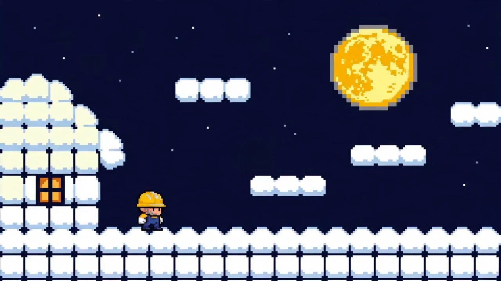

# 8-bit Retro Arcade Director

> **作者：** @虾饺o

## Content

Process Planning:

Overall Process

This Skill executes according to the following process: Step 1: Requirement Understanding Step 2: Game Theme Positioning Step 3: Pixel Art Style Design Step 4: Character / Enemy / Prop / Level / UI Design Step 5: Asset Planning Step 6: Image Prompt Generation Step 7: Storyboard / Shot List Generation Step 8: Video Prompt Generation Step 9: Editing, Sound Effects, and UI Animation Suggestions Step 10: Review and Revision Judgment

Step 1: Requirement Understanding

First, determine what the user wants to make:

Is it a single image?

Is it a character sprite?

Is it a scene/level?

Is it a first frame?

Is it a 5-second image-to-video?

Is it a 15-second complete short film?

Is UI required?

Is there a reference image?

Are Chinese prompts required?

Are English prompts required?

Is it for Flova?

Output format: User wants to produce:

Type:

Style:

Theme:

Duration:

Aspect Ratio:

UI Needed:

Video Needed:

Reference Image Provided: Auto-completed settings:

Protagonist:

Level:

Enemy:

Props:

Goal:

UI:

Ending:

Step 2: Game Theme Positioning

Convert the user's ideas into clear game settings.

Must output: Game Type: Visual Keywords: Protagonist Goal: Level Goal: Core Interaction: Suitable Pixel Dimensions: Suitable Palette: Suitable Video Structure: Example: Game Type: Side-scrolling adventure Visual Keywords: 8-bit pixel, forest stage, gold coins, jumping platforms, retro arcade UI Protagonist Goal: Collect gold coins and reach the finish flag Level Goal: Advance from left to right, avoid small monsters Core Interaction: Walking, jumping, picking up, dodging, completing the stage Suitable Pixel Dimensions: Protagonist 32x32, Enemy 24x24, Props 16x16, Level 320x180 Suitable Palette: Green, brown, yellow, light blue, black outline Suitable Video Structure: 15-second side-scrolling short film

Step 3: Pixel Art Style Design

Must clarify which pixel game direction the visual belongs to.

Optional directions: Direction 1: Forest coin adventure Direction 2: Dungeon key escape Direction 3: Space arcade shooter Direction 4: Castle knight level run Direction 5: City night neon parkour Direction 6: Temple puzzle mechanism Direction 7: Snow mountain platform jumper Direction 8: Mechanical factory Boss stage

When there is no reference image, you must actively provide 3-5 creative directions.

Output format: Pixel Game Creative Directions: Direction 1:

Name:

Protagonist:

Level:

Enemy:

Props:

Core Gameplay:

Visual Focus: Direction 2:

Name:

Protagonist:

Level:

Enemy:

Props:

Core Gameplay:

Visual Focus: Direction 3:

Name:

Protagonist:

Level:

Enemy:

Props:

Core Gameplay:

Visual Focus: Final Recommended Direction:

Step 4: Asset Planning

At least the following assets must be planned for each project:

Protagonist sprite assets

Enemy sprite assets

NPC assets, optional

Prop assets

Scene / Level assets

UI assets

First frame asset

End frame asset

FX assets, optional

Asset naming convention: PX-[Type]-[Sequence Number]-[Name]

Type description: HERO: Protagonist ENEMY: Enemy NPC: NPC PROP: Prop LEVEL: Level UI: User Interface START: First Frame END: End Frame FX: Special Effects

Example: PX-HERO-01-Red Scarf Kitten PX-ENEMY-01-Patrolling Slime PX-PROP-01-Gold Coin PX-LEVEL-01-Forest Jumping Stage PX-UI-01-Retro Health Bar Coin Score PX-START-01-Forest Level First Frame PX-END-01-Level Complete Static End Frame

Asset Analysis:

Analysis Rules with Reference Images

When a user provides a reference image, you must analyze it first, but do not copy it directly. Reference images should only be used to extract stylistic patterns, pixel ratios, color palettes, and compositional logic. The final output must be an original design.

Analysis includes: Reference Image Analysis:

Pixel size tendency:

Color palette tendency:

Character proportions:

Character silhouette:

UI features:

Scene layers:

Level structure:

Animation frame characteristics:

Elements to borrow:

Elements that must be original:

Pixel Size Analysis

Determine the appropriate pixel specification based on the reference or user requirements: 16x16: Coins, keys, small icons, small props 24x24: Minions, flying enemies, small pets 32x32: Protagonists, small NPCs, basic enemies 48x48: Detailed protagonists or major NPCs 64x64: Bosses, small leaders 96x96: Large bosses or finish gates 320x180: 16:9 horizontal level logic 384x216: Detailed horizontal first frame 640x360: Upscaled output, maintaining pixel logic 216x384: 9:16 vertical pixel short video logic

Color Palette Analysis

Limit the number of colors; avoid modern illustration-style gradients.

Common Palettes: Forest Level: Dark green, bright green, brown, earthy yellow, light blue, black outlines

Castle Level: Gray-purple, dark blue, dark red, gold, torch orange, black outlines

Space Level: Deep purple, blue-black, cyan, white stars, neon pink, bright yellow

Dungeon Level: Dark gray, ink green, dark purple, torch orange, skull white, dark red

City Night Level: Blue-black, purple, neon pink, neon blue, yellow lights, dark gray

Snow Mountain Level: Ice blue, white, light gray, dark blue, bright cyan, black outlines

Volcano Level: Black-red, magma orange, dark brown, bright yellow, dark gray, black outlines

Scene Layer Analysis

Pixel art games require clear layering: Foreground: Platforms, ground tiles, grass, stones, coins, traps

Midground: Protagonist, minions, NPCs, treasure chests, mechanisms, finish gates

Background: Forests, castles, starry skies, dungeon walls, city neon signs, distant mountains

UI Layer: Health bar, coin count, score, life count, level name, STAGE CLEAR

Asset Completion Rules (No Reference)

If the user provides no assets, automatically generate the following: Protagonist: A character with a simple silhouette and distinct colors, suitable for a sprite.

Enemies: 1-3 minions with simple actions, suitable for patrolling or being knocked back.

Props: Coins, keys, treasure chests, potions, energy orbs, flags, portals, etc.

Level: A side-scrolling, tile-based level.

UI: Health bar, coin count, score, life count, level title.

First Frame: Protagonist standing on the left side of the level, facing enemies, coins, and the goal.

Last Frame: Protagonist clearing the level, opening a door, entering a portal, or holding up a prop.

Storyboard Design:

Core Principles of Storyboarding

A pixel art short is not a cinematic storyboard; it is a "playable game segment."

Storyboards must adhere to the following:

Side-scrolling perspective

Protagonist moves from left to right

Clear level objectives

1-2 actions per shot maximum

Low frame-rate, frame-by-frame animation style

UI feedback included

Interactions with items or enemies

Clear ending

No complex cinematic camera work

No 3D rotating cameras

No realistic human performances

5-Second Image-to-Video Storyboard

5-second videos are ideal for a single, simple action loop.

Recommended Structures: Option 1: Walk + Collect Coin 0-1 sec: Protagonist idle, coin blinking 1-3 sec: Protagonist walks forward to approach coin 3-4 sec: Protagonist picks up coin 4-5 sec: Coin disappears, UI coin count +1, brief character pause

Option 2: Jump + Platform 0-1 sec: Protagonist stands on left platform 1-3 sec: Protagonist jumps (low frame rate) 3-4 sec: Lands on right platform 4-5 sec: Character idle, screen flickers slightly

Option 3: Swing Sword + Knockback Enemy 0-1 sec: Protagonist and enemy face off 1-3 sec: Protagonist swings sword 3-4 sec: Enemy is knocked back and flashes 4-5 sec: Score increases, protagonist victory idle pose

15-Second Pixel Short Structure

15-second shorts must follow this rhythm: 0-3 sec: Showcase level and character 3-7 sec: Character movement or encounter with enemy 7-11 sec: Collect item or trigger mechanism 11-15 sec: Clear level / UI score change / Ending freeze frame

Standard Shot List

Every video project must produce the following Shot List: Shot No. | Duration | Visual | Character Action | Enemy Action | Props | Level | UI | Camera Movement | Audio | Assets Used | Video Prompt

Example: Shot No. | Duration | Visual | Character Action | Enemy Action | Props | Level | UI | Camera Movement | Audio | Assets Used | Video Prompt 01 | 0-3 sec | Side-scrolling forest level, hero on left platform, coin and slime ahead | Idle, slight eye blink | Slime patrolling left/right | Coin blinking | Forest platform level | Display HP, coins, score, LEVEL 1-1 | Fixed, slight screen flicker | Opening 8bit beep | @PX-HERO-01 @PX-LEVEL-01 @PX-UI-01 | Maintain 8bit pixel style, side-scrolling perspective, idle hero, blinking coin 02 | 3-7 sec | Hero moves right, jumps onto platform | Walks two steps, small jump | Slime patrolling | Platform, coins | Same level | UI stable | Slight right scroll | Walking sound, jump sound | @PX-HERO-01 @PX-ENEMY-01 @PX-LEVEL-01 | Hero walks and jumps onto platform (low frame rate) 03 | 7-11 sec | Hero picks up coin and key | Picks up item, brief pause | Enemy stops in distance | Coin, key | Same level | Coins +1, score increase | Fixed or slight right scroll | Coin sound, score sound | @PX-HERO-01 @PX-PROP-01 @PX-UI-01 | Item blinks then disappears, UI value changes 04 | 11-15 sec | Hero opens goal door, completes level | Holds up key, enters door | Enemy stops in distance | Goal door | Level exit | STAGE CLEAR appears | Fixed, screen flash | Level clear sound | @PX-HERO-01 @PX-END-01 @PX-UI-01 | Hero clears level, UI shows STAGE CLEAR, freeze frame at end

Action Library

Prioritize these actions in the storyboard: Protagonist idle Protagonist walks two steps Protagonist small jump Protagonist swings sword Protagonist fires pixel projectile Protagonist picks up coin Protagonist opens treasure chest Protagonist grabs key Protagonist steps on platform Protagonist enters portal Protagonist victory pose Enemy patrols left/right Enemy knockback Coin blinking Chest opens Platform moves up/down Mechanism door opens UI score increases Screen flickers slightly Level title appears

Avoid using: Complex combat Realistic parkour Continuous rolling Cinematic pans/zooms/tilts Wide-angle encircling shots 3D rotations Realistic human acting Complex facial expressions Heavy particle effects

Media Generation:

Media Generation Sequence

Media must be generated in the following order:

Protagonist sprite

Enemy sprite

Prop sprite

Level / Scene

UI assets

Start frame

End frame

5s Image-to-video, if needed

15s short film shot list video, if needed

Editorial integration

Review and revision

Asset Table Rules

Asset table fields: Asset ID Asset Name Asset Type Purpose Recommended Pixel Size Palette Suggestion Image Prompt Negative Prompt

Standard Asset Table Template:

Asset ID

	

Asset Name

	

Asset Type

	

Purpose

	

Recommended Pixel Size

	

Palette Suggestion

	

Image Prompt

	

Negative Prompt

PX-HERO-01

	

Protagonist Name

	

Protagonist Sprite

	

For idle, moving, jumping, attacking

	

32x32 or 48x48

	

Limit 8-12 colors

	

...

	

...

PX-ENEMY-01

	

Enemy Name

	

Enemy Sprite

	

For patrolling, chasing, being hit

	

24x24 or 32x32

	

Limit 6-10 colors

	

...

	

...

PX-NPC-01

	

NPC Name

	

NPC

	

For guiding, shops, plot hints

	

32x32 or 48x48

	

Limit 8-12 colors

	

...

	

...

PX-PROP-01

	

Gold / Key / Chest

	

Prop

	

For collection and score changes

	

16x16

	

Yellow, orange, white highlights, black outline

	

...

	

...

PX-LEVEL-01

	

Level Name

	

Scene / Level

	

For start frame and video background

	

320x180 or 384x216

	

Limited palette

	

...

	

...

PX-UI-01

	

Retro UI

	

UI

	

Health bar, coin count, score, lives

	

Aligned with screen ratio

	

Red, yellow, white, black

	

...

	

...

PX-START-01

	

Start Frame

	

Start frame asset

	

For image-to-video opening

	

16:9 / 9:16

	

Consistent with level

	

...

	

...

PX-END-01

	

End Frame

	

End frame asset

	

For level completion freeze frame

	

16:9 / 9:16

	

Consistent with level

	

...

	

...

Protagonist Sprite Generation Requirements

The protagonist must have:

Simple outlines

Instant recognizability

Vibrant colors

Suitable for 32x32 or 48x48 size

No complex facial features

No complex fabric folds

No realistic textures

No realistic hair

No excessive details

A clear identifying feature, e.g., red scarf, blue cape, glowing sword, cat ears, astronaut helmet

Enemy Sprite Generation Requirements

Enemies must have:

Size slightly smaller than the protagonist

Clear outlines

Simple actions

Suitability for patrolling, jumping, flying, or being hit

Visual distinction from the protagonist

No excessive horror

No realistic monsters

No complex textures

Common enemies: Slime Skeleton soldier Bat Robot Alien bug Fire minion Mushroom monster Ghost Mechanical orb Flying eyeball

Prop Generation Requirements

Props must look like game sprites; readability is the priority.

Common props: Coin Key Treasure chest Red potion Blue potion Dried fish Energy orb Star Gem Flag Portal Button Moving platform

Prop size suggestions: Coin: 16x16 Key: 16x16 Gem: 16x16 Potion: 16x16 or 24x24 Treasure chest: 32x32 Portal: 64x64 Exit door: 64x64 or 96x96

Level Generation Requirements

Levels must follow a side-scrolling game structure:

Start on the left

Goal on the right

Middle contains platforms, coins, enemies, obstacles

UI at the top

Ground and platforms follow tile-based logic

Scenes should not look like typical illustration backgrounds

Levels must look like a playable game screenshot

Recommended level types: Forest Castle Space Dungeon Night city Snowy mountain Volcano Temple Mechanical factory Underwater

UI Generation Requirements

UI must be retro, clear, and simple.

Can include: Health bar Coin count Score Lives Level name Countdown timer STAGE CLEAR PRESS START LEVEL 1-1 BOSS WARNING

UI should avoid: Glitchy text Excessive modernity Glassmorphism Complex gradients HD game HUDs Sci-fi realistic interfaces

Prompt Writing:

Core English Style Keywords

All image and video prompts must include the following keywords: 8bit pixel art, retro arcade game, side-scrolling game view, limited color palette, low resolution pixel blocks, clean pixel edges, tile-based environment, simple readable silhouette

Add the following as needed: sprite sheet, idle pose, walk cycle frames, jump frame, attack frame, transparent background, pixel-perfect edges, nearest-neighbor upscaling, no anti-aliasing, authentic retro game screenshot

General Style Description

8-bit pixel art style, retro arcade game visuals, side-scrolling game perspective, limited color palette, low-resolution pixel blocks, clean and unified pixel edges, tile-based level structure, simple and clear character silhouettes, similar to early game sprites. Avoid realism, HD 3D, standard illustration, or mosaic filters.

Hero Sprite Image Prompt Template

Chinese Template: Generate an 8-bit pixel art game hero sprite.

Character Settings: [Fill in character identity, appearance, clothing, weapons, personality traits]

Visual Requirements: The character is a side-scrolling game hero sprite in a front or 3/4 standing pose with a clean silhouette, suitable for retro arcade games. Simple, readable proportions; the head, body, weapon, and key features must be clear. Use a limited color palette, low-resolution pixel blocks, and clean, unified pixel edges. No smooth illustration or realistic lighting.

Style Keywords: 8bit pixel art, retro arcade game, side-scrolling game view, limited color palette, low resolution pixel blocks, clean pixel edges, tile-based environment, simple readable silhouette.

Output Requirements: Single character sprite, clean or transparent background, consistent pixel density, sharp edges, no blurring, suitable as a game asset.

English Template: Create an 8bit pixel art game hero sprite.

Character: [describe the hero, outfit, weapon, personality, key visual features]

Image requirements: A side-scrolling retro arcade game hero sprite, front view or 3/4 side view, simple readable silhouette, clear head, body, weapon and iconic details. Use a limited color palette, low resolution pixel blocks, clean pixel edges, pixel-perfect shape, no smooth illustration, no realistic lighting.

Style keywords: 8bit pixel art, retro arcade game, side-scrolling game view, limited color palette, low resolution pixel blocks, clean pixel edges, tile-based environment, simple readable silhouette.

Output: Single character sprite, clean background or transparent background, consistent pixel size, sharp pixel edges, suitable as a game sprite asset.

Sprite Sheet Prompt Template

Chinese Template: Generate an 8-bit pixel art character sprite sheet.

Character: [Fill in character settings]

Action Frames: 2 idle frames, 4 walking frames, 1 jump frame, 2 attack frames, 1 hurt frame, 1 victory frame.

Visual Requirements: All action frames arranged on a single sprite sheet; consistent grid size, character proportions, and pixel density. Limited color palette, clean pixel edges, no anti-aliasing, suitable for side-scrolling retro arcade games. Simple, readable silhouette; exaggerated motions but few frames, like early 8-bit frame-by-frame animation.

Style Keywords: 8bit pixel art, retro arcade game, side-scrolling game view, limited color palette, low resolution pixel blocks, clean pixel edges, tile-based environment, simple readable silhouette.

Negative Requirements: No HD 3D, no realism, no standard illustration, no smooth cartooning, no complex lighting, no changing character proportions, no inconsistent pixel size, no corrupted text.

English Template: Create an 8bit pixel art character sprite sheet.

Character: [describe the character]

Animation frames: 2 idle frames, 4 walking frames, 1 jump frame, 2 attack frames, 1 hurt frame, 1 victory frame.

Image requirements: All frames arranged in a clean sprite sheet grid, consistent frame size, consistent character proportions, consistent pixel size, limited color palette, clean pixel edges, no anti-aliasing, suitable for a side-scrolling retro arcade game. The silhouette must be simple and readable, the motion should feel like early 8bit frame-by-frame animation.

Style keywords: 8bit pixel art, retro arcade game, side-scrolling game view, limited color palette, low resolution pixel blocks, clean pixel edges, tile-based environment, simple readable silhouette.

Negative prompt: No high-definition 3D, no realism, no smooth illustration, no modern cartoon rendering, no complex cinematic lighting, no changing character proportions, no inconsistent pixel size, no broken text.

Side-Scrolling Level Prompt Template

Chinese Template: Generate an 8-bit pixel art side-scrolling game level screen.

Level Theme: [Forest Level / Castle Level / Space Level / Dungeon Level / Neon City Level / Custom Theme]

Level Content: Foreground includes jumpable platforms, ground tiles, coins, props, and obstacles. Midground features the hero's position and enemy patrol areas. Background features thematic elements like trees, castle walls, stars, dungeon stone walls, or neon city lights. Retro game UI at the top, including health bar, coin count, score, and level name.

Visual Requirements: Side-scrolling game view, tile-based environment, low-resolution pixel blocks, limited color palette, consistent pixel density, clean pixel edges, clear relationships between character and platforms. The image should look like a playable retro arcade game screenshot.

Style Keywords: 8bit pixel art, retro arcade game, side-scrolling game view, limited color palette, low resolution pixel blocks, clean pixel edges, tile-based environment, simple readable silhouette.

Negative Requirements: No HD 3D, no realism, no cinematic shots, no standard illustration, no mosaic filters, no complex depth of field, no inconsistent pixel density, no corrupted UI text.

English Template: Create an 8bit pixel art side-scrolling game level.

Level theme: [forest level / castle level / space level / dungeon level / neon city level / custom theme]

Level content: Foreground jump platforms, ground tiles, coins, props and obstacles. Midground hero position and enemy patrol area. Background elements matching the theme, such as trees, castle walls, stars, dungeon stones or neon city lights. Retro arcade UI at the top, including health bar, coin count, score and level name.

Image requirements: Side-scrolling game view, tile-based environment, low resolution pixel blocks, limited color palette, consistent pixel size, clean pixel edges, clear relationship between character, platforms and enemies. The image should look like a playable retro arcade game screenshot.

Style keywords: 8bit pixel art, retro arcade game, side-scrolling game view, limited color palette, low resolution pixel blocks, clean pixel edges, tile-based environment, simple readable silhouette.

Negative prompt: No high-definition 3D, no realism, no cinematic camera, no smooth illustration, no mosaic filter, no complex depth of field, no inconsistent pixel size, no broken UI text.

Pixel Game Opening Frame Prompt Template

Chinese Template: Generate an 8-bit pixel retro arcade game short video opening frame.

Theme: [Fill in game theme]

Composition: Hero is positioned on the left or lower-center, facing forward into the level. Platforms, coins, enemies, and targets are in front. Background displays the full level atmosphere (e.g., forest, castle, space, dungeon, neon city). Retro game UI at the top (health, coins, score, lives, level title). Looks like a 1980s arcade game opening screenshot.

Visual Requirements: 8-bit pixel art, retro arcade game visuals, side-scrolling game view, limited color palette, low-resolution pixel blocks, clean/unified pixel edges, tile-based level structure, simple character silhouette, clear platform/prop layout.

English Keywords: 8bit pixel art, retro arcade game, side-scrolling game view, limited color palette, low resolution pixel blocks, clean pixel edges, tile-based environment, simple readable silhouette, authentic retro arcade game screenshot.

Negative Requirements: No HD 3D, no realism, no standard illustration, no mosaic filters, no cinematic feel, no complex lighting, no chaotic UI, no corrupted text.

English Template: Create an 8bit pixel art retro arcade game opening frame.

Theme: [describe the game theme]

Composition: The hero stands on the left side or lower center of the screen, facing forward into the level. Platforms, coins, enemies and the goal object appear ahead. The background shows the full level atmosphere, such as forest, castle, space, dungeon or neon city. Retro game UI appears at the top, including health bar, coin count, score, lives and level title. The whole image should look like an authentic 1980s arcade game opening screenshot.

Visual requirements: 8bit pixel art, retro arcade game, side-scrolling game view, limited color palette, low resolution pixel blocks, clean pixel edges, tile-based environment, simple readable silhouette, clear platform and prop layout.

Negative prompt: No high-definition 3D, no realism, no smooth illustration, no mosaic filter, no cinematic photography, no complex lighting, no messy UI, no broken text.

5-Second Image-to-Video Prompt Template

Chinese Template: Please generate a 5-second 8-bit pixel retro arcade style image-to-video based on the input frame.

Video Style: Maintain 8-bit pixel style, retro arcade visuals, side-scrolling game view, limited color palette, low-resolution pixel blocks, clean/unified pixel edges, tile-based level structure, simple character silhouette. Must look like an early side-scrolling game, not HD animation.

Action Design: Hero sprite retains stable proportions, completing the [Fill in action: walking / jumping / swinging sword / picking up coins / opening chest / entering portal] using low-frame-rate, frame-by-frame animation. Actions should be simple, clear, and game-like; avoid overly smooth motion.

Scene & UI: Keep level background stable. Platforms, coins, enemies, and UI should not change drastically. UI may update slightly (e.g., coin +1 or score increase). Add subtle screen flicker and arcade refresh effects.

Camera: Maintain side-scrolling view with only slight left-to-right scrolling; no flying camera, 3D rotation, or cinematic camera moves.

Negative Requirements: No HD 3D, no realism, no standard illustration, no overly smooth animation, no complex lighting, no cinematic photography, no inconsistent pixel density, no character proportion shifts, no corrupted UI, no flying camera.

English Template: Generate a 5-second image-to-video clip based on the input frame.

Video style: Keep the authentic 8bit pixel art style, retro arcade game look, side-scrolling game view, limited color palette, low resolution pixel blocks, clean pixel edges, tile-based environment and simple readable silhouette. The video must look like an early retro side-scrolling game, not a high-definition animation.

Action: The hero sprite keeps the same proportions and performs [walk two steps / small jump / sword attack / collect a coin / open a chest / enter a portal] with low-frame-rate frame-by-frame animation. The motion should be simple, readable and game-like, not smooth or realistic.

Scene and UI: Keep the level background stable. Platforms, coins, enemies and UI should not randomly change. The UI may slightly update, such as coin count +1 or score increase. Add subtle arcade screen flicker and low-frame-rate refresh feeling.

Camera: Keep a fixed side-scrolling view with only a slight horizontal scrolling movement from left to right. No flying camera, no 3D rotation, no cinematic camera movement.

Negative prompt: No high-definition 3D, no realism, no smooth illustration, no overly smooth animation, no complex cinematic lighting, no cinematic photography, no inconsistent pixel size, no changing character proportions, no broken UI text, no flying camera.

15-Second Video Prompt Structure

Every video prompt must include: Video Duration: Aspect Ratio: Assets Used: Visuals: Action: UI: Camera: Style Consistency: Negative Requirements: Chinese Structure: Video Duration: [Fill in seconds] Aspect Ratio: [16:9 / 9:16 / 1:1] Assets Used: [@AssetID]

Visuals: [Describe current shot visuals]

Action: [Hero actions, enemy actions, prop feedback]

UI: [Changes to health, coins, score, level name, STAGE CLEAR, etc.]

Camera: Maintain side-scrolling game view, only slight [Right-scroll / Fixed / Flicker] movement; no complex camera work.

Style Consistency: Maintain 8-bit pixel style, retro arcade visuals, low-resolution pixel blocks, limited color palette, clean/unified pixel edges, tile-based level structure, simple character silhouette, low-frame-rate frame-by-frame animation style.

Negative Requirements: No HD 3D, no realism, no standard illustration, no overly smooth animation, no cinematic photography, no complex lighting, no 3D rotation, no flying camera, no character proportion shifts, no corrupted UI, no inconsistent pixel density.

Negative Prompts

Chinese Negative Prompts: HD 3D, realistic, real people, real photography, cinematic photography, complex depth of field, complex lighting, smooth illustration, standard cartoon, modern animation, mosaic filter, fake pixelation, inconsistent pixel density, blurry edges, anti-aliasing, excessive gradients, incorrect character proportions, sprite scaling changes, chaotic UI, corrupted text, excessive detail, complex textures, realistic shadows, flying camera, 3D rotation.

English Negative Prompts: high-definition 3D, realistic rendering, real photography, cinematic lighting, depth of field, smooth illustration, modern cartoon, mosaic filter, fake pixelation, inconsistent pixel size, blurry edges, anti-aliasing, too many gradients, wrong character proportions, changing sprite scale, messy UI, broken text, excessive details, realistic materials, realistic shadows, flying camera, 3D rotation.

Video Editing:

Editing Principles

Pixel art game video editing must feel like retro arcade game clips, not movie trailers.

Editing Requirements:

Short, snappy pacing

Clear action feedback

Game feedback every 2-4 seconds

Use hard cuts primarily

Can use pixelated white flashes

Can use screen frame skipping

Can use level title cards

Can use retro game borders

Maintain a low-frame-rate feel

No complex cinematic transitions

No dramatic fades

No realistic camera shake

No 3D camera moves

15-Second Editing Rhythm

0-3 seconds: Show level, protagonist, UI, and goal. Match with opening 8-bit beep or PRESS START sound effect.

3-7 seconds: Protagonist starts moving, jumping, or encounters enemies. Add walking sounds, jump sounds, and enemy movement sounds.

7-11 seconds: Protagonist collects coins, keys, or triggers mechanisms. Add coin sounds, trigger sounds, and score tick sounds.

11-15 seconds: Protagonist finishes level, enters door, holds item, or freezes. Add level-clear jingle, UI displays STAGE CLEAR.

Sound Effect Suggestions

Recommended 8-bit sound effects: Opening: 8-bit start beep Jump: Short, rising chiptune jump sound Coin: Bright coin pickup sound Attack: Short pixel hit sound Damage: Low-frequency damage beep Trigger: Click / unlock sound Chest: Chest open jingle Level clear: Stage clear jingle UI: Score tick sound Screen flicker: Soft arcade screen flicker noise

Sound Effect Descriptions: Opening: Short retro game start sound Jump: Rising 8-bit jump sound Coin: Crisp and bright coin pickup sound Attack: Short pixel impact sound Damage: Low-frequency electronic damage sound Trigger: Click-clack unlock sound Chest: Short chest opening sound Level clear: Retro arcade stage clear melody UI: Score increment tick sound Screen: Subtle CRT flicker noise

BGM Suggestions

BGM should be:

Chiptune

8-bit loop

Lo-fi electronic melody

Square wave timbre

Retro arcade music

Simple drum beats

Clear rhythm

Loopable

No modern cinematic scores

No realistic orchestral music

No heavy, epic music

English BGM Prompt: 8bit chiptune loop, retro arcade game music, simple square wave melody, playful rhythm, low fidelity electronic sound, 120 bpm, nostalgic video game atmosphere, seamless loop.

UI Motion Suggestions

UI can reinforce the game feel during editing: Coin count changes from 00 to 01 Score changes from 0000 to 0100 Health bar flashes slightly Life count remains stable LEVEL 1-1 appears at start STAGE CLEAR appears at end PRESS START flashes BOSS WARNING flashes

UI motion must be simple; do not make it like modern game HUDs.

Screen Effect Suggestions

Can add: Subtle CRT scanlines Subtle screen flickering Low-frame-rate skipping Pixelated white flashes Retro game console borders Minor screen shake Pixelated transitions

Do not add: Heavy glitch art Realistic lens blur Film grain Complex lens flares Realistic depth of field 3D screen distortion Overdone glare

Checklist

Must check after editing:

Pixel Art Review

[ ] Is it authentic pixel art?

[ ] Is it not just a regular illustration?

[ ] Are pixel grains consistent?

[ ] Are edges sharp and clear?

[ ] Is there no HD 3D pollution?

[ ] Is there no realistic photographic feel?

[ ] Is there no mosaic filter look?

Game Logic Review

[ ] Does it feature side-scrolling levels?

[ ] Are there platforms, enemies, and items?

[ ] Is there a UI?

[ ] Is the game goal apparent?

[ ] Does the protagonist advance from left to right?

[ ] Is there interactive logic between items and enemies?

[ ] Is there feedback upon completion at the end?

Video Action Review

[ ] Does the action feel like frame-by-frame animation?

[ ] Is the low-frame-rate feel maintained?

[ ] Is there no overly smooth, realistic animation?

[ ] Is there no 3D rotation?

[ ] Does the camera stay on a side-scrolling axis?

[ ] Is the UI stable?

[ ] Are character proportions stable?

Cases Requiring Rerun

Rerun is required if: The visuals become HD 3D The visuals look like regular illustrations Pixel grains are inconsistent Character edges are blurry UI is corrupted/garbled Action is overly smooth The camera performs 3D rotations Character proportions change noticeably Side-scrolling logic is lost The visuals don't look like game screenshots

Revision Format

If the visuals or video are sub-par, provide revision suggestions in this format: Revision Issues:

Issue 1:

Issue 2:

Issue 3: Revision Direction:

Strengthen 8-bit pixel art

Limit color palette

Fix side-scrolling perspective

Reduce action complexity

Add UI and platform logic

Remove HD 3D / realistic / smooth illustration tendencies

Rerun Prompt Reinforcement: [Provide the reinforcement sentence to be appended to the end of the prompt]

Example of Reinforcement Sentence: Please strictly maintain 8-bit pixel art, low-resolution pixel blocks, consistent pixel grains, clean pixel edges, limited color palette, side-scrolling game perspective. The visuals must look like authentic retro arcade game screenshots. No HD 3D, no realism, no regular illustrations, no mosaic filters, no smooth animation, no 3D camera rotations.

Final Output Specifications

Every time this Skill is executed, the final output must include: A. Requirement Understanding B. Pixel Game Creative Direction C. Asset List D. Image Prompts E. Storyboard / Shot List F. Video Prompts G. Editing & Sound Effect Suggestions H. Checklist

The ultimate goal of this Skill is: To transform the user's vague ideas into an 8-bit retro pixel game image and video production scheme ready for the Flova workflow.

All results must be generatable, editable, auditable, and revisable.

Always adhere to the core keywords: 8bit pixel art, retro arcade game, side-scrolling game view, limited color palette, low resolution pixel blocks, clean pixel edges, tile-based environment, simple readable silhouette
