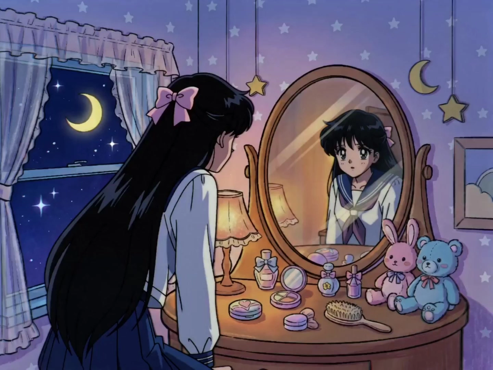

# 90s Magical Girl Anime

> **作者：** 黄炜炜

## Content

**Process Planning:**

**1. Global Design and Specification Establishment Stage**
- Before starting any generation task, **ask the user first** if there are reference prototype materials to upload, such as:
  - **Character reference images** (original animation screenshots, setting book scans, hand-drawn character drafts) — used to lock in the daily form and transformation battle outfit design for each character;
  - **Prop/Weapon reference images** (transformation devices, magical weapons, iconic accessory designs) — used to ensure visual consistency of props across shots;
  - **Scene reference images** (atmosphere images for daily scenes or dreamlike battle spaces) — used to establish the color base for the Key Elements of scenes;
  - **Voice reference audio** (character voice clips) — used to provide a binding base for key_element_audio, ensuring consistent voice acting across shots;
  - **Music style reference** (OP/ED reference audio or style descriptions) — used to guide the musical direction for OP/ED generation.
- Explain to the user: Even without reference materials, the system can create content entirely from text descriptions; however, if references are provided, all subsequent character settings, prop forms, and scene atmospheres will use the references as visual anchors, resulting in higher fidelity.
- After collecting user feedback, use **text_editor** to create or update Final_Video_Spec.md, locking in key global parameters: aspect ratio (classic 4:3 or modern 16:9), art style preference (90s hand-drawn cel-shaded style), sound effect and music tonality (orchestral starlight and retro synth), output language, and the list of confirmed reference materials (noting which Key Element or Audio Layer each material will be bound to).

**2. Resource Parsing and Multimodal Analysis Stage**
- If the user has uploaded reference materials, invoke **resource_prepare_and_analyze** for parsing:
  - **Character/Prop reference images**: Extract daily clothing styles, transformation battle outfit color schemes, and prop design details, outputting structured descriptions for use in Storyboard design;
  - **Scene reference images**: Extract color tones, light source positions, and atmosphere keywords, writing them into corresponding element scene descriptions;
  - **Voice reference audio**: Analyze voice characteristics and record them as key_element_audio binding parameters;
  - **Music reference**: Extract genre tags and mood keywords, writing them into the description of the OP/ED audio_layer.
- After parsing is complete, add a "Reference Material → Key Element/Audio Layer Mapping Table" to Final_Video_Spec.md, clarifying which element or audio layer each reference material is bound to for review in subsequent generation stages.
- If the user has not provided any reference materials, skip this stage and proceed directly to the Storyboard design stage, creating all characters and scenes from scratch based solely on text descriptions.

**3. Storyboard Design and Asset Anchoring Stage**
- Invoke **storyboard_designer** to create the Storyboard.
  - **Key Elements** must clearly define Daily Form (e.g., school uniform, flowing long hair) and Magical Form (e.g., magical battle outfits with bows, ribbons, tiaras, and gloves).
  - **Dual-layered Daily and Dream scenes** must be distinguished in the elements (e.g., school rooftop, nighttime city rooftop vs. starry void, dream corridors, magical barriers).
  - **Shot Lists** must include classic ritualized transformation sequences (emotional trigger -> light particle diffusion -> rotating camera -> battle outfit layering -> magnificent Pose freeze-frame) and poetic magical battles.
- Check the current asset library; if the user has provided key assets, use **media_generator** to logically bind them to the corresponding Key Element.

**4. Key Element Asset Generation Stage**
- If the user has not provided visual assets, use **media_generator** and image generation tools to create reference images for characters and key scenes. Use Image-to-Image to ensure visual consistency across dual forms and cross-shot sequences.
- **Awakened Form Asset Checkpoint (Applicable for Season Finale plots):** If the Storyboard includes Season Finale Climax beats, you **must** complete the generation and asset_id registration binding for the "Awakened Form" Key Element at this stage; verify that the Awakened Form assets are ready before proceeding to Stage 5 for batch video generation. If not ready, pause and confirm the visual scheme with the user before continuing.

**5. Video Shot and Audio Layer Batch Generation Stage**
- For each shot in the Storyboard, invoke **media_generator**'s multimodal video generation.
  - By default, use the advanced **MultiModalToVideo** mode, binding the previously generated character/scene Key Element images.
  - For characters with dialogue or requiring voice consistency, bind their key_element_audio.
- Invoke **media_generator**'s audio generation tools to create high-quality audio resources for background music (BGM), transformation sound effects (SFX), and long narration (VO).

**6. Timeline Editing and Render Export Stage**
- Invoke **video_assembler** to combine visuals and audio tracks, add classic starlight transitions and high-contrast rhythm alignment, and finally export the video.

**【Checkpoint and Pause Strategy】**
- **Storyboard Confirmation Pause:** After Storyboard design is complete, you must pause and show the user the overall plot flow, transformation steps, and Shot List. Only proceed to large-scale asset generation after receiving confirmation.
- **Element Design Confirmation Pause:** After generating reference images (Element images) for key characters' daily and transformation states, pause to get user feedback to ensure the visual fidelity perfectly matches the 90s aesthetic.

**Asset Analysis:**

**1. Character Trait Analysis**
- Extract and classify character attributes from user reference images, dividing them into daily school/casual status (schoolgirl base form) and magical transformation posture (magical transformation outfit).
- Specifically identify iconic accessory elements: ribbons, bows, tiaras, gloves, boots, and star/moon motifs.

**2. Villain Character Trait Analysis**
- Identify the visual language hierarchy of villains in reference materials: distinguish between Archenemy (usually only appearing at the plot climax, with visual designs that are either extremely ornate or extremely oppressive) and Monster-of-the-Week (appearing in every episode, with costume designs featuring twisted decorative themes).
- Extract iconic visual elements of villains: dark robes/leotards, exaggerated sharp shoulder silhouettes, hairstyles that obscure one eye with shadows, twisted star/moon runes (forming a mirror contrast with the magical girls' positive runes), and corrupted black/deep purple/dark gold color schemes.
- Analyze the oppressive compositional signals when villains appear: high-angle threatening shots, backlit silhouettes, shadows spreading from the feet, and sudden drops in background color temperature (warm to cold).

**3. Transformation and Battle Mechanism Analysis**
- Identify dynamic trajectories in reference materials: such as circular motion of limbs, classic pose freeze frames, and the arrangement of magical glyphs.
- Analyze the visual carriers of magical attacks (e.g., energy ribbons, starlight beams, moonlight flow).

**4. Color and Light/Shadow Feature Extraction**
- Extract preferences for high-brightness dreamlike pastels: pastel pink, moonlight silver, sky blue, lavender purple, and magical gold.
- Analyze hand-drawn cel-shaded textures, soft focus glow, and rim light distribution, providing a color and brightness matrix mapping for subsequent Prompt Writing and image generation.

**5. Voice Trait Analysis**
- Analyze the character voice materials provided by the user, extract voice traits that are crisp, pure, emotionally expressive, or firm and gentle, and record them as key_element_audio binding parameters.

**Storyboard Design:**

**1. Designing Key Elements requirements**
- **Element character — Multi-character ensemble support:**
  - Each magical girl must have an independent Key Element, explicitly recording:
    - **Dual Form Descriptions:** [Identity 1] Daily status (e.g., school uniform, hairstyle, temperament keywords); [Identity 2] Magical Warrior status (e.g., costume color theme, iconic accessories—ribbons/bows/tiaras/gloves/boots, and exclusive runes/weapons).
    - **Color Identity:** Each warrior's exclusive primary color (e.g., Moon Warrior = Pink + Silver; Fire Warrior = Red + Orange; Water Warrior = Blue + Aqua), used for color differentiation and ensemble color balancing across shot compositions.
    - **Friendship Role:** Note each character's emotional role in the ensemble cast (e.g., Leader/Protector/Wisdom/Power/Gentle), used for emotional layer design in ensemble shots.
  - Bind or generate an exclusive key_element_audio for each main character to ensure voice consistency across shots for lines and combined attack shouts.
- **Element scene:**
  - Establish a dual-layered "Daily + Dream" structure for scenes: e.g., [Scene_Rooftop_Night] school rooftop under the night sky, and [Scene_Cosmic_Void] a starry cosmic space filled with shooting stars, dreamlike auroras, and constellation trajectories.
  - For ensemble battle scenes, additionally create exclusive wide-angle scene elements (e.g., [Scene_Ensemble_Battle_Arena]), noting compositional features suitable for multiple people in the same frame (e.g., wide starry stage, circular magic circle ground, multi-directional light sources) to provide scene anchors for ensemble shots.

**2. Designing villain Key Elements requirements**
- **Establish independent Key Elements for villain characters**, which must record the following fields:
  - **Threat Tier:** Note "Archenemy" or "Monster-of-the-Week", used to match the corresponding oppressive compositional intensity during Shot List design.
  - **Dark Color Identity:** Lock in an exclusive dark theme color (e.g., Dark Purple + Corrupted Gold, Abyss Blue + Frost Silver, Blood Red + Pitch Black), forming a strong visual contrast with the magical girls' pastel color schemes, used for color confrontation design in standoff compositions.
  - **Costume and Body Design Keywords:** Describe iconic threat elements—exaggerated shoulder silhouettes, dark trailing cape, corrupted star/moon motifs, hairstyles obscuring half the face with shadows, and costume structures that form a mirror-twisted relationship with the magical girls' battle outfits.
  - **Temperament Keywords:** Distinguish between two temperament directions—"Cold and Arrogant" (cold pupil color, slow-motion gaze, low-pitched tone) or "Twisted and Manic" (split-style smile, asymmetrical dynamics, mocking and explosive tones alternating).
- **Villain element scene**: Establish exclusive dark realm scenes, such as "Corrupted Dark Palace," "Cracked Dimensional Space," or "City Ruins Eroded by Dark Energy," noting the color contrast with the magical girls' daily/dream scenes (warm pink gradient vs. cold black gradient) in the scene description to provide clear scene anchors for standoff shots.

**3. Villain Appearance and Standoff Shot Planning Rules**
- **Villain Appearance Shot Structure (2–4 shot standard sequence):**
  - *Appearance Shot V-1 (Silhouette Oppression):* First appear as a backlit silhouette, revealing only exaggerated outlines and glowing dark pupils; use high-angle overhead or extreme low-angle compositions to create a sense of physical oppression; background color temperature drops sharply.
  - *Appearance Shot V-2 (Detail Reveal):* Slow camera push, revealing details segment by segment from the bottom of the cape → waist → chest rune → chin → mouth corner → single eye; do not show the full face head-on at once, preserving suspense.
  - *Appearance Shot V-3 (Dialogue Declaration):* The first line of dialogue accompanies an extreme close-up of the mouth corner or cold eyes; the tone is calm, arrogant, or mocking and disdainful; control length to under 15 characters; use the character's key_element_audio (low-pitched voice).
- **Standard Standoff Shot Structure (6–8 shot full sequence):**
  Standoff segments must be allocated shots according to six narrative beats: "Oppression Established → Emotional Brew → Clashing Probe → Emotional Eruption → Compositional Flip → Aftermath Closure". It is forbidden to simplify the standoff into a single fighting shot. Standard sequence as follows:
  - *Beat C-1 (Oppression Established):* Use a strong diagonal composition with **villain high, girl low**—the villain stands above or on higher ground, the girl looks up; space between them is intentionally widened to emphasize power disparity. The villain side occupies about 60% of the visual weight, using Dark Color Identity cold/dark light to suppress overall color temperature. **In this beat, the girl is not allowed to attack, establishing the oppressive base with a static or retreating stance.**
  - *Beat C-2 (Emotional Brew · Girl's Internal Close-up):* Cut to the girl's **emotional close-up beat** (prioritize E-1 tear close-up or E-4 "Burst Critical" state before Awakened Eruption). This beat is purely emotional; **villain visuals do not appear**; the camera is static or slowly pushing in; internal monologue allowed (dialogue ≤10 characters, questioning or wavering tone). Background blurred into defocused warm light, foreshadowing the emotional reversal.
- **Compositional Flip Node Rules (Cross-shot execution constraint):**
  - **Flip only occurs once:** In each standoff, the composition flipping from "Villain high/Girl low" to "Equal standing or Girl high" is only allowed to happen once, no repeated switching, ensuring a unidirectional advancement of the dramatic arc.
  - **Flip must be emotionally driven:** The C-5 compositional flip **must** occur after the C-4 emotional eruption close-up; it is not allowed to cut directly into a flipped composition without emotional buildup, restoring the 90s animation performance logic of "emotion precedes action."
  - **Flip handling for ensemble standoffs:** When multiple magical girls stand against a single villain, the flip beat is triggered by the **Friendship Role: Leader**; the C-4 close-up focuses on the Leader; in the C-5 wide shot, other members follow behind to form a rainbow array, with overall colors switching from "dark-dominant" to "rainbow warm light surrounding a single cold color."
- **Standoff shot emotional beat distribution rules:**
  - **Dialogue Allocation:** Villain dialogue is concentrated in C-1 (Oppression Declaration) and C-3 (Mocking Probe); girl dialogue is concentrated in C-2 (Internal wavering/monologue) and C-6 (Oath Declaration); C-4 and C-5 are visual dynamic-focused, no overlapping dialogue from both sides in the same shot.
  - **Silence Beat Protection:** C-2 (Emotional Brew) and C-6 (Aftermath Closure) shots must reserve at least 0.5 seconds of silence or extremely light music window, forbidden to fill all shots with full sound effects, preserving "standoff airiness."
  - **Monster-of-the-Week Simplified Version:** Monster-of-the-Week standoffs can be compressed to 4 shots (C-1 → C-4 → C-5 → Enter battle sequence directly), omitting C-2/C-3/C-6; Archenemy standoffs must execute the full 6-beat structure.

**4. Shot Planning Requirements (Designing shots)**
- **Shot Length:** Tend towards designing coherent, slightly longer shots with internal camera movement (each shot usually between **8-15 seconds**, not exceeding the 15-second model limit) to showcase delicate transformation processes and soothing poetic battles.
- **Multi-character ensemble shot planning rules (Ensemble Shots):**
  - **Group Appearance Shot:** When multiple magical girls are in the same frame, prioritize a three-stage rhythm of **Wide → Individual Close-up Round → Group Wide**; each character must receive at least one emotional facial close-up to establish presence, avoiding ensemble shots becoming background filler.
  - **Ensemble Positioning and Color Composition:** Shot descriptions must clearly specify each character's positioning and depth (foreground/mid-ground/background) and arrange them left/right/front/back based on Color Identity, forming a rainbow gradient composition.
  - **Friendship Combo Attack sequence:** Planned as an independent multi-shot small sequence, standard structure as follows:
    - *Shot F-1 (Emotional Resonance Trigger):* Multi-character mutual look, close-up eye contact and silent tacit understanding.
    - *Shot F-2 (Individual Charge):* Rapid cross-cutting showcasing each character summoning their exclusive magical rune/beam, each occupying about 1-2 seconds of close-up charging footage.
    - *Shot F-3 (Energy Convergence):* All characters' beams/ribbons converge towards the center, forming a rotating beam of light or starburst pattern; camera rapidly pushes from wide to center burst point.
    - *Shot F-4 (Combined Release and Diffusion):* Ultimate light wave diffuses outward, cut to wide view, all characters frozen in their respective exclusive Hero Pose, rainbow-colored light surrounding everyone.
  - **Combined attack dialogue design:** In each shot of the combined attack sequence, each character's shout/declaration (dialogue) must be short and forceful (≤ 10 characters/person) and dispersed across different shots' dialogue fields according to shot order, avoiding stacking all dialogue in one shot.
- **Ritualized transformation sequence planning (8-10 shot classic structure):**
  - *Shot A (Daily Origin):* Character holding transformation item, eyes firm, light overflowing from the chest.
  - *Shot B (Spinning Ascent):* Rotating camera, body turning into a translucent silhouette of light particles.
  - *Shot C (Costume Generation):* Magical ribbons wrapping limbs, gradually solidifying into gloves and boots.
  - *Shot D (Hairstyle Change):* Hair flying in the wind, moon tiara and hair accessories lighting up on the forehead.
  - *Shot E (Pose Freeze):* Low angle close-up (low angle hero pose), body spinning and freezing, winking at the camera.
- **Each shot's core fields must include:**
  - **Visual Scene:** Explicitly reference the scene element ID.
  - **Plot Beat and Action:** Describe character limb dynamics in detail, specify the character's **classic line / transformation oath (dialogue)**, and reference the character element ID.
  - **Lens Language and Composition:** Forcefully use 90s classic storyboard terminology: close-up emotional eyes, dramatic zoom-in, rotating transformation camera, soft focus glow.

**5. Ensemble Transformation (ET) Sequence Planning**
Multi-character joint transformation is not a simple superposition of single-character transformation sequences (A–E), but an independent Shot List structure centered on "Emotional resonance trigger → Individual charge → Light convergence → Collective freeze," emphasizing ensemble connection rather than showcasing rituals one by one. This structure is suitable for scenes where two or more people transform at the same time.

**Applicable Timing Distinction**
- **Single Transformation (A–E sequence):** Transformation start of a single character; emotional trigger comes from personal inner heart; soundtrack is mainly single instrument (piano/strings); transformation process is a standard ritual flow.
- **Ensemble Transformation (ET sequence):** Two or more people transforming simultaneously; emotional trigger comes from emotional resonance between the ensemble (eye contact, silent tacit understanding, joint oath); soundtrack converges from layered solo to full orchestral play; collective freeze replaces single Hero Pose.

**ET Sequence Standard Shot List Structure (7–10 shots)**
- *Shot ET-1 (Emotional Resonance Trigger · Shared Resolve):*
  Cross-cutting close-ups of the ensemble faces—each character's gaze appears in turn, shifting from exhaustion/wavering to firmness; the last shot is a multi-character profile look-at-each-other (refer to E-3 Friendship Awakening eye-look sentence structure). This beat is purely emotional buildup, **no transformation item appears**, background blurred into defocused warm light; dialogue optional: each character has one tacit short phrase (≤8 characters/person), dispersed in different close-up frames, not stacked in the same shot.
- *Shot ET-2 (Simultaneous Brooch Raise):*
  Rapid cross-cutting—each character shows their action of summoning the transformation item/transformation tool in **1–1.5 second** close-ups; each person's Color Identity light overflows from the edge of the transformation item simultaneously; the shot editing rhythm must align with the music buildup beat of ET-3, the final cut is unified to a wide shot, all characters stretch out their transformation items at the same time. **Each character independently triggers the transformation device sound effect, sound density increases with the number of people (layered sequentially, not simultaneously).**
- *Shot ET-3 (Individual Transformation Flash):*
  Different from the complete A–E expansion of a single-character sequence, use **flashback montage style compression treatment here**: take **1–2 highest visual density moments** from each character's transformation process (e.g., costume generation freeze-frame, tiara ignition frame), arranged with extremely fast cuts of about 0.5–1 seconds; montage order suggested to advance according to the character Color Identity rainbow sequence (e.g., pink→blue→red→purple→gold), forming a color rhythm. This segment **does not show the complete transformation ritual**, only extracts peak emotion frames, keeping the rhythm compact.
- *Shot ET-4 (Light Convergence):*
  Wide shot—all characters' respective Color Identity transformation lights converge toward the center of the screen simultaneously, forming a rotating rainbow beam of light or starburst pattern; the camera rapidly pushes from the wide view to the convergence center point; the soundtrack enters the full orchestral play peak at this frame. **This shot is the visual axis of the ET sequence and must be designed as the highest brightness frame of the entire segment.**
- *Shot ET-5 (Ensemble Hero Pose):*
  Low-angle wide shot—all members finished transforming, simultaneously frozen in their respective exclusive Hero Pose; arranged in Color Identity rainbow array composition (standing position description must specify foreground/mid-ground/background layers and left/right order); each character's Color Identity light radiates outward, forming a constellation burst pattern converging at the center top of the frame; leader character positioned at the visual center of the ensemble or slightly forward. Camera remains completely locked, **residing for over 3 seconds**, accompanied by Hero Pose flashing sound effects.
- *Shot ET-6 (Sequential Declaration): [Optional, applicable for plot nodes with declaration designs]*
  Rapid switching of each character's medium close-up, each saying their post-transformation declaration (≤8 characters/person), dialogue dispersed in respective close-up frames, not stacked in the same shot; the last shot cuts back to a wide shot, the leader character says the combined declaration (≤12 characters), accompanied by collective winking or glowing weapons lighting up simultaneously.

**ET Sequence and Single Transformation Sequence Core Structural Differences**
Dimension | Single Transformation (A–E) | Ensemble Transformation (ET)
---|---|---
Emotional Trigger | Personal inner monologue | Ensemble eye resonance
Transformation Ritual Expansion | Complete 5-shot ritual | Compressed montage (1–2 peak frames per person)
Visual Climax | Single Hero Pose freeze | Ensemble rainbow array collective freeze
Soundtrack Direction | Single instrument → small ensemble climax | Layered superposition → full orchestral play
Dialogue Distribution | Concentrated in shots A and E | Dispersed in ET-1 and ET-6 character close-up frames
Residence Duration | Hero Pose ≥ 3 seconds | Ensemble Pose ≥ 3 seconds (rule same)

**ET Sequence Planning Constraints**
- **ET-3 Compression Principle:** The individual transformation process of the joint transformation must be compressed in a montage way, it is forbidden to expand the complete A–E sequence for each character (will cause the whole segment duration to get out of control and weaken the overall feel of the ensemble); if the plot needs to specifically emphasize a character's transformation details, one slightly longer transformation close-up can be inserted separately (about 3–4 seconds), but the overall rhythm must be mainly based on the ET-3 cross-cutting rhythm.
- **Color Identity Rainbow Sequence Consistency:** The summoning order of ET-2, the peak frame montage order of ET-3, and the standing order of ET-5 must maintain the same rainbow sequence, forming a color narrative logic running through the entire ET segment.
- **Leader Character Highlight Treatment:** In the ET-3 montage, the leader character's transformation peak frame must be slightly longer than other members (about 0.5 seconds more), in the ET-5 ensemble freeze, the leader's Color Identity light must be visibly stronger than other members—two details together strengthen the visual priority of the leader, without destroying the overall ensemble feel.
- **Differentiation from Friendship Combo Attack (F-1～F-4):** The ET sequence is the "transformation process itself", the F series is "combined attack after transformation", the two cannot be mixed; if the same scene contains a combined attack immediately after the combined transformation, the cut point where the F sequence connects after the ET sequence ends should be clearly marked in the Storyboard.

**6. Season Finale Climax — Special Narrative Beats**
Season Finale Climax scenes do not follow standard transformation/battle flows, but are driven by five narrative major beats: "Collapse at the Limit → Sacrifice → Miracle Awakening → Ultimate Purification → Emotional Aftermath", each major beat containing independent sub-sequences. This section only defines **beat structure and shot planning rules**; corresponding prompt templates are expanded in the prompt module.

**Beat SF-1 (Collapse at the Limit)**
*Applicable Timing:* The Season Finale Boss's overwhelming power completely suppresses all magical girls for the first time, declaring that conventional combat methods have failed.
- **Shot List Structure (4–6 shots):**
  - *SF-1a (Wide View Collapse Overview):* Ensemble wide shot—all members' Color Identity lights simultaneously weaken or extinguish; the battlefield color temperature is completely dominated by Dark Color Identity, magical girls are scattered and fallen or struggling to hold on. Camera descends slowly from a high-altitude overlook, emphasizing the total reversal of forces.
  - *SF-1b (Individual Close-up · Ensemble Collapse Inspection):* Rapid cross-cutting between each character's face—tears, scars, shock, despair, about 1.5–2 seconds close-up each; Color Identity light only has the faintest trace remaining in the eyes.
  - *SF-1c (Leader Character Limit Close-up):* Finally freeze on the leader character's face—she is still trying to hold up her body, the Color Identity shimmer remaining in her eyes is the only warm color signal in the entire collapse scene; camera completely locked and static, sound effects silent, foreshadowing subsequent turning point.
- **Planning Constraint:** The entire SF-1 soundtrack must be in a "tension highest but orchestra not yet erupted" suspended state, forbidden to use climax brass early; **must reserve at least 0.5 seconds of silence** between SF-1c and SF-2a to cut emotional layers.

**Beat SF-2 (Sacrifice)**
*Applicable Timing:* One or more characters fight for a turning point for their companions in a self-sacrificing way; it is the segment with the highest emotional density in 90s magical girl anime.
- **Shot List Structure (5–8 shots, need to select subset according to plot):**
  - *SF-2a (Sacrifice Resolution Close-up):* Extreme close-up of the sacrificed character—tears have dried or are forcibly held back, gaze shifts from exhaustion to calm determination; this is not a tragic outburst, but a "letting go" serenity. Type is an upgraded version of E-2 (Guardian Oath), dialogue length ≤12 characters, tone **gentle and resolute, not tragic weeping**.
  - *SF-2b (Body Language of Sacrifice Action):* Medium or wide shot—the sacrificed character sends their last magical energy, holy relic, or Color Identity light **to their companion or leader**; light flows from her chest/hands, flowing toward the other party along the centerline of the screen; the two are connected by gentle Color Identity beams, forbidden to use explosion or shockwave-style effects.
  - *SF-2c (Receiver Reaction Close-up):* Close-up of the face of the character receiving the power (usually the leader)—shock → tears pouring → silent "I will remember you" gaze; variant of E-3 (Friendship Awakening eye-look), but this moment is a one-way farewell eye-look, camera freezes on the last intersection of the two's gazes at the last frame.
- **Planning Constraint:**
  - **Forbidden combat actions** throughout the SF-2 segment—sacrifice is not being defeated in battle, but an active choice; shot descriptions must emphasize "proactivity" and "gentleness."
  - If the plot is set as "Ensemble Sacrifice", then SF-2b is replaced by a multi-shot cross-sequence where multiple characters successively converge light to the leader, each about 2 seconds independent close-up, the last shot is a wide shot of everyone's light flowing into the center.

**Beat SF-3 (Miracle Awakening)**
*Applicable Timing:* The sacrifice triggers a "miracle" that transcends individual power—the leader or everyone gains a brand-new power form exceeding original capability limits.
- **Shot List Structure (6–10 shots, the segment with the highest visual density in the entire film):**
  - *SF-3a (Power Inflow · Internal Light Sea):* Leader character internal visualization performance—presented in an abstract or semi-abstract light sea scene: in the infinite starry sky, all partners' Color Identity lights flow in turn, forming a rainbow light pillar pouring into the leader's chest; this segment can be designed as an "Inner World Shot", scene is [Scene_Cosmic_Void] or exclusive miracle space (e.g., [Scene_Miracle_Heart_Space]).
  - *SF-3b (External Awakening Signs):* Leader character's external change sequence on the battlefield—hair rising against gravity, Color Identity light intensity far exceeding usual, new glowing patterns or sublimation decorations appearing on the original battle outfit; use shot descriptions similar to transformation sequences but **more intense and without ritual feel**—this is not a ritual, but power overflow.
  - *SF-3c (Awakening Freeze · Brand New Form Debut):* Wide shot of the brand-new power form Hero Pose—this frame must be designed as the highlight of the film: sublimated Color Identity light wraps the whole body, iconic features of the new form (new weapon/new tiara/new wings of light, etc.) are clearly visible; low-angle looking up, the four corners of the screen filled with Color Identity light, background forcibly transitions from the cold color of Dark Color Identity to warm starlight.
  - *SF-3d (Boss Reaction):* Cut to villain's single close-up—"wavering" appears for the first time, fine cracks appear in the originally cold or mocking expression (slight furrowed brow, pupil slight shake, Dark Color Identity aura edge trembling); this segment must be **extremely restrained**, only using micro-expressions to convey that the threat sense is starting to loosen, Boss forbidden from showing obvious fear or panic.
- **Planning Constraint:**
  - The essential difference between SF-3b and the standard transformation sequence (A–E) is **no prelude ritual**, descriptions must reflect "power spontaneously overflowing rather than actively summoned"; forbidden to reuse ribbon wrapping/tiara lighting sentence structures of standard transformation sequences here, replace with light explosion/pattern emergence/battle outfit spontaneous sublimation, etc.
  - SF-3c's new form debut is the visual peak of the film, must specially establish an independent Key Element variant for "Awakened Form" in the Storyboard elements area, ensuring subsequent shots can reference correctly.

**Beat SF-4 (Ultimate Purification)**
*Applicable Timing:* The leader executes purification on the Season Finale Boss with the brand-new power after awakening, is the final resolution of the entire film narrative arc.
- **Shot List Structure:** Same as standard purification sequence (P-1 to P-4), but make **Season Finale Strengthening** in the following dimensions:
  - **P-1 Strengthening:** The scale of the light touch energy is far greater than ordinary purification—not a single light touch, but **rainbow-shaped multi-colored light waves (converging all partners' Color Identity)** entirely covering the Boss; P-1's contact area covers the entire Boss silhouette, not local contact points.
  - **P-3 Season Finale Strengthening (Mandatory execution, not optional):** The "True Form Reveal" stage of the Season Finale Boss **must be executed**, and the most complete real appearance scene must be designed for it (full face debut for the first time, not limited to one eye); if the Boss has a tragic background, a "memory flashback" image must be added at this stage (about 2–3 seconds, montage style showcasing the villain's gentle image before being corrupted).
  - **P-4 Strengthening:** The white light particles after dissipation must be mixed with all partners' Color Identity, finally diffusing to fill the entire starry sky background, forming a visual wrap-up of "all colors returned to the universe"; the process of the entire battlefield completely warming back from Dark Color Identity cold color must be designed to be completed in at least 2 shots, not a single-shot color temperature switch.

**Beat SF-5 (Emotional Aftermath)**
*Applicable Timing:* The emotional wrap-up segment after purification is complete, is the second highest emotional density segment of the entire film (second only to SF-2), cannot be omitted.
- **Shot List Structure (4–6 shots):**
  - *SF-5a (Battlefield Silence Overview):* Wide shot—battlefield color temperature has completely warmed back, dust and light particles floating quietly; figures of all surviving characters scattered among them, no one cheering, camera static.
  - *SF-5b (Mourning Gaze):* Leader character looking up at the direction where the sacrificed vanished—white light particles reflecting in eyes; tears fall silently, but expression is "relief and gratitude" not collapse; E-1 (tear close-up) variant, background must retain the aftermath light of the sacrificed's Color Identity as the last trace of "presence".
  - *SF-5c (Ensemble Silent Eye-look):* Silent look between surviving members—no dialogue needed, eyes convey "we are still here"; E-3 (Friendship Awakening eye-look) wrap-up variant, the emotion at this moment is "exhausted gratitude" not awakening burning.
  - *SF-5d (Daily Return Shot · Optional):* If this episode is the final episode, a transition shot can be inserted here—scene gradually dissolves from magical battlefield into daily world scene (e.g., [Scene_Rooftop_Night] or [Scene_School_Morning]), symbolizing guardian mission accomplished, daily return; dissolve transition uses starlight particle dissolve effect rather than ordinary gradient.
- **Planning Constraint:**
  - SF-5 entire soundtrack must be the softest piano/strings lyrical ending, forbidden to let any battle rhythm sound effects appear again.
  - If the plot sets that the sacrificed **did not truly perish** (e.g., memory recovery, reincarnation reunion), SF-5b's tear expression must be adjusted to "smile with tears" not pure sorrow, and an additional reunion hint shot added after SF-5d (e.g., the light of the sacrificed's Color Identity briefly appears in the sky, only 1–2 seconds, no dialogue confirmation, leaving room for audience interpretation).

**7. Awakened Form Key Element design rules**
Awakened Form is the visual peak of the entire film, must **separately establish a Key Element variant** for each character who experiences the SF-3 miracle awakening in the Storyboard elements area, alongside the daily form and transformation warrior form, as an exclusive visual anchor for the Season Finale shot sequence.
**7.1 Mandatory fields and dual-form description expansion**
- **Three-form parallel description:** Awakened Form Key Element must record three form nodes in the description at the same time, for convenient subsequent shot referencing corresponding reference images:
  - [Identity 1] Daily status (follow original character element description, no need to regenerate setting image)
  - [Identity 2] Standard transformation warrior status (reference original transformation Key Element ID, maintain consistency)
  - [Identity 3] **Awakened Form**: Based on "Standard battle outfit as base, spontaneously emerging sublimation patterns and light addition layers" as design principle, see fields below.
- **Awakening trigger notation:** Note the plot trigger condition for Awakened Form (e.g., "Triggered by companion Color Identity light infusion after SF-2 sacrifice"), used for confirmation of the timeline node where this form first appears in the assembly stage.

**7.2 Sublimation accessory design requirements**
Awakened Form visual features must follow the "sublimation rather than replacement" principle—the original standard battle outfit is fully retained, with the following new levels added on top of it, each item must be explicitly written out in the Key Element description:
- **Light Wings / Luminous Mantle:** Translucent light wings spontaneously unfurled from shoulder blades, or glowing long cape flowing from the waist; material description must include optical texture words such as "translucent, prism refraction, Color Identity and all partners' colors interwoven," forming a mirror contrast with the villain's dark long cape.
- **Ascended Tiara / Hair Ornament:** New light addition layer added on original tiara base, must design iconic "sublimation feature details" (e.g., new star/moon main stone appearing in tiara center, tiny shooting star trajectories appearing in hair), forming a visual continuation with the standard form tiara as "same origin but more flourishing."
- **Ascended Weapon Form:** Original weapon shows spontaneous light effect enhancement, or briefly reveals "brand new form" (e.g., crystal at staff top expands, ribbons turn into light blades); need to note visual description keywords of sublimated weapon and its wrap-up state after use (whether it returns to standard form after awakening battle ends).
- **Luminous Glyph Overlay:** Constellation patterns or magical runes echoing the character Color Identity spontaneously emerge on key areas of the original battle outfit such as arms, collarbone, abdomen; pattern shape reference must be noted in description (e.g., "Orion-chain markings", "crescent-flow lines"), for subsequent image generation use.

**7.3 Exclusive color scheme (Awakened Color Palette)**
Awakened Form color scheme makes "sublimation expansion" based on original Color Identity, must clearly record the following color parameters in Key Element description:
- **Primary Color Ascension:** Original Color Identity primary color saturation and brightness synchronously upgrade (e.g., original pink → platinum rose light), description must include directionality of "closer to pure white light than single hue than standard form," embodying the visual signal of power exceeding limits.
- **Ally Color Fusion Layer:** Tiny amounts of all partners' Color Identity must be visible in Awakened Form (presented as light scattering prism effect, not directly painted), embodying the narrative visualization of "converging everyone's power"; list mixed partners' colors and their appearance positions one by one in color description (e.g., "Fire Warrior's orange-red scattered at wing edge").
- **Hair Color Shift:** Hair color must have visible sublimation change at the awakening moment—usually evolves towards "approaching pure white or rainbow gradient mixed with all members' Color Identity," as an awakening signal that can be recognized at a glance in the shot; must note the "root → tip" gradient direction and final hue of hair color change.
- **Iris Light Eruption:** Character pupil color in awakening freeze frame must present a dual-layered eruption structure of "Color Identity primary color + pure white light core," forbidden to use single uniform pupil color; can note eruption intensity (slight shimmer / medium starburst / full-frame eruption) in description to match plot tension.

**7.4 Cross-shot reference constraint**
- **Independent asset_id binding:** Awakened Form Key Element must generate independent setting image and register independent asset_id, do not reuse standard transformation form reference image, ensuring all Awakened Form shots from SF-3c onwards can reference accurately.
- **Debut frame lock:** Mark the "first reference shot ID" of Awakened Form Key Element in Storyboard (i.e., SF-3c Wide shot Hero Pose freeze frame), all subsequent shots referencing this Key Element must maintain visual consistency with the debut version.
- **Form wrap-up after Season Finale ends:** If the plot sets Awakened Form as "one-time transcendence," need to note in Key Element description the visual treatment method of form returning to standard battle outfit after Season Finale ends (e.g., "wings slowly dissolve into particles, tiara returns to original form"), used for tail shot design in assembly stage.

**Season Finale Climax overall planning constraint**
- **Five beats must be fully executed:** SF-1 to SF-5 cannot omit any one beat; if duration is limited, can compress the number of shots within each beat, but cannot skip the beat itself.
- **Difference marking between standard process and Season Finale process:** In Storyboard, Season Finale Climax shot sequence must be clearly marked "Season Finale Climax", to distinguish from the standard transformation/battle/purification process of regular episodes; **media_generator** must prioritize referencing "Awakened Form" Key Element (sublimated form setting image generated in SF-3c) when handling shots in this segment, rather than the regular transformation form.
- **Asset strategy for sacrifice shot:** SF-2d dissipation effect does not generate new video shots, but reuses that character's last entity shot (final_shot) and overlays a soft particle dissipation effect layer on it in the assembly stage (handled by **video_assembler**), avoiding repeated generation of the same character.

**8. Daily Life Episode (DL Structure)**
This section is applicable to non-combat school heartwarming episodes, friendship deepening episodes, and secret identity dark-line episodes. Daily episodes use "emotional accumulation" rather than "energy outburst" as the main axis—rhythm is slow, shots static or very slow push-in, emotional concentration is low but continuously accumulates, providing emotional bedding for subsequent battle/transformation episodes.
**Daily scene element design requirements**
- Must independently establish daily element scene that forms a "warm contrast" with battle/dream scenes, for example: [Scene_Classroom_Morning] (morning light slanting on desk), [Scene_Rooftop_Lunch] (rooftop lunch), [Scene_Shopping_Street] (after-school shopping street), [Scene_Bedroom_Night] (bedroom under night light).
- The color tone description of daily scenes is mainly **warm yellow/milky white/pale blue sunlight**, forming a distinct visual contrast with the "starry cosmos/cold dark barrier" of battle scenes; assembly stage can automatically distinguish "safe now" and "crisis now" narrative signals by color temperature difference.

**Daily emotional beat types (DL Beat Types)**
- **Beat DL-1 (Warmth Moment):** Natural daily interaction of multiple characters—scrambling for food, laughing, back-to-back doing homework, sharing earphones. Composition mainly **medium shot or wide shot**; camera static or very slow lateral drift; convey connection feel through body language and expression, prioritize no dialogue or short relaxed dialogue (≤8 characters, can have modal particles); forbidden to have any Color Identity light effects or transformation elements appear.
- **Beat DL-2 (Secret Identity Tension):** Moment of identity nearly exposed or abnormal detected—transformation item accidentally slipped, passersby talking about "magical girl", enemy scout appeared at the edge of daily scene. Composition **suddenly cuts** from wide shot to character close-up, expression turns from relaxed to subtle vigilance; background color temperature maintains daily warm color, does not trigger battle light effects—convey suspense through "abnormality in normality", suspense not developed in this episode, only as foreshadowing.
- **Beat DL-3 (Friendship Dialogue):** Deep exchange between two characters—talking about dreams, expressing vulnerability to each other, resolving contradictions. Composition mainly **two-person medium shot** or alternating close-ups, camera basically locked; dialogue lines can be slightly longer (≤20 characters/sentence), tone true rather than declaration style; soundtrack accompanied by gentle piano or guitar at extremely low volume, does not push emotion, only fills the airiness.
- **Beat DL-4 (Solitary Reflection):** Inner monologue moment of a single character—dazed by the window, walking alone after school, looking at transformation item before sleep. Composition mainly **medium shot or close-up**, camera pushing in extremely slowly or completely locked; convey inner state through micro-expressions and ambient light changes (e.g., sunset color temperature gradient); no dialogue needed, emotion in a "unresolved question" state—the core difference with E-2 Guardian Oath is: this is question, not answer.
- **Beat DL-5 (Daily Coda):** Emotional wrap-up of daily segment—waving goodbye in the sunset, saying goodnight to each other, recalling smile alone. Composition usually **wide shot or back view shot**, backlit or warm side light outlining outline; camera slowly pulls away or stares from behind the person until the person walks away; soundtrack can naturally connect with ED prelude, no special wrap-up treatment needed.

**Daily Episode Standard Segment Structure (Recommended Shot Order)**
1. *Opening Establishment (1–2 shots):* Scene wide shot establishes daily atmosphere, characters naturally enter the frame, no sense of urgency.
2. *Warmth Interaction Segment (2–4 shots, mainly DL-1):* Episode core daily interaction, rhythm loose.
3. *Secret Identity Tension (0–2 shots, DL-2, optional):* If this episode contains enemy situation foreshadowing, lightly insert suspense frames here, do not expand, only leave hints.
4. *Friendship or Inner Deepening (1–3 shots, DL-3 or DL-4):* Core carrying segment of episode emotional theme.
5. *Daily Coda (1–2 shots, DL-5):* Emotional falling point, paving the base for emotional resonance of subsequent battle episodes.

**Daily Episode Shot List Constraints**
- **Forbidden to introduce battle grammar:** In daily episode shot descriptions, it is strictly forbidden to have dramatic zoom-in, low-angle hero composition, Color Identity light outburst, transformation item summoning, etc. transformation/battle exclusive elements, to keep the "daily feel" complete.
- **Dialogue density constraint:** In DL-1 and DL-5 beats, prioritize body/expression narrative without dialogue; avoid daily segments becoming "dialogue stacking" with too much information—silence conveys peace of mind better than dialogue.
- **Daily → Battle Episode sensory switch:** If daily episode is followed by battle episode, assembly stage must design clear color temperature and rhythm switch between the two episodes—daily episode ends with warm yellow color temperature + static shots, battle episode opens with starry blue-purple cold color + push-in shots, conveying "calm → crisis" narrative flip through color and movement rhythm.

**9. Designing cross-shot audio requirements**
- **Background Music (BGM):** Plan at least one music layer spanning across transformation and battle, specify 90s classic orchestral magical style or retro electronic synth style.
- **Sound Effect Layer (SFX):** Plan magical chime, orchestral sparkle, transformation device startup sound, ribbon swishing sound that lasts across shots.
- **Opening Theme (OP) Planning:**
  - As an independent audio_layer (type: music) placed at the very front of the Storyboard, span covering the entire opening shot sequence (usually about 90 seconds).
  - Style definition: 90s J-Pop/idol-pop style, prelude with orchestral starlight padding (4-8 bars), chorus rhythm clear and rising, matching transformation climax visuals; lyrics theme focus on "girls' oath of love and protection."
  - If vocal version is needed, write complete lyrics in description (including verse/chorus/bridge structure) and vocal line traits (narration_speaker_profile: girl clear, high pitch pure, slightly emotional tremolo).
  - If only instrumental version is needed (instrumental OP theme), note "no vocals, keep synth chords and orchestral foreground" in layout_instruction.
- **Ending Theme (ED) Planning:**
  - As an independent audio_layer (type: music) placed at the end of the Storyboard, span covering the ending shot sequence (usually 60-90 seconds).
  - Style definition: Compared to opening theme rhythm slows down, tends toward gentle lyrical ballad or soft city-pop style, piano and acoustic guitar as main melody carrier, creating "gentle aftermath after battle ends."
  - Lyrics theme focus on friendship bonds and daily protection, emotion transitions from relief after battle to gentle anticipation for the future.
  - Note the correspondence with ending static/semi-dynamic visuals (character daily silhouettes, starry sky fade) in layout_instruction.

**Media Generation:**

**1. Image and Element Asset Generation Strategy**
- **Preferred path and model:** Use **TextToImage** or **ImageToImage**.
  - **Recommended model:** Nano Banana Pro (Gemini 3 Pro Image), recommended resolution is **2K**. This model is most excellent for text presentation, sub-plot layouts rich in detail, and restoration of hand-drawn animation details.
  - **Art Style Consistency Constraint:** On character setting images, horizontal layout must be adopted: left is exquisite facial portrait (highlighting big eyes, starry pupils, and hairstyle), right is full-body form (showing clothing and iconic accessories), background uses simple solid dreamlike gradient pink.

**2. Video Shot Generation Strategy**
- **Preferred path and model:** Use **MultiModalToVideo** (default) or **FirstFrameToVideo**.
  - **Recommended model:** Seedance 2.0 or Seedance 2.0 Fast, resolution defaults to **720p** (if user has member permission and explicitly requires high image quality, **1080p** can be adopted).
  - **Multimodal Reference Binding (Single character shot):**
    - Shots before and after transformation need to accurately reference corresponding Key Element setting images.
    - For all shots containing spoken dialogue or emotional shouts, must bind character's key_element_audio (voice reference) during generation, to ensure consistent voice tone across shots.
    - Allowed to add previous shot's video (reference_video) as previous reference, ensuring consistency of movement and light effect flow.
  - **Ensemble Shot Reference Binding (Ensemble Shots):**
    - Ensemble wide shots need to simultaneously input all present characters' Key Element setting images as multi-image reference (reference_image), and correspond each character one by one using placeholders <<<image_1>>>, <<<image_2>>>, … in the prompt.
    - For each shot of Friendship Combo Attack sequence (F-1 to F-4), only reference the Key Element image of the character focused on in that shot, avoiding畫面 confusion caused by putting too many reference images in a single shot; F-3/F-4 energy convergence shots can simultaneously introduce all character images to ensure overall color consistency.
    - Characters with lines in the combined attack sequence must each bind key_element_audio, multi-character lines are generated dispersed in different shots (consistent with dialogue dispersion rules in Storyboard design), forbidden to trigger multiple characters' voice generation simultaneously in the same shot to avoid tone aliasing.

**3. Sound and Music Generation Strategy**
- **Background Music Generation:** Invoke **text_to_instrumental**. Recommended model: Suno 5. Generation style includes "90s magical girl anime theme, nostalgic synthpop, orchestral sparkles, fast tempo, upbeat melody".
- **Dialogue Generation:** Default use **text to narration**, recommended model: MiniMax Speech 2.8 HD or ElevenLabs v3, configure "high-pitched, pure, hot-blooded and emotionally rich" girl voice traits.

**4. Awakened Form Key Element Image Generation Strategy**
Awakened Form setting image is the highest priority visual asset of the entire film, must be completed generation and asset_id registration binding before SF-3c shot generation.

**Generation path: ImageToImage**
- Forcefully use **ImageToImage**, recommended model: **Nano Banana Pro (Gemini 3 Pro Image)**, resolution **2K**.
- Must not use TextToImage to generate Awakened Form—Awakened Form must be sublimated and derived on the basis of standard transformation form setting image, ensuring visual inheritance; generating from zero text cannot guarantee consistency with the original battle outfit form.

**Reference Image Combination Strategy (Multi-image input)**
Awakened Form's ImageToImage must simultaneously input the following reference images, arranged by priority:
1. **Main Reference (Must):** This character's already registered standard transformation form setting image (original transformation Key Element asset image)—as battle outfit base, ensuring visual continuation of "same origin" between Awakened Form and standard form.
2. **Sublimation Feature Reference (Must):** If user has already provided external reference images of light wings/awakened hair color/sublimated tiara (e.g., original animation screenshots, concept design images), as second path reference input, focusing on guiding the visual direction of newly added sublimation layers.
3. **Partner Color Reference (Optional):** When Awakened Form must fuse multiple partners' Color Identity, can simultaneously input other characters' setting images as auxiliary color reference, used only for guiding the color range of prism scattering, not as main form reference.

**Prompt Writing Focus**
- Explicitly describe "overlaying light wings/patterns/sublimated tiara on standard battle outfit", not "replace battle outfit"—write out layer relationship with words like "overlay", "emerge over", "add luminous layer upon".
- Write one by one according to design description of "Awakened Form" field in Key Element: sublimation accessory details (light wings material/pattern shape/tiara new main stone), exclusive color scheme (primary color sublimation direction/hair color gradient/pupil explosion structure).
- Horizontal dual-version layout requirement same as standard form: left is exquisite Awakened Form facial portrait (focusing on sublimated pupil color and hair color change), right is complete full body (showing light wings unfurled state, pattern distribution, weapon sublimation form).
- Resident Negative Prompt: no dark Color Identity elements, no villain motifs, no standard form only (must show awakened layers), no realistic textures, no modern VFX.

**asset_id registration and binding rules**
- After generation is complete, immediately register independent **asset_id** for Awakened Form setting image through **media_generator**, must not share same asset_id with standard transformation form.
- Bind registered asset_id to "Awakened Form Key Element" slot of corresponding character in Storyboard; if this Key Element already has independent entry in Storyboard, bind directly; if not yet established, complete this Key Element entry through **storyboard_designer** before binding.
- After binding, record Awakened Form asset_id and its first reference shot ID (SF-3c) in Final_Video_Spec.md, for all subsequent Awakened Form shots reference, avoiding mistaking standard transformation form image.
- **Generation timing constraint:** Generation and asset_id registration of Awakened Form setting image must be completed before SF-3c shot video generation starts; Planner must verify this asset is ready before batch generating video shots, if not ready, pause and prompt user to confirm Awakened Form visual scheme before continuing.

**5. Opening Theme (OP) and Ending Theme (ED) Generation Strategy**
- **Vocal version (with lyrics):** Invoke **lyrics_to_song**, recommended model: Suno 5 (Note: forbidden to appear famous artist names in prompt, to avoid generation failure risk).
  - **OP Style Prompt Direction:** "90s Japanese magical girl anime opening theme, upbeat idol-pop, soaring chorus, orchestral intro fanfare, synthesizer lead, dreamy female vocal, energetic and emotional, Sailor Moon aesthetic".
  - **ED Style Prompt Direction:** "90s Japanese magical girl anime ending theme, soft ballad, warm acoustic guitar and piano, gentle female vocal, bittersweet and hopeful, friendship theme, city-pop influenced".
- **Instrumental version:** Invoke **text_to_instrumental**, recommended model: Suno 5 or Mureka 8, add "no vocals, instrumental only" direction word in prompt, other style anchors same as above.
- **Generation duration alignment:** OP target duration about 90 seconds, ED target duration 60-90 seconds; try to specify segment structure in prompt or parameters (prelude → verse → chorus → bridge → chorus → ending), to obtain complete song form output.
- **Asset registration and binding:** After generation is complete, register asset_id for OP/ED audio through **media_generator**, and bind to corresponding OP/ED audio_layer in Storyboard, ensuring can be correctly picked up by **video_assembler** during assembly stage.

**Prompt Writing:**

**1. Image Prompting Standards (Images - TextToImage / ImageToImage)**
- **Hand-Drawn Texture & Style Anchoring (Combine into one natural paragraph; tag-based headings are prohibited):**
  - Core style words: 1990s retro anime style, classic hand-drawn cel animation, soft focus dream-like atmosphere, vintage lens bloom, subtle chromatic aberration, delicate linework, beautiful analog film grain, classic toei magical girl aesthetic.
  - Character form expression: very large expressive sparkling eyes with star highlights, detailed pupil reflections, flowing gorgeous long hair with wind blow effect, highly detailed Sailor Moon-inspired uniform, satin bows and long flowing ribbons, glittering crystal star tiara, glowing magical accessories.
  - Scenes, lighting, and palette: enchanting pastel colors, pastel pink, lavender, mint, and cosmic gold, soft moonlight rim light, starry sky overlay, heavy glowing aura bloom, countless floating glitter particles, dreaming gradients, fantasy retro background.
- **Avoiding Realism (Standing Negative Prompt):**
  - modern 3D render, CGI, realistic textures, Unreal Engine, photorealistic, cinematic gritty, dark noir, hard mechanical armor, cybernetic parts, adult anatomy, realistic blood, dark depressing atmosphere.

**2. Video Prompting Standards (Video - MultiModalToVideo / Seedance)**
- **Multimodal Image Positioning (Single-character shot):** Explicitly embed asset placeholders in the text line, e.g.: <<<image_1>>> depicts the daily form, <<<image_2>>> represents her magical outfit.
- **Motion & Camera Flow (Motion Stack):** Write in a stepped manner strictly following the order: [Camera Trajectory] -> [Character Core Motion] -> [Magical Light Effects & Scene Changes]:
  - *Camera Trajectory:* slow rotating 360-degree camera, dynamic zoom-in on the face, rapid panning camera up and down.
  - *Character Motion:* spinning elegantly with arms wide open, striking a dramatic pose with a wink, raising a glowing wand towards the sky.
  - *Magic & Scene:* magical glowing ribbons wrapping around her body, starry cosmic dust bursting, pastel pink light wave expanding, moonlight beams reflecting off the lens.
- **Seedance 2.0 Dedicated Audio & Dialogue Tagging:**
  - Use parentheses for music atmosphere descriptions: (nostalgic upbeat synth brass and orchestral fanfare)
  - Use angle brackets for sound effect descriptions: <magical bells chiming, starry explosion sparkles>
  - Use curly braces to wrap transformation lines or declarations, and indicate the language: {I am the incarnation of love and justice, and I will punish you in the name of the Moon!} (The line must be exactly the same as the output language specified in Final_Video_Spec, even if the main prompt is in English).
- **Resident Negative Prompts:** Include no subtitles (dialogue is composited later), no modern VFX, no text watermarks.

**3. Ritualistic Transformation Sequence Special Template (Transformation Sequence A–E)**
Write A→E as separate shots, each limited to its stage; replace [ ] with actual character/color parameters:
- **Shot A (Daily Origin · Emotional Trigger):**
  > <<<image_1>>> depicts her in [schoolgirl base form]; she clutches the transformation brooch tightly in both hands, eyes resolute and glistening with emotion; a warm [Color Identity] radiance begins to leak from her chest, soft petals of light drifting upward; camera locks in medium close-up, slowly pushing in; (tender emotional piano swells); {[Transformation Line, ≤10 characters]}

- **Shot B (Spinning Ascent · Light Particle Silhouette):**
  > <<<image_1>>> dissolves into a luminous semi-transparent silhouette of swirling [Color Identity] light particles; the camera rotates 360 degrees around her rising figure in a smooth orbital arc, pace accelerating as she ascends; her outline pulses rhythmically as the particles scatter outward; background transitions to a pure starry void; (orchestral fanfare builds); <transformation activation chime, swooshing particle rush>

- **Shot C (Garment Generation · Ribbon Wrapping):**
  > Magical [Color Identity] ribbons spiral and wrap around her arms and legs in sequence — first satin gloves materialize at the fingertips then extend upward, next knee-high boots crystallize from toe to thigh; each garment layer appears with a soft flash and a trailing sparkle edge; camera frames a full-body medium shot, slowly tilting upward from boots to waist to torso; <fabric crystallization chime, satin ribbon flutter>

- **Shot D (Hairstyle Change · Crown Illumination):**
  > Her hair flows wildly in an upward draft of starlight wind, strands catching the glow and re-forming into [signature hairstyle description]; a [Color Identity] tiara materializes on her forehead in a burst of golden sparks — each decorative star/moon motif lighting up one by one; extreme close-up on the tiara ignition, then pulls back to reveal the completed hairstyle; soft chromatic aberration frames the edges; <crown chime, crystalline ping>

- **Shot E (Final Hero Pose · Flash End):**
  > Low-angle hero shot looking up: she strikes her signature pose — [describe specific pose: e.g., one arm extended forward with wand raised, the other hand on hip, chin slightly lifted]; she turns her gaze directly to camera and delivers a slow, confident wink; a blinding [Color Identity] starburst flare erupts from the wand tip, expanding to fill the entire frame for one beat before cutting to black; (triumphant brass fanfare peak); <star explosion burst, magical sparkle ring-out>; no subtitles, no modern VFX

**Common Negative Prompts for Transformation Sequences (appended to the end of each shot):** no realistic textures, no 3D render, no dark shadows, no subtitles, no watermarks

**Dialogue Assignment Principle Across Shots:** It is recommended to concentrate transformation oaths/declarations (dialogue) in Shot A (internal monologue when emotion is triggered) and Shot E (declaration after the pose is held). Shots B/C/D in between should focus on visual dynamics and sound effects, avoiding stacked dialogue.

**4. Ensemble Transformation Sequence Special Template (Ensemble Transformation — ET-1 ~ ET-6)**
Write prompts for each ET sequence shot independently in the order of Emotional Resonance → Brooch Summoning → Montage Compression → Light Convergence → Group Pose → Dialogue Rollout, describing only the core dynamic of the current stage. Replace [ ] with actual character/color parameters. Each stage uses no subtitles, no realistic anatomy, no modern VFX, no single-character focus (except ET-2 individual cuts) as resident negative prompts.
- **ET-1 (Emotional Resonance Trigger · Shared Resolve):**
  > Cross-cutting extreme close-ups across all warriors' faces — each pair of eyes shifts in real-time from exhaustion or doubt to blazing resolve; the final cut settles on a static multi-shot: all warriors in profile, eyes meeting without words, a silent pact forged in the space between them; each figure's [Color Identity] light barely flickers in the iris — not yet blazing, only kindling; background dissolves to a warm bokeh wash; (solo piano enters softly, one note per character, building into a tentative motif)

- **ET-2 (Simultaneous Brooch Raise):**
  > Rapid cross-cutting: <<<image_1>>> raises her [transformation item], [Color Identity_1] light spilling from its edges — cut — <<<image_2>>> raises hers, [Color Identity_2] light igniting — [repeat per character] — final wide shot: all warriors extend their transformation items simultaneously toward the sky, each radiating their distinct [Color Identity] glow; the activation SFX for each device triggers in sequence (not simultaneously), layering into a rising chord of chimes; camera ends on the wide shot, all items held aloft; (orchestral tension builds, each chime layer adding to the density); <brooch activation chime ×N, layered ascending — Color Identity 1 first, then 2, then 3…>

- **ET-3 (Transformation Montage Flash):**
  > Ultra-fast montage: each warrior's transformation is condensed to 1–2 peak visual frames — the instant a glove crystallizes, the exact frame a tiara ignites — cut in rainbow Color Identity order: [Color Identity_1 peak frame → Color Identity_2 peak frame → Color Identity_3 peak frame…]; each frame lasts approximately 0.5–1 second; no complete ritual sequence is shown — only the highest-density moment of each transformation; [Color Identity of the lead warrior] peak frame held approximately 0.5 seconds longer than the others; (full orchestra surges — each peak frame hit by a corresponding brass accent in the same Color Identity rhythm as the edit order); <crystalline chime burst per frame, each pitch distinct, ascending scale>, no complete transformation ritual

- **ET-4 (Light Convergence):**
  > Wide shot: all warriors' [Color Identity] transformation light streams converge simultaneously toward the center of the frame, forming a rotating rainbow spiral pillar or starburst fractal pattern; camera pushes in rapidly from wide to the convergence point at the center; the converging light reaches peak brightness — the single highest-luminance frame of the entire ET sequence; (full orchestral peak — brass lead, timpani, all Color Identity harmonic layers simultaneously audible); <thunderous convergence burst — single massive bloom>

- **ET-5 (Ensemble Hero Pose):**
  > Low-angle wide hero shot — all warriors fully transformed and simultaneously striking their individual signature poses; arranged in rainbow formation: [list Color Identity order left to right, specifying foreground/mid/background depth for each warrior]; each warrior emits a soft [Color Identity] glow halo, Color Identity light beams radiating outward from each figure; beams converge at the center above the group, forming a starburst constellation; the lead warrior is positioned at the visual center or slightly forward; camera locks off completely — hold for at least 3 seconds; (triumphant brass fanfare holds at peak — not fading, sustaining); <hero pose sparkle burst — each warrior's Color Identity light pops in sequence, lead warrior last>

- **ET-6 (Sequential Declaration) [Optional]:**
  > Rapid cuts to individual medium close-ups of each warrior in transformation order: <<<image_N>>> delivers her post-transformation declaration — [≤8 characters, decisive and bright] — a single chime accent punctuates each cut; final cut returns to the group wide shot: the lead warrior delivers the combined declaration [≤12 characters]; on the final word, all warriors wink or raise their weapons simultaneously, each emitting a brief [Color Identity] flash; (brass fanfare begins to resolve and settle — no longer building, now triumphant and held); {[Character declaration, ≤8 chars, dispersed in individual close-up frames]} {[Leader ensemble declaration, ≤12 chars]}

**ET Sequence General Rules:**
- **Core Selection Principle for ET-3 Montage Frames:** For each character's "montage representative frame," select the state with the highest visual density (first frame of fully formed battle gear > tiara ignition frame > weapon ignition frame), rather than intermediate states of the transformation process; specify "peak visual frame" in the prompt rather than describing the dynamic process.
- **Color Identity Rainbow Order Must Be Consistent in ET-2/ET-3/ET-5:** Once the summoning order is determined in ET-2, the montage frames in ET-3 and the positioning in ET-5 must follow the same order to form a consistent color narrative logic throughout the segment.
- **Cut Point Between ET-4 Convergence Frame and ET-3 Last Frame:** The last frame of ET-3 (the montage peak frame of the last character) must cut hard to the ET-4 wide shot; gradient transitions are prohibited to maintain the impact of the convergence.
- **Connection to F-Series Combo Attacks:** If the plot transitions directly to F-1 (Combo Attack Emotional Resonance) after the ET sequence, the last frame of ET-5 can append "camera slowly pulls back further, anticipating the next move" to the prompt to leave narrative space for the eye-contact cut-in for F-1.

**5. Ensemble Shots Prompting Standards**
- **Placeholder Arrangement Rules:**
  - In wide ensemble shots, key_element setting images for all present characters must be arranged in order from left to right as <<<image_1>>>, <<<image_2>>>, <<<image_3>>>..., with each placeholder followed by a brief identification line, for example:
    - <<<image_1>>> is the pink Moon Warrior (front-left), <<<image_2>>> is the blue Water Warrior (front-center), <<<image_3>>> is the red Fire Warrior (front-right).
  - Placeholders must be next to the characters and not mixed with scene images; if a scene image needs to be referenced, place it separately at the end of the prompt and label it "background reference."

- **Color Identity Blocking Rules:**
  - Each character's theme color must be clearly marked in their corresponding placeholder description, and rainbow array composition constraints must be written into the overall scene description, for example:
    - "Characters are arranged in rainbow formation from left to right: pastel pink → sky blue → fiery red → lavender purple → magical gold; each warrior emits a soft glow halo in her Color Identity, clearly separating figure silhouettes against the cosmic background."
  - When a group Hero Pose occurs, add: "each warrior strikes her signature pose simultaneously, Color Identity light beams radiating outward from each figure, forming a starburst constellation pattern at the center."

- **Friendship Combo Attack Motion Stack:**
  - Split prompts for each stage of the combo attack from F-1 to F-4. Each shot prompt describes only the core dynamics of that stage without repeating content from other stages:
    - *F-1 Emotional Resonance (Eye Contact):* Focuses on close-up eye contact and silent mutual understanding — "extreme close-up cross-cutting between eyes of each warrior, subtle nod exchange, emotional resonance spark visible in pupils, (soft emotional piano swell)"
    - *F-2 Individual Charge:* Single character close-up, emphasizing exclusive magical glyph summoning — "<<<image_N>>> raises her [weapon/wand], [Color Identity] magical glyph materializes in front of her, energy condensing rapidly, <charging hum and crystalline chime>"
    - *F-3 Convergence:* Must include multiple light streams flowing to the center — "wide shot: [Color Identity] light beams from all warriors converge at the center of the frame, forming a rotating spiral pillar of rainbow energy; camera pushes in rapidly toward the convergence point, <thunderous magical explosion build-up>"
    - *F-4 Ultimate Release:* Focuses on full-field diffusion and group pose — "ultimate energy wave expands outward in all directions filling the entire frame; cut to full wide: all warriors simultaneously strike their signature Hero Poses, each surrounded by her Color Identity aura, rainbow light constellation visible overhead; (triumphant orchestral climax), <cosmic burst sparkles>"
  - **Combo Attack Dialogue Writing:** Each character's declaration line is dispersed in the curly braces of their respective shots, ≤ 10 characters each. Do not stack multi-character dialogue in the same prompt — for example, F-2 for a certain character: {Power of Water, converge!}; F-4 for the leader character: {In the name of Love, purify everything!}.

**6. Emotional Close-up Shots Special Template**
Emotional close-ups are the soul of 90s magical girl anime, typically appearing before transformation causes, during battle power-ups, at moments of friendship awakening, and at the end of post-battle emotional closures. The following provides skeletons for three core emotional scene types that can be directly applied. Replace [ ] with actual character/color/dialogue parameters. All shots use no subtitles, no realistic anatomy, no modern VFX as resident negative prompts.
**Type E-1 (Tear Close-up)**
> Extreme close-up on <<<image_1>>>'s face: her large luminous eyes brim with crystalline tears — each tear catches the [Color Identity] moonlight and refracts into a tiny star prism before rolling slowly down her cheek; her brow trembles with restrained emotion, lips slightly parted; camera holds completely still, letting the tear trace its full path; soft chromatic aberration blooms at the frame edges; background dissolves into an out-of-focus [pastel / starry] bokeh wash; (delicate solo piano, single sustained note)
*Use:* Before transformation, a wavering power-up, or an oath.

**Type E-2 (Oath Monologue)**
> <<<image_1>>> is framed in a tight medium close-up; she raises her chin slightly, gaze fixed directly into the lens with quiet, unshakeable resolve; [Color Identity] light slowly wells up behind her eyes as she speaks — her voice steady despite the tears still drying on her cheek; the background is a still [moonlit rooftop / starry void], wind lightly lifting strands of her hair; a faint magical shimmer traces her silhouette outline; camera barely drifts inward over the duration of the line; (tender strings swell, single oboe melody); {[Oath line, ≤15 characters, tone firm yet gentle]}
*Use:* Post-transformation declaration, pre-battle stand, or leader monologue.

**Type E-3 (Friendship Awakening)**
> Cross-cutting extreme close-ups between <<<image_1>>> and <<<image_2>>>: eyes lock in silent understanding — no words needed; in each pair of eyes, a soft [Color Identity] light ignites and mirrors the other's glow, as if two stars responding to each other across the void; micro-expressions shift from exhaustion → disbelief → blazing resolve; camera cuts rhythmically between the two faces 3–4 times, each cut tighter than the last, before holding on a final two-shot: both faces in profile, foreheads nearly touching, [Color Identity 1] and [Color Identity 2] auras intertwining between them; (emotional piano theme swells, strings enter on the final two-shot hold)
*Use:* F-1 resonance, ensemble turning points, or crisis trust.

**Type E-4 (Emotional Eruption)**
> <<<image_1>>>'s face transitions in real-time from anguish to overwhelming resolve — tears streak her cheeks but her eyes ignite with blazing [Color Identity] fire; a sudden burst of [Color Identity] magical light erupts from her irises, washing the frame in soft radiance for exactly one beat; her hair surges upward in a burst of wind pressure; camera holds a tight close-up and lets the light explosion bloom outward past the frame edges before cutting on the peak brightness; (full orchestra erupts from silence — brass lead, timpani pulse); {[Awakening declaration, ≤10 characters, tone explosive]}
*Use:* Shot A upgrade, battle limit-break, or friendship recovery.

**Emotional Close-up Shots General Rules:**
- **Bokeh Principle:** The background of all emotional close-ups must be highly blurred (bokeh / out-of-focus), with the subject's face and eyes as the absolute focus. Background details are forbidden from stealing attention.
- **Tear Expression Standard:** Descriptions of tears must use optical texture words (crystalline / prism / star refraction). Realistic physiological crying is prohibited; maintain a "beautiful tear" tone.
- **Dialogue Rhythm Matching:** E-1 (Tear) usually has no dialogue or only internal monologue; E-2 (Oath) dialogue tone is slow and firm (≤15 characters); E-3 (Eye Contact) usually has no dialogue; E-4 (Eruption) dialogue is short and powerful (≤10 characters).
- **Music Cue Matching:** Emotional close-up background music should be primarily piano/strings. Percussion or synthesizer-led dynamic rhythms are prohibited in these shots to distinguish from the sound texture of battle/transformation segments.

**7. Confrontation Sequence Special Template (Confrontation Sequence C-1 ~ C-6)**
Split the confrontation sequence into six beats: "Establishing Oppression → Emotional Brewing → Testing Confrontation → Emotional Eruption → Composition Inversion → Emotional Coda." Write prompts for each shot, replacing [ ] with actual character/color parameters. Each beat uses no subtitles, no realistic anatomy, no modern VFX as resident negative prompts.
- **Beat C-1 (Dominance Framing):**
  > Strong diagonal composition: the villain stands elevated at the upper portion of the frame, occupying approximately 60% of the visual weight — [Dark Color Identity] cold aura radiating outward from the figure; the magical girl is positioned low in the foreground, small and still, looking upward in a guarded or retreating stance; a vast empty space deliberately separates the two figures, emphasizing the power imbalance; [Dark Color Identity] color temperature dominates the entire frame, suppressing all warmth; camera holds a wide establishing shot, completely locked off — no movement; (low brass drone, dissonant string tremolo)

- **Beat C-2 (Emotional Brewing):**
  > Extreme close-up on <<<image_1>>>'s face — villain absent from frame entirely; her expression wavers between doubt and resolve, [Color Identity] light barely flickering in her eyes; [select from E-1 tear trace OR E-4 pre-eruption trembling brow]; camera holds completely still or drifts in almost imperceptibly; background dissolves into an out-of-focus warm bokeh wash — a visual promise of imminent emotional shift; (delicate solo piano, hesitant and searching); {[Internal monologue, ≤10 characters, tone questioning or wavering]}

- **Beat C-3 (Charged Two-Shot):**
  > Medium two-shot: both figures share the frame for the first time — strict color partition enforced: left half of frame dominated by [Color Identity] pastel warm light (magical girl's side), right half dominated by [Dark Color Identity] cold shadow (villain's side); at the center dividing line, the two color temperatures bleed into each other approximately 10% of the frame width — light wrestling light; camera executes a slow, steady push inward or a smooth lateral drift — no sudden movement, conveying a tension coiling tighter; {[Villain line, ≤15 characters, tone mocking or declarative]}; (string tension cluster, tightening and holding)

- **Beat C-4 (Emotional Eruption & Framing Trigger):**
  > Insert E-4 Emotional Eruption close-up: <<<image_1>>>'s eyes ignite with blazing [Color Identity] fire, shifting from anguish to unshakeable resolve in a single peak frame; [Color Identity] light erupts from her irises, washing the frame in radiance for exactly one beat; immediately after the light peak: camera CUTS HARD — pulling from tight close-up to a wide environmental shot in a single frame; in the same wide shot, the magical girl's posture shifts from defense to forward motion; (full orchestra erupts from silence — brass lead, timpani pulse)

- **Beat C-5 (Power Reversal):**
  > The composition established in C-1 is fully inverted: the magical girl rises to the same height as or above the villain — camera executes a **low-angle tracking shot** following her upward movement, lens tilting upward to emphasize the ascent; [Color Identity] warm light expands from its initial 30% of the frame to over 50%, now matching or overtaking the [Dark Color Identity] cold zone; villain, previously towering, is now framed at equal level or slightly below; both figures in wide shot, the spatial dominance clearly redistributed; (triumphant brass builds — not yet the full climax fanfare, but clearly ascending)

- **Beat C-6 (Emotional Coda Before Battle):**
  > [Select from: tight medium close-up on <<<image_1>>>'s face alone — OR — static two-shot with both figures in profile, foreheads not quite facing]; her expression settles into quiet, unshakeable resolve — tears dried, eyes clear and forward-looking; [Color Identity] light traces a soft outline around her silhouette; camera holds completely still, no movement; the frame breathes; (strings sustain a single long tone — or solo piano plays a gentle preparatory motif — do NOT enter battle rhythm yet); {[Oath line, ≤15 characters, tone firm yet gentle]}

**Confrontation Sequence General Rules:**
- **Cold and Warm Color Zones Must Be Explicit:** For all shots with both parties present (C-3, C-5), the prompt must explicitly use dedicated segments to describe which side has [Color Identity] warm light, which side has [Dark Color Identity] cold light, and the width of the interplay at the dividing line. Vague terms like "colorful" or "dramatic lighting" are prohibited.
- **C-4 Hard Cut Instruction:** Beat C-4 is the visual pivot of the entire confrontation. The prompt must explicitly include the instruction for the camera to "cut hard from close-up to wide shot," distinguishing it from the tracking movement of C-5; they cannot be merged into a single shot description.
- **C-5 Camera Movement Keywords:** The camera movement description for the composition reversal shot must include "low-angle tracking shot" or "tracking low-angle upward follow." High-angle or eye-level camera movements are prohibited to restore the 90s convention of "looking up at rising power."
- **Monster-of-the-Week Simplified Version:** Only perform beats C-1 → C-4 → C-5 for monster-of-the-week level confrontations, skipping C-2/C-3/C-6. You can directly reuse the sentence skeletons, but the emotional setup in C-4 can be simplified to a shorter eye-switch close-up, without needing the full E-4 eruption template.

**8. Villain Entrance and Oppressive Composition Special Template (Villain Entrance Shots V-1 ~ V-3)**
Split the villain entrance sequence into three shots: "Silhouette Oppression → Detail Reveal → Declaration." Each shot describes only the core visual dynamic of that stage. Replace [ ] with actual character/color parameters. Each stage uses no subtitles, no realistic anatomy, no photorealistic textures, no modern VFX as resident negative prompts.
- **Shot V-1 (Silhouette Entrance):**
  > A towering [Dark Color Identity] silhouette materializes against a backlit void — exaggerated shoulder contour and a long trailing cape edge are the only visible details; the background color temperature drops sharply from warm pastel to cold deep [dark hue]; camera holds an extreme low-angle upward shot, making the figure loom over the entire frame; [Dark Color Identity] aura pulses slowly around the silhouette edges like decayed starlight; no facial features revealed yet; (low brass drones and dissonant string tremolo)

- **Shot V-2 (Detail Reveal Creep):**
  > Camera drifts slowly upward in a tight tracking shot: cape hem trailing on cracked ground → [corrupted star/moon motif] emblem at the waist → chest armor with warped decorative lines → jawline and smirking lips catching the cold rim light → single eye half-concealed by shadow and flowing dark hair; each body section is revealed with a subtle flash of [Dark Color Identity] crackling energy at its edges; the other eye remains hidden throughout the shot; (slow chromatic string cluster swells, tension tightening)

- **Shot V-3 (Cold Declaration):**
  > Extreme close-up on the revealed portion of the villain's face — a single [Dark Color Identity]-lit eye, perfectly still, radiating contempt or amusement; lips curve into a controlled smirk or cold thin line; [Dark Color Identity] energy barely ripples across the iris; camera holds completely motionless, letting the silence stretch before the line; (silence then a single cold piano note struck once); {[Villain line, ≤15 characters, tone calm and arrogant or understated mocking]}

**Villain Entrance Sequence General Rules:**
- **Prohibit Full Frontal Face Debut Early:** V-1 and V-2 strictly forbid revealing the full face. Suspend the suspense until V-3 or even the climax of the battle to fully show the villain's face, aligning with the 90s anime performance logic of "threat perception before identity perception."
- **Color Confrontation Writing:** For any shot where the villain and the magical girl are in the same frame, the prompt must write out cold/warm color opposition zone descriptions (see ensemble shots confrontation rules), clearly marking which side is [Color Identity] warm light and which side is [Dark Color Identity] cold light. Mixing is not allowed.
- **Dialogue Tone Standard:** The declaration in the V-3 curly braces must maintain a calm/arrogant or understatedly mocking tone; avoid writing it as an excited roar — the oppression of a high-level villain comes from the stillness of "not needing emotions." Monster-of-the-Week level villains can appropriately include short, arrogant shouts (≤10 characters).
- **Sound Effect and Music Tagging:** Villain entrance segments focus on low brass, dissonant strings, and tremolos, strictly distinct from the starlight chimes and uplifting orchestral cues of the magical girl transformation segment. The two sound systems must not be mixed in the same shot prompt.

**9. Villain Purification/Elimination Shots Special Template (Villain Purification Sequence P-1 ~ P-4)**
Purification is the most emotionally deep segment of 90s magical girl anime — the villain is not "beaten," but "saved" or "restored." Split into four stages: "First Contact of Light → Dark Shell Dissolving → True Form Glimpse (Optional) → Soul Released/Dissipated." Each stage uses no realistic violence, no blood, no dark horror, no subtitles, no modern VFX as resident negative prompts.
- **Stage P-1 (First Contact of Light):**
  > The [Color Identity] magical energy — in the form of softly flowing ribbons / starlight waves — reaches the villain and makes first contact; the [Dark Color Identity] aura surrounding the villain begins to fracture at the edges, hairline cracks of warm pastel light spreading outward from the point of contact like shattered dark glass; the villain's body stiffens for one suspended beat — neither advancing nor retreating — caught between resistance and surrender; camera holds a tight medium shot on the contact point, slowly drifting inward; (dissonant string cluster cracks and softens into a single sustained high string tone)

- **Stage P-2 (Dark Shell Dissolving):**
  > The [Dark Color Identity] shell cracks and peels away in layers — not with violence, but with the softness of frost melting; each shard dissolves upward as dim [Dark Color Identity] particles that slowly bleach into neutral white and then fade entirely; the villain's silhouette, once towering and sharp-edged, begins to lose its hard contours, exaggerated shoulder lines and trailing cape dissolving petal by petal into drifting light dust; camera pulls back slowly to a medium-wide shot, capturing the full dissolving figure against the now-brightening background; (low brass drone fades, replaced by a tender ascending piano motif); <soft crumbling sound, dust-like particle scatter, distant magical chime awakening>

- **Stage P-3 (True Form Glimpse) [Optional, for Boss-level villains or characters with a redemption arc]:**
  > For one brief luminous beat, the dark shell fully dissolves — beneath it, a fleeting glimpse of the villain's true self: softer features, unclouded eyes catching starlight for the first time, expression stripped of contempt — only exhaustion and something like relief; the true form lasts only 2–3 seconds before it too begins to dissolve upward; extreme close-up on the eyes, now calm and clear, reflecting the [Color Identity] glow of the warrior facing them; (a single delicate celesta or music box note, struck once and left to fade); {[Villain's last line, ≤12 characters, tone calm or with a hint of release — definitely not angry]}
  *Use:* Boss farewell, tragic sub-boss purification, or corrupted companion release.

- **Stage P-4 (Soul Released/Dissipated):**
  > The last remnants of the figure ascend as a column of softly glowing particles — neither [Dark Color Identity] nor fully [Color Identity], but a neutral luminous white — drifting upward toward an unseen sky beyond the frame; the particles slow, pause for one weightless beat, and then disperse into the surrounding space like dandelion seeds carried by wind; the background, once cold and dark, gradually warms back to a soft pastel gradient — the space left behind is not empty, but gently radiant; camera holds a wide environmental shot as the last particle fades; warrior's silhouette visible in foreground, lowered weapon, head slightly bowed in a gesture of respect rather than triumph; (full tender string theme swells to a quiet resolution — major key, gentle, unhurried); <last soft chime, fading wind, silence)

**Purification Sequence General Rules:**
- **Prohibit Realistic Violence Expressions:** During purification, collapse, explosion, or residue fragmentation effects are prohibited. All dissipation must be described using soft verbs like "dissolve, sublimate, float," maintaining the "salvation rather than destruction" performance tone.
- **Color Transition Must Be Written:** P-1 through P-4 must present a three-stage color temperature change: Dark Color Identity → Neutral White Light → Return of Background Warm Colors. Maintaining cold tones to the end is prohibited — the warming of the screen is the signal for emotional resolution.
- **Dialogue Rhythm Standard:** The final line in P-3 must be calm rather than angry, leaning toward one of three emotional directions: "release/relief/regret." The length is ≤ 12 characters, and leaving space is more important than fullness — the fewer words the villain's last line has, the more powerful it is.
- **Warrior's Closing Action:** In P-4, the warrior must appear in a non-victory posture such as "bowing head in respect/lowering weapon/silent gaze." Cheering or celebrating is prohibited, restoring the 90s animation logic: "purification is a sorrowful victory."
- **Music Switching Nodes:** When P-1 starts, the dissonant strings should have already started softening (not climaxing), P-2 enters the tender piano transition, and P-4 concludes with a major key string theme — the emotional direction of the three music segments must be clearly written in the prompt's music tags; do not continue using the dynamic percussion rhythm of the battle segment.

**10. Awakened Form Reveal Sequence Special Template (Awakened Form Reveal — SF-3a ~ SF-3d)**
Awakened form reveals are the segments with the highest visual density in the entire film. Split into four shots: "Power Inflow (Internal Light Sea) → Signs of External Awakening → Awakened Hero Pose → Boss's First Wavering." Each shot describes only the core visual dynamic of that stage. Replace [ ] with actual character/color parameters. Each stage uses no subtitles, no realistic anatomy, no modern VFX, no ritual transformation sequence as resident negative prompts.
- **SF-3a (Internal Light Sea):**
  > Abstract or semi-abstract interior vision: <<<image_1>>> stands in a boundless cosmic void — [Scene_Cosmic_Void] or [Scene_Miracle_Heart_Space] — as streams of [Color Identity_1], [Color Identity_2], [Color Identity_3]… light pour inward from all directions, each stream carrying the warmth of a fallen companion; the converging streams merge into a radiant rainbow pillar that flows into her chest; her silhouette dissolves and re-forms, outlined in blinding combined light; camera starts wide, slowly pushing inward toward her figure as the pillar intensifies; (tender piano motif blossoms into full orchestral swell — all Color Identity tones audible as harmonic layers), no ritual transformation sequence

- **SF-3b (Spontaneous Power Overflow):**
  > <<<image_1>>> stands on the battle field at [location element ID]; power does not answer a call — it erupts without ceremony: her hair surges violently upward, strands catching every Color Identity hue as they catch the light; her standard [Magical Form] uniform remains intact, but luminous [Color Identity] glyphs and constellation patterns [glyph shape reference, e.g. crescent-flow lines / Orion-chain markings] spontaneously emerge across her forearms, collarbone, and torso, pulsing brighter with each beat; her [Color Identity] aura expands beyond its usual boundary, overflowing past the frame edges; camera holds a medium full-body shot, absolutely no deliberate pose — she is caught mid-overflow, not posing; (full orchestra at near-peak, Color Identity brass theme fully audible); <wind surge, glyph ignition chime — each mark lights with a crisp crystalline ping>, no ritual transformation sequence

- **SF-3c (Awakened Form Full Reveal):**
  > Wide low-angle hero shot — the definitive visual peak of the entire film: <<<image_2>>> (Awakened Form reference) stands fully revealed; from her shoulder blades, translucent [Awakened Light Wings / Luminous Mantle] unfurl in a slow, weightless bloom — prismatic light refracting through each feather/fold, weaving together [list all ally Color Identities] into a single iridescent shimmer; her [Ascended Tiara] blazes with a new central [star/moon motif] stone; luminous glyph overlay glows at peak intensity across her entire silhouette; her hair has shifted toward [Awakened Hair Color: near-white / rainbow gradient from root to tip]; she strikes her signature pose — [describe specific pose] — and holds; camera locks off completely on the first still frame of the pose, frame corners flooded with her Color Identity light; the battle-field background, previously dominated by [Dark Color Identity], forcibly transitions to warm starlight; (full orchestral climax — brass lead, triumphant and soaring, Color Identity theme at maximum amplitude); <cosmic starburst — a single massive bloom, then sustained shimmer>

- **SF-3d (First Crack in the Villain):**
  > Extreme close-up on the villain's face: for the first time, absolute stillness and contempt are interrupted — a micro-expression fracture: brow barely furrows, pupils contract almost imperceptibly, the [Dark Color Identity] aura at the silhouette edge trembles for exactly one beat; the expression must NOT read as fear or panic — only the slightest, most controlled signal that something has shifted; camera holds completely motionless, single locked frame; [Dark Color Identity] rim light wavers once then stabilizes, as if refusing to acknowledge the change; (orchestra drops to a single sustained low string note — the climax recedes for exactly this one beat to let the silence carry the weight)

**Awakened Form Sequence General Rules:**
- **Distinction from Standard Transformation Must Be Evident:** In the SF-3b prompt, ribbons wrapping, tiara lighting up, and uniform generation are **strictly prohibited** — use verbs like "glyph spontaneously emerge," "hair surges upward," and "aura overflows" to emphasize "involuntary awakening," clearly distinguishing it from the ritualistic transformation sequence.
- **SF-3c is the Peak Frame, Must Reference Awakened Form key_element:** Placeholder <<<image_2>>> must correspond to an awakened form reference image with an independent asset_id; reusing standard transformation images is prohibited. If the awakened form setting image hasn't been generated, it must be generated and bound before this shot.
- **Description of Light Wings Must Include Three Dimensions:** Expansion dynamic (unfurl in slow bloom) + Material optical texture (prismatic / translucent / iridescent) + Companion color fusion (weaving together all ally Color Identities). Visual information is incomplete if any of these are missing.
- **Restraint in SF-3d is Vital:** The villain's wavering must be described using micro-expression terms (brow barely furrows / pupils contract almost imperceptibly / aura edge trembles for one beat). Describing it as obvious fear, retreat, or verbal reaction is prohibited. The threat of a 90s high-level villain must be expressed at this moment as "extremely restrained wavering" rather than "collapse."
- **Description of Light Wings/Glyphs Must Match Key_Element Design:** The shape reference terms for glyphs in the prompt (e.g., "crescent-flow lines" / "Orion-chain markings") must be consistent with the description in the "Light Pattern Layer" field of the character's awakened form key_element in the storyboard area, ensuring visual anchor unity during image generation.

**11. Magical Combat Sequence Special Template (Magical Combat Sequence B-1 ~ B-4)**
Split the combat sequence into four stages: "Emotional Summon → Power Charge → Spectacular Release → Light Diffusion." Each shot describes only the core dynamic of that stage. Replace [ ] with actual character/skill/color parameters. Each stage uses no subtitles, no realistic violence, no modern VFX as resident negative prompts.
- **Stage B-1 (Emotional Summon):**
  > <<<image_1>>> stands at [location element ID], breathing heavily after a fierce moment; her expression shifts from anguish to fierce resolve — tears trace her cheek as her eyes ignite with blazing [Color Identity] light; she raises her trembling hand toward the sky, fingers spread wide; camera holds a tight emotional close-up on her face, slowly drifting inward, then cuts to an extreme close-up on her glowing eyes; (emotional piano swells into orchestral rising strings); {[Declaration line, ≤10 characters]}

- **Stage B-2 (Power Charge):**
  > <<<image_1>>> draws both arms inward across her chest, [Color Identity] magical energy visibly condensing around her fists and weapon; a [signature magical glyph / star formation] materializes in front of her body, rotating and expanding rapidly as the energy intensifies; stray strands of hair whip upward in the surge of wind pressure; camera frames a medium full-body shot, slowly pulling back to accommodate the expanding aura; background shifts to a [Color Identity] gradient void as ambient reality fades; (orchestral tension build, tightening percussion); <charging hum, crystalline energy pulse, low rumble intensifying>

- **Stage B-3 (Spectacular Release):**
  > <<<image_1>>> thrusts her [weapon/wand/hands] forward in a decisive strike pose; a massive [Color Identity] energy beam / ribbon wave / star burst erupts from the weapon tip, tearing across the frame from center outward; the release motion trails a cascade of glittering pastel light particles and flowing magical ribbons; camera executes a fast dramatic zoom-out — starting tight on the weapon tip, then exploding back to reveal the full energy wave expanding through the scene; (triumphant brass fanfare erupts, full orchestral peak); <thunderous magical blast, whooshing energy wave, sparkle burst shower>; {[Skill name call, ≤8 characters]}

- **Stage B-4 (Light Diffusion & Emotional Coda):**
  > The [Color Identity] energy wave expands outward in all directions, dissolving into cascading pastel glitter and soft moonlight ribbons that wash over the entire frame; the threat crumbles / purifies in a gentle implosion of soft light — no darkness, only radiant dissolution; camera pulls back to a wide environmental shot: [location element ID] bathed in the afterglow, floating star particles slowly drifting down; warrior lowers her weapon, posture softening — exhausted but unwavering; extreme close-up on her eyes: tears still glistening, now reflecting only starlight; (full orchestra fades into a delicate piano coda); <distant magical chime ring-out, soft wind, last sparkle settle>

**12. Daily Life Shots Special Template (Daily Life Shots — DL-1 ~ DL-5)**
The core of daily life shot prompts is "restraint" — remove all visual signals exclusive to combat/transformation, conveying "security" and "character connection" through gentle light, relaxed composition, and natural body language. Each beat uses no Color Identity light effects, no transformation elements, no dramatic zoom, no hero pose framing, no subtitles as resident negative prompts.
- **DL-1 (Warmth Moment):**
  > Medium shot or wide shot at [Scene_Rooftop_Lunch / Scene_Classroom_Morning / etc.]: <<<image_1>>> and <<<image_2>>> share a relaxed moment together — [describe specific casual interaction: e.g., leaning against the railing side by side, one sharing her lunch box with the other, or laughing over a shared notebook]; natural soft [warm golden / overcast soft white] daylight falls evenly across both figures; no directional hero lighting, no auras; camera holds completely still or drifts laterally at an imperceptibly slow pace — unhurried, observational; expressions are unguarded and spontaneous; {[Casual line, ≤8 characters, tone casual, can include fillers]}; (light acoustic guitar or piano at very low volume — ambient rather than emotional)

- **DL-2 (Secret Identity Tension):**
  > Wide shot of [daily scene element ID] — the scene appears completely ordinary; SUDDEN CUT to tight close-up on <<<image_1>>>'s face: her expression shifts from relaxed to subtly alert in a single micro-expression beat — brow barely tightening, eyes tracking something just off-frame; the warm daylight color temperature of the scene does NOT change — the tension lives entirely in her expression, not the environment; camera holds the close-up completely still, letting the micro-expression carry the weight; background remains a soft bokeh of the daily scene; no battle light, no Color Identity glow, no explanation — only a held breath; (ambient sound continues normally — no musical sting, no dramatic chord)

- **DL-3 (Friendship Dialogue):**
  > Alternating medium close-ups between <<<image_1>>> and <<<image_2>>> in [scene element ID]: each character speaks in turn, expression open and unguarded — no speeches, no declarations, only honest words between two people; camera holds on each face for the full duration of the line, then cuts cleanly to the other — no reaction shots mid-line, preserving the weight of each spoken thought; lighting is soft and directional — [late afternoon warm side light / soft window diffusion] — catching the texture of their expressions without drama; occasional two-shot holds both in frame with natural negative space between them; {[Character line, ≤20 chars/sentence, tone real, dispersed in respective close-up frames]}; (very soft piano or classical guitar, barely audible — presence rather than accompaniment)

- **DL-4 (Solitary Reflection):**
  > <<<image_1>>> alone at [scene element ID] — window ledge, rooftop railing, or an empty corridor; she is caught mid-thought, not posing — weight shifted slightly, gaze unfocused and aimed somewhere beyond the frame; [describe ambient light condition: e.g., late afternoon sun painting long shadows across her profile / overcast grey diffusion draining color from the scene]; camera holds a medium shot or slow, nearly imperceptible push-in over 6–8 seconds; no dialogue, no internal monologue title card — her emotional state is carried entirely by micro-expression and light quality; the transformation item may be visible at her side or loosely held, but emits no glow; (silence or near-silence — if music present, a single sustained piano note held without resolution); no Color Identity light effects, no transformation activation, no dramatic zoom, no subtitles

- **DL-5 (Daily Coda):**
  > Wide shot or silhouette back-shot at [scene element ID] — [describe parting scenario: e.g., two figures waving at a crossroads as warm backlight outlines them, or a single figure walking away down a sunlit street]; camera holds completely still and observes as the distance between figures grows naturally — no editorial commentary, no push-in; warm rim light or golden backlight reduces figures to soft glowing silhouettes against the ambient environment; the last beat of the shot: an empty frame after the figure(s) exit, held for 1–2 seconds — the space they occupied still warm with their presence; (music may gently rise into ED intro motif — acoustic, unhurried, bittersweet)

**Daily Life Shots General Rules:**
- **Light Description Must Be "De-dramatized":** In daily life shots, using combat-exclusive light terms such as "rim light from Color Identity / magical aura bloom / star overlay" is prohibited. Use natural light descriptions like "soft window light / late afternoon sun / overcast diffusion / warm indoor lamp," so the audience visually perceives that they are "not in danger."
- **Body Language Prioritized Over Dialogue:** In prompts for DL-1 and DL-5, write specific body interactions (sharing food, leaning on shoulder, looking at each other) before dialogue. Dialogue is a supplement, not the main lead, restoring the warm perception logic that "life's narrative precedes language."
- **DL-2 Micro-Tension Writing Principles:** Writing "abnormal light effects," "sudden drops in color temperature," or "sound effect shocks" is strictly prohibited in secret identity tension shot prompts to avoid triggering combat performance syntax prematurely. Tension relies entirely on facial micro-expressions and camera stillness. "Not explaining" is the most important narrative strategy for this beat.
- **Differentiation between DL-4 and E-2:** Do not write any declaration-style dialogue or awakening signals like "Color Identity light rising from eyes" in DL-4 solitude reflection prompts. If words like "resolve," "blazing," or "determination" appear in the prompt, it has already slid into the E-2 or E-4 beat category and must be rewritten.

**Combat Sequence Cross-Stage Rules:**
- **Dialogue Concentrated in B-1 and B-3:** Put internal declarations/resolute monologue in B-1, and skill shouts in B-3. B-2/B-4 should be dominated by visual dynamics and sound effects; do not stack dialogue.
- **B-4 Emotional Coda:** The light diffusion stage must retain a close-up of the character's facial emotion as an emotional conclusion. Combat sequences cannot end on pure special-effect screens to restore the 90s anime performance logic where "emotion precedes the battle outcome."
- **Connection Between Friendship Combo Attack and Individual Battle:** If the current combat sequence is a combo attack (F-1–F-4), the B-4 Light Diffusion stage is replaced by the F-4 group hero pose shot. There is no need to write an independent B-4 shot.

**Final Assembly:**

**0. Seedance embedded audio preservation rule (Important)**
- Embedded human voice and sound effect audio tracks triggered by {Dialogue} and <SFX> tags in Seedance 2.0 generated video files. During timeline assembly, **must preserve and enable the embedded audio track of each Seedance video clip**, must not treat it as pure visual material (i.e., cannot import video visuals only and discard audio channel).
- If a shot has Seedance embedded human voice **and** independently generated TTS narration track (text to narration) at the same time, prioritize embedded human voice as dialogue sound source, TTS narration is only used if the shot has no Seedance embedded human voice, **forbidden to overlap dual tracks to play the same dialogue**.
- **Pre-check:** If "lip sync but no human voice" appears during shot video generation, must confirm two points before entering editing: ① whether dialogue in prompt is wrapped with {...} curly braces; ② whether character's key_element_audio is successfully bound. Missing either one will cause Seedance to only generate lip-sync animation without outputting human voice audio; should return to media generation stage to fix before regenerating the shot, not supplement with TTS at editing stage.

**1. Editing Rhythm and Timing Alignment**
- **Fast-and-slow interleaved animation rhythm:** Daily origin shot rhythm is slow (2-3 seconds per cut), after entering transformation ritual, use strong rhythm click-point. Each sub-action segment of character spinning, ribbon generation (about 1-1.5 seconds) performs fast cuts.
- **Pose freeze residence:** Final Hero Pose shot after transformation finished needs to maintain **over 3 seconds** of visual freeze, accompanied by winking or flashing, leaving enough emotional resonance time.
**1b. Daily Life Episode pacing specifications (Daily Life Episode Pacing)**
- **Overall rhythm tone:** Daily episode timeline is mainly "long residence, slow switching"; single daily shot residence duration usually between **4–8 seconds**, forbidden to apply 1–2 second fast cut rhythm of transformation/battle episodes, to avoid daily segments being wrongly endowed with sense of urgency.
- **Cut point type:** Daily episodes prioritize using **cross dissolve (duration 0.5–1 second) or direct hard cut (used for light interaction jump-cut rhythm)**; forbidden to use exclusive effect transitions of transformation/battle episodes like star/heart transitions, to keep daily feel visual boundaries clear.
- **DL-2 micro-tension cut point:** Secret identity beat (DL-2) cut-in from wide shot to close-up must use **hard cut without transition**, cut point falls between the last static frame of wide shot and the first frame of close-up, conveying "sense of vigilance" through sudden switching itself, not relying on sound effects or light effects.
- **Inter-episode color temperature switch (Daily Episode → Battle Episode):** When daily episode and battle episode are adjacent, design clear **color temperature transition frames** at the boundary of two episodes—last frame of daily episode is warm yellow/milky white tone DL-5 aftermath shot, first frame of battle episode starts with starry blue-purple cold color; can insert 0.5–1 second black field or white field cut-off as clear narrative boundary in between.
- **Silence protection zone:** DL-4 solitary reflection and DL-5 aftermath closure shots must reserve at least 1 second of weak/silent sound effect window on timeline, not to be automatically filled by BGM; BGM level must be pressed below 10% or completely silent, let ambient sound (e.g. wind sound, distant human voice) become the main sound field of this segment.

**2. Retro Visual Transitions and Effect Overlay**
- **Starlight and Heart transitions:** Frequently use star-shaped wiping, heart-shaped transition or strong white flash dissolve as transition effect between shots, reshaping 90s animation opening style.
- **Speedlines and Overlay Layers:** At the moment of battle and releasing ultimate skill, overlay light, soft starlight speedlines overlay and full-screen pastel light halo particles on track.

**3. Special Shot Effect Overlay Treatment**
- **SF-2d Sacrifice Dissipation Effect Layer:** SF-2d does not generate new independent video tasks, but reuses that character's last entity shot (final_shot) as underlying material, overlaying a soft white particle ascent effect layer (soft white particle ascent overlay) on timeline. Overlay layer must meet the following requirements:
  - Particle color is neutral white (not character Color Identity color), starts from character outline edge spreading upward, dissipation speed aligned with piano melody natural decay duration of SF-2d (usually about 3 seconds).
  - Particle density decreases from inside to outside, retaining the last recognizable shape of the main body silhouette, until completely dissipated outside the frame.
  - Overlay layer does not add any shockwave or hard explosion effects, executing with visual language of "dissolve sublimation" rather than "elimination", keeping consistent with dissipation style of purification sequence P-4 but speed slower.

**4. Frame-Level Sync Rules (Frame-Level Sync)**
Frame-level sync is core mechanism to restore 90s animation "audio-visual hit feel". Following is precise sync instruction for each key sequence:
**4.1 Transformation Sequence Frame-Level Sync**
Visual key frame to be aligned | Sound effect event | Alignment accuracy requirement
---|---|---
Shot A: First frame of light overflowing from chest | Transformation device startup sound (short crisp chime) | ±2 frames
Shot B: Peak frame of character body completely dissolving into light particles | Particle scattering sound effect (whoosh peak) | ±2 frames
Shot C: Moment gloves/boots solidify (first frame of each battle outfit materialization) | Material crystallization sound (crystalline chime, each piece independently triggered) | ±1 frame
Shot D: Frame where each star/moon rune on tiara lights up one by one | High-frequency chime corresponding (each rune independently aligned) | ±1 frame
Shot E: First static frame of transformation completed Hero Pose | Brass fanfare downbeat | ±1 frame
Shot E: Winking completion frame (frame of eyes reopening) | Star burst sparkle sound effect trigger | ±1 frame
Shot E: Peak frame of wand/weapon tip flash diffusing to full-frame white field | Ring-out fade start point | ±2 frames

**4.2 Standoff Sequence Frame-Level Sync (C-1 ~ C-6)**
Visual key frame to be aligned | Sound effect event | Alignment accuracy requirement
---|---|---
C-1: First frame of camera completely locked, both sides completely static (oppression composition established completed frame) | Low brass drone entry point; dissonant string tremolo stable layer appearance frame | ±2 frames
C-2: Peak micro-expression frame where girl's eyes switch from steady to "wavering" | Solo piano note trigger; thereafter maintain extremely weak or silent, let emotion flow naturally | ±1 frame
C-2: First tear rolling down from eye corner (if using E-1 tear close-up variant) | Same as E-1 rule: after piano note triggered, silence protection window ≥0.5 seconds | ±1 frame
C-3: Frame where two-person in-frame composition established, cold/warm color partition fully presented for first time | String tension cluster tighten and hold trigger point | ±2 frames
C-3: Villain dialogue speech start frame (first frame of mouth open) | Dialogue audio track start point; BGM can float within ±5 frames to give way, cannot let dialogue drift | ±1 frame
C-4: Emotional peak frame where girl's eyes switch from painful to resolute (E-4 eruption close-up) | Full orchestra eruption from silence; brass lead, timpani pulse triggered on same beat | ±1 frame
C-4: Switch frame from close-up to wide shot (hard cut frame triggered by composition flip) | Hard cut frame itself is the first strong beat落点 after brass eruption; **forbidden** to use gradient transition at this cut point | ±1 frame
C-5: Peak frame where girl jumps up to same height as villain (low-angle follow highest point) | Ascending brass motif reaches local volume peak; not yet entering ultimate climax full play | ±2 frames
C-5: Color flip frame where Color Identity warm light screen share exceeds 50% boundary | Warm string theme enters, clearly distinguish from C-1 dissonant cold color sound effect layer | ±2 frames
C-6: Frame where girl's final emotional state freezes, camera completely static | Single sustained string tone or piano preparatory motif first note trigger; **forbidden** to trigger any battle rhythm sound effect at this frame | ±2 frames
C-6: Girl oath dialogue speech start frame | Dialogue audio track start point; BGM drops to background level, dialogue highest priority | ±1 frame

**Standoff sequence frame-level sync common rules:**
- **C-4 hard cut is the only impact-type cut point of the entire segment**, remaining beats (C-1/C-2/C-3/C-5/C-6) do not use hard cut, connect with slow push/lateral drift/locked camera, maintaining "tension accumulation" rhythm sense of standoff segment as a whole.
- **Silence protection priority:** C-2 (emotional brew) and C-6 (aftermath closure) silence windows must be physically reserved on timeline, not to be covered by BGM layer automatically filled; two silence windows shortest 0.5 seconds each.
- **Monster-of-the-Week simplified version frame-level alignment:** When omitting C-2/C-3/C-6 beats, their corresponding sound effect trigger points are synchronously omitted; C-4 hard cut and C-5 follow-shot alignment rules completely retained, cannot be simplified.

**4.3 SF-2 Sacrifice Segment Frame-Level Sync**
Visual key frame to be aligned | Sound effect event | Alignment accuracy requirement
---|---|---
SF-2a: Peak micro-expression frame where sacrificed character's eyes switch from exhaustion to "calm determination" | 配乐 enters softest dynamic layer (ppp) — piano solo melody start note; strings should have completely stopped before this | ±1 frame
SF-2a: Sacrifice dialogue speech start frame | Dialogue audio track start; in whole segment silent background, dialogue must be completely clear, BGM level pressed to 0 | ±1 frame
SF-2b: First frame where light starts flowing from sacrificed character's chest/hands | Piano melody synchronizes one melodic step up with light appearance, does not trigger new sound effect layer | ±2 frames
SF-2b: Frame where light beam crosses screen center line and arrives at receiver (two-person connection completed frame) | Violin harmonics light-in, extremely weak sustained; after this frame soundtrack keeps static, does not make any dynamic change | ±2 frames
SF-2c: Emotional peak frame where receiver switches from shock to "silent farewell eye-look" | Synchronizes with SF-2b string retention, does not add sound effect; only allows string to do micro-force expansion (≤3dB) at this frame | ±2 frames
SF-2d: First frame where sacrificed character figure starts turning into white light particles | Soundtrack enters softest piano solo melody, strings **completely stop** (this is hard alignment, string wrap-up must be completed before this frame) | ±1 frame
SF-2d: Frame where last white light particle leaves character contour (figure completely dissipated frame) | Piano melody reaches highest note of this segment (melodic peak), then starts natural decay, does not cut off | ±1 frame
SF-2e: First static frame where whole field is static, white light particles still floating (breathing frame) | All sound effect layers completely stop (full silence); forcefully reserve at least 1 second silent window, cannot提前淡入 SF-3 music motif | Hard rule, no frame error
Transition frame of SF-2e end / SF-3a start | First note of SF-3 piano motif must be triggered after SF-2e silence window ends, overlap between two not allowed; transition handled with fade in, duration not exceeding 0.5 seconds | ±2 frames
**SF-2 sacrifice segment frame-level sync common rules:**
- **Forbidden percussion and battle rhythm sound effects throughout the segment:** SF-2 timeline sound effect layer must clear all SFX impact points, only retain piano solo melody and extremely weak string harmonics, until SF-2e silence frame ends.
- **Dissipation speed aligned with sound effect decay speed:** SF-2d particle dissipation duration must match piano melody natural decay duration—if particle dissipation designed as 3 seconds, piano high-note after decay tail tone must also maintain about 3 seconds, cannot truncate or提前淡出.
- **SF-2e silence frame is incompressible hard protection zone:** Even if total duration is limited, this 1-second silence window cannot be compressed or omitted; it is the only breathing space between sacrifice and awakening emotional segments, compression will directly destroy audience's emotional rhythm perception.
- **Ensemble joint sacrifice version alignment expansion:** If executing cross-sequence of multiple characters sequentially converging light, "first frame of light outflow" for each character must be independently aligned with one piano scale ascending trigger point, forming sequentially advancing melody line, rather than everyone's light triggering same sound effect point.

**4.4 Purification Sequence Frame-Level Sync**
Visual key frame to be aligned | Sound effect event | Alignment accuracy requirement
---|---|---
P-1: First frame of magical light touching villain body | Final dissonant chord → immediately switch to high-pitched sustained string | ±2 frames
P-2: Frame where Dark Color Identity shell appears first crack | Hairline crack sound trigger | ±2 frames
P-2: Frame where shell fragments all rise as white particles | Low brass completely fades to silence completed frame → Gentle piano motif start frame synchronize | ±2 frames
P-3 (Optional): Frame where villain true face extreme close-up eyes reflect starlight | Music box/harp single note strike (struck once) trigger point | ±1 frame
P-4: Frame where last particle dissipates outside screen | Last fading chime start point, allows natural decay to silence | ±2 frames
P-4: Frame where background color temperature warms back from cold color to pastel gradient | String major key theme final resolution chord downbeat | ±2 frames

**4.5 Battle Sequence Frame-Level Sync**
Visual key frame to be aligned | Sound effect event | Alignment accuracy requirement
---|---|---
B-2: Frame where magical rune rotates and expands to maximum size | Energy charge peak reached (highest frequency/volume) | ±2 frames
B-3: Weapon/hand thrust to farthest point freeze frame (strike frame) | Magical blast trigger point | ±1 frame
B-3: Frame where energy beam crosses screen width to reach full frame | Fanfare downbeat | ±1 frame
B-4: Frame where light diffuses to fill all four corners of screen | Decrescendo start frame | ±2 frames
B-4: Frame where warrior lowers weapon to lowest point | Piano finale first note trigger | ±2 frames

**4.6 Emotional Close-up Frame-Level Sync**
Visual key frame to be aligned | Sound effect event | Alignment accuracy requirement
---|---|---
E-1: Frame where first tear rolls down from eye corner | Piano single note trigger; thereafter maintain silence, let tear trace full path | ±1 frame
E-4: Peak frame where eyes switch from painful to resolute (emotional eruption frame) | Full orchestra eruption from silence | ±1 frame
E-3: Frame where both freeze at profile eye-look (friendship awakening two-person freeze) | Strings enter on hold trigger point | ±2 frames

**4.7 Ensemble Transformation (ET) Sequence Frame-Level Sync (ET-1 ～ ET-6)**
Visual key frame to be aligned | Sound effect event | Alignment accuracy requirement
---|---|---
ET-1: Emotional peak frame where last character's eyes switch from wavering to resolute (ensemble mutual look freeze frame) | Piano motif last note trigger, strings light-in starts accumulating | ±2 frames
ET-2: Reach-out frame where first character summons transformation item | First transformation device activation sound (Color Identity_1 tone) trigger | ±1 frame
ET-2: Action frame where each character summons in turn (one by one) | Corresponding character transformation device activation sound (respective Color Identity tone independently triggered, sequentially stacked) | ±1 frame
ET-2: Wide shot freeze frame where all characters raise transformation item toward sky simultaneously | All activation sounds harmonize into chord, orchestra tension layer enters stable state | ±2 frames
ET-3: Montage peak frame of each character (switched in one by one) | Corresponding character Color Identity brass accent independently aligned | ±1 frame
ET-3: Leader character's peak frame (duration slightly longer than other members) | Brass accent sustains about 0.5 seconds (others only single beat), strengthening leader visual priority | ±1 frame
ET-4: Frame where all light beams converge to screen center point (convergence completed frame) | Orchestra erupts to highest volume peak of entire segment (all members Color Identity harmonic layers simultaneously audible) | ±1 frame
ET-4: Peak frame where convergence light bursts to full-frame white field | Single massive bloom SFX trigger | ±1 frame
ET-5: First static frame where all characters simultaneously freeze Hero Pose | Triumphant fanfare downbeat, thereafter maintain sustain without decay | ±1 frame
ET-5: Frame where each character Color Identity light beams pop out in turn (one by one) | Each character exclusive starlight sparkle sound triggered in sequence (leader last), overall forming progressive sequence | ±2 frames
ET-6 (Optional): Each character dialogue speech start frame | Dialogue audio track start; BGM drops to background level to give way to dialogue | ±1 frame
ET-6 (Optional): Last syllable frame of leader combined declaration | Brass starts to resolve to resolution chord, no longer continue accumulation | ±2 frames
**ET sequence frame-level sync common rules:**
- **ET-3 Montage frame hard cut principle:** Hard cut between all peak frames within ET-3, absolutely never use gradient transition; impact of montage comes from clarity of cut points, blurred cut points will cause rhythm sense to be completely lost.
- **ET-4 Convergence frame is the only white field peak of entire ET segment:** Highest brightness frame of ET must be ensured to appear only once on timeline, must not reach full-frame white field in any peak frame of ET-3; brightness of ET-3 frames must be controlled below ET-4 level, retaining visual climbing space.
- **ET-5 Residence duration protection:** Ensemble Hero Pose static residence must be physically reserved ≥3 seconds on timeline, cannot be compressed due to subsequent shot duration pressure; brass fanfare must be fully sustained within this 3 seconds, cannot提前渐弱.
- **Isolation from single transformation sequence (A–E) sound effect:** If single transformation shot and ET sequence exist in same episode, two sets of sound systems (single starry chime vs ensemble layered chord sequence) cannot borrow from each other; physically separated by clear transition frames (black or white field cut-off) on timeline.

**4.7b Combined attack sequence frame-level sync**
Visual key frame to be aligned | Sound effect event | Alignment accuracy requirement
---|---|---
F-2 Each character charge close-up strike frame | Each character exclusive charge sound (distinguished by character Color Identity tone, one by one independently triggered) | ±1 frame
F-3: Frame where all light beams converge to screen center point | Burst sound effect charge to highest point (thunderous build peak) | ±1 frame
F-4: Peak frame where ultimate light wave diffuses to full-frame white field | Orchestral climax downbeat | ±1 frame
F-4: Frame where all characters simultaneously freeze Hero Pose | Cosmic burst sparkles trigger; brass sustains until after this frame then starts decay | ±2 frames

**4.8 General frame-level sync principles**
- **Hard cut precedes gradient:** When sound effect is "impact type" (burst, freeze, strike), shot cut point must be hard cut (hard cut), forbidden to use gradient transition at align frame to cover alignment error.
- **Gradient used for emotional wrap-up:** When sound effect is "dissipation type" (piano finale, string decay, chime attenuation), shot can use frame cross dissolve or brightness fade (fade to white/black) in coordination, gradient duration not exceeding 0.5 seconds.
- **Reserve silence frame:** Emotional close-up shots (E-1/E-2/P-3/P-4) after sound effect trigger, timeline must reserve at least 0.5 seconds silence window, forbidden to immediately stack next sound effect layer, retaining "breathing feel."
- **Multi-track alignment priority:** When BGM, SFX, dialogue three tracks have sync conflict, priority order is: **SFX impact point > Dialogue speech frame > BGM beat point**; BGM beat can float within ±5 frames to give way, cannot let dialogue or SFX shift for it.

**5. Audio Track Sync Control**
- Align transformation sound effect climax (starburst sound, magical chime strongest note) with visual frames where transformation battle outfit freezes, winks, wand shines, making vision and hearing united.

**6. Opening Theme (OP) and Ending Theme (ED) Assembly Specifications**
- **OP segment:** Place OP audio track at the very front of the timeline, strictly aligned with opening character appearance/transformation collection shot sequence; chorus in-point must synchronize with screen highest energy frame (ultimate Hero Pose or starlight burst). OP segment ends with white flash dissolve transition into main feature.
- **ED segment:** Place ED audio track at end of timeline, coordinate with semi-dynamic/static character daily silhouette or starry sky fade visuals; reserve about 0.5-1 second silent or aftermath fade-in before ED starts, avoiding conflict with emotional sound effects of last frame of main feature hard cut. ED ends with starlight particle fade to black wrap-up.
- **Volume hierarchy:** OP/ED song track is the main audio track of this segment, during which BGM layer volume is pressed to 0, SFX layer retains not exceeding 20% volume (only retain extremely slight starlight particle sound effect to increase airiness), avoiding three tracks overlap causing mix muddy.
