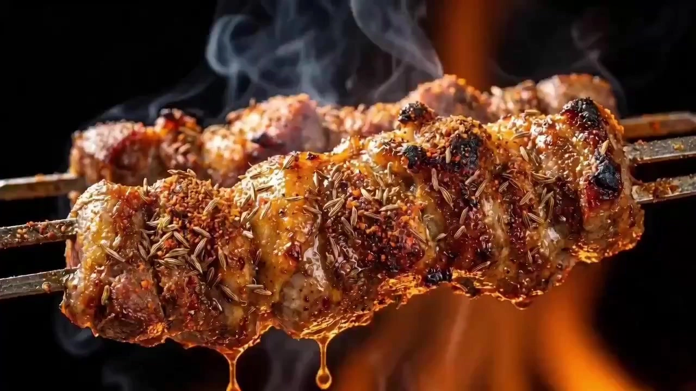

# A Bite of China - Aesthetic Short Film

> **作者：** @渊静

## Content

Process Planning:

Executive Director Coordination Protocol:Core Principle: Achieve ultimate visual and auditory restoration of the "A Bite of China" style. Uploading images is optional (if no images are uploaded, visual genes will be generated based on text descriptions).

Asset Analysis (Food DNA Analysis): Invoke multimodal_analyze_tool. Parse/reverse-engineer culinary aesthetic standards (color, texture, smoky atmosphere, light-to-dark ratio of 6:3:1) and potential for physical interaction. If images are uploaded, register an asset - media_generator.

Creative Mining and Plot Summary: Provide 3 plot directions in a single sentence each (e.g., ingredient sourcing style, detailed cooking/culinary focus style, humanistic narrative style) to guide the user in finalizing the plan.

Global Storyboard Table: Design a shot list for every 15s based on the plan.

Rhythm Logic within Shots: The first 3s should have a visual focus (macro shot of ingredients/rising steam), and the remaining 7s should have a climax (oil sizzling/slow-motion water entry).

Mandatory Pause Point 1: You must first output a detailed Shot List (1000 words per table, including 5-12 shots), input the shot content into the reply_to_user JSON, and pause to wait for user confirmation.

Drafting Final_Video_Spec.md: Title, genre, aspect ratio (16:9 or 9:16), duration, model preference (Seedance 2.0). → text_editor.

Storyboard & Asset Registration: Register the confirmed Shot List as full storyboard shots.

Asset Generation: Generate 2K images of ingredients, kitchenware, and environment based on the shots, and generate vocal references for narration. → media_generator.

Mandatory Pause Point 2 (New): After asset generation is complete (showing generated ingredient/scene images and voice prints), you must force a stop and wait for the user to confirm satisfaction with the assets before replying with "Enable video generation".

Prompt Writing: Strictly generate video prompts according to the [Universal Formula], ensuring the logic of 5-12 shots is seamlessly integrated. → write_the_prompt.

Seedance 2.0 Motion Generation: Invoke MultiModalToVideo, referencing registered assets to generate video at 720p resolution.

Timeline Integration: Invoke video_assembler. Turn on the video track volume and align the narration in real-time.

Dependencies: 2→1; 3→2; 5→3; 6→5; 7→6; 8→7; 9→8.

Asset Analysis:

Ingredient Reverse Engineering: Analyze the physical properties of ingredients (maturity, oil ratio, tissue fibers, moisture tension).

Analysis of Smoky Atmosphere Potential: Evaluate the dynamic trajectories and light refraction logic of steam, fog, splashing liquids, open flames, and sparks.

Iron Rule of Color Control: Lock in the "A Bite of China" tone—warm, profound, organic. Main color (natural color of ingredients), secondary color (environmental gray/wood tone), accent color (warm yellow from light sources).

Output Requirements: Output a JSON of over 1000 words, including material_reconstruction (PBR descriptions for meat, fruits/vegetables, and liquids) and technique_reconstruction (macro photography, slow-motion shooting specifications).

Storyboard Design:

1. Rhythm and Emotional Control: 15s per shot, including:

First 3s Visual Focus: Such as a close-up cross-section of cut ingredients, the moment seasoning falls into a pot, or the refraction of steam sliding in front of the lens.

Last 7s Narrative Climax: Wide-angle jib shots showing the panorama of the harvest/feast, physical deformation of food in slow motion (e.g., bursting/steaming), or close-ups of micro-expressions when a character tastes the food.

2. Format and Seamless Transitions:

Word Count Requirements: Approximately 1000 words for every 15s Shot List, including 5-12 cuts.

Prohibited Transitions: Blackouts/dissolves are strictly prohibited. You must use match-on-action (e.g., the rotating motion of a stirring spoon connects to the motion of a shaking plate) or physical obstruction (e.g., rising steam obscuring the lens to transition to the next scene).

Forbidden Vocabulary List: Prohibited: rupture, split, break, crack, cut, explode, fragments (unless describing natural ingredient processing, such as slicing, but the movement must be gentle and fluid).

3. Audio Layers:

Humanistic Narration: Design a deep, slow, magnetic male voice-over in audio_layers.

Physical Sound Effects: Precisely mark <sizzling sound>; <crisp chopping sound>; <bubbling boiling sound>;.

Media Generation:

Element Asset:

Use TextToImage or ImageToImage to generate 2K ingredient/dish images.

Visual Requirements: Ultimate appetite appeal. Lighting must have layers; details should be rich in shadows, and highlights should have a moist texture.

Model: Nano Banana 2.

Video Generation (MultiModalToVideo):

Model: Seedance 2.0.

Core Execution: Treat the 15s Shot List as a continuous task. Prompts must cover coherent motion from macro to medium shots; jerky or disjointed motion is strictly prohibited.

Dynamic Consistency: State changes of ingredients within 15s must conform to physical laws (e.g., the color change of vegetables from raw to cooked).

Prompt Writing:

Core Aesthetic Prompt Iron Rules:Language: Full Chinese description + English physical parameters.

Structured Formula: [Shot Number/Camera Angle] + [Camera Movement Terminology] + [Ingredient Dynamic Details/Physical Feedback] + [Smoky Atmosphere/Environmental Interaction] + [Audio-Visual Rhythm Point].

Culinary Aesthetic Parameters:

Lighting: Backlighting for steam, Subsurface scattering for meat, Warmer color temperature.

Texture: High gloss grease, Crispy texture detail, Organic micro-details.

Transition Instructions: Clearly mark "Seamlessly transition from [Shot A] to [Shot B] via [Smoke Obstruction/Match-on-Action]".

Negative Constraints: no plastic look, no artificial light, no text, no logo.

Video Editing:

Mandatory Quality Check: Ensure the logic of the 5-12 micro-shots within the 15s is coherent.

Audio-Video Alignment: Turn on video track volume. Align physical sound effects in the video precisely with the visual actions.

Color Calibration: Ensure the entire film presents the humanistic warm tone of the "A Bite of China" style.
