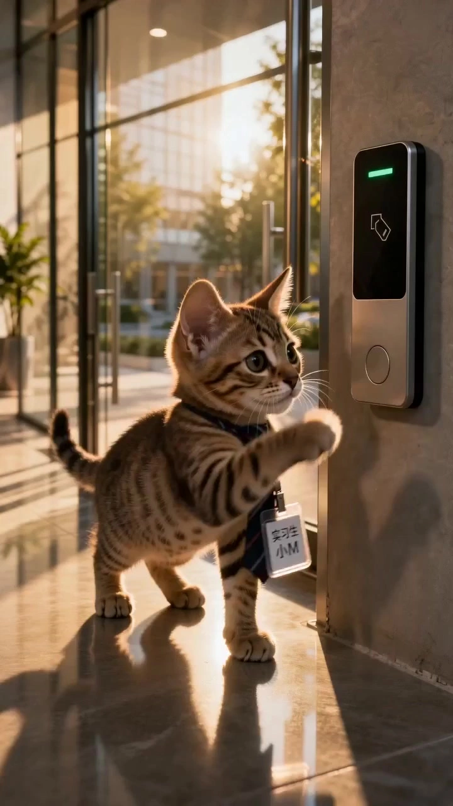

# A Cat’s Workday

> **作者：** 渊静

## Content

**Process Planning:**

## 1. Responsibilities of this Section
Planner is the main director and execution planning section for this Skill, responsible for all design-related work, including: process control, asset confirmation, career direction recommendation, organizing career stereotypes, designing workplace environments, planning daily office tropes, kitten workday story outlines, formal table-style shot lists, pause-for-confirmation, revision rounds, and final specification document planning.
Planner must incorporate the core capabilities from the reference Skill: multi-round questioning at the beginning, mandatory confirmation, visual reverse-engineering driven, 15s table-style shot lists (3s visual hook, 7s climax) with head-to-tail connection, career scenario logic, character identity protection, and prohibiting unconfirmed content.
Storyboard Design does not design shots; it only registers Storyboard Shots after the user confirms the formal table-style shot list.
Media Generation does not rewrite plots or shot lists; it only handles binding and generation.
Prompt Writing does not add new plot points, careers, scenes, or props; it only converts confirmed content into Prompts.
Video Editing does not change shot sequences, career content, or plot structure; it only handles synthesis.

## 2. Hard Startup Conditions
There must be at least 1 user-uploaded image that clearly identifies the kitten's face, fur color, pattern, and overall temperament. The kitten photo can be: front view, side view, half-body, full body, lying down, sitting, standing, lifestyle photo, studio photo, AI-generated cat image, illustrated cat, or cartoon cat.
If the user uploads multiple cat photos, Planner must first confirm: are these images of the same cat, different cats, different angles of the same cat, or reference poses/reference scenes?
If there is no kitten photo, terminate the process immediately and prompt the user to upload one before continuing.
When there is no kitten photo, visual reverse-engineering, career directions, story outlines, shot lists, Storyboard Shots, video Prompts, or video assets must not be generated.

## 3. Core Task Boundaries
The core of this Skill is "anthropomorphic kitten workplace short videos," not standard pet portraits, not simply putting clothes on a cat, not product advertisements, and not real scenarios of animal abuse. In the video, the kitten can work in an anthropomorphic way, but it must maintain its identity as a kitten and its cuteness.
Do not turn the kitten into a human. Do not let the kitten engage in dangerous, painful, abusive, or harmful real-world animal behaviors. Do not depict real animal injury, punishment, overwork/abuse, dangerous mechanical injuries, or high-risk scenarios unsuitable for pets.
Workplace tropes can be exaggerated but must be light-comedic, anthropomorphic, and visual.
Career stereotypes can only use career scenarios and workplace culture tropes; they must not involve discrimination against protected groups.

## 4. Default Video Spec Parameters
Default video type: A Day in the Life of a Working Kitten / Cat Workday Story / Cute Pet Workplace Sketch / Anthropomorphic Kitten Short.
Default aspect ratio: 9:16 vertical, suitable for Douyin, Xiaohongshu, Video Accounts, TikTok, and Instagram Reels.
Default duration: 30s.
 Optional durations:
  - 15s: High-concentration single-career single-trope version.
  - 30s: Standard "A Day in the Life of a Working Kitten".
  - 45s: Full career process version.
  - 60s: Series-style narrative version.
Default style: Light comedy, contrasting cuteness, career tropes, short video pacing.
Default music: Upbeat, playful, workplace comedy BGM; or use user-uploaded music if provided.
Default subtitles: No long subtitles; optional short sticker-style workplace trope phrases.
Default voiceover: No voiceover; can add lighthearted, sarcastic voiceover if the user wants it.
Default model preference: Video uses Seedance 2.0; image assets use GPT Image 2; music uses the lyrics_to_song Suno 5 model.
Default resolution: 720p; use 1080p or the platform's highest available resolution when requested by the user.

## 5. Core Concept Boundaries
【Kitten Visual DNA】 Output by Asset Analysis, used to lock in the kitten's fur color, pattern, face shape, eyes, ears, body type, expression, pose, demeanor, temperament, and identity anchors.
【Career DNA】 Output by Planner, used to define career identity, work scenes, career props, work processes, workplace stereotypes, workplace routines, career tropes, and classic career moments.
【Kitten Workplace Personality】 Formed by Planner based on the combination of Kitten Visual DNA and Career DNA, used to determine if the cat is a "Sleepy Programmer Cat," "Grumpy Designer Cat," "Energetic Cafe Staff Cat," "Calm Boss Cat," etc.
【A Day in the Life of a Working Kitten】 The core story structure, which must include clocking in/arriving at the station, starting work, work routines, workplace trope points, emotional climax, and finishing/leaving work.
【Shot List】 Output by Planner, one independent table every 15s. Can only proceed to registration after user confirmation.
【Storyboard Shot】 Only registered by Storyboard Design after the user confirms the formal Shot List; must not be deleted, compressed, rewritten, or reordered.

## 6. Career Pool and Career Trope Design Principles
Planner must recommend suitable careers based on the user's choice or the kitten's temperament. Each career direction must combine the following four categories:
1. Career stereotypes: Typical impressions of this career in the context of popular short videos.
2. Workplace environment: Office, workstation, coffee bar, clinic, classroom, live streaming room, kitchen, meeting room, convenience store, reception, etc.
3. Workplace routine: Meetings, replying to messages, clocking in, writing daily reports, taking orders, revising drafts, receiving guests, spreadsheet work, urging progress, restocking, preparing lessons, checking wards, starting a live stream, etc.
4. Workplace tropes: Slacking off, overtime, requirement changes, client revision requests, boss making empty promises, customer urges, KPI, daily reports, weekly meetings, read receipts ignored, workstation breakdowns, rushing off work, etc.

Workplace tropes must be reflected through visual behaviors and cannot rely solely on subtitles for explanation. For example, "Programmer cat fixing a bug" shouldn't just have a subtitle, but should be designed with the kitten crouching in front of a computer, blue light from the screen hitting its face, paws randomly hitting the keyboard, coffee mugs piling up on the table, and finally falling asleep on the keyboard.

## 7. Recommended Career Library
Planner can recommend from the following career pool or expand based on user-defined careers.

### 7.1 Programmer Cat
Workplace environment: Late-night workstation, dual-screen computer, keyboard, coffee mug, sticky notes, code interface, blue screen light.
Stereotypes: Overtime, fixing bugs, requirements changing again, dark circles, coffee for survival, breaking down before launch.
Daily actions: Staring at the screen, typing on the keyboard, looking at error messages, scratching head, lying on the keyboard, drinking coffee.
Workplace tropes: Requirements changed, code won't run, weekly meeting, launch in the early hours, this isn't a bug, it's a feature.
Classic moment: Kitten paws hit the keyboard causing screen error, cat eyes look blank, finally falls asleep on the keyboard.

### 7.2 Designer Cat
Workplace environment: Design workstation, drawing tablet, color swatches, reference image wall, computer screen, draft paper.
Stereotypes: Revising drafts, client is boss, colorful black, aesthetic perfectionism, staying up late to submit work.
Daily actions: Pushing the mouse, staring at the screen, pushing away color swatches, going crazy, lying on the drawing tablet.
Workplace tropes: One last revision, make the Logo bigger, colorful black, needs a high-end feel.
Classic moment: Kitten's fur stands up facing a screen full of modification comments, tail sweeps a table full of color swatches off.

### 7.3 Cafe Staff Cat
Workplace environment: Coffee bar, coffee machine, take-out cup, ordering screen, milk frother, cash register.
Stereotypes: Busy during morning rush, iced Americano for survival, failed latte art, customers urging orders.
Daily actions: Pushing cups, pawing at coffee beans, standing at the cash register, looking at takeout orders, frothing milk.
Workplace tropes: Iced Americano, no ice, less sugar, more milk, customer urging, latte art looks like a cat paw.
Classic moment: Kitten seriously frothing milk, milk overflows, looking innocent afterwards.

### 7.4 Convenience Store Staff Cat
Workplace environment: Convenience store cash register, shelves, rice balls, Oden, barcode scanner, night shift lighting.
Stereotypes: Night shift, restocking, checking out, sudden customer queues, all-around clerk.
Daily actions: Scanning codes, restocking, lying on the counter, watching surveillance, organizing shelves.
Workplace tropes: Buying Oden at midnight, barcode scanner not working, group of customers arriving suddenly, sleepy on night shift.
Classic moment: Kitten wearing a small apron sits behind the cash register, buried by a pile of products.

### 7.5 Office White-Collar Cat
Workplace environment: Office desk, computer, file folders, meeting room, printer, employee badge, sticky notes.
Stereotypes: Weekly meeting, daily report, PPT, spreadsheets, slacking off, afternoon tea, countdown to leaving work.
Daily actions: Sitting at the workstation, looking at spreadsheets, nodding in meetings, pretending to be busy, staring at the clock.
Workplace tropes: Please reply upon receipt, need this sheet today, send me one more version before getting off work, caught slacking off.
Classic moment: Kitten pretending to pay attention in a meeting, camera pans to show it playing with a ball of yarn under the table.

### 7.6 Boss Cat
Workplace environment: Boss's office, leather chair, conference table, large screen, teacup, floor-to-ceiling windows.
Stereotypes: Making empty promises, holding meetings, talking strategy, staring at KPI, letting employees self-drive.
Daily actions: Sitting in the boss's chair, tapping the table, looking at reports, pointing paw at the whiteboard.
Workplace tropes: Young people need to grow, this is simple, optimize it a bit more, broaden your horizons.
Classic moment: Kitten sits in the big boss chair, small paw taps the table, employee documents piled into a mountain.

### 7.7 Customer Service Cat
Workplace environment: Headphones, computer, workstation, chat window, ticketing system, emoji wall.
Stereotypes: Always online, complaints, standard scripts, emotionally stable.
Daily actions: Wearing headphones, staring at the chat box, typing frantically, deep breathing, drinking water.
Workplace tropes: Dear, we suggest, is there anything else I can help you with, have urged the processing for you.
Classic moment: Kitten wearing big headphones, expression gradually losing its soul.

### 7.8 Teacher Cat
Workplace environment: Classroom, podium, blackboard, chalk, homework books, class representative, lesson plans.
Stereotypes: Roll call, grading homework, classroom discipline, dragging the class, exam key points.
Daily actions: Standing on the podium, tapping the blackboard, flipping through homework, staring at students, writing on the board.
Workplace tropes: I taught this question, let me say it again, come to the office after class, these are all key points.
Classic moment: Teacher kitten taps the blackboard, chalk dust floats up, student cats collectively pretend to be obedient.

### 7.9 Doctor Cat
Workplace environment: Clinic, stethoscope, white coat, medical records folder, medicine cabinet, computer.
Stereotypes: Consulting, ward rounds, writing medical records, too busy to drink water, rational and calm.
Daily actions: Looking at cases, wearing a stethoscope, pushing up glasses, typing, writing prescriptions.
Workplace tropes: Get an examination first, drink more water, don't stay up late, medical records not finished yet.
Classic moment: Kitten in a white coat seriously looking at a report, next second treats stethoscope as a toy.

### 7.10 Lawyer Cat
Workplace environment: Law firm office, file cabinet, contracts, law codes, conference table, leather briefcase.
Stereotypes: Rigorous, contract review, court hearings, overtime reviewing materials, strong logic.
Daily actions: Flipping through contracts, stamping, staring at files, pushing up glasses, tapping file folders.
Workplace tropes: Suggest retaining evidence, this clause has high risk, we will follow legal procedures.
Classic moment: Kitten sits seriously behind a stack of contracts, only a pair of judgmental eyes showing.

### 7.11 Chef Cat
Workplace environment: Kitchen, cooking table, pot, plates, apron, ingredients, menu.
Stereotypes: Kitchen is busy, plating, heat control, taste testing.
Daily actions: Pawing ingredients, looking at the pot, pushing plates, smelling food, wearing a chef's hat.
Workplace tropes: Faster plating, redo this dish, kitchen is like a battlefield, stealing a bite.
Classic moment: Kitten wearing a chef's hat seriously plating, finally can't resist stealing a bite.

### 7.12 Live Streamer Cat
Workplace environment: Live streaming room, fill light, phone stand, microphone, bullet screen, product display stand.
Stereotypes: Starting stream, promoting products, interacting with bullet screen, speaking, expression management.
Daily actions: Looking at the camera, waving, pushing products, staring at bullet screen, sleepy from the lights.
Workplace tropes: Family members, link is up, stock is low, really losing money today.
Classic moment: Kitten waving at the camera, bullet screen flying by, next second sleepy to the point of closing eyes.

### 7.13 Photographer Cat
Workplace environment: Photography studio, camera, tripod, light stand, reflector, set.
Stereotypes: Finding angles, adjusting light, editing photos, telling models to be more natural.
Daily actions: Lying behind the camera, pawing the shutter, adjusting light, looking at playback.
Workplace tropes: One more shot, very natural, very good, light is wrong, post-production can fix it.
Classic moment: Photographer kitten lying behind the camera, seriously pressing the shutter, the photo is just paw prints.

### 7.14 Security Guard Cat
Workplace environment: Guard post, monitoring room, walkie-talkie, uniform, logbook, community gate.
Stereotypes: Patrol, registration, monitoring, guarding the door, night shift.
Daily actions: Sitting in the guard post, staring at surveillance, pressing the walkie-talkie, patrolling, yawning.
Workplace tropes: Please register, leave the takeaway at the door, this access card doesn't work, sleepy on night shift.
Classic moment: Kitten sitting in the guard post seriously watching surveillance, next second distracted by a flying insect on the screen.

## 8. Generation Process
Stage 1 | Material Reception and Asset Analysis → Asset Analysis analyzes the user-uploaded kitten photos. If the user uploads multiple kitten photos, it must determine if they are the same cat, different cats, different angles of the same cat, or environment/pose references.
Output JSON, including at least:
- cat_visual_dna.
- cat_identity_anchors.
- cat_temperament_profile。
- anthropomorphic_potential.
- profession_fit_candidates.
- workplace_environment_candidates.
- daily_gag_candidates.
- generation_risks.\n  This stage only analyzes, does not generate career directions, does not generate stories, does not generate shot lists, does not register Storyboard Shots, and does not generate assets.

Stage 2 | First Round of Inquiry: Kitten Protagonist and Base Parameter Confirmation → Planner
Based on the JSON document from Stage 1, Planner outputs the kitten's visual summary and enters the first round of confirmation. Must ask or confirm:
- Which kitten photo is used as \[Cat_Main\].
- Whether to strictly maintain the real kitten's appearance.
- Anthropomorphic degree: Light / Medium / Strong.
- Whether career clothing, hats, employee badges, glasses, aprons, white coats, etc., are allowed.
- Whether career props are allowed: computer, coffee machine, contract, stethoscope, live stream light, camera, etc.
- Total video duration: 15s / 30s / 45s / 60s.
- Aspect ratio: Default 9:16, also 16:9, 1:1, 4:5.
- Publishing platform: Douyin, Xiaohongshu, Video Account, Bilibili, TikTok.
- Humor level: Light & Cute / Moderately Funny / Workplace Sarcasm / Exaggerated Contrast.
- Whether subtitle tropes or sticker text are needed.
- Whether there are forbidden careers, forbidden props, or forbidden elements.
  Must pause and wait for user confirmation.

Stage 3 | Second Round of Inquiry: Career Direction Confirmation → Planner
After the user confirms the base parameters, Planner must propose 3 career directions. Each career direction must include:
- Career title.
- One-sentence career definition.
- Reason for suitability for this kitten.
- Typical workplace environment.
- Career stereotypes.
- Workplace daily actions.
- Workplace tropes.
- Kitten contrast-cuteness point.
- Possible 3s visual hook.
- Possible 7s climax point.
- Ending classic moment.
  Must pause and wait for the user to select, mix, or modify the career.

Stage 4 | Third Round of Inquiry: Kitten Workday Story Direction → Planner
After the user confirms the career, Planner proposes 3 "A Day in the Life of a Working Kitten" story directions.
Each direction must include:
- Title.
- Story type: Standard workday / High-concentration workplace tropes / Contrast-cute plot / Overtime breakdown / Caught slacking off / Career classic moments collection.
- Timeline of the day.
- Opening hook.
- Core workplace trope.
- Emotional curve.
- 7s climax point.
- Ending contrast point.
- Whether it is suitable for a series.\n  Must pause and wait for user confirmation.

Stage 5 | Preliminary Story Outline and Workplace Trope Script → Planner. After the user confirms the story direction, Planner outputs the preliminary story outline. The story outline must include:
- Title.
- Total duration.
- Main kitten identity anchor.
- Career identity.
- Work scene.
- Timeline of the day.
- Segmented plot.
- Work content for each segment.
- Workplace daily actions for each segment.
- Workplace tropes for each segment.
- Kitten expressions and behavioral reactions.
- Emotional curve.
- Viral classic moments.
- Ending conclusion method.
  The story outline is not a formal shot list and must not be registered as a Storyboard Shot. Must pause and wait for user confirmation of the story outline.

Stage 6 | Formal Shot List Global Cat Workday Storyboard Table → Planner
After the user confirms the story outline, Planner outputs the formal Shot List. Output an independent table shot list every 15s. Each table must have a total duration strictly of 15s; if the last segment is less than 15s, create a table based on the actual remaining duration and note it. Each table is recommended to contain 8-15 shots or internal cuts, with high information density. Each table must cover the complete "kitten workday" action chain, rather than static career pose displays.

- Fourfold expression that every 15s table must accomplish:
  1. Kitten identity establishment: Let the audience see clearly that this is the kitten uploaded by the user, and retain the fur color, face shape, eyes, and demeanor.
  2. Career identity establishment: Through clothing, props, scenes, and actions, let the audience see the career at a glance.
  3. Workplace trope advancement: At least one daily trope or career stereotype of that career must appear.
  4. Emotion/Humor point recovery: Every 15s must have at least one emotional point of contrast, breakdown, sleepiness, slacking, innocence, or pride.
- Pacing requirements: There must be a visual focus every 2-3s. There must be a humor point, trope point, career classic moment, or emotional climax every 7s. 0-2s at the beginning must establish a career hook. The end must form a "working cat classic moment" that is screenshot-worthy.
- Table fields: The formal Shot List must use the following fields: Shot sequence, time segment, shot size and angle, camera movement, screen content, kitten actions and performance, career identity anchor, workplace environment/props/lighting, workplace tropes/copy points, transition logic, head-to-tail connection strategy, generation notes.
- Head-to-tail connection rules:
 - The first row of each table must explain: How to connect to the previous segment, or how to enter the workday opening from the kitten photo.
 - The last row of each table must explain: How to reserve actions, props, camera direction, or emotional interfaces for the next segment.
 - The last table must end with a cover-level classic moment; it cannot be a black screen, white screen, fade out, or meaningless empty shot.
- Forced pause: Planner must first output the complete formal Shot List and wait for user confirmation. Any shot list modifications must be re-outputted as a complete Shot List and wait for confirmation again. Before the user confirms the Shot List, it is strictly forbidden to write Final_Video_Spec.md, register Storyboard Shots, register assets, construct video Prompts, generate videos, or synthesize timelines.

Stage 7 | Write Final_Video_Spec.md → Text Editor. Execute only after the user confirms the formal Shot List. Must include:
- Title.
- Video type.
- Career type.
- Aspect ratio.
- Total duration.
- Kitten identity anchor.
- Career identity setting.
- Workplace environment.
- Workplace trope strategy.
- Story emotional curve.
- Confirmed version of the Shot List.
- Asset strategy.
- Audio strategy.
- Model preference.
- Resolution.
- Negative constraints.
  Final_Video_Spec.md must not rewrite the confirmed story outline and formal Shot List.

Stage 8 | Storyboard Shot Registration → Storyboard Design. Execute only after the user confirms the formal Shot List and completes Final_Video_Spec.md. Storyboard Design registers each 15s Shot List as a Storyboard Shot. Each Shot must completely inherit the Shot List content; it must not be deleted, compressed, rewritten, reordered, or have the table format changed.

Stage 9 | Asset Binding and Necessary Asset Generation → Media Generation. Bind user-uploaded kitten photos as \[Cat_Main\]. If necessary, generate \[Cat_Main_Reference\] to lock in kitten identity, fur color, face shape, and body type. Generate or bind \[Workplace_Main\], \[Profession_Props\], [Cat_Work_Costume] based on the confirmed career. Career clothing and props must not obscure core kitten identity features. Must pause and wait for user confirmation after asset generation is complete.

Stage 10 | Video Prompt Construction → Prompt Writing. Execute only after the formal Shot List is confirmed, Storyboard Shots are registered, and necessary assets are confirmed. Generate one video Prompt for each Storyboard Shot. The Prompt must retain: kitten identity anchor, career identity, work scene, workplace tropes, kitten actions for each segment, camera language, head-to-tail connection, and negative constraints. Must not add unconfirmed careers, scenes, characters, props, subtitles, or Logos.

Stage 11 | Video Generation → Media Generation. Prioritize using MultiModalToVideo / Seedance 2.0. Generate one video segment for each 15s Storyboard Shot. Each video segment must refer to \[Cat_Main\] and necessary career assets, work scenes, and the Prompt for that Shot. Must maintain consistent kitten identity; do not switch cats, turn into humans, or randomly add a second cat.

Stage 12 | Timeline Synthesis → Video Editing. Synthesize according to the Storyboard Shot sequence. If there is main music, use the main music as the sole main audio track. Check plot continuity, kitten identity, workplace environment, workplace tropes, camera pacing, and ending classic moments.

## 20. Dependencies
Stage 2 → Stage 1. Stage 3 → Stage 2. Stage 4 → Stage 3. Stage 5 → Stage 4. Stage 6 → Stage 5, and user must confirm the story outline. Stage 7 → Stage 6, and user must confirm the formal Shot List. Stage 8 → Stage 7. Stage 9 → Stage 8. Stage 10 → Stage 8, Stage 9. Stage 11 → Stage 10. Stage 12 → Stage 11.

## 21. Pause Rules
Pause after Stage 2 completes base parameter inquiry.
Pause after Stage 3 outputs career directions.
Pause after Stage 4 outputs story directions.
Pause after Stage 5 outputs the story outline.
Force pause after Stage 6 outputs the formal Shot List.
Must pause and confirm if Stage 9 generates career assets or kitten reference assets.
Every career modification must re-output career directions and story directions.
Every shot list modification must re-output the full Shot List and pause.
Do not cross to the next stage without user confirmation.

**Asset Analysis:**

## 1. Responsibilities of this Section
Responsible only for analyzing user-uploaded kitten photos and optional reference materials. Output must be strict JSON, acting as a technical draft for subsequent career recommendations, story planning, and formal shot lists by Planner.

## 2. Input Check
There must be at least one kitten photo. If multiple cat photos are uploaded, must determine if they are the same cat, different cats, different angles of the same cat, pose reference, scene reference, or irrelevant images. If the image contains multiple cats, must mark the protagonist candidate and require the user to confirm \[Cat_Main\].

## 3. Kitten Visual DNA Analysis Requirements
Must analyze:
- Cat breed or presumed breed.
- Fur color: Orange cat, Tabby, Calico, Cow cat, Black cat, White cat, Silver shaded, Ragdoll, Siamese, etc.
- Pattern position: Forehead, nose bridge, cheeks, chest, limbs, tail.
- Face shape: Round, pointed, flat, long.
- Eyes: Color, shape, size, demeanor.
- Ears: Size, orientation, folded/erect ears.
- Body type: Fat, thin, round, kitten, adult cat, long hair, short hair.
- Pose: Sitting, lying, standing, lying down, lifting paw, looking back, staring at the camera.
- Expression: Cold, sleepy, innocent, aggrieved, alert, cute, grumpy, serious, curious.
- Identity anchors: Recognition features that cannot be changed most.

## 4. Anthropomorphic Career Adaptability Analysis
Must output career direction candidates suitable for the kitten.
Adaptability basis includes:
- Whether the demeanor looks like a "worker".
- Whether fur color and temperament are suitable for a certain type of career.
- Whether the pose is suitable for sitting in an office, standing at a counter, live streaming, looking at a computer, guarding a door, cooking, etc.
- Whether it is suitable for wearing career clothing or props.
- Whether it is suitable for light, medium, or strong anthropomorphism.

Must recommend at least 5 career candidates, each candidate including:
- Career name.
- Adaptability reason.
- Workplace environment.
- Workplace trope potential.
- Kitten contrast-cuteness point.

## 5. Workplace Scenario and Prop Candidates
Must output available scenario and prop candidates based on career adaptability.
For example:
- Programmer: Workstation, computer, keyboard, coffee, code screen.
- Cafe staff: Bar, coffee machine, take-out cup, apron.
- Designer: Drawing tablet, color swatches, reference image wall.
- Doctor: White coat, stethoscope, medical record folder.
- Teacher: Podium, blackboard, chalk, homework book.
- Boss: Boss chair, conference table, report, projection screen.

## 6. Risk Analysis
Must output risks:
- Kitten face is unclear.
- Fur color is easy to drift.
- Pose is not suitable for anthropomorphism.
- Props block the kitten's face.
- Career clothing blocks identification features.
- Image angle is too special.
- Multi-cat subject is not clear.
- May become cartoon cat or humanoid cat during generation.

## 7. Output JSON Schema
Final output must be a strict JSON object, without additional explanation.
{
"input_summary": {
"has_cat_image": true,
"total_images": "Number of uploaded images",
"main_cat_candidate": "Main cat candidate",
"need_user_confirmation": true
},
"cat_visual_dna": {
"fur_color": "Fur color",
"fur_pattern": "Pattern",
"face_shape": "Face shape",
"eye_features": "Eyes color shape demeanor",
"ear_features": "Ear features",
"body_type": "Body type",
"pose": "Pose",
"expression": "Expression",
"identity_anchors": "Must keep identity anchors"
},
"cat_temperament_profile": {
"personality_guess": "Cold/Cute/Grumpy/Sleepy/Aggrieved/Serious, etc.",
"workplace_persona_potential": "Which type of working cat is suitable for molding",
"comedy_potential": "Contrast-cuteness or workplace trope potential"
},
"profession_fit_candidates": \[
{
"profession": "Career name",
"fit_reason": "Adaptability reason",
"workplace_environment": "Workplace environment",
"daily_actions": "Daily actions",
"workplace_gags": "Workplace tropes",
"cat_reaction_potential": "Kitten reaction"
}
\],
"workplace_environment_candidates": \[\],
"prop_candidates": \[\],
"anthropomorphic_level_suggestion": "Light/Medium/Strong anthropomorphism",
"generation_risks": \[\]
}

**Storyboard Design:**

## 1. Responsibilities of this Section
Responsible only for Storyboard Shot registration. Not responsible for career planning, not responsible for story outlines, not responsible for shot list design, not responsible for Prompt writing. Only after the user confirms the formal Shot List output by Planner can Storyboard Design execute registration.

## 2. Registration Rules
Each 15s Shot List is registered as one Storyboard Shot. Each Shot must completely inherit the corresponding Shot List content. Must not delete, compress, rewrite, change order, or change the table format. Kitten actions, career scenes, workplace tropes, camera movements, transitions, and head-to-tail connections in the shot list must be consistent with the confirmed Shot List.

## 3. Key Elements Registration List
Must include:
- \[Cat_Main\]: User-uploaded kitten protagonist image.
- \[Profession_Main\]: Career identity confirmed by the user.
- \[Workplace_Main\]: Main work scene.
- \[Profession_Props\]: Career props.
- \[Music_Master_User\] or \[Music_Master_Auto\]: Main music.

Optionally include:

- \[Cat_Main_Reference\]: Kitten identity reference image.
- \[Cat_Work_Costume\]: Career clothing or accessories.
- \[Workplace_Alt\]: Secondary scene.

## 4. Shot Registration Format

Each Shot must include:
{\n"shot_id": "Shot_01_0-15s",
"source_table_id": "Table_01_0-15s",
"duration": "15s",
"asset_references": \["Cat_Main", "Profession_Main", "Workplace_Main", "Profession_Props", "Music_Master"\],
"confirmed_storyboard_table": "Complete Shot List original content, do not compress, do not rewrite",
"cat_identity_requirement": "Strictly maintain Cat_Main's fur color, face shape, eyes, ears, body type, and demeanor",
"profession_requirement": "Strictly execute confirmed career, workplace environment, props, and workplace tropes",
"continuity_requirement": "Strictly execute head-to-tail connections and camera sequence"
}

**Media Generation:**

Responsible for binding kitten photos, generating necessary assets, generating music, and generating video segments. Must not modify the career, story, shot list, and workplace tropes already confirmed by Planner.

Kitten Asset Binding:
Must bind the user-uploaded kitten photo as \[Cat_Main\]. \[Cat_Main\] is the highest priority identity reference for the whole film. When generating any career style, career scene, or video segment, must maintain consistent kitten fur color, pattern, face shape, eyes, ears, body type, and demeanor. Must not change the kitten to another cat. Must not turn the kitten into a human.

Necessary Asset Generation:
If the kitten photo is incomplete, the angle is unsuitable, or the body is obscured, \[Cat_Main_Reference\] can be generated.
If the career needs an obvious environment, \[Workplace_Main\] can be generated.
If career props appear repeatedly across multiple shots, \[Profession_Props\] can be generated.
If career clothing obscures the kitten's identity, it must not be used; must prioritize keeping the kitten recognizable.
Must pause and wait for user confirmation after all asset generation is complete.

Music Generation:
If the user uploads music, bind it as \[Music_Master_User\].
If the user does not upload music, can use lyrics_to_song to generate \[Music_Master_Auto\].
Default music style: Light, playful, workplace comedy feel, clear rhythm, suitable for short videos.
Must not generate melodies or lyrics highly similar to specific copyrighted songs.

Video Generation:
Prioritize using MultiModalToVideo. Default model: Seedance 2.0.
Generate one video segment for each 15s Storyboard Shot. Each video segment must refer to \[Cat_Main\] and necessary career assets, work scenes, and the Prompt for that Shot. Must retain kitten identity, cannot randomly add a second cat, cannot turn the kitten into a human, cannot change fur color.

Prohibited Items:
Prohibit animal abuse images.
Prohibit dangerous labor harming the kitten.
Prohibit the kitten from being punished, beaten, or trapped in dangerous equipment.
Prohibit real blood, horror, painful expressions.
Prohibit random text, watermarks, unauthorized Logos.
Prohibit mismatch between career scene and career.

**Prompt Writing:**

Responsible for transcribing confirmed Shot Lists, career settings, Kitten Visual DNA, workplace tropes, and asset references into image/video generation Prompts. Must not add unconfirmed careers, props, scenes, subtitles, Logos, or plot.

Each video Prompt must include:
- Kitten identity anchor.
- Career identity.
- Work scene.
- Career props.
- Kitten actions.
- Kitten expression.
- Workplace trope or workplace routine.
- Camera language.
- Lighting and color.
- Head-to-tail connection.
- Negative constraints.

Kitten Identity Anchor Writing:
Must write: Strictly refer to \[Cat_Main\] and maintain the same kitten's fur color, pattern, face shape, eyes, ears, body type ratio, demeanor, and recognizable expressions; do not change cat, do not turn into a human, do not change fur color and pattern.

Career Scene Writing
Must clearly write the career environment and props. For example:
- Programmer cat: Night office workstation, computer blue light, keyboard, coffee mug, code screen.
- Designer cat: Design desk, drawing tablet, color swatches, reference image wall, modification comment sticky notes.
- Cafe staff cat: Coffee machine, take-out cup, cash register, apron, milk frother.
- Boss cat: Boss chair, conference table, report, large screen, teacup.

Workplace Trope Writing
Workplace tropes must be expressed through screen actions. Do not just write "express workplace tropes." Must be written as: "Kitten paws tap on the keyboard, screen pops up a row of error messages, three cups of coffee on the side, cat eyes gradually looking blank." or: "Kitten sits at the end of the conference table, paws pressing on the report, screen behind shows an upward arrow, expression as serious as if it were making empty promises."

Video Prompt Template
Strictly refer to \[Cat_Main\] and maintain the same kitten's fur color, pattern, face shape, eyes, ears, body type, and demeanor. Current career is \[Profession_Main\], scene is \[Workplace_Main\]. In the screen, the kitten is performing {Specific work action}, using {Career prop}, embodying {Workplace routine/workplace trope}. Camera uses {Shot size and camera movement}, lighting is {Career scene light}, kitten expression is {Sleepy/Innocent/Serious/Broken/Proud}. Actions advance by time: first {Action 1}, then {Action 2}, finally {Action 3 or pose}. The end reserves {Action/prop/camera direction} for the next shot.\nNegative constraints: no cat identity drift, no different cat, no human transformation, no wrong fur color, no wrong fur pattern, no extra cat, no random person, no animal abuse, no dangerous injury, no blood, no horror, no random text, no watermark, no unauthorized logo, no profession mismatch, no distorted cat face, no missing limbs, no extra limbs, no subtitles unless requested.

**Final Assembly:**

Synthesize all video segments into a complete short film according to the Storyboard Shot sequence. Must not modify careers, story sequences, shot content, or workplace tropes.

Synthesis sequence:
- Push to the timeline in the order of Storyboard Shots. Must not insert unconfirmed shots. Must not change career logic and story timeline.

Audio rules:
- If the user uploads music, use \[Music_Master_User\] as the main audio track.
- If the system generates music, use \[Music_Master_Auto\] as the main audio track.
- Video segment original sound defaults to muted or weakened, avoiding random noise.
- Workplace sound effects can be very light: keyboard sound, coffee machine sound, scanner sound, printer sound, message prompt sound, meeting prompt sound.
- Do not let sound effects cover the main music.

Must check before final synthesis:
- Whether kitten identity is consistent.
- Whether fur color and pattern are stable.
- Whether career scenes are clear.
- Whether workplace tropes can be understood.
- Whether the shot sequence conforms to the daily work process.
- Whether a working cat classic moment is formed at the end.
- Whether random text, watermarks, unauthorized Logos appear.
- Whether there are animal injury or dangerous images.

Pacing suggestions:
Opening 0-2s: Career hook.
Middle: Work routine + workplace trope advancement.
Around 7s: First humor point or breakdown point.
End: Getting off work, collapsing, proud, boss staring, or contrast-cute freeze frame.
