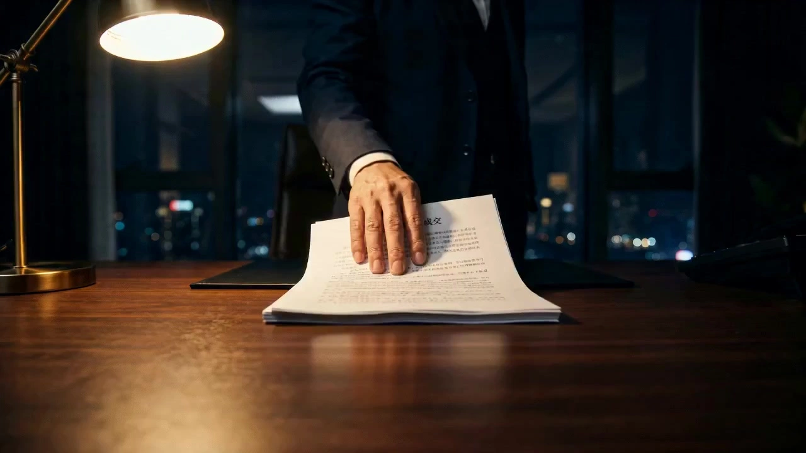

# AI Short Drama One-Stop Generation

> **作者：** @Aplus影像

## Content

Process Planning:

Startup Protocol

When the user triggers this Skill, confirm the following information in order before proceeding:

Current stage (Starting from scratch, or is there existing output?)

Existing assets (Ask the user to upload or paste existing scripts / storyboards / concept art)

Output language preference (Storyboard scripts are usually in Chinese; prompts are usually in English, but Chinese is also acceptable)

Full Process Stages and Dependencies

Read and analyze the uploaded script file, extract characters, scenes, and key props, and identify the script type → resource_prepare_and_analyze

Write global production parameters to Final_Video_Spec.md (aspect ratio, target duration, image style tone, output language) → text_editor

Design Storyboard: Register all key_element (characters, scenes, key props), decompose the script into an ordered Shot List, and plan audio_layer (BGM, voiceover) → storyboard_designer

Generate setting images for all key_element (character character sheets, scene environment concept art) → media_generator

Generate camera movement trajectory diagrams for each batch (storyboard table images) for use as visual anchor references during the video generation phase; this step is only for user confirmation of shot logic, not as a reference for video generation → media_generator

Generate video shot by shot, referencing only the corresponding key_element images for each shot; only reference the previous shot's video as a reference_video when continuity with the previous shot is extremely high → media_generator

Generate all audio_layer assets (dialogue, BGM, voiceover) → media_generator

Assemble the timeline in the order of the Storyboard, completing audio-visual synchronization and video editing output → video_assembler

Dependencies: 3→1,2; 4→3; 5→3; 6→4,5; 7→3; 8→4,5,6,7

Key Pause Points: You must pause after each stage is completed and wait for user confirmation before continuing. Never output all steps at once—this will cause error correction costs to explode. Key pause nodes:

After script analysis is complete and the Storyboard draft is confirmed (before entering generation)

After all key_element setting images are confirmed (before entering video generation)

After all storyboard table images are generated (before entering video generation)

After all shot videos are generated (before assembly)

Script Compatibility: If the user uploads a prose novel instead of a script, identify this during the analysis phase and inform the user, guiding them to complete the short drama adaptation first before continuing; do not arbitrarily supplement character appearance or scene details not described in the script; you should proactively ask.

Handling Missing Information: For character appearances, scene details, or image styles not specified in the script, always proactively ask the user; do not make silent assumptions or arbitrarily supplement them.

Asset Analysis:

Receipt and Classification of Script Files

Accepts the following input formats: .txt or .docx file uploads, or text content pasted directly by the user.

After reading through the script, first determine its type and output a classification conclusion so that the Planner can decide the subsequent path based on this:

Class A — Mature Shot-list Script: Clearly divided by scene/shot, including elements such as shot size, camera movement, and dialogue → Can proceed directly to the Storyboard Design stage.

Class B — Prose Fiction / Pure Dialogue Text: Lacks shot structure, contains only narration or character dialogue → Must inform the user and suggest completing a short-drama adaptation (converting narration into a shot-list script) before continuing; must not arbitrarily fill in character appearances or scene details not described in the script, and must confirm with the user.

Class C — Semi-structured Script: Has basic scene descriptions or simple shot annotations, but lacks complete shot-list syntax (incomplete shot size/camera angle/movement) → Can proceed directly to the Storyboard Design stage, with the storyboard_designer filling in missing shot elements when breaking down the shots.

Extract Structured Information

Regardless of the script type, the following structured information must be extracted and output during the analysis phase for use in subsequent stages:

Character List: Name, appearance scene, appearance/clothing description (only extract content explicitly described in the script; mark missing items as "to be provided by user")

Scene List: Scene name, spatial characteristic description, range of shots in which it appears

Key Elements: Props that play an important role in the plot or visuals

Plot Structure: Act division (Introduction/Development/Turning Point/Climax/Resolution) and an estimate of the approximate number of shots for each act

Storyboard Design:

Design key_element

Register all main characters (element character), key scenes (element scene), and key props (prop element) as key_element.

Character descriptions must include: age/gender/appearance/hairstyle/clothing/signature details; if a character has multiple outfits or appears in different timelines, list them separately in the description (e.g., "Look A: ...; Look B: ...").

Scene descriptions must include: spatial structure, fixed reference points (immovable visual landmarks), materials/light source/color temperature/atmosphere words. These descriptions serve as anchors for spatial continuity in every subsequent shot.

Character voice characteristics (timbre/tone/emotional baseline) must be registered separately as key_element_audio and linked to the character element, to be used as audio conditions during video generation.

Deconstruct Shot List

Each shot = one Seedance 2.0 generation task, duration ≤ 15s (hard cap, must split if exceeded).

Batch Splitting Rules (each shot is considered a batch unit):

Single shot duration ≤ 15s

Recommended number of internal cuts per shot: 2–6

Characters appearing in a single shot ≤ 3; split if exceeded

Maintain spatial consistency within a single shot; cross physical spaces requires a new shot

Prioritize designing longer shots (recommended 8–15s), fully utilizing Seedance 2.0's capability to support internal cuts and rich camera movements in a single generation; avoid splitting a continuous scene into too many short shots.

Each shot description must include:

Scene: Reference the corresponding element scene ID

Character actions and dialogue: Describe character behaviors, facial expressions, and lines in chronological order (write out specific dialogue text)

Shot syntax trio: Shot size (Extreme Close-Up/Close-Up/Medium Close-Up/Medium Shot/Medium Long Shot/Long Shot/Extreme Long Shot) + Camera angle (Eye-level/High angle/Low angle/Over-the-shoulder/Profile, etc.) + Camera movement (Static/Zoom in/Zoom out/Pan/Follow/Orbit/Crane, etc.); all three are mandatory

Continuous scenes in the same physical space should be grouped into the same or adjacent shots; cross-scene transitions must be clearly marked.

Character positions/orientations/held items must be consistent between adjacent shots; this state must be explicitly maintained in the Storyboard.

Global Spatial Anchor Card (declaration at the beginning of each shot)

Every shot description must begin with a spatial anchor card in the following format:

【Spatial Anchor / Scene Name】 Fixed reference point: (Immovable visual landmark, e.g., "dilapidated security door at the center of the frame") Character current status: · Character A: [Position + Orientation] · Character B: [Position + Orientation] Lighting tone: (Light source type + Color temperature + Atmosphere words)

The spatial anchor card is the key anchor for maintaining spatial consistency across shots, ensuring character positions and lighting are coherent between adjacent shots, and must not be omitted.

Storyboard pre-finalization self-check checklist

Check items one by one and report results to the user before delivering the Storyboard:

[ ] Missing check: Are all key actions, lines, and plot twists in the original script covered by corresponding shots?

[ ] Logical consistency: Are character positions/orientations/held items consistent between previous and subsequent shots?

[ ] Shot transition smoothness: Does the exit direction of the previous shot and the entry direction of the subsequent shot comply with the 180-degree rule (no axis jump)?

[ ] Duration compliance: Is the total duration of each shot ≤ 15s? Is each internal cut within the recommended duration for its shot size?

[ ] Spatial consistency: Is there no scene crossing within the same shot? Is the lighting tone consistent with the previous shot (unless a hard cut is required by the plot)?

[ ] Character consistency: Are character codenames consistent throughout, with no variations for the same character?

[ ] Sound effect/dialogue placement: Are they closely aligned with corresponding actions, with no misalignment?

If any issues are found, confirm with the user before proceeding to the next step; do not modify the original manuscript silently.

Design audio_layer

BGM: Plan at least one background music track for the entire piece. If the plot has significant emotional turning points (e.g., long films over 3 minutes), multiple BGMs can be designed in segments (each with an independent audio_layer ID and coverage range of shots).

Narration: If there is voice-over/narration, register it as 'narration' type, specifying voice characteristics, tone, specific script text, and the range of shots covered.

During the video generation phase, the video itself does not embed BGM (it is mixed during the assembly phase after being generated independently as an audio_layer); dialogue/sound effects can be embedded during video generation.

Media Generation:

Key Element Setting Image Generation

Use TextToImage to generate all character and scene setting images. Recommended model: GPT Image 2, resolution: 2K.

Character Three-View Drawing: A single image displaying three full-body views side-by-side (Front / Side 90° / Back). Ensure that clothing, accessories, hairstyle, and body proportions remain completely consistent across the three views. Use a neutral gray background with soft, even studio lighting.

Scene Four-View Drawing: A single image arranged in a 2×2 grid showing four angles (Establishing shot / Main entrance medium shot / Key prop close-up / Reverse angle). Ensure lighting, color tone, and furnishings remain consistent across the four quadrants. No characters should be present in the scene.

After generating the setting images, the process must pause for user confirmation to ensure the visual style aligns with the script before binding to the corresponding key_element and proceeding to the video generation stage.

Shot List Diagram (Camera Movement Trajectory) Generation

Before the video generation stage begins, generate a camera movement trajectory diagram for each shot as a visual construction blueprint.

Use ImageToImage. Recommended model: GPT Image 2, resolution: 2K. Upload the character three-view drawing and scene four-view drawing involved in that shot as reference_image to ensure consistency in art style, characters, and scenes.

The Shot List Diagram must include four key elements: camera movement trajectory arrows (use different colors to distinguish between zoom in/zoom out/pan/crane/track/static), Chinese action descriptions for each cut, shot size and duration labels, and camera position indicators (camera icon + dashed trajectory lines).

See the Prompt Writing section for specific prompt writing instructions.

Shot Video Generation

Use MultiModalToVideo. Recommended model: Seedance 2.0, resolution: 720p.

The reference input for each shot defaults to: all character key_element images involved in the shot + corresponding scene key_element image.

Only when there is extremely strong continuity between the current shot and the previous one (e.g., continuation of the same action, unedited scene progression) should the final_shot video of the previous shot be added as reference_video. Usually, do not add video references to avoid the model excessively inheriting the composition of the previous shot, which would weaken the camera design of the current shot.

When generating each shot video, use the corresponding character's key_element_audio as the audio condition to maintain consistent character voice across shots.

Audio Generation

BGM (music type): Use text_to_instrumental. Recommended model: Suno 5 (Note: Do not include names of famous musicians in the prompts).

Narration (narration type): Use text to narration. Recommended model: ElevenLabs v3.

Prompt Writing:

Internal Shot Duration Estimation (Before Video Prompt Writing)

If the Storyboard shot does not specify the duration for each internal cut, estimate based on the following experience values to ensure the total per shot is ≤ 15s:

Shot Type

	

Suggested Duration

Extreme Close-up / Hand or Foot Close-up

	

1.5–2.5s

Close-up (with dialogue)

	

2–4s

Medium Close-up (with dialogue)

	

2.5–4s

Medium Shot / Medium Long Shot

	

3–5s

Long Shot / Establishing Shot

	

3–5s

Camera Movement (Push In / Pull Out / Orbit)

	

Base shot duration + 1s

If it exceeds 15s, it must be split into independent shots.

Character Turnaround Sheet Prompt (TextToImage / GPT Image 2)

A character turnaround sheet of [Character description, including age/gender/appearance/clothing/distinctive details]. Show three full-body views in one image, evenly spaced left-to-right: Front view (facing camera) | Side view (90° profile, facing right) | Back view (facing away). Identical clothing, accessories, hairstyle, and body proportions across all three views. Plain neutral gray background (#888888), soft even studio lighting, no shadows on background. Photorealistic, cinematic film still aesthetic, PANAVISION lens look, 8K detail. No text, no labels, no watermark.

Location Reference Sheet Prompt (TextToImage / GPT Image 2)

A location reference sheet of [Location description, including spatial structure/materials/light source/color temperature/landmarks]. Show four angles of the same location in one composite image (2×2 grid): Top-left: Wide establishing shot | Top-right: Medium shot from main entry point | Bottom-left: Detail shot of key prop or feature | Bottom-right: Reverse angle from opposite side. Identical lighting, color palette, and props across all four panels. No people in frame. Photorealistic, [Lighting tone description], PANAVISION cinematic, IMAX 70mm film grain. No text, no labels, no watermark.

Storyboard Table Chart (Camera Movement Diagram) Prompt (ImageToImage / GPT Image 2)

A professional storyboard sheet titled "[Shot ID] Camera Movement Diagram" in Chinese, clean white background, top-to-bottom vertical layout.

[Header]: bold Chinese title "镜头运动轨迹示意图"; subtitle: "[One-sentence summary of current shot plot]"; legend box — colored dashed arrows: Push In=red, Pull Out=blue, Orbit=green, Boom Up/Down=purple, Tracking=orange, Static=cyan.

[Main content — one row per internal cut]: Left (10%): numbered circle + Chinese shot description (Shot size + Action summary, 2–3 lines) Center (70%): wide cinematic frame showing the scene; camera icon 📷 marks start position, dashed arrow shows movement path Right (20%): Chinese shot type label + one-sentence purpose note

[Footer]: pacing summary in rounded box: "整体节奏：[Emotion 1]→[Emotion 2]→[Emotion 3]"

Style: all text Simplified Chinese, clean sans-serif; frame thumbnails photorealistic, matching attached reference images exactly; vertical 3:4 layout.

Reference images attached:

Image 1: Character sheet for @[Character code] — replicate exactly

Image 2: Location sheet for @[Location code] — replicate exactly

Single Shot Video Prompt (MultiModalToVideo / Seedance 2.0)

Output a prompt for each shot with the following structure:

[Visual Style]: PANAVISION cinematic, anamorphic widescreen, IMAX 70mm film grain, 24fps, natural depth of field, three-point dramatic lighting, cinematic color grading.

[Scene]: <<<image_scene>>> — [Current lighting tone description]

[Character]: <<<image_character>>> — [Current clothing/state, consistent with reference sheet]

[Camera]: [Shot size] + [Camera angle] + [Camera movement] Example: Medium waist shot, fixed camera, eye-level

[Action]: [Break down character actions, advancing in narrative order, primary action → secondary action; Avoid writing absolute seconds; use 'slow' / 'quick' / 'lingering' to describe the pace]

[Dialogue]: {[Character] says: "[Dialogue text]"} (with [Emotion] tone)

[Prohibitions]: No subtitles, no background music, no text overlay, no watermark.

[Duration]: Approximately [X]s

Fixed Rules for Ending:

All video prompts must end with: 'No subtitles, no background music, no text overlay' — BGM is generated independently in the audio_layer for post-mixing; dialogue/sound effects can be embedded.

Use Seedance 2.0 embedded format: Music (...), Sound Effects <...>, Dialogue {...} (indicate language before brackets if not the project language), On-screen subtitles 【...】; write only the original text inside dialogue brackets without emotion tags.

Do not rely on absolute timestamps (e.g., "0–3s") to describe action rhythm; use speed adjectives instead.

Video Editing:

Start/End Frame Continuity Strategy

First shot: Use the full-view angle established in the key_element four-view diagram as the start_frame.

Subsequent shots: Use the last frame of the previous shot as the start_frame for the current shot, ensuring that character position, orientation, and held items align perfectly with the spatial anchor points in the Storyboard for the current shot's initial state. If there is a discrepancy, the previous shot must be regenerated or the current shot's spatial anchor point description must be adjusted; do not skip this check and splice directly.

Editing Rhythm and Transitions

Assemble in the order of the Storyboard shots; keep edits tight for dialogue-heavy segments, and allow sufficient breathing room for emotional close-ups.

Use seamless hard cuts for adjacent shots within the same physical space; use fade-in/fade-out (within 0.3s) for cross-space transitions, avoiding excessive use of transition effects.

Observe the 180° rule: If an axis jump occurs between two adjacent shots, insert a frontal or over-the-shoulder transitional shot instead of force-splicing.

Audio Mixing Hierarchy

BGM (audio_layer) volume should be 8–12 dB lower than dialogue, serving as background music; can be increased by 3–5 dB during emotional climaxes.

Dialogue/sound effects are already embedded in the video track; do not overlay similar audio when assembling to avoid repetition.

Narration (narration audio_layer) volume should be at the same level as dialogue, and must be aligned with the corresponding shot on the timeline.

Apply crossfade (0.5s) between BGM and narration/dialogue to prevent volume jumps from hard cuts.

Common Generation Failures and Assembly Fixes

Phenomenon

	

Root Cause

	

Fix Strategy

Character appearance drifts across shots

	

Character description in prompt is not specific enough

	

Strengthen feature descriptions in Write the Prompt and regenerate the shot

Axis jump

	

Camera position crosses the 180° line

	

Insert a frontal or over-the-shoulder transition shot

Shot duration deviation

	

Model is insensitive to absolute seconds

	

Use rhythm words like "slow" / "quick" / "lingering"; fine-tune by cropping on the timeline during assembly

Subtitles appearing in video

	

Prompt did not explicitly forbid text

	

Strengthen "no subtitles, no text overlay" in prompt and regenerate

Start/end frames do not connect

	

Character has deviated from spatial anchor point in the previous shot's last frame

	

Design the first internal cut of the current shot as a transition shot to guide the frame back to the anchor point

Export Standards

Video track resolution should align with the highest specification used during generation (default 720p); if an upgrade is required, perform upsampling via super_resolution (MediaKit) before exporting.

Frame rate 24fps; for smooth slow-motion segments, perform frame interpolation (increasing fps to 60) on the target shot individually before merging it into the timeline.
