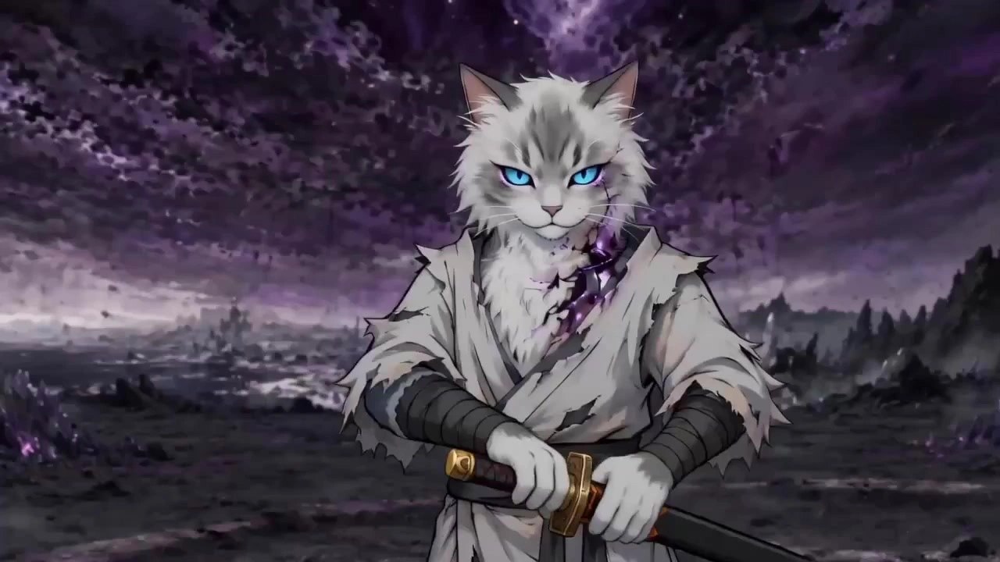

# Action Previs Storyboard Video

> **作者：** @Damon

## Content

Process Planning:

Work Mode Determination (Ask First)At project startup, first confirm the user's current entry point:

Mode A (Concept → Storyboard → Video): User provides action concepts/descriptions, generate PREVIS storyboard images first, then generate video after confirmation.

Mode B (Storyboard → Video): User already has PREVIS storyboard images, skip the storyboard generation stage, let resource_prepare_and_analyze parse the storyboard images and align them to the Storyboard, then enter the video generation stage. Startup criteria for Mode B: User uploaded PREVIS storyboard images directly at the start of the session, or explicitly stated "I already have a storyboard"; must not automatically downgrade to Mode A if the user hasn't uploaded, the mode must be confirmed by the user.

Regardless of the mode, if the user provides character three-view drawings, immediately analyze and register them as character key_element assets via resource_prepare_and_analyze; if not yet provided, prompt the user to upload before entering the video generation stage.

Scene Image Entry: At project startup, simultaneously confirm the source of the scene images—whether the user has provided scene reference images, needs the Skill to generate them, or has no scene images (video generation will then rely solely on PREVIS storyboard images and character three-view drawings).

Complete Workflow and Dependency Order

Lock Global Parameters → text_editor to create Final_Video_Spec.md, recording: Project Name, Total Boards, Aspect Ratio (Default 16:9), Target Output Resolution (Default 720p), Visual Style Lock (Minimalist Stick-figure PREVIS Hand-drawn style), Max Duration per Board (15s).

Analyze Input Assets and Register Immediately → resource_prepare_and_analyze + media_generator:

Mode A: Analyze user-provided character three-view drawings or scene reference images (storyboard images not generated yet).

Mode B: Perform structured parsing frame-by-frame for all PREVIS storyboard images uploaded by the user, outputting a complete "Storyboard Mapping Output" for each board (including action beat sequence, shot direction, transition notes between boards, and inter-board continuity predictions); simultaneously analyze character three-view drawings and scene reference images (if any). Analysis order: Storyboard → Three-view → Scene, output a unified summary result once all are completed.

[Critical Rule] Register assets immediately after analysis: Whether Mode A or Mode B, once the user has uploaded assets and analysis is complete, the following registration and binding MUST be completed via media_generator before the end of this step, and must not be delayed to subsequent steps:

Each character three-view drawing → Register asset_id → Bind to corresponding element character (if Storyboard is not yet established, complete registration and record the mapping, then re-bind immediately after Storyboard is established).

Each scene reference image → Register asset_id → Bind to corresponding element scene (same as above).

In Mode B, each PREVIS storyboard image provided by the user → Register asset_id → Bind to corresponding shot (re-bind immediately after Storyboard is established).

Output the asset registration checklist (Asset Name → asset_id → Target) after registration for user verification; if there are assets that cannot be matched to targets, mark as "[To be bound]" and prompt the user to confirm the assignment.

Establish Storyboard → storyboard_designer:

Mode A: Pre-build shot placeholders (storyboard image content is not yet available, leave empty pending generation and binding), establish element character and element scene entries.

Mode B: Directly populate the "Storyboard Mapping Output" from resource_prepare_and_analyze into the corresponding shot fields board by board; establish element character entries based on the number of characters identified by the analysis tool, and infer scene transitions based on cross-board continuity predictions to establish element scene entries.

Generate PREVIS Storyboard Images (Mode A) → media_generator (TextToImage or ImageToImage, Model: GPT Image 2). Pause after each board is generated, wait for user confirmation before continuing.

Scene Image Acquisition/Generation:

If the user has provided scene reference images, register asset_id and bind to corresponding element scene → media_generator.

If not provided, generate scene concept images based on the element scene description in the Storyboard → media_generator (TextToImage or ImageToImage, Model: GPT Image 2, Resolution 2K); pause for confirmation after generation.

Bind Assets → media_generator: Bind the asset_ids of the confirmed PREVIS storyboard images, character three-view drawings, and scene images to the corresponding shot, element character, and element scene.

Generate Action Video (Board by Board) → media_generator (MultiModalToVideo, Model: Seedance 2.0): Pause after each board is generated, present to the user for review, and continue to the next board after confirmation.

Final Assembly → video_assembler: Splice videos of each board in Storyboard order, handle transitions between boards, and audio alignment.

Dependencies: 3→1; 4→3; 5→3; 6→3,4,5; 7→6; 8→7.

Multi-Board Batch Video Generation Sequence Control (5+ Boards Projects)

Strict Sequential Generation: Always generate board by board according to the Storyboard shot order (Board 1 → Board N), parallel or out-of-order generation is prohibited. Only after each board is generated and confirmed by the user, the final_shot of that board is included in the reference candidate pool for the next board, before proceeding to generate the next board.

Odd-Even Segmentation Strategy (Enabled when Boards ≥ 10): Split all boards into batches of 5 (e.g., 1–5, 6–10...). After each batch is fully generated and confirmed by the user board by board, perform a centralized batch-level consistency pre-check (character position/appearance/scene), output a pre-check summary, and then begin the next batch. Issues found in the pre-check must be fixed in the current batch before proceeding to the next batch, avoiding accumulation of issues until the assembly stage.

Mid-process Issue Handling Rules:

Current board generation quality below standard (e.g., severe character appearance drift, out-of-order action beats): Pause immediately, do not continue generating subsequent boards; display screenshots and description of the problem to the user, suggest fixing direction (adjust reference weight / modify prompt / replace reference input), re-generate current board after user confirms the fix plan, only proceed after passing.

Current board transition glitch (character position/orientation inconsistent with the last frame of the previous board): Append forced start position constraints in the prompt spatial blocking layer, re-generate current board; if it still glitches after two re-generations, prompt the user to choose: ① Accept jump cut and mark for assembly handling; ② Manually upload a transition frame image as start_frame to assist alignment; ③ Return to modify Storyboard transition notes and retry.

Same type of issue for 3 consecutive boards (e.g., same character appearance keeps drifting): Judged as a systemic issue, pause the entire batch, explain the potential root cause to the user (insufficient three-view weight / character description too vague), suggest supplementing higher-quality three-view drawings or adjusting element character description, and re-generate from the first board of the issue.

Single board generation failure (Seedance 2.0 returns error): Skip the current board, continue generating subsequent boards to save time; however, skipped boards must be kept in the pending list, retry uniformly after all boards are generated, entering assembly in an empty board state is prohibited.

Pause Points and User Confirmation Interaction NormsEach pause point must present a structured summary to the user and provide clear decision options, not just output ambiguous prompts like "Finished, continue?". Pause Point 1: After Final_Video_Spec.md is locked

Content: Project name, total boards, aspect ratio, target resolution, visual style, max duration per board, scene image source confirmation (provided by user / needs generation / none).

Decision Options: ① Confirm parameters, enter Storyboard design; ② Modify a specific parameter (user can point directly to the field).

Pause Point 2: After each PREVIS storyboard image is generated (Mode A)

Content: Current board number (e.g., Board 1/N), preview of generated image, frame numbers covered by this board (F1–F8) and brief action beat description.

Decision Options: ① Confirm this board, continue to next; ② Adjust description and re-generate (user explains modification direction); ③ Skip this board (mark as "Pending"), continue with subsequent boards first.

If the user has provided scene reference images and has not confirmed binding, confirm at this node simultaneously: display thumbnail description of the scene image, ask whether to bind to the corresponding element scene.

Pause Point 3: After all PREVIS storyboard and scene images are ready, and Storyboard is established

Content: Complete Storyboard summary—all element characters (including description source: three-view / to be uploaded), all element scenes (including image source: user provided / Skill generated / none), shot list (board number + one-sentence summary of core action beats), list of bound assets.

Decision Options: ① Confirm Storyboard, enter board-by-board video generation; ② Modify description of an element or shot; ③ Prompt user to upload missing character three-view drawings (if there are element characters marked as "Pending", this step is a mandatory pause, must wait for upload to continue).

Pause Point 4: After each board video is generated

Content: Current board number (e.g., Board 1/N), video duration, list of reference inputs used (PREVIS storyboard asset_id, each character three-view asset_id, scene image asset_id, whether previous board reference_video was used), status of transition notes execution (e.g., "Role start position aligned to the right side of the frame based on previous board's last frame").

Decision Options: ① Confirm this board, continue to next; ② Current board needs re-generation (user explains adjustment direction: camera movement / action beats / character appearance / other); ③ Accept this board but mark problem points that need manual processing in the assembly stage.

Pause Point 5: After all board videos are generated, before assembly

Content: Full list of final_shots (board number + duration + whether there are marked issue points), total duration of all boards, consistency pre-check summary (number and location of detected character position jump cuts / scene drift / appearance drift issues).

Decision Options: ① Confirm all videos, enter assembly; ② Re-generate for a specific board (targeted fix based on pre-check issues); ③ Accept existing issues and proceed directly to assembly (suitable for jump cuts with clear montage intent).

Asset Analysis:

Analyze User-Provided PREVIS Storyboard Images (Core Entry for Mode B)Perform structured parsing for each storyboard image, the output must be directly mappable to the Storyboard shot field: ① Count Frames and Recognize Layout

Count the total number of frames in the storyboard image (≤16 frames), confirm the arrangement (4×4 grid or other arrangement).

If frame numbers are unclear or absent, automatically label them F1–FN from left to right, top to bottom, and note the labeling method in the output.

If image resolution is too low or some frames are blurry, mark the affected frame numbers and confidence level one by one ("Readable / Partially Readable / Unreadable"), do not fabricate content for unreadable frames, keep a placeholder in the output and mark as "[To be supplemented by user]".

② Frame-by-Frame Structured Extraction (Every frame must include all the following fields)

Frame Number: F1–FN (automatically labeled or reference labels in the image).

Shot Size: Choose the closest one from standard terms—EXTREME WIDE / WIDE / MEDIUM / MEDIUM CLOSE-UP / CLOSE-UP / EXTREME CLOSE-UP; if there are text annotations in the image, quote them directly and add the mapped term in brackets (e.g., "Annotation WS → WIDE").

Camera Movement: Push / Pull / Pan (direction) / Track / High-Angle / Low-Angle / Static; inferred based on arrows, annotations, or perspective lines in the image; if indeterminable, mark as "Static (inferred)".

Main Action Beat: The core action of the active character (stick figure), described in "Part + Movement Direction + Amplitude" format, e.g., "right arm swings wide to the upper right"; if there are speed lines or trail lines, add [Speed Sensation: Explosive/Smooth/Heavy] after the description.

Hit/Reaction Action: If a second character exists, describe their reaction posture and movement direction; if no second character, mark "Single character frame".

Annotation Excerpt: Transcribe all text annotations in the image verbatim, regardless of Chinese or English; if no text, mark "No text annotation".

Movement Trajectory Arrow: Describe the starting position, direction, and inferred meaning of the arrow (e.g., "character moves from the bottom left of the frame to the top right").

③ Board-Level Shot Direction Summary

Summarize the overall rhythm of the board's camera movement: Starting Shot Size → Intermediate Change → Ending Shot Size, summarized in one sentence (e.g., "Push in from WIDE to EXTREME CLOSE-UP, the whole board focuses on tracking movement").

Identify if there are clear cut points within the board (e.g., obvious cut lines between F3→F4 or "CUT" annotation), if so, mark the switch position.

Summarize the overall motion trend of the board: Character's main movement direction (left/right/into depth/out of depth) and overall rhythm intensity (fluctuating/continuous explosive/gradual power-up).

④ Multi-Board Continuity Prediction (Unique to Mode B)

If the user provides multiple storyboard images simultaneously, output a cross-board continuity summary after analyzing all individual boards:

Confirm whether the character position/orientation at the ending frame (previous board FN) and starting frame (next board F1) of adjacent boards are consistent; if there is obvious inconsistency, mark "[Transition notes between boards needed]".

Confirm the identity consistency of the same character appearing across boards (identified based on stick figure body proportions or character annotations in the image).

Identify if there is a scene switch across boards (background geometric elements change significantly), if so, mark the new scene and suggest establishing an independent element scene.

⑤ Storyboard Mapping Output (For direct reference by storyboard_designer)The analysis result of each storyboard image is finally output in the following structure, aligning field names with Storyboard shot definitions: [Board N Mapping]

Associated Storyboard: [User provided board number or automatically numbered Board_N]

Frame Range: F1–FN (total N frames)

Action Beat Sequence: F1: … ; F2: … ; … ; FN: …

Shot Direction: Start [Shot Size] → [Movement Type] → End [Shot Size]; Cut point within board: [None / F_N→F_N+1]

Transition Notes: [Description of character position/orientation continuity with the last frame of the previous board, fill "First board, no previous board reference" for the first board]

Max Duration: 15s

Items to be supplemented: [List all "[To be supplemented by user]" or "[Transition notes between boards needed]" marks]

Analyze User-Provided Character Three-View DrawingsAnalysis Goal: Extract visual anchors that can be stably reused across all boards (across shots), output structured character identity description as the basis for element character's description, and directly serve as reference binding for subsequent GPT Image 2 character reference image generation and Seedance 2.0 video generation. Extract item by item according to the following dimensions, each item must give specific descriptions rather than vague conclusions like "Normal/No special": ① Face Identity Anchors

Face shape contour (e.g., square jaw / heart-shaped / wide cheekbones)

Facial key features (eyebrow thickness and color, eye shape and spacing, nose bridge height and width, lip shape and color)

Skin tone and texture tendencies (color range description, e.g., warm medium-tan / pale cool-toned)

Hairstyle structure: hairline position, parting method (middle/side/none), length, texture (straight/curly/fluffy/slicked-back)

Hair color: main color + secondary color/highlights (if any), avoid just writing "black", add gloss tendency (matte black / blue-black sheen)

② Body Proportion

Overall height and build classification (tall/medium/short and stocky/slender, etc.)

Visual impression of shoulder width and waist-to-hip ratio

Recognizable local features like hands/neck (if any)

③ Costume & Styling

Tops: style type + main color + secondary color/pattern + collar type/sleeve type and other structural details

Bottoms: style type + main color + length + fit (slim/loose)

Footwear: type + color + sole thickness (if visible across shots)

Texture keywords (2–3): e.g., matte cotton / shiny leather / worn denim

Iconic accessories (if any): type + color + wearing position (e.g., right wrist silver chain bracelet / left shoulder tactical strap)

④ Three-View Consistency Check

Compare the front, side, and back views, point out color differences or inconsistent details between views (e.g., clothing color is darker in side view, back shows backpack but front does not), and indicate "Subject to front view" or "Subject to user description".

If any view is missing in the three-view drawings, mark the missing direction and explain the potential impact on subsequent image/video generation.

Output Format: Output as structured text, segmented by dimensions ①–④ above, each item listed in short sentences or keyword groups, for direct copying and reference in subsequent steps; do not output narrative paragraph descriptions.

Analyze User-Provided Scene Reference Images

Identify spatial structure and key visual anchors: overall environment type (indoor/outdoor/specific location), main constituent elements (building outline, ground material, light source direction and hue, background layering), visual features that can be stably reused in multi-board videos.

Output structured scene description as the basis for element scene's description, ensure scene style and atmosphere are consistent in cross-board videos.

Storyboard Design:

Key Elements Design

Establish an element character for each appearing character, description based on three-view analysis results; if the user does not provide three-view drawings, mark as "To be supplemented" and prompt the user to upload.

Establish an element scene for each major scene/location, describe spatial structure, light direction, key visual anchors in the background, overall hue and atmosphere; if the user has provided scene reference images, the description must be consistent with the reference image content, must not contradict; if no reference image, provide sufficiently detailed description for subsequent generation of scene concept images.

Shot Design (Each board = one shot)Each shot corresponds to a PREVIS storyboard image (up to 8 action beats), must include:

Associated Storyboard: Specify the corresponding PREVIS storyboard image asset ID (or user-provided board number).

Action Beat Sequence: Briefly describe the core action, movement direction, and motion trend of each beat in frame order.

Shot Direction: Camera start/end for the whole board, camera movement type (push/pull/pan/track/static), shot size changes.

Transition Notes: Continuity requirements with the character position/scene state of the last frame of the previous board (leave blank for the first board).

Beat Density Label: Label the beat density type for each board—High Density (Explosive Board) or Low Density (Transition Board), judged based on the following standards:

Explosive Board: Action within the board is dominated by continuous strikes, collisions, multi-person melees, causal relationship between beats is tight, no obvious pauses or power-up segments; target video duration 6–8s.

Transition Board: Contains slow-paced segments like opening up distance, power-up, panting, large camera push/pull; target video duration 10–15s.

If explosive segments and transition segments are mixed within the board, judge based on the dominant content, or explain the segmented rhythm intention in the notes.

Target Duration: Fill in based on the beat density label (Explosive board 6–8s, Transition board 10–15s), not forced to be uniformly capped at 15s.

Mode B Special—Establish Storyboard from Analysis ResultsWhen the user directly provides PREVIS storyboard images, the shot fields of the Storyboard must be directly extracted from the "Storyboard Mapping Output" output by resource_prepare_and_analyze, fields correspond one-to-one, do not rely on subjective speculation to supplement content that the analysis tool failed to identify. Specific rules are as follows:

Analysis tool output is the first draft of the shot: The three fields of Action Beat Sequence, Shot Direction, and Transition Notes are copied directly from the mapping output, maintain original inferred conclusions, do not expand.

Handling of items to be supplemented: Fields marked as "[To be supplemented by user]" or "[Unreadable]" in the analysis tool output retain the same mark in the corresponding position of the shot, waiting for the user to supplement or abandon when confirming the Storyboard at pause point 3. Do not fill these fields with speculative content.

Cross-board element scene inference: If the analysis tool identifies scene switching in multi-board continuity prediction, need to automatically add a new element scene entry for the new scene, description source marked as "[Analyzed by tool, waiting for user confirmation]"; if the analysis tool does not identify scene switching, default all boards to share the same element scene, until the user specifies.

Character element alignment: If the analysis tool identifies multiple different characters through body proportions or character annotations in the image during frame-by-frame analysis, need to establish an independent element character entry for each character, the description field is empty at this time or only filled with minimal features inferred by the analysis tool (e.g., "tall build, active party on the right"), waiting for the user to upload three-view drawings for completion by resource_prepare_and_analyze.

Independent Audio Track

If the project needs background sound effects or action sound effects, plan audio_layer here; action PREVIS videos default to no narration track.

Media Generation:

PREVIS Storyboard Image Generation (Mode A)

Tool: TextToImage (when no user reference image) or ImageToImage (when user provides style reference or already has partial storyboards).

Model: GPT Image 2, Resolution 2K.

Generate a single-image storyboard board containing up to 8 continuous frames each time, frames arranged horizontally (2 rows × 4 columns), unified aspect ratio.

If GPT Image 2 fails, prioritize switching to Nano Banana Pro (Gemini 3 Pro Image) (switch within the same tool), maintain the same prompt and style constraints.

Scene Image Generation (When not provided by user)

Tool: TextToImage (no reference image) or ImageToImage (when user provides partial scene reference).

Model: GPT Image 2, Resolution 2K.

Generate scene concept images based on the description of element scene in the Storyboard, focusing on: overall spatial structure, main light source direction and hue, key background visual anchors (building/terrain/environmental props), style must be consistent with the project's overall visual tone.

When the same scene is reused in multi-board videos, generate only one scene image and bind it uniformly, no need to regenerate for each board.

If GPT Image 2 fails, prioritize switching to Nano Banana Pro (Gemini 3 Pro Image) as a fallback within the same tool.

Asset Registration and Binding

For each three-view image uploaded by the user, register asset_id and bind to the corresponding element character.

For each scene image uploaded by the user or generated by the Skill, register asset_id and bind to the corresponding element scene.

For confirmed PREVIS storyboard images, register asset_id and bind to the corresponding shot.

Mode B Special—Asset Registration Process for User's Own Storyboard ImagesIn Mode B, the user directly provides PREVIS storyboard images, asset registration must be completed after the Storyboard is established and confirmed by the user, and before video generation starts, execute in the following order:

Register PREVIS storyboard images provided by the user: Register asset_id for each storyboard image (each is registered independently, not merged), and bind to the corresponding shot in the Storyboard. If the user provides multiple images at once, register one by one in the order of board numbers output by the analysis tool, output a checklist (Board N → asset_id) for user verification after registration is completed.

Register character three-view drawings provided by the user (if uploaded): Register asset_id for each three-view drawing and bind to the corresponding element character; if the user has not yet uploaded three-view drawings, this step is a mandatory pause node, must wait for upload to continue, cannot enter video generation in a no-three-view state.

Register scene reference images provided by the user (if any): Register asset_id for each scene image and bind to the corresponding element scene. If the same scene appears in multiple boards, register only once, all associated shots share the same asset_id binding, repeating registration of multiple asset_ids for the same scene is prohibited.

Registration Confirmation: After all assets are registered and bound, output the total asset binding checklist (shot list, element character list, element scene list, each including asset_id), prompt the user to confirm before entering the video generation stage. If there are unbound items in the list (e.g., the storyboard image asset_id corresponding to a shot is missing), must pause here and prompt the user to supplement, skipping unbound shots to generate video directly is prohibited.

Action Video Generation (Board by Board)

Tool: MultiModalToVideo, Model: Seedance 2.0, Resolution 720p.

Target duration decided by Storyboard beat density label:

Explosive Board (High Density): Target duration 6–8s, prioritize selection closer to the lower limit (6s) to strengthen the compact feel.

Transition Board (Low Density): Target duration 10–15s, select within the range according to camera movement complexity.

Fill in duration as rounded second value within the above range, not exceeding the 15s limit.

Reference input for each board video:

PREVIS Storyboard Image (asset_id of this board): As the primary visual reference for shot direction and action beats, weight is higher than text prompts. The storyboard image has already encoded a lot of action information through movement vector arrows, trail lines, impact annotations, shot size info bars, etc.; prompts must strictly execute the subtraction principle—content already clearly expressed by the storyboard image must be omitted in the prompts, only supplement speed quality words and causal relationships that the storyboard image cannot convey; highly repetitive prompts and storyboard images will cause text weight to suppress visual references, deviating the generation result from the storyboard intention.

Character Three-View Drawings (asset_id of all appearing characters): As reference for character appearance consistency.

Scene Image (element scene asset_id of the scene involved in this board, provided by user or Skill generated): As reference for consistency of spatial structure and hue atmosphere; if there is no scene image available for the current board, then omit.

Final video of the previous board (optional): Only added as reference_video when the continuity of scene/character state between this board and the previous board is extremely strong; otherwise omit, to avoid introducing unnecessary action continuation.

If Seedance 2.0 fails, do not automatically switch to other models; stop the task, explain to the user and ask whether to try other tools.

Reference Input Progression Strategy for Multi-Board Batch Generation

reference_video enablement threshold tightens with the number of boards: When boards ≤ 4, judge whether to introduce the previous board's reference_video as usual (use when continuity is extremely strong); when boards ≥ 5, only introduce reference_video for boards explicitly marked as "Strong Continuity" in the Storyboard transition notes, omit for all other boards, to avoid reference chain transmission error being magnified board by board as the number of boards increases.

element reference image weight remains consistent: Regardless of which board is being generated, the binding method and input order of element character three-view drawings and element scene images for each board video must be exactly the same as the 1st board, do not reduce the completeness of reference input for subsequent boards because "the first few boards are already stable".

Boards to be repaired do not block subsequent batches: When a board is marked as "needs re-generation", subsequent boards can continue to be generated (skip the reference_video chain of this board, directly use the last confirmed final_shot as a continuity reference); after the skipped board is repaired, if its direct subsequent boards have already been generated, prompt the user to evaluate whether subsequent boards need re-generation due to reference missing.

Cross-Board Consistency Strategy (Video Generation Stage)Scene Image Reuse Rules:

When the same element scene appears in multiple boards, force reuse of the same scene image asset_id, repeating generation or replacing with new images for the same scene is prohibited; only when the user explicitly requests scene state changes (e.g., time period switch, scene after destruction), then generate new scene images and register independent asset_ids.

During each board video generation, if this board involves an existing element scene, the corresponding scene image must be included in the reference input, even if the current board's main action has no direct connection to the background, it should be retained to stabilize hue and spatial structure.

Character Position Continuity Handling:

Before each board video generation, read the "Transition Notes between boards" field from the Storyboard: if it indicates the character position at the last frame of the previous board (e.g., "Character A is on the right side of the frame, facing left"), the starting state must be aligned with it in the spatial blocking (③) of the current board's prompt, to avoid position jump cuts.

If there is a clear action causal relationship between two boards (e.g., hit → fall), the first action beat (F1) of the subsequent board's prompt must be written starting from the forced posture of the hit character, rather than resetting to a neutral standing posture.

If there are no transition notes between boards (first board or clear scene switch), no forced alignment, schedule independently according to this board's storyboard image.

Three-View Consistency Fallback:

All board video generations must be accompanied by three-view drawings asset_id of all appearing characters; even if a character has very few scenes in a board, do not omit their three-view citation, to prevent Seedance from redrawing character appearance on its own under low-weight situations.

Prompt Writing:

PREVIS Storyboard Image Prompts (GPT Image 2)Core Design Principles: The generated storyboard images should have sufficient visual information density so that Seedance 2.0 can directly read the action arrangement, spatial relationships, and shot intentions from the images, minimizing reliance on text prompts. Each frame must be "self-explanatory"—even without reading the prompt, one can understand what happened in that frame from the annotations, arrows, and lines within the image. Core constraints (must be included in every prompt, placed first):

Style Lock: Minimalist, rough, hand-drawn storyboard style, all characters must be represented by stick figures only, appearance of realistic human structures, muscles, clothing, pants, shoes, or any character details is prohibited.

Line Style: Hand-drawn pencil/charcoal lines with uneven thickness, slight jitter and irregularity allowed, reflecting the tension of sketches; smooth vector lines or any digital clean-up feel is prohibited. Key motion trends emphasized with heavy lines, auxiliary reference lines (perspective lines, trajectory lines) represented by thin dashed lines.

Background Treatment: Background remains minimalist, using only geometric outlines (blocks = buildings/covers, horizontal lines = ground/steps, diagonal lines = slopes) to indicate spatial relationships; realistic textures, fill colors, or any detail textures are prohibited. Overall background is pure white or very light cool grey paper surface color, only lines, no gradient or shadow fill.

Annotation Language: All shot annotations, action descriptions, technical instructions must use English (e.g., PUSH IN, WIDE SHOT, POV, IMPACT, ×2 SPEED), maintain professional director previs conventions; Chinese characters within the frame are prohibited.

Single Image Multi-Frame Layout: Clearly specify the number of frames (up to 16), arranged in a 4×4 grid, each frame composed independently, separated by thin solid lines; a small grey frame number (F1–F16) can be placed in the upper left corner of each frame.

Visual Information Density Requirements per Frame (Core)Each frame must simultaneously contain all the following visual element layers, missing any layer will cause insufficient information during Seedance reference:

① Movement Vectors: Draw independent trajectory lines with arrows for every moving limb or body part, arrow length reflects movement amplitude (large amplitude = long arrow), arrow thickness reflects force (explosive power = thick arrow); the overall character displacement must draw a separate whole-body movement trajectory arc, distinguished from limb arrows by line type (limb = solid line, displacement arc = dashed line).

② Motion Blur Streaks: The ends of moving limbs (fists, toes, knees) must draw 2–4 parallel trail lines, the direction of the trail is the opposite of the movement, indicating speed sensation; trail lines for explosive actions (e.g., straight punch, sweeping leg) should extend to the edge of the frame or very close, expressing the force of crossing.

③ Impact Markers: Any frame with contact or impending contact must draw explosion-shaped radiation lines (star or chrysanthemum shape) at the contact point, and add English annotation (e.g., IMPACT / HIT / BLOCK / GRAB) next to it; if close-quarters force (e.g., close combat), draw additional concentric circles or compressed ripple lines to indicate force conduction.

④ Spatial Depth Indicators: All frames must have a clear horizon line (represented by thick horizontal dashed lines), in multi-character scenes, each character must have a landing shadow dot or small horizontal line under their feet (indicating standing position), foreground characters drawn with thicker lines, background characters with thinner lines, to form visual depth layers.

⑤ Character Labels: When there are two or more characters in the frame, there must be an uppercase letter label (A / B / C) next to each character's head, the active character's label is circled (①), the attacked party's label is in a box ([B]); this label must remain consistent across all frames of the board, not changing with frames.

⑥ Shot Info Bar: Leave a thin horizontal annotation bar at the bottom or top of each frame, marking: shot size abbreviation (WS / MS / MCU / CU / ECU) + camera movement (STATIC / PUSH / PULL / PAN-L / PAN-R / TRACK) + optional speed modifier (SLOW / NORMAL / SNAP); format example: MCU | PUSH | SNAP.

⑦ Inter-frame Transition Cues: On the dividing line between adjacent frames, if the action is continuous, use a small arrow (→) to indicate the flow of action; if it is a cut (CUT), mark CUT on the dividing line; if it is a shot switch (scene change), mark NEW SHOT on the dividing line, and replace the single line separator with double vertical lines.

Prompt structure (order):

Style constraints + Visual information density requirements per frame (core constraints above, compressed into concise instructions)

Frame count and layout declaration (e.g., 8-panel grid, 2 rows × 4 columns)

Describe frame by frame according to frame number: Shot info (shot size + movement) + Character label assignment + Main action vector direction + Impact point position + Inter-frame transition type

Overall rhythm of action arrangement for the whole board (one sentence summary of action causal chain, e.g., A breaks through defenses→close-range force combo→B/C fall one after another)

If there is a reference image (ImageToImage mode): specify reference source and reference dimensions (composition/motion/shot language), exclude character appearance reference.

Character Reference Image Prompts (GPT Image 2 — TextToImage / ImageToImage)The core function of the character reference image is to provide stable character appearance anchors for cross-board videos, the output must be directly usable as reference_image input for Seedance 2.0. Write in the following structure order: ① Layout Declaration

First sentence clearly states the output is a side-by-side two-panel reference sheet, left frame: tight head-and-shoulders portrait; right frame: full-body standing pose, neutral stance.

Unified background for both frames: plain light grey / pure white studio background, no shadow projection or environmental elements, ensure no background noise is introduced during Seedance reference.

Merging the two frames into a single frame is prohibited, adding side/back views is prohibited (side/back information is borne by the original three-view drawings, reference image focuses on front standard appearance lock).

② Facial Identity Lock

Directly cite the ① Face Identity Anchors output by resource_prepare_and_analyze, write item by item: face shape contour, facial key features (eyebrows/eyes/nose/lips), skin tone description, hairstyle structure and hair color (main color + gloss tendency).

Left frame (head-and-shoulders portrait) must additionally note: facing directly forward, neutral expression, soft frontal lighting, minimal shadow to ensure facial features are clear and extractable.

Adding dramatic lighting effects (e.g., strong side lighting, Rembrandt lighting) or exaggerated expressions is prohibited, to avoid interfering with Seedance's facial consistency recognition.

③ Costume Reproduction

Directly cite ② Body Proportion + ③ Costume & Styling output by resource_prepare_and_analyze, describe layer by layer: tops → bottoms → footwear → iconic accessories.

Each item must contain three elements: color + style + texture; use English color words (e.g., matte charcoal-grey / deep navy / off-white cream), avoid mixing in Chinese color words.

Right frame (full-body standing pose) must note: standard neutral standing pose (hands naturally hanging or slightly clenched fists), do not add dynamic poses, ensure the full-body clothing is completely visible without obstruction.

④ Style & Rendering Anchor

Style positioning words (1 sentence): cinematic character design reference sheet, realistic proportions, clean studio lighting, sharp focus.

Do not add PREVIS stick-figure style vocabulary, character reference images must be realistic/semi-realistic style to serve Seedance's appearance extraction.

If the user provided three-view drawings (ImageToImage mode): at the end of the prompt, indicate the reference source is the front view of the three-view drawings, reference dimensions are face + costume only, excluding background, pose, light effect references.

⑤ Fixed Exclusions (must be attached to the end of every prompt)no background elements, no props in hand, no dynamic pose, no motion blur, no text, no watermark, same character in both panels

Scene Concept Image Prompts (GPT Image 2 — TextToImage / ImageToImage)The core function of the scene image is to provide stable spatial structure and hue anchors for cross-board videos, prompts must ensure the output can be directly used as Seedance reference input. Write in the following structure order: ① Spatial Composition

First sentence clearly states the environment type and shooting angle: indoor/outdoor, specific location type (e.g., industrial rooftop / narrow alley / concrete stairwell), overall pitch angle (eye-level / high-angle establishing / low-angle looking up).

List the structural anchors that must appear in the frame (up to 3), as visual identification basis for reuse across boards, e.g., a rusted fire escape on the right edge, cracked asphalt ground, distant city skyline.

Clarify the hierarchy relationship between foreground/middle ground/background, specify the main visual elements of each layer, ensure the frame has sufficient depth for video generation reference.

Any recognizable people, character outlines, or human silhouettes are prohibited in the scene images; scene images are used only for spatial and hue reference.

② Lighting

Specify main light source type and position: natural light (golden hour sidelight from left / overcast diffused top light) or artificial light (single harsh overhead fluorescent / neon strip from below-right).

Describe shadow direction and length (short hard shadows cast to the right / long soft shadows stretching leftward).

Specify secondary light source or reflected light (if any): fill light color, intensity and direction (cool blue fill from the sky / warm amber bounce from ground).

Lock the overall exposure tendency: high-key / mid-tone / low-key; for action scenes, default tendency is mid-tone to low-key to enhance contrast and tension.

③ Visual Tone

Hue tone description: constituted by dominant hue + accent + overall saturation tendency, e.g., desaturated teal-grey base with orange accent points, low saturation.

Material and texture keywords (2–3): concrete / rust / wet asphalt / crumbling plaster / worn wood, aligned with the project's PREVIS visual style.

Atmospheric feeling (if any): light haze / rising dust particles / rain mist / dry heat shimmer; use strong fog effects with caution in action scenes to avoid obscuring spatial structure.

Style reference words (1 sentence): end with film/image feeling style words, e.g., cinematic location scout photograph, no people, sharp focus, production design reference.

④ Exclusions (must be attached to the end of every prompt)no people, no characters, no silhouettes, no text, no watermark, no vignette, photorealistic environment only

Video Prompts (MultiModalToVideo + Seedance 2.0)Core Principle: Storyboard image-led, prompts fill the gapsPREVIS storyboard images (<<<image_1>>>) have already encoded a lot of action and shot information through movement vector arrows, motion blur streaks, impact annotations, shot info bars, etc.—this is the primary reference source for Seedance 2.0. The sole responsibility of the prompt is to supplement information that the storyboard image cannot encode: speed quality words, character causal relationships, sound effect instructions. [Mandatory Subtraction Principle] For content already clearly expressed in the storyboard image, prompts must omit it or leave only 1–2 keywords, do not expand description:

Storyboard image has movement vector arrows → limb action description in prompt is omitted, only keep speed quality words (e.g., explosive)

Storyboard image has shot info bar (e.g., MCU | PUSH | SNAP) → camera movement description in prompt is shortened to one sentence (e.g., medium close-up, push in), do not expand

Storyboard image has impact annotation (IMPACT) → contact point description in prompt is omitted, only keep sound effect annotation (<sharp impact crack>)

Storyboard image has character labels and position information → spatial blocking description in prompt is omittedViolating this principle (i.e., prompts and storyboard images are highly repetitive) will cause text weight to suppress visual references, generation results will favor text rather than storyboard intention.

Reference Input Binding (According to Seedance multimodal input specifications):

<<<image_1>>> = PREVIS Storyboard Image (Blueprint for shot direction and action beats, primary reference)

<<<image_2>>>, <<<image_3>>> … = Each character's three-view drawings (one per character, for appearance restoration, arranged in order of appearance)

If using previous board video reference: <<<video_1>>> = previous board final_shot (only used when continuity is extremely strong, omitted by default)

Prompt Structure (Motion stack order, strictly written according to the following levels):① Camera Movement

Shortening Principle: Camera movement already annotated in the storyboard image shot info bar, write only one summary sentence in the prompt, do not expand; the supplementary value of the prompt lies in speed quality words (the storyboard info bar usually has SNAP/SLOW, but Seedance is more sensitive to text speed words).

Format: [Start Shot Size] → [Movement Type] → [End Shot Size], strictly corresponding to the shot direction annotation of the PREVIS storyboard image.

Shot size vocabulary locked (keep consistent with storyboard annotations): EXTREME WIDE / WIDE / MEDIUM / MEDIUM CLOSE-UP / CLOSE-UP / EXTREME CLOSE-UP.

Boards with multiple shot switches: list each segment of camera movement in beat order, separated by "→ cut →", do not use timecodes.

Example: WIDE SHOT, swift push in → cut → EXTREME CLOSE-UP on fist impact, lock-off

② Character Action

Subtraction Priority: For limb actions clearly specified by movement vector arrows in the storyboard image, write only speed quality words, do not repeat description of specific limb movement direction. Only causal relationships that the storyboard image cannot convey (e.g., "center of gravity shifts back after being hit", "counter-clinch interlock") need to be expanded.

Multi-beat writing (Simplified version): In the order of PREVIS frame numbers (F1→F8), write only [Speed quality word + Causal relationship (if any)] for each beat, limb actions already clear in the storyboard image are omitted; beats are separated by semicolons.

✅ Correct (storyboard image already has arrows): F1: explosive; F2: recoils from impact, weight shifts back; F3: snapping

❌ Incorrect (repeated info already in storyboard): F1: right arm swings upward in a 120° arc at explosive speed, fist clenched, elbow leads

Multi-character writing: Describe the main action character first, then the attacked/reaction character; main-sub relationship clarified by words like "in response / simultaneously / recoils".

Speed Quality Vocabulary (Use the following standard words uniformly): explosive / snapping / fluid / heavy / weightless / sluggish; using vague words like fast/slow is prohibited.

③ Multi-character Scene Special Rules (Mandatory when two or more characters appear in the same board)Main-Sub order of character action description:

Describe character by character in the order of "Active party → Attacked/Reaction party → Secondary bystander character", each character makes an independent sentence, characters are separated by "—" or line breaks, mixing the actions of two characters in the same sentence is prohibited.

Definition of active party: the party initiating force/displacement output in the current beat (attacker, pursuer, push-puller); if the beat is a simultaneous counter-clinch between both parties (e.g., sparring opening stance), use the party with visual focus bias in the frame (usually the character closer in the frame center) as the active party.

Causal link word specification: the attacked/reaction party must be introduced with clear causal words, select one of the following: in response / simultaneously / recoils from / absorbs the impact / driven back by; using "and" to simply list two characters' actions is prohibited, to avoid blurring the main-sub relationship. Frame spatial allocation:

Each character must use independent frame position words to lock their occupation in the composition, using relative words (e.g., "they stand together") to describe multi-person positional relationships is prohibited.

Default spatial allocation template for two-character scenes: active party frame left / center-left, attacked party frame right / center-right; if PREVIS storyboard image shows opposite layout, subject to the storyboard image and specify clearly in the prompt.

Three characters or more: allocate by foreground/middle ground/background depth layers, foreground character (largest shot size) is the active party, middle ground is attacked/reaction party, background is secondary character; each layer must have clear depth distance feeling description (e.g., pushed into the background, noticeably smaller in frame).

When multiple characters move simultaneously, the movement direction vectors of each character must be distinguished from each other (e.g., A drives forward toward frame right; B retreats toward frame left), blurring descriptions like "the two have a fierce conflict" is prohibited. Reference image binding method:

Reference image input for multi-character boards must be bound strictly character by character, binding order is fixed: PREVIS storyboard image (<<<image_1>>>) → Active party three-view (<<<image_2>>>) → Attacked/reaction party three-view (<<<image_3>>>) → Secondary character three-view (<<<image_4>>> increasing in order) → Scene image (last image placeholder).

After each reference image is bound, specify its source placeholder in parentheses at the beginning of the corresponding character description sentence in the prompt, format is [ref:image_2] Character A: ..., ensure Seedance can correspond reference images with character descriptions in the prompt text, reducing the risk of appearance confusion.

Merging multiple characters' three-view drawings into a single image placeholder input is prohibited; each character must independently occupy an image slot, to ensure Seedance's appearance extraction weight for each character is independent.

④ Spatial Blocking

Describe the change of character position in the frame: frame left / frame right / center frame / foreground / background / off-screen.

Spatial relationships with scene elements (ground, obstacles, environment anchors) must be consistent with PREVIS background geometry.

If there are characters entering/exiting the frame: clarify entry/exit direction (enters from frame left / exits top frame).

⑤ Sound Effects and Dialogue Annotation (Added only when no independent narration track conflict)Use Seedance 2.0 official syntax, placed at the end of the prompt:

Action Sound Effects (SFX): <sound of heavy footsteps on concrete>、<sharp impact crack>、<whooshing air burst>

Dialogue: {EN: "Get down!"} (language code prefixed)

Ambient Sound: <ambient urban noise, distant siren> used to supplement scene atmosphere

Priority: Action impact sound effects > ambient atmosphere sound > dialogue; when all three appear simultaneously, list them in this order at the end of the prompt.

⑥ Beat Density Corresponding Speed Quality Words (Automatically selected based on Storyboard labeling, appended to the end of ② Character Action description)

Explosive Board (High Density): Append at the end of character action description layer: snapping cuts, explosive action rhythm, no slow motion, rapid kinetic energy

Transition Board (Low Density): Append at the end of character action description layer: deliberate pacing, building tension, smooth camera movement

Using vague words like fast / slow to replace the above standard speed quality words is prohibited for both types of boards.

⑦ Fixed Negatives (must be attached to the end of every prompt)no subtitles, no text overlay, no wardrobe change, no style shift between cuts

no wardrobe change: ensure character clothing is consistent with three-view drawings throughout.

no style shift between cuts: suppress Seedance's tendency to automatically change frame style/hue within multi-beat boards.

Video Editing:

Splice Between Boards and Rhythm

Splice videos of each board in Storyboard shot order, default to hard cut (no fade in/out), retain action impact feel.

If the Storyboard notes of adjacent two boards indicate "Strong Continuity", extremely short cross-dissolve (≤4 frames) can be used to assist transition, avoiding jump cut feel.

Consistency Check Priority (Must do before assembly)

Character position continuity: Check the frame position and orientation of each character in the transition frames (last frame of previous board vs first frame of next board) between adjacent boards one by one. If obvious jump cuts occur (e.g., character teleports from left to right of the frame, orientation reversal without cause), add a marker at the corresponding cut point on the timeline, pause assembly and prompt user to choose: ① Re-generate subsequent board video (forced specification of starting position in the prompt); ② Accept jump cut (suitable for situations where montage editing intent is clear).

Scene visual anchor consistency: Check whether the main visual anchors (horizon height, main light source direction, key background objects) of the background of the same element scene are stable across multiple boards. If there is obvious style drift or sudden composition change, mark similarly and prompt the user.

Character appearance drift detection: If the character's clothing color scheme, hairstyle, or iconic accessories show visual differences in adjacent boards, note in the timeline notes, prompt the user to evaluate whether re-generation of the corresponding board with stronger three-view weight is needed.

Priority Order: Character position jump cut > Scene visual anchor drift > Character appearance drift; the former affects narrative coherence, the latter two affect visual stability, processed separately, not mixed.

Audio Processing

If each board video contains action sound effects generated by Seedance 2.0, retain by default; background music track (if any) is laid continuously across boards, not interrupted by cut points between boards.

When there is no narration track, the volume of the action sound effect track is moderately increased to enhance impact.

Export Settings

Export resolution follows the global setting of Final_Video_Spec.md (default 720p), aspect ratio defaults to 16:9.
