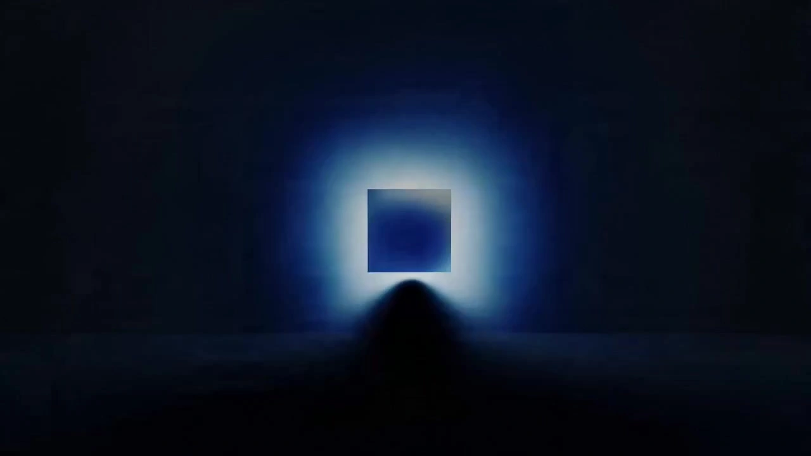

# Aesthetic to Video

> **作者：** @Flova

## Content

Process Planning:

Phase Logic and Dependencies for the Complete Video:

Write Final_Video_Spec.md (Title, type, ratio, duration, visual style, language, model preferences) → text_editor.

Generate storyboard (shot_list, audio_layers) → storyboard_designer.

Generate a keyframe image for each shot → media_generator.

Generate the final video for each shot; reference the keyframe for that shot (Step 3) → media_generator.

Generate all audio_layers based on the storyboard → media_generator.

Perform final editing once all assets are ready; guide the user to export → video_assembler.

Dependencies: 2→1; 3→2; 4→3; 5→2; 6→2, 3, 4, 5.

Note — User-provided or existing assets (primarily affects steps 3–5): Before populating generated content, use the media_generator to bind and assign them to the corresponding storyboard positions; avoid re-generating assets that the user has already provided.

When to Pause: Do not run through all steps at once. Stop at each of the key phases mentioned above (e.g., after specs are defined, after the storyboard is complete, after element images are finished, after keyframes are finished, after shot videos are finished, after audio is finished) to confirm with the user before proceeding to the next step. Before continuing, use a card or reply_to_user to invite the user for a review.

Before finalizing the Final_Video_Spec and asset generation, you must confirm the path for generating aesthetic images using MJ with the user:

Path 1:Use prompt descriptions to define the style. If the user specifies style terminology or preferences, record the style description in Final_Video_Spec and consistently reuse these style description words in subsequent element generation.

Path 2: Use an sref code as the style benchmark. Build the content within the storyboard plan using --sref codes, rather than rewriting the Final_Video_Spec style into every MJ prompt.

--sref Selection Rules:

Ask the user if they have Midjourney V7 --sref style codes. Otherwise, the agent should select a code (usually a valid random/fitting integer in the 0–4294967295 range); record the code used and reuse it in subsequent MJ calls for the project unless changed by the user.

Use --sref <code1> <code2> …, with tokens separated by spaces (e.g., --sref 5877700996 4815442863 …). Each value must be an integer between 0–4294967295. Multiple codes can be stacked. If the user provides multiple codes, record the complete list and reuse it across all MJ element tasks. When inventing a code without user preference, prioritize choosing a single auto-generated integer to maintain simplicity, unless the user explicitly requests stacking.

Storyboard Design:

How to Design Shots

Each shot description must include:

Scene: Reference location/set (use scene element IDs, e.g., [Element_Office_Noir]).

Narrative Content: Actions and dynamics of characters and key objects; dialogue and performance. Write out the exact dialogue (spoken lines or internal monologue / OS). Reference characters using element IDs.

Cinematography: Shot size (e.g., Wide shot, Medium shot, Close-up), camera angle (e.g., Low angle, High angle), camera movement (e.g., Static, Pan, Dolly).

How to Design Independent Audio

Background Music: Design at least one global background music track. If the video is long (e.g., 3 minutes or longer) and has clear intermissions or turning points, you can plan multiple music segments (each with its own audio_id and scope).

Narration: If using voice-over or narration to explain or advance the story, design it here (set type to narration). Define the vocal characteristics, tone, and exact script; use layout_instruction to constrain it to the relevant shot range.

Media Generation:

Key Element Image GenerationLoad the generation path selected by the user. Path 1: If the user specifies style terminology or preferences, use the style recorded in Final_Video_Spec as the style description in the prompts. Path 2: Use sref code as style. Build the first frame of the storyboard plan using --sref codes, rather than rewriting the Final_Video_Spec style into every MJ prompt.

TextToImage. Recommended model: Midjourney V7.

Prompt Rules: Describe content (person/thing/place, recognizable silhouettes, environment). Append --sref according to the rules below. Do not cram long-winded descriptions of "intended video/image style" from the spec document into MJ, and do not treat MJ steps as a place to execute that document—sref + subject/scene description is sufficient.

--sref Selection Rules:

Ask the user if they have Midjourney V7 --sref style codes. Otherwise, the agent should select a code (usually a valid random/fitting integer in the 0–4294967295 range); record the code used and reuse it in subsequent MJ calls for the project unless changed by the user.

Use --sref <code1> <code2> …, with tokens separated by spaces (e.g., --sref 5877700996 4815442863 …). Each value must be an integer between 0–4294967295. Multiple codes can be stacked. If the user provides multiple codes, record the complete list and reuse it across all MJ element tasks. When inventing a code without user preference, prioritize choosing a single auto-generated integer to maintain simplicity, unless the user explicitly requests stacking.

Final Shot Video Generation

MultiModalToVideo. Input: Keyframes. Recommended model: Seedance 2.0, resolution 720p.

Prompt Writing:

Highest Priority, applies to all prompt writing: When the user inputs in Chinese or loads a Chinese environment, the prompt must be written in Chinese. However, content regarding narration/dialogue in the prompt must strictly follow the Output Language specified in the Final_Video_Spec.

Prompts for Image Generation (TextToImage, ImageToImage)General Principles for All Image Prompts

The prompt is not just a description of "what is in the image," but rather like a professional film director and colorist giving instructions to the team.

key_frame (Nano Banana) is the exception: Do not use the long-winded 6 Core Principles here. Heavy cinematic text will cause Banana to ignore or fight against the MJ reference image, leading to the image being redrawn. Prioritize "Slot Tag + Storyboard Alignment"—please refer to the key_frame section below.

For Midjourney key_element TextToImage (Style/Scene, Character/Prop Base, Wide Scene): You must apply the "6 Core Principles of Cinematic Prompts." Write in fluent, natural English paragraphs; do not output as labeled sections:

Professional Style Terminology: Use professional artistic or cinematic terminology combined with style vocabulary to improve accuracy (e.g., introduce authors and specific visual anchors, using Neo-Noir style, David Fincher Style, inspired by Se7en as a style anchor, rather than vaguely saying Neo-Noir style).

Composition and Cinematography: Clearly indicate cinematic composition (e.g., Over-the-shoulder shot, Dutch angle) and shot size (e.g., Close-up, Medium shot).

Lighting: Detail the key light and emphasize "negative fill" to create contrast and drama (e.g., Strong chiaroscuro contrast, dramatic interplay of light and shadow, or deep facial shadows emphasizing facial structure).

Color Grading: Use high-end Hollywood color grading to set a restrained tone (e.g., deep teal-cyan shadows dominating 90%, zero warm fill or muted watercolor wash). Unless the user explicitly requests it, do not use red-blue neon clashes (e.g., ban crimson bleed, neon magenta vs. cyan). Limit the image to one dominant tone (occupying about 90% of the frame)—extreme restraint.

Visual Rendering: Describe overall visual quality and texture (e.g., fine rendering quality, rich and intricate details, soft focus with slight Gaussian blur).

Atmosphere and Subtext: Describe the character's "subtext" and micro-expressions, capturing the action in a dramatic moment (e.g., oppressive suffocation, no mercy, and predatory stillness). Refuse stiff, posed stances. For inanimate objects, describe their state (e.g., a sense of fatalism, piercing gaze, cold and alienated atmosphere).

Conditional Elements (Include only when relevant):

Accurate In-Frame Text: If text appears in the scene (e.g., text on a screen), integrate it naturally. You must wrap the exact text content to be rendered in quotation marks to show emphasis. E.g., 'A neon sign in the background reads "DANGER".'.

When the target character is a key_elementProvide a clear, detailed visual definition of the element to ensure consistency across shots. The prompt structure is as follows:

Subject & Characteristics: Clearly state what the element is—character, prop, scene, or creature. For characters, include defined identity traits (age, body type, race (if specified), distinguishing features, voice).

Feature Details: Describe the specific key visual features of the element. Prioritize features that must remain consistent across shots:

Character: Facial features (eye shape, jawline, hair style/color), makeup and styling (if applicable), clothing and accessories (material, cut, color, state).

Props/Objects: Shape, material, color, size, state (brand new/weathered/damaged), unique markings.

Atmosphere/Emotional Tone: Describe the emotional tone that defines the scene (e.g., tense, melancholy, hopeful, serene, uneasy, warm, oppressive, fearful, nostalgic, isolated, intimate).

Only use when the user chooses Path 2: Confirm style via sref code:

--sref (Apply only in Midjourney V7 calls): After the main prompt text, append --sref followed by one or more integers separated by spaces. Follow Final_Video_Spec / storyboard_designer; verify that each token is between 0–4294967295; standardize user input to a space-separated format. If not set, choose a code, record it, and reuse it during global MJ image generation.

Prompts for Video GenerationIn video prompts, name characters for every reference image so Seedance can correctly read faces and styling. Use the product's image tags (<<<image_1>>>, <<<image_2>>>). Template: Subject 1 — Facial features reference <<<image_1>>> (Headshot); Hair style, makeup, and clothing reference <<<image_2>>> (Full body shot). For Subject 2, continue numbering (e.g., <<<image_3>>> Headshot, <<<image_4>>> Full body shot, etc.). Then use the Seedance sequence below (Shot → Subject → Space → Audio) to append action/motion prompts:Follow this order in written prompts:

Shot — Movement or camera/editing change (e.g., Static → Push in, cut to new angle, Orbit, Pan).

Subject — Actions and expressions (who did what, facial expressions).

Space — Location or environment changes (position of subject or camera relative to space; background movement; depth/layout transition).

Audio — Dialogue (if any), sound effects, and music when missing from the model (see notes below). Action Details

Actions based on specific body parts when relevant: Hands, legs, head, shoulders, etc.

Addition of degree: Amplitude, speed, force (e.g., slowly raise one hand, head snaps left, push off ground with force).

If there are multiple beats in one prompt, list them in the order from primary action to secondary action (in chronological order of the story). Multi-beat & "Shot 1 / Shot 2" (Official Guidelines)

When the tool accepts long prompts, you can mark Shot 1, Shot 2, Shot 3 in a single generation to indicate the sequence of shots or story beats.

Precise clock timing (e.g., "0–3 s", "3–6 s") cannot be reliably executed — do not force split prompts by precise second ranges, and do not write an explicit second-by-second plan (e.g., "at 2 s…", "from 5–8 s…"). Describe what happens in order, not a list of shots divided by time. Optional Modifiers (When the brief is live-action footage): You may add slight handheld micro-shakes or subtle film grain based on other strategy rules — keep it subordinate to the order of the four layers above. Special Character Conventions (For Seedance 2.0) Seedance accepts natural language prompts; these wrappers help the model distinguish between music, sound effects, dialogue, and on-screen title text:

Music (Describe what is playing): (...), e.g., (fast-paced rock playing in the background).

Sound Effects: <...>, e.g., <distant dog barking>.

Spoken Dialogue: {...}, e.g., {Hello, world} — If a line of dialogue is not in the project's primary language (e.g., Japanese lines in an English video), mark the language before the curly braces, e.g., Says in Japanese: {こんにちは}.

On-screen Titles / Chapters / Subtitle Text: 【...】, e.g., 【Chapter One: Departure】

For special instructions involving highly complex or multi-stage actions within a single shot: You must describe the sequence in order. You can use "cut to" tags to indicate transitions (Shot A..., cut to Shot B..., cut to Shot C...).

Example: Shot1: <<<image_1>>> his hands carefully open a dusty wooden box, with the sound of a soft creak. <<<image_1>>> His expression is focused and curious. The camera is a fixed shot, and the background attic is static. Shot2: cut to a bright blue light emanates from the artifact inside, casting an ethereal glow on his face and creating long, shifting shadows in the room. <<<image_1>>> His expression changes from focused to shocked awe as the camera begins a slow zoom in on his face. Shot3: cut to <<<image_1>>> he looks up with determination, the blue light reflecting in his eyes, as he slightly turns his head to the left to look past the camera. (no dialogue, no music, no subtitles)

Note: You must always include the following negative constraints in prompts to ensure the output is suitable for post-production:

If the storyboard script indicates that the shot has an independent narration track, do not write narration text in the video prompt to avoid audio conflicts.

To prevent the model from adding unwanted background music, you should almost always include 'no music'.

Subtitles are added during post-production editing, so you must always include 'no subtitles'.

Video Editing:

Assemble all shots, narration tracks, and background music in storyboard and timeline order; guide the user to export once editing is ready. If the final shot has no in-shot dialogue or narration, mute the embedded audio of that shot/video layer in the edit, and rely on the Audio Layer (based on designed background music/sound effects), so that the sound effects generated within the shot do not conflict with the mix.
