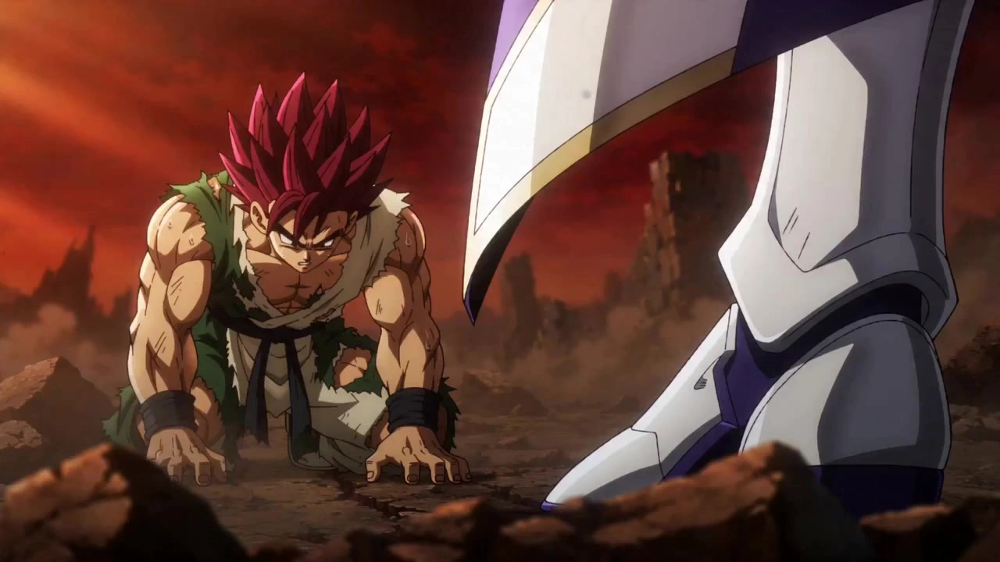

# Akira Toriyama Style Animated Short

> **作者：** @Damon

## Content

Process Planning:

Full Process Stages and Dependencies:

Plot Development (Scriptwriting Phase): The goal of this phase is to develop user input (a simple idea, character name, combat scene description, etc.) into a complete story outline suitable for storyboard design. Proceed through the following sub-steps. You must pause after completing each sub-step to obtain user confirmation before moving to the next. Do not skip steps: a. Extract Core Concept: Analyze the user's initial input and summarize it into the three elements: "Who × What they want × What obstacles they face." Rephrase this in 1-2 sentences for the user to confirm. Do not proceed until understanding is verified. If the input is incomplete, proactively offer reasonable suggestions (clearly marked as "Suggestion") for the user to accept or adjust. Do not make decisions for the user in silence. b. Determine Story Genre, Style Era, and Output Language: Based on the concept, determine the best-fitting genre (Action/Hot-blooded, Daily Comedy, Transformation Climax, Character Promo) and ask the user:

Style Era: Early Rounded (Dr. Slump/Early Dragon Ball) / Mid-period Hot-blooded (Dragon Ball Z) / Late Modern (Dragon Ball Super). If unspecified, provide a recommendation with reasons.

Output Language: Chinese / Japanese (This affects dialogue, voice-over language, as well as on-screen subtitles and voice tone direction). If unspecified, provide a recommendation and explain the differences (Chinese is closer to domestic audiences; Japanese is closer to the original anime atmosphere). Lock this in only after user confirmation; do not default without asking. c. Establish Three-Act Structure: Expand the core concept into a three-act outline:

Act I (Setup): Introduce the protagonist and worldview, presenting the cause of the core conflict or the daily state.

Act II (Confrontation/Development): Conflict escalates, character faces setbacks, key turning point.

Act III (Climax/Resolution): Final battle or outbreak, results, and emotional payoff. Display the outline to the user in paragraph form, clearly defining the emotional tone, main actions, and key characters for each act. The user can modify any act until the overall direction is confirmed. d. Confirm Character Path and Scene Settings: Before listing characters, you must use reply_to_user to confirm the character creation path with the user, proactively explaining the differences and risks of the two paths:

Original Character Path (Recommended): Design entirely new characters referencing Akira Toriyama's aesthetic style, but with differentiated hair color, clothing color, and hair silhouette. The Skill will guide the process to ensure successful original design.

Original Work Adaptation Path (Risky, must inform): If the user wishes to base characters on existing ones like Goku or Vegeta, explicitly inform them: Direct use of original character names or visual features highly similar to the original (e.g., iconic hair color + clothing color + hair shape) has a high probability of triggering copyright safety filters during both image and video generation phases. The Skill will perform "originality processing" (changing hair color, clothing, etc.), meaning the final appearance will differ significantly from the original character, not a direct replica. The user must confirm acceptance of this premise before proceeding. Do not present this as a neutral, binary choice. Clearly state the recommended direction and reasons, ensuring the user is informed before deciding.After path confirmation, list all characters (protagonists/supporting/opponents) and scenes (battlefield/indoor/village, etc.) needed for the short film based on the confirmed outline, giving a brief description for each (visual style direction, personality/emotional tone). If the user has already provided character or scene settings, verify and integrate them; do not reinvent what already exists. e. Scene List: Refine the three-act outline into a chronological scene list. Each record includes: Scene ID, Act, Core Event (one sentence), Emotional Tone, and Characters Involved. The scene list is the direct input for Storyboard Design—only proceed to the storyboard phase after confirming the scene list. Target duration and number of scenes must be matched (Reference: Each scene corresponds to about 1-2 shots; climax scenes at most 3; a 30s short has about 3-4 scenes; a 60s short has about 5-6 scenes; a 2-minute short has about 8-12 scenes). The final total number of shots must adhere to the shot count limit set in the storyboard design phase and cannot be exceeded. Once the plot development phase is fully confirmed, use text_editor to create Final_Video_Spec.md, locking in global parameters: Title, Genre, Style Era, Aspect Ratio (16:9), Resolution (720p), Target Duration, Output Language, as well as the confirmed summary of the three-act outline and the scene list.

Call storyboard_designer to design the storyboard based on the plot/concept provided by the user: Refine key_element (characters, scenes, props), plan the shot list, and cross-shot audio tracks (BGM, VO).

Reference Asset Handling (User provided priority): After storyboard design is complete, check if the user has uploaded corresponding character three-view drawings, scene reference images, or other materials;

If provided and style matches: Use media_generator to register asset_id and bind it to the corresponding key_element; do not regenerate.

If provided but style does not match the target style of this Skill (e.g., realistic photos, 3D renders, other comic styles): You must use resource_prepare_and_analyze to extract character/scene appearance information from the materials, then use media_generator via ImageToImage to regenerate three-view or scene drawings that fit the Toriyama style. Explain to the user that reference images will be recreated based on their materials to fit the film's style and wait for confirmation before generating.

If not provided: Generate via media_generator in the next phase according to the Storyboard description.

Use media_generator to generate images for uncovered key_element items (character three-views, scene images, vehicle images, etc.); skip entries that are already bound to user assets. After all generations are complete, you must check one by one to ensure every key_element item in the Storyboard has a corresponding asset_id and is bound. If any omissions are found (not generated or generated but not bound), they must be filled immediately. Only proceed to the next phase after confirming all key_element items are covered.

Voice Confirmation before Generating Shots with Dialogue: Before starting shot-by-shot video generation, if any shots in the Storyboard contain character dialogue, you must proactively ask the user via reply_to_user if they are willing to provide voice samples for the relevant characters (recordings or reference audio are both acceptable); simultaneously explain: Once samples are provided, the system can register them as key_element_audio for that character, ensuring consistent voice tone across all shots with dialogue. If the user explicitly declines or skips this, the system must generate a 3-5s character voice sample via media_generator calling text to narration based on the description in the Storyboard (gender, voice characteristics, emotional tone), register it as the character's key_element_audio, and bind it to the corresponding element character. Before generating, explain the intended voice direction to the user (e.g., "Steady, low male voice, suitable for a hot-blooded combat character") and generate only after user confirmation or adjustment. Proceed to the shot video generation phase only after all characters with dialogue have completed key_element_audio registration.

Generate final video shot-by-shot via media_generator, defaulting to element images as visual references.

Generate all audio layers (BGM, VO, etc.) via media_generator.

Once all media is ready, call video_assembler to complete the timeline assembly and guide the user to export.

Dependencies: 2→1; 3→2; 4→3; 5→4; 6→4,5; 7→2; 8→6,7.

Key Node Pause for Confirmation: Do not execute the entire process at once. Pause after completing every important stage (Plot confirmation, Spec locking, Storyboard completion, Reference asset binding/generation completion, Shot video completion, Audio completion) and invite the user to review and confirm via reply_to_user or cards before continuing to the next stage.

Asset-by-Asset Generation Confirmation: Before starting the generation of any new batch of assets (including element images, shot videos, BGM, VO, etc.), you must explain the content to be generated to the user via reply_to_user (asset type, quantity, corresponding Storyboard entry) and receive explicit confirmation before calling media_generator to execute the generation. Do not trigger multiple batches of generation tasks continuously without confirmation.

Style Era Selection: If the user has not explicitly specified a style era, ask the user to choose before starting: Early (rounded and cute, Dr. Slump/early Dragon Ball), Mid-period (tough and hot-blooded, Dragon Ball Z), or Late (modern remake, Dragon Ball Super). Different periods affect Storyboard design and Prompt description direction and must be recorded and locked in Final_Video_Spec.md.

Asset Analysis:

Process user-uploaded reference materials:

Character Reference Images (illustrations, screenshots, sketches): Extract character hair style, eye patterns, muscle proportions, clothing color schemes, and fold characteristics. Output structured descriptions to lock in the appearance attributes for the corresponding key_element, ensuring consistency between subsequent image generation and the reference.

Scene Reference Images: Identify architectural style (Chinese/Japanese/Western/Sci-fi mix), terrain features (hilly grasslands/wilderness rocks/towns), and lighting tones (bright pastoral/high-contrast combat), recording these as element scene descriptions.

Dynamic/Action Reference Videos: Extract key motion nodes (punching, transformation, charging energy blast) and cinematic language (low angle, bird's-eye view, rapid cuts) as motion reference signals for shot descriptions.

Audio Reference (BGM/Sound Effects): Analyze genre, rhythm, and emotional tone (passionate/lighthearted/humorous), outputting text descriptions for use in Audio Layers generation.

Storyboard Design:

Narrative Structure and Directorial PrinciplesThis section provides a directorial-perspective framework for storyboard design, ensuring that the conversion from scene list to shot list is well-founded.

Opening Hook (First Shot of Act I)

The first shot of the short film must establish a "visual hook" within 4–6s, allowing the audience to immediately perceive the world-building: action shorts should open with impactful visuals (low-angle close-ups, energy ripples, intense gazes), while comedy clips should open with exaggerated expressions or absurd situations.

Avoid opening with cold, static shots of the environment (unless synchronized with background music + narration); the first frame should contain characters or dynamic elements.

Act Intermission and Pacing Design

Act I: Establish the pace steadily, with medium-length shots (6–10s); the focus is to let the audience get to know the characters and the situation. Switching too quickly can confuse initial character relationships.

Act II: The pace can gradually accelerate, with action shots shortening to 4–6s to match the rising emotional intensity. A deliberately slowed-down "breathing shot" (6–8s) can be set at the turning point to amplify emotional contrast.

Act III: Densely cut shots for the climax, followed by a longer "stabilizing confirmation shot" (6–10s) after the peak to release the tension. If the final shot involves dialogue or an emotional landing point, return to a medium pace for the conclusion.

Directorial Strategy for Scene Transitions

Transitions within the same act (e.g., changing locations during a fight): Arrange a clear action before the transition as a basis for "exiting" (e.g., a character flying out of frame, an explosion obscuring the view) to avoid spatial confusion caused by hard cuts.

Transitions between acts (e.g., from daily life in Act I to the battlefield in Act II): Design an emotional pivot line or narration as a transition anchor so that the visual shift is accompanied by an emotional leap.

Flashbacks/Memories (if any): Must be clearly marked with "[Flashback]" in the shot description, explaining the relationship to the main timeline. It is recommended not to exceed 2 consecutive shots to avoid drifting too far from the main narrative axis.

Directorial Priorities by Short Film Type

Action/Shonen: Prioritize placing the most impactful hit shots at the end of Act II (not the beginning of Act III). Design a brief moment of "silence/heaviness" at the start of Act III to create contrast, making the subsequent climax explosion more effective.

Daily Comedy: Prioritize designing "reaction shots"—the protagonist's exaggerated reaction is often more interesting than the action itself. Give 1–2s of "silence landing time" after every punchline before moving to the next beat to give the comedy rhythm a sense of breathing.

Transformation Climax: The transformation sequence must be the longest narrative segment in the entire film. "Restraint and suppression" during the power-up phase is the prerequisite for the sense of explosion; do not skip or compress the power-up phase to jump directly into the explosion.

Character Promo: Focused on "character trait display," with each shot corresponding to a dimension of the character (strength/personality/signature move). Design the most impactful freeze-frame shot at the end of the film.

Planning Shot Count and Total DurationBefore starting the shot-by-shot design, you must plan the maximum total shot count based on the target duration in Final_Video_Spec.md to avoid creating a shot list that exceeds the duration:

30s short: approx. 4–7 shots;

60s short: approx. 8–12 shots;

2-minute short: approx. 15–25 shots;

When planning, map each scene in the scene list to 1–2 shots (maximum 3 for climax scenes), and establish a shot allocation draft before designing each shot individually.

Designing key_element

Character (element character): Must record the following attributes—

Hairstyle: Shape (spiky/bunched) + Direction (upward/spiky or flat/smooth) + Color;

Face: Large, round eyes + simple black pupils + highlight spots + thick eyebrows + minimalist nose + exaggerated mouth (if expressive);

Body type: Broad shoulders, muscular, exaggerated proportions (mid-to-late stage) / Chibi, round, chubby (early stage);

Clothing: Precise color combinations and signature palettes + simple, clean fold lines;

Visual style of the respective period (Early: round / Mid: rugged / Late: modern).

If the character has multiple forms (e.g., base form vs. Super Saiyan form), record descriptions for each form one by one.

Scene (element scene): Must be recorded in the following structure—

Terrain and Spatial Layers: Foreground/midground/background landforms (e.g., "Foreground: shattered rock platform; Midground: cratered plains; Background: orange-red sky and distant mountain silhouettes");

Architectural and Structural Features: Style (Chinese pavilions/Western domes/Sci-fi capsule architecture/Spaceship cabins) and the main visual focus within the scene;

Lighting and Shadow Tone: Key light direction and color temperature (high-angle warm sun/backlit cool contour light/artificial cool white cabin light), cel-shaded 2–3 level shadow hierarchy;

Scene Status Labeling: Initial state (intact/lightly damaged/severely damaged) and progressive direction of damage across shots (used for expressing progressive scene destruction during combat).

Design Guidelines for Typical Scene Types:

Wilderness Battlefield: Shattered rocks and dust in the foreground, cratered ground in the midground (must mark the distribution of craters/fissures as combat progresses), orange-red or dark red sky in the background; must label the destruction level (Level 0: intact → Level 3: devastated) for chained generation of scene images at different stages;

Rural Countryside: Round, low hills and trees, open grasslands, dome farmhouses or Chinese pavilions visible in the distance; lighting is bright and warm, shadows are soft, with an overall pastoral atmosphere;

Spaceship Interior: Record main functional areas (cockpit/corridor/combat bay), bulkhead materials (metal plates/glass portholes), lighting colors (cool white fluorescent/alarm red light); exterior spaceship shots are separate entries, recording ship shape characteristics and cosmic background (starry sky/planets/nebulae).

Props (key_element): Important props (Dragon Balls, battle armor, weapons) must record styling characteristics and color schemes.

Mechanical Vehicles (key_element, independent category): Akira Toriyama's signature "Retro-Futuristic" machines must be listed as a separate key_element, and descriptions must include—

Overall styling: Rounded curved shell / streamlined body / retro mecha silhouette, specifying the main viewing angle (front-side/three-quarter view);

Material details: Visible rivets and seams, metallic texture highlights, glass cockpit transparency;

Color scheme: Main color + secondary color + metallic structure color (e.g., silver, dark gray, copper);

Functional symbols: Thruster/exhaust positions, simple dashboard sketch, Capsule Corp Logo, etc. (if any);

Scale reference: If a character is driving/using the vehicle in the shot, note the relative scale relationship between the character's height and the vehicle.

Character Multi-form Cross-shot Appearance Locking Strategy

For every character with multiple forms, a separate sub-entry must be created for each form in the key_element description (e.g., [Base Form], [Super Saiyan Form], [Transformation Intermediate Form]), recording the following locked attributes one by one:

Hairstyle changes: Color (black → gold/blue), morphological changes (flat → all spiked up), hair strand thickness and fluffiness;

Eye/Pupil changes: Pupil color (solid black → turquoise/blue with transparency), whether the sclera glows;

Skin and Muscle: Whether skin tone deepens/glows golden, whether muscle contours are more prominent;

Aura and Halo: Energy aura color, range, presence of lightning arcs and their color;

Clothing deformation: Whether the fabric is torn, whether the armor is damaged, and the location and degree of tears must be described specifically;

Transformation Intermediate Form (if any): Must additionally describe characteristics of the transitional stage (e.g., half-gold hair, unstable aura, facial muscle twitching).

When generating key_element images, different forms of the same character must be generated in a chained sequence: use the Base Form image as an anchor point, and subsequent forms should all reference the previous form image via ImageToImage, ensuring that basic facial features (eye spacing, nose shape, body contour) remain consistent across forms.

When referencing a character in a shot description, the current form ID must be clearly marked (e.g., [Element_Goku_SSJ]), and ambiguous form references are not allowed.

Designing the shot List

The duration of each shot must be dynamically planned, strictly controlled within the range of 4–15s (Seedance 2.0 model hard limit), not lower than 4s or exceeding 15s:

Short shots (4–6s): Suitable for a single impactful action (a punch/a kick/one line of dialogue reaction), freeze-frame close-ups for emotional shifts, or the emotional pause of a transformation power-up segment; the pace is compact, and too many action beats should not be crammed in;

Medium shots (6–10s): Suitable for combat exchanges containing 2–3 continuous action beats, daily dialogue back-and-forth, scene establishment shots; this is the most universal shot duration range;

Long shots (10–15s): Suitable for climax segments that need to complete a full "exposition-development-twist" arc within a single shot (e.g., the core shot of a transformation explosion, the entire process of charging and releasing a big move); must clearly list 2–4 internal switching beats in the story beats to ensure the rhythm density matches the duration, avoiding empty visuals;

Duration Decision Principle: Prioritize deciding the duration based on the number of narrative beats and emotional density, rather than defaulting to the maximum value; it is better to split multiple short, rapid impacts into several 4–6s shots than to force them into a single 15s shot.

Each shot description must include:

Scene: Reference the element scene ID, explain environmental status (combat damage level, weather);

Story Beats: List character actions and emotional changes in chronological order, referencing the element character ID; combat shots must describe the trajectory of striking actions, body twists, and weight shifts; daily shots must describe exaggerated expressions and physical comedy actions; if there is dialogue, exact lines must be written out;

Cinematography: Shot scale (wide/medium/close-up), shot angle (low-angle to enhance intimidation, bird's-eye view to show scale), camera movement (push/pull/pan/lock); combat scenes prioritize low-horizon low-angle shots;

Internal Switching Beats (if a single shot contains multiple cuts): Describe the actions, angles, and emotional shifts of each visual phase in order of the narrative.

Specialized Storyboard Arrangement for Transformation SequencesTransformation is the climactic moment of the film, which must be constructed in three rhythmic segments: "Power-up → Explosion → Stabilization," and cannot be compressed into a single shot:

Power-up Segment (1–2 shots, 4–8s per shot): Character bows head, fists clenched, body trembling; lens language mainly alternates between tense close-ups and medium shots; at the end of the story beats, mark "[BGM lowers to extremely low volume or silence, keeping power-up breathing sound effects]" as a mixing anchor for video_assembler;

Explosion Frame Shot (1 shot, 6–10s): The core shot of the transformation, designed to be high-dynamic throughout; must include: golden aura spreading from feet to the whole body, radiant cracks on the ground, surrounding lightning arcs, hair color turning from black to gold, pupils changing color; prioritize a low-angle wide shot; at the end of the story beats, mark "[BGM volume turns to max in sync with the aura explosion]"; must reference the post-transformation form key_element image (e.g., [Element_Goku_SSJ]) to ensure appearance is locked consistently with the element;

Stabilization Confirmation Segment (1 shot, 4–6s): A gazing or dialogue shot after the transformation is complete, the character looks up after the aura stabilizes; the "pupil color change" can be designed as an internal switching beat;

Cross-shot Continuity: If the end frame of the power-up segment needs to connect strictly to the posture of the explosion shot, the end frame screenshot can be used as a start_frame reference input for the explosion shot; generally, do not attach a reference_video to avoid limiting the dynamic range of the explosion shot.

Designing Cross-shot Audio Tracks

BGM: Plan at least one global background music track; when there is a significant emotional difference between heated combat scenes and relaxing daily scenes, it can be split into multiple music segments of different styles, each corresponding to different shot spans. Each BGM segment must be described in detail according to the narrative stage for use in audio generation:

Daily/Establishment Segment (Act I): Lighthearted and humorous, with an 80s cartoon feel; instruments are mainly woodwinds/piano/light strings; tempo range 90–120 BPM; rhythm type is loose, leaving breathing space for comedy reaction shots;

Conflict Escalation Segment (First half of Act II): Emotion gradually becomes tense; percussion layers thicken, strings enter the high-frequency range; tempo range 120–140 BPM; rhythm type shifts from loose to dense, matching the accelerated cutting pace of the shots;

Power-up/Silence Segment (Transformation power-up or suppression before the climax): BGM drops to extremely low volume or completely silent, keeping low-frequency humming or sustained single-note strings; rhythm is weakened, letting the breathing sound effects built into the shot lead the atmosphere; (this segment corresponds to the BGM volume reduction anchor for video_assembler)

Climax Explosion Segment (Transformation completion/Final battle): High-energy rock/orchestral mix; electric guitar and brass ensemble; tempo range 150–180 BPM; rhythm type is dense and powerful, drum beats precisely aligned with action frames;

Ending/Emotional Landing Segment (End of Act III): Emotion falls back from excitement; string-led, rhythm type is soothing; tempo range 70–90 BPM; choose a bright major key finish or a melancholic minor key ending based on the ending emotion (victory/sadness/open-ended).

Narration VO (if any): Type set to narration; must define narration_speaker_profile (voice characteristics, e.g., [Calm deep male voice, with magnetic grainy texture]), language (Chinese/Japanese), and bind it to the corresponding shot segment via layout_instruction; Chinese narration and Japanese narration must establish independent audio_layers, not mixing in the same voice track. The narration script must be written separated by emotional segments rather than spread out as a whole paragraph, and each segment should be marked with the following information:

Emotional Tone: The emotion of that narration segment (depressed memory, tense warning, hot-blooded excitement, gentle ending);

Speech Rhythm/Pacing: Overall speed (slow / medium / fast) and keyword stress reminders;

Pause Labeling: Mark long pauses (approx. 0.5–1s) with "‖" in the script text, and short pauses (breathing/rhythmic pauses) with "｜" to help TTS generation get closer to the rhythm of human performance;

Volume Change Trend: E.g., "Start low and deep, volume pulls to the strongest at '...final battle!', then fades away";

Example format: [Calm Male Narration] Emotion: Depressed → Explosion; Speed: Start slow and gradually faster; "After that battle‖everything changed.｜No one knew‖what he sacrificed...‖to trade for this moment of—‖victory!" ("victory" stressed, volume at its strongest)

Character Dialogue (dialogue): Exact lines must be written in the shot's story beats (enclosed in quotation marks), and the element ID of the speaking character must be labeled; the storyboard record of the dialogue must also include performance direction, immediately following the dialogue text in parentheses:

Emotional State: E.g., (angry and suppressed, relaxed and joking, fear trying to stay calm, screaming with explosion);

Speech Speed and Volume: E.g., (extremely slow, stress on the last character, volume from low to explosion, tailing sound elongated);

Pauses and Beats: E.g., (pause for about 1 second when saying "...", take a deep breath, then say the second half);

Physical Coordination: Micro-expressions and body movements corresponding to the lines, for synchronized description in the video Prompt.

Example format: [Element_Goku] "Kakarot... you will never win." (Voice low and restrained, speech very slow, stress on "never", mouth twitches slightly after speaking, fist slowly clenches)

Dialogue is embedded in the video Prompt in the {...} format of Seedance 2.0; if the dialogue language is different from the project language, the language code must be marked before the curly braces; vocal consistency of dialogue relies on character key_element_audio binding—if the user has already provided character voice samples, they must be registered as key_element_audio via media_generator and bound to the corresponding element character, and passed in via audio_infos when generating the shot video containing the character's dialogue.

Maintaining Shot Axis and Character Spatial OrientationWithin the same combat or dialogue scene, multi-shot switching can easily lead to characters being reversed left-to-right due to crossing the axis. You must actively lock and maintain the axis relationship in the shot description:

Establishing the Axis (First shot of the scene): Clearly write out the axis setting in the "Cinematography" of the first shot of the scene, such as "The protagonist is on the left facing right, the opponent is on the right facing left, the axis is the line connecting the two, the camera always stays on the same side of the axis"; all subsequent shots in the scene must be labeled "maintain consistency with the first shot axis" in the Cinematography field;

Legitimate Axis Crossing (must be actively labeled): When the plot needs to deliberately create spatial confusion (e.g., character is hit and crosses the axis, explosion destroys spatial order, deliberate disorienting shots), it must be labeled "[Deliberate Axis Crossing]" and the reason for crossing must be stated in the shot description, and a new axis setting must be re-established for subsequent shots;

Cut Axis Shot Transition (non-hard crossing): If you need to reasonably switch to a back or side angle within the same scene, you must write out the transition basis in the shot description, such as "Camera moves to the center axis behind the protagonist, both characters centered facing away/facing, spatial orientation is neutralized and then the axis is rebuilt";

Orientation Locking in Multi-character Scenes: Scenes with three or more characters must list the initial screen orientation of each character one by one in the first shot description, and mark which characters maintain a fixed orientation within the scene and which characters are allowed to move and change positions.

Impact of Style Periods on Storyboard Design:

Early (Dr. Slump/Early Dragon Ball): Mostly round compositions, chibi character proportions, light and humorous lens rhythm, mainly daily fantasy and comedy reaction shots;

Mid (Dragon Ball Z): Lots of low-angle intimidating shots, bird's-eye view destructive scenes, high-speed afterimage switching; lens emotional density is high, dramatic tension is strong;

Late (Dragon Ball Super/Modern Remake): Based on the mid-period, increase richer particle effect descriptions and modern digital light and shadow transitions, while retaining the cel-shaded brush feel.

Media Generation:

Model Usage Restrictions (Globally Mandatory):

Throughout this entire Skill, only the following two models are permitted for use; no substitutions are allowed:

Image Generation (TextToImage / ImageToImage): Must use GPT Image 2 exclusively.

Video Generation (MultiModalToVideo): Must use Seedance 2.0 exclusively.

If the above models fail to execute, you must not automatically switch to any other image or video generation models. You must halt the current task, explain the failure situation to the user via reply_to_user, and let the user decide whether to retry or change the plan.

Image Generation Aspect Ratio Independence Principle (Globally Mandatory):

The generation aspect ratios for character three-view drawings and scene four-grid reference images are completely independent of the video aspect ratio (16:9) recorded in Final_Video_Spec.md. You must not apply the video aspect ratio to image generation tasks. The specific aspect ratio rules are as follows:

Character Full-Body Three-View Drawing: Fixed to landscape wide-aspect (three images arranged horizontally, overall ratio approximately 2:1 to 3:1, width greater than height) to ensure the three full-body portraits are side-by-side without being cropped.

Scene Four-Grid Reference Image: Fixed to square or a landscape ratio close to 4:3 to ensure the four grids are evenly distributed with complete composition.

The above aspect ratio settings are controlled via Prompt composition declarations (e.g., "three images arranged horizontally," "four-grid layout") and resolution parameters when calling GPT Image 2, independent of the video aspect ratio parameters.

Element Image Generation:

Use ImageToImage or TextToImage with the model fixed to GPT Image 2 at 2K resolution.

For each character, generate one full-body three-view drawing (front / side / back arranged horizontally). The three views must all be full-body portraits; do not crop at the waist or shoulders. The three views must cover: overall hairstyle shape (including the back of the head), full view of clothing (including shoes), body silhouette, and muscle proportions. The background must be a solid color or white to facilitate subsequent video generation referencing.

For multiple forms of the same character (e.g., normal form → Super Saiyan form), prioritize using ImageToImage, using the previously generated three-view drawing as a reference to ensure consistency in basic features.

Originality Handling for Character Three-View Drawings (Mandatory during generation phase):Before generating any character three-view drawing, you must proactively assess whether the character's appearance is highly similar to the visual characteristics of existing copyrighted IP (combinations of hair color, hair outline, and clothing color scheme). Execute the following originality adjustments during the image generation phase; do not wait until video generation is rejected to apply remedies:

Hair Color Originality: If the character's original design has a highly recognizable IP signature hair color (e.g., all-golden spiky hair, pure black upright spiky hair, short blue hair, etc.), you must proactively replace it in the generation prompt with a color not common to that IP (e.g., dark blue, silver-white, brownish-red, dark purple, etc.) while maintaining the anime spiky style. The replacement color must be updated synchronously in the Storyboard's key_element description to ensure consistency in cross-shot descriptions.

Clothing Color Remapping: If the character's original design clothing color scheme highly overlaps with known copyrighted IP signature colors (e.g., orange + blue combo, white shoulder pads with dark blue armor), you must replace them with non-IP common color combinations (e.g., dark green + beige, deep purple + silver-gray) during generation, retaining the clothing structure design but changing the colors.

Hairstyle Shape Fine-tuning: While retaining the anime spiky style, adjust the number, direction, or fluffiness of the spikes so that the overall silhouette is significantly different from the highly recognizable IP character.

Facial Structure Differentiation: If the character's facial features are highly similar to known IP (e.g., square-jawed male warriors with extremely sharp angles, round-faced, big-eyed Q-version robot girls), you must provide a differentiating description in the prompt for at least one of the following: face shape contour (square jaw → round jaw/pointed jaw), brow ridge height, eye spacing, nose shape. The direction of differentiation must be explained to the user and confirmed before generation.

Aura/Energy Effect Color Independence: The colors of energy auras and combat halos must be processed differently from the character's hair color. If the character is set with golden hair, change the energy aura to blue-purple or silver-white. If the character's hair is dark blue, change the aura to orange-red or cyan-white. Avoid the visual rule of "hair color = aura color" which is strongly tied to specific IP.

Multi-form Chain Originality: The three-view drawings for different forms of the same character must all apply the above originality adjustments. When generating in a chain, use the already-originalized form as the anchor point to ensure appearance consistency across forms.

User Confirmation of Direction Before Generation: The originality adjustment plan must be presented to the user via reply_to_user before generation (explaining hair color replacement direction, clothing color adjustment plan), and executed only after user confirmation or fine-tuning. Do not modify character appearances silently.

If the user has uploaded character reference images:

Already a full-body three-view and style matches: Register the asset_id directly and bind it to the corresponding key_element; no need to regenerate.

Not a three-view (single front view, half-body shot, screenshot, etc.), regardless of whether the style matches: You must use the image provided by the user as a reference and use ImageToImage (model GPT Image 2, 2K resolution) to regenerate a full-body three-view drawing that fits the Toriyama style. Inform the user that a full-body three-view will be created based on their provided assets, and wait for confirmation before generating. Register the regenerated three-view as a new asset_id and bind it to the corresponding key_element; the original user material can be retained as auxiliary reference.

Is a three-view but the style does not match (e.g., realistic photos, 3D renders, other manga styles, etc.): Same as above, use the user material as a reference to regenerate a full-body three-view matching the Toriyama style via ImageToImage.

Mechanical Vehicle Image Generation:

For vehicle key_element images, use TextToImage (if no reference) or ImageToImage (if sketch/reference exists), with model fixed to GPT Image 2 at 2K resolution.

Generation composition requirements: Three-quarter side view (45° front side) as the main view; side views can be added. Background must be a solid/dark color to ensure clear outlines. Do not place characters around the vehicle to avoid interfering with scale judgment.

If a character needs to drive/use the vehicle in the shot, generate an additional human-vehicle scale reference image during the shot generation phase (using ImageToImage, referencing both the character element image and the vehicle element image) as a reference_image for video generation.

For different models in the same series (e.g., same model with different damage levels), prioritize using ImageToImage chain generation, using the intact version as an anchor.

Scene (element scene) Image Generation:

All scene reference images must be generated as multi-angle, no-character, four-grid reference images. The content of the four grids is fixed:

Top Left: Panoramic Establishing Shot — Show overall spatial layout and terrain layers (foreground/midground/background).

Top Right: Furnishing Close-up — Focus on key props, architectural components, or surface details within the scene.

Bottom Left: Depth Perspective — Use perspective lines to emphasize spatial depth and embody the scene's depth.

Bottom Right: Atmospheric Lighting — Highlight the emotional expression of the scene's main light direction, color temperature, and shadow layers.

Characters appear in none of the four grids. The background and style anchor words must remain consistent with single scene images.

Use TextToImage (if no reference) or ImageToImage (if reference exists), model fixed to GPT Image 2 at 2K resolution.

Rules for when the user has uploaded scene reference images:

If the user has already uploaded an image that fits the four-grid format mentioned above (multi-angle, no-character, four-grid): register the asset_id directly and bind to the corresponding element scene, no need to regenerate.

If the user has not uploaded in the four-grid format (single screenshot, illustration, photo, etc.): use the user-provided image as visual reference and use ImageToImage to regenerate a scene reference image that meets the four-grid specification (retaining scene appearance characteristics, replacing with Toriyama style, and completing the four grids). Inform the user that a four-grid reference image will be created based on their provided materials, and wait for confirmation before generating. Register the regenerated four-grid image as a new asset_id and bind it to the corresponding element scene.

Wilderness Battlefield must generate two sets of four-grids: Level 0 intact version and Level 3 extreme destruction version. Use the intact version four-grid as an anchor, and generate the destruction version via ImageToImage chain generation. Both sets must be registered as independent asset_ids and bound to different status sub-entries of the same element scene.

Spaceship must generate interior cabin views and exterior spaceship views as separate four-grids and register them as independent asset_ids; do not merge into a single entry.

Shot Video Generation:

Use MultiModalToVideo, model fixed to Seedance 2.0, resolution 720p, aspect ratio 16:9. Individual shot duration is between 4—15s, decided according to Storyboard shot design.

Global Scene Binding Check Before Batch Generation (Must be performed before starting any shot video generation): Before generating the first shot video, iterate through all shot entries in the Storyboard to confirm one by one that the element scene referenced by each shot has a corresponding asset_id and has been bound. If any shot is found to be missing a scene binding (not generated or not bound), immediately generate and bind the corresponding scene four-grid reference image. Only start video generation for any shot after ALL shots have element scene bindings. It is not allowed to skip this on the grounds that "the shot has no specific scene." If a shot truly has no specific scene (e.g., pure close-up with no environment), it must be explicitly marked as "No scene reference" in the Storyboard and is considered processed, not a leak.

Prompt Self-Check Before Generation (Must be performed before each shot generation): Before calling the generator, compare the current shot's Storyboard description item by item to check if the written video prompt fully covers the following items:

Scene Reference: Whether the element scene image referenced by this shot has been bound as reference input.

Character Reference: Whether all element character images appearing in this shot (including the correct form ID, e.g., [Element_Goku_SSJ]) have been bound as visual reference.

Lines and Dialogue: If the shot's story beats contain precise dialogue, confirm it has been embedded in the prompt using Seedance 2.0 dialogue format {...}, the language code is correctly marked, and the speaking character's key_element_audio (if registered) has been passed via audio_infos.

Props and Vehicles: Whether important prop or vehicle element images appearing in the shot have been bound.

Start_frame of Adjacent Shot: If the condition for connecting adjacent shots is met, whether the last frame screenshot of the previous shot has been passed as start_frame.

Story Beat Coverage Completeness: Compare the written video prompt with the list of story beats for this shot in the Storyboard item by item, confirming that every beat (actions, emotional changes, secondary character reactions, lines) has a corresponding description in the prompt. If omissions are found, they must be added to the prompt immediately; do not submit for generation with gaps.

If any omissions are found, they must be filled before generation; do not execute generation with gaps.

Reference inputs for each shot:

Required: All element character images + element scene image (if there is an independent scene image) involved in the shot, bound as visual reference.

Optional (Only when continuity with the previous shot is extremely strong): Pass the final_shot video of the previous shot as reference_video input. In daily situations, skip video reference and prioritize using element images to drive generation.

Adjacent Shot Connection (Action Continuity): When two adjacent shots meet all the following conditions—same scene (references same element scene), same characters involved, and actions are narratively directly continuous—you must pass the last frame screenshot of the previous shot's final_shot as start_frame reference input, passed along with element images, to ensure smooth connection of posture/composition between the two shots. If all three conditions cannot be met simultaneously (e.g., scene switch or different characters), skip this rule and drive only with element images.

If the user has provided video material corresponding to a shot, bind it as the final_shot for that shot and skip generation.

Visual Discretization Processing of Reference Images When Seedance 2.0 IP Safety Filter Triggers:When shot video generation is rejected by the Seedance 2.0 safety filter, and the reason for rejection points to the reference image being highly similar to the visual characteristics of copyrighted IP, process as follows—the root cause lies in the reference image itself, not the video prompt text; do not simply retry after modifying the prompt:

Locate Triggering Reference Image: Confirm all element character images passed in this generation, and judge which image (or group of images) is most likely to have triggered the filter (usually a combination of signature hairstyle + clothing color scheme too close to the original).

Execute Visual Discretization Regeneration on Triggering Image: Call ImageToImage via media_generator (model GPT Image 2, 2K resolution), using the original element image as reference, and make differential adjustments to the character's appearance in one or a combination of the following directions, so that it clearly deviates from the original work visually while retaining the Toriyama artistic style:

Hair Color Replacement: Replace highly recognizable hair colors (gold Super Saiyan, black spiky hair) with non-original common colors (e.g., dark blue, silver-white, brownish-red).

Clothing Color Remapping: Replace signature color schemes (e.g., orange+blue, dark blue armor+white shoulder pads) with non-original common color combinations (e.g., dark green+beige, deep purple+silver-gray).

Hairstyle Shape Adjustment: While retaining the anime spiky style, adjust the number, direction, or fluffiness of the spikes, making the overall silhouette significantly different from the original character.

Body Proportion Fine-tuning: Appropriately adjust body proportions (e.g., height perception, muscle distribution) without breaking the style, creating distance between the character's overall recognizable features and the original work.

Update Element Binding: Register the regenerated discretized image as a new asset_id, rebind to the corresponding key_element, and replace the original reference image.

Resubmit Video Generation: Use the discretized element image to regenerate the shot, with other prompt content and reference inputs remaining unchanged.

Explain to User: Inform the user via reply_to_user that visual discretization has been performed on the character reference image (explaining the specific modification direction), and show the regenerated reference image for the user to confirm the direction. If the user does not accept this modification direction, discuss other adjustment plans with the user before executing.

Processing Principles for Batch Triggers: If multiple shots in the same batch are rejected, prioritize checking if they stem from the same element character image. If so, only perform discretization processing on that image once and rebind it; all shots relying on that element will use the new image for regeneration. Do not perform repetitive image regeneration for each shot individually.

Audio Generation:

BGM: Use text_to_instrumental, model Suno 5 or Mureka 8 (default Suno 5; if Suno 5 fails, switch to Mureka 8). Describe intense combat segments as "high-energy rock/orchestral, fast-paced, full of tension"; describe daily relaxed segments as "lighthearted and humorous, with 80s anime cartoon vibe."

Narration VO: Use text to narration; default model MiniMax Speech 2.8 HD (preferred for Chinese/Japanese/multilingual). If the narration is in English and requires high voice quality, switch to ElevenLabs v3. Chinese and Japanese narrations must be called separately, each corresponding to an independent audio_layer.

Segmented Generation Principle: Do not input the entire narration script into TTS generation at once. You must split it according to the emotional segments marked in the Storyboard's audio_layer, calling TTS once for each emotional segment, ensuring each segment has corresponding emotional instruction control to avoid emotional flattening when generating the whole piece.

Each TTS call must write the emotional tone, speech speed rhythm, emphasis prompts, and pause markers marked in the Storyboard into the Prompt (see the specific norms for narration TTS prompts in the Prompt Writing section). Keep pause markers (‖ / ｜) in the script text when submitting to TTS, which are parsed by the model as rhythm cues.

After segmented generation is completed, assemble into a complete narration track in sequence in video_assembler according to layout_instruction, ensuring natural connection rather than hard cuts between segments.

Character key_element_audio: If the user provides a character voice sample (recording or reference audio clip), register it as the key_element_audio for the corresponding element character via media_generator. When generating shot videos containing the character's lines, pass it via audio_infos to ensure the line timbre remains consistent across shots. If the user has not provided a voice sample, the system must generate a 3—5s character voice sample based on the character's description in the Storyboard (gender, timbre characteristics, emotional tone) via text to narration (default MiniMax Speech 2.8 HD), register it as the character's key_element_audio, and bind it to the corresponding element character. Similarly, pass it via audio_infos when generating subsequent shot videos containing the character's lines, ensuring consistent timbre across shots without relying on Seedance 2.0 automatic synthesis.

Local Iterative Regeneration of Single Assets:When a user is unsatisfied with a generated asset (shot video, character three-view, scene four-grid reference image), perform local regeneration via the following path, without triggering a full process rerun:

Confirmation Before Regeneration: Confirm the specific reason for dissatisfaction with the user via reply_to_user (composition / color / action / character appearance / scene consistency, etc.), and adjust the Prompt or reference input accordingly before rerunning. Do not rerun the original Prompt directly without modifications.

Shot Video (final_shot): Regenerate only that shot's video, and after generation, rebind the new resource_id to the final_shot slot of that shot. Other completed shots remain unchanged. If this shot is the source of the start_frame for the next shot, you must synchronously update the start_frame screenshot of the next shot after the new video is generated.

Character Three-View (element character image): Regenerate only that element's image. After rebind, check all generated shots in the Storyboard that reference this element. If there is a significant difference between the new three-view and the old version, list the affected shots to the user via reply_to_user, and let the user decide whether to regenerate these shots; do not trigger automatically.

Scene Four-Grid Reference Image (element scene image): Regenerate only the four-grid image for that element scene. After rebind, do the same as above, listing all generated shots that reference this scene to the user, and let the user decide on subsequent processing.

No Full Process Rerun Principle: Iterative modification of a single asset must not cascade to automatically regenerate all downstream assets. The scope of impact must be clearly explained to the user and executed one by one after user confirmation; do not trigger in bulk silently.

Prompt Writing:

Global Highest Priority: When users interact in Chinese, the main prompt must be written in Chinese; dialogue, lines, and VO script content must strictly follow the output language (Chinese or Japanese) locked in Final_Video_Spec.md, regardless of the interaction language. Do not mix or replace them arbitrarily. Japanese lines must be prefixed with the language code (e.g., jp{...}) before the Seedance 2.0 curly braces. Japanese VO TTS must be created in a separate audio_layer using MiniMax Speech 2.8 HD, and must not be mixed on the same track as Chinese VO.

Copyright Compliance Principles (All Prompts must adhere to these):

Prohibit direct citation of copyright-protected proprietary names: In image and video prompts, do not directly write the names of copyright-protected characters (e.g., Goku, Vegeta, Piccolo, Bulma, Trunks, Arale, etc.) or work titles (e.g., "Dragon Ball," "Dragon Ball Z," "Dragon Ball Super," "Dr. Slump"); always substitute with descriptions of visual features. Common substitution examples:

"Goku" → "Boy with black vertical spiky hair, wearing an orange martial arts uniform with a blue sash at the waist";

"Super Saiyan Goku" → "Boy with golden hair spiked fully upward, wearing an orange martial arts uniform, greenish-blue eyes, surrounded by a golden aura";

"Vegeta" → "Muscular male warrior with black hair spiked upward, wearing dark combat armor with white shoulder guards and a stern expression";

"Piccolo" → "Tall male warrior with green skin, pointed ears, wearing a white turban and a white cape";

"Frieza" → "Humanoid alien creature with a smooth white shell, purple face, no hair, a slender tail, and purple stripes on the face";

"Arale" → "Little girl with twin tails, wearing large round glasses and a dress, with mechanical details on the shoulders";

"Dragon Ball" → "Orange spherical orb with red star patterns of varying numbers engraved on the surface";

"Kamehameha" → "A blue-and-white high-density energy beam emitted from palms pushed forward from the waist, with concentric halo rings diffusing outward at the beam's edge";

"Final Flash" → "A giant, wide blue-purple energy beam fired after charging with arms spread to the sides then brought forward together, with arced electric bolts surrounding the beam";

"Kaio-ken" → "Skin flushing red, emitting a red aura, with extremely defined muscle lines, the aura having a white outline highlight";

"Spirit Bomb" → "Gathering massive amounts of golden/orange energy particles from the sky, condensing into a giant glowing sphere, much larger than the character, with swirling energy patterns on the sphere's surface."

Substitution for Proper Nouns of Scenes:

"Planet Saiyan / Planet Vegeta" → "Barren alien planet shrouded in a reddish-brown sky, the surface covered in tall, sharp black rock pillars, high gravity, filled with magma cracks, no vegetation";

"Namek" → "Alien planet with a turquoise sky and three suns, surface covered in domed white stone rock villages, ocean is cyan, terrain is flat and vast";

"King Kai's Planet" → "Extremely small spherical planet suspended in cosmic void, very high gravity, a single giant round-crowned green tree planted on the surface, a spiral nebula surrounding the planet's outer edge";

"World Martial Arts Tournament Arena" → "Circular octagonal stone combat ring, surface made of light gray polished stone slabs, surrounded by the sea, spectator stands and flags visible in the distance";

"Hyperbolic Time Chamber / Room of Spirit and Time" → "Pure white void space extending infinitely, both floor and sky are pure white, borderless, thin mist-like clouds floating on the ground, sense of space is extremely empty and oppressive";

"Kami's Lookout" → "White colonnaded temple complex suspended above high cloud seas, architectural style is classical circular colonnade, looking down reveals the curvature of the blue planet beneath the clouds";

"Hell / Entrance to the Demon Realm" → "Otherworldly space with dark red and black tones, floating rock platforms intertwined with lava fissures, giant skull-shaped rock structures in the distance, purple mist permeating the air."

Substitution for Proper Nouns of Items:

"Scouter" → "Single-eye transparent lens facial device, clipped onto one ear, green numerical readings displayed inside the lens, lens shape is oval";

"Dragon Radar" → "Circular handheld detector, body is an orange cylinder, a round screen on the front showing light spot coordinates, short antenna on top";

"Power Pole" → "Red metal staff that can extend and retract, rounded caps at both ends, surface decorated with black stripes";

"Capsule / Space Pod Capsule" → "White cylindrical capsule the size of a fingertip, instantly emits white smoke when thrown to the ground, transforming into a full-sized vehicle or building";

"Combat Armor" → "White hard polymer chest armor covering the chest and abdomen on both sides, with white arc-shaped shoulder guards, lined with a dark purple or black tight bodysuit, white short skirt plates at the waist";

"Gravity Training Chamber" → "Spherical metal training chamber, shell made of off-white metal panels, the chamber has a circular door, connected to external pipes and power generation equipment, interior light is dim";

"King Kai's Car" → "Small pink car with a rounded, retro style, low and wide proportions, soft contours, strong overall cartoon feel."

Copyright Self-Check before Prompt Submission (Must be performed after writing each image/video Prompt): Scan the written Prompt word-for-word, compare with the following high-risk word categories, and if any are found, replace with visual descriptions before submitting:

Proper nouns of characters (names, nicknames, titles);

Titles of works/series/episodes (including abbreviations, e.g., "DBZ," "GT");

Move/Skill names (e.g., "Kamehameha," "Final Flash," "Kaio-ken," "Spirit Bomb," etc., must be replaced with action/effect descriptions);

Proper nouns of scenes (e.g., "Namek," "King Kai's Planet," "Hyperbolic Time Chamber," etc., must be replaced with environmental appearance descriptions);

Proper nouns of items (e.g., "Scouter," "Dragon Radar," "Power Pole," "Capsule," etc., must be replaced with shape descriptions);

Author attributions (e.g., "Akira Toriyama" must not appear in the Prompt);

Proper nouns of organizations/races (e.g., "Saiyan," "Galactic Patrol," "Capsule Corp," etc., must be replaced with descriptive language, such as "alien warrior race," "interstellar law enforcement agency," "domed industrial architectural enterprise").

Style descriptions substitute proper attribution with visual features: Style anchoring must use descriptive visual language ("1980s to 1990s Japanese classic shonen manga animation style, cel-shading, high saturation, clean black outlines"), not relying on the author's name as a core word for direct generation instructions in the prompt; style anchor descriptions have been written according to this principle; maintain this usage when writing.

Music Prompts must not include names of known artists/bands: BGM generation prompts must not include the names of specific musicians or bands (Suno 5 has a high probability of failure in this case, and there is a copyright risk); they should be replaced with descriptions of style, mood, instruments, and tempo.

User-original characters are not subject to the above restrictions: If characters, scenes, and music styles are all independently created by the user and do not involve existing copyrighted IPs, there is no need to deliberately avoid names; you can describe them according to the actual creative content.

Image Prompt (TextToImage / ImageToImage, GPT Image 2)Write in the format of a joint briefing by the Director and Art Director; describe "subject + action + environment" in natural paragraphs, and describe "style/color/light/composition" in phrases. Do not write about psychological motives or off-camera content; write only what is visible in the frame.

Image Style Anchor Description (Must be embedded in all image prompts, usage of author or work names is prohibited):

Hand-drawn animation style, cel-shaded flat coloring, high-saturation bright colors, clean and sharp black contour lines, no cross-hatching, clear two-to-three-level shadow transitions, slight vintage film grain effect, original character design

Style Description Usage Principle: Do not use tags that can be directly associated with specific IPs such as "Akira Toriyama," "80s-90s shonen manga," "DragonBall style," or "DBZ style" in any image or video prompt; use purely technical/visual language descriptions such as "cel-shaded flat coloring," "hand-drawn animation style," or "high-saturation outlined anime style" as substitutes.

Character Image (key_element character) Prompt Structure:

Hairstyle: Shape (spiky/clustered) + Direction (spiked upward/flat and rounded) + Originalized color (do not directly use highly recognizable IP signature colors; must use replacement colors confirmed with the user);

Face: Large, round eyes + simple black pupils + highlight dots + rugged eyebrows + minimalist nose + exaggerated mouth shape (if expression exists);

Physique: Broad shoulders and muscular, exaggerated proportions (mid-to-late stage) / Chibi, rounded, short and stout (early stage);

Clothing: Originalized color combination (use replacement color combinations confirmed with the user; do not directly use IP iconic color schemes) + concise wrinkle lines;

Originalization Declaration (Must be written in every character image Prompt): Append a clear statement at the end of the Prompt, such as "This character is an original design; hair color and clothing color scheme are independent creations, not a reproduction of any existing copyrighted work," to strengthen the model's recognition of it as original content;

When generating full-body three-view drawings, explicitly write: "Front / side / back three views side-by-side horizontally, all full-body standing illustrations (including from top of head to soles of feet), white or solid color background, no obstruction, the proportions of the three figures are consistent"; do not generate half-body or head-and-shoulder compositions.

Scene Image (element scene) Prompt Structure:All scene images are generated as four-grid reference images. The prompt must embed the Akira Toriyama style anchor description (same as the character image) and be written in the following structure:

Four-grid format declaration (Must be written at the beginning of every scene image Prompt):

Four-grid layout, the four grids are respectively: top-left panoramic establishing shot, top-right prop close-up, bottom-left depth perspective, bottom-right atmospheric lighting effects; each grid is an independent composition, no characters, no text, no watermarks; the whole is a four-grid composite of a single image, not a video, not a sequence of frames

Four-grid content description hierarchy (Write in order):

Top-left — Panoramic establishing shot: Describe topography and spatial layout using "foreground / mid-ground / background" layers in order;

Top-right — Prop close-up: Focus on key props, architectural components, or iconic surface details within the scene, with a compact composition;

Bottom-left — Depth perspective: Clear perspective lines, emphasizing the sense of spatial extension, foreground elements guide the line of sight toward the depth;

Bottom-right — Atmospheric lighting effects: Main light direction + color temperature + cel-shaded shadow layers (two to three levels) + emotional atmosphere;

Damage/Status annotation (if any): Clearly state the current status (intact / extremely damaged) and damage characteristics in each grid's description;

Global prohibition: No characters, text identifiers, or watermarks appear in any grid; the style anchor words for the four grids are unified.

Notes on referencing four-grid scene images when generating video:

When referencing a four-grid scene image as a scene reference in a video prompt, you must write the following in the reference image description (specify clearly item by item to prevent the model from randomly selecting different grids as the scene basis in different shots):

Grid content explanation: "This image is a four-grid scene reference image: top-left is the overall space panoramic establishing shot, top-right is the prop close-up within the scene, bottom-left is the depth perspective angle, bottom-right is the atmospheric lighting effect; the four grids describe different aspects of the same scene, not four independent scenes."

Main composition anchor: "Please use the top-left panoramic establishing shot grid as the spatial layout benchmark for this scene, and comprehensively understand the information of the four grids as the same scene environment; present it as a unified single-frame scene in the video, do not switch between different grid compositions in different shots, and do not generate a four-grid split screen."

Consistency requirement: For the same element scene, in all shot video prompts referencing it, the above explanation must be consistent to ensure stable cross-shot spatial layout, and prevent scene jumping caused by the reference image being interpreted differently.

Typical scene implementation language:

Wilderness battlefield (Intact version):

Foreground: Gray-brown rocky ground, scattered large irregular rubble, dry cracks extending into the screen; Mid-ground: Pitted and undulating desolate plain, surface alternating between earthy yellow and ochre; Background: Orange-red gradient sky, silhouettes of low mountains in the distance; High-angle front-side light, warm orange tones, cel-shaded two-level shadows; no characters, no text

Wilderness battlefield (Extremely damaged version, generated based on intact version ImageToImage):

Based on the intact version: Radial craters 3-5 meters in diameter appear in the foreground, rubble and debris scattered and piled up around; the mid-ground ground is covered with radial deep cracks, some plots heaved and misaligned; the background sky turns dark red, raised dust clouds obscure distant mountains; overall destruction level 3, devastating

Rural countryside:

Foreground: Rounded low green grass hills, dotted with scattered wildflowers; Mid-ground: Open flat grassland, domed farmhouses or Chinese-style pavilion silhouettes visible in the distance; Background: Bright blue sky, fluffy white clouds; High-angle warm sun casting from the upper right, soft shadows, cel-shaded two-level transition, overall bright and warm pastoral atmosphere; no characters, no text

Spaceship cabin interior:

Foreground: Metal-textured floor, visible rivet seams and anti-slip patterns; Mid-ground: Interior of the cabin, curved metal bulkhead panels on left and right, deep black space background visible through glass portholes; Background: Control console or functional control panel, row of cold white fluorescent tubes; Cold white artificial light, cel-shaded two-level shadows, clear metal highlights; no characters, no text

Spaceship exterior:

Main body of the spaceship occupies the center of the frame, three-quarter side angle; spaceship shape is simple and streamlined, cockpit glass and thruster exhaust visible; background is deep black space, scattered stars, planet silhouette or nebula colors visible in the distance; cold blue ambient light, sharp metal highlights; Akira Toriyama retro-futurist spaceship aesthetic; no characters, no text

Mechanical vehicle image (key_element vehicle) Prompt Structure:Specialized style anchor words (Must be embedded in all vehicle images):

Retro-futurist mechanical design, cel-shaded style flat coloring, precision like industrial design blueprints, rounded curved shells, visible rivets and seam lines, simple dashboard Description hierarchy (Write in order, combined into a natural paragraph):

Overall outline: Shape outline characteristics (streamlined / rounded surface / retro mecha), main viewing angle (front-side / three-quarter 45° front-side);

Body segments: Description of cockpit cover/nose/body/thruster areas;

Mechanical details: Rivet arrangement, seam line direction, simple dashboard sketch, functional markings (exhaust ports, thruster nozzles, brand emblems);

Material and color scheme: Main color + secondary color + metal structure color (silver/dark gray/copper), metal highlight points, cel-shaded flat coloring;

Composition requirements: Dark or solid color background to highlight the outline; vehicle centered in the frame, no obstruction by characters; a wireframe drawing of the front-side view can be attached at the bottom right as a scale reference (optional).

Manifestation of style period differences in Prompts:

Early stage: Rounded and soft lines, chibi cute physique, egg-shaped face, bright and warm color tones

Mid stage: Hard and sharp lines, angular face shape, extremely developed muscles, strong contrast of cold and warm colors, high-contrast light and shadow

Late stage: Retains cel-shaded brushwork feel, incorporates modern digital light and shadow layers, richer particle effects, more vivid and saturated colors

Video Prompt (MultiModalToVideo, Seedance 2.0)

Reference image binding: Each character's element image is marked one by one with placeholders such as <<<image_1>>>, <<<image_2>>>, etc.

Video Prompt style declaration (Must be written at the beginning of every video prompt): Do not use any style tags directly associated with existing copyrighted IPs; must start with the following template to declare original attributes and style attribution:

Hand-drawn animation style, cel-shaded flat coloring, high-saturation outlined anime style, original character design, not a reproduction or derivative of any existing copyrighted work

High-risk visual feature combination avoidance (Must self-check after writing every video prompt): The following individual features have a low risk when appearing alone, but when multiple items appear in the same shot simultaneously, the probability that the model identifies them as a specific IP increases sharply; if the following high-risk combinations are found, actively split or replace one of the descriptions: High-risk combinations (must be handled if appearing simultaneously) Recommended handling methods: Fully spiked hair + orange combat suit + energy aura, replace clothing color, or change aura color to non-golden (e.g., blue-purple, silver-white); Black upward-spiked hair + dark combat armor + white shoulder guards, replace armor color scheme, or adjust shoulder guard shape; Green skin + pointed ears + white turban + cape, replace skin color (e.g., blue-gray) or change headgear shape; White shell humanoid + purple facial stripes + slender tail, replace shell color or remove tail features; Blue short-haired female + Dragon Radar prop, when describing props, use shape descriptions instead, and do not combine with specific hair colors. Handling method: Give priority to replacing descriptions in the Prompt text layer; if the root cause is in the reference image, you must perform visual discretization on the reference image before rewriting the Prompt.

Cross-shot tone and light/shadow consistency (Must be executed for all shots under the same element scene, in every video prompt):In all shot video prompts referencing the same element scene, a unified tone anchor description must be embedded, using the "light/shadow key" field in the element scene description as the sole authoritative source. Do not invent different light/shadow settings when writing the prompt:

Color temperature anchoring: Explicitly write the description of the main light color temperature for this scene (e.g., "warm orange daylight" or "cold white interior artificial light, blue-white tones"), kept completely consistent for all shot prompts of the same scene;

Cel-shaded shadow layers: Specify the shadow level ("cel-shaded two-level shadows" or "three-level shadows"), kept consistent with the levels set in the element scene, not changing arbitrarily between different shots;

Overall cold/warm tone declaration: Add a unified cold/warm tone locking phrase at the end of all shot descriptions for the same scene (e.g., "Overall warm tone, orange-red sky, warm orange ambient light" or "Overall cold tone, blue-white artificial light, cold metal highlights"), to prevent the model from randomly switching light/shadow tendencies in different shots;

Special status changes: If the scene has cross-shot status changes (e.g., the sky changes from orange-red to dark red during the battle), you must explicitly write the status change description in the affected shot's prompt, rather than reusing the intact version anchor words, to avoid inconsistencies between the scene state and the actual narrative stage.

Lens axis and spatial orientation maintenance (Must be executed for every video prompt in continuous shots within the same battle/dialogue scene):In continuous shots within the same scene, spatial orientation anchoring must be explicitly written in the video prompt to prevent the characters from being flipped left-right or jumping positions due to crossing the axis:

Axis declaration: In shots involving two or more characters, write the screen orientation of the characters (e.g., "the protagonist is always on the left side of the frame, and the opponent is always on the right side") before the motion description layer of the prompt, and keep it consistent in all shot prompts within the same scene;

Axis explanation when switching angles: If you need to switch from a front view to a back or side angle, you must write a clear conversion basis in the prompt (e.g., "the camera moves behind the protagonist, the protagonist is in the center of the frame with their back to the camera, the opponent is visible in the distant background on the right"), do not just say "switch camera angle";

Axis crossing exemption: Only when the plot deliberately needs to create a sense of spatial confusion (e.g., character flies out of frame, explosion disrupts spatial order), can you explicitly mark "axis crossing transition, spatial orientation random" in the prompt; otherwise, strictly maintain axis consistency;

Cross-shot consistency requirement: The screen orientation declarations for characters in all shots within the same scene must be kept completely consistent, and no unreasoned orientation flipping should occur between adjacent shots.

Storyboard beat completeness transformation principle (Must be executed before every video prompt generation):Before writing a video prompt, go through the Storyboard's Story Beats list for the current shot one by one, and confirm that each item has a corresponding description in the prompt, with no omissions or mergers:

Action beat order: Every action beat listed in the shot must be presented in the prompt in narrative order; use temporal connectors such as "first... then... immediately after... finally..." instead of clock-time segmentation (writing like "0-3s" is unstable, avoid using it);

Emotional change arc: If emotional changes of characters (e.g., "from angry and suppressed to explosive") are marked in the story beats, you must transform the emotional change into specific descriptions of facial expressions, body movements, and lens pacing, reflecting the emotional ups and downs in the prompt, not just writing the final emotional state;

Minor characters and environmental reactions: If there are reaction shots of minor characters (e.g., opponent being knocked back) or environmental reactions (e.g., ground cracking, shockwaves sweeping) in the story beats, they must be explicitly written after the corresponding action beat in the prompt, and must not be omitted because "it is minor content";

Synchronization of lines and performance: Beats containing lines must simultaneously write the physical performance state before the lines in the prompt, and then attach the {...} line format to ensure that the voice and body movements are synchronized on the timeline rather than separated;

Internal shot switching (Special for long takes): If the shot design contains multiple internal switching beats (10-15s long takes), you must describe each internal segment in order, specifying the scene focus and camera angle changes for each segment, and must not compress them into a single general description. After writing, compare the prompt with the Storyboard story beats list again to confirm that each beat is covered correspondingly. If any omissions are found, add them immediately before submitting for generation.

Motion description hierarchy (In order): Camera movement → Subject action → Spatial/environmental change → Sound effects/lines

Dynamic description words must be included for battle scenes (Combine as needed):

Low-angle lens to enhance the sense of oppression;

Radial shockwave lines; speed lines and afterimages to express ultra-high-speed movement;

Ground cracking and debris flying up; screen vibration lines to convey the impact force;

Golden flame-like aura surrounding the whole body; blue-white energy beams with diffusing halos; lightning arcs surrounding;

Fighting postures with twisted bodies and exaggerated centers of gravity;

Battle special effects special Prompt template (Seedance 2.0)The following are description templates for three types of iconic special effects, embedded as needed in the video prompt's motion description layer of the shot, combined with character action descriptions into a complete paragraph, not listed in a separate paragraph.

Energy blasts (Kamehameha / Final Flash, etc., energy beam types):

Palms closed to charge, blue-white energy particles all over the body converge toward the palms, a bright energy core appears in the palms; when released, a blue-white beam shoots straight from the hands, concentric halo rings diffusing outward around the beam, the beam's trail carries dissipating energy particles; a spherical explosion occurs when the beam hits the target, with a pure white center, fading outward to gold-orange-dissipating; <...energy blast roaring sound, explosion shockwave sound effect>

Super Saiyan transformation aura:

Character's knees slightly bent, head lowered to charge, the outline of the whole body begins to vibrate; golden aura spreads upward from the ground at the feet, enveloping the whole body, with irregular blue-white lightning arcs surrounding the outer layer of the aura; hair color turns from black to gold, hairstyle gradually spikes and explodes upward; radial cracks appear on the ground under the feet, debris scattered in all directions; high-frequency vibration lines appear at the edges of the screen; after the aura stabilizes, the character raises their head, pupils have a greenish-blue transparent feeling; <...energy burst low hum, lightning sound effect, debris splashing sound effect>

Punch/kick impact wave:

The moment the character throws a punch/kick, radial white impact lines diffuse outward in front of the fist/foot; the body of the one being hit shows a brief deformation and depression at the point of contact, then flies back at high speed; the flight trajectory carries multiple afterimages; radial cracks appear on the ground/wall near the impact point; screen-wide 1-2 frame vibration lines appear briefly to convey the impact force; <...heavy hit sound effect, shockwave bursting sound>

Dynamic description words must be included for daily/humorous scenes (Combine as needed):

Comedic reaction expressions with exaggerated facial deformation; soft and rounded body movements; bright and warm light;

Seedance 2.0 Sound effect annotation format (Use as needed):

Background music: (...); Sound effects: <...>; Lines: {...} (If not the project language, indicate the language before the curly braces); In-video subtitles: […]

Writing lines (dialogue) in video prompt:

Line text is embedded using Seedance 2.0's {...} format; if the line language is different from the project language, indicate the language code before the curly braces (e.g., jp{...}).

Before {...}, use natural language to describe the performance state of the lines, converting the emotional direction, speech speed, and pauses marked in the storyboard into body language and facial movements: emphasis corresponds to clenching fists or staring, pauses correspond to lowering head/deep breathing/gaze shifting, volume bursts correspond to leaning forward/gaze focusing;

Example: Character lowers head, fists clenched, shoulders trembling slightly, slowly raises head, eyes extremely restrained, lips trembling slightly, speaks very slowly, {Kakarot... you will never win.} (Speech speed very slow, emphasis on "never", corners of mouth twitch slightly after speaking)

Fixed negative description (Must be attached to every video prompt):

no subtitles (subtitles are in post-processing); no music (BGM covered by independent audio track); VO narrations, if an independent track already exists, do not restate the full VO content in the video prompt.

Narrator TTS Prompt writing (text to narration, each emotional segment written independently)Each narrator TTS prompt must include the following three layers, combined into a natural language instruction:

Voice anchoring: Directly referenced from Storyboard narration_speaker_profile, e.g., "Steady, deep male voice, with a magnetic grainy texture, Chinese";

Emotion and performance instructions: Emotional key of this segment + speech speed + volume change trend, e.g., "Emotion starts gloomy and slow, gradually turns passionate as the narrative progresses, volume pulls to the strongest at the last sentence, followed by a short pause and a low-pitched ending";

Script text: Embed the original story board script (including ‖ / ｜ pause markings) directly, keeping all pause markers for the model to parse the rhythm; emphasized keywords can be marked with 【】, e.g., "Only then did we earn this moment of—【victory】!". Example complete Prompt:

Steady, deep male voice, with a magnetic grainy texture, Chinese. Emotion starts gloomy and calm, gradually accumulating tension, volume bursts to the strongest at "victory", then fades. Speech speed starts slow and gradually gets faster. Script: After that battle‖ everything changed.｜No one knows‖ what he paid...‖ to earn this moment of—【victory】!"

Video Editing:

Rhythm and Editing Tone:

Combat sequences: Fast-paced, with tight transitions between action beats; prioritize retaining impact frames. Align sound effects precisely with video impact frames.

Daily life sequences: Relaxed rhythm, allowing shots to linger on comedic reaction expressions.

Transformation/Energy burst scenes: Retain a "charging silence" segment before the golden aura burst frame; see the Transformation Sequence Linkage Rules below for specific parameters.

Audio Layering and Mixing:

BGM as the underlying continuous track; narration VO above the BGM, with BGM automatically lowering in volume (ducking) when VO appears.

In-shot sound effects (impact sounds and energy sounds generated by Seedance 2.0) are retained and not completely masked by the BGM.

Intro/Outro: BGM fade-in/fade-out, duration 1—2s.

Transition Preferences:

Use hard cuts between shots within the same combat sequence to maintain the immediacy of the impact.

For scene changes (e.g., combat → daily life), use short fades or quick blackouts (0.3—0.5s).

Transformation sequences may use white flash transitions to enhance visual impact.

Transformation Sequence Linkage Rules (Directly corresponds to the charge/burst/stabilization segments in the Storyboard):

BGM handling for the charging segment: At the start of the charging segment, fade the BGM volume down to 10—20% of its original level over 0.5—1s (near silence, but retaining a sense of atmosphere). Maintain this low volume throughout the charging segment, accompanied by the in-shot charging sound effects.

Burst frame hard cut + BGM ramp-up: Use a hard cut between the last frame of the charging segment and the first frame of the burst shot (no fade-in). Synchronize the BGM volume to ramp up to full volume within 2—4 frames (approx. 0.08—0.17s at 24fps) at the hard cut point to create an explosive impact.

White flash transition parameters: If a white flash is needed between the last frame of the charging segment and the burst frame, the duration should be 2—3 frames (approx. 0.08—0.13s). The white flash frame is a pure white full-screen overlay, with 100% opacity on the 1st frame, followed by linear decay to transparency in subsequent frames. Do not exceed 3 frames, as this destroys the immediacy of the impact.

Stabilization/Confirmation segment transition: Use a hard cut between the end of the burst shot and the stabilization/confirmation segment. The BGM remains at full volume during the stabilization segment without additional processing.

Storyboard anchor correspondence: "【BGM drops to extremely low volume or silence】" in the Storyboard corresponds to the charging segment processing mentioned above; "【BGM ramps to full volume simultaneously with the aura burst】" corresponds to the hard cut + ramp-up operation above. Use these two anchors to position the timeline during assembly.

Final Pre-Delivery Quality Checklist (Must be confirmed point-by-point before export):Before performing the final render export, check each item below. If issues are found, return to the corresponding stage to fix them; only export after all items are confirmed passed:

Scene consistency: Check all shots within the same element scene one by one to ensure no jumps in scene spatial layout, color tone, or lighting direction. Pay special attention to whether the level of destruction in combat scenes corresponds to the narrative stage.

Character orientation consistency: Check consecutive shots within the same combat/dialogue scene to ensure the character's screen orientation has not been reversed left-to-right without reason.

Audio/Video synchronization: Confirm that in-shot impact sound effects are precisely aligned with video impact frames; dialogue {...} is synchronized with character lip-sync/performance actions; narration VO matches the on-screen content.

BGM volume curve: Confirm that the BGM has been lowered to low volume during the charging segment and ramped back to full volume at the burst frame; ensure auto-ducking is active when narration appears; ensure intro/outro fade-in/fade-out are normal.

Total duration and specifications: Check whether the total timeline duration matches the target duration in Final_Video_Spec.md (±5% deviation allowed); ensure the aspect ratio and resolution are 16:9 / 720p.

Audio track integrity: Confirm all audio_layers (BGM, narration VO) are loaded and cover the corresponding shot span; ensure there are no silent gaps or missing tracks.

Correctness of transition types: Ensure hard cuts within combat sequences, short fades/blackouts for scene changes, and white flashes for transformation sequences are executed according to the Storyboard design; ensure no incorrect application of soft fades between combat shots.

If any checklist item does not pass, use reply_to_user to inform the user of the problem and suggest repair solutions. Proceed with repairs and re-export only after the user confirms.

Cross-shot Color Correction (Unified execution during assembly stage):Due to model randomness, there may be color shifts between shots generated in multiple batches (e.g., adjacent shots in the same scene showing cold/warm discrepancies or inconsistent saturation). Unified color correction must be applied to the entire film during the assembly stage, rather than adjusting each shot individually:

Color tone baseline locking: Use the style period recorded in Final_Video_Spec.md as the global color tone baseline—Early (bright, warm, high saturation), Mid (high contrast, distinct cold/warm), Late (vivid, full, with digital light and shadow layers). Select the shot with the most stable visual effect as the reference frame for the entire film's color.

Correction priority within scene groups: All shots within the same element scene should prioritize alignment to the scene's key light color temperature and cel-shaded shadow layers (based on the "lighting tone" field of the element scene in the Storyboard) to ensure consistency within the group before performing overall adjustments for the entire film.

Unified adjustment parameters (whole film): Perform unified micro-adjustments on the three basic parameters: contrast, saturation, and color temperature. Anime cel-shaded styles should generally have higher saturation (avoid low saturation, which causes color blocks to look grey); avoid strengthening individual shots, as this may lead to local oversaturation and create a noticeable disconnect with other shots.

Exemption for special status shots: Charging/silent segments (low brightness, low saturation) and transformation burst segments (high brightness, high contrast) inherently need to form a contrast with regular shots for narrative purposes. Do not enforce color alignment; preserve their differences based on the narrative stage notes.

Linkage between color correction and quality check: After completing color correction, re-run the "Scene consistency" checklist to confirm that no new cross-shot color jumps have been introduced before proceeding to the export process.

Export settings: 16:9, 720p, consistent with Final_Video_Spec.md.
