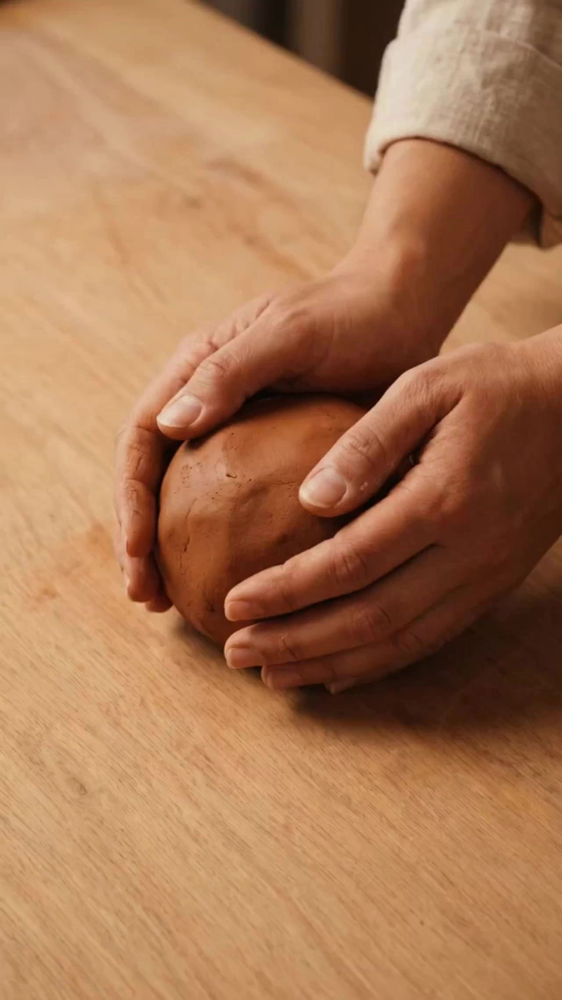

# Artisan Crafting: Creation Process Short Film

> **作者：** @澄海AI工坊

## Content

Process Planning:

Workflow Phases and Dependencies

Sequence:

Confirm core parameters with user (creation_type, subject, mood, duration, aspect_ratio, visual_style, 3-layer color scheme) and write to Final_Video_Spec.md → text_editor

Generate Storyboard (key_elements + Shot List + Audio Layers list) → storyboard_designer

Generate visual anchor image: Generate high-quality start_frame for the final shot as the consistency benchmark → media_generator

Reverse generate intermediate frames: Use anchor image as reference_image to generate start_frames for preceding shots, then fill remaining shots → media_generator

Generate final video clips per shot (final_shot); handle transition shots separately → media_generator

Generate BGM Audio Layers (transition sound effects embedded in transition shot audio) → media_generator

Assemble final video → video_assembler

Dependencies: 2→1; 3→2; 4→3; 5→4; 6→2; 7→5,6

Pause Points: Pause after step 1 (Spec), step 2 (Storyboard review), and step 4 (Start-frame review) for user confirmation.

User Asset Processing: If user provides reference images/videos, call resource_prepare_and_analyze before step 2 to parse assets (character appearance, materials, color tone) and update Final_Video_Spec.md. Use user assets as anchor/reference_images in steps 3-4.

creation_type enum: hand_drawing / watercolor / calligraphy / craft / digital_art mood enum: warm_healing / energetic_vibrant / calm_zen / mysterious_dark

Asset Analysis:

Reference Asset Analysis Goals

When a user uploads reference images, videos, or samples, extract the following for subsequent modules:

Subject Appearance: Hair/clothing color, posture, accessories. If no person, describe the tool's shape and color.

Canvas/Medium: Material, color, and texture of paper, canvas, or screens.

Color Palette (3-layer): Base color (60%), main color (30%), and accent color (10%).

Lighting: Direction, color temperature, and contrast.

Camera: For videos, extract shot types and movement direction.

Output as a structured summary for direct use by storyboard_designer and media_generator.

Storyboard Design:

Key Elements Design

Element scene: Describes the material, color, and texture of the paper/canvas/screen, acting as the visual background anchor for the entire film.

Element character: If hands are visible, uniformly describe skin tone, nails, and cuff style; right hand holds the tool, entering from the right side of the frame.

Element prop: Pen/paint/knife etc., specify material and color.

If the user has uploaded reference assets, the element description must be consistent with the assets and not contradict them.

Narrative Structure and Shot Design
Four-Stage Emotional Arc and Duration Allocation

Phase

	

Allocation

	

Emotion

	

Visual Focus

Rise

	

15%

	

Expectation/Curiosity

	

Empty carrier display, preset clues

Develop

	

60%

	

Immersion/Progression

	

From outline to coloring, gradually taking shape

Turn

	

10%

	

Surprise/Impact

	

Visual mutation transition, sudden sound change

Resolve

	

15%

	

Satisfaction/Release

	

Product centered, slow zoom out

(Duration allocation is calculated proportionally based on the target length.)

Shot Count Reference

15s video: 3 shots; 30s video: 5 shots; 60s video: 7 shots

Mandatory Fields for Each Shot

phase: rise / develop / turn / resolve

Framing & Composition:

rise: Center composition, leave negative space in the center.

develop (hand operation): Left-leaning composition, hand enters from the right, work is on the left.

develop (coloring): Rule of thirds composition, subject at the intersection.

turn: No fixed composition, focused on visual mutation.

resolve: Symmetrical center composition, work centered.

Camera Movement:

rise: Static or very slow zoom in.

develop (sketching): Fixed position.

develop (coloring): Slight horizontal pan, following brush strokes.

develop (details): Slow zoom in.

turn: Fast blur transition, 0.5-1s.

resolve: Slow zoom out to medium or wide shot.

Adjacent shot constraint: Framing and movement cannot be the same for two consecutive shots.

Narrative Action: Describe the specific action of hands/tools and the visual progress within the shot.

duration_seconds (Generation duration): Regular shots must align with Google Veo3.1 Fast supported values (only 4s / 6s / 8s); turn shots must align with Seedance 2.0 minimum value of 4s (or 5s if using Wan2.6). Calculate target duration by stage ratio, round up to the nearest supported value; excessive parts are trimmed by video_assembler.

duration_seconds (Timeline duration): Turn shots are trimmed to 1-2s in the final timeline; total duration after splicing shots should be within 5% error of the target duration.

Lighting System (Inject into Shot description by stage)

Phase

	

Lighting Direction

	

Color Temp

	

Contrast Ratio

Rise

	

Side-front 45°

	

3200K (Warm)

	

1:2 (Low)

Develop (sketch)

	

Top/Neutral 45°

	

4500K

	

1:3 (Mid)

Develop (color)

	

Front + Backlight

	

3800K (Warm)

	

1:4 (High)

Resolve

	

Diffused

	

5000K (Warm White)

	

1:2 (Low)

Scene Adaptation Color Parameters (Inject into Shot description by creation_type)

Default values for the three-layer color system per creation type are below. Use this to lock the color tone for each shot during the Shot List stage; if user uploads reference assets, prioritize them.

creation_type

	

Background (~60%)

	

Main Color (~30%)

	

Accent Color (~10%)

	

Texture Keywords

calligraphy

	

Beige #F5E6C8

	

Black #1A1A1A / Grey #6B6B6B

	

Red #C0392B

	

ink on rice paper, dry brush texture

watercolor

	

White #F0EDE8

	

Transparent color

	

Blue #4A90D9 / Yellow #F5C518

	

watercolor wash, wet-on-wet, pigment bleeding

digital_art

	

Dark Grey #2C2C2C

	

Theme color (Blue #3A7CA5)

	

Neon #00E5FF / White #F8F8F8

	

digital painting, screen glow, stylus strokes on display

hand_drawing

	

Yellowish #E8DCC4

	

Grey #3D3D3D

	

White #FAFAFA / Eraser marks

	

charcoal texture, graphite grain, rough paper

craft

	

Wood #C4A464

	

Theme color

	

Metallic #B8860B

	

wood grain, fabric/felt texture, handcraft material

Audio Layer Design
BGM Track

Default Strategy (≤30s): Design 1 background music audio_layer (type: music) across the entire film.

60s Long Video Segmentation Strategy: When target duration ≥60s, split into 3 BGM segments based on emotional turning points, each as an independent audio_layer (with distinct audio_id). Scheme:

Segment A (rise → early develop, ~45%): Setup segment, soft melody, slower BPM, corresponds to the expectation of 'rise' and immersive start of 'develop'.

Segment B (late develop → turn, ~45%): Progression segment, accelerated rhythm, thicker texture, sudden stop at turn for transition effects; 1-2s cross-fade with Segment A.

Segment C (resolve, ~10%): Conclusion segment, return to soft melody, slow fade to end.

Specify mood parameters in each description:

warm_healing: Strings, 80-100 BPM, soft melody, crescendos to gentle fall.

energetic_vibrant: Violin/Electric guitar, 120-140 BPM, upbeat, accelerating.

calm_zen: Guqin/Flute, 60-80 BPM, ethereal, very slow, fades to silence.

mysterious_dark: Cello/Synth, 70-90 BPM, low/winding, builds then sudden burst.

layout_instruction: Fade in at rise, strengthen during develop, sudden stop for effects at turn, melody concludes at resolve.

Additional constraints for segmented BGM: Segment A end has 1-2s cross-fade with Segment B; Segment B stops precisely at turn point, followed by fade-in of Segment C; Segment C end fade coincides with fade to black.

Transition Sound Effects

Transition SFX for the turn shot are not separate audio_layers (Flova has no standalone SFX tool), but are embedded within video segments via TextToVideo synchronized audio capabilities.

Mark required SFX type (e.g., whoosh, impact) in the audio_note of the turn shot to guide synchronization during video generation.

Audio-Visual Sync Rules (Inject into shot's audio_note field)

rise: Music leads, soft melody, visual waits.

develop (sketch): Medium rhythm, one beat per stroke.

develop (color): Fast rhythm, multiple strokes per beat, music drives visual.

develop (details): Melody slows, hands finish up.

turn: Sudden stop + SFX, visual change sync.

resolve: Outro melody, static visual then slow zoom out.

Media Generation:

Consistent Image Generation Strategy

Anchor Image Priority Principle:

First, generate a high-quality anchor image (start_frame) for the final shot of the "Resolve" phase. Use TextToImage → recommended model Nano Banana Pro (Gemini 3 Pro Image), resolution 2K, to serve as the visual benchmark for the entire video.

Using the anchor image as a reference_image, generate the start_frame for the shots in the "Develop" → "Rise" phases sequentially. Use ImageToImage → recommended model Nano Banana Pro (Gemini 3 Pro Image), resolution 2K, to ensure consistency in character appearance, material textures, and color tones.

If the user has already uploaded a reference image, register it directly as an asset_id and bind it to the corresponding shot's start_frame, skipping the generation step.

Consistency Check: If any start_frame’s character appearance or color tone deviates significantly from the anchor image, revert to the anchor image and regenerate that frame.

Video Segment Generation Strategy

Regular shot (Rise / Develop / Resolve phases): Use FirstFrameToVideo, using start_frame as the driving first frame; recommended model Google Veo3.1 Fast, resolution 720p, aspect_ratio only supports 16:9 or 9:16 (must be limited to one of these two in Final_Video_Spec.md, default 9:16).

Turn/Transition shot: Use TextToVideo; recommended model Seedance 2.0 (or Wan2.6 as a backup), resolution 720p, generation duration 4s (model minimum, final timeline clipped to 1-2s).

Model Failure Handling: First switch models within the same tool to retry; if all models within the same tool fail, stop generating that shot and notify the user, letting them decide whether to switch to another tool.

Audio Generation Strategy

BGM: Use text_to_instrumental, recommended model Mureka 8 (backup Suno 5); prohibit the inclusion of well-known artist names in the Suno 5 prompt.

60s Long Video Segmented BGM: When there are multiple BGM audio_layers in the Storyboard, call text_to_instrumental to generate them individually for each segment. Each prompt must specify the segment's position in the emotional arc (foreshadowing / progression / resolution), BPM range, and texture characteristics; tonal uniformity between segments is not required, but there should be no abrupt changes in BPM at the joints (difference between adjacent segments should not exceed 20 BPM) to avoid auditory disconnects.

Transition SFX: Flova has no independent SFX generation tool; transition SFX are embedded within the video segment via the turn shot's TextToVideo synchronized audio, guided by SFX tags in the video prompt (e.g., <whoosh sfx>).

Asset Binding Rules

Register asset_id immediately after generating each shot's start_frame and bind it to the corresponding shot.

Register asset_id after generating each shot's final_shot video and bind it to the corresponding shot.

Register asset_id after generating the final_audio for BGM and bind it to the corresponding audio_layer.

Prompt Writing:

Image Prompt (TextToImage / ImageToImage)

Structure Order: Subject Description → Creation Media Description → Composition → Lighting/Shadow Settings → Visual Style

Subject Description: Hair color/clothing color/posture/accessories (if any); for hand operations, specify "right hand holding pen, hand enters from the right side of the frame"

Creation Media: Material (e.g., aged yellow book paper, watercolor paper, rice paper) + Color/Hue + Texture keywords; lock in three layers of color (base/main/accent ratio)

Composition: Use the composition description from the corresponding shot in the storyboard (center composition/left-leaning/rule of thirds/symmetrical center)

Lighting/Shadow: Use keywords for light direction and color temperature for the corresponding stage (e.g., warm 3200K, side light 45°)

Style Locking: Photorealistic style + texture corresponding to the creative subject (e.g., charcoal texture / watercolor wash / ink on rice paper)

Consistent Frames (ImageToImage): Explicitly note at the start of the prompt: "Use anchor image as reference, maintain consistent character appearance/media material/color tone"

Video Prompt (FirstFrameToVideo / TextToVideo)

Structure Order: First Frame Reference → Camera Movement Instructions → Subject Action → Spatial Environment → Audio Notes

First Frame Binding: <<<image_1>>> corresponds to start_frame

Camera Movement: Use camera movement descriptions from the storyboard, precisely named (static shot / slow push in / slow pull back / slow horizontal pan / fast blur cut)

Hand Actions: Be specific about body parts and action range (e.g., "Right thumb and index finger hold the charcoal pencil, outlining contours with a slow, long arc from top-left to bottom-right"); list multi-shot actions in story sequence

Audio Notes: If there is a separate audio track, do not repeat BGM content in the video prompt; default to add no subtitles; use SFX notation for transition sound effects in the prompt (e.g., <whoosh sfx>)

Transition Shot (TextToVideo): Emphasize "visual jump cut," "fast blur," or "abrupt cut" semantics; do not bind the first frame

General Rules

No text should appear in the frame (unless explicitly requested by the user); add no text, no watermark to the prompt

Aspect ratio must match Final_Video_Spec.md (default 9:16 vertical short video)

Scene-Specific Prompt Templates

Choose the corresponding template based on creation_type and replace bracketed placeholders with actual content from the storyboard. Applicable to both image and video prompts.

calligraphy

Style Anchor: photorealistic, traditional Chinese calligraphy, ink on rice paper, dry brush texture

Base Description: aged rice paper, warm beige tone #F5E6C8, visible fiber texture

Tool Description: black ink brush (wolf/goat hair), ink stone with fresh ink

Main Color Lock: rich black ink #1A1A1A with gradient to light grey wash #6B6B6B

Accent Color: single vermillion seal stamp #C0392B placed at lower-right

Stroke Segment: right hand holding brush vertically, wrist suspended, brush tip touches paper with steady downward pressure, ink flows from dark to light in a single stroke

Avoid: no colors other than black ink and red seal, no modern tools, no digital artifacts

watercolor

Style Anchor: photorealistic, watercolor painting, wet-on-wet technique, pigment bleeding, transparent wash

Base Description: cold-pressed watercolor paper #F0EDE8, subtle grain texture

Tool Description: round sable brush size 8, ceramic palette with water pools

Main Color Lock: transparent ultramarine blue #2E5BBA as primary wash

Accent Color: cobalt blue accent #4A90D9 or cadmium yellow highlight #F5C518

Stroke Segment: right hand holding round brush at low angle, brush loaded with wet pigment, sweeping horizontal stroke, water blooms and color bleeding at edges

Avoid: no opaque gouache coverage, no hard ink outlines, no digital smoothness

digital_art

Style Anchor: photorealistic, digital painting on graphics tablet, screen glow, stylus on glass display, subtle UI elements at screen edge

Base Description: dark grey digital canvas #2C2C2C, faint pixel grid texture

Tool Description: digital stylus pen, tablet screen with warm glow reflection on hand

Main Color Lock: teal-blue brush strokes #3A7CA5 as primary color layer

Accent Color: neon highlight glow #00E5FF or bright white #F8F8F8 on focal points

Stroke Segment: right hand holding stylus at shallow angle, pen tip glides on glossy screen surface, brush stroke appears with soft glow trail, layers build up progressively

Avoid: no traditional paper texture, no physical paint, no visible keyboard or cables in frame

hand_drawing

Style Anchor: photorealistic, charcoal drawing on toned sketch paper, graphite grain, rough paper texture

Base Description: aged sketch paper #E8DCC4, warm yellow tone, visible paper fibers

Tool Description: charcoal stick / graphite pencil, kneaded eraser

Main Color Lock: charcoal grey-black #3D3D3D with smudge gradients

Accent Color: white chalk highlight #FAFAFA on focal edges

Stroke Segment: right hand gripping charcoal at low angle, broad side-stroke for shading, fingers smudge edges for soft transition

Avoid: no color pigments, no ink, no digital screen

craft

Style Anchor: photorealistic, handcraft workshop, natural material close-up, warm overhead work light

Base Description: wooden workbench surface #C4A464, visible wood grain

Tool Description: craft tools (scissors / needle / carving knife), material pieces in natural tones

Main Color Lock: material primary color (e.g. felt fabric #8B4513, clay #D2B48C)

Accent Color: brass or gold metallic accents #B8860B, thread or button highlights

Stroke Segment: right hand operating craft tool with precise small movements, fingers manipulate material, shavings or scraps accumulate at lower edge

Avoid: no digital screens, no flat studio backdrop, no synthetic plastic sheen

Video Editing:

Editing Rhythm and Transition Strategy

Between standard adjacent shots: Use cross-dissolve transitions, duration 0.5s.

Turn transition shots: Use hard cuts with no dissolving; align precisely with scene switches and transition sound effects.

Resolve (final shot): End with a fade to black, duration 1-2s, synchronized with the BGM fading out.

Audio Layering Rules

BGM track: Fade-in (1-2s) from the first frame, fade-out (2-3s) at the end.

Turn shot sound effects: Play in sync with the video segment. When assembling, set the turn shot's embedded audio as the primary (not lower than BGM). Duck BGM to 30-40% volume during turn shots to highlight sound effects.

When BGM and embedded video audio coexist: Set BGM as primary, lower embedded audio to 20-30%.

60s long video BGM splicing: Arrange multiple BGM tracks sequentially. Use 1-2s cross-fades between segments to ensure no obvious breaks. Segment B's stop point must align precisely with the turn shot's hard cut. After the stop, leave a 0.5-1s gap before Segment C fades in. Keep volumes consistent across segments, applying ducking only during turn shots.

Duration and Rhythm Verification

Total duration after splicing must be within 5% of the target duration. If it exceeds this, fine-tune/trim shots in the "Development" (承) phase; do not alter the "Introduction" (起), "Turn" (转), or "Conclusion" (合) phases.

If shot size or camera movement variations are found missing during assembly, compensate by fine-tuning the cut points here.

Export Settings

Aspect Ratio: Follow the aspect_ratio specified in Final_Video_Spec.md (default 9:16).

Frame Rate: 24fps
