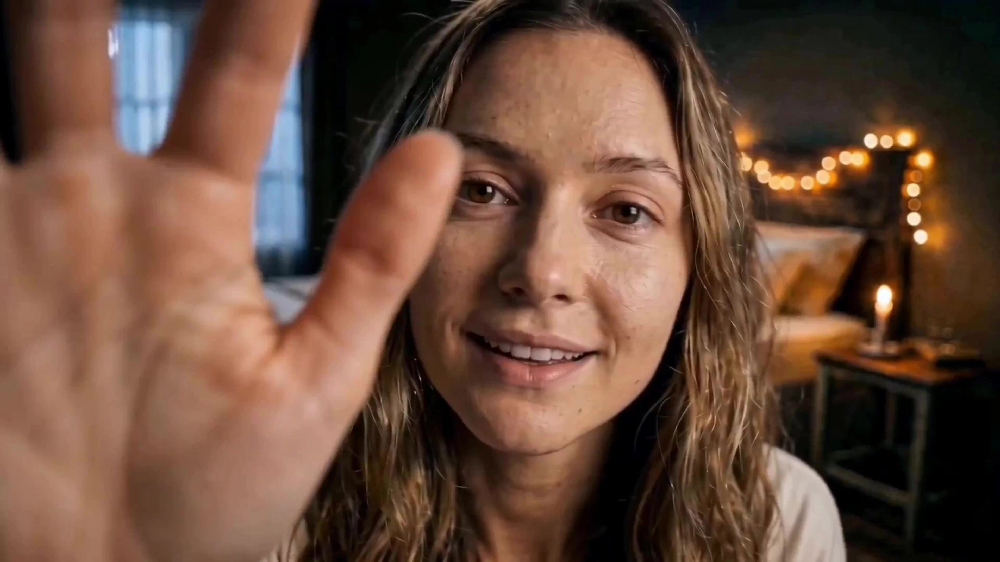

# Audio-First Video Creation

> **作者：** @Flova

## Content

Process Planning:

Audio-First Complete Video Workflow:

Use text_editor to create the Final_Video_Spec.md, locking in the theme, total duration, aspect ratio, visual style, final output language, dialogue language, and whether character voice consistency is required across segments.

First, use storyboard_designer to create the initial Storyboard: define key_element, fix the number and order of shots, expected duration for each shot, audio_layer, and plans for dialogue, narration, ambient sound, sound effects, and background music for each shot. The initial version is for audio arrangement; you cannot accommodate the results after audio is completed by adding or deleting shots.

Based on the initial Storyboard, use media_generator's MultimodalToAudio and Seed Audio 1.0 to generate audio assets:

Total duration not exceeding 120 seconds: In the non-reference path, prioritize generating the full audio timeline at once, including dialogue, narration, emotional performance, background music, ambient sound, and sound effects; then cut out the corresponding final_audio based on the planned shot range.

Total duration exceeding 120 seconds, or later expanded to exceed 120 seconds: Produce audio segments not exceeding 120 seconds based on established shots and narrative segments. First, generate or extract a clean, representative line for each major element character and register/bind it as key_element_audio; then generate segmented dialogue based on fixed character-to-reference-audio mapping. Generate background music, ambient sound, and sound effects using the non-reference Seed Audio 1.0 path, then mix into final_audio for each shot.

Expanding a short film into a long film: Cut clean single-person speaking segments from existing audio, split and bind by character as key_element_audio; do not use segments with multi-person speech, music, or significant environmental noise as a single character voice reference. Afterward, follow the long-film path.

After audio assets are completed, call resource_prepare_and_analyze to analyze each final_audio and output a non-editable audio event list: full-film timestamps, event types, speakers, accurate dialogue/narration, music, ambient sound, sound effects, pauses, and parallel relationships. Do not infer or supplement events not present in the audio.

Establish visual key_element: prioritize binding the user's existing character, scene, and prop assets; if missing, generate them via media_generator. Visual key_element must match the speakers and performance in the generated audio; do not modify the locked audio timeline.

Once characters and other visual key_element are ready, you must call storyboard_designer again to update the Storyboard before generating video. Using the actual audio timestamps from Step 4 as the sole basis, map established shots precisely to the audio; do not add, delete, rearrange, or insert empty visual shots to accommodate audio. If audio duration, events, or boundaries cannot accommodate the established shot, regenerate or cut the audio; do not alter the locked shot structure.

After updating and confirming the Storyboard, generate a keyframe for each shot, then use media_generator's MultiModalToVideo and Seedance 2.0 to bind the shot's keyframe and corresponding final_audio to generate the final_shot. Only reference the previous shot's reference_video when continuity is extremely strong.

Use video_assembler to strictly align final_shot with final_audio; final_audio is the sole audio master track, retaining all its dialogue, narration, music, ambient sound, sound effects, and pauses, while eliminating redundantly generated audio tracks in the final_shot.

Dependencies: 2→1; 3→2; 4→3; 5→3; 6→2,4,5; 7→6; 8→3,7.

When to Pause: Do not complete the entire workflow in one go. Pause after specification finalization, initial Storyboard confirmation, audio asset and character voice confirmation, visual key_element confirmation, Storyboard confirmation after audio timestamp updates, keyframe confirmation, shot video confirmation, and before final assembly; proceed only after obtaining user confirmation.

Existing Asset Handling: Check user-uploaded and existing project materials before generation. Register matching resource_id as asset_id and bind to the correct key_element, shot, or audio_layer; do not redundantly generate visual or audio assets already provided by the user.

Asset Analysis:

Analyze user-provided or generated audio, distinguishing between dialogue, narration, background music, ambient sound, sound effects, pauses, and overlapping parts. Output the start and end times, duration, sound source/speaker, and accurate audible content for each segment.

Create a sound event list for the final_audio, arranged by the absolute time of the full video. Record only what is actually audible; do not include unstated dialogue, narration, sound effects, musical shifts, or moods.

Mark key_element_audio usable for element character: accept only clean, clear, single-speaker segments and record the speaker identity, language/accent, tone, mood, clarity, and trim range. Exclude segments mixed with other speakers, music, or significant ambient noise.

When expanding a short film into a feature, extract and split voice segments by character from the existing final_audio, keeping original absolute timestamps for subsequent voice consistency binding.

When analyzing visual references, extract visible characteristics of characters, scenes, and props to ensure subsequent key_element, keyframe, and shot descriptions do not contradict user assets.

Storyboard Design:

Initial Storyboard: Lock the structure, then produce audio

Define necessary element characters, element scenes, and key props. For characters with different ages, outfits, or states, list their looks separately. For each element character with dialogue, define a stable identity, age, vocal tone, accent, common emotions, and speech rhythm, and mark available key_element_audio candidates.

Before generating audio, finalize the number, order, narrative purpose, and expected duration of shots. Audio must be produced around these shots; do not adjust the structure by adding, deleting, rearranging, or inserting silent/pure visual shots later.

Plan the audio_layer for each shot: Specify necessary dialogue, narration, background music, ambient sound, sound effects, pauses, and parallel relationships. Each line of dialogue must indicate the element character, exact lines, tone, and rhythm. For narration, use the type narration, and define the narration_speaker_profile, exact script, and layout_instruction within the description.

Reserve continuous time ranges of 4 to less than 15 seconds for audio-driven shots so that a corresponding final_audio can serve as a complete reference for the video audio. Do not rely on adding or missing sounds after generation to adjust the duration.

Mandatory updates after audio return: Rewrite shot details based on actual timestamps

After characters and other visual key_elements are generated, the storyboard must be updated based on the sound event list of the final_audio; the final audio is the sole source of truth for timing and content. Updates only refine established shots; never add, delete, or rearrange shots, and do not create extra shots without audio basis.

The global time range of each shot must correspond continuously and non-overlappingly with the final_audio, and all shots combined must exactly cover the planned audio timeline. Do not omit any dialogue, narration, music, ambient sounds, sound effects, or pauses, and do not describe sounds that do not exist in the audio.

Record both the absolute time of the whole film and the relative time within the shot for each shot. Relative time starts at 0 for that shot: e.g., if shot 2 covers 15.0–29.9 seconds of the film, and a sound event occurs at 15.2–16.5 seconds of the film, it must be written as 0.2–1.5 seconds within that shot.

For each audible event, write out the synchronized visuals based on its timestamp: character actions, eye contact, expressions, prop interactions, camera movement, or editing rhythm. The description, sequence, duration, and parallel relationships of dialogue, narration, sound effects, music changes, and pauses must match the audio item by item; do not advance, delay, add, or omit events.

Each updated shot must include: bound element scene/element character, global and relative time ranges, chronologically ordered visible actions, visual beats corresponding to each sound event, shot size, camera angle, camera movement, and a keyframe design representing the strongest narrative moment of the shot. The keyframe must include the characters, scenes, props, and composition required for the first segment of action, serving as the visual starting point for the shot.

If the user provides reference material, key elements, keyframes, and shot descriptions must be consistent with what is seen or heard; do not fabricate conflicting appearances, identities, or voices.

Media Generation:

Audio Asset Generation and Binding

Use MultimodalToAudio with the Seed Audio 1.0 model. When no image, audio, or voice_id references are provided, use the text-to-audio path to generate the complete sound design; the maximum duration for a single audio generation is 120 seconds.

For projects under 120 seconds, prioritize generating a master audio timeline containing dialogue, narration, emotional performance, background music, ambient sounds, and sound effects in one pass. Then, crop, register, and bind the final_audio for each shot according to the locked shot range.

For projects exceeding 120 seconds, first generate or bind key_element_audio for each primary element character. Use a maximum of 3 clean character voice references per request, each no longer than 30 seconds, and always maintain a fixed correspondence between the character and their reference audio.

When using audio references or voice_id to maintain character voice, input text must only consist of the actual narration or dialogue. Do not include instructions for emotion, sound effects, music, ambiance, or style in the same request. If these elements are needed, generate them separately using a reference-free Seed Audio 1.0 request, then mix them into the shot's final_audio.

When using image references, input only the actual narration or dialogue text; do not mix image references with audio references. Existing or extracted character audio should be registered as an asset_id and bound to the correct element character's key_element_audio.

Visual Key Elements, Keyframes, and Final Shot Generation

Establish visual key_elements after audio generation. For images, use TextToImage; for different appearances or ages of the same character, prioritize ImageToImage by referencing the previous element image to maintain consistency. Recommended model: Nano Banana 2 (Gemini 3.1 Flash Image), resolution: 2K.

Generate one horizontal side-by-side reference image for each character: a tight headshot on the left to lock identity features, and a full-body shot on the right to lock clothing, hairstyle, makeup, shoes, and silhouette.

Once the storyboard is updated with audio timestamps, generate exactly one keyframe for each shot. Prioritize ImageToImage, binding the element character, element scene, props, and necessary keyframes from the previous shot. The keyframe must realize the composition, perspective, character positioning, and first visible action defined by the storyboard, and must not depict events inconsistent with the final_audio.

For final shots, use MultiModalToVideo and Seedance 2.0, recommended resolution: 720p. Each shot must bind its own keyframe as <<<image_1>>> and the corresponding final_audio for that shot's time range as <<<audio_1>>>; by default, do not pass additional element images unless the keyframe fails to represent necessary character, scene, or prop consistency.

audio_infos are limited to 3 items; each audio clip must be over 2 seconds, and the total must be less than 15 seconds. Prioritize using a single mixed shot final_audio, and ensure the audio-driven shot duration is between 4 and less than 15 seconds to allow for the complete, uncropped input of the corresponding audio.

Only reference the previous shot's reference_video when there is extremely high continuity between the current and previous shot. The video must adhere to the final_audio's timing, sound sources, and beat; do not request the generation of dialogue, narration, music, ambient sounds, or sound effects not present in the audio.

Prompt Writing:

Global Rules: When interacting with the user in Chinese, prompt descriptions must be written in Chinese; narration and dialogue languages must strictly follow the Final_Video_Spec.md settings. Video prompts should only use visible content confirmed in the storyboard based on audio timestamps; do not add extra sounds, timelines, or creative requirements.

Seed Audio 1.0 Prompts

Full Audio Timeline (No Reference): Write in the narrative order of auditory events: overall atmosphere → background music → continuous ambient sound → character name and voice/performance description → dialogue inside quotation marks → interspersed sound effects → next character → musical changes or conclusion. Clearly specify parallel relationships like "simultaneous," "during dialogue," or "continuously layered underneath."

Clearly define the character's age, identity, vocal quality, accent, emotion, pace, speaking style, and exact dialogue. For multiple characters, repeatedly use character names or identities; do not use only pronouns like "he" or "she." Segment the dialogue to place sound effects or pauses in the correct narrative positions.

Background music must specify the type/instrument, rhythm, mood, dynamic changes, and duration. Ambient sounds and sound effects must specify the source, volume/intensity, frequency, distance, and relationship to the dialogue.

Character Dialogue Using Audio Reference or voice_id: In the prompt, use fixed character names corresponding to @Audio1, @Audio2, or @Audio3, but write only the actual narration or dialogue text in the main body. Do not write about emotions, music, ambient sounds, sound effects, or extra style notes; these are handled by non-referenced voice requests.

When using image references, only include the actual narration or dialogue text in the main body; do not add audio references simultaneously. Do not use background music or multi-person audio mixes as character voice references.

Image Generation Prompts

Use natural language to describe the scene as "Subject + Visible Action + Environment," then add brief phrases for style, color, lighting, composition, and texture. Do not describe motivations, internal thoughts, off-screen events, or invisible information.

Use professional film terminology to specify shot size, composition, key light, contrast, restrained color grading, visible textures, and micro-expressions. Unless explicitly requested by the user, avoid red-blue neon conflicts and use one dominant color tone to command the scene.

key_element images must lock in cross-shot stable facial features, hairstyles, makeup, costumes, accessories, and prop materials/states. keyframe must accurately present the corresponding shot's scene, composition, character position, and initial action. Avoid text within the frame unless the story requires it.

Seedance 2.0 Video Prompts: Use only the following structure, do not add extra paragraphs or generic prompts

All video prompts are bound to <<<image_1>>> as the shot's keyframe and <<<audio_1>>> as the corresponding final_audio in the input. The default structure is: Use <<<image_1>>> as the keyframe for video creation, Use <<<audio_1>>> as the timing / soundtrack / voice reference. Follow this only with concise, confirmed visible actions and shot descriptions from the storyboard.

For simple shot actions, dialogue-corresponding actions, or sound events, use the structure: "Use @Image1 as the keyframe for video creation, Use @Audio1 as the timing / soundtrack / voice reference," with no need to repeat content explanations.

For complex shots, write by event sequence rather than per-second timecodes: write only the visible reactions or actions when the sound actually occurs. For example: write the action for the first line of dialogue, then when the steam hisses sharply, write the character turning to show the locomotive; then write the character looking back at the camera corresponding to the next dialogue line. Do not add dialogue, narration, music, or sound effects not present in the final_audio.

Since final_audio already covers dialogue, narration, music, ambient sounds, and sound effects, do not rewrite the full dialogue in the video prompt, nor use wrappers for music, sound effects, or spoken dialogue. Use [Exact Text] only when there is text within the frame.

Always include no music and no subtitles to prevent redundant generation of music and subtitles; when final_audio exists, do not ask the model to generate extra dialogue, narration, or sound effects.

Video Editing:

Align the final_shot of each shot with its corresponding final_audio based on the global and relative timestamps in the updated storyboard; every dialogue, narration, pause, sound effect node, ambient sound change, and musical transition must sync with the corresponding visual beat.

final_audio is the sole master track for dialogue, narration, background music, ambient sound, and sound effects. Mute or significantly attenuate redundant generated audio within final_shot to avoid echo from overlapping dialogue, music, or sound effects; do not cut, replace, or add extra sound events to final_audio.

Do not add empty shots, filler shots, or extra audiovisual segments outside the storyboard. For ambient sound and background music that spans across shots, only apply short fade-ins/fade-outs within the existing duration in the original final_audio to maintain a continuous soundscape.

Maintain the rhythm of the original audio, the integrity of dialogue, and audiovisual synchronization; do not arbitrarily cut key dialogue, narration, or sound effects to accommodate the visuals. If a final_shot cannot match the locked timestamp, rework the shot; do not alter final_audio or the confirmed storyboard time mapping.
