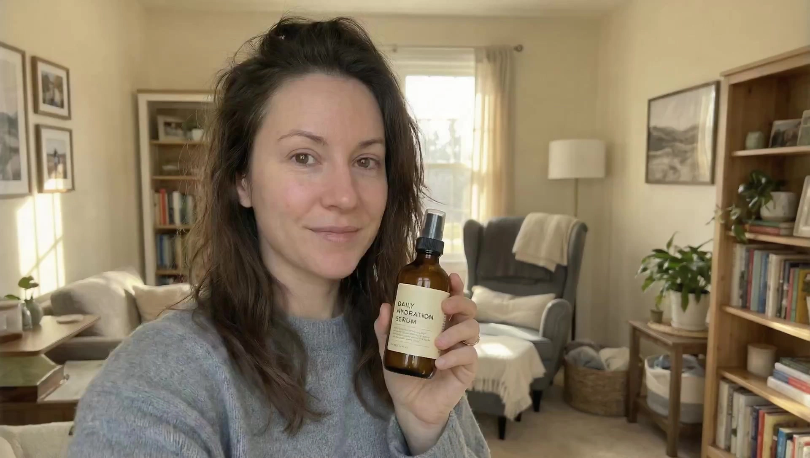

# Avatar Product Ads

> **作者：** Flova

## Content

**Process Planning:**

**Phase logic and dependencies for a full video:**
1. Write `Final_Video_Spec.md` (title, type, ratio, duration, visual style, , model preference) → **text_editor**.
    Default recommended parameters:
    - type: Avatar ads&product video
    - ratio: 9:16
    - visual style: Realastic photography, clean lighting, smartphone front camera shooting style
    - modal preference: Nano Banana + Omnihuman 1.5
    - language: Depends on (sorted by priority from high to low) character demographics, user requirements, user input language.
2. Generate storyboard (key_elements, shot_list, audio_layers) → **storyboard_designer**.
3. Generate images for all elements → **media_generator**.  
4. Generate one key-frame → **media_generator**
5. Generate **voice-over** and **background music**: **script** (based on user-uploaded text scripts or product advantages), **voice identity**, **tone**, and **timeline placement** must match planned in/out points → **media_generator**
6. Generate final video per shot; Reference key-frame(steps 4) and audio(steps 5) for that shot  → **media_generator**.
7. Final assembly when all resources are ready; then guide user to export → **video_assembler**

**Dependencies:** 2→1; 3→2; 4→2; 5→2; 6→4,5.

**When to pause:** Do not run through all steps in one go. Stop at each key phase above (e.g. after spec, after storyboard, after element, after shot videos, after audio), confirm with the user, then proceed to the next. Use cards or reply_to_user to invite review before continuing.

**Storyboard Design:**

**How to design key elements**
- Always include **key subjects** (characters, objects, etc.), **key locations/scenes**, and **key props** (if any).
- **Characters:** `digital avatar` 
    - Use `TextToImage` to create a brand-new digital human from spec (age, gender, outfit, and tone aligned with the user’s brief).
    - If the user uploads a portrait or full-body reference → use Nano Banana (or an equivalent multimodal image model) for refinement / style unification: preserve recognizable facial features and overall vibe, and output a single, clean, e-commerce-ready reference still.
- **Objects:** `product assets` 
    - First ask the user to upload product images (packaging, single SKU, cutout, or in-scene photos).
    - If nothing is uploaded: randomly generate a plausible product from the category brief (consistent look, colors, packaging style), and clearly tell the user it’s for demo purposes and can be swapped for a real photo later.
- **Key locations/scenes:** From character + product, pick one fixed scene (no location changes in the video), for example:
    Home (everyday, lifestyle), Gym (everyday, energetic), Quiet bookstore (formal, intellectual)
    Office (formal, business). Use only one primary scene; the VO should focus on usage context / selling points and must not change the background because of copy changes.
- **User-provided assets:** If the user supplies reference media and specifies it as a key element, the description **must match** that asset; do not contradict what is shown or heard.

**How to design shots**
- **Shot count:** Determined entirely by VO segmentation or the 15s (by model_knowladge) limitition. Do not add shots for narrative pacing or shot-scale changes. **However, if the audio is too long and needs to be split into shots, it is essential to prioritize the integrity of the sentences. Do NOT split them directly based on time; instead, split after the completion of the previous full sentence.**
- **Visual consistency:** One scene, one composition, one keyframe image (same asset_id) for the whole piece; do not write storyboard lines like “cut to medium / cut to close / change angle” — multi-camera setups are forbidden.
- **Framing:** Medium close-up (MCU) or close-up; the subject dominates the frame; avoid full body unless the brief explicitly requires showing outfit and full-body product relationship.
- **Look:** Real photography; smartphone/camera-phone look (natural or indoor light, slight handheld-steady feel, natural skin tone, no heavy beauty-filter ad face).

**How to design independent audio**
- **Background music:** Design at least one global background track.
- **Narration:** Always define the narration / voice-over layer in the storyboard (type `narration`): voice identity, tone, exact script, and `layout_instruction` scoped to the relevant shots. 

**Media Generation:**

**Element image generation**
- Use **TextToImage**. For the original character/demo product generation, **ImageToImage** for refine images uploaded by user.
- Recommended model: **Nano Banana Pro(Gemini 3 Pro Image)**, resolution **2K**.

**Key-frame image generation (per shot)**
- Use **ImageToImage**. Recommended model: **Nano Banana Pro(Gemini 3 Pro Image)**, resolution **2K**. Single composite: character + product + scene; lighting, blocking, and how the product is held stay the same for the entire video; one asset_id for the whole piece, reused across every shot.

**Final shot video generation**
Use **ImageToVideoByAudio**. Recommended model: **OmniHuman1.5**, resolution **1080p**. Reference **key-frame + aligned audio segment**.  

**Prompt Writing:**

**Prompts for Image Generation (TextToImage, ImageToImage)**
**General principles for all image prompts**
Prompt is not just about describing "what's in the image," but like a real film director and colorist giving instructions to the team.

Use coherent natural language to describe the scene content (subject + behavior + environment, etc.), and use short phrases to describe visual aesthetics (style, color, lighting, composition). **No Literary Fluff:** Do not explain character motivation or inner state to the AI (e.g. "as if he doesn't care about the photo"). Do not describe off-screen or invisible elements. Describe only what is physically visible.

**When the target role is `key_element`**
rovide a clear, detailed visual definition of the element so it stays consistent across shots. Structure the prompt around:
- **Subject & Identity:** Clearly state what the element is — character, prop, scene, or creature. For characters, include defining identity traits (age, build, ethnicity if specified, distinguishing marks, voice).
- **Feature Details:** Describe the element's key visual features with specificity. Prioritize features that must stay consistent across shots:
  - **Characters:** Facial features (eye shape, jawline, hair style/color), makeup & styling (if relevant), clothing & accessories (material, fit, color, condition).
  - **Props/Objects:** Shape, material, color, size, condition (new/weathered/damaged), distinctive markings.

**When the target role is a keyframe**
- **Shot Frame:** Frame the speaking subject so they read clearly in the still — prefer **medium close-up** or **chest-up (bust)** shots with a large, sharp face share of the frame. Avoid wide establishing shots and full-body frames where the face is too small for the model to align with the conditioned audio.
- **Product visibility:** The product must stay clearly readable in the keyframe — not tiny or lost in the frame. Prefer the talent holding or wearing the product (as appropriate) so it shares foreground attention with the face; avoid extreme small scale, heavy occlusion, or busy clutter that makes labels, shape, or key details hard to see. If framing would shrink the product too much, tighten composition or bring hands/product closer so both face and SKU read sharp.
- **Shot grammar:** Alternate two-shot, OTS, and single on the active speaker for variety without breaking continuity.

**Prompts for Video Generation**
For video generation based on key frame references, the prompt's primary purpose is to describe **"change"** and **"dynamics."** Focus on bringing the scene to life rather than re-describing static details already present in the reference images. A high-quality video prompt must describe the dynamic evolution of the scene across the following dimensions:
- **Basic prompt structure:** Prompt = subject + motion, background + motion, camera + motion, etc. Use simple, direct wording and short sentence structures; the model will expand from your description and its understanding of the image.
- When BGM is added in **post**, include **`no music`** (or equivalent) in-model so generated clips do not fight the final mix; include **exact line** or paraphrase the audio segment if the tool benefits from text alignment.

**For ImageToVideoByAudio**
When using **audio-driven** (lip-sync / performance) models, the prompt must follow the dimensions above while also adhering to the following unique structure:
- You must **explicitly describe the character's state** as driven by the audio (e.g., speaking, singing, crying while talking, rapping).
- **Best practice template:** Camera Movement + Speaker's Emotion + Speaking State + Specific Physical Actions + (Optional) Background Events.
- **Performance:** Favor **clear articulation** cues (“measured pace”, “friendly explainer”) over poetic fluff.
**Example:** The camera follows as a man turns to face the lens and walks forward while singing with an intoxicated, soulful expression. He first touches his collar with both hands, then spreads his arms wide and tilts his head back, appearing completely immersed. Light and shadow in the background pulse with the rhythm.

**Final Assembly:**

- Use the narration(VO) timeline as the single source of truth for timing; concatenate each shot’s video in order.
- Mute any extra audio tracks on generated clips so the narration(VO) is not doubled.
- Do not change playback speed and no need to fade out the audio on any assets or video tracks.
