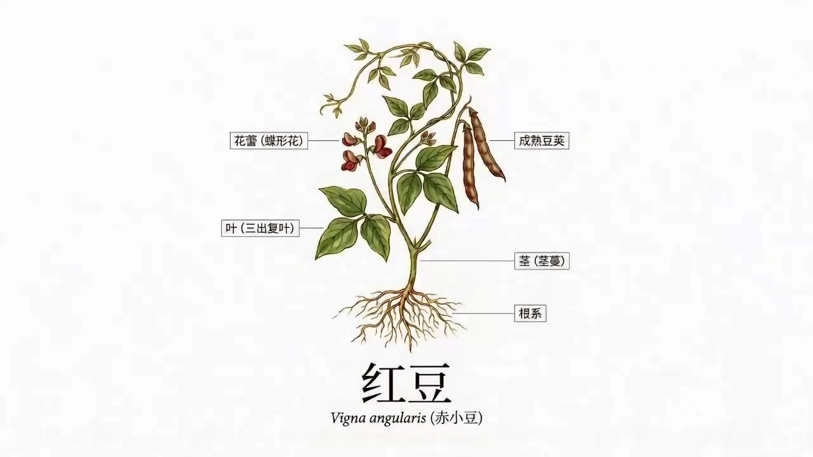

# Botanical Documentary Short

> **作者：** @境在丨米叔

## Content

Process Planning:

Logic and Dependencies for the Full Project

Establish global specifications file → text_editorCreate Final_Video_Spec.md, locking in: aspect ratio (16:9), total duration (45s, 3 groups × 15s), visual style (realistic science documentary/National Geographic aesthetic), and narration output language.

Analyze plant reference materials, write to Botany_Spec.md → resource_prepare_and_analyze + text_editorIf the user uploaded plant text or images, call resource_prepare_and_analyze to extract anatomical features, Color Arc, HSL parameter ranges, and geographical/historical context, writing them to Botany_Spec.md. If the user has not uploaded any reference materials, recommend 3–5 representative plant options (e.g., Turmeric, Saffron, Rice, Lavender, Ginseng) and ask which they are interested in and what they wish to highlight. Once confirmed by the user, Planner generates Botany_Spec.md based on the plant name without calling the analysis tool.

Generate scientific plant analysis diagram (Plant_Asset_01) → media_generatorAfter Botany_Spec.md is confirmed, immediately call media_generator using TextToImage (Recommended Model: Nano Banana Pro (Gemini 3 Pro Image), 2K resolution) to generate a vertical (3:4) botanical analysis chart. This should cover: overall morphology, magnified cross-section, leaf/flower anatomy, origin map, molecular structure schematic, life cycle diagram, and Chinese calligraphy annotations. Style: vintage parchment texture, 18th-century botanical ink and watercolor. Bind to Plant_Asset_01 after generation as the anchor for the entire project's visual form. Pause and wait for user confirmation of the analysis diagram before proceeding.

Write story script based on Plant_Asset_01 analysis results and convert to structured Storyboard Design → resource_prepare_and_analyze + storyboard_designerFirst, call resource_prepare_and_analyze to perform a structured analysis of Plant_Asset_01, extracting morphological elements, scientific annotations, life cycle nodes, and efficacy clues. Write these into the Botany_Spec.md supplementary section as content anchors for the script. Then, call storyboard_designer to plan 6 distinct content beats for each of the three groups (18 frames total) based on the analysis diagram and themes. Simultaneously, write the complete Narration VO script for all three groups. Style: magnetic documentary voiceover (deep, restrained, high information density). The script must be strictly anchored to the corresponding storyboard frame numbers. Pause and wait for user confirmation of the story script and Narration VO. Once confirmed, convert into a structured Storyboard (including 2×3 six-frame content, camera movement notes) and cross-group Audio Layers (BGM, Narration VO, including full verbatim draft) planning.

Generate 2×3 six-frame director's Storyboard for each group, confirm group by group → media_generatorBased on the confirmed script, generate a six-frame matrix storyboard for each group (Text-to-Image only, no reference image input required). Pause after each group for confirmation before proceeding.

Generate 15-second group-level video for each group → media_generatorUsing the confirmed six-frame storyboard as a reference_image for each group, trigger Seedance 2.0 to generate a 15-second group-level video covering the 6 narrative nodes in one go. After each video is generated, simultaneously synthesize the corresponding Narration VO.

Generate full project BGM → media_generatorAfter all 3 groups of videos are confirmed, call text_to_instrumental (Recommended Model: Suno 5) to generate a 45-second deep orchestral background track.

Assemble and export → video_assemblerSplice the 3 video groups in A→B→C order, overlay BGM and Narration VO, perform self-check against the Color Arc in Botany_Spec.md, and export.

Dependencies: 2→1; 3→2; 4→3; 5→4; 6→5 (group by group); 7→6; 8→6,7

Pause and Confirmation Nodes:① After the specifications file is locked; ② After Botany_Spec.md is confirmed; ③ After the plant analysis diagram (Plant_Asset_01) is confirmed; ④ After the story script is confirmed; ⑤ After each group's six-frame Storyboard is generated (core intercept point); ⑥ After all 3 groups of videos are completed; ⑦ After final assembly is complete.

Asset Analysis:

Analyze Plant_Asset_01 (Plant Science Analysis Diagram)Before the Planner calls storyboard_designer, perform a structured analysis of the generated Plant_Asset_01 and output the following information for direct use in script arrangement:

Morphological Element List: Identify and list the core visual features of the plant from the image—leaf shape, inflorescence/flower color, stem/tuber morphology, root system, and fruit; provide specific visual subjects for each frame in Section A.

Scientific Annotation Content: Extract scientific names, genus/family, origin information, molecular structure keywords, and life cycle stage annotations present in the image as material for Section A information card copy.

Color and Texture Tone: Identify the dominant colors (e.g., ochre warm brown, matte grass green) and paper/background textures as reference base tones for Section B/C video grading, creating a clear contrast with the white background style of Section A.

Growth Cycle Clues: Extract the key stage nodes that Section B should cover from the life cycle diagram (e.g., sowing → germination → stem/leaf growth → flowering → fruiting/maturation).

Efficacy and Application Clues: If the diagram contains efficacy annotations or molecular structure hints, distill them into core information points for Section C.

The analysis results are output as structured text and handed over to the Planner to be written into the Botany_Spec.md supplementary chapter, serving as content input for storyboard_designer.

Storyboard Design:

Three Major Storyboard Group Structures (Each group must correspond to one 2×3 six-panel Director's Storyboard layout)

Storyboard Group A: Plant Information Display (0–15s, includes 6 shots, approx. 2.5s per grid)

Overall Visual Tone: Pure white or light gray background, centered subject, clean infographic style; content derived directly from Plant_Asset_01 analysis results, prioritizing science education over dramatic narrative.

Grid (Plant Introduction): Pure white background, full plant centered and fading in. Scientific and common names fade in from the bottom in an elegant sans-serif font with minimalist motion.

Grid (Morphology Deconstruction): White background, close-up of leaves/inflorescence/fruit, thin indicator arrows labeling organs, clean and precise.

Grid (Origin Distribution): White background overlaid with a minimalist map outline, origin areas highlighted, with origin names and climate tags appearing dynamically.

Grid (Growth Conditions): White background, simple icons representing growth requirements—temperature range, light intensity, soil type, and suitable altitude.

Grid (Core Components): White background, key active ingredients or nutrients appearing as floating labels, with optional simplified molecular formulas or diagrams.

Grid (Lifecycle Overview): White background, minimalist horizontal lifecycle sequence unfolding dynamically (Sowing→Germination→Growth→Flowering→Fruiting), setting the stage for Section B.

Narration Script Framework: Announce scientific and common names → Describe core morphological features and origin → Highlight growth habits and main components → Briefly preview the life journey.

Storyboard Group B: Plant Cultivation Process (15–30s, includes 6 shots, approx. 2.5s per grid)

Grid (Sowing): ECU extreme close-up, lock-off. The microscopic moment a seed drops into moist, loose soil.

Grid (Sprouting): Time-lapse, low angle. Seed coat splits, roots anchor, and the sprout pushes through the soil.

Grid (Stem/Leaf Growth): Medium shot time-lapse, shifting light. Stem rises, leaves unfurl like fans.

Grid (Irrigation): Handheld documentary style, rapid zoom in/out. Water mist spraying on leaves, forming droplets.

Grid (Pruning/Care): Medium shot. Precise pruning or artisan fertilizing, showing precise human intervention.

Grid (Harvest): Close-up, slow push. Fruit/ear gains weight and droops, showing a plump, ready-to-harvest state.

Narration Script Framework: Describe cultivation conditions → Present key growth milestones → Highlight the significance of human intervention.

Storyboard Group C: Plant Efficacy and Usage Scenarios (30–45s, includes 6 shots, approx. 2.5s per grid)

Grid (Ancient Harvesting): Handheld documentary medium shot. Hands precisely harvesting plant parts.

Grid (Primary Processing): Stable close-up. Physical processing via stone mill, knife, or drying, showing material fragmentation.

Grid (Microscopic Texture Transformation): ECU extreme close-up. Cell walls breaking, juice splashing, or fiber weaving at the micron level.

Grid (Final Product Presentation): Lifestyle medium shot, soft natural light. Plant converted into food, fabric, medicine, or materials.

Grid (Human Application): Wide shot, warm daylight. Heartwarming scenes of people using the derivative product in daily life.

Grid (Civilization Aesthetic Conclusion): Stable tracking shot, depth of field blur. Finished product frozen in light/shadow, concluding the human narrative.

Narration Script Framework: List core efficacy and uses → Connect the transformation chain from processing to application → Elevate the relationship between plants and human civilization.

Per-Group Narration VO Scripting (Completed synchronously with the storyboard)

Write narration line-by-line while designing each grid, strictly bound to the Grid ID (approx. 2.5s of script per grid).

Style: Deep, magnetic documentary narration—steady pace, high information density, restrained but powerful emotion; avoid colloquialism or advertising tone.

Script structure follows the narration frameworks (see above), ensuring logical flow across all three groups to form a complete narrative arc.

Input the full script into the corresponding audio_layer (type: narration), including time anchors for each grid, for direct use in VO generation.

Visual Focus Alignment (Eye Tracing)Forcefully mark the center coordinates (X, Y) for the 18 shots in the 2x3 matrix. The visual focus of the tail frame of the previous shot must achieve momentum conservation with the first frame of the next, ensuring the 45s video remains documentary-level smooth despite high-frequency cuts, eliminating jumpiness.

Media Generation:

Plant Science Analysis Diagram (Plant_Asset_01)

Invoke TextToImage, recommend model Nano Banana Pro (Gemini 3 Pro Image), resolution 2K, vertical 3:4 aspect ratio.

After generation, register the asset_id and bind it to Plant_Asset_01 as the visual constraint anchor and script content basis for the entire film.

Storyboard (2×3 six-panel matrix per group)

Invoke TextToImage, recommend model GPT Image 2, resolution 2K, horizontal 16:9 aspect ratio (generate three groups separately, pause for confirmation after each group).

Text-to-image only, no reference image input required.

Group-level Video (15 seconds per group)

Invoke MultiModalToVideo, recommend model Seedance 2.0, resolution 720p, duration 15s.

Use the confirmed six-panel storyboard for the group as the reference_image to drive generation; synchronize the corresponding Narration VO after each group's video is completed.

Section A Video: The reference image is the Section A storyboard; the prompt must reflect the white-background infographic style (see prompt specifications) and should not reference realistic scenes.

Narration VO

Invoke text to narration, recommend model MiniMax Speech 2.8 HD; directly read the complete verbatim script from the audio_layer in Botany_Spec.md to generate.

Full Film BGM

Invoke text_to_instrumental, recommend model Suno 5, duration 45 seconds, deep orchestral style; generate after all 3 video groups are confirmed.

Prompt Writing:

Global Priority: The main content of the prompt should be written in Chinese; the narration language must follow the output language set in Final_Video_Spec.md.

Botanical Scientific Analysis Diagram Prompt (TextToImage · Nano Banana Pro · Vertical 3:4)Draft following this structure: Botanical Latin name and Chinese common name + core identification features → Vintage parchment texture, 18th-century naturalist ink and watercolor style, scientific botanical chart aesthetic → Multi-panel layout: large centered image (overall form) + cross-section details under a magnifying glass + anatomy diagrams of leaves and flowers + small regional map + molecular structure diagram + bottom life cycle sequence → Chinese calligraphy headers and scientific labels → Palette dominated by ocher, warm brown, and matte grass green (≥ 90%), calm and restrained, no modern design feel. Append fixed ending: no watermarks, no modern UI, no neon colors, highly detailed, accurate botanical drawing.

Example Structure (using East Asian Raspberry as reference):

Chinese botanical illustration of [Botanical Latin Name]（[Chinese Name]）, retro vintage parchment paper texture, scientific botanical chart, detailed ink and watercolor sketch, multipanel layout. Central large [Main Organ Description], detailed cross-section under a magnifying glass, anatomical diagrams of leaves and flowers, small regional map, molecular structure diagrams, step-by-step life cycle diagram at the bottom. Elegant Chinese calligraphy headers and labels. Highly detailed, accurate botanical drawing, 18th-century naturalist style, sepia tones, muted colors, aesthetic composition. no watermarks, no modern UI, no neon colors.

Storyboard Prompt (TextToImage · GPT Image 2 · 2x3 Six-Grid Matrix)Draft following this structure: Plant theme and content reference → 2x3 (2 rows x 3 columns) regular matrix layout → Director's storyboard style → Each grid separated by an independent black border, labeled with shot numbers (Grid 1,1 to 2,3), camera movement arrows, and shot types (Wide/MCU/ECU/Time-lapse) in the corners → Bottom includes handwritten Chinese director's notes (shot type, movement, lighting direction).

Section A Storyboard Requirements: Background for each grid is pure white or very light gray, subject centered, style is simple infographic; label floating text areas and indicator arrow positions; fresh and bright tones, no realistic scene textures. Append: clean white background, minimal infographic style, no realistic scenery, no watermarks.

Section B/C Storyboard: Realistic scientific documentary aesthetic, natural rural tones (natural green and earthy warm brown as dominant colors, ≥ 90%); plant subject clear, background blurred, strong perspective and depth-of-field rhythm. Append: no watermarks, no stylization, no fantasy lighting.

Video Prompt (MultiModalToVideo/Seedance 2.0 · Six-Grid Storyboard Driven)Draft following this structure: Based on the six-grid storyboard reference image <<<image_1>>> as the start → 15 seconds → Describe 6 dynamic beats in sequence according to the story (camera movement, subject action, light evolution, depth-of-field changes) → Note the visual center momentum continuity when switching each grid → Use Seedance 2.0 tags to embed sound effects <Foley description> (only used for Section B/C realistic segments). Append fixed ending: no split frames, no arrows, no watermarks, no subtitles, no music.

Section A Video Requirements: Pure white background, plant subject centered, information labels and floating text appear with dynamic fade-in; shots are mainly slow pushes or lock-offs, avoid realistic scene camera movements (e.g., pans, aerial shots); overall style references scientific documentary intro information segments. Add negative prompts: no realistic background, no nature scenery, no handheld shake.

Section B/C Video: Realistic scientific documentary style, cinematic lens language, Foley sound effect tags embedded as needed. Add negative prompts: no floating text, no annotation labels.

Video Editing:

45-Second Timeline AssemblyArrange the 3 video segments in the sequence A (Plant Information) → B (Growth Cycle) → C (Efficacy & Application) for a total duration of 45 seconds. Apply L-Cut/J-Cut logic to all intra-segment shots and inter-segment transitions: trigger Foley sound effects, such as soil cracking or processing clangs, approximately 0.5 seconds before the edit point to enhance immersion. Place BGM and Narration VO on separate audio tracks. Volume hierarchy: Narration VO > Foley > BGM.

Color Arc & Visual Continuity AuditVerify the overall color tone evolution against Botany_Spec.md to ensure it aligns with the defined arc (Group A: clean white background info-graphics → Group B: realistic natural green/brown → Group C: neutral, bright lifestyle). Check the visual continuity of plant leaf shapes and flower colors across all 18 shots; ensure the shift in visual center between adjacent shots is within 20%. Export in high definition upon passing the audit.
