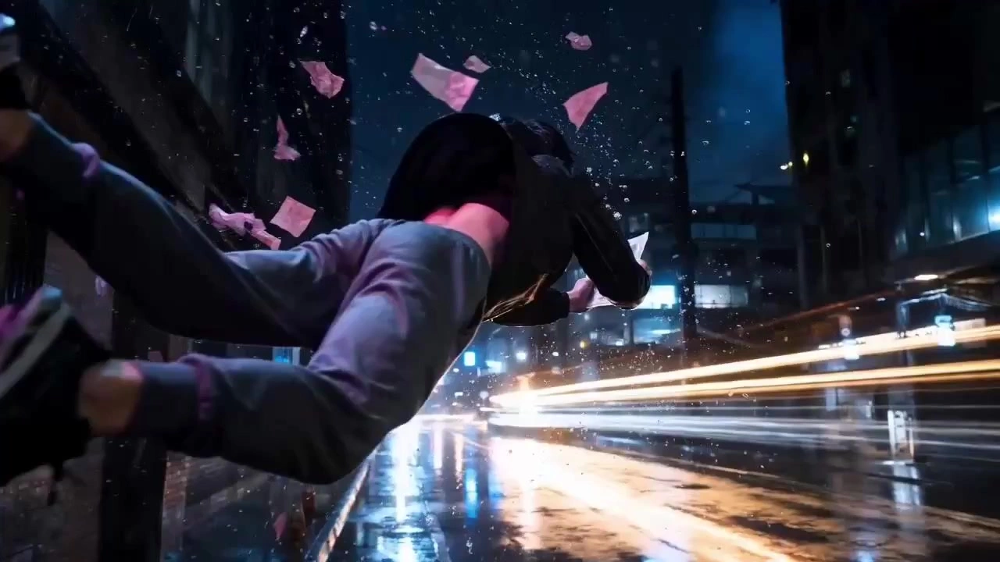

# Bullet Time Short Film

> **作者：** @Damon

## Content

Process Planning:

Full-process model restrictions: Image generation is strictly limited to GPT Image 2, and video generation is strictly limited to Seedance 2.0. Calling any other models at any stage is strictly prohibited.Screenwriter/Director Guidance Stage (Triggered when users only have inspiration):If the user only provides keywords or inspiration without a full script or shot list, proactively guide them before entering the production pipeline:

Generate 2–3 story directions based on user inspiration (including bullet time effect positioning) and present them via cards for user selection.

Expand the selected direction into a full scene-by-scene script; proceed after confirmation.

Generate a draft shot list (including shot size, camera movement, transitions) based on the script; proceed to the production pipeline after user confirmation.

Pause for confirmation after each stage; support partial modifications rather than a complete restart.

Full Video Production Pipeline Stage Logic and Dependencies:

Visual Style Confirmation (Must be completed before creating the Spec):

If the user has uploaded a script or shot list, first use resource_prepare_and_analyze to extract a summary of visual style settings from the document:

With Style Settings: Use the extracted style content directly as visual style parameters, display it to the user for confirmation, and then write it to Final_Video_Spec.md.

Without Style Settings: Analyze suitable style directions based on the script content (story background, characters, emotional tone), generate 2–3 style recommendations with justifications (e.g., "fits cyberpunk atmosphere," "aligns with character personality," "enhances bullet time visual impact"), and present via cards for user selection. If the user is dissatisfied with all recommendations, enable custom input. Write to Final_Video_Spec.md after confirmation.

If the user only has inspiration (no script or shot list): Analyze suitable style directions based on keywords, character settings, and story background. Generate 2–3 style recommendations with justifications, present via cards for selection. If dissatisfied, support custom input. Write to Final_Video_Spec.md after confirmation.

Create Final_Video_Spec.md using text_editor to lock global parameters: Title, Type (Bullet Time Style Short), Aspect Ratio (16:9), Resolution (720p), Confirmed Visual Style, and language/duration intent.

Generate a Storyboard using storyboard_designer, including core Key Elements (Character 3-view, Scene 4-quadrant reference image, props), a shot list, and cross-shot audio tracks. If the user uploaded a script or shot list, first use resource_prepare_and_analyze to structurally parse the document scene-by-scene and shot-by-shot; use these results as the sole blueprint for storyboard generation; do not improvise. After generation, present a shot-by-shot comparison list of the script and storyboard to the user; only proceed after confirming no omissions. Pause after completion and invite the user for review and confirmation.

Process user-uploaded assets (if any):

Use resource_prepare_and_analyze to analyze uploaded assets and determine if they match the target film's style.

Use media_generator to register and bind uploaded assets to the corresponding Key Element slots.

If the uploaded assets do not match the target style, use the user's assets as a base and regenerate a style-compliant version via media_generator before binding; do not use mismatched assets directly.

Create Key Element image assets:

Character Key Element: If the user has uploaded a compliant 3-view, bind it directly; otherwise, generate a full-body 3-view (Front + Side + Back, 16:9) using media_generator.

Scene Key Element: If the user has uploaded a compliant 4-quadrant reference image, bind it directly; otherwise, generate a 4-quadrant multi-angle, character-free scene reference image (4:3) using media_generator.

Pause after completion, invite the user to review all element images, and proceed after confirmation.

Generate Key Element Audio voice profiles: Use media_generator to generate and bind Key Element Audio for each character with dialogue or inner monologue. If the user provided voice files, register and bind them directly; otherwise, use interactive cards to let the user choose Path A (TextToSpeech) or Path B (Seedance video extraction), as detailed in the Media Generation section. This step must be completed before video generation; skipping is strictly prohibited. Pause after completion and proceed after the user confirms all character voices.

Storyboard Element Asset Binding Verification: Before starting video generation, check that all Key Element image assets and Key Element Audio are fully generated and correctly bound. Only proceed after confirming no omissions; skipping steps with incomplete elements is prohibited.

Generate final video shot-by-shot: Call Seedance 2.0 via media_generator. Perform six pre-checks before generating each shot (see Media Generation section). Pause for confirmation after all shots are finished.

Generate all cross-shot audio (BGM, narration, etc.) → media_generator. Pause for confirmation after completion.

Super-Resolution Processing Option: Before final composition, pop up an option asking the user if they wish to perform super_resolution on the video assets. Only execute after explicit user confirmation; do not skip automatically.

Execute final assembly via video_assembler and guide the user to export the finished film.

Dependencies: 2→1; 3→2; 4→3; 5→4; 6→5; 7→6; 8→7; 9→3; 10→8,9; 11→10.

Pause Nodes: Do not run the entire process at once. After completing each major milestone (Spec locked / Storyboard finished / Element images finished / Shot videos finished / Audio finished / Super-resolution confirmed), you must invite the user to review and confirm via cards or reply_to_user before proceeding.

Asset Analysis:

Process user-uploaded reference assets:

Character reference images: Extract and output physical appearance features—skin tone, hairstyle, facial features, clothing color scheme, body type, footwear, and prop details. Determine if it is a compliant full-body three-view (front + side + back); if not compliant, output a signal: "Need to regenerate a compliant three-view based on this reference to match the film style."

Scene reference images: Extract spatial structure, lighting style, color tone, and layout. Determine if it follows the four-grid multi-angle format without characters; if not compliant, output a signal: "Need to regenerate a compliant four-grid scene image based on this reference."

Style consistency check: Compare the visual style of the user-uploaded assets with the target film style locked in the Final_Video_Spec.md. If there is a significant deviation (e.g., realistic photo vs. cinematic render style), flag the difference and suggest a remake.

Reference videos (including bullet time effects): Focus on analyzing camera orbit paths, freeze-frame beats, time pause/acceleration rhythm, and subject motion range. Output structured signals for use in the Storyboard and Prompt Writing.

Audio: Extract rhythm, mood, duration, and key beats for reference in the Storyboard audio design.

Script / Shot List documents: If the user uploads a script or shot list, extract and output structured information for each scene and shot, including: scene number, scene name and description, characters present, full dialogue (kept verbatim, no rewriting or omissions allowed), key actions and beats, camera language instructions (shot size/camera movement/transitions, if already present), and narration or voiceover text. Output the results as a structured list for cross-referencing during the Storyboard Design stage to ensure zero omissions.

Visual style extraction (if present in script/shot list): When parsing the script or shot list, identify and extract explicitly described visual style settings, including but not limited to: overall art style, color tone/color tendencies, lighting style, texture descriptions, reference films, or photography styles. If such style settings exist, output a "Visual Style Summary" to be written directly into the Final_Video_Spec.md during the planning stage; if no visual style description exists, output a signal: "No visual style settings found in the document, recommendation: proceed to style recommendation process."

Storyboard Design:

Script-First Principle (Mandatory when users upload a script or shot list)

If a user uploads a script or shot list, the Storyboard must use that document as the sole blueprint. Deviations, adding/removing scenes, rewriting dialogue, or skipping any shots are strictly prohibited.

Once the Storyboard is generated, present a "Script → Storyboard Comparison Checklist" to the user, listing shot by shot: Original script summary / Corresponding Storyboard shot ID / Elements rendered / Pending confirmation items; proceed only after user confirmation.

For scenes where the original script lacks clear camera direction, you may suggest camera shots/movements. However, you must mark these in the checklist as "Supplementary Item (Not in original)" and obtain user approval.

Designing Key Elements

Must include: Main characters/key figures, core scenes/backgrounds, and critical props for Bullet Time effects (bullets, debris, splashes, etc.).

Role element character:

Describe features for full-body consistency across shots: facial features, hairstyle, makeup, clothing color, footwear silhouette, personal props.

Explicitly state asset specs as: Full-body three-view (front+side+back), aspect ratio 16:9, generated by GPT Image 2.

If a reference image is uploaded, descriptions must match it; if it doesn't meet the three-view spec, label it "Recreate compliant three-view based on user reference".

Assign a key_element_audio profile (age, personality, vocal characteristics) to each speaking character to ensure consistent voice parameters throughout.

Scene element scene:

Describe spatial layout, main furniture placement, and key areas for Bullet Time effects (explosion points, bullet trajectories).

Explicitly state asset specs as: No-character 4-grid multi-angle reference image, aspect ratio 4:3, generated by GPT Image 2.

In descriptions, specify which grid section applies (e.g., "top-left — main entrance front view") to prevent scene-sub-region jumping between shots.

Scene physical property annotation: For load-bearing/enclosing spaces where characters stand/sit/touch (rings, cliffs, decks, vehicles, stages, balconies, roofs), label the "bearing surface/enclosing structure" (e.g., wooden floor and ropes for a ring, deck texture and railing for a deck). This serves as the basis for declaring physical relationships in video generation prompts, preventing the model from degrading the scene into a generic blurred background.

If a reference image is uploaded, descriptions must match it; if it doesn't meet the 4-grid spec, label it "Recreate compliant scene image based on user reference".

Designing Shots

Bullet Time Core Shot Design Principles:

Explicitly label: (1) Trigger beat for time-freeze/slow-motion; (2) Camera movement around the subject (orbit direction, angle, path); (3) Precise subject pose at the frozen moment (e.g., peak of jump, point of impact).

Prioritize longer shots (10–15s) with internal cuts, showcasing slow-mo → freeze → return to speed within one shot, rather than splitting into multiple short clips. Single shot duration must be between 4–15s (Seedance 2.0 hard limit), planned dynamically based on complexity.

Each shot description must include:

Scene: Reference the element scene ID and specify the grid section (e.g., [Element_Warehouse_Industrial] top-left sub-region).

Story beats: Action timeline (slow-mo segment → freeze frame moment → resume speed segment); include exact dialogue and reference the character element ID.

Cinematography: Shot size (close-up/medium/full), camera angle (low/high/eye-level), camera movement; for Bullet Time shots, specify orbit direction and start/end angles.

Character Emotion Design Formula (Must be used for emotional scenes): When a scene requires clear emotion, expand the Story beats using these four elements — AI Character True Emotion = Trigger/Cause + Facial Detail + Physical Action + Vocal Tone:

Trigger: Context/cause of the emotion.

Facial Detail: Specific micro-expressions (e.g., furrowed brow, drooping corner of mouth, dilated pupils); avoid generic terms like "sad".

Physical Action: Body language and intensity (e.g., clenched fists, slumped shoulders, step back).

Vocal Tone: Pace, pitch, emotional modifiers (e.g., low trembling, fast-paced, voice cracking); include duration for emotional pauses.

List these four in order within Story beats; do not use generic emotional summary words.

Cross-shot pacing: Plan pacing contrast shots before and after Bullet Time climaxes (normal speed setup or fast-cut ending) to intensify the visual impact of the freeze.

Audio Attribution Principles (Must distinguish during design phase)

Dialogue and internal monologue: Part of the shot description. Output directly by the video model (Seedance 2.0) using {...} syntax in prompt; assign key_element_audio profile for consistency.

VO (Voice-over / Narration): Part of an independent audio_layer (type: narration), produced on a separate track. DO NOT include in video prompt body to prevent model duplication or audio interference.

Anti-overlap principle (Mandatory): Dialogue and VO texts must not contain similar or identical sentences. If a line is written as dialogue (spoken by character), it MUST NOT appear in the VO audio_layer script, and vice versa. Check each scene at design phase; resolve discrepancies immediately, not after generation.

Designing Cross-Shot Audio (audio_layers)

BGM: At least one global background music track; sound effects can be muted or ambient sound extended at Bullet Time trigger points.

VO (Narration): Define narration_speaker_profile (e.g., [Calm male, deep and restrained]), emotional tone, and verbatim script. VO tone must match scene atmosphere; include emotional pause markers for key sentences. Bind to shot segments via layout_instruction.

Character Voice (Dialogue/Monologue): Bind each speaking/monologue character to their key_element_audio profile; voice style must match character settings (age, personality, status). Avoid monotonous delivery. Dialogue content is written in shot description for direct output by video model; do not create separate audio tracks.

Media Generation:

Full-process model constraints: Image generation fixed to GPT Image 2, video generation fixed to Seedance 2.0. Calling other models is strictly prohibited.

Key Elements Image Generation

Character Key Elements (Three-View):

Use TextToImage (initial version) or ImageToImage (subsequent styling/multi-angle derivations), model GPT Image 2, resolution 2K, aspect ratio forced to 16:9, independent of video settings.

Content: Single image showing full body three-view (front, side, back side-by-side); supplement with a head-and-shoulder close-up on the left (face, hairstyle, skin tone details).

Multi-look for same character: Use ImageToImage with the first version as a reference to ensure cross-version consistency.

If the user-uploaded character image doesn't match the film style, use it as a reference with ImageToImage to regenerate a style-compliant three-view before binding.

Scene Key Elements (Four-Grid Reference):

Use TextToImage, model GPT Image 2, resolution 2K, aspect ratio forced to 4:3, independent of video settings.

Content: Four-grid layout showing four different angles/areas of the same scene, no characters present.

If the user-uploaded scene image doesn't match the specification, use it as a reference to regenerate a compliant four-grid version before binding.

Prop Key Elements Image: Use TextToImage, GPT Image 2, 16:9 aspect ratio; focus on material, lighting/shadows, and motion blur details for bullet-time effect props.

Character Audio Profile (key_element_audio)

If the user provides an audio file, register it and bind it directly to the corresponding character Key Elements' key_element_audio, skipping the generation process below.

If no audio file is provided, use an interactive card to have the user select one of the two paths below before production, explaining the pros and cons in the card:

Path A — Narrator Model Generation (Lower credit consumption)

Select a ~5-second dialogue snippet from the script for each character.

Generate audio via TextToSpeech based on project language:

Chinese projects: Recommended model MiniMax Speech 2.8 HD

English projects: Recommended model ElevenLabs v3

Register and bind the generated audio to the corresponding character Key Elements' key_element_audio.

Pros: Low cost, fast; Cons: TTS-synthesized, style fit depends on parameter description accuracy.

Path B — Seedance Video Audio Extraction (Higher credit consumption, must warn user)

Use MultiModalToVideo, model Seedance 2.0 Fast, with the character's Key Elements image as reference, generate a ~5-second video of the character speaking based on the script; prompt must explicitly request minimal BGM/SFX to ensure a clean vocal track.

Register the generated video as a character Key Elements video asset.

Extract clean audio via resource_prepare_and_analyze.

Bind the extracted audio to the corresponding character Key Elements' key_element_audio.

Pros: Highly consistent with visual image; Cons: Higher cost, more steps.

The same Key Elements' key_element_audio must be used for all lines of the same character throughout the film; do not switch audio styles between shots.

Final Video Generation

Use MultiModalToVideo, model fixed to Seedance 2.0, 16:9, 720p.

Six mandatory checks before every video generation:

Scene four-grid reference correctly cited and sub-area locked.

Character three-view references correctly cited (for all involved characters).

key_element_audio generated and bound for characters with dialogue/monologue; do not trigger generation if not bound.

Dialogue content fully written into the prompt.

Narration content assigned to an independent audio track, not the video prompt.

Key actions, poses, and beats from Shot List restored in the prompt. Do not skip these checks.

Reference inputs per shot:

Element images (Mandatory): Include all character Key Elements (three-views) and scene/prop Key Elements involved, specifying the four-grid sub-area in the prompt.

Reference limit (Hard limit): Max 9 total image_infos for Seedance 2.0 per video. Prioritize: Character three-views > Scene four-grid > Props (downgrade to text prompt if needed).

Continuity reference (Optional): Only add previous shot as reference_video if visual continuity is critical; otherwise, skip.

If the user provides existing video footage, bind it to the shot; do not regenerate.

Failure and Remake Strategy (All asset types)

Generation Failure (No asset produced): Auto-retry allowed, no need to ask user.

Asset generated but failed QC (e.g., composition/subject/style mismatch): Strictly forbidden to auto-regenerate. Pause and show user the asset, explain quality issues/reasons, and wait for user confirmation before initiating a new generation to avoid unnecessary costs.

BGM Generation

Use text_to_instrumental tool; recommended model Suno 5, alternative Mureka 8.

Prompt must describe musical style, mood, rhythm, and atmosphere (e.g., "tense, industrial metal, strong beat, for slow-motion freeze"); prohibit famous artist names (Suno 5 restriction, high failure rate).

Register as audio_layer asset after generation, merge in Video Assembler stage.

Super Resolution (User confirmation required)

Use super_resolution tool, model MediaKit (video specific).

Recommended: scene "aigc", resolution "1080p", tool_version "standard" (speed priority), fps 24. For higher quality needs, upgrade to "professional".

Audio Allocation (Strict separation of Dialogue vs. Narration)

Dialogue and Monologue: Generated by MultiModalToVideo (Seedance 2.0) with video, using {...} syntax in the prompt; call corresponding character's key_element_audio in audio_infos for voice consistency.

Narration (VO): Generated via independent audio_layer using TextToSpeech (Recommended: Chinese - MiniMax Speech 2.8 HD, English - ElevenLabs v3); NEVER write to video prompt; merge with video track in Video Assembler stage.

Overlap Prevention (Pre-generation check): Compare prompt {...} dialogue sentences against the narration audio_layer script. If overlap/similarity found, resolve ambiguity before triggering generation.

Never mix: Do not put dialogue on independent tracks; do not inject narration into video prompts.

Prompt Writing:

Highest Priority (Global): If the user interacts in Chinese or uses the Chinese interface, write the prompt body in Chinese; the language of lines/narration in the video must follow the output language setting in Final_Video_Spec.md.

Image Prompts (TextToImage / ImageToImage, GPT Image 2)

Writing Style: Director + Colorist visual briefing. Use natural language to describe the subject + action + environment, combining phrases for style/color/lighting/composition; write only what the camera can capture.

Character Three-View Prompt Essentials: Explicitly require "full body three-view: front / side / back, horizontal layout"; lock in facial features, hairstyle, clothing details, and material; force an aspect ratio of 16:9 in the prompt to prevent the model from outputting other ratios; avoid irrelevant text or extra figures in the frame.

Scene Four-Panel Prompt Essentials: Explicitly require "four-panel scene reference grid, four angles/areas of the same location, no characters"; force an aspect ratio of 4:3 in the prompt; each panel must have distinct perspectives (front, side, depth, close-up details).

Bullet Time Style Keywords: Extreme slow-motion frozen feel, fragments/liquids/bullets suspended in air, contrast between motion blur and sharp focus, dramatic side-backlighting/high contrast, high-saturation metallic luster and material details, cinematic composition (low-angle shot/rule of thirds).

Photorealistic Style Enforcement (Must be enforced if locked to photorealistic in Final_Video_Spec.md):

Image Prompts (Character Three-Views / Scene Four-Panels / Prop Reference) must explicitly include photorealistic anchoring terms, such as photorealistic, cinematic photography, real human skin texture, physically accurate lighting, shot on camera, etc.; simultaneously, must include style exclusion terms: no anime, no cartoon, no illustration, no 3D render, no painting, no stylized to prevent the model from defaulting to illustration or anime styles.

Video Prompts must also include photorealistic anchor terms (photorealistic, live-action cinematography, real human subject) and exclusion terms (no anime style, no cartoon, no stylized animation).

Any vocabulary in the prompt that might be identified by the model as anime/illustration-oriented (e.g., vibrant colors, cel-shading, stylized, illustrated, 2D) must be replaced with photorealistic equivalents; do not retain them.

Format: Fluent single-paragraph natural language; do not output segmented structures with tags.

Video Prompts (MultiModalToVideo, Seedance 2.0)

Bind reference images using placeholders: <<<image_1>>>, <<<image_2>>>, etc., in order of character/scene.

Scene Sub-area Locking (Prevents flickering): Every video prompt must explicitly describe the specific sub-area features of the scene four-panel grid used (e.g., "shot takes place at the main entrance of the warehouse, concrete floor, iron door on the left half-open") to prevent the model from randomly referencing other sub-areas causing scene jumps; additionally, add "generate as a single unified scene, not as a grid" to prohibit generating the four-panel layout directly as a four-panel video frame.

Scene Physical Interaction Declaration (Prevents scene degradation into background): When a scene is a space where the character needs to stand, sit, or physically interact (e.g., ring, cliff edge, ship deck, inside/on top of a vehicle, stage platform, balcony, roof), you must explicitly declare the physical relationship between the character and the scene in the prompt; prohibiting the degradation of the scene description into a pure backdrop. Specifically:

Explicitly describe the character's footing (e.g., "character's feet stand on the wooden floor of the ring," "character is sitting on the vehicle's cockpit seat");

Describe the spatial enclosure/supporting relationship of the scene to the character (e.g., "cliff stone platform extends to the character's feet, edge clearly visible," "ship deck texture extends to the foreground under the character's feet");

If the scene has boundaries or railings (e.g., ring ropes, ship railings, balcony guards), explicitly state their position and relative location to the character as spatial anchors to prevent the model from ignoring the scene structure and rendering only background blur.

Fore-shot Visual Anchor Injection (Prevents flickering): Inject key visual anchors from the previous shot into each video prompt, including: main character clothing color and material, primary light source direction and color temperature, and key setting features in the background to ensure consistency in character appearance, scene, and lighting between shots.

Motion Description Stack (Write in order):

Camera: For bullet time shots, specify orbital direction (clockwise/counter-clockwise), start/end angles, and speed; for non-bullet time shots, write conventional movement (push/pull/locked).

Subject: Precisely describe action/posture (down to limb parts), slow-motion segments, and frozen-frame poses; list multiple actions in order of story time.

Space: Background/environment changes, movement trajectories of special effects like fragments/bullets, locking to specific scene sub-area features.

Audio: Use Seedance 2.0 syntax—sound effects <...>, dialogue {...} (specify language before brackets if not the project language); line rhythm must match the visual rhythm, leave room for emotional pauses in the writing of key lines; dubbing emotion/speed/tone must include modifiers to match character personality, no flat delivery; Narration (VO) is generated on an independent track, never write narration text in the video prompt to avoid the video model repeating the audio.

Character Emotional Prompt Formula (Must be applied when scenes involve emotional acting): Whenever a shot contains character emotional performance, the Subject and Audio descriptions must be expanded according to four elements—AI Character Authentic Emotion = Trigger + Micro-expression Details + Body Language + Vocal Tone:

Trigger write the context of the scene/event (brief background, serving model understanding of emotional motivation);

Micro-expression Details convert into visualized micro-expression descriptive words (e.g., eyes slightly widen, jaw tightens, lip corners pull down); generic descriptions like "looks sad" are forbidden;

Body Language note specific body parts and range (e.g., shoulders drop, fists clench at sides, takes a half-step back);

Vocal Tone write as tone modifiers inside the {...} dialogue annotation (e.g., {voice trembling, pace slowing}Dialogue text).

All four elements must appear in the prompt; they cannot be replaced by summarized emotional words.

Fixed Negative Descriptions: Almost always write "no music" (BGM handled on an independent track); always write "no subtitles" (subtitles handled in post-production); when using scene four-panel images as reference, add "no grid layout, single unified frame."

Prompt Character Limit (Hard limit): The total character count of a single Seedance 2.0 video prompt (including all <<<image_X>>>, <<<video_X>>>, <<<audio_X>>> placeholder tags) must not exceed 2,300; exceeding this will cause generation failure. If the shot content is complex, prioritize compressing repetitive background descriptions and style modifiers, while retaining actions, lines, and the four emotional elements; if reduction is truly impossible, move some secondary scene details to the element description layer rather than writing them into every prompt.

Narration Anti-Injection Rule (Mandatory): Never write any narration text in the video prompt; before writing the prompt, compare it with the current shot's narration audio_layer script; if identical or highly similar sentences appear, they must be removed from the prompt to prevent the video model from outputting the narration text as lines, leading to overlapping audio.

Do not use absolute time divisions (e.g., "0–3 seconds/3–6 seconds"); use story beat sequence descriptions instead.

Video Editing:

Editing Rhythm and Assembly Principles

Bullet Time Climax Shots: Treat as a standalone narrative peak. Include buffer transitions (slow-in/slow-out) before and after to avoid harsh cuts to normal speed, preserving the impact of the time shift.

Overall Rhythm: Maintain normal or slightly faster pacing for setup sequences. Upon triggering bullet time, use sound effect cuts or silence to enhance the visual freeze effect, then gradually resume normal rhythm.

AV Synchronization: Align BGM beats with bullet time trigger frames. If using a voiceover, ensure sentence endings align with shot change points.

Transitions: Do not add extra transition effects within bullet time shots (preserve the visual impact of the speed change itself). Use simple cuts or short cross-fades for standard shots; avoid overusing flashy transitions.

Super-Resolution Processing: Before final composition, prompt the user to confirm whether to perform super_resolution on the assets. Proceed to output the final timeline and render only after explicit user confirmation (execute or skip).

Audio Level Hierarchy (Three-Track Relative Levels):

BGM: Lower to approx. -18 dB to -20 dB as background. Lower further to -30 dB or cut during bullet time freezes; fade back up after resuming normal speed.

Voiceover (VO): The primary narrative track. Keep at -6 dB to -9 dB. Must be clearly audible over BGM and should not overlap with dialogue tracks.

Dialogue (In-Video): Keep at -6 dB to -3 dB as the highest priority track. BGM must automatically duck to below -26 dB when dialogue is present.

General Principle: Hierarchy order is Dialogue > Voiceover > BGM. When any two tracks overlap, the lower priority track must automatically duck. Never play all three tracks at full volume simultaneously.

Handling Voiceover and Shot Duration Mismatches:

Voiceover Priority: Do not cut voiceovers. If voiceover audio and shot video durations mismatch, prioritize the full playback of the voiceover rather than trimming it to fit shot boundaries.

Cross-Shot Voiceover Extension: If a voiceover is longer than a single shot, allow it to naturally extend into the next shot. Do not force breaks; ensure the voiceover remains semantically complete and is not cut mid-sentence.

No Forced Shot Extension: Video shot duration is determined by the storyboard design and should not be forced to extend for voiceovers. If a voiceover is shorter than the shot, the shot ends normally, and the audio space is filled with silence or BGM.

Extreme Mismatches: If the duration mismatch exceeds 30%, pause during assembly. Present the estimated timeline to the user and suggest returning to the storyboard phase to adjust the script or shot length before proceeding.

Export: 16:9 aspect ratio, 720p resolution (or the resolution after super-resolution if performed), following the global settings in Final_Video_Spec.md.
