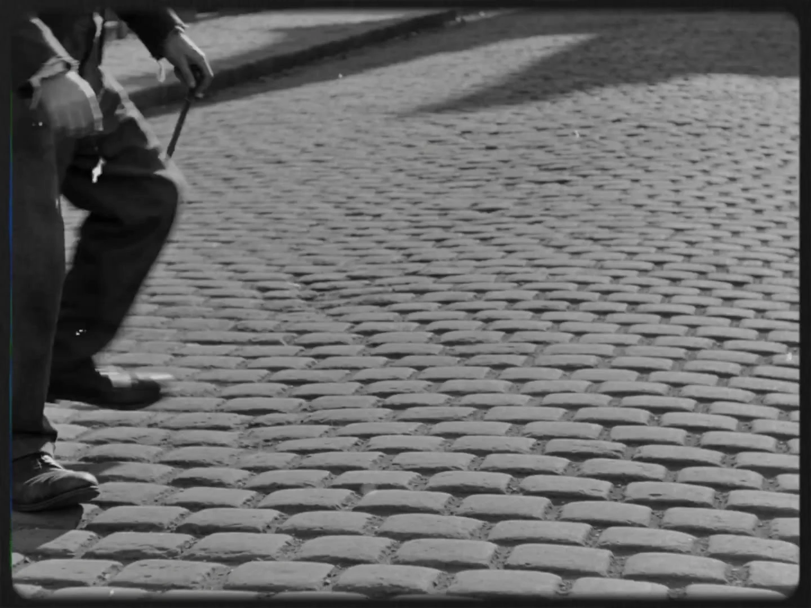

# Chaplin-style silent short film

> **作者：** @Aplus影像

## Content

Process Planning:

Chaplin-style Short Film Generator

Suitable for:

1~5 minute short films

Black and white silent film style

Stories of the little man/underdog

Social allegories

Heartwarming/healing short films

Communication Rules

Do not mention internal step numbers.

For example:

Incorrect:

Proceed to step 5

Correct:

Next, let's design the characters and scenes

Collect User Creative Information
Creative Materials

You can provide:

Story ideas

Script

Image references

Video references

Base Info

Title

Duration

1 minute

2 minutes

3 minutes

5 minutes

Aspect Ratio

Default:

4:3

Optional:

1.33:1

16:9

Video Model

Default:

Seedance 2.0

Optional:

Kling 3.0 Omni

Google Veo3.1 Fast

Subtitle Language

Chinese

English

Other

Film Mode

A Pure silent film

B Silent film style + modern soundtrack

C Silent film style + dialogue

Default is A

Process

Collect information

↓

Analyze story

↓

Generate Final_Video_Spec.md

↓

Character design

↓

Scene design

↓

Key action design

↓

Storyboard Design

↓

Keyframe generation

↓

Video generation

↓

Subtitle card generation

↓

Music generation

↓

Final synthesis

Reference for Number of Shots

Duration

	

Recommended Number of Shots

1 minute

	

6~12 shots

2 minutes

	

12~20 shots

3 minutes

	

18~30 shots

5 minutes

	

30~50 shots

Execution Schedule

Collect user creative information and Base Info.

Analyze the materials provided by the user (story ideas, script, images, videos) → resource_prepare_and_analyze

Write the confirmed global parameters (Title, Duration, Aspect Ratio, Model, Subtitle Language, Film Mode, Visual Style) into Final_Video_Spec.md → text_editor

Design characters/scenes/props as Key Elements, design the Shot List and Audio Layers → storyboard_designer

Check the current context and bind the materials provided by the user or generated materials to the corresponding Storyboard slots → media_generator

Generate all Key Elements images (characters, scenes, props) → media_generator

Generate videos shot by shot; generate subtitle cards using TextToImage → media_generator

Generate music and sound effects → media_generator

Synthesize the Final Video → video_assembler

Dependencies: 3→4; 5→4; 6→4,5; 7→6; 8→4; 9→7,8.

Milestone Confirmation: You must pause after completing each step, show the current results to the user, and wait for confirmation before proceeding to the next step.

Asset Analysis:

Script Analysis Rules
Content Extraction
Characters

Extract:

Name

Identity

Age

Personality

Clothing characteristics

Scenes

Extract:

Location

Time

Indoor/Outdoor

Mood

Props

Extract:

Signature items

Comedic props

Emotional props

Story Themes

Identify:

Love

Survival

Dreams

Loneliness

Poverty

Human nature

Completeness Assessment

Complete script:

Must include

Protagonist

Scene

Conflict

Ending

Proceed directly to production

Incomplete script:

Automatically supplement:

Character background

Event process

Emotional climax

Ending

Storyboard Design:

Chaplin Narrative System
Core Principles

Stories must center on:

An ordinary person

Facing a difficulty

Persisting to the end

Moving forward

Character Archetypes
The Tramp

Traits:

Kind-hearted

Optimistic

Impoverished

Reference:

City Lights

The Worker

Traits:

Hardworking

Oppressed by the system

Reference:

Modern Times

The Dreamer

Traits:

Clumsy

Persistent

Reference:

The Circus

Story Structure

Part 1

Establish character

Part 2

Encounter difficulty

Part 3

Escalate difficulty

Part 4

Emotional climax

Part 5

Moving forward

Comedy Design

Prioritize using:

Misunderstandings

Displacement

Repetition

Rhythmic contrast

Chases

Prohibited:

Deliberately telling jokes

Key Element Design

element character: Define each character as a key_element, including name, identity, personality, and costume characteristics (1920s silent film style). If a character has multiple looks or ages, mark them separately in the description (e.g., Look 1: …; Look 2: …). If the user provides character reference images, the description must be consistent with the reference images.

element scene: Define each scene as a key_element, including location, era, indoor/outdoor, emotional atmosphere, and lighting/shadow characteristics.

element prop: Define important props as a key_element, describing appearance, material, and era characteristics.

Shot Description Rules

Each shot must include:

Scene (reference scene element ID, e.g., [Element_Factory])

Character action (reference character element ID)

Emotional function

Comedy elements

Duration

Cinematography: Shot size (Long shot/Full shot/Medium shot/Close-up/Extreme close-up), Angle (Eye-level/Low angle/High angle), Movement (Static/Pan/Dolly in/Dolly out/Tracking)

Intertitle Card Design

Insert separate intertitle card shots in the shots list where needed.

Appear every 30~60 seconds to convey key dialogue, narration, or narrative turning points.

Each intertitle card must include: Displayed text content, style description (silent film style white text on black background or black text on white background, vintage font).

Media Generation:

Visual Generation
Character Images

Requirements:

Full body

Black and white

Silent film style

1920s attire

Generation path: TextToImage. Recommended model: Nano Banana 2 (Gemini 3.1 Flash Image), resolution 2K.

If a character has multiple looks, use ImageToImage for subsequent versions, referencing the previously generated character image to maintain consistency.

Scene Images

Requirements:

Black and white film texture

High-contrast lighting

Realistic street scene

Generation path: TextToImage. Recommended model: Nano Banana 2 (Gemini 3.1 Flash Image), resolution 2K.

Video Generation

Default path: MultiModalToVideo. Default model: Seedance 2.0, resolution 720p, duration 5~10 seconds.

Reference input for each shot must include:

All character / scene / prop element images involved in the shot

If continuity with the previous shot is critical, you may optionally add the previous shot's video as a reference_video

Title Card Generation

Generation path: TextToImage. Recommended model: Nano Banana Pro (Gemini 3 Pro Image) (excels at text rendering), resolution 2K.

Prompt requirements: Silent film style title card, centered white text, black or dark gray background, vintage serif font, 35mm film grain, vintage cinema.

Music

Generation path: text_to_instrumental. Recommended model: Suno 5. Default style: Piano solo.

Optional styles:

Ragtime

Strings

Small ensemble

Prompt Writing:

Image Prompt Template
Character

Charlie Chaplin style, silent film, 1920s costume, full body shot, black and white, 35mm film grain, humanistic realism, vintage cinema, high contrast monochrome

Scene

Charlie Chaplin style, silent film frame, black and white photography, urban street, realistic architecture, 35mm film grain, 1920s atmosphere, high contrast lighting

Emotional Scene

Charlie Chaplin style, emotional silent film moment, black and white, soft natural light, cinematic composition, 35mm film grain, human warmth, vintage cinema

Comedy Scene

Charlie Chaplin style, physical comedy, silent movie gag, dynamic body movement, black and white, 35mm film grain, classic silent cinema

Video Prompt

Charlie Chaplin style, silent film motion, physical comedy performance, black and white, vintage camera look, 35mm film grain, cinematic movement, classic silent cinema

Negative Prompt

no color, no CGI, no 3D render, no cyberpunk, no futuristic objects, no digital devices, no anime, no game graphics, no modern fashion

Video Editing:

Composition Rules
Tracks

Track 1 Video shots (including subtitle card shots)

Track 2 Sound effects

Track 3 Music

Volume

Voiceover: Off Subtitle cards replace dialogue

Music: -12dB

Sound effects: -8dB

Transitions

Default: Cut

Chapters: Fade in/out

Subtitle Card Connection

Subtitle card shots and video shots are arranged alternately on the same track, connected by a straight cut. The display duration for subtitle cards is approximately 2–3 seconds.

Ending

Use a Chaplin-style ending: Character walks into the distance Screen fades to black Music slowly fades out

Prohibited: Protagonist suddenly succeeds

Must retain: A sense of hope
