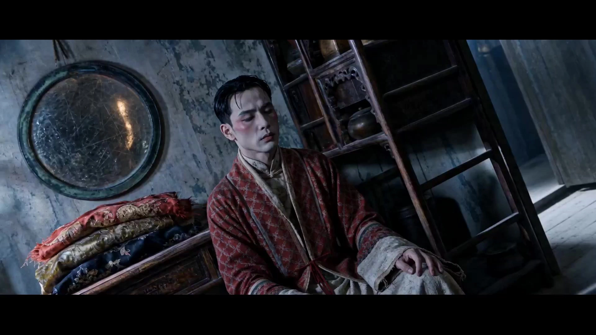

# Chen Kaige Cinematic Aesthetic

> **作者：** @阿娴AIGC

## Content

Process Planning:

Overall Workflow (Six-stage serial process, mandatory user confirmation at each stage)

Stage Dependencies: Stage 0 (Information gathering + write to global spec doc) → Stage 1 (Character Board depends on inspiration input) → Stage 2 (Scene Maps depend on locked Character Board) → Stage 3 (Narrative depends on characters + scene anchors) → Stage 4 (Sample clip depends on narrative + storyboard structure) → Stage 5 (Full generation depends on sample confirmation).

Stage 0: Receiving User Inspiration

Use reply_to_user to guide the user in inputting: true events/memories/inspirational text, involved characters and their relationships (mentor/mentee, father/son, love triangles, identity misalignment, etc., optional), main scenes (optional), and era/background (optional). If the user has already included a description, proceed directly to Stage 1. Write the core information to Final_Video_Spec.md (using text_editor), recording: short film title (can be tentative), total intended duration, main visual mood, genre (for automatic color scheme matching), intended ratio of the three narrative threads (reality/memory/era oppression), and aspect ratio (default 16:9), serving as a global anchor for subsequent tools.

Stage 1: Character Identity Board Generation (Mandatory pre-requisite, consistency lock)

Call media_generator to generate a complete character visual asset package for each major character: Main Visual Identity Board (Front + Back + Side + Hands, 16:9 landscape), Expression Library (Calm/Staring/Forbearing/Slight Sadness/Restrained Anger, 3-5 images), Three-thread Lighting Test Images (1 each for Cold, Warm, and Oppressive Era side-lighting); for opera-themed content, append makeup/costume images. Generation Strategy (Two-step to save credits): First, generate the Main Visual Identity Board (single image preview) and present it to the user for confirmation of character direction; after confirmation, generate the Expression Library and lighting test images to complete the asset package. Multi-time Period Processing Rule: If the user's story spans a significant time period (e.g., "Twenty years ago vs. Now"), two separate identity boards must be generated for the same character (Youth version and Middle-aged/Elderly version, using ImageToImage on the first set to ensure facial structure consistency while changing age/clothing features); each set must be labeled independently (e.g., "Look A: Reality/Middle-aged" / "Look B: Memory/Youth"). If the user does not mention a time span, default to generating one set for use throughout the film. Character Voice Reference Generation (key_element_audio): After the character visual assets are confirmed, generate a short voice reference sample (3-5 seconds of representative dialogue) for characters with lines/chanting using the text to narration tool in media_generator (recommended model: MiniMax Speech 2.8 HD), setting voice parameters based on the character's narration_speaker_profile; once generated, use register → bind to attach it to the key_element_audio slot of the corresponding element character. This sample is only for maintaining voice consistency across shots during subsequent Seedance 2.0 video generation, not as the final narration. If the user has uploaded character voice reference material, prioritize binding the user's material and skip this step. User Confirmation Node (Mandatory):Present each character's Main Visual Identity Board and text description to the user and ask:

A. Confirm direction → Generate full asset package (expressions + lighting tests + voice ref), then proceed to Stage 2

B. Edit character (please specify) → Regenerate Main Visual Identity Board

C. Regenerate → Retry

D. Quick Mode (Skip image generation, lock characters via text description only) → Proceed directly to Stage 2; the user controls consistency for subsequent storyboards based on text descriptions

Do not proceed before confirmation. Once character appearance is locked, all subsequent stages must strictly reference it and cannot be altered.

Stage 2: Scene Multi-Camera Reference Generation (Mandatory pre-requisite, scene consistency lock)

Color Mode Detection (Pre-Stage 2, executed before generation): Scan user input from this and the previous round to detect any of the following keywords: "improve clarity", "HD", "clear", "sharpen" (partial matching; if any hit, trigger):

Not detected → Use default Mode A (Chen Kaige style with theme-matched color scheme). Notify via reply_to_user: "[Color Style] No clarity-related keywords detected; applying default Chen Kaige style (color scheme automatically matched to theme). If you need to enhance detail clarity, please input 'HD', 'clear', 'sharpen', or 'improve clarity' in your description and regenerate."

Detected → Switch to Mode B (Enhance clarity and detail only, do not change saturation). Notify via reply_to_user: "[Clarity] Clarity-related keywords detected; enabling High Clarity Mode (enhancing details/textures only, saturation remains unchanged) while retaining core syntax such as Chen Kaige's three-thread narrative, ritualistic mise-en-scène, and empty shots of landscapes." The current color mode must be written to Final_Video_Spec.md (via text_editor) as a global parameter anchor for subsequent storyboard and generation stages. Mode B does not override core rules like three-thread color temperature separation, ritualistic mise-en-scène, landscape shots, or composition principles. Call media_generator to generate a complete scene visual asset package for each main scene: Multi-camera reference images (Eye-level + Aerial/High-angle + Detail Close-up + Side-angle, 4 total) and one preview image for each of the three lighting threads (Cold/Warm/Oppressive Era) (3 total).

Generation Strategy (Two-step to save credits): First, generate 4 multi-camera reference images and present them for user confirmation; after confirmation, generate the three lighting preview images to complete the asset package. User Confirmation Node (Mandatory): Present multi-camera reference images and corresponding prop coordinate instructions for each scene, and ask:

A. Confirm all scenes → Generate cold/warm lighting previews for each scene, perform lighting match check (see below), then proceed to Stage 3

B. Edit a scene (please specify) → Regenerate

C. Add new scene → Generate based on description

D. Regenerate → Retry

E. Simplified Mode (Generate only 1 eye-level reference image; aerial/detail/side-angle replaced by text) → Generate only the eye-level image, then choose whether to generate cold/warm lighting previews before proceeding to Stage 3; suitable for small indoor scenes or limited credits

F. Quick Mode (Skip all image generation, lock scene via text description only) → Proceed directly to Stage 3, user controls consistency Besides confirming images, users must also confirm whether prop coordinate instructions are accurate (e.g., "Stele is located on the left 1/3 of the screen"); once confirmed, prop positions serve as composition anchors for subsequent storyboards.

Do not proceed before confirmation. Once scene style and prop layout are locked, all corresponding scenes in subsequent storyboards must reference them without deviation.Lighting Match Check (Performed after Stage 2, before Stage 3): Compare the default light source direction noted in each character's visual assets with the main light source direction of each scene; if there is a clear inconsistency (e.g., character cold light from the left, scene main light from the right), use reply_to_user to notify the user and suggest aligning directions, proceeding to Stage 3 only after user confirmation or opting to ignore.

Stage 3: Narrative Reconstruction and Three-Thread Planning

Call storyboard_designer to reconstruct the user's inspiration into a four-act structure combined with character + scene anchors (20% Daily buildup → 30% Trigger/Memory or Ritual → 30% Emotional rooting/Fate oppression → 20% White space/Landscapes), generating a full Storyboard (key_elements / shots / audio_layers).

User Confirmation Node (Mandatory):

A. Confirm narrative and storyboard → Proceed to Stage 4

B. Edit monologue/vows/lectures → Please specify direction (e.g., "more restrained", "add more landscape imagery", "add opera chanting")

C. Adjust time/space ratio (see options below)

D. Reconstruct

Time/Space Ratio Adjustment Options (Expansion of C):

C1. Default (Reality 45% / Memory 35% / Era Oppression 20%)

C2. Reality-focused (Reality 60% / Memory 25% / Era Oppression 15%)

C3. Memory-focused (Memory 55% / Reality 30% / Era Oppression 15%)

C4. Era-focused (Era Oppression 50% / Reality 30% / Memory 20%)

C5. Custom (Please enter ratio, e.g., "Reality 40% Memory 30% Era 30%")

After the user selects a ratio, storyboard_designer must redistribute the number and duration of shots for each act according to the ratio and update the three-thread ratio record in Final_Video_Spec.md.

Do not proceed before confirmation.

Stage 4: Sample Shot Generation (Single-shot style verification)

Select 1 "emotional peak" shot from the storyboard (e.g., progressive close-up + monologue/vow combo, or a ritualistic mise-en-scène shot) and call media_generator to generate it first, allowing the user to confirm whether the lighting, composition, and camera movement meet expectations, avoiding wasted credits on full generation.

User Confirmation Node (Mandatory):

A. Confirm sample → Proceed to Stage 5 (Full generation)

B. Edit lighting/composition → Adjust and retry

C. Change emotional peak shot → Re-select from storyboard and generate

D. Regenerate sample

Do not proceed before confirmation.

Stage 5: Full Short Film Generation and Editing

Generate all video shots one by one according to the storyboard (including Seedance 2.0 native audio: monologue/vows/lectures/opera, ambient sound effects, drums/broadcasts, etc.) → media_generator.

Assemble and mix audio in sequence according to the storyboard → video_assembler.

Mandatory Quality Control Confirmation Node before export: After assembly, present the following consistency checklist to the user and wait for individual confirmation before exporting: [Consistency Checklist] Please confirm item by item or reply "Edit [specific issue]":

[ ] Is character appearance consistent with the character board (hairstyling, clothing, posture)?

[ ] If there are multi-version characters (youth/middle-aged), is the correct version used for each shot?

[ ] Are character relationships (mentor/mentee, father/son, identity misalignment, etc.) reflected in the frame through spatial positioning and body language?

[ ] Are scene prop positions consistent with reference images (no drifting)?

[ ] Is lighting in reality segments cold hard-layered light? Is memory segment warm yellow soft light? Is era segment top-lighting with hard shadows?

[ ] Are progressive close-ups or ritualistic mise-en-scène serving the narrative (not mechanical templates)?

[ ] Are landscape empty shots inserted after heavy segments?

[ ] Are characters silent and centrally composed during monologue/vow segments?

[ ] For opera segments, is there a contrast between on-stage/off-stage and backstage makeup/removal rituals (if opera-themed)?

[ ] Are there any unauthorized new elements beyond the character board/scene reference images? Export after user replies "Confirm consistency"; if user replies "Edit [issue]", perform targeted corrections and resubmit for check.

Exception Handling Rules

If no recognizable character description appears in user inspiration, do not skip Stage 1, instead:

Automatically match relationship templates based on the story theme and generate corresponding characters (templates detailed in the "Default templates when user has no description" section of the storyboard_designer Key Elements design specifications).

Explain to the user at the Stage 1 confirmation node: "Character appearances and relationships (e.g., mentor/mentee, father/son, era conflict) have been automatically generated based on the story; please describe directly if you need to adjust details like age, clothing, facial features, or relationship types."

Wait for user confirmation before proceeding, do not automatically enter Stage 2.

User Did Not Provide Scene Description

If no specific scene is involved in the user inspiration, do not skip Stage 2, instead:

Automatically generate 2-3 core scenes matching the emotional tone of the story (templates detailed in the "Default templates when user has no description" section of the storyboard_designer element scene design specifications), and record in Final_Video_Spec.md.

Explain to the user at the Stage 2 confirmation node: "Scenes have been automatically planned based on the story; please specify if you need to edit or add scenes."

Wait for user confirmation before proceeding, do not automatically enter Stage 3.

No Response at Confirmation Node

All mandatory confirmation nodes (Stages 1-5) follow this waiting mechanism:

After displaying confirmation options, stop advancing and wait for a clear user reply (A/B/C/D or free text).

No automatic timeout advancement; do not treat "no response" as user consent.

If the user sends a message unrelated to confirmation (e.g., new inspiration), use reply_to_user to remind the user that the process is currently awaiting confirmation, ask whether to continue the current project or start a new one, then decide follow-up actions based on the reply.

Asset Analysis:

Analysis and Processing of User-Uploaded Assets

Users may upload images, videos, audio, or documents as reference assets (character references, scene references, audio references, story inspiration text, etc.). Analyze based on asset type and output structured text for use in subsequent stages.

Image Assets (Character Reference / Scene Reference / Prop Reference):

Extract character appearance features: age range, gender, physique, facial features, hairstyle, clothing color and material, hand characteristics (Chen Kaige signature details like calluses/scars).

Extract scene features: geographic environment, architecture/landscape, core props and their positions, lighting direction and color temperature.

For opera-related images (makeup/costumes/stage), additionally extract makeup patterns, costume color/material, and stage structure.

Output structured description text for the storyboard_designer to write into the corresponding key_element description, ensuring subsequent generation matches user assets.

Video Assets:

Overall understanding: narrative content, emotional tone, visual style (color palette, lighting, composition).

If the video contains characters, extract character appearance features (same rules as image assets).

If the video contains scenes, extract scene layout and prop positions.

Perform clip trimming, extract keyframes (as keyframe or reference_image), or extract audio (as audio reference or key_element_audio) as needed.

Audio Assets (Audio Reference / key_element_audio):

Identify timbre characteristics: gender, vocal range (low/mid/high), speech rate, tone (restrained/oppressive/weathered, etc.), output narration_speaker_profile description text.

If a user uploads character audio references, mark them as high-priority bound assets and skip the text-to-narration generation step.

Document Assets (Story Inspiration / Script / Historical Material):

Extract core narrative elements: characters and relationships (master-apprentice/father-son/triangle entanglements/misplaced artist identity, etc.), historical background, key scenes, emotional tone.

Identify genre (folk/opera/period/court/dream-like) for automatic color palette matching.

Output structured summary for the planner to write into Final_Video_Spec.md.

Consistency and Risk Check:

If the same character's appearance is inconsistent across multiple assets, use reply_to_user to prompt the user and ask which one to use as the standard.

If the asset style conflicts with the selected color palette, prompt the user to adjust the color palette or replace the assets.

Storyboard Design:

Core Narrative Structure

Adopt a four-act rhythmic cycle (proportions adjustable, default: 20% Daily Life/Pacing → 30% Scene Setting/Flashback or Ritual → 30% Emotional Anchoring/Fate's Burden → 20% Negative Space/Landscape). Each cycle contains the following rhythm:

Wide environmental establishing shot → Documentary medium shot → Ritualized spatial blocking (or progressive close-up) → Vows/Lectures/Opera lyrics/Monologue → Empty landscape shot

Chen Kaige-style storytelling is not just about poetic narration; it is expressed through rituals, actions, silence, costume changes, makeup application, and bowing. Monologues are only one tool and should not be overused. Characters should explain little, relying more on body language and spatial relationships to convey emotion.

Theater/Ritual Grammar (Core Chen Kaige markers, distinct from generic art films)

The following elements are key to distinguishing Chen Kaige's style from typical "landscape/reminiscence art films" and should be actively applied in appropriate themes:

Contrast between Stage and Backstage: The misalignment and overlap between the character's identity on stage and their true identity off stage ("The person in the play becomes the fate in reality").

Ritualized Spatial Blocking: Characters are oppressed by spatial structures—standing on steps, within door frames, at the end of long corridors, in the center of a stage, or in the heart of an ancestral hall; the space is larger than the human, and the human is framed.

Makeup/Changing Clothes/Removing Costume: A visual ritual of identity transformation, relying on action rather than dialogue.

Bowing/Admonition/Avoidance: Body language of power dynamics between master and apprentice, father and son, or family hierarchy.

Era Oppression Grammar (Third Narrative Line)

Beyond the dual timelines of reality and memory, the era itself is an invisible "third line," oppressing character fate through specific imagery:

Era Symbol Imagery: Marching queues, slogan walls, radio broadcasts, collective gaze, public trial-style positioning, family discipline, master-apprentice admonitions.

Historical Events entering fate from the background: The era is not decoration; it directly alters the character's situation—from radio broadcasts getting louder to characters being forced to kneel, change clothes, or separate.

Three-Line Visual System (Strict Separation)

Timeline Type

	

Color Temp

	

Light Quality

	

Emotion

Reality (Cold Tone)

	

7500—9500K

	

Hard-layered light, high contrast

	

Restrained, cold, hard

Memory (Warm/Soft)

	

2700—3600K

	

Soft light blooming, low contrast

	

Gentle, dissolving

Era Oppression

	

5500—6500K

	

Top/Side-top lighting, hard shadows

	

Oppressive, suffocating

Every shot description must clearly label its timeline (Reality Cold / Memory Warm / Era Oppression) and cannot be mixed. Memory sequences start with a backlit silhouette as a transitional medium shot. Era oppression segments are marked visually by top/side-top lighting with hard shadows.

	

	

	

Color System (Diverse, not locked to gray/blue)

Chen Kaige's color palettes vary significantly by work; select the primary tone based on the theme:

Color System

	

Applicable Themes

	

Primary Tones

	

Saturation

Yellow Earth

	

Rural/Wasteland/Rustic

	

Blue-gray, sandy brown, charcoal black

	

40%—55%

Farewell My Concubine

	

Opera/Identity/Period

	

Red, black, gold, costume colors, face paint

	

50%—70% (higher on stage)

The Emperor and the Assassin

	

Power/Palace/Assassination

	

Black, iron gray, dark gold, blood red

	

40%—60%, high contrast

Legend of the Demon Cat

	

Tang Dynasty/Gorgeous/Dreamlike

	

Gold, vermilion, emerald green, deep ink

	

60%—80%

Default Rule: If the user does not specify a color system, it will be automatically matched based on the theme (Rural → Yellow Earth; Opera/Period → Farewell My Concubine; Palace → The Emperor and the Assassin; Gorgeous/Dreamlike → Legend of the Demon Cat). Once selected, the color system must be recorded in Final_Video_Spec.md.

Clarity A/B Mode (Refer to color mode parameters in Final_Video_Spec.md)

A Mode (Default, Chen Kaige Style): Execute saturation and tone based on the selected color system; retain a slight fog/mist effect (Yellow Earth series) or film texture. Edges are not overly sharp, simulating 35mm film grain. B Mode (Triggered when user input contains keywords like "improve clarity," "HD," "clear," or "sharpen"): Only enhance details and clarity; do not change saturation. 4K super-resolution detail enhancement; skin pores, eyelashes, fabric textures, and background textures are visible without softening. Highlights retain detail, shadows are lifted above mid-gray, Gamma 1.8—2.0, image is transparent and uniform; White balance locked to Daylight mode (5500K). Saturation remains at the original value of the color system and is not automatically increased due to "HD." B Mode does not change existing rules: Three-line color temperature separation, ritualized blocking, empty landscape buffers, composition principles (heaven/earth larger than humans), or 16:9 aspect ratio handling.

Key Elements Design Specification

element character (Characters)

Establish an independent key_element for each major character.

Description must include: Age range, physique, clothing color/material, facial features, hand features (calluses/scars, etc.—Chen Kaige's signature details), default light source direction (for lighting matching checks).

Character Relationship Template (must specify the relationship type in the character description):

Master-Apprentice: Skill transmission and power asymmetry

Father-Son: Blood bonds and generational oppression

Triangle: Loyalty and betrayal in a love triangle

Artist and Character: The person in the play becomes the fate in reality; identity overlap and tearing

Personal Identity vs. Era Identity: Assigned status by the era vs. true inner self

If a character has "Real State" and "Younger Memory State" looks, describe both within the same key_element (Look A: Reality; Look B: Memory).

Character Visual Assets (generated via media_generator and bound to the corresponding key_element reference_image slot, labeled by asset type):

Main Visual Identity Board: 4-view + macro shot of hands

Expression Library: Calm/Gaze/Forbearance/Slight Sadness/Restrained Anger (3—5 images)

Three-Line Lighting Test: 1 image each for cold, warm, and era-oppression half-face side lighting

Makeup/Costume (if applicable): Full face paint + full costume + backstage casual wear contrast

Clothing details (optional)

key_element_audio: Character voice reference sample (3—5 seconds of representative lines for consistent tone across shots)

Default template when no user description: Automatically match relationship structure by theme—Rural → Father/Son; Opera → Master/Apprentice; Era → Individual vs. Era (Protagonist + old friend changed by the era); If theme is unrecognizable → Default "Protagonist in Reality" + "Old friend/deceased in memory."

element scene (Scenes)

Establish an independent key_element for each major scene.

Description must include: Geography, architectural/topographical features, core prop layout (positional coordinates), era atmosphere, main light source direction (for lighting matching checks).

Theater/Ritual Scene (must include for Opera/Ritual themes): Stage structure (front of stage/depth/entrances), backstage (vanity mirror/clothing rack/red curtain), audience space relationship, placement of face paint/costumes/props.

Era Scene: Slogan wall content and location, queue marching route, radio speaker placement, public trial/assembly layout.

Scene Visual Assets (generated via media_generator and bound to the corresponding key_element reference_image slot, labeled by camera type and timeline version):

Multi-camera reference: Front shot + aerial/high angle + detail close-up + side shot (4 total)

Three-line lighting preview: 1 image each for cold, warm, and era-oppression versions of the same scene

Default template when no user description: Match by theme—Rural → Old House/Wasteland/Mountains; Opera → Stage/Backstage/Corridor; Era → Plaza/Slogan Wall/Collective space; Palace → Hall/Corridor/High steps.

Shot Design Specification

Each shot description must include:

Timeline Label: Reality Cold / Memory Warm / Era Oppression

Shot Size and Camera Angle: (e.g., Extreme low horizon wide shot / Documentary handheld medium shot / Centered symmetrical eye-level)

Camera Movement: (e.g., Locked / Slow ascent / Handheld slight shake / Vertical tilt)

Content: Character action, core props, environmental details

Dialogue/Sound Type: Specify type—Monologue (VO, lips closed) / Vows / Lecture / Opera singing / Old-era rules / No dialogue (expressed through action/silence)

Associated key_element ID: Reference the corresponding scene and character elements

Hard Shot Rules (Non-negotiable):

The first shot of each scene sequence must be a wide environmental establishing shot (extreme low horizon wide angle, heaven and earth larger than human).

Emotional turning points must use progressive close-ups or ritualized spatial blocking (choose one or combine, not required to be identical each time):

Progressive close-up: Object → Face → Hands (can flexibly adjust order and quantity, serving the narrative rather than templating)

Ritualized blocking: Character standing on steps/door frame/corridor/center of stage, framed and oppressed by the space, conveying emotion through body posture (kneeling/standing/turning/avoidance)

After each heavy narrative sequence, an empty landscape shot must be inserted (no characters, 3—6 seconds, mountain/river/long road/sunset/withered tree).

Monologue/Vow shots: Symmetrical centered eye-level composition, character lips closed, VO handled separately.

Stage sequences (for opera themes): Must include "on-stage/off-stage" contrast shots and backstage makeup/removal ritual shots.

Era oppression sequences: Visual subject is collective gaze, queues, slogans, radios; character surrounded by crowd or spatial structures.

Default shot duration: Wide/Landscape 4—6s; Medium/Documentary 5—8s; Close-up/Ritual 3—8s; Monologue/Vow 6—10s. No single shot exceeds 15s (model limit).

Audio Layers Design

Relationship with Generation Pipeline: The narration audio_layer in the Storyboard is the authoritative text source for monologues, vows, lectures, and opera. In the default pipeline, this text is transcribed verbatim into the corresponding video prompt {...} block and output via Seedance 2.0 native audio; a separate narration track is not generated. narration_speaker_profile is used to guide the generation parameters for key_element_audio reference samples and tone descriptions in video prompts. If Seedance 2.0 native audio quality is insufficient, narration audio_layer text can be generated independently via text to narration as a narration track, mixed in video_assembler (see media_generator fallback policy).

Voice-over Monologue/Vows/Lecture (narration)

Type: narration

Sound Diversity: Not limited to poetic monologues; includes: Vows (solemn short sentences), Lecture (authoritative/oppressive), Opera singing (opera theme), Old-era rules (family/master-apprentice), Restrained narration.

3—5 sentences per segment; integrate imagery but do not overstuff; characters explain little, rely on action and silence.

Specify narration_speaker_profile in description (e.g., "[Weathered male baritone, slow pace, restrained]" or "[Master tone, low and commanding]").

Bind to corresponding shot range in layout_instruction.

Theater/Ritual Audio Layer

Opera theme must plan for: Gong/drum rhythm (rhythmic markers), distant opera singing, fabric friction backstage, wooden door opening/closing sounds.

Ritual scenes must plan for: Training commands, kneeling/bowing sounds, clothing fabric rustling.

Specify sound effects content and timing in the description.

Era Audio Layer

Era oppression sequences must plan for: Radio broadcasts, marching footsteps, chanting slogans, postering sounds.

Volume should be lower than monologue/vows, existing as background oppression.

Environmental Sound

Plan one environmental layer for each major scene (wind/birds/distant water, etc.) for post-mix usage; specify sound effect content in the description.

Media Generation:

Character Visual Asset Pack Generation (Phase 1)

Use TextToImage / ImageToImage, recommended model GPT Image 2, resolution 2K.

Generation Sequence (Two-step process: preview to confirm direction, then generate extended assets):Step 1 — Master Visual ID Board (TextToImage): 16:9 landscape collage, showing full-body front/back/left/right + hand close-up; pure white background, uniform front diffuse lighting. Present to the user for confirmation before proceeding. Step 2 — Extended Assets (Execute after user confirms master visual direction):

Expression Library (ImageToImage, referencing Master Visual ID Board): 5 expressions (e.g., calm, staring, forbearing, subtle sadness, restrained anger); each is a frontal half-body portrait with a unified background. Total 3–5 images.

Three-Tone Lighting Test (ImageToImage, referencing Master Visual ID Board): One shot each for cold tone (7500–9500K hard layered light), warm tone (2700–3600K soft halo light), and period oppression tone (5500–6500K top-down hard shadows) with half-face side lighting.

Costume/Makeup (Enable for opera themes, ImageToImage, referencing Master Visual ID Board): 1 image each for full-face makeup, full-body costume, and backstage casual comparison; describe makeup patterns, costume colors/materials, and headpiece details.

Character Voice Reference Sample (key_element_audio): Use text to narration (recommended model MiniMax Speech 2.8 HD), generate 3–5 seconds of representative lines based on the character's narration_speaker_profile. After generation, use register → bind to link it to the corresponding element character's key_element_audio slot. If the user has already uploaded voice reference material, prioritize the user's material and skip this step. If a character has two looks (e.g., reality/flashback), generate the second Master Visual ID Board using ImageToImage (referencing the first set), keeping facial structure consistent while only changing age/clothing features; generate extended assets for the second set accordingly. Only one voice reference sample is needed per character (do not duplicate for different looks). After generation, use register → bind to link all visual assets to the corresponding element character reference_image slot, noting the asset type (Master Visual/Expression Library/Lighting Test) in the description.

Scene Visual Asset Pack Generation (Phase 2)

Use TextToImage / ImageToImage, recommended model GPT Image 2, resolution 2K. Generation Sequence (Two-step process: multi-angle confirmation, then generate cold/warm lighting previews):Step 1 — Multi-Angle Reference Images (TextToImage):

Straight-on shot (eye-level frontal, full view + core prop layout and coordinates)

Aerial/High-angle shot (spatial relationships + environmental sense of oppression)

Detail close-up (macro shot of key items in the scene)

Side shot (side structure of the scene + depth) Total 4 images. Present to the user for confirmation of scene direction before proceeding.

Step 2 — Three-Tone Lighting Preview (ImageToImage, referencing the straight-on shot): One shot each for cold tone (blue-gray cold hard light), warm tone (warm yellow soft halo light), and period oppression tone (top-down hard shadows); keep composition and prop placement consistent with the straight-on shot. After generation, use register → bind to link all assets to the corresponding element scene reference_image slot, noting the angle type and time/space version.

Video Shot Generation (Phase 5)

Default Path: Use MultiModalToVideo, recommended model Seedance 2.0, resolution 720p (default); switch to 1080p (requires membership) only when the user explicitly requests higher quality. Model Fallback Strategy: If Seedance 2.0 generation fails, prioritize retrying with Seedance 2.0 Fast (within the same tool, 720p only); if Seedance 2.0 Fast also fails, stop generating the current shot and use reply_to_user to inform the user of the failure, asking if they would like to switch to ImagesToVideo (recommended model Vidu(Q3)) as an alternative path—note that this path does not support native audio output, and audio must be generated separately via text to narration. Do not silently switch to a different tool. Reference Input Rules per shot:

scene reference_images: Link the element scene reference image corresponding to the shot (straight-on/aerial/detail, choose the 1–2 most relevant images based on shot size).

element character reference_images: Link the ID board images of all characters appearing in the shot.

key_element_audio (Character Voice Reference): If the character has lines/chanting, link the corresponding character's key_element_audio to maintain vocal consistency.

Previous Shot Video Reference (reference_video): Only add the previous shot's final_shot as a reference_video if there is extremely strong continuity with the previous shot (same scene, same camera movement); usually, do not add it to avoid style contamination. Progressive Close-up/Ritual Blocking Group: Progressive close-ups are independent shots (objects/face/hands, sequence can be adjusted flexibly), each generated individually; recommended duration 4–5s. Ritual blocking shots (characters framed by stairs/door frames/corridors/stages) recommended duration 5–8s. All use MultiModalToVideo (model Seedance 2.0, resolution 720p), using corresponding reference images as visual reference inputs; sound effects/dialogue are written into the prompt using wrapping format and output natively by Seedance 2.0. Nature/Landscape Shot: No character reference, only link natural landscape reference images or plain text descriptions; duration 4–6s, use MultiModalToVideo or TextToVideo (Seedance 2.0); ambient sound is written into the prompt using <...> wrapping and output natively by the model.

Audio Generation Strategy and Fallback:

Default Pipeline: Full-film audio (monologue, oaths, instructions, opera chanting, ambient sound effects, drums/gongs, broadcast sounds, etc.) is output natively by Seedance 2.0's audio capability. Text for narration audio_layers in the Storyboard (monologue/oaths/instructions/opera) is transcribed directly into the video prompt {...} wrapping of the corresponding shot for generation; sound effects like opera drums/gongs, broadcasts, marching footsteps, etc., are written in using <...> wrapping.

Fallback Pipeline: If Seedance 2.0 native audio quality is insufficient or generation fails, generate the shot's narration text independently via text to narration (recommended model MiniMax Speech 2.8 HD, setting vocal tone according to narration_speaker_profile) as a voiceover track, then mix with the video in video_assembler. When switching to the fallback pipeline, inform the user via reply_to_user.

Asset Binding Principles

Prioritize registering user-uploaded photo/video/audio material as asset_id and binding it to the corresponding key_element; do not regenerate.

After each phase is complete, perform bind/rebind promptly to ensure all elements and shot slots in the Storyboard have clear asset anchors before proceeding to the next phase.

Prompt Writing:

Global Principles

Write all prompt content in Chinese (including images and video); use Chinese for voiceovers/oaths/theatrical lines as well. Prompts should only describe visible/audible content; do not include psychological motivations or background context.

Color System Rules

Based on the selected color palette in Final_Video_Spec.md, incorporate the corresponding color anchor words:

Yellow Earth: Blue-grey, sandy brown, charcoal black, low saturation, hazy texture, 35mm film grain

Farewell My Concubine: Red, black, gold dominant; accented with opera costume and mask colors; high saturation on stage, low saturation backstage

The Assassin: Black, iron grey, dark gold, blood red; high contrast, cold and hard

Legend of the Demon Cat: Gold, vermilion, emerald green, thick ink; richly colorful and ornate

Character Sheet Prompt (TextToImage / ImageToImage)

Structure: Character appearance anchor (clothing/posture/face/hands) + four-view layout description + lighting and background + style locking keywordsExample structure (single paragraph, no headings):

Chen Kaige film character reference, [age range], [gender], [posture]. [Clothing color/material/condition]. Face: [wrinkles/eyes/scars, etc.]. Hands: [calluses/scars/shape]. Horizontal four-view collage: front full-body / back full-body / left-side full-body / right-side full-body, with hand macro shot in lower left corner. Pure white background, even front diffuse lighting, no shadows, no extra props. Realistic photography style, 35mm portrait texture.

Opera Character (Opera theme): Generate additional front-facing full-face mask image + full-body opera costume image + backstage casual clothing reference. Prompts must describe mask patterns, opera costume colors and materials, and headdress details.

Scene Reference Prompt (TextToImage)

Structure: Style anchor (including color system) + scene content + camera angle + lighting/time + technical parameters

Chen Kaige film style, [color system anchor], epic landscape/theatrical ritual feel/period oppressive atmosphere. [Scene name and core content]. [Camera angle: eye-level/high-angle/macro close-up]. [Lighting/time: realistic cold hard-layered light / memory warm soft diffuse light / period oppressive top light with hard shadows]. Extreme low horizon wide-angle composition, land and sky larger than people. [Color system technical parameters]. 35mm film texture, widescreen composition (keep aspect ratio 16:9).

B-Mode Additional Text (used when user inputs contain keywords like "improve clarity", "HD", "clear", "sharpen"):

Clarity standard: 4K super-resolution detail enhancement; skin pores, eyelashes, fabric textures, and background details must be clearly visible, no softening. Keep highlight details, brighten shadows to mid-grey or higher, gamma 1.8-2.0, clear and even image, white balance 5500K. Saturation remains unchanged, only improve clarity and detail, do not change color style. In B-mode, remove softening descriptors like "hazy texture" or "35mm film grain" and replace them with the above text; composition, shot size, lighting/time, and color system descriptions remain unchanged.

Video Shot Prompt (MultiModalToVideo)

Reference Image Placeholder: Label in the order <<<image_1>>>, <<<image_2>>> (scene reference first, character reference second). Structure (Movement stack order):

Reference image placeholder → Time/space marker → Shot size/camera angle → Camera movement → Main subject action and facial details → Scene space changes → Sound effects/dialogue (Seedance wrapper format)

Seedance 2.0 Sound Effect Specification:

Background music: (...) — Almost all shots should be written as (no music), only ambient sound.

Sound effects/ambience: <...> format—except for wind or water, must actively use Chen Kaige signature sound effects: gong and drum <distant gong and drum>, opera singing <faint opera singing>, training commands <instructor commands>, broadcast <broadcast sound>, marching footsteps <rhythmic footsteps>, fabric friction <costume rustling>, backstage wooden door <creaking wooden door>.

Dialogue/monologue/oath/opera lines (voiceover): Character in shot with monologue/oath/training/lines remains silent; transcribe text from Storyboard narration audio_layer word-for-word into {...} wrapper for native Seedance 2.0 audio output; if the shot is downgraded to a text-to-narration pipeline, do not write {...} in the video prompt, use {no dialogue} instead, and mix narration in video_assembler. For shots without dialogue, write {no dialogue}.

Title/subtitles: 【...】 — All shots should be written as 【no subtitles】.

Ritualized Movement Prompt Points:

Describe the relationship between character and spatial structure: step height, door frame width, corridor depth, stage scale—make the space larger than the person.

Describe body posture: degree and speed of kneeling/standing/turning/avoiding/bowing.

Do not use emotional judgment words, only visible spatial relationships and body movements.

Opera Stage Segment Prompt Points:

On-stage: Describe costume colors, masks, stage movements, stage-front lighting; create a color/identity contrast with off-stage.

Backstage: Describe makeup mirrors, red curtains, costume racks, makeup/removal actions; low-saturation warm light.

Identity displacement: For the same character on and off stage, the prompt must explicitly establish visual anchors for "the same person".

Period Oppression Segment Prompt Points:

Describe collective scenes: formation direction, crowd density, slogan content (can render text), loudspeaker placement.

Characters surrounded by crowds or buildings, narrowing space.

Sound effects mainly <broadcast sound>, <marching footsteps>, <coordinated chanting>.

Progressive Close-up Prompt Points:

Object close-up: Precise description of material/condition/corner lighting, centered composition, shallow depth of field.

Facial close-up: Describe eye direction, wrinkle texture, micro-expressions; do not use emotional judgment words, only visible details.

Hand macro: Describe movement range, skin texture, contact state with props.

Order can be adjusted flexibly to serve narrative rhythm rather than a fixed template.

Landscape/Empty Shot Prompt Points:No people; describe natural movement (e.g., "withered grass bowing in the wind", "clouds and mist flowing slowly over distant mountains"), camera movement is locked or extremely slow horizontal pan, duration 4—6s, (no music), <ambient wind>.

Fixed Negative Prompts (standing negatives, append to the end of every video prompt):

(no music), 【no subtitles】, no watermark, no text overlay.

Note: For shots with dialogue/monologue/oaths/lines, wrap text in {...}; for shots without dialogue, append {no dialogue}. Do not write {no dialogue} for every shot uniformly.

Video Editing:

Editing Pace and Spatiotemporal Transitions

Overall Pacing Principle: The Chen Kaige editing style does not rely on fast cuts, but rather a breathing rhythm of "negative space—pressure—eruption—silence." Shot durations must respect the Storyboard presets (Panoramic/Empty shots: 4–6s, Medium/Documentary: 5–8s, Close-up/Ritual: 3–8s, Monologue/Vows: 6–10s). Do not arbitrarily accelerate or trim narrative shots.

Three-Line Spatiotemporal Transition Rules:

Reality → Memory: Use backlit silhouettes as a bridging shot; introduce memory segments with a warm, soft-focus glow.

Memory → Reality: Conclude memory segments with empty landscape shots to transition naturally back to the cool tones of reality.

→ Era Pressure: Use fading broadcast audio or approaching marching footsteps as an audio-lead transition. Cut to era symbols (slogan walls/queues/squares) from long shots.

Era Pressure → Other: Use hard cuts or brief black frames (0.5–1s) to create a suffocating effect before transitioning to the next timeline.

Landscape Shot Buffering: After every heavy narrative segment (rituals, reprimands, era pressure, emotional outbursts), a landscape shot must be preserved as an emotional buffer. Do not delete these or shorten them to under 3 seconds. Do not layer music over these empty shots; retain only ambient sound.

Audio Mixing Rules

Volume Hierarchy (Highest to Lowest):

Monologue/Vows/Lectures/Opera Lines (Core narrative audio) — Highest priority, must be clear and distinct.

Dialogue/Stage Singing — Slightly lower than monologues to maintain spatial depth.

Stage Percussion/Ritual SFX — Medium volume, used as rhythm markers.

Era Sound Layers (Broadcast/Marching/Slogans) — Lower than monologues, serving as atmospheric pressure.

Ambient Sound (Wind/Water/Birds) — Lowest layer, creating spatial ambiance.

Downsampled Narration Mixing: If certain shots are downgraded to a text-to-narration pipeline, align the narration audio precisely with the corresponding video segment (based on the shot start frame). Keep volume consistent with Seedance 2.0 native monologues to avoid audio quality jumps. If adjacent shots use native audio and downsampled narration respectively, apply a 0.3s crossfade at the boundary for a smooth transition.

Muting: For shots where characters are silent during monologues/vows, the native video audio should contain no speech. If Seedance 2.0 incorrectly generates mouth movements with sound, mute that video track segment and retain only the narration track.

Splicing and Export

Splice shots strictly in the order of the Storyboard; do not alter shot order (the user has already reviewed this at the quality inspection node).

Use primarily hard cuts for transitions between shots; for spatiotemporal shifts, use 0.5–1s black frames or backlit silhouettes.

Confirm the total duration of the film matches the intention recorded in Final_Video_Spec.md before exporting. If the deviation exceeds 20%, notify the user via reply_to_user.

Export aspect ratio: 16:9.
