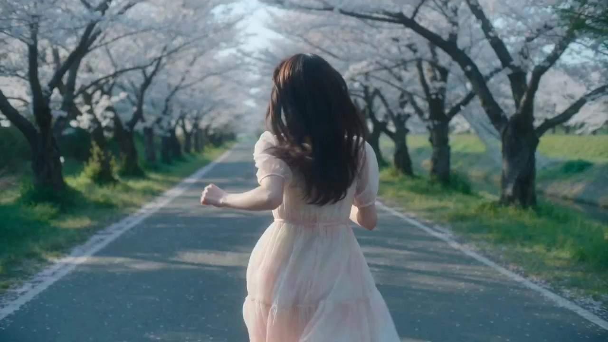

# Cinematic Lightcraft

> **作者：** 阿娴AIGC

## Content

**Process Planning:**

## Input Method Confirmation and Global Parameter Locking
**When the process starts, first ask the user for the input method:**
1. **Upload existing video** (MP4/MOV, 5–30 seconds) → Call **resource_prepare_and_analyze** to analyze, then proceed to the narrative outline stage.
2. **Text description** (script/ideas) → Ask for video aspect ratio (16:9 / 9:16 / 1:1, default 1:1), then proceed to the narrative outline stage.
3. **Reference image + Background image** → Ask for character actions (default: look left/right, wave, slow walk), maintain the aspect ratio of the background image, then proceed to the narrative outline stage.
After confirming the input method, use **text_editor** to create Final_Video_Spec.md, locking in: video aspect ratio, style positioning (Hollywood realistic lighting), output language, and default settings (no subtitles/no background music).

## Stage Dependencies and Milestone Pauses
**Proceed strictly stage-by-stage; pause and wait for user confirmation after each milestone is completed; do not rush through all steps at once.**
1. **Lock global parameters** → Write to Final_Video_Spec.md using **text_editor**
2. **Generate narrative outline** (four-part structure: Introduction, Development, Twist, Conclusion; includes emotion/content/suggested shot count) → Present the outline table to the user and wait for confirmation
3. **Lighting mode selection** → User chooses between manual lighting selection or AI automatic lighting recommendation; proceed to the next step after confirming the lighting type
4. **Generate Storyboard** (key elements + shots + audio layers) → Use **storyboard_designer**; pause for confirmation after completion
5. **Generate element images** (characters, scenes, props) → Use **media_generator**; if the user has already uploaded reference images, bind those assets directly
6. **Generate video shot by shot**, pause for confirmation after each batch → Use **media_generator**
7. **Generate audio layers** (only when explicitly requested by the user) → Use **media_generator**
8. **Final clip synthesis** → Use **video_assembler**; output the quality inspection table and wait for user export confirmation

**Dependency Relationships:** 2→1; 3→2; 4→3; 5→4; 6→5; 7→4; 8→5, 6, 7

## Handling User-Provided Media
If the user uploads a video, first call **resource_prepare_and_analyze** to analyze the content (subject, action, current lighting status, emotion). The analysis results will serve directly as the basis for the narrative outline and lighting recommendations. If the user uploads a reference image, use **media_generator** to register the image as an `asset_id` and bind it to the corresponding `key_element` instead of regenerating existing material.

## Exception Handling for Camera Movement
**Trigger Condition Assessment:** After the video shot is generated, if the output shows any of the following, the camera movement execution is determined to have failed:
- No clear camera displacement/movement, inconsistent with the movement specified in the Storyboard (e.g., a push-in becomes a static shot)
- Movement direction is opposite or speed is out of control (e.g., expected slow push becomes fast jitter)
- Subject and movement intent are severely misaligned (e.g., subject disappears out of frame during a tracking shot)

**Graded Fallback Strategy (Execute in order):**
1. **Retry with same model (Priority 1):** Keep Seedance 2.0, simplify movement descriptions in the prompt—remove magnitude modifiers (e.g., "slowly", "deliberate"), retain core movement direction words (e.g., "pushes in" / "tracks laterally"), and regenerate once.
2. **Prompt degradation (Priority 2):** If retry still fails, break complex movements into simpler forms:
   - Push/Pull → Change to "camera holds, subject steps toward/away from lens" (subject movement replaces camera movement)
   - Pan/Track → Change to "camera slowly pans [left/right], movement minimal"
   - Follow → Change to "camera follows at fixed distance, locked frame"
3. **Fallback to static shot (Priority 3):** If requirements are still not met after degradation, fallback to a locked-off version of that shot, ensuring the subject is stable in the frame, with lighting parameters unchanged. Explain the failure to the user, show the static shot result, and ask if it is acceptable or if another model should be used.
4. **Switch to alternative model (Execute after user confirmation):** If the user does not accept the static shot, switch to **Kling 3.0 Omni** (MultiModalToVideo, refer_type: feature) to regenerate, prioritizing the original reference images and lighting parameters. Only after both Seedance 2.0 and Kling 3.0 Omni fail, downgrade to **ImagesToVideo (Vidu Q3)** for a static-to-animated fallback.

**Pause Principle:** Steps 1–2 can be silent retries; from step 3 onwards, must pause to inform the user and wait for confirmation; do not automatically replace the final shot.

**Asset Analysis:**

## Key Analytical Focus for User-Uploaded Assets
**Analyze uploaded video:**
- Identify subjects (people/objects/scenes) and their actions and expressions
- Analyze current lighting status: indoor/outdoor, day/night, existing light source position and color temperature
- Infer emotional tone of the scene (tense/warm/mysterious/bright, etc.)
- Output a structured report for use in narrative outline generation and automatic lighting recommendations; if the footage is too dark or the subject is unclear, note this in the report and alert the user

**Analyze uploaded reference images (people/objects/backgrounds):**
- Extract physical characteristics of the subject (facial features, clothing, body type, texture)
- Extract color tone, spatial structure, and light source direction from background images
- The output element description must strictly match the content of the image; do not fabricate details that do not exist.

**Storyboard Design:**

## Narrative Structure Design
Every project must output a four-part narrative outline (Introduction, Development, Twist, Conclusion), with each part containing:
- **Emotion**: e.g., curious/expectant, happy/tense, shocked/aggrieved, warm/humorous
- **Content description**: Specific scenes and actions
- **Suggested shot count**: 1 each for Introduction/Twist/Conclusion, 1–2 for Development
After the user confirms the outline, proceed to lighting mode selection, and only then enter the Storyboard design phase.

## Lighting Parameter Design
Every shot must clearly specify the following lighting parameters and write them into the shot description:

| Lighting Effect | Applicable Scene | Intensity | Color Temp Reference |
| :--- | :--- | :--- | :--- |
| Backlight | Rim light, strong contour, suitable for arrival/farewell | Medium–Strong | 2800–3500K |
| Top Light | Oppressive feel, suitable for tension/interrogation/confrontation | Medium | 5500–6500K |
| Tyndall Light | Volumetric light, spatial feel, suitable for hope/holiness/transition | Strong | 3200–4000K |
| Under Light | Eerie/dramatic feel, suitable for villains/suspense | Medium | 2500–3200K |
| Side Light | Dimensionality, high contrast, suitable for character portrayal | Medium–Strong | 3500–5000K |
| Hard Light | Sharp shadows, suitable for action/conflict | Strong | 4000–5500K |
| Soft Light | Soft shadows, suitable for warmth/memories/dreams | Weak–Medium | 3000–4500K |

**Manual Lighting Mode:** Show the user the table above, and let them specify the lighting type for each shot.
**AI Automatic Mode Decision Rules:**
AI automatic lighting takes the **narrative segment (Introduction, Development, Twist, Conclusion) as the first priority**, and performs secondary filtering within the segment's default lighting pool based on: ① Combining the scene lighting status (indoor/outdoor, day/night, existing light direction) obtained from the **Asset Analysis** to exclude physically unreasonable lighting; ② Combining with the emotional tone for final selection. Each shot outputs the recommended lighting type + reason; wait for user confirmation before writing to the Storyboard.

**Default Lighting Priority by Narrative Segment (in order of recommendation):**
| Segment | Emotional Tone | Primary Recommendation | Secondary Recommendation | Avoid | 
| :--- | :--- | :--- | :--- | :--- |
| **Introduction** | Curious, expectant, introductory | Backlight (Strong contour) | Soft Light, Tyndall Light | Under Light, Cold Top Light |
| **Development** | Happy, tense, confrontational | Side Light (Character focus) | Hard Light, Cold Top Light | Soft Light |
| **Twist** | Shocked, crisis, hopeful | Tyndall Light (Hope) or Under Light (Crisis) | Backlight, Hard Light | Soft Light |
| **Conclusion** | Warm, relieved, humorous, suspenseful | Soft Light | Backlight, Tyndall Light | Under Light, Cold Top Light |

## Lighting Coordination Rules for Multi-Character Scenes
When two or more characters appear in the same shot, the shot description must clearly define the primary/secondary lighting relationship and light direction distribution to avoid flatness caused by "equal lighting for all" or visual confusion caused by "clashing light directions."
**Primary/Secondary Lighting Principle:**
- **Protagonist (Narrative focus character)**: Priority to receive the primary lighting type of the shot, with light intensity at 100% of the design value; the lighting parameters for the protagonist's area must be fully consistent with the Storyboard lighting plan.
- **Secondary character (Supporting/Antagonist)**: Light intensity reduced to 50–70% of the protagonist's; light direction forms contrast or complement (see relationships below) to the protagonist, must not steal visual focus.
- **Background/Group characters**: Only affected by ambient/scattered light, no separate lighting design, light intensity controlled within 30% of the protagonist.

**Two-character adversarial relationship (Conflict/Interrogation/Confrontation scenes):**
- Use **Two-sided opposing lighting**: Protagonist receives the main lighting (e.g., side light/backlight), antagonist receives fill light but from the opposite direction—if the protagonist's light source is from the left of the frame, the antagonist's light source is from the right.
- Color temperature can be designed with differences to reinforce ideological contrast: e.g., protagonist warm light (3000–3500K) vs antagonist cold light (5500–6000K), visually forming a "warm/virtuous vs cold/adversarial" emotional cue.
- Prompt writing: Describe light direction for both characters separately, explicitly labeling [Character_A] lit from camera-left, [Character_B] lit from camera-right.

**Two-character alliance relationship (Intimate/Collaborative/Empathy scenes):**
- Use **Unified main light source**: Both characters receive light from the same direction, lighting type is consistent, primary/secondary status is reflected only through framing differences (protagonist close-up, secondary character medium shot) or exposure intensity (protagonist slightly brighter by 1–1.5 stops).
- Tyndall/Backlight and other overall atmospheric lighting types are particularly suitable for such scenes; light beams naturally cover multiple people, no need to assign light direction separately.
- Prompt writing: Describe a unified light source illuminating multiple people, e.g., both figures bathed in warm volumetric light from the upper-left, [Character_A] closer to the beam center, [Character_B] partially in shadow.

**Three or more character scenes:**
- Clearly define one "lighting protagonist," with the remaining characters decreasing in lighting intensity based on distance/importance, forming lighting layers (Bright → Semi-bright → Dark).
- Do not use three different lighting types for three characters—no more than two lighting types per shot (Main lighting + Ambient auxiliary light) to avoid visual fragmentation.
- Prompt writing: First describe the protagonist's lighting, then handle secondary characters with "while [Character_B] and [Character_C] recede into ambient shadow."

**Integration with existing lighting templates:**
- Multi-character light direction distribution descriptions must be **appended after the single-character lighting core segment**, not replacing the original lighting description structure.
- Color temperature difference design must remain consistent with the lighting plan confirmed in the Storyboard; if opposing color temperatures need to be introduced, they must be noted separately in the shot description and confirmed by the user.

**Consistency Principle for Multi-Shot Segments:**
- If there are more than 2 shots in the same narrative segment, maintain consistent lighting or perform progressive transitions (e.g., 1st shot Backlight → 2nd shot Side Light), avoid large jumps in lighting type within the same segment.
- **Development → Twist** is the most important lighting transition node in the entire film, requiring a clear lighting boundary (recommended color temperature difference ≥ 1500K or completely opposing light directions) to reinforce the narrative twist with visual language.
- When narrative emotion conflicts with a segment's default lighting type (e.g., a "Conclusion" segment ending with suspense), prioritize the emotional tone, select from the secondary list, and note the reason for the deviation in the recommendation report.

**AI Automatic Lighting Output Format (Displayed shot-by-shot, wait for user confirmation):**
> **Shot [N] — [Segment Name] · [Emotion Tag]**
> Recommended Lighting: [Lighting Type Name]
> Reason: [Combine scene analysis + narrative segment basis, 1–2 sentences]
> Color Temp Suggestion: [Value Range]K
> Adopt? Reply "Confirm" or "Change one".

## Key Elements Design
- Includes **Main Characters**, **Key Scenes/Locations**, **Key Props**
- Character description must lock: Physical features, hairstyle, clothing, makeup, body type
- Scene description must include: Light source direction, main color tone, placement of key props/furniture
- If the user provides a reference image, element descriptions must strictly match the image content

## Shots Design
Every shot description must include:
- **Scene**: Reference the corresponding element scene ID
- **Story beat**: Character actions, expressions, dialogue (if any, write exact lines); reference character element ID
- **Cinematography**: Framing (Long/Medium/Close-up/Extreme Close-up) + Angle (Main/Side/High/Low) + Movement (Static/Push/Pull/Pan/Track/Follow)
- **Lighting Parameters**: Lighting type, intensity, color temperature (from confirmed lighting plan)
- **Duration**: Each shot recommended at 4–10 seconds, not exceeding 15 seconds

**Movement Preference**: Cinematic movements like Push, Pull, Pan, Track, and Follow are enabled by default; static shots are only used when emphasizing static tension.

## Independent Audio Layer Design
- Default **no background music or sound effects** audio_layer set.
- Only when the user explicitly requests (e.g., "add a piano piece"), ask for specific content before creating the corresponding audio_layer.
- If narration (VO) is needed, define the `narration_speaker_profile` (e.g., [Calm Male Voice]) and the full script.

**Media Generation:**

## Element Image Generation
- Use **TextToImage** or **ImageToImage**, model: **GPT Image 2**, resolution: **2K**
- If the user has already uploaded reference images, register as `asset_id` and bind to the corresponding `key_element`, do not generate repeatedly
- **Scene reference image**: Reflect light source direction, main color tone, key spatial structure

## Character Four-View Generation Rules
**Trigger Condition:** If the user has not uploaded any character reference images, or only provided text descriptions of character appearance, must first generate the character's **four-view reference sheet**, then proceed to the video shot generation stage.
**Generation Method:**
- Use **TextToImage** (when no reference image) or **ImageToImage** (when the user provides a single character image, use it as a base to complete other perspectives), model: **GPT Image 2**, resolution: **2K**
- Generation content: Single landscape image, including **bust close-up + front full-body + side full-body + back full-body**, five views arranged side-by-side on the same white background
- After generation, register the image as the corresponding character's `asset_id`, bind to the corresponding `key_element`, and use as the `reference_image` for all subsequent video shot generation
- If the user provided a single character reference image, use **ImageToImage** with the original image as the base to generate the four-view sheet, keeping appearance/clothing/tones consistent, with no contradictory changes to appearance from the original image

## Video Shot Generation
- Use **MultiModalToVideo**, model: **Seedance 2.0**, resolution: **720p**
- Reference inputs for each shot must include:
  1. **Element assets**: All character `element` images involved in the shot + corresponding scene/prop images
  2. **Continuity video reference** (optional): Add the previous shot's video as a `reference_video` only when continuity with the previous shot is extremely high; usually, do not add video reference
- Seedance 2.0 supports 4–15 seconds per generation, can design scene switching within the prompt, prioritize utilizing its multi-angle/movement capabilities to reduce fragmented short shots

## Audio Generation
- Narration (VO): Use **text to narration**, default model **MiniMax Speech 2.8 HD**
- Background music: Use **text_to_instrumental**, model **Suno 5** or **Mureka 8**
- The above are only executed when explicitly requested by the user

**Prompt Writing:**

## Character Multi-view Prompt Template (TextToImage / ImageToImage — GPT Image 2)
When needing to generate a character four-view reference sheet, use the following template, replacing [Character Appearance Description] with the full description of that character's `key_element` from the Storyboard:
> Photorealistic cinematic character multi-view reference sheet, 16:9 landscape composition, pure white background. Five views arranged side by side in a single image from left to right: [1] bust close-up (head and shoulders, face detail, hair, expression); [2] full-body front view; [3] full-body side view (camera-right profile); [4] full-body back view; [5] full-body three-quarter view (45° front-right). All views depict the same character: [Character Appearance Description]. Consistent costume, hairstyle, skin tone, and proportions across all five views. Clean studio lighting, no shadows, no background elements, character centered in each panel.

**Embedding Rules:**
- [Character Appearance Description] must be extracted from the `key_element` description, including: Gender, perceived age, facial features, hairstyle/color, clothing (including material/color), footwear, body profile
- If the user provided a single reference image (ImageToImage), append to the end of the prompt: Reference image provided for facial and costume fidelity — maintain identity consistency across all five views.
- Do not add any lighting effects in the four-view sheet (purpose is for consistency reference, not for final shots), always maintain white background and flat lighting

## Image Prompt (TextToImage / ImageToImage — GPT Image 2)
- Write from the perspective of a director + cinematographer: Subject appearance/action/position → Lighting parameters (lighting type/color temperature/intensity/light source direction) → Composition (framing/angle) → Color style → Material/details
- Lighting descriptions must correspond to the lighting parameters confirmed for that element/scene in the Storyboard, ensuring the prompt is consistent with the lighting plan
- Character images must lock in appearance stable across shots: Facial features, hairstyle, makeup, clothing, footwear
- Do not describe content outside the frame; do not write motives and psychological states, only write what is visible in the shot

## Lighting Type Prompt Templates (Core lighting description segments for images and videos)
Each lighting type has a fixed core description segment; embed it directly into the corresponding position when writing image or video prompts, and adjust the subject and scene parts based on specific shot content.
**Backlight**
> strong backlight from behind the subject, glowing rim light tracing the silhouette edge, subject face in deep shadow with soft ambient fill, halo-like light bloom at shoulder and hair line, high contrast between background luminance and subject, color temperature 2800–3500K warm amber backlight

**Cold Top Light**
> harsh cold overhead light source directly above, deep shadows carved under brow ridge and cheekbones, skin tone desaturated toward blue-grey, flat ambient with no warm fill, clinical and oppressive atmosphere, color temperature 5500–6500K cool white

**Tyndall / Volumetric Light**
> visible volumetric light shafts cutting through dusty or misty atmosphere, god-rays streaming at 20–45° angle, soft particles suspended in air column, bright cone of light isolating subject within the beam, surrounding area in deep atmospheric shadow, color temperature 3200–4000K warm gold

**Under Light**
> single light source positioned below subject eye level, inverted shadow cast upward across face, deep shadows on upper forehead and eye sockets, unnatural uplighting creating dramatic menace, dark vignette at top of frame, color temperature 2500–3200K dim amber or sickly green

**Side Light**
> strong single-source side lighting from camera left/right, one half of face fully illuminated with sharp falloff, opposite half in deep shadow (split lighting ratio 3:1 or harder), pronounced facial contour and texture, no fill light unless mood requires it, color temperature 3500–5000K neutral to warm

**Hard Light**
> direct hard light source with no diffusion, razor-sharp shadow edges cast by subject, high specular highlights on skin and surfaces, punchy contrast with crushed blacks, strongly defined form and edges, color temperature 4000–5500K neutral daylight or tungsten

**Soft Light**
> large diffused light source, shadow edges feathered and gradual, skin tones even and luminous, low contrast with lifted shadows, dreamy or intimate atmosphere, minimal specular highlight, color temperature 3000–4500K soft warm white

**Embedding Rules:**
- **Image prompt**: Insert the core lighting segment after the subject description and before the composition, and supplement with specific light source orientation (e.g., "from upper-left", "from behind at 6 o'clock").
- **Video prompt**: Append the lighting segment after the "spatial change" step in the motion stack, describe the movement of light combined with dynamic changes within the shot (e.g., "backlight gradually diffuses into a full silhouette halo as the character turns").
- Color temperature values must be strictly consistent with the lighting plan confirmed in the Storyboard; do not adjust arbitrarily.

## Video Prompt (MultiModalToVideo — Seedance 2.0)
- Use placeholders <<<image_1>>>, <<<image_2>>> … to bind each character/scene reference image one by one
- **Motion stack order**: Camera movement (position/movement/rhythm of cuts) → Subject action (body/expression/dialogue beats) → Spatial change (scene/environment movement) → Lighting reinforcement (lighting effect description) → Sound/dialogue cues (if needed)
- **Lighting reinforcement**: Supplement the lighting effect of the shot after the spatial change description, e.g., "backlight rim halo hits from behind, subject at the junction of silhouette and semi-light/shadow"
- Seedance 2.0 dialogue uses the format {language:raw script}; sound effects use <...>; background music uses (...); screen titles use 【...】
- **Fixed negative tags**: no subtitles; when there is no independent narration track, add no music; do not use wall-clock time segments ("0–3s / 3–6s"), use narrative beat sequences instead

## Cinematic Camera Movement Prompt Template (Seedance 2.0)
Below are standard formulations for five core camera movements. **Camera movement descriptions must always be placed at the beginning of the motion stack**, first explain the camera position and movement intent, then narrate subject behavior, and finally append the lighting segment.
### Push / Dolly In
> Applicable: Emphasizing emotion, revealing details, creating oppression
Camera slowly pushes in from [starting framing] to [target framing], closing in on [subject part/object],
movement steady and deliberate at low speed.
[Subject action description, e.g.,: subject stands motionless, jaw tightening, eyes fixed forward]
[Spatial description, e.g.,: background gradually compresses into bokeh]
[Lighting segment, e.g.,: side lighting sharpens across cheekbone as camera advances, shadow deepening on far side]
**Example:**
> Camera slowly pushes in from medium shot to tight close-up, closing in on the subject's eyes. Subject stands motionless, jaw tightening, gaze locked ahead. Background gradually compresses into shallow bokeh. Strong side lighting sharpens across cheekbone as camera advances, deep shadow carving the far half of the face, color temperature 4500K neutral.

### Pull / Dolly Out
> Applicable: Revealing environment, expressing isolation, ending with space for contemplation
Camera slowly pulls back from [starting framing] to [target framing], revealing [new environmental elements entering frame],
movement smooth and continuous.
[Subject action description, e.g.,: subject remains centered, gradually dwarfed by surroundings]
[Spatial description, e.g.,: wide environment expands into frame, emphasizing isolation]
[Lighting segment, e.g.,: warm backlight wraps subject as camera retreats, rim light intensifying at shoulders]
**Example:**
> Camera slowly pulls back from close-up to wide shot, revealing the empty warehouse stretching behind. Subject remains centered, gradually dwarfed by the vast industrial space. Warm backlight wraps the figure as camera retreats, rim light intensifying at shoulders and hair line, background fading to deep shadow, color temperature 3000K amber.

### Pan
> Applicable: Following gaze, explaining spatial relationships, parallel comparison of two subjects
Camera pans [left/right] at [slow/moderate/fast] speed from [start] to [end],
[Tracking intent, e.g.,: tracking subject's gaze toward the doorway / revealing the second figure].
[Subject action description]
[Spatial description, e.g.,: environment sweeps laterally across frame]
[Lighting segment]
**Example:**
> Camera pans right at moderate speed, tracking the subject's gaze from the window toward the far doorway. Subject turns head slowly, expression shifting from calm to alert. Environment sweeps laterally, fluorescent ceiling strips cutting harsh cold light across the floor, color temperature 5800K cool white, deep shadows pooling at frame edges.

### Lateral Track / Slide
> Applicable: Following a moving subject, revealing scene depth in parallel, creating flowing rhythm
Camera tracks laterally [left/right] alongside the subject at matching pace,
maintaining [framing] throughout.
[Subject action description, e.g.,: subject walks at measured pace, each step deliberate]
[Spatial description, e.g.,: background layers slide at different speeds, creating natural parallax depth]
[Lighting segment, e.g.,: volumetric light shafts strobe intermittently across subject as camera slides through columns]
**Example:**
> Camera tracks laterally left alongside the subject at a measured walking pace, holding a medium shot throughout. Subject moves with slow deliberate steps, eyes downcast. Background pillars slide at different speeds creating natural parallax depth. Volumetric light shafts strobe intermittently across the subject as the camera passes through columned archways, warm god-rays at 30° angle, color temperature 3400K warm gold.

### Follow / Tracking Shot
> Applicable: Presence, chase/escape, POV following
Camera follows [behind/ahead of/beside] the subject at [tight/loose] distance,
movement [handheld with subtle sway / steadicam smooth / over-the-shoulder].
[Subject action description, e.g.,: subject moves urgently through corridor, breathing audible]
[Spatial description, e.g.,: environment rushes past in peripheral blur]
[Lighting segment, e.g.,: harsh overhead lighting strobes as subject passes under fixtures]
**Example (Chase scene):**
> Camera follows tight behind the subject at shoulder height with slight handheld sway, tracking through a narrow corridor. Subject runs at full speed, shoulders heaving, arms pumping. Environment rushes past in peripheral blur. Harsh cold overhead lights strobe intermittently as subject passes under each fixture, casting sharp downward shadows, color temperature 5500K clinical white, no warm fill. <Rapid footsteps and heavy breathing>

### Multi-movement combination (In-shot switching)
Seedance 2.0 supports describing multiple continuous movement segments in a single prompt, arranged in narrative beat order, **without timecodes**, connected by transition words:
Opening on [framing + angle], camera [movement 1 description].
As [narrative beat transition word, e.g.,: as subject reaches the door / then cutting to],
camera [movement 2 description], [new framing] on [new subject or new angle].
[Lighting segment runs through the whole segment or is marked segmentally]
**Example:**
> Opening on a wide establishing shot, camera slowly pushes in toward the lone figure at the center of the rain-soaked plaza. As the subject looks up, cutting to a tight close-up — camera locks off, holding the face in stillness. Then pulling back to reveal the crowd watching in silence. Consistent warm backlight throughout, rim light tracing the silhouette edge, color temperature 3200K amber, no music, no subtitles.

**Final Assembly:**

## Editing and Synthesis Preferences
- Splice in Storyboard shot order, maintain original aspect ratio and frame rate
- **Default: No subtitles, background music, or sound effects** unless explicitly requested by the user
- **Transition design**: Based on the transition methods specified for each shot in the Storyboard (match on action/match on gaze/hard cut/dissolve), do not arbitrarily use a single transition type
- **Pacing control**: Narrative shots (Introduction/Conclusion) can have slightly longer dwell times; conflict/twist shots (Development/Twist) should have faster pacing
- **Lighting consistency check**: When there is a significant difference in lighting types between adjacent shots, prioritize using a dissolve or hard cut (rather than other transitions) to reduce abruptness
- **Output quality inspection table** (displayed to user after synthesis): Input method, total shot count, narrative structure summary, lighting mode, applied lighting type list, total duration, output aspect ratio, subtitle/music status
