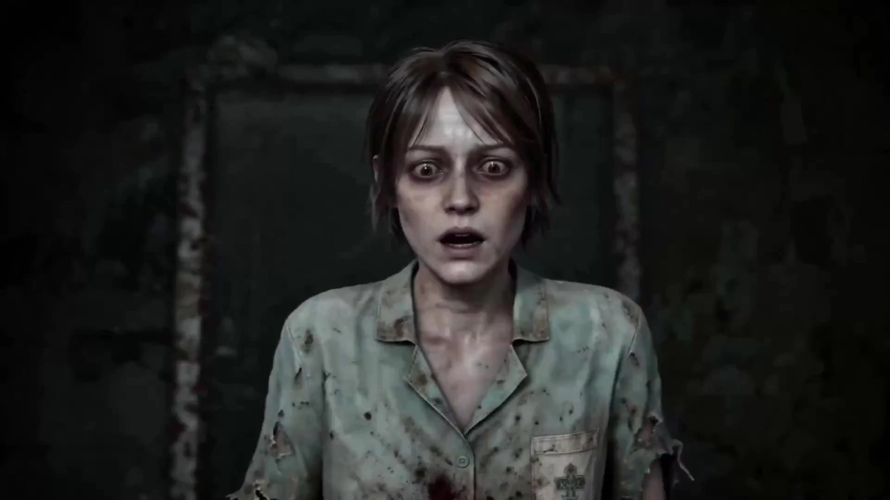

# Classic 3D J-Horror Folklore Style

> **作者：** @みお

## Content

Process Planning:

【Language Iron Rule】When the Agent replies to users at any stage, it must use the user's interaction language (e.g., if the user is in a Chinese-speaking environment, use Chinese throughout). The J-horror background setting only applies to the video content and visual style, and does not affect the Agent's own conversational language.Horror Game Video Generation Planning Logic and Stage Dependencies:

Establish Specifications and Character/Monster Pre-selection: Prioritize using text_editor to create Final_Video_Spec.md, lock the video aspect ratio (e.g., 9:16 or 16:9), output language (defaults to the user's interaction language; "J-horror background" is limited to visual and cultural aesthetic settings, and the output language should not default to Japanese just because of the background), and the photorealistic 3D J-horror aesthetic tone. Based on the initial plot provided by the user (even if minimal), the Agent must first recommend the most suitable protagonist appearance and monster configuration (supports single, multiple, or custom selections). Trigger [Checkpoint 1] at this stage to provide users with selection cards to adjust and confirm.

Preset Candidate Protagonist Looks:

Japanese Schoolgirl: Wears a worn, torn classic Japanese sailor suit/uniform, with visible mud spatters and rain.

Exhausted Detective/Investigator: Wears a low-saturation long trench coat/jacket, with stubble and heavy dark circles under the eyes.

Ordinary Office Worker: Wears a soiled white shirt and slacks, looking extremely panicked, with heavy mud stains on shoes.

Late-night Attendant/Security Guard: Wears a loose, worn, and stained dark blue/gray uniform jacket.

Preset Candidate Monster Forms (All are speechless, only capable of making sounds):

Bound Humanoid: Head and upper body seamlessly wrapped in outer skin/wet cloth, with no clear facial features, dragging forward or crawling on knees.

Headless Limb Recombination: No head or normal arms, counter-articulated quadruped, 80-110 cm tall, simulates a static object in the shadows.

Covered Professional Humanoid: Alienated professional uniform (e.g., ragged nurse outfit/custodian uniform), head covered by wet cloth or mask, sluggishly wanders before suddenly charging while wielding a tool.

Giant Face-Covering Stalker: Massive size, head completely covered by a giant triangular iron cover or iron cage, drags a heavy industrial object like a giant hammer while slowly closing in.

Constructing the Horror Shot List Script: After the user confirms the character and monster settings, run storyboard_designer to plan core elements (scenes, monsters, protagonists, core props) and the shot list. At this stage:

Proactive Script Refinement and Logic Reconstruction: The Agent must proactively refine and expand the initial plot. The plot must possess rigorous causal logic and the "logic of reality vs. illusion" unique to J-horror, refusing to pile up horror imagery without logic.

Audiovisual Coherence and Non-uniform Dynamic Rhythm (Strong Coherence, with Fluctuations):

Coherence: Ensure smooth transitions in space, posture, and direction of movement between adjacent shots and clips (e.g., if the previous shot flashes left, the next shot must follow up with the landing action; sudden changes in direction or position teleportation are strictly prohibited).

Fast-Slow Contrast and Non-uniform Shot Duration: Use slow-paced long shots for exploration/hiding (12–15s to build tension), and fast-paced short shots for chasing/being hit/jumpscares (4–8s for rapid impact). It is strictly prohibited for all shots to have a uniform duration (e.g., repetitive 10s shots); create a wave-like editing rhythm through non-uniform durations.

Action Completeness: Action complexity must match time allocation to ensure each sub-action has ample time in the Clip to be completed fully (it is recommended to reserve at least 3–4 seconds for each small action) without being abruptly cut.

Externalizing Emotions with Multiple Shot Scales: Use alternating shot scales (wide shots to express isolation, medium shots for the character's exploration, close-ups/extreme close-ups for pupil contraction/cold sweat/shivering) to visually magnify the protagonist's terror.

Check if the user has uploaded reference images (including protagonist/monster appearances, environment screenshots/scene images, etc.), use resource_prepare_and_analyze to analyze their visual characteristics (style, texture, character appearance, composition, etc.) to provide a stylistic foundation for subsequent generation/binding. If it is a scene image, use media_generator to bind it to the corresponding key_element.

Plot Segmentation and Combination Mechanism: Break down the plot into specific plot segments, and apply corresponding structural modules (exploration, anomaly, hiding, escaping, fighting, etc.) to each segment for combination.

Trigger [Checkpoint 2] upon completion: Present the complete text storyboard, dialogue, and specific camera movement design to the user, inviting them to review and confirm.

Key Element Image Generation (Elements First - Full Generation and Three-Track Compatibility):

[Important] Three-Track Compatibility Rules for Character Assets (Applies to Protagonists and Monsters):

Direct Binding Track (Photorealistic 3D already compliant): If the user-uploaded character image has been confirmed by resource_prepare_and_analyze to meet the photorealistic 3D J-horror game rendering texture (real adult proportions, low-saturation gray-cold tones, rain/mud stains, etc.), it is directly registered as an asset_id in media_generator and bound to the corresponding Storyboard slot, bypassing the regeneration process.

Image-to-Image Stylization Track (Non-3D Style Conversion): If the user-uploaded character image is a real photo, 2D anime illustration, sci-fi style clothing, or conceptual sketch, this image must be used as a reference. Use the ImageToImage path in media_generator (with GPT Image 2 model, 2K resolution), combined with photorealistic 3D J-horror style characteristics to perform image-to-image conversion, generating a full-body character reference image on a white background with a 3D game texture, and then complete registration and binding.

No-Image Full Generation Track (Generated directly if not provided): If the user has not uploaded any character image, use the TextToImage function of media_generator (GPT Image 2, 2K) to generate a brand new full-body character/monster image on a white background with 3D game texture based on the script's character design.

[Important] Full Asset Generation List Rules (Generated based on script content):

Clarification of Terminology (Difference between clip and shot): Here, "clip" refers to specific visual cuts/splices. For example, if a 10-second long shot contains 3 sub-cut descriptions, these 3 cuts are treated as independent clips.

Protagonist/Monster Reference Images: Following the three-track compatibility mechanism above, you must finally provide/generate independent full-body reference images with 3D game texture for the protagonist and every monster selected in the storyboard/cards; it is strictly prohibited to miss any appearing character.

Floor Scene Images (Must be generated if present): All spaces broken down according to the script's physical layers (e.g., 1st-floor lobby, 2nd-floor corridor, cabin, classroom, etc.). As long as any scene or space is mentioned/used in at least 1 clip (even if multiple internal cuts within the same 10s shot are in the same scene), a photorealistic 3D rendered scene reference image for that space must be generated; it is strictly prohibited to miss any appearing scene.

Core Props/Items Images (Must be generated if repeated in 2 or more clips): If a specific item (e.g., flashlight, special key, machete, baseball bat held by the protagonist throughout) repeatedly appears in 2 or more clips (i.e., multiple visual cuts, regardless of whether they belong to the same major shot), an independent prop/item reference image must be generated.

Use the media_generator image generation function (TextToImage/ImageToImage, using GPT Image 2, 2K resolution) and asset binding function to complete the image acquisition, style alignment, system registration, and Storyboard slot binding for all the above key elements. It is strictly prohibited to generate only the protagonist while missing any monster, scene, or prop that meets the above rules.

Trigger [Checkpoint 3] after generation: Must show the user a complete package of 3D reference images for the protagonist, all monsters, every floor scene, and repeated props (regardless of whether the image comes from direct binding, stylized conversion, or brand new generation), so that the user can confirm whether the 3D game texture (rain, mud spots, low saturation, etc.) meets the photorealistic rendering standards and consistency requirements.

Shot-by-Shot Video Generation:

Run media_generator, selecting the Seedance 2.0 model (720p limit, fallback for non-members) or Kling 3.0 Omni model via the MultiModalToVideo path.

Each shot must reference the character and scene key_element images generated in Step 3 to maintain 3D character consistency. Introduce the reference_video of the previous shot only when extremely high action continuity is required.

Horror Sound Effects and Voiceover Generation:

Use media_generator to generate environmental and monster acoustics (BGM/SFX, powered by Suno 5). Dialogue, inner OS (monologue), and whispered voiceover (VO) are not generated by default unless explicitly requested by the user in the input or already included in the original script (in which case, generate highly realistic ElevenLabs v3 whispered voiceover).

Post-Production Editing and Rendering Assembly:

Run video_assembler to organize the timeline, implementing the "sound first" horror audio-visual alignment rule (threat sound effects start first, monster visuals appear later), and configure different editing rhythms, irregular flashlight flickering, and high-frequency noise transitions according to the eight major plot segments decomposed.

Dependencies: 2→1; 3→2; 4→3; 5→2; 6→3,4,5.

Checkpoints:

[Checkpoint 1] (Character & Monster Selection): Pause after establishing specifications and before writing the storyboard. Recommend the most suitable protagonist appearance (e.g., schoolgirl, detective investigator, office worker, late-night security guard) and monster forms (e.g., bound humanoid, headless limb recombination, covered professional humanoid, giant face-covering stalker, or custom) to the user, providing cards for the user to confirm or modify with one click.

[Checkpoint 2] (Storyboard & Dialogue Approval): Pause after the shot list script planning is complete. Invite the user to confirm the decomposed plot flow, camera arrangement, and dialogue.

[Checkpoint 3] (Full 3D Visual Asset Confirmation): Pause after all key element reference images (including protagonist, all selected monsters, floor scenes, and core repeated props) are fully generated. The Agent must bundle a complete asset list (categorized display of protagonist, each monster, all decomposed scenes, and prop images) for the user to confirm the photorealistic 3D rendering texture and consistency. It is strictly prohibited to let the user review blindly while missing any monster or scene/prop image.

It is prohibited to run the entire process at once without confirmation.

Asset Analysis:

User Input and Game Asset Analysis Rules:

When users upload screenshots of realistic horror games such as Siren, Fatal Frame, or Silent Hill, or images of old Japanese streets, abandoned wooden houses, reference images (including protagonist character art, concept design drawings, scene photos, monster sketches), or reference videos:

Visual Style Feature Extraction:

Identify Environment and Weather: Analyze meteorological details such as overcast skies, wet ground after rain, and layered thick fog.

Identify Lighting and Color: Analyze the Chiaroscuro high-contrast lighting in low-light environments; extract desaturated tones like lead gray, cyan-gray, grayish-green, aged wood brown, and dirty white; confirm if dark reddish-brown exists only as localized stains.

Identify Materials and Condition: Extract micro-textures of abandoned life such as wet wood, cracked plaster, damaged paper doors, mycelium, and dust, as well as traces of living spaces where someone has suddenly departed (e.g., fallen bicycles, cold tea).

Character and Monster Image/Video Asset Analysis:

Evaluate whether characters or monsters in images are realistic 3D game renders (adult proportions, average build, mud splatters, and rainwater traces; exclude anime, high-fidelity live-action, and sci-fi attire).

Evaluate monster asset types (confined bound humanoids, headless limb-reassembled entities, cover-art vocational humanoids, giant face-covering pursuers, or user-defined deformed monsters), and extract their 3D asset texture hardness to match the protagonist.

Audio Acoustic Extraction:

Identify characteristics of low-frequency ambient sounds, metal scraping, wood creaking, and sudden noises.

Extract these styles into specific descriptive text keywords and automatically supplement them into the Storyboard and Prompt, strictly avoiding high-saturation, cyberpunk, or anime styles.

Storyboard Design:

Designing Key Elements（Designing key_elements）：

element character（Character & Monster）：

Protagonist（Character Styling Archetype）：Realistic 3D game character, with authentic adult proportions and an average build. The expression is vigilant, with rapid breathing. Users can select the protagonist's look/career setting in advance (customization is also supported), and the clothing details, body movements, and handheld props in the shot list script must be completely consistent with this. The following highly compatible character stylings frequently seen in classic horror games/movies are provided (customization supported)：

Japanese Schoolgirl: Dressed in a classic Japanese sailor-style or suit-style school uniform, pleated skirt, and white cotton socks or black knee-high socks, which are dirty and partially worn or torn, with visible mud splatters and rainwater stains.

Exhausted Detective/Investigator: Wearing a worn, low-saturation long trench coat or jacket over a wrinkled shirt, with stubble, dark circles under the eyes, and a decadent posture.

Ordinary Office Worker: Wearing a white or gray shirt with the collar unbuttoned and stained, dress pants, and leather shoes with heavy mud prints and rainwater traces, looking extremely terrified and panicked.

Late-night Attendant/Security Guard: Wearing a loose, worn, and stained dark blue or gray uniform jacket, with a dull walkie-talkie or badge hanging at the waist.

Horror Monster: Must share the same realistic 3D game asset style as the protagonist (no live-action, no magical CG). Design rules: Users must select from the following four classic forms (single or multiple selections supported); custom monster forms are also allowed. If multiple monsters are selected, the shot list design and plot script must rationally and coherently display the roles and appearance trajectories of all selected monsters, making each assume different plot functions (e.g., the Headless Limb Recombination is responsible for mimicking objects in the dark, while the Covered Occupational Humanoid wanders and ambushes in the corridor). Under no circumstances should the selected monsters be absent from the story without reason. If using a custom monster, it must also conform to the realistic 3D game texture style, and its form and specific plot function must be explained in the shot list. Furthermore, all monsters have lost the ability to speak human language and cannot talk. They can only express themselves in audio through instinctive savage roars, painful wails, gurgling/throat noises, or shrieks.

Enclosed Bound Humanoid: Adult height. The head, arms, and upper body are continuously and seamlessly wrapped in tight outer skin or wet cloth, with no clear facial features or palms. Movement design: While standing, it leans forward and drags itself as if losing its center of gravity, or crawls violently on the wet floor using its knees and shoulders after falling.

Headless Limb Recombination: No head or normal arms. Directly connects a second set of upward-curving, anti-joint legs above the hip/torso. The four legs are similar in length, with an overall height of about 80-110 cm. Movement design: Usually curls up in dark corners to mimic the silhouette of a chair, low table, or fallen mannequin. Once startled, it displays extremely rapid lateral displacement or crawls flat on the ground.

Covered Occupational Humanoid: Retains the clothing and uniform of a specific alienated occupational character (e.g., torn clinic nurse uniform, old school guard/janitor uniform, hotel waiter outfit, rural festival staff attire). The head is completely covered by swollen outer muscles, dirty plastic film, wet cloth, or a tightly closed mask, with no visible eyes, nostrils, or mouth. Movement design: The body wanders in a sluggish, swaying manner. After a short, trembling shake of the head, it suddenly charges forward like a madman or hysterically waves rusted work tools in its hands (e.g., scissors, batons, wrenches).

Giant Face-Covered Stalker: Huge size, height of about 2-2.4 meters, shoulder width 1.5-1.8 times that of the protagonist, creating extreme physical oppression. The head is completely covered by a closed geometric mask significantly wider than its shoulders (such as an inverted triangular cone iron mask), a heavy rusted mask, or a rough metal shell, with no visible facial organs. Dressed in a dirty long leather apron or old protective clothing, dragging heavy, rusted industrial tools. Movement design: Rarely runs; hunts the protagonist by slowly approaching in an unstoppable manner, blocking narrow exits with its large physique, or slamming into doors with great force.

element scene（Japanese Horror Scene）：

Full Generation Based on Script (Must Generate if Mentioned)：If the story script takes place in multiple physical spaces/areas (e.g., 1st-floor lobby and 2nd-floor corridor), it must be strictly split into different Scene IDs based on space. As long as any physical scene is mentioned/used in at least 1 clip (even a sub-cut within the same 10s shot), a corresponding independent 3D rendered scene reference image must be generated; generic scene images cannot be used as substitutes.

Core Japanese architecture: Including narrow slopes, wooden residential houses, old school buildings, clinics, shrines, old-fashioned shops, and streets with utility poles and gutters.

Spatial material expression: Wet wood, cracked plaster, stained Shoji (sliding doors), rusted metal, damp fabric, dust, mold spores, and mycelium.

Remnants of life suggesting "someone just left": Cold tea, hanging raincoats, half-eaten bowls of rice, old radios playing static, chalk writing remaining on a blackboard, or a fallen bicycle in the courtyard, highlighting silence and despair.

element prop（Horror Atmosphere Props/Items）：

Iconic Repeated Props (Must Generate if used in 2 or more clips)：If a character holds a specific special prop (e.g., lantern, hatchet, flashlight, diary, key held by the protagonist, or a baseball bat carried by the protagonist throughout) in the script or uses it repeatedly in 2 or more clips, it must be defined as a Key Element prop, and an independent style reference image must be generated for it. Note: Here, "clip" refers to a specific visual cut/shot slice, not a large Shot. Even if the prop reappears in different sub-cuts within a 10s shot, it falls into the category of repeated use in "2 or more clips". The material, texture, wear and tear marks, and the held/suspended state of the prop must be detailed in the Shot List.

Designing Shots (Designing shots) and Plot Segment Arrangement：

Script Refinement & Psychological Logic：

Script Enrichment: If the original plot, outline, or instructions provided by the user are short or logically thin, the Agent must actively refine the logic and enrich the plot before writing the Shot List, adding reasonable causes, developments, twists, and details of spatial transitions. The plot development must be logical and smooth.

Narrative Tension Combining Reality and Illusion: The script must include an alternating connection between "illusion" (e.g., auditory hallucinations, shadow illusions, bizarre spatial distortions, the protagonist's self-frightening psychological suggestions) and "reality" (e.g., direct approach of a physical monster, physical confrontations, escaping by destroying the environment), ensuring logical plot points and clear causality, rejecting a series of thin, illogical horror images.

Pre-Appearance Suspense: Before the monster appears, the Shot List script must design at least 1-2 shots for side suggestions or indirect rendering to layer the suspense. This can be done by: subtle light and shadow movements (e.g., a deformed shadow suddenly stretching and flashing across the wall when a flashlight shines into the depths of a corridor), environmental anomalies (e.g., peeling wall plaster, reflective viscous liquid seeping from door gaps, light bulbs bursting), or pure sound warnings (hearing strange gasping or dragging chains first, while the visual is still dense fog/dark blind spots). It is absolutely forbidden for a monster to appear out of thin air without any prior hints.

Generalized Atmosphere & Flicker-to-Faceoff Jump Scares: Creating non-template, universally adaptable extreme scare points for various scenes (e.g., classrooms, corridors, elevators, streets, etc.).

Lighting Flicker & Blackout: Ambient light sources (e.g., old fluorescent lights, street lights, flashlights, or instrument screens) must not remain constant. The shot design should incorporate dynamic fluctuations in light and sound: "intense flickering -> sudden blackout without warning -> light source suddenly returning amidst electromagnetic noise or heavy impact sounds."

The Sudden Faceoff Jump Scare: The moment the light source turns back on and the darkness is suddenly torn apart (usually within 0.1s), the face or body of the deformed monster has instantly crossed physical barriers, infinitely magnified at the very front of the shot (extreme close-up), accompanied by an audio-visual roar transitioning from extreme silence to extreme activity.

Vivid Emotional Release of the Protagonist: The protagonist's extreme terror when facing this scare must be strongly externalized and presented; the protagonist must never remain calm. The Shot List script must specifically describe the protagonist's physiological and vocal feedback (e.g., hysterical inhuman screams, stumbling backward, gasping in extreme terror, eyes wide open, desperate wailing, or physical impact from falling due to extreme panic). By using the protagonist's bone-deep fear reaction, the immersion in the horror atmosphere is maximized.

Multi-level Scene Splitting: Shot List design must strictly conform to the spatial levels of the script. If the story occurs in multiple physical areas/levels (e.g., "1st-floor lobby" and "2nd-floor corridor"), they must be split into different Scene IDs in element scene (e.g., [Scene_1F_Lobby] and [Scene_2F_Corridor]), and the floor or specific space must be noted in each shot description to generate matching floor scene asset images respectively.

Plot Segment Breakdown and Modular Design Rules: The Agent must break down the user's story outline into multiple specific atomized plot segments, judge what is happening in each segment (rather than labeling the entire video with a catch-all "exploration-type, chase-type"), and apply the following 8 major modules for Shot List and shot structure design:

Exploration and Searching (Applicable to characters entering a place, searching for people, keys, photos, tapes, or exits)：

Shot Structure: Use 3-5 seconds of environmental panorama to display the person's location, entrance, and at least two spatial landmarks; then use 2-4 seconds of medium shot to show the person walking toward the specific target; close-ups of clues should be controlled within 0.8-1.5 seconds; after finding a clue, a 1-2 second reaction shot of the person must be reserved, not immediately cutting into a chase.

Action Restrictions: Characters perform only one atomized action per clip (e.g., opening a drawer, checking a door plate, picking up a photo, or pushing a door).

Example: Character is next to a green classroom door, bending down to pick up a wet photo. Camera shoots a medium shot from the left side of the character. The character's name is written on the back of the photo. The character stops moving and looks into the door.

Anomalous Observation (Applicable to objects moving, lights changing, footprints appearing, or distant silhouettes appearing for the first time)：

Shot Structure: Must first show the normal state before the anomaly occurs; only change one thing at a time; when the anomaly appears for the first time, the height should be controlled within 5%-15% of the screen height; the anomaly lasts for 0.5-2 seconds, then is blocked by door frames, fog, or the character's body; the next clip shoots the character confirming the anomaly, without adding running or fighting at the same time.

Example: The character stops two meters away from a bicycle. The camera is fixed, shooting the character and the bicycle. A bunch of wet flowers appears in the bicycle basket, other objects' positions remain unchanged. The character turns to look at the basket.

Dialogue and Relationship Revelation (Applicable to two people talking, recording playback, memories, or plot truths appearing)：

Shot Structure: Use a 2-4 second two-person medium shot to establish the positions of both parties; do not cut frequently during dialogue, match each sentence with only one character action; after key words appear, use a 1-2 second close-up of the person or object; dialogue scenes must still retain spatial landmarks like door frames, windows, or tables; background anomalies occur after the dialogue ends, not simultaneously with long lines.

Example: Two people stand across a clinic table. The recorder plays "You didn't come back." The character grips the edge of the table. The person opposite does not move, but an extra hand is raised in the shadow on the wall.

Stealth and Hiding (Applicable to a character hiding in a cabinet, behind a door, under a bed, or in a corner after hearing a threat)：

Shot Structure: Use 1-2 seconds to show the character entering the hiding spot; then maintain a 2-5 second fixed shot, do not cut quickly; the threat must enter from a known entrance and pass along the route already shown; after the threat leaves, wait 1-2 seconds before the character can move.

Extremely Slow Torturous Atmosphere (Slow Pacing): The core of this stage is "suffocating slow pace and psychological torture." Camera actions and editing must slow down completely, utilizing extremely slow or completely static long takes to prolong the protagonist's waiting process, where they "might be discovered at any moment." The monster wanders, sniffs, or drags itself extremely slowly outside the cover, creating an extreme sense of oppression like a cat playing with a mouse.

Extreme Character Emotion and Physiological State (Externalization of Fear): Lock in the protagonist's extreme fear micro-expressions and physiological details through extreme close-ups: pupils rapidly contracting, facial muscles trembling/spasming from holding breath, large beads of cold sweat seeping from the forehead, hands tightly covering the mouth to prevent gasping sounds, body shaking violently at high frequency due to inability to control it.

Action Restrictions: Characters perform only one action in the shot, such as lowering the body, covering props, or holding breath.

Example: The character squats to the right of the cabinet door, hands tightly covering their mouth, pupils contracted, body shaking at a high frequency due to extreme fear. The camera is fixed inside the cabinet, close-up on the character's face. The monster passes extremely slowly outside the cabinet, footsteps heavy and sluggish. Only after the footsteps disappear for two seconds does the character look up.

Chasing and Escaping (Applicable to when the monster has been confirmed and is actively approaching the character)：

Shot Structure: Before the chase begins, a 1.5-2 second full-body shot must be used to simultaneously show the person, the monster, and the exit; the monster must start the chase from a location that has already appeared, it is strictly forbidden to suddenly appear in front of the person; the duration of fast-cutting clips should be controlled within 0.5-1.5 seconds and do not exceed three consecutive fast cuts; afterward, it must cut back to a longer 1.5-2.5 second shot to re-show the positions of the person and the exit; after the run ends, use closing doors, corners, or obstacles to temporarily block the threat.

Extremely Tense/Racing Atmosphere (Fast Pacing): This stage renders "absolute tension of life and death," and the audio-visual rhythm must rise sharply. The shot description should combine rapid, violent shaking tracking shots (e.g., simulating a handheld camera running perspective, stumbling pitch/tilt shots) and blurred light and shadow movements.

Protagonist's Emotional Externalization: The protagonist shows hysterical despair and a will to survive, sweating profusely, mouth wide open and gasping rapidly, body posture out of control due to escaping for their life.

Example: The character is in the center of the corridor, the monster is next to the green door, and the stairwell is in front of the character. The character turns abruptly, face extremely distorted and panicked, turns and runs wildly toward the stairwell. The camera shakes violently, side-tracking the character passing a cleaning wooden rack. The next clip shoots from the same position as the character rushes into the stairwell.

Fighting and Breaking Free (Applicable to when the character cannot escape directly and needs to block or push away the threat)：

Shot Structure: First show the positions of the person, monster, props, and exit; the action burst phase is controlled overall within 3-5 seconds; each clip expresses only one action (Recommended order: risk avoidance/hit reaction -> dodge/roll/fall -> desperate counterattack/break free -> use momentum to escape), each action clip is about 0.5-1.2 seconds; do not display prolonged attacks continuously; the result of the fight must be to propel the character away, not to stop in place and continue fighting.

Desperate Struggle Burst Points and More Painful Physical Hit Actions (Fast Pacing): Fighting and hit actions are intense, short, and full of a sense of loss of control and strong physical impact pain.

Awkward Risk Avoidance and Hit Actions: Detail the protagonist's dodging, rolling, or falling when facing weapon attacks. Risk avoidance actions must be accompanied by a loss of balance and instability (e.g., to dodge a sweeping weapon, the protagonist must perform a side roll to the ground, shoulders or back slamming violently into the wall, splashing mud); being hit/falling must explicitly show heavy damage to specific joints (e.g., knees or elbows hitting the concrete floor hard, body rolling, clothes tearing due to friction, covered in dirt).

Externalization of Pain and Physiological Feedback: The protagonist's facial expression must show intense pain from bone and flesh impacts, such as gritting teeth, eyes tightly closed, painful contortion, covering injured limbs after being hit, showing temporary stiffness due to pain, or the awkwardness and exhaustion of struggling to get up, maximizing the "pain of being hit" in horror games.

Example: The monster drags a heavy hammer and sweeps across. The protagonist is terrified, desperately lunging to the right to avoid the hammer, awkwardly rolling sideways in the muddy water, shoulders slamming heavily into the peeling wall corner, clothes torn by iron nails on the ground. Next clip: the protagonist closes their eyes in pain from the impact, clutching their left shoulder and struggling, but seeing the hammer raised again, can only grit their teeth and desperately push over a nearby rusted iron rack to block the monster, using the momentum to awkwardly climb up and rush toward the exit.

Spatial Loop and Reality Changes (Applicable to characters repeatedly passing through the same corridor, door, ramp, or phone booth)：

Shot Structure: Each round of the loop uses the same camera position, focal length, and character movement direction; doors, windows, furniture, and road positions cannot change; the first round shows the normal space; the second round only changes one landmark; the third round adds corruption or brings the monster closer; the duration of each round can be shortened by about 15%-30%; the final round must make the character realize the loop (e.g., stop, back up, or touch the changed object).

Example: The character passes the green classroom door three times. The first time, the door plate is normal. The second time, the door plate changes to the character's name. The third time, thin roots grow from the door gap, and the monster stands behind the door. All three clips use the same fixed camera position.

Results and Aftermath (Choose a clear result based on user content for the final section of each plot)：

Rules: The fixed shot at the end must hold for 1-3 seconds, and can only show one result; it is strictly forbidden to add a new monster, a new location, and a second twist at the same ending.

Clear Result Forms (Choose one of five)：

The character closes the door, and the doorknob continues to turn.

The character temporarily escapes, but a second set of footprints appears in the distance.

The character finishes playing the recording, and the monster stops moving.

The character puts down the key object, and the space stops decaying.

The character returns to the same entrance again, proving the loop has not ended.

Narrative Causality & Continuity between Shots：

Unidirectional Irreversible Causality and Coherent Connection Principle: State transitions in the Shot List script must have strict unidirectional causal logic; logic gaps or state backtracking conflicts are strictly prohibited (e.g., in the previous shot the protagonist has been grabbed or tackled by the monster, and in the next shot the protagonist is back in the corridor, several meters away from the monster, running away to escape without explanation). All adjacent shots and clips must maintain absolute visual and directional coherence and smooth transitions. If the action of the previous clip is not finished, the next clip must naturally follow in physical space, protagonist posture, and direction of movement (e.g., if the previous shot shows a large lunge to the left to dodge, the next shot must follow the protagonist's landing or collision action from a left-side perspective; sudden, unreasonable changes in direction or instantaneous spatial drifting are strictly prohibited).

Physical Connection Bridge Requirement: If the plot requires the protagonist to transition from a desperate situation, being grabbed, or collapsing back into a confrontation, exploration, or chase state, the shot description must include explicit physical self-rescue, breaking free, or environmental blocking connection shots (e.g., first apply the "Fighting and Breaking Free" module, blocking with a wooden stick, desperately pushing over a cabinet to block the monster, or causing a disturbance via other environmental factors, before it can reasonably cut back to "Chasing and Escaping").

Inheritance of States and Physical Properties: Physical changes to the protagonist or monster in the previous stage (e.g., falling, bruising, torn clothing, flashlight dropped and extinguished, monster briefly stunned or staggering after being hit with an iron rod) must be consistently inherited and presented in subsequent shots; they must never be logically reset to the initial perfect state after switching clips.

Posture and Locomotion Consistency: The monster's movement posture must remain absolutely consistent in the Shot List. If set as a standing-type monster (e.g., Covered Occupational Humanoid, Giant Face-Covered Stalker), it is strictly forbidden to suddenly change to crawling in subsequent shots; if set as a crawling-type monster (e.g., Headless Limb Recombination), it is strictly forbidden to suddenly stand and walk.

Optionality of Weapons/Props and Forced Usage Principle: Whether a monster holds a weapon or carries props (e.g., iron rod, rusted tools, industrial giant hammer, lantern, etc.) is an optional configuration, not all monsters must carry them. It is strictly forbidden for forms with disabled or bound hands (e.g., Enclosed Bound Humanoid, Headless Limb Recombination) to carry any weapons or props; other forms should also decide whether to be equipped based on the plot and the monster's actual function, avoiding rigidity. Important Principle (Must Use): In the Storyboard design, if a monster is set to hold or carry a specific weapon/prop, that monster must actually use the weapon/prop in subsequent shot plots during action, performance, or confrontation (e.g., swinging to attack, slamming onto the ground, dragging on the ground to create screeching sounds, etc.); it is absolutely not allowed for carried props to be mere static decorations.

Dynamic Rhythm and Prohibit Uniform Shot Durations：

Strong Audio-Visual Rhythm Contrast (Definition of Fast and Slow)：

Slow Pacing (Stretching Tension): Deliberately slow down the pace in the [Exploration and Searching], [Anomalous Observation], [Dialogue and Relationship], and [Stealth and Hiding] modules. Through long shot design, demonstrate the character's hesitation, probing, breath-holding, and the condensation of surrounding environmental details, allowing the crisis to loom like a shadow and the feeling of oppression to continue to rise.

Fast Pacing (Burst Points): Sharply accelerate the pace in [Chasing and Escaping] and [Fighting and Breaking Free] modules. Use shorter shots, combined with rapid physical actions, high-frequency cutting, and large-shake moving shots, to create an adrenaline-rushing feeling of life and death.

[Iron Rule] Prohibit Uniform Shot Durations: It is strictly forbidden to design the time of each shot to be uniform and equal (e.g., all shots in the entire film are a uniform 10 seconds). The number of seconds for each shot must be dynamically and unevenly customized based on the script content it carries, the complexity of actions, and emotional tension. For example: setup and stealth shots can be lengthened to 12–15 seconds to accumulate fear; Jump Scare shots, single shots of being hit or panicked running should be shortened to 4–8 seconds to create visual impact, allowing the shot durations of the entire film to form a natural editing rhythm with wavy ups and downs.

Action-Duration Feasibility：

Every action or clip designed must have extremely high physical feasibility in terms of time allocation.

It is strictly forbidden to stuff too many complex consecutive actions into a very short time budget (e.g., planning "protagonist runs into classroom, searches drawer, gets key, inserts into lock, turns and pulls door open to escape" in a 5-second shot; this will lead to abruptly cut actions, visual discontinuity, and jumps in AI video generation due to insufficient time).

It is essential to ensure that ample time is reserved for completing each specific action. It is recommended to leave at least 3–4 seconds of time budget for each sub-action/sub-shot, so that the character's body movement, center of gravity shift, and prop interaction can be presented completely and smoothly. If the action is too complex, it must be proactively split into multiple independent shots of different lengths to ensure the executability of the action during video generation.

Multi-Framing Emotional Expression Mechanism：

Character Emotion as the Core of the Frame: The essence of Japanese horror is the psychological collapse of humans facing the unknown. Through highly layered, multi-framed cyclic alternation, the protagonist's emotions must be externalized and amplified; the piling up of single, mediocre perspectives is absolutely prohibited：

Isolation Wide: Used to contrast the protagonist's extremely tiny physique with the vast, oppressive, and dilapidated environment, rendering helplessness and isolation.

Action Medium: Used to show the protagonist's cautious steps, slightly trembling shoulders, vigilant groping of the surrounding environment, and action details.

Emotion Close-Up / ECU: Must be used with high frequency, locking onto the micro-expressions of the protagonist's emotional collapse. Specifically describe subtle facial details such as pupil contraction/dilation, terrified wide eyes, cold sweat sliding down the forehead, facial muscles trembling and spasming from holding breath, and the mouth tightly covered but distorted due to extreme fear, maximizing the visual resonance of horror emotions.

Multi-Cut Description Format：

Within a single physical long shot (shot), if it contains multiple internal cuts, the description must be written using a clear sub-shot segment format: shotX - Shot 1: [Description], Shot 2: [Description], Shot 3: [Description], ....

Note: The number of sub-shots in multi-cuts can be flexibly increased or decreased according to the needs of narrative and action coherence, and is by no means limited to 3. The "Shot 1, 2, 3" here is just a format example for dividing time order and actions.

This formatted description can provide the Large Model with clear multi-shot temporal boundaries and action transition instructions, thereby achieving natural picture switching.

Strict Flashlight Constraint：

Unless the Shot List script explicitly states that the protagonist is holding and has activated a flashlight (or the flashlight is held by the protagonist as an activated Key Element prop), flashlight illumination, strong flashlight beams, or strong reflective apertures are absolutely not allowed in the shot settings.

When the protagonist is not holding or has not turned on a flashlight, the scene must remain in a purely low-light environmental tone, using low-saturation, dim lighting primarily through faint ceiling lights, moonlight outside the window, light leaking from door gaps, a lonely street light, or weak natural reflections from wet ground, to prevent the large model from generating unreasonable flashlight projections out of thin air.

Weather and Lighting Tone：

Set to overcast, after rain, and layered dense fog. Only low-saturation blurry outlines are visible 8-20 meters outdoors.

The overall environment is dark, but action routes, doors, and furniture details within 0-8 meters around the character must be clearly visible. Primary dim lighting is provided through ceiling lights, window light, light leaking from door gaps, a lonely street light, or reflected light from wet ground.

Dialogue and Inner Monologue Rule: By default, do not design any human dialogue, lines, or the protagonist's inner monologue (internal OS), unless the user explicitly requests it in the input, or the original script provided by the user already contains dialogue/inner monologue.

Default performance when no request is made: The Shot List design does not contain any human language, only planning for gasping, rapid breathing, or non-human action sound effect descriptions, with no dialogue lines.

Design rules when there is a request: Only when there is an explicit request from the user/original script provided, write the protagonist's fragmented inner monologue, gasping, or whispered self-talk (coordinate with Final_Video_Spec to lock the language) in the shot description.

Absolute Restriction on Monsters (Strict Hard Constraint): It is strictly forbidden to design dialogue, language, or human lines for any monster. Monsters must absolutely not talk under any circumstances, they can only express themselves through non-human instinctive fearful vocalizations, growls, roars/shrieks, weird breathing, gurgling/throat noises, or painful screams.

Designing Independent Audio Tracks：

Core Principle of Sound Narrative (Threat Pre-empts Visually): The monster or crisis must "be heard first, then appear in the background." Before visually presenting the monster in the shot, the audio track of the preceding shots must first include corresponding sound effects (e.g., dragging metal sounds, strange breathing, splintering wood).

Environment and SFX Layers (Music/SFX, ambient sound at maximum, BGM at minimum)：

Ambient Sound Dominance (Maximum Volume): Sound design must be dominated by realistic environmental sounds (physical foley, scene atmosphere), including: the sound of drizzling rain, creaking sounds when stepping on rotten wooden floors, the buzzing of old fluorescent tubes flickering, distant metal dragging sounds, wind, electromagnetic static, etc. These highly realistic environmental base noises are the primary source of oppression and fear.

Minimalist Restrained BGM (Low Volume): Background music (BGM/low-frequency undertones) must take a secondary role, maintaining an extremely low volume, serving only as an underlying psychological undercurrent. Using soundtracks that are too noisy or steal the show with melodies is strictly prohibited to ensure the dead silence and realism of the environment.

Narration Track: By default, do not plan or generate a narration track, unless the user has an explicit request or the original script already contains one. When enabled, it is presented as the protagonist's suppressed, intermittent, whispered voice-over (VO), used to express deep anxiety and confusion during exploration.

Media Generation:

Visual Asset Generation Models

Image Generation (TextToImage / ImageToImage)：

Default recommended model: GPT Image 2, recommended resolution: 2K.

Hard Constraints: Strictly prohibited from using the Nano Banana series of models without explicit user request in the conversation.

Key Elements Acquisition and Alignment Rules (Triple-Track Compatibility & Full Binding)：

Terminology Definition (Difference between clip and shot): Here, a 'clip' refers to the specific cut within the shot list description. Even sub-cuts within a single 10-second shot are considered independent clips.

Character Asset Triple-Track Compatibility Determination Mechanism (Protagonist and Selected Monsters)：

Track 1: Realistic 3D Direct Binding: If the character image (protagonist/monster) uploaded by the user has a realistic 3D game quality style (fitting realistic adult proportions, muddy/rainy features, dull tones, non-2D anime, non-real-life photo), the media_generator must directly register it as a physical resource_id as a stable asset_id, and bind it to the corresponding slot in the Storyboard, skipping the generation process from scratch.

Track 2: Non-Realistic 3D Stylized Conversion: If the user-uploaded character image is a real-life photo, 2D anime art, sci-fi, or non-3D realistic game render style, direct binding is strictly prohibited. The system must use this image as a reference, invoke the ImageToImage path (selecting the GPT Image 2 model, resolution 2K), and use prompts for realistic 3D Japanese horror game style to generate a white-background full-body character reference image that inherits its clothing/facial features and fully complies with the 3D Japanese horror game texture, then register and bind it.

Track 3: New Autonomous Generation: If the user has not uploaded any character reference images, invoke TextToImage normally (selecting GPT Image 2, 2K resolution) to generate 3D game-textured white-background full-body reference images for the protagonist and each selected monster that match their character profiles.

Physical Scene Space (Full Mandatory Generation - Generate if present): For every physical level/scene ID identified in the script or Storyboard (e.g., 1st-floor lobby, 2nd-floor hallway, residential house, classroom, etc.), as long as any physical scene is mentioned/used in at least 1 clip (even if sub-cuts within the same 10s shot are in the same scene), a corresponding independent realistic 3D rendered scene reference image must be generated. It is strictly forbidden to use generic scenes as substitutes; ensure that video shots can accurately inherit the corresponding spatial visual characteristics.

Core Props/Weapons (Precise Binding - Mandatory generation if repeated in 2 or more clips): For props that appear repeatedly in 2 or more clips (regardless of whether they belong to the same major shot) (e.g., flashlight, special key, baseball bat that the protagonist carries throughout, etc.), a dedicated independent reference image must be generated.

Asset Registration and Binding Requirements: After obtaining/generating the white-background full-body images of the protagonist and all monsters, as well as the generated scene images and core prop images via the three tracks above, they must be fully registered in the media_generator and bound to the corresponding slot in the Storyboard. Entering video generation without missing images or missing bindings is strictly prohibited.

Video Generation (MultiModalToVideo)：

Default recommended model: Seedance 2.0 (Non-members smoothly fallback to Seedance 2.0 Fast or Kling 3.0 Omni), default resolution: 720p.

Function: Utilize the powerful audio-synchronized generation capabilities of Seedance 2.0 to read sound package descriptions enclosed in (...) and <...> in the video prompts, synchronously rendering and generating shot-level accompanying sounds such as high-fidelity monster screeches, sudden physical clatters, dragging sounds, and embedded ambient sounds.

Audio Asset Generation Models

Background Music and Long Sound Effects (text_to_instrumental)：

Default recommended model: Suno 5.

Function: Generate persistent low-frequency dark currents (creepy low drone), light rain sounds, radio static, and other long-track horror atmosphere BGM/SFX, to be mixed as independent audio tracks by post-production editing.

Narration and Inner Monologue (text to narration)：

Default recommended model: ElevenLabs v3.

Function: Used to generate highly realistic whispering narration (VO). By default, the narration track is not planned or generated; it is triggered on demand only when the user has explicit requirements or the original script already contains it.

Prompt Writing:

Global Language Consistency:

When the user interface is set to Chinese, all generated prompt content must be written in Chinese. Spoken dialogue / narration still follows the output language settings in Final_Video_Spec.md.

Horror Image Prompt Writing Rules (TextToImage / ImageToImage):

Art Style Descriptor Stack: 3D horror game screenshot, psychological horror aesthetic, retro 3D render, low-saturation 3D textures, wet rainy weather, thick layered fog, stark chiaroscuro shadows, decaying detail, realistic game character shading, not real photo, not anime style.

Exclusive Color Aesthetic: Strictly limit the color palette. Lead gray, blue-gray, gray-green, old wood brown, and dirty white. Dark red-brown is reserved only for minimal traces of blood or rust, and any high-saturation bright colors are strictly prohibited.

Lighting & Environment Control: overall dark and gloomy environment, weak volumetric top light, street lamp light, window light spilling through a cracked door, wet pavement reflection, visible range limited to 0-8 meters, distant scenery fading into gray silhouette in heavy layered fog (8-20m away).

Material Detail Description: wet wood textures, cracked plaster on peeling walls, mold and fungus, dust and cobwebs, stained shoji sliding paper doors, rusted steel fixtures, damp clothing fibers with rainwater splatters and mud stains.

Monster & Deformity Detail Enhancement:

General Deformed Textures: deformed fleshy textures, glistening sticky mucus (reflecting under weak light or when illuminated by a flashlight), wet slime, heavy peeling skin, organic decay.

Corrosion & Aging Textures: oxidized rough rust, heavily corroded metal surfaces, flaking rust-colored crusts, rust spots, grimy oil stains.

Exclusive Prompts for Four Types of Monsters (including physique, motion, and material characteristics):

Closed Restraint Humanoid: adult-sized height, head and arms and upper body continuously enclosed by tight pale outer skin and damp bound cloth wrapper, seamless limbs with no visible eyes or mouth or hand palms, standing forward lean posture dragging feet on wet floor, crawling frantically using shoulders and knees on ground, tightly bound damp ropes cutting into pale fleshy folds, rotten leather straps, dirty bandages wrapping tightly.

Headless Recombined Limbs: headless and armless monster, a second pair of upward-curving reverse-joint legs attached directly above the hip, four legs of equal length, short stature 80-110 cm tall, curled up in dark corner resembling the outline of a wooden chair or headless mannequin, sudden rapid sideways crawling, creeping flat on muddy floor, shattered bone joints, unnatural reverse-joint angles, fleshy tendrils dripping with dark thick fluid.

Professional Uniform Humanoid: wearing decayed and dirt-stained professional uniform (such as distressed nurse scrubs, rusted nurse cap, school janitor overalls, hotel receptionist outfit, or festival attire), head fully covered by swollen fleshy envelope, dirty plastic wrapping, damp bound cloth, or closed featureless mask, no visible eyes, nose, or mouth, sluggishly swaying body, head twitching and jerking, sudden frantic forward lunge, swinging rusted tools (scissors, baton, heavy wrench).

Giant Face-Covered Stalker: massive imposing stature 2.0-2.4 meters tall, extremely broad shoulders 1.5-1.8 times wider than normal human, head completely obscured by a giant closed geometric metal hood or heavy rusted iron cage wider than shoulders, wearing a long grimy oil-stained apron or old heavy-duty protective suit, dragging a massive heavy rusted sledgehammer or iron pipe, slow unstoppable stalking walking animation, blocking exit doors, violently smashing through door frames.

Custom Monster (Custom Physique & Material): If the user customizes a monster, it must follow the realistic 3D game texture style. The prompt should include the monster's deformed fleshy textures, featureless head/envelope (featureless envelope, dirty bound bandage), distinctive low-saturation ragged clothing, and iconic dragging weapons/props (dragging heavy rusted object), avoiding any sci-fi or glossy CG rendering terms.

Portrait Constraints & White Background Baseline:

Initial Full-Body Baseline (First generation of protagonist and monster): Must include full body shot, standing posture, on a solid white background, studio lighting, character concept art, sharp focus, 3d game character design. If it is a selected classic protagonist style, additional English descriptors for their corresponding clothing characteristics must be added to lock in the texture, removing any complex outdoor/indoor background interference:

Japanese Schoolgirl: Add japanese schoolgirl character, wearing stained and slightly torn classic sailor uniform, pleated skirt, white cotton socks, school shoes, muddy water stains.

Tired Detective/Investigator: Add tired detective character, wearing worn-out low-saturation long trench coat, messy wrinkled shirt, stubble on chin, deep dark eye circles.

Ordinary Office Worker: Add ordinary office worker, wearing stained white dress shirt with unbuttoned collar, dark formal trousers, leather shoes covered in mud and water.

Night Security Guard: Add night security guard, wearing worn uniform jacket with badge, belt holster and dusty walkie-talkie.

The above descriptions must be used as core style locks during the generation of white-background full-body shots.

Subsequent General Shot Prompts: Inherit the core clothing, proportions, and mud-stain descriptors established for the protagonist in the earlier stages (e.g., for the schoolgirl, add japanese schoolgirl, wet and muddy sailor uniform, pleated skirt, ordinary face, wide-eyed look of dread, low-saturation textures in subsequent shots), and combine with scene environment and action/posture descriptions, without randomly adding unrelated clothing.

Horror Video Prompt Writing Rules (MultiModalToVideo / Seedance):

Prompt Placeholders: Bind the protagonist image with <<<image_1>>> and bind the environment, ruins, or specific selected monster type image with <<<image_2>>>.

Single-Shot Multi-Cut Formatting & Action Integrity:

For long video shots (usually 8–15 seconds, or less than 8 seconds in special cases), when writing video generation prompts, use the following segmented prompt format to clearly define the chronological structure of sub-shots: shotX - Shot 1: [Description], Shot 2: [Description], Shot 3: [Description], ....

Note: The number of sub-shots in a multi-cut sequence can be flexibly adjusted based on screen coherence and logic requirements; it is not limited to 3. The "Shot 1, 2, 3" here is just a format example for structured multi-cut prompts. The action design for each sub-shot must be extremely concise (it is recommended to reserve at least 3–4 seconds of duration for each sub-shot/small action), ensuring that the action can be fully completed within the video duration. It is strictly forbidden to stack complex long actions into a very short duration, which would cause the action to be cut off abruptly, resulting in visual discontinuity and jump cuts.

Strict Conditions for Flashlight Effects (to prevent the model from generating flashlight beams without cause):

Unless the protagonist is holding and has enabled a flashlight (or holds an active prop key_element), terms such as flashlight, torchlight, shining a light, beam of light, flashlight beam, strong light projection, or any other words that would induce the model to generate strong light beams/projections are strictly prohibited in the prompt. All lighting descriptions must maintain a weak light/non-reflective tone entirely.

When there is no flashlight, the scene should use weak volumetric top light, window light spills, or dim ambient natural reflections to prevent the model from forcibly generating flashlight light effects, which would cause the video's lighting to violate the storyboard logic.

Mechanics of Dragging & Crawling:

Anchors & Gravity: When describing dragging or crawling actions, the use of isolated, abstract action verbs is strictly prohibited. You must describe the physical fulcrum of force, the body's center of gravity, and the frictional contact with the ground:

Dragging: Must include body leaning forward heavily, shifting center of gravity, and the continuous contact and friction trail of the dragged object (e.g., limp lower limbs, heavy iron chains, giant industrial tools) with the ground (dragging heavy lower limbs flat on wet concrete, leaving dark wet scrape trails).

Crawling: Must clearly state the weight-bearing alternation of specific joints (alternating elbows and knees scraping the wooden floor), with the torso hugging the damp ground, low center of gravity, and the sluggishness of pulling the body forward (sluggishly pulling the dead weight of the lower body).

Continuity of Momentum: When describing the same monster's actions across shots, maintain consistency in its movement momentum and action speed. Unless obstructed by scene obstacles, speed should remain consistent. Common modifiers: sluggish but unstoppable momentum, frictional resistance, rhythmic dragging slides.

Posture Exclusivity & Optional Weapons:

Posture Consistency: The action type of the same monster must be consistent. If set to standing/walking, using any crawling/slithering words in the prompt is strictly prohibited; if set to crawling, no standing or walking state can be generated, strictly maintaining the physical form consistency of the 3D asset.

Optional Weapons & Action Correlation: Weapons and carryable props are optional prompts. They should only be written in when the monster is in a "holding object" state and the script explicitly requires it. For monsters with no weapon settings or physiological structures that cannot hold objects (such as the Closed Restraint Humanoid, Headless Recombined Limbs), do not include any words about weapons or props in the prompt. Important Principle (Action Correlation): If the prompt contains a description of the monster holding a weapon/prop (such as holding a rusted iron bar or dragging a heavy sledgehammer), it must be closely associated with its specific usage action in the Motion Stack (e.g.,: swinging the iron bar to attack, slamming the sledgehammer into the wall, dragging the heavy sledgehammer and leaving scrape marks), ensuring that the scene presents the dynamics of using that prop, and preventing the prop from becoming a redundant, static, useless background element in the scene.

Dehumanized Micro-motions: Enhance the eeriness and 3D monster rendering tension by adding involuntary muscle or joint spasms (spasmodic muscle twitches, periodic joint jerks, erratic trembling), avoiding the mechanical and stiff feel caused by regular crawling.

Lighting Flicker, Blackout, and Vivid Emotional Release: When writing video generation prompts, you must support environmental changes and intense emotional feedback from characters that are non-template and can be naturally generalized to different environments:

Environmental Abnormal Flickering and Blackout Description: Regarding flickering lights and sudden extinction, the prompt must specifically describe the flickering of the light source and the state of pure darkness, e.g.,: ceiling fluorescent lights flicker erratically, unstable light sparking, casting trembling shadows -> sudden blackout, engulfed in pitch-black darkness for a tense second -> the light flashes back on with high-voltage sparks.

Jump Scare Close-Up Description: In the cut where the light comes back on, describe the extreme approach of the monster, e.g.,: the horrific deformed monster <<<image_2>>> suddenly appearing right in front of the camera lens, extreme close-up faceoff, twisted features fully illuminated under the sudden harsh spotlight.

Protagonist Active Screaming and Violent Reaction Description: You must force the description of the protagonist's emotional and physiological posture out of control; static descriptions are strictly forbidden. E.g.,: the 3D game character <<<image_1>>> screaming hysterically with mouth wide open in utter terror, eyes bulging with shock, shivering and falling backward in physical recoil, losing balance, hyperventilating. This intense emotional description maximizes the model's rendering explosive power for horror scenes.

Protagonist Evasion and Physical Impact Action: When encountering attacks or dodging, you must use English descriptors that have a strong sense of physical reality, inertia, gravity, and pain feedback.

Dodge & Roll: the 3D game character <<<image_1>>> frantically lunges and rolls sideways flat on the muddy floor to evade the weapon strike, shoulder crashing into the peeling wall, splashing dirty water, clothes torn and stained with grime, realistic bone-jarring impact.

Fall & Agony: collapsing violently onto knees and elbows, body tumbling and sliding along the dusty concrete floor, face contorted in agony, clutching the injured arm in realistic physical pain, struggling to stand up, trembling with exhaustion and intense dread.

Hard Constraint: Firmly avoid using weightless, teleporting, or mechanically stiff translation movement words (e.g., simple dodge, generic fall); you must emphasize gravity, inertia, body reaction impacts, pain-contorted expressions, and signs of wear in muddy and dusty environments in the prompt.

Motion Stack:

Camera Movement: Slow cinematic camera movement, lateral tracking shot alongside the character, slow camera panning up, subtle hand-held breathing shake, or cold CCTV camera style angles.

Subject Action: The 3D game character <<<image_1>>> walks carefully through <<<image_2>>>, checking surroundings cautiously (using a trembling flashlight only if equipped, or in ambient dark light if not), breathing heavily with shoulders slightly shuddering. Or The deformed monster <<<image_2>>> twitches with unnatural joint movements, dragging heavily rusted chains that scrape the floor, glistening wet slime dripping from its body.

Environmental & Particle Dynamics: slowly dripping thick dark mucus, rust flakes peeling and falling, layered thick fog drifting slowly, raindrops dripping down wet walls, dust motes floating in weak lamp light, wet ground showing soft glossy reflections of streetlights.

Sound Packaging (Seedance format): Use music (creepy low drone), sound effects <distant metallic dragging, floorboards creaking, slow heartbeat>. Do not write dialogue/inner monologue in braces {...} (e.g., {Is... is anyone there?}, dialogue language must be consistent with Spec) by default unless explicitly requested by the user in the input, or if the original script already contains dialogue/inner monologue.【Hard Constraint】 Any monster is strictly prohibited from writing dialogue in braces {...}. Monster sounds can only be used as sound effects, enclosed in angle brackets, and deeply reuse the non-verbal dehumanized horror vocal stacks defined in <media_generator> (e.g., <raspy decaying breathing, piercing high-pitched screech, bubbling throaty hiss>).

Standing Negatives: cinematic clean glossy CGI, bright daylight, high saturation vibrant colors, futuristic neon, clean skin, anime look, real human photo, fantasy, high-tech, 2D vector style.

Video Editing:

Gamified Post-Production Editing and Assembly:

Tempo Rules per Segment (Modular Narrative Timeline Assembly):

1. Exploration and Searching: Maintain panoramic shots for 3–5 seconds (establishing spatial landmarks at a steady 0.9x-1.0x speed), medium shots for 2–4 seconds, and keep close-ups of clues strictly between 0.8–1.5 seconds. Retain character reaction close-ups for 1–2 seconds after the clue is revealed; do not cut to a chase immediately.

2. Anomaly Observation: The anomaly appears for 0.5–2 seconds before being obscured, precisely aligned with a sudden sound effect. The subsequent character verification shot should maintain a slow, steady push-in for 1.5–2.5 seconds; absolutely no running or blocking actions should be added here.

3. Dialogue and Relationship Revelation: Medium shots for two-person interactions should last 2–4 seconds. For long conversations, use only one subtle movement per line; avoid frequent cuts. After a key line is delivered, insert a 1–2 second close-up or an empty shot to create a moment of stillness.

4. Stealth and Hiding (Slow pacing, creating extreme horror and suffocation):

Editing and Time Flow Control: Use quick jump cuts (1–2 seconds) for the hiding action itself. During the actual hiding phase, use a fixed long shot for 2–5 seconds to observe (absolutely no cuts or camera shaking), and the video playback speed can be slightly adjusted to 0.8x-0.9x slow motion.

Suspense Sound Control: During this segment, background noises like persistent drizzle must fade out acoustically. The only sound amplified should be the tense, high-frequency "Slow heartbeat" and the friction of monster footsteps or sticky dragging sounds. Use long, stagnant long shots and absolute silence to elongate psychological time, heightening the protagonist's trembling fear and the fatal terror that "exposure could happen the next second" to the extreme.

Allow cuts to character movement only after threat sound effects have completely disappeared for 1–2 seconds.

5. Chasing and Escaping (Fast pacing, creating an adrenaline-fueled, manic feel):

Before starting, force a 1.5–2 second full-body shot to establish the human, monster, and exit.

Editing and Speed Variation: During the escape, compress individual clip durations aggressively to 0.5–1.5 seconds, but do not exceed 3 consecutive quick cuts; after which you must force a cut back to a 1.5–2.5 second shot to re-establish spatial context and exit positions.

Manic Atmosphere Packaging: Video playback speed can be fine-tuned to 1.1x-1.2x. Maximize the frequency of cuts; the screen can accompany this with intense shaking, defocusing, and blur. Soundtrack and environmental threat sound effects (like roaring, rapid chain sounds) should be instantly boosted in volume to create the tension of a desperate struggle for survival. Use a 2s fade to black after doors close/obstacles block the way.

6. Fighting and Breaking Free (Fast pacing, creating explosive power collisions):

Control the entire combat burst to 3–5 seconds. Individual action clips such as dodging, blocking, striking, or pushing obstacles are strictly limited to 0.5–1.2 seconds, with no slow motion (maintain 1.0x-1.1x normal or slightly faster speed).

Alternate rhythmic intensity. Physical explosion sound effects (e.g., blunt impact, bone/flesh tearing, fabric friction) must instantly overpower underlying sound effects in volume. The final frame of the fight must cut to a shot of the protagonist successfully breaking free.

7. Spatial Loops and Reality Shifts: For every cycle (Normal -> Landmark subtle change -> Severe corruption/monster approaching), the editing duration must decrease by 15%-30% sequentially, using a gradually compressed sense of time to force the protagonist to realize the cycle.

8. Results and Aftermath: The final fixed shot must be forced for 1–3 seconds, rendering only a single outcome on screen. Absolutely do not mix in new monsters or secondary reversals during the fade-to-black stage.

Screen Flickering and Electromagnetic Transition Control:

Everyday Psychological Horror Transitions: Transitions between shots should prioritize "Fade to Black," or use "Static distortion transition" (0.8s–1.5s) combined with snow-like electrical noise to simulate classic game loading.

Electromagnetic Distortion Transitions (Static distortion transition) for Monster Encounters or Jump Scares:

At the moment of an encounter or scare, use a 0.3s–0.5s short, high-frequency electromagnetic distortion transition (displaying intense red-grey tearing and simulated horizontal snow/static tears) to break the slow pace. This cut must be aligned at the millisecond level on the timeline with sudden radio noise or electric crackling (Static crackle).

Screen Flickering and Flashlight Malfunction Rhythm (Flicker Pattern) During Monster Encounters:

In shots involving confrontations, chases, or scares after encountering a monster, do not use regular, uniform strobing. You must use irregular, non-periodic, unstable flickering.

Recommended non-linear flicker rhythm: 0.1s total black (depriving sight) -> 0.3s weak light/faint exposure (revealing only the monster's blurred outline) -> 0.05s total black -> 0.4s bright light (exposing the deformed monster's facial details and textures) -> 0.15s total black. Each moment of black screen should be accompanied by a faint low-frequency electrical hum.

"Explore-Sound-Turn Back" Tempo Shifting Rules:

Exploration and Strange Sound Slow-Motion Tension: During the stage of exploring an unknown space, hearing sudden strange sounds, and focusing the psychological atmosphere (i.e., preceding shots and character close-ups), the video editing rhythm must be extremely sluggish. This can be achieved by fine-tuning deceleration (e.g., 0.8x slow motion) or minimal cuts. Even at the moment of hearing the strange sound, significantly reduce background environmental noise (fading out ambient drizzle), keeping only tense low-frequency pulses and the protagonist's extremely faint whisper (VO), making time and space seem almost frozen, pushing the tension of the "calm before the storm" to the limit.

Turn-Back Reveal Speed Variation Burst: At the moment the protagonist suddenly turns around and the monster appears terrifically, the editing rhythm must explode in a cliff-like, step-function manner. Instant jump cuts, drastically compressed or eliminated screen transitions (no need for long transitions, use extremely short 0.2s high-frequency electromagnetic distortion transitions), and video playback speed returns to normal or slightly accelerated (e.g., 1.1x). Couple this with sudden, violent abnormal sound effects (e.g., dragging, roaring, or metallic tearing sounds suddenly raised) to instantly shock the player with extreme audio-visual impact, completely shattering the slow psychological setup.

Audio-Visual Sync and "Sound Before Image" Mechanism:

Core Narrative Sync: When a monster is about to appear on screen, you must fade in the monster's signature sound (e.g., metallic dragging, strange wheezing, or floor cracking sounds) on the audio track (e.g., BGM/SFX) 1-2 seconds in advance on the timeline, letting the user hear the threat first before the monster's outline cuts into view amidst heavy fog or light blind spots.

Interactive Sound Sync: Flashlight flickering and fluorescent light popping sounds must be aligned at the millisecond level on the timeline with audio spikes (Static crackle).

Volume Balance and Layer Control (Environmental sound loudest, BGM lowest): Realistic horror environmental sounds (ambient noise like soft drizzle, creaking rotten floorboards, flashlight flickering electrical hum, radio static, etc.) act as the main soundscape, with volume ratios adjusted to the maximum, creating an immersive, claustrophobic sense of pressure with highly realistic environmental sound pressure. Conversely, background music (BGM/low-frequency undertones) must be set to the lowest volume, kept extremely faint, hidden, and barely perceptible, serving only as a deep psychological suggestion; it must absolutely not overpower the main audio. If a narration track is enabled, the protagonist's voice-over/whispers (VO) must always be clear. Radio static and dragging sounds increase as the threat distance decreases, but the overall volume envelope should not drown out the protagonist's sudden gasps and dialogue (if any).
