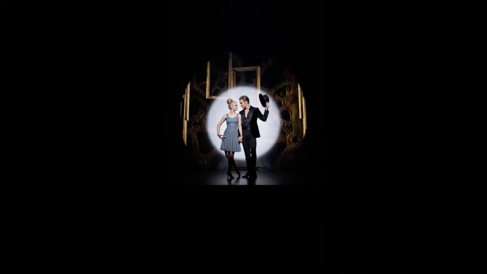

# Classic Broadway-Style Video

> **作者：** @黄炜炜

## Content

Process Planning:

Full-Chain Stage Logic and Dependencies:

Use text_editor to establish Final_Video_Spec.md first: Title, Broadway period (Golden Age / Fosse Modernist / Contemporary), aspect ratio, intended duration, visual style, output language, and Letterbox visual specifications. Lock these global parameters before moving to shot listing and batch generation to serve as shared anchors for all subsequent stages.

Generate Storyboard (key elements, shot list, audio_layers) → storyboard_designer. Once the Storyboard is complete, scan the context and user-uploaded assets, then bind matching key element images, reference videos, and background music to corresponding Storyboard slots via media_generator.

Create elements: If the user has uploaded character/scene assets, bind them directly; otherwise, generate all element images → media_generator. Simultaneously, bind key_element_audio to each element character (voiceprint reference audio: bind directly if the user has provided cast recordings; otherwise, use text to narration to generate short voiceprint samples). This allows reference via audio_infos during shot video generation in Step 4 to ensure consistent timbre across shots.

Generate final video shot-by-shot: By default, reference the element image bound to that shot; only append the previous shot video as a reference_video when continuity with the previous shot is critical → media_generator.

Generate all audio layers (Broadway background music, voiceover / VO) → media_generator.

Assemble final assets once all materials are ready and guide the export → video_assembler.

Dependencies: 2→1; 3→2; 4→3; 5→2; 6→3, 4, 5.

Milestone Pauses: Do not run the entire process at once. Pause after each major milestone (Spec locked, Storyboard complete, elements complete, shot video complete, audio complete, assembly complete) and invite the user to confirm via cards or reply_to_user before proceeding.

User Asset Priority: In steps 3–5, for any media already provided or existing from the user, bind it to the correct Storyboard anchor via media_generator first. Do not regenerate content already provided by the user.

Asset Analysis:

Analyze Broadway reference materials uploaded by the user (stills, costume references, choreography videos, cast recordings, posters). Output a structured understanding across five dimensions: 'Era—Color Palette—Costume Signatures—Choreographic Vocabulary—Lighting Mood', to be reused during the Storyboard and prompt writing stages.

Choreography reference videos: Tag actionable keywords (e.g., Fosse's pigeon-toed knees, jazz hands, hat tilts) and identify specific beats where moves can be directly reused by the camera.

For any user-uploaded material mapped to a key_element, the description must remain consistent with what is seen/heard and cannot contradict it.

Storyboard Design:

Visual Vocabulary for the Three Key Eras (Each shot must specify its era and apply the corresponding vocabulary):

Golden Age (1940s–60s): Saturated Technicolor, symmetrical composition, grand ensemble arrays, spotlight/wash lighting, gold/red color palettes; framed like a proscenium stage.

Fosse Modern (1960s–80s): Bob Fosse style—pigeon-toed knees, jazz hands, bowler hats/derbies, minimalist black, angular spotlighting, body isolation; high-contrast black & white or monochromatic red.

Contemporary (1990s–Present): Julie Taymor’s The Lion King style—puppets/masks, ritualistic textures, layered projections, earthy and totem colors; or Six-style pop concert staging, neon, and modern minimalism.

Key Elements Design:

Characters must be anchored with a "Character Card": color binding + hairstyle binding + posture binding. The one-sentence core description must remain unchanged across all shots.

Character Anchor Example: A 20-year-old blonde actress in a signature emerald green silk dress—reuse this core description in every shot prompt without variation.

Characters with multiple looks/ages must be listed separately (Look 1:…; Look 2:…).

Scene descriptions must specify stage orientation and the position of key props/performance areas.

Stage Character Archetype Reference (Use these for character design):

Archetype

	

Golden Age

	

Fosse Modern

	

Contemporary

Protagonist

	

Eliza Doolittle (My Fair Lady)

	

Charity (Sweet Charity)

	

Elphaba (Wicked)

Comic Relief

	

Ado Annie (Oklahoma!)

	

Amos Hart (Chicago)

	

Anne of Cleves (Six)

Charismatic/Villain

	

Harold Hill (The Music Man)

	

Roxie Hart (Chicago)

	

Heather Chandler (Heathers)

Storyboard Design:

Each shot description must include: Scene (reference scene element ID), Story Beat (character action, ensemble formation, dialogue/performance—reference character element ID, write out exact dialogue), Cinematography (shot size, camera angle, movement like zoom/pan/track/lock), Lighting Cue (spotlight/wash/follow spot).

Ensemble shots must clearly define formations and order (e.g., "V-formation moving in unison") to avoid chaotic stacking—this is the primary reason why it looks like an "ordinary gala" rather than Broadway.

Shot duration should align with musical phrases (4–15s); no single shot should exceed 15s (current model limit).

Cross-Shot Audio Design:

At least one global BGM track (Broadway orchestral style). Long clips can be split into segments at transition points (each with its own audio_id and duration).

If the narrative is driven by VO, define the narration_speaker_profile, tone, and exact script here.

Media Generation:

Element Image Generation: Use TextToImage, recommended Nano Banana Pro (Gemini 3 Pro Image) @ 2K. For multiple looks of the same character, use ImageToImage and reference the previous generation to maintain consistency; use a layout with a "half-body portrait on the left + full body on the right" to lock the character identity.

Character Voiceprint Binding (key_element_audio): Bind key_element_audio (character voice reference audio) to each element character to ensure voice/singing consistency across shots. If the user has uploaded cast recordings, bind them directly; otherwise, use text to narration to generate a short voice sample for the character and bind it. This binding is essential for Broadway characters with extensive dialogue and singing.

Shot Video Generation: Use MultiModalToVideo, recommended Seedance 2.0 @ 720p. For each shot, reference: ① the bound character/scene/prop element image for that shot; ② the key_element_audio for characters appearing in that shot (referenced via audio_infos to ensure voice/singing consistency across shots); ③ only add the previous shot video as a reference_video if there is extremely strong continuity, otherwise skip.

Negative Prompt Standards: Seedance and domestic video models use natural language input and do not support Midjourney/SD syntax like --no / --negative. The Flova generator also lacks a separate negative input field. Negative intent must be written as natural language avoidance phrases (e.g., "avoid CGI cartoon look, avoid amateur gala staging, avoid chaotic crowd") within the main prompt body, rather than appending them with --no.

Audio Generation:

BGM: For Broadway orchestral music, use text_to_instrumental or lyrics_to_song with the Suno 5 model (Note: failure rate is high when prompts include famous musician names; avoid naming real composers/singers).

Pure instrumentals (e.g., overtures): Must be specified as 'Instrumental' in Suno to prevent AI from generating nonsensical vocals.

Narration/VO: Use text to narration, default MiniMax Speech 2.8 HD.

Membership / Resolution: 1080p and the Seedance 2.0 series are member-exclusive; non-members are capped at 720p. Do not refuse requests based on membership limits when explicitly asked by the user; pass it to downstream processing.

Prompt Writing:

Prompt Combination Formula (natural language, single paragraph, do not use paragraph breaks):[Historical Aesthetic Vocabulary] + [Subject & Action / Group Dance Formation] + [Stage Environment & Key Props] + [Lighting Cues] + [Shot Size & Camera Movement] + [Color Grading: Single dominant color at approx. 90%]

Historical vocabulary must translate into executable actions: Fosse style must specify "inward knees, jazz hands, hat tipping, body isolation"; Contemporary Taylor style must specify "marionette / mask, ritual totem texture".

Character descriptions must reuse core sentences from the character profile and remain consistent throughout.

Negative prompts should be marked as "[Negative Prompt]", written as natural language avoidance phrases, and incorporated into the main text; do not use --no / --negative syntax.

Video Prompt (Seedance category):

Use placeholders like <<<image_1>>> to bind reference images to characters.

Action Stacking: Camera movement → Subject action → Spatial arrangement → Audio cues (if there is a separate narration track, do not repeat the full narration in the video prompt).

Standard Avoidance: "no subtitles" (for post-production subtitling); if BGM is on a separate track, add "no music" to the video prompt.

Suno Style Description: Broadway style relies heavily on the interplay and fusion of vocals and orchestral music. In [Style Description], emphasize the spatial depth between vocals and instruments (e.g., "vocal forward over layered orchestral pit") to make the soundstage feel more theatrical; for purely instrumental sections, be sure to enable "Instrumental".

Video Editing:

Track Layout: Video tracks V1–V3, audio tracks A1–A2. Main footage on V1, group dance/close-ups overlaid on V2–V3; BGM on A1, voiceover/VO on A2.

Letterbox: Implement a cinematic wide-screen look with letterboxing during the generation phase (add "cinematic letterbox" to prompts) rather than cropping during export—aspect ratio and resolution cannot be adjusted at the export stage.

Pacing and Transitions: Align editing rhythm with musical phrases and crescendos; use blackout cuts between segments to simulate stage scene changes. Keep musical phrases intact during group dance climaxes; avoid fragmented cuts.
