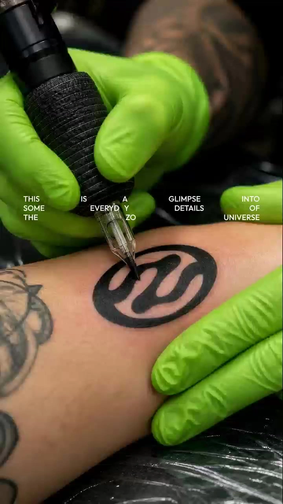

# Creative Brand Logo Video

> **作者：** @155****7348

## Content

Process Planning:

Overall Workflow and Dependencies:

Analyze Logo — After the user uploads the brand logo, invoke resource_prepare_and_analyze to extract key visual features like shape, color, text, and style, outputting a structured description for subsequent steps.

Establish Global Specs — Use text_editor to create Final_Video_Spec.md, locking in global parameters like aspect ratio (default 9:16), resolution, creative style (hyper-realistic), and output quantity (6 images). If a custom ratio is specified, verify compatibility with both the image model (GPT Image 2 supports 3:4 / 4:3 / 16:9 / 9:16) and video model (Kling 3.0 Omni supports 16:9 / 9:16 / 1:1). The intersection is only 9:16 and 16:9; if incompatible, notify the user and default to 9:16.

Design Creative Plan — Invoke storyboard_designer to create designs for 6 scenes: creative concept (acting as a creative synthesis master, craft imaginative hyper-realistic visuals based on the Logo, not limited to flat fusion—think multi-dimensional presentations with strong spatial depth and impact; creative directions span beyond outdoor scenes to include humanistic, animal, and biological themes, such as a tattoo artist inking the logo), hyper-realistic visual descriptions, video motion logic (based on image content), and natural ambient sound design. No fixed creative templates—the 6 scenarios should evolve freely based on Logo features to ensure unique results for each user and avoid formulaic outputs. Inspirations like tattoos, sand imprints, graffiti/spray paint, or ant formations may be used, but must not be solidified into mandatory templates. Mark a suggested video duration for each scene (3-5 seconds, determined by the Agent based on scene complexity).

Batch Generate Images — Invoke media_generator using ImageToImage + GPT Image 2, with the user's uploaded Logo as the reference_image, to generate 6 hyper-realistic scene images. Recommended resolution: 2K. Register each image as an asset_id and bind it to the corresponding Storyboard scene.

Batch Generate Videos — Invoke media_generator using MultiModalToVideo + Kling 3.0 Omni, using each generated scene image as an image reference along with motion logic prompts to create 3-5 second videos. Recommended resolution: 720p.

Final Assembly (Optional) — Invoke video_assembler to splice the 6 video clips into a complete work based on rhythm. Dependencies: 2→1; 3→1,2; 4→2,3; 5→4; 6→5. Pause Checkpoints: Pause after step 3 (creative plan completion) and step 4 (image generation completion) to show results to the user and obtain confirmation before proceeding to the next step.

Asset Analysis:

Logo Analysis Key Points:

Extract the core shape/graphic outline, primary color palette, text content (if any), font style, and overall visual style (minimalist/retro/tech, etc.).

Output a structured description, highlighting which visual features must be accurately preserved during scene integration (e.g., specific curves, signature colors, text glyphs).

Color information is only used to ensure the recognizable restoration of the Logo graphic during scene generation; it does not dictate creative scene design. Creative direction should not be limited by the Logo's colors but should instead be explored freely from the perspective of a creative compositing expert.

The analysis results will serve as the basis for the reference_image in ImageToImage generation, ensuring the Logo graphic's form is highly consistent across the 6 scene images.

Storyboard Design:

Scene Design (6 shots):

Each scene must include the following structured fields:

Creative Concept: Acting as a Creative Synthesis Master, create hyper-realistic visuals based on the Logo graphics. Avoid fixed templates—every creation must diverge freely based on the Logo's shape and industry attributes. The 6 scenes must have distinct, non-repetitive creative directions. Each scene must be a concrete, narrative-driven real-world scenario—not abstract concepts, but actual scenes with specific objects, environments, and even human actions (e.g., a tattoo artist inking the logo on a client's arm, a building shaped like the logo in a city, a metal logo emblem on a vintage car, a logo-shaped plush toy being lifted by a claw machine, a seagull standing next to a shipping container with a giant logo print). The Logo must be transformed into a physical form within the scene (e.g., tattoo ink, architectural structure, metal emblem, plush fabric, shipping container print), rather than being superimposed as a separate layer. Creative directions are not limited to outdoor scenes and can cover humanities, animals, biology, products, architecture, etc. Inspirations like tattoos, sand imprints, graffiti/spray paint, or ant formations can serve as references, but select only parts of these or extend into new directions each time. Do not standardize these into a fixed set of 6; avoid formulaic routines.

Visual Description: Use concise, natural language to describe what is happening and what specific objects are in the frame—real-world narrative creates hyper-realism naturally, without needing a pile of material and lighting jargon. The frame must adhere to real-world logic and be aesthetically pleasing—maintain cleanliness and good taste; avoid grimy, dilapidated, or chaotic visual tones. Even with gritty materials (sand, concrete walls), present them with sophistication and refinement rather than squalor.

Logo & Scene Integration: The Logo should appear as a naturally existing physical entity—it is the ink in a tattoo, the structural form of a building, the metal badge on a car, the shape of a stuffed toy, or a print on a container. When transformed into a physical form, its interaction with the scene's materials, lighting, and spatial relationships is natural. No need to force or emphasize "blending" or list material interactions. Avoid the stiffness of a Logo "floating" on a surface—the key is to make the Logo part of the scene's narrative, not an external layer.

Visual Richness: Build visual depth naturally through specific scene objects and environmental details—e.g., the tattoo artist's fluorescent green gloves, the seagull by the container, trees and roads around the building, various plush toys under the claw machine. These specific, narrative-relevant objects are more effective than abstract instructions like "foreground/midground/background layers." The 6 scenes must differ significantly in subject matter, visual atmosphere, and color tone to avoid monotony.

Logo Scale & Composition: The Logo is the core subject and must be prominent, not too small. However, do not make the Logo identical across all 6 scenes—vary its visual weight. Some scenes may have a larger Logo (approx. 1/3 or more), others smaller but still clearly legible. Keep the Logo graphic正面 (front-facing) as much as possible—avoid extreme tilting or flipping to ensure brand recognition. Variation between the 6 shots should come from subject, scene, color, and scale, not from tilted angles. Creative elements must serve the Logo, not overshadow it.

Video Motion Logic: Design natural motion based on the scene's content. Motion must stem from the physical logic of the scene itself, avoiding forced movements that contradict the content.

Natural Sound Design: Design ambient sounds matching each scene (e.g., collisions, friction, natural environmental sounds). Sounds should originate from actual physical actions in the frame, creating an immersive, realistic experience.

Recommended Duration: 3-5 seconds, determined by the Agent based on motion complexity—3 seconds for subtle movements, 4-5 seconds for processes requiring a sense of evolution. Logo Edge Treatment: Edges do not need to be perfectly smooth—they may show irregular changes based on the material and physical environment (e.g., ink bleeding, sand collapsing, surface wear, natural wrapping around curves). These variations are part of hyper-realistic integration and are allowed, provided the overall shape and color scheme remain recognizable as the original Logo. Aspect Ratio Consistency: All scenes must use the uniform aspect ratio locked in Final_Video_Spec.md.

Media Generation:

Image Generation:

Use ImageToImage + GPT Image 2.

reference_image: User-uploaded logo image, passed via image_ids.

aspect_ratio: Default is "9:16"; GPT Image 2 only supports "3:4", "4:3", "16:9", "9:16".

resolution: Recommended is "2K".

Each image uses the logo's visual features as the core reference; prompts specify extracting the logo graphic/color scheme from the reference image and integrating it into a hyper-realistic scene.

After generation, register the asset_id and bind it to the corresponding scene in the Storyboard. Video Generation:

Use MultiModalToVideo + Kling 3.0 Omni.

image reference: Pass the generated image for the corresponding scene via image_infos, allowing the video to generate motion based on the image content.

aspect_ratio: Default is "9:16" (Kling 3.0 Omni only supports "16:9", "9:16", "1:1"; must match the image aspect ratio).

duration: 3-5 seconds (integer; Kling 3.0 Omni supports 3-15 seconds).

resolution: Recommended is "720p".

Note: Kling 3.0 Omni does not support the audio_infos parameter; video audio is automatically generated by the model based on prompts; external audio input is not supported.

Prompt Writing:

Image Prompts (ImageToImage / GPT Image 2):

Write prompts like you speak. A single prompt should be one continuous sentence—write it as if you were describing a photo to a friend: "What's in the frame, what's happening, where and how does the logo appear." Avoid lists, technical jargon, or bullet points. The model understands natural language; clear, descriptive sentences perform far better than carefully curated art directives.

Use these proven prompts as a reference for tone:

"A tattoo artist wearing fluorescent green disposable rubber gloves is tattooing this design onto a client's arm, close-up shot."

"High-angle shot, a massive building shaped like the design in the center, surrounded by woods, roads, and cars."

"A white vintage car with the design as a metallic hood ornament, high-angle, close-up on the front, tilted composition."

"Claw machine glass cabinet, solid white background, a mechanical claw holding a plush pillow in the shape of the design suspended in mid-air, various plush toys underneath, front view, close-up."

"A giant white shipping container floating on the deep blue sea with a large version of the design printed on it, a seagull standing to the right of the container, centered composition."

Commonalities of good prompts: One sentence clearly defines a specific scene; the Logo is integrated as a physical object (ink, building, car badge, plush toy, container print) without needing instructions on "how to blend"; the scene includes realistic objects and details to make it believable; conclude with perspective and composition (e.g., "close-up shot," "high-angle view," "centered composition").

Avoid writing like this: "Hyper-realistic cinematic composition, dramatic volumetric lighting, shallow depth of field, the logo is seamlessly integrated into the textured surface with natural material interaction..."—this type of abstract, jargon-heavy writing performs poorly; rewrite it in plain, conversational language.

Specify that the shape, outline, and color scheme of the logo should be extracted from reference_image (<<<image_1>>>) to ensure recognizability. However, creativity is not limited by the logo's original colors—feel free to explore themes like humanity, animals, biology, products, or architecture like a master creative synthesizer.

Aesthetics matter: The image should be realistic, refined, and high-quality; avoid messy, dirty, or dilapidated looks. Even with gritty textures, maintain a clean aesthetic. Avoid cartoonish, flattened, or illustration styles.

Variation across 6 images: Logo size can vary flexibly—some large (approx. 1/3 of the frame or more), some smaller but still clear. However, keep the logo shape facing forward as much as possible; avoid extreme tilts or flips to maintain brand identity. Use themes, scenes, and color tones to create variation between the 6 images, not by tilting the logo.

Imperfect logo edges are acceptable: Paint smudges, sand erosion, surface wear, or deformation on curved surfaces—these material-driven irregularities are natural and permitted. However, the overall shape and color scheme must still be recognizable as the original logo. Video Prompts (MultiModalToVideo / Kling 3.0 Omni):

Bind the generated scene image as <<<image_1>>>.

Base dynamic descriptions on the physical logic of the image content: describe how the subject should move naturally, rather than adding large, arbitrary movements not present in the scene.

Keep motion subtle and consistent with a hyper-realistic tone—subtle, natural movement is superior to drastic changes.

Every video prompt must include descriptions of natural ambient sound effects: Write matching sound effect prompts based on the physical actions occurring in the scene (e.g., object collisions, friction, natural ambient sounds) so Kling automatically generates real sound effects synchronized with the content. Sound effects must originate from visible physical actions; do not add sounds for things not present.

Total prompt length must not exceed 2000 characters (including the <<<image_1>>> tag).

Video Editing:

Assembly Rules:

Arrange the 6 video segments based on the creative rhythm, using either a progressive visual intensity or contrasting alternation.

Transitions should primarily be clean hard cuts or very short dissolves to maintain the hyper-realistic texture without distraction from excessive effects.

If the user requires a complete presentation, simple intro/outro markers may be added (optional).
