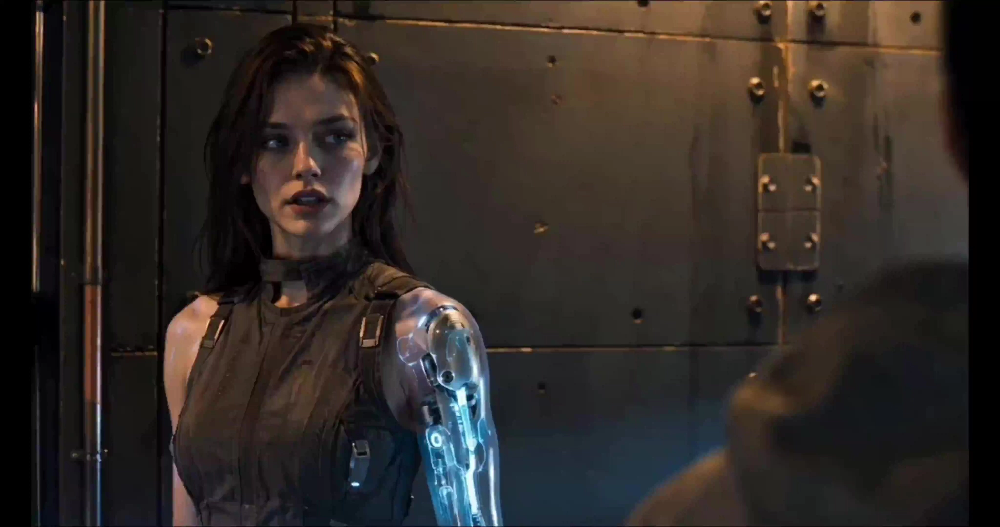

# Cyber-Megastructure: Hard Sci-Fi Short Film

> **作者：** @阿娴AIGC

## Content

Process Planning:

Full Workflow Logic and Dependencies:

Lock Global Specs (First step, highest priority) → Use text_editor to create Final_Video_Spec.md, inputting: Title, genre (hard sci-fi short), aspect ratio 16:9, resolution 4K (4096×2160), frame rate 24fps, target duration 45–60s, visual style (hyper-realistic cinematic, high contrast, scale disparity between giant and small objects), color palette (ice blue / warm gold / pale purple / amber / pale pink), and output language. Confirm key parameters (duration, title, output language) with the user; the user may modify them here. Only proceed after locking.

Analyze User-Uploaded Assets (if any) → resource_prepare_and_analyze: Extract visual style signals from sci-fi references and world-building details from the script, outputting structured text for later stages.

Design Storyboard (Key Elements + Shot List + Audio Layers) → storyboard_designer. Present the complete draft to the user, highlighting adjustable items (narrative beats, shot sequence, ethnic group ratios, BGM style, VO tone, etc.). Wait for user confirmation or feedback before proceeding.

Generate Key Elements (Representative characters of the four tribes, mechanical Kunpeng, steel forest scene, abandoned zone scene) → media_generator. If the user has uploaded reference images, register asset_ids and bind them to the corresponding Key Elements, skipping generation. Only prompt the user if there is a visual conflict between the reference and the Storyboard. Pause after each batch of elements, show them to the user, and allow for regeneration or adjustments.

Generate Video Shot-by-Shot → media_generator (Show results after each shot, proceed only after confirmation or modification; users may request re-generation of the current shot).

Generate Audio Layers (BGM + VO, if applicable) → media_generator (Preview audio for user confirmation; allow style adjustments or regeneration).

Assemble Final Video → video_assembler. Preview the timeline structure (shot sequence + audio tracks) for the user. Render only after confirmation, then guide the user to export.

Dependency Map: 2→1 (Asset analysis follows global spec establishment); 3→1,2; 4→3; 5→4; 6→3; 7→4,5,6.

Pause Nodes (Mandatory pause after each milestone; no automatic execution):

After Global Specs draft presentation (user can modify title, duration, language, etc.)

After Storyboard design completion (user can adjust narrative structure, group ratios, BGM tone, etc.)

After all Key Elements are generated (user can request regeneration of specific characters/scenes)

After each shot is generated (verify one by one; user can request a retake of a single shot)

After all Audio Layers are generated (user can adjust BGM style or VO tone)

After timeline structure preview (user must confirm final structure before rendering)

User Upload Handling: Parse all user-provided reference images, scripts, and audio via resource_prepare_and_analyze, then bind them to corresponding Storyboard slots to avoid duplicate generation. If uploaded assets conflict with built-in specs, prioritize user uploads and clearly inform the user of the conflict for their decision.

Asset Analysis:

When processing user-uploaded reference assets, focus on extracting the following signals:

Sci-Fi Reference Images: Extract lighting structure (main light source direction, contrast ratio), color palette (dominant/accent colors, black/white point levels), scale relationship between giants and characters, material grading (Sky-tier / Proliferation-tier / Wasteland-tier), and cinematography (shot size, low angle, depth of field).

Script / World-building Text: Extract scene names and distribution, tribe types and appearance order, and core narrative beats (opening / conflict / resolution), transforming them into structured Shot List input.

Reference Audio (if any): Extract emotional tone (epic, oppressive, tragic), BPM range, and key timbre characteristics to provide style anchors for BGM generation.

Output Format: Output analysis results as structured text, clearly labeling the source asset ID for direct reference by storyboard_designer and media_generator.

Prohibited: Do not perform style transfers or creative reinterpretations on reference assets; only faithfully extract quantifiable visual/audio signals.

Storyboard Design:

Worldview Tone

After 3025, the sky no longer belongs to humanity. A giant mechanical Kunpeng (518m wingspan) hovers 900–1100m above the steel forest, its bottom structure slicing sunlight into parallel bands of shadow. On the ground, four distinct groups share the same infrastructure; the border between prosperity and ruins is not a wall, but light. The short film focuses on macro slices rather than micro narratives.

Worldview Design Principles (Mandatory):

Always maintain a grand scale narrative perspective: Do not limit scenes to single interiors or confined small spaces; every shot's background must reflect urban depth, sky layers, or group ecology, with visual information density always covering multiple spatial levels.

Size contrast is the core visual language: Each shot must demonstrate at least one scale comparison (Giant vs. Human / Skyscraper vs. Pedestrian / Sky vs. Ground); isolated subject close-ups must be followed by macro spatial shots to prevent narrative constriction.

Ethereal atmosphere (Optional rule): During emotional transition segments (e.g., from awe to contemplation, or when the Kunpeng shadow covers the city), a thin layer of atmospheric scattering fog is allowed in light-source scattering areas—only from physical light sources (light beams penetrating Kunpeng armor gaps, low-density particle light fog around energy bodies); psychedelic colored fog or artificial light pollution-style lens flares without light sources are prohibited.

Key Elements Design Specifications
element character — Representative Characters for Four Groups

Each group must have at least one representative character designed as a key_element:

Primitive Humans: 0% body modification, pure organic bodies. Wearing 21st–25th century casual wear (cotton/linen/denim/polyester). Skin retains real texture (pore density 80–120 per cm², fine line depth 0.05–0.1mm). Asian and Western faces each account for half.

Cyber Humans: 40–70% body modification. Exposed joints (metallic skeleton material), subcutaneous glowing circuit patterns (pulse frequency 0.8Hz), wearing industrial modular clothing. Asian/Western faces 1:1.

Gene Fusions: 100% modification (genetic level). Skin covered in biological patterns (scale thickness 0.5–2mm / feather length 1–5cm), capable of changing color with the environment (response time 0.3–0.5s).

Digital Consciousness (Cyber-Immortals): No physical body, presented as human-shaped light mist (transparency 40–60%, size 1.7–2.2m), form fluctuates randomly. These are existences that achieved immortality by uploading biological consciousness to machine carriers—when describing, faint remnants of original human facial features can be seen within the light mist, serving as a narrative anchor for "once human."

element scene — Scene Elements

Steel Forest (Prosperous Area): Skyscraper spacing 20–40m (avg 32m), footprint 45m×45m. Vertical layering: Ground 0–12m (maglev lanes, translucent metal leaf street trees), Middle 12–150m (green information light pulses, flow rate 2m/s, pulse width 0.8m), High 150–800m (floating platform spacing 150–200m, aerial light bands 3–5m wide). Zenith-class buildings: All matte black titanium alloy + mirror glass (reflectivity 72–85%).

Abandoned Area: Information light pulse break rate 40–60%, building rust coverage ≥30%, no floating vehicles, no full-brightness light pulses.

Transition Zone: Width 30–50m, gradual transition; recommended frame ratio 5:5 or 6:4.

Giant Mechanical Kunpeng (Sky Giant): Wingspan 518m, body length 322m, main body height 78m. Hover altitude 600–1400m (stable at 900–1100m). Scaled armor plates 2.5m×4m, gap 3cm, dark blue energy patterns 1.5cm wide, pulse 0.5Hz. Bottom engine array: 12 sets (diameter 6m, exhaust nozzle 4 concentric rings, ring spacing 0.3m). Horizontal movement 28–52m/s, vertical movement 0.5–1.2m/s.

Specialized Ethereal Camera Work Specifications (For emotional transition segments only)

Trigger conditions: Enabled when emotional arcs transition, typical scenes include: oppression→contemplation, Kunpeng shadow slowly covering the city, silent stagnation after group eye contact, moving from shock to internal collapse, etc. Prohibited to use ethereal camera work in shots without emotional turning points.

Physical light source constraints (Iron Rule): Ethereal feel must come from atmospheric scattering produced by real physical light sources—

Allowed: Parallel light beams formed by sunlight penetrating Kunpeng armor gaps (projection width proportional to 3cm gap on the ground), low-density particle fog around energy bodies due to air pressure difference (transparency ≤25%), natural diffusion of light from nighttime building self-illumination into fog (diffusion radius ≤ 3x actual light source size).

Prohibited: Psychedelic colored light fog without light source, non-physical glow, large-area lens flare diffusion resembling artificial light pollution, any scattered light effects inconsistent with light source positions.

Specialized camera rhythm (Three-stage):

Oppression Start: Slow handheld pan (speed ≤3cm/s), camera axis offset 15–25°, maintain slight handheld shake, light beams or shadow boundaries slowly enter from off-screen, character in light-shadow transition area (half-body lit, half-body dark).

Contemplation Core: Panning speed drops to ≤1.5cm/s (near static but never locked), lens floats slightly with breathing; cut to extreme close-up of eyes or hands (capture skin pores/iris reflections/finger tremors); atmospheric scattering light beams shift slowly in background, resonating with character emotion rather than competing for the frame.

Shock Turning Point: Camera tilts up from a low angle (tilt 20–35°), handheld shake increases slightly (not deliberate shaking, maintain breathing rhythm), giant object or light beam fully enters the frame, completing emotional release.

Collaboration rules with other camera movements: Sudden cuts or rapid jumps are prohibited during ethereal segments; if switching to other views, use a ≥0.8s gradual transition; resume standard camera decision tree only after the ethereal segment ends.

General Camera Work Guidelines (Global mandate, strictly executed in all shots)

Strictly forbidden: Locked tripod shots, simple linear push/pull (push/pull without inertia/emotional intent), frontal eye-level medium shots, frontal eye-level wide shots.

Full handheld breathing feel: All shots must have slight handheld shake (breathing-style micro-vibration, not deliberate shaking), simulating human-carried camera feel, reflecting the real coexistence of characters and the scene.

Camera Work Decision Tree (Select by context, "simple push/pull + locked" combination is prohibited)

Context

	

Priority Camera Technique

Character Close-up (Emotional explosion / breakdown / shock)

	

Dutch Tilt + extreme facial close-up, tilt angle 10–25°, highlighting psychological imbalance

Character Close-up (Oppression / helplessness / being looked down upon)

	

High-angle shot (30–60° pitch) + handheld micro-shake, character in the bottom 1/3 of the frame

Character Close-up (Awakening / reigniting / confrontation)

	

Low-angle shot (20–45° upward pitch) + slow push-in, character occupies 60–80% of the frame, sky/giant as oppressive background

Walking / running / chasing

	

Over-Shoulder Tracking + handheld follow, keeping character's back neck/shoulder line in frame

Dialogue / Shot-Reverse-Shot

	

Shot-Reverse-Shot, angle difference ≥30° between switches, prohibited to cut perfectly face-to-face

Giant object reveal / Shock reveal

	

Low-angle orbit + camera gradually rotates from side-up to full-up, combined with handheld shake to reinforce impact

Scene macro display

	

High-altitude wide overhead shot (45–75° pitch) or side-high pan, direct eye-level medium locked shots prohibited

Light/shadow slicing / Atmosphere rendering

	

Side-backlit tilted shot (axis offset 15–40°), light/shadow boundary crossing the character's body

Each shot description must contain the following six fields:

Scene: Cite corresponding scene element ID (e.g., [Element_SteelForest_Prosperous]).

Story beats: Specific actions and character behavior, cite group character ID; write exact dialogue text; describe character emotional arc (e.g., from numbness→suddenly looking up→pupil dilation→lip trembling).

Cinematography (Must be selected from the Camera Work Decision Tree, writing "medium shot locked" or "push/pull" is prohibited):

Shot Size (Close-up/Extreme Close-up/Wide Shot/Aerial Wide Shot)

Camera Angle (Upward angle / Downward angle / Dutch Tilt angle / Over-the-shoulder view)

Movement (Handheld follow/Orbit/Over-shoulder track/Rotating tilt/Rapid multi-cam switch)

Close-up note: Clearly state the subject (eyes/hands/armor gaps/trembling lips/pupil reflection, etc.) and narrative purpose.

Emotion–Shot Mapping: Explain how this position/movement serves the character's inner state (e.g., Dutch tilt 18° reinforces the character's collapse of belief).

Light/Shadow: Main light direction (side-backlit/top-down/bottom reflection), shadow edge characteristics (hard cut/gradient), brightness contrast (6–7 stops).

Multi-cam labeling (If applicable): Indicate whether this shot involves multi-camera switching, state the angle of each cam and switching timing.

Standard Five-Shot Structure (Director's Cut, base template, adjustable based on script)

Macro Reveal (4–6s): High-altitude 45–60°俯 shot of the Steel Forest + mechanical Kunpeng entering the frame. Camera has handheld micro-shake with slow pan (not locked), Kunpeng occupies 20–30% of the frame, city 40–50%. Establishes oppressive worldview tone through the disparity in size between giant object and city.

Oppressive Close-up (3–4s): Cut to ground character. Dutch Tilt 15–20° + low upward angle (30–40°) close-up on character face; Kunpeng bottom structure occupies 50–60% of the frame in the background. Close-up on eyes—irises reflect Kunpeng outline, conveying indifference or shock under oppression.

Light/Shadow Cut (4–6s): Kunpeng shadow moves across building complex. Side-backlit tilted angle (offset 20–30°), handheld follow with shadow boundary, slow pan; light/dark boundary passes through character body, character half-lit, half-dark. Shadow covers 40–60% of city area.

Multi-Group Frame (4–5s): Orbit follow (arc movement, radius 2–4m) bringing multiple groups into the same frame. f/11 deep depth of field, all four groups clearly identifiable; group density 3:3:2:1 (Primitive Human:Cyber Human:Gene Fusion:Digital Consciousness). Switch shot-reverse-shot during orbit to capture eye contact or deliberate avoidance between groups.

High-Altitude Conclusion (4–6s): Start with handheld low-angle upward shot (45°), then camera slowly rotates upward (handheld arc rise) to overhead view; Kunpeng appears from one corner (60–70%), city shrinks to bottom 10–20%. Full handheld shake without interruption, preserving human breathing feel.

Single-Shot Multi-Lens Design Specifications (For 7–14s shots)

Seedance 2.0 supports multi-lens storytelling within a single shot; fully utilizing this can significantly enhance narrative tension without increasing shot count. Applicable range: 7–14s shots; short shots under 5s maintain a single lens, switching is not mandatory.

Trigger basis (Narrative priority, not time division):

Emotional arc reaches a turning point (e.g., from indifference to shock, or oppression to release);

Giant object enters frame or shadow coverage is large, requiring a cut from wide shot to character reaction;

Peak tension from multi-group eye contact, requiring shot-reverse-shot to capture emotions of both sides;

Spatial scale needs to be shown (Macro→Micro→Macro three-cut narrative).

Single-shot cut format (Storyboard description specification):[Cam A] Shot size / Angle / Camera movement — Screen description + emotional state → Switching basis: (Narrative event or emotional turning point, e.g., "Kunpeng shadow boundary enters frame") [Cam B] Shot size / Angle / Camera movement — Screen description + emotional state → Switching basis: (e.g., "Character pupils contract, emotional tipping point") [Cam C] Shot size / Angle / Camera movement — Screen description + emotional state (Conclusion)

Adjacent camera angle difference ≥30° (Follow Camera Work Decision Tree, prohibited to re-cut with same-angle pan);

Cut points must have narrative justification, prohibited to use pure time anchors like "cut after 3s" or "cut at 6s";

Each cam must mark Shot size + Upward/Downward angle + Camera movement (e.g., Low upward 30° handheld follow→Dutch tilt 18° close-up→High altitude 50° pan).

Recommended Three-Cut Template (7–14s shot):

Macro reveal (Wide/Overhead, establish scene)→Emotional trigger (Cut to close-up/extreme close-up, emotional explosion)→Macro backtrack (Restore up/down angle, conclude narrative structure);

Oppressive upward shot (Upward angle + handheld)→Character close-up reaction (Dutch tilt extreme close-up)→Light/shadow cut (Side-backlit tilted, emotion spreads to environment);

Over-the-shoulder tracking (Movement)→Shot-Reverse-Shot (Dialogue/Eye contact tension)→Low-angle orbit (Giant object reveal, emotional sublimation).

Giant Object and Scale Rules (Mandatory for every shot containing a giant object):

For structures with single unit size ≥100m, at least one human or vehicle must appear in the same frame as a scale reference, with the reference object occupying ≥0.5% and ≤2% of the frame area.

When the frame includes vertical perspective from ground to high sky, at least one intermediate height reference object (e.g., middle-level buildings, floating passages) must appear, with a visual drop ≥500m.

Shots containing giant objects prioritize low upward orbit or Dutch tilt, reinforcing the giant object's psychological dominance over the character through camera tilt; it is forbidden to shoot giant objects with locked eye-level shots.

Optical System (Globally fixed, injected into all shot descriptions)

Depth of Field: f/11 deep depth of field, background clearly identifiable, excessive blurring is prohibited.

Focal Length: Standard lens 35mm–50mm (natural human eye perspective), ultra-wide or telephoto is prohibited.

Shutter: 1/250s, freezes motion, motion blur is prohibited.

ISO: 100–400, pure image quality, noise is prohibited.

Color: High saturation and transparency, main colors icy blue #4A9BC7 / warm gold #E8B84B / pale purple #9B7BB8 / amber #D4A05A / pale pink #DDB5B5.

B&W Depth: Darkest area RGB≥15 (pure black prohibited), brightest area RGB≤245 (pure white prohibited).

Contrast: Brightness difference in the same frame 6–7 stops, highlight and shadow areas both retain texture details.

Shadow rules: Every shot must have shadows with clear direction; soft light edges are blurred, hard light edges are sharp, shadows from multiple light sources can overlap.

Cross-Shot Audio Layer Design

BGM: At least one global background music track (type: music), epic, low-frequency oppressive tone, BPM in 60–90 range. If the short film has clear emotional turning points (e.g., oppression to shock), it can be split into 2 BGM segments, each specifying the covered shot range.

Narration VO (If script has narrative text): Type: narration, set narration_speaker_profile (e.g., [Low-pitched male narration, restrained, epic]), write full VO script, layout_instruction corresponds to shot range.

Ambient Sound Layer: Design independent ambient sound descriptions for each main scene (e.g., Steel Forest ground—maglev lane low-frequency electromagnetic hum + information light pulse high-frequency pulse + crowd noise; Abandoned area—wind whistling through rust structures + intermittent arcing of broken light pulses; Kunpeng overhead—ultra-low frequency engine oppressive vibration + armor plate airflow cutting sound). Designed as independent audio_layer within the corresponding shot range, mixed separately from BGM during the video_assembler stage.

Prohibited: BGM must not overlap with synchronous sound/dialogue tracks generated during video generation without mixing; volume and fade in/out control must be applied uniformly at the video_assembler stage.

Media Generation:

Generation of Key Elements

Tool: TextToImage, Preferred Model: GPT Image 2, Resolution: 2K, Aspect Ratio: 16:9.

Character Key Elements: For each character, generate a horizontal multi-view reference image (white background, 16:9): The left side of the frame features a close-up bust (clear facial features, skin texture, hairstyle, and modification details); the right side shows front, side, and rear full-body views arranged horizontally. All four views are presented side-by-side on the same white background to clearly display the character's full appearance and silhouette.

Scene Key Elements: Generate one key element scene image each for: Steel Forest (Prosperous Zone), Abandoned Zone, Transition Zone (Prosperous/Abandoned), and Mechanical Kunpeng (worm's-eye view). These will be used for reference binding in subsequent video shots.

When user uploads reference images: Directly register the corresponding reference image as an asset_id and bind it to the relevant key element, skipping the generation step. Only if there is a visual conflict between the reference image and the Storyboard description, prompt the user to confirm which one takes precedence.

Multi-version iteration: If the initial element image deviates significantly from the world-building specifications (e.g., fake halos, excessive skin smoothing, incorrect material grading), use ImageToImage (Preferred Model: GPT Image 2) for targeted corrections while retaining consistent identity features.

Final Shot Video Generation

Tool: MultiModalToVideo, Preferred Model: Seedance 2.0, Resolution: 720p, Aspect Ratio: 16:9.

Single shot duration: Not to exceed 15s (Seedance 2.0 maximum limit); standard shots should be executed within the 3–6s range as designed in the Storyboard.

Reference inputs for each shot:

Element images (Required): All Key Elements for characters appearing in the shot + corresponding Key Elements for the scene (including giant objects/settings/props).

Continuous video reference (Use with caution): Only append the previous shot's final_shot as a reference_video if the current shot has extremely strong visual continuity with the previous one (e.g., continuous action of the same character, seamless movement from the same camera angle). Generally, do not add video references to avoid style homogenization.

Audio processing: Seedance 2.0 supports audio_infos. If a character has a key_element_audio binding (user-uploaded or previously generated character voice reference), pass it into the corresponding shot generation to maintain consistent dialogue tone across shots. If the shot has no character dialogue, leave audio_infos blank; audio will be layered uniformly during the video_assembler stage with BGM / VO.

Audio Layers Generation

BGM: Use text_to_instrumental, generating based on the mood description, BPM range, and primary tone defined in the Storyboard's Audio Layers. Generate in segments if multiple BGM sections are defined in the Storyboard.

Narration VO: Use text_to_narration, generating according to the voice characteristics described in the Storyboard's narration_speaker_profile. Strictly adhere to the VO script text; no ad-libbing is permitted.

Prompt Writing:

Global Top Priority

When the user interacts in Chinese, the prompt body must be written in Chinese; dialogue / voice-over text language must follow the output language settings in Final_Video_Spec.md.

Key Elements Image Prompt (TextToImage / ImageToImage → GPT Image 2)

Structure: Subject Description (Identity + Modification Level + Material Details) → Light and Color (Main Light Source Direction + Color Anchors) → Texture Details (Skin Pores / Metal Grading / Circuit Patterns) → Lens Language (Shot Size + Composition) → Optical Rules (f/11, no skin smoothing, no fake lens flares).

Key_element Prompting Points for Group Characters:

Character descriptions must include specific identity details; character names alone are prohibited. Description order: Age (e.g., "approx. 22 years old") → Gender and Appearance (e.g., "attractive female college student with a perfect figure," "1.9m tall muscular hunk," "middle-aged man around 60") → Hairstyle (e.g., "long wavy hair," "buzz cut," "silver-white short hair") → Height and Build (e.g., "1.72m tall, slim waist and long legs") → Group Modification Traits → Clothing. Examples: "Approx. 22 years old, stunning Asian female college student, 1.68m, long deep brown wavy hair, wearing a loose cotton-linen top and jeans (Primitive human, 0% modification rate)"; "Approx. 35 years old, 1.90m tall muscular Western male, buzz cut, exposed left arm metal skeletal joints, wearing an industrial-style modular jacket (Cyber human, 55% modification rate)."

Lock in stable identity features: facial contour, skin tone, modified part material state (Sky-tier/Augmented-tier/Wasteland-tier), clothing color and material; background text or cluttered patterns unrelated to the setting are prohibited.

Skin description must include: visible pores (diameter 0.1–0.2mm), visible fine lines (depth 0.05–0.1mm), physiological color differences (forehead brighter, jaw darker, nasal wings slightly red); skin smoothing is prohibited.

Modified characters must describe: material grading of metal skeletons, light color and pulsation of circuit patterns (0.8Hz), and transition seam treatment between skin and metal.

Digital consciousness: Humanoid light mist, 40–60% opacity, random edge disturbance; physical manifestation is prohibited.

Key_element Prompting Points for Scenes:

Clarify main light source: Sunlight (penetrating through gaps in the Kunpeng shield) / Architectural self-luminescent information light pulses / Cold white scattered light in abandoned areas.

Color anchors: Main color ice blue #4A9BC7, secondary color warm gold #E8B84B; in the same frame, the main tone accounts for about 60–70%, secondary color 20–30%, and the rest is neutral transition colors.

Material quantification: Information light pulses (green, flowing sensation, width 0.8m), reflectivity (mirrored glass 72–85%), rust coverage (abandoned area ≥30%).

Shot Video Prompt (MultiModalToVideo → Seedance 2.0)

Reference Image Placeholder Binding: Use product placeholders <<<image_1>>>, <<<image_2>>>, etc., for each reference input, arranged in the order of characters / scenes, and state "<<<image_1>>> is [Character/Scene Name]" at the beginning of the prompt.

Motion Stacking Structure (Written in Order):

Camera Movement ( "Locked" or "Simple Push/Pull" are strictly prohibited, must select from the following types):

Handheld micro-shaking tracking / Handheld orbiting (arc radius + direction) / Over-the-shoulder tracking / Dutch tilt (specify degrees) / Low-angle rotation rising / Rapid cuts; specify speed (slow/steady/rapid) and emotional intent for each.

Subject Action and Emotional Arc: Specific limb movements + amplitude/speed + emotional beats (e.g., shoulders slump → eyes lift → corners of mouth tremble) listed in narrative order; do not use time-stamp splitting like "0–3s / 3–6s".

Close-up Focus (if included): Clearly specify the object of the close-up (pupil reflection/clenching fist/armor seams, etc.) + the emotional purpose served by the close-up (e.g., close-up on iris reflection of the Kunpeng bottom structure, conveying helplessness).

Spatial Changes: Displacement or occlusion relationships of elements within the scene (e.g., Kunpeng shadow sweeping across the building complex from left to right); for multiple camera angle switches, specify the timing and angle offset (≥30°) for each cut.

Audio Description (Exclusive format for Seedance 2.0 only):

Music: (...) Description in parentheses

Sound effects: <...> Description in brackets

Dialogue: {...} Insert verbatim dialogue inside brackets; specify language before brackets for non-English dialogue (e.g., Chinese{...})

Screen subtitles: 【...】 Insert subtitle text inside brackets

If an independent Voice-Over (VO) audio layer is already planned, do not write VO text into the video prompt to avoid duplicate rendering.

Prompt Writing for Ethereal/Dreamy Sequences (Dedicated to emotional transition segments):When a shot is marked as an ethereal emotional transition segment, the prompt must be written according to the following structure and cannot be simplified:

Physical Light Source Anchoring (Must be written before motion stacking): Clearly specify the source of light beams (e.g., "Sunlight penetrates through a 3cm gap in the Kunpeng armor, casting parallel light beams on the ground"), and the cause of mist (e.g., "Low-density particle mist, opacity ≤25%, appearing only in the scattered area at the edge of the light beam"); writing descriptions without light source anchors like "diffused mist," "dreamy glow," or "psychedelic light effects" is prohibited.

Motion Rhythm Notation: Slow handheld tracking (specify speed ≤3cm/s or "nearly stationary") → Insertion of extreme close-ups of eyes/hands (specify object and emotional intent) → Low-angle rising (specify angle and scale of the giant object entering the frame); write narrative transition basis between the three segments, writing time stamps is prohibited.

Sound Effect Coordination: Use <...> to describe the low-frequency resonance of airflow through light beams or the extremely low noise floor of particle mist, avoiding conflict between ethereal segment sound effects and the BGM main melody (sound effects here are physical soundscape backgrounds, not music).

Negative Constraints Addition: Add "no psychedelic colors, no glowing mist without light source" at the end of this prompt segment.

Prompt Writing for Multiple Cuts Within a Single Shot (Seedance 2.0 multi-shot narrative format):For shots marked with multi-camera switching in the Storyboard, the prompt must be written in the following format:

Camera Block Structure (Arranged in narrative order, each camera angle is an independent paragraph): [Camera A] <<<image_1>>> is [Character/Scene Name]; [Shot Size/Angle/Movement], [Subject Action and Emotion], [Lighting/Shadow Description] → Switch: [Narrative basis, e.g., "Moment when the Kunpeng shadow boundary enters the frame"] [Camera B] <<<image_2>>> is [Character Name]; [Shot Size/Angle/Movement], [Subject Reaction and Emotional Arc], [Close-up Focus] → Switch: [Narrative basis, e.g., "Character emotion reaches a tipping point, lips slightly trembling"] [Camera C] [Shot Size/Angle/Movement], [Concluding Shot Description]

Angle Difference Notation: Specify the angle offset after the narrative basis for each switch (e.g., "Angle offset ≥30°, cut to 18° Dutch tilt");

Prohibited Writing: cut to + fixed camera description, time-stamp splitting, continuous cuts from the same angle;

Audio format is written uniformly after the last camera block, not repeated within each camera block.

Fixed Negative Constraints (Added to the end of every video prompt):

no subtitles (subtitles are for post-processing, not rendered in the video)

no music (BGM is superimposed during the video_assembler stage, not generated in the single shot)

no motion blur (shutter 1/250s, freeze motion)

no fake lens flare (no flare without a light source)

no skin smoothing (no smoothing, realistic skin texture)

no overexposure (brightest areas RGB≤245)

Strengthening Optical Rules:

Every video prompt must include: f/11 deep depth of field, clear background; extreme contrast (6–7 stops); real physical light sources (sunlight/architectural self-luminescence/reflected light), with a clear direction for the main light source.

Real lens flares permitted: Three-layer gradient flare at the position of the main light source; the outermost layer diameter must not exceed 1.5 times the actual displayed size of the light source; opacity decays evenly from 40% at the center to 0% at the edge; flare displacement relative to the light source ≤2°.

Prohibited descriptions: outward glow, divine light, light-less flares, fake diffuse flares, fake neon lights.

Strengthening Giant Scale Description:

Every shot prompt containing a mechanical Kunpeng must include: wingspan 518m / fuselage 322m / hovering height 900–1100m; the same frame must include humans/vehicles as a scale reference, with the reference object accounting for ≥0.5% and ≤2% of the frame area.

When the frame contains a vertical perspective from ground to high altitude, write in intermediate-height reference objects (mid-level buildings/floating passages), with a visual vertical drop ≥500m.

Video Editing:

Rhythm and Editing Logic

Base Editing Rhythm: Align with the BGM's low-frequency drum beats. Opening grand panoramic shot (4–6s) → Fast-cut contrasting shot sizes (3–4s) → Light and shadow cuts (4–6s) → Group shot (4–5s) → Concluding high-altitude shot (4–6s). Total duration: 45–60s.

Transitions: Use hard cuts as a priority (aligned with light/dark rhythm changes); use 0.5–1s crossfades only during emotional shifts (e.g., from tension to awe). Do not use flashy transition effects.

Beat Alignment: Align the motion frames of the Kunpeng shadow sweeping across the buildings with the strongest low-frequency BGM drum beats. Align the entry points of multi-group shots with melody nodes.

Audio Track Mixing

BGM Track: Underlay throughout, set to -12 dB (relative to full scale). 3s fade-in at the start (0 → -12 dB), 3s fade-out at the end (-12 dB → silent).

Voiceover (VO) Track (if applicable): Set to -6 dB. BGM automatically dips by 3 dB when VO starts and recovers after VO ends. Do not overlap VO with synchronous dialogue within shots.

In-Shot Generated Sound Effects (if applicable): Retain original sound effect tracks, mixed in at -18 dB to avoid frequency conflicts with BGM and VO.

Ambient Sound Layer Mixing: Ambient sound as an independent track, underlay at -20 dB. During the Kunpeng overhead shot, raise ambient sound to -14 dB (sub-bass engine tension must be above the physical perception threshold), with BGM dipped by 4 dB during this segment. Ambient sound for the abandoned area shot (wind/electric arcs) at -16 dB, preserving high-frequency clarity to create a frequency contrast with the electromagnetic hum of the prospering district.

Export Settings

Aspect Ratio: 16:9, Resolution 4K (4096×2160), Frame Rate 24fps.

Color Space: Final export should maintain high-saturation, clear tones, ensuring RGB black depth ≥15 and white depth ≤245.
