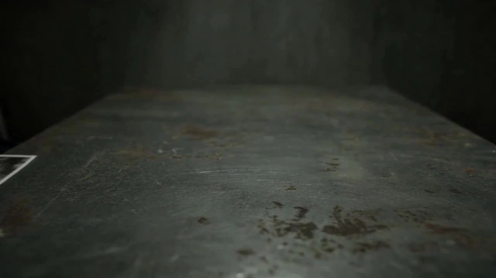

# David Fincher Style Short Film

> **作者：** @Damon

## Content

Process Planning:

Logical Stages and Dependencies:

Create Final_Video_Spec.md (Title, Genre, Aspect Ratio 16:9, Resolution 720p, Target Framerate 24fps, Total Duration, Visual Style: David Fincher-esque stylized realism, Output Language) → text_editor.

Script Development (Screenwriting Stage): If the user already has a complete script, skip this step. If the user provides only inspiration, concepts, or rough ideas, assist in developing a full script through the following process:

Confirm core creative concepts with the user: theme, tone, general plot direction, key characters, and their relationships.

Generate a story outline based on Fincher-style narrative principles (see "Screenwriting Guide" below) — including a cold open hook, a slow-burn tension curve, key revelation nodes, and a fatalistic conclusion.

Refine the outline into a draft script: scene descriptions, character actions and blocking, dialogue (adhering to Fincher's style — subtext-rich, restrained, and natural; characters always say less than they think), and voiceover (if applicable).

Write the draft script into Final_Video_Spec.md → text_editor.

Pause: The draft script must be presented to the user for review and revision. Only after user confirmation can the process proceed to the next step—the script is the narrative foundation for all subsequent visual design; do not proceed to Storyboard design without user approval.

Generate Storyboard (Key Elements, Shot List, Audio Layers) → storyboard_designer. Once the Storyboard is complete, scan the assets provided by the user or generated in the context, and bind the asset_id to the corresponding Storyboard slot for matching items → media_generator.

Establish Element Assets (Character Three-View, Scene Reference, Character Voice Reference):

If provided by the user and the style matches Fincher's film style, bind directly to the corresponding Key Elements.

If provided but the style does not match, regenerate the three-view/scene reference based on the user's material to fit the film style → media_generator.

If not provided, generate images for all elements → media_generator.

Scene Reference Format: Scene references must be in a multi-angle, no-character, 4-grid format. If user-provided scene images are not in 4-grid format, regenerate them to match this format → media_generator.

Character Voice Binding: Create key_element_audio (voice reference) for characters with dialogue in the Storyboard—bind directly if the user provides voice samples, otherwise generate reference audio → media_generator.

Element Integrity Check: After processing all element assets, verify each Key Elements (character, scene, prop) in the Storyboard one by one to ensure every element has an image generated and an asset_id bound to the correct slot; Scene elements must be specially confirmed to have their 4-grid scene reference generated and bound—this is a prerequisite to prevent frame jumping. Simultaneously confirm all characters with dialogue have key_element_audio bound. If omissions are found (image not generated/bound, voice not bound), they must be addressed before proceeding; do not proceed to shot generation if elements are incomplete.

Generate the Final Video shot by shot: Reference the element images (character + scene/prop) and key_element_audio (voice reference) involved in the shot. For adjacent shots in the same scene, the end_frame of the previous shot can be used as a reference for the start_frame of the subsequent shot to maintain visual continuity; only attach the previous shot as a reference if the continuity is extremely high → media_generator.

Generate all Audio Layers (BGM / VO) → media_generator.

Super-Resolution Selection (User Decision): After all shot videos and audio layers are ready, and before final assembly, provide the user with the super_resolution option—the user can choose to perform super-resolution on shot videos to improve resolution and clarity (optional frame rate increase), or skip directly to assembly. Clearly explain the effects and costs of super-resolution and execute only after receiving explicit user choice; if the user chooses super-resolution, execute it for each shot video → media_generator.

Once all media is ready (including potential super-resolution results), perform final assembly and guide the user to export → video_assembler.

Dependencies: 2→1; 3→2; 4→3; 5→4; 6→3; 7→5; 8→4, 5, 6, 7.

Pause Nodes: Do not run all steps at once. In addition to pausing after every major milestone (Spec Locked, Script Finalized, Storyboard Complete, Elements Complete, Shot Video Complete, Audio Complete), before generating any new assets (applies to element images, shot videos, audio layers, super-resolution, etc.), you must explain what is about to be generated to the user and obtain explicit consent before executing—do not automatically generate multiple assets sequentially. The super-resolution step itself is a user-decision phase—must ask if they want super-resolution before executing.

Asset Division (Overview): See Step 2 (Script) and Step 4 (Element Assets) for detailed processing rules for each asset type. Core Principle: Prioritize user-provided assets—bind directly if style/format matches; regenerate based on user material if they do not match; system generates if not provided. Avoid unnecessary regeneration of content already provided by the user that matches in style and format.

Screenwriting Guide (Fincher-Style Narrative Principles)

Narrative Structure: Use a cold open to create suspense—start with a crime scene, anomalous event, or future timeline, then cut to the main narrative. Use a slow-burn pace for the main story; reveal information layer by layer, do not rush to provide answers, and let the truth emerge gradually amidst the audience's unease.

Thematic Core: Choose a clear thematic anchor—obsession, institutional corruption, moral gray zones, or the dark side of human nature. The surface is a specific event (murder, investigation, psychological game), while the deeper layer is an examination of humanity or systems; these run parallel.

Character Arcs: Design the protagonist as paranoid or worn down by the system—obsession drives their actions, and obsession eventually consumes or changes them. Characters need not be likable, but their behavior logic must be self-consistent.

Dialogue Principles: Subtext is greater than dialogue—characters always say less than they think. Dialogue is restrained, natural, and carries professional characteristics (police use jargon, investigators talk about logic). Key information is conveyed through topics characters avoid or silence, rather than direct statements.

Information Control: Clearly define the amount of information the audience should know at each narrative node; intentionally create cognitive gaps where the audience knows "more than the characters" or "less than the characters" to drive suspense. Mark the information state of each node in the script (Audience Known/Character Known/Both Unknown) to aid subsequent shot list design.

Asset Analysis:

Analysis of User Reference Materials:

If the user provides reference images or videos, analyze whether they contain Fincher-style visual characteristics (low-saturation yellow-green tones, exposure focused on shadows, geometric composition, practical light sources such as fluorescent/table lamps). Record these truthfully in the Storyboard element description; do not contradict the user's material.

If the user provides a character turnaround (three-view drawing), extract identity features for each view (front/side/back, skin tone, hairstyle, clothing style, facial expression). Simultaneously, evaluate whether the style matches Fincher's film style (low-saturation yellow-green tones, exposure focused on shadows, geometric composition, practical light sources). If it does not match, clearly note: "Style mismatch; need to regenerate a version that fits the film's style based on user material."

If the user provides scene reference images, first check if they are in the multi-angle, character-free quad-grid format (multiple angles of the same scene stitched into one quad-grid image, with no characters in the frame). If it is not a quad-grid format, note: "Format mismatch; need to regenerate a multi-angle, character-free quad-grid scene reference image based on user material." Simultaneously, evaluate if the style matches Fincher's film style (same standards as character turnaround); if not, note: "Style mismatch; need to regenerate."

If the user provides character voice samples, extract timbre characteristics (gender, pitch, huskiness, speech rate, tone), and record them as the basis for the character's key_element_audio description to ensure that the dialogue timbre in subsequent shots remains consistent with the user's samples.

Storyboard Design:

Director's Guidelines (From Script to Screen)

Visual Storytelling First: Convey information visually whenever possible rather than through dialogue. Documents on a table, a character's micro-expressions, and the placement of objects in a space are all storytelling tools. When designing each shot, ask, "What story is this image telling?" to ensure the image itself carries narrative weight.

Blocking and Power Dynamics: Character placement in space reflects power dynamics. Who is sitting vs. standing in an interrogation room, the distance across a desk, or the degree to which characters are squeezed by walls and ceilings—all silently communicate power and oppression. Incorporate spatial politics into your blocking design.

Stillness Equals Tension: Fincher's tension comes from gazing, not movement. Let long, static shots build emotional accumulation. Force the audience to experience unease through silence and stillness, rather than relying on fast cuts to create artificial tension.

Information Revelation Pacing: Visual information reveal must align with the script's information control. Key props (text on documents, photos on a table) should enter the depth of field or be pushed into focus only at the right moment. Premature reveal dissipates suspense; delayed reveal loses impact.

Environment as Character: Treat the space as a supporting character. The hum of fluorescent lights, rain-blurred windows, and low, oppressive ceilings all participate in the narrative. Give environments emotional expressive functions rather than treating them as mere backdrops.

Tonal Unity and Isolated Color: Push the overall palette of a scene toward a unified, dark, and neutral base. All shots in the same room at the same time share a single tonal baseline (the same set of desaturated yellow-greens or smoky grey undertones, the same light source color temperature). Because of this, an occasional accent color (a red shirt, an orange desk lamp, a yellow sticky note) stands out sharply against the neutral background. This "severed" feeling is a core Fincher technique for creating loneliness and alienation via color. Plan scenes: decide which remain entirely neutral without accent colors, and which allow one accent color as a narrative focus. The accent color must correspond to information revelation nodes, not appear randomly.

Total Duration and Shot Count Planning

Use the target total duration determined in Final_Video_Spec.md as an anchor. Work top-down to estimate shot counts and allocate the narrative rhythm curve to avoid losing control of shot count or narrative pacing.

Rhythm Curve Allocation (Suggested Ratios): Cold open ~15% (rapidly establish unease with a suspense hook); Slow burn ~50% (information revealed layer by layer, tension slowly builds); Revelation and closure ~35% (truth emerges, fatalistic ending). Ratios can be adjusted based on the story, but must follow Fincher's rhythm: "slow over fast, accumulation over explosion."

Shot Count Estimation: Estimate the shot count range based on target total duration and single shot duration (4–15s). E.g., for a 3-minute target (180s), roughly 12–30 shots are needed (average ~18–20). In the Storyboard, label each shot with a number, planned duration, and its narrative segment (Cold Open / Slow Burn / Revelation & Closure) to make the rhythm curve traceable and verifiable.

If the estimated shot count is too high (e.g., >30), confirm with the user whether to reduce total duration or merge shots to avoid unmanageable workloads.

Key Elements Design

Character (key_element character): Wardrobe focuses on dark tones—charcoal suits, black coats, dark shirts—pragmatic and understated. Facial state is tired, tense, contemplative; skin tones lean grey/yellow with shadows under the eyes, conveying long-term mental stress. Describe each outfit or age variation if applicable.

Character Voice (key_element_audio): Define voice references for speaking characters. Note that key_element_audio only locks the character's base voice profile (gender, pitch, huskiness, base speaking rate) to ensure consistency across shots. Fincher-style characters usually have a low, tired, restrained base voice: middle-aged male voices are husky/low and slow-paced; female characters are calm and detached. If the user provides audio samples, record their characteristics faithfully and do not contradict user assets. Character emotional expression is not defined in key_element_audio—emotion changes with the story and should be dynamically marked in the dialogue description for each shot (see "Story Beats" dialogue emotion marking requirements) so the same character presents different emotional states in different scenes rather than a monotone delivery.

Scene (element scene): Prioritize closed, oppressive spaces—offices, interrogation rooms, police stations, gloomy apartments, rainy city streets, fluorescent-lit hallways. Describe ceiling height (often low), wall color (dim), key light source positions (desk lamps/fluorescent tubes/windows), and main prop placement areas. Scene reference images must be in a multi-angle, no-character, 4-panel grid format—multiple perspectives of the same scene (front, side, top-down, detail close-up) stitched into one 4:3 image. No characters in frame, to facilitate consistent spatial layout across shots.

Props: Paper documents, old phones, desk lamps, ashtrays, coffee cups, typewriters, or early computer terminals. Detailed but never flashy.

Shot Design

Shot Size Preference: Use medium and long shots extensively, viewing characters from the distance of a calm, detached observer. Close-ups are extremely restrained, pushed only for emotional outbursts or critical information delivery. This distance creates a voyeuristic viewing experience.

Composition Principles: Strict geometric composition. Place characters at the geometric center or the intersection points of the rule of thirds. Use background architectural lines, furniture edges, and door/window frames as leading lines. Frequently include the ceiling; low-angle shots make characters feel "squeezed" by ceilings and walls, reinforcing claustrophobia. Use foreground obstructions (door frames, window frames, railings, furniture) to frame the subject, creating a voyeuristic visual metaphor.

Camera Movement: Prioritize static shots, watching the scene with the calm gaze of a security camera. When moving, use only extremely slow dollies (dolly in) or steady tracking shots, so slow that the audience barely notices—the pressure accumulates unconsciously. Handheld shaking, fast zooms, and flashy panning are strictly forbidden.

Restrained Use of Zoom: Fincher typically uses zoom lenses rather than primes, but the use of zoom is extremely restrained and slow, almost invisible on screen. It acts on the audience's subconscious through the subtle squeezing/stretching of spatial sense to create implicit psychological tension. When the storyboard requires, plan for slow zooms and mark them in shot descriptions as "extremely slow zoom (nearly invisible)." Fast pushes or obvious zooms are forbidden; if the audience clearly perceives the zoom, it is a failure.

Wide Angle Restraint: Avoid exaggerated wide angles. The spatial distortion caused by wide angles destroys the oppressive but realistic spatial sense of Fincher's style. Prioritize standard to medium-telephoto focal lengths. Wide angles should only be used in specific cases: top-down panoramas needed to reinforce oppressive claustrophobia, or explicit compositional requirements.

POV-driven Cuts: The timing of cuts closely follows the character's shifts in attention. When a character's gaze or focus changes, switch to the next shot immediately, allowing the audience to share the character's perceptual perspective and see what the character cares about. In the Storyboard, mark shot descriptions with "triggering POV change" (e.g., "Character gaze turns to document on table -> cut to document close-up," "Character hears door -> cut to door"). This makes editing rhythm subservient to the character's internal rhythm rather than mechanical time division. The continuity of POV switching makes the audience subconsciously empathize with the character's perception and is a key editing tool for Fincher to create voyeurism and cognitive suspense.

Shot Duration and Rhythmic Dynamic Planning: Do not unify durations mechanically. Allocate based on the narrative function and emotional dynamics of each shot. Long gazing shots that build potential energy, complex actions, or multi-character dialogue scenes can be longer (10–15s). Shots for fast information delivery, shock reactions, or tight internal editing rhythms can be shortened (4–10s). Every shot must adhere to Seedance 2.0 duration limits—minimum 4 seconds, maximum 15 seconds. Exceeding this range prevents generation. Explicitly mark planned duration for each shot in the Storyboard.

In-Shot Narrative Capacity Control: A 4–15 second video can reliably execute only a limited number of story beats. Each shot should focus on 1–3 core actions or narrative beats. If too many independent events are crammed into a storyboard, the model will inevitably lose content. When designing shots, first determine the 1–2 most important beats as core content to present, and demote others to supporting status. If there are too many core beats, split into multiple shots rather than crowding them into one video. Story beat descriptions must be specific to visible physical actions and facial expressions, rather than abstract summaries—"He slowly flips open the document, his eyes pausing on the third line, his fingers tapping the table unconsciously" is better than "He checks the document and falls into thought."

Every Shot Description Must Contain:

Scene: Reference location/scene using Scene Element ID. Every shot must be explicitly bound to its Scene Element ID, and the 4-panel scene reference image for that scene must already be generated and bound to asset_id. If the scene reference image is missing or unbound, the shot cannot proceed to generation, or the model will hallucinate the scene, causing visual jumps. Additionally, specify which perspective from the 4-panel reference image this shot corresponds to (front/side/top-down/detail close-up) so the perspective matches the shot's camera angle and size. This guides the model to focus on the correct spatial layout and prevents it from misinterpreting different panels of the 4-panel image as different rooms, which causes cross-shot inconsistency.

Story Beats: Character actions, performance, dialogue (write exact lines), referencing characters via Element ID. Dialogue must include emotion tags—mark the character's current emotional state and speaking style before each line (e.g., "[Suppressed whisper] Line," "[Tired but trying to be calm] Line," "[Restrained anger, faster pace] Line"). Emotion tags must fit the character's psychological state and narrative tension in that scene, changing dynamically as the story progresses rather than using the same tone throughout. Lines themselves should reflect natural speaking rhythm—allow pauses, interruptions, trailing ends, and incomplete sentences; avoid bookish perfect syntax so dialogue sounds like real people speaking, not reading aloud.

Cinematography: Shot size (medium/long/close-up), camera angle (eye-level/low-angle/high-angle), camera movement type (static/extremely slow dolly/steady tracking).

In-Shot Cuts

When using in-shot cuts, cut points must follow narrative beats, not uniform time divisions—serving the "accumulation-explosion-closure" emotional curve.

Typical Rhythm Pattern: Start with a static, medium-long shot gazing at the scene for a long time to accumulate potential energy (~60–70% of shot duration). When the character performs a key action or reveals the truth, hard-cut to a closer shot to release tension, then cut back to the original shot or close with an extremely slow dolly.

In-shot cut points are always hard cuts; jump cuts in size must be distinct (e.g., medium shot -> close-up) to create visual impact. Flashy transitions are forbidden.

When a shot has internal cuts, list each segment's scene/story beat/cinematography in the shot description in sequence, and note the intent of the cut (e.g., "Cut point: Reveal document content on table").

Cross-Shot Continuity Marking: When multiple consecutive shots occur in the same scene and time, mark them as a "continuous shot group" in the shot description and specify the order within the group. All shots in the group must reference the same Scene Element ID (the same 4-panel scene reference image) to ensure consistent scene layout, prop placement, and light direction across shots. Relying solely on end_frame is insufficient to lock the scene; the 4-panel reference image is the primary anchor for scene consistency. Adjacent shots in the group can use the previous shot's end_frame as a start_frame reference for the subsequent shot as an additional continuity safeguard.

Scene Transitions and Match Cuts

When scenes switch (not the same continuous shot group), design hard cuts with matching composition as a transition method—using similarities in composition (similar shapes, subject position, direction of movement, or visual center of gravity) to achieve seamless connection. For example: A character pushing a door at the end of the previous shot, hard-cutting to a close-up of the door being pushed open in the new scene; or a circular coffee cup on a table, hard-cutting to a close-up of a circular clock.

Match cuts must be marked as "match cut transition" in the Storyboard shot description, specifying the matched element (shape / position / movement / light & shadow) so the subsequent prompt writing and assembly stages can execute accurately.

Fincher-style match cuts should maintain a cool, restrained visual logic—matching geometric relationships and movement trajectories, not flashy visual effects.

In-Frame Time and Location Marking

Fincher's narrative often uses in-frame subtitles to mark time and location (e.g., "Jan 14, 1995, 3:17 AM," "Sacramento Police Basement"), using a cold, documentary-style approach to provide spatio-temporal information and enhance realism and institutional feel.

Plan these markers in the Storyboard: which shots they appear in (usually when the scene first appears), content displayed, and duration. Content must match the script's time and location settings.

Style must be restrained—no decorative fonts, concise layout, lower left or bottom-center of the screen, disappearing after a short stay; do not interfere with narrative rhythm.

Cross-Shot Audio Design

Background Music: Plan at least one global BGM track. Fincher-style BGM is characterized by minimalism, ambiance, and industrial texture—drones, dissonant strings, sparse piano, electronic noise soundscapes. Refer to the aesthetic of Trent Reznor and Atticus Ross. The tone should be ominous, oppressive, and surging with undercurrents; avoid melodic or overly emotional music. For long segments (over 3 minutes) with clear turning points, split into multiple music tracks.

Environmental Sound Effects: Fincher’s soundscape relies on ambient sound as an emotional pillar. Mark key environmental sounds in each scene's Storyboard: buzzing fluorescent tubes, rain on windows, distant traffic, ticking clocks, paper turning, footsteps on hard surfaces, low hum of old heating pipes. These sounds should be clearly planned in audio_layer or shot descriptions, working with the visuals to create institutional indifference and claustrophobia.

Voiceover (VO): If narration drives the narrative, design it here. Define narration_speaker_profile (e.g., [Deep, calm male voice, slow pace, tone restrained and detached like a forensic report]), tone, and exact script, and use layout_instruction to link to relevant shot ranges. The VO maintains a clinical calm throughout, stating facts rather than unburdening—consistent with the observer perspective of Fincher's imagery. However, "restrained" does not mean "flat and mechanical." Enhance expressiveness in these dimensions:

Rhythm Variation: When narrative tension is low, pace can be slightly slower with more pauses; in information-dense or escalating emotional segments, speed up appropriately; insert distinct pauses before key reveals or turning points—use the tightening and loosening of rhythm to create breathing room; avoid reading at a uniform speed from start to finish.

Emotional Undertone Adjustment: While the overall tone is restrained and detached, subtle emotional shifts are allowed as the story progresses—slightly heavy when describing a crime scene, slightly tired in flashback segments, slightly fatalistic at the end. These shifts are subtle hints, not overt emotional outbursts.

Script Annotation: Use annotations in the VO script to guide TTS delivery—[Pause] for brief silence, [Long pause] for dramatic room for thought, [Emphasize] for words/phrases needing stress, [Slow down]/[Speed up] to mark rhythm transition points. These annotations give the generated narration natural breath and pauses, rather than mechanical, continuous delivery.

Media Generation:

Model Locking: Use only GPT Image 2 for all image generation and Seedance 2.0 (via MultiModalToVideo) for all video generation throughout the process. It is prohibited to swap to other models. If generation fails, retry with the same model first. If repeated attempts fail, halt the task and inform the user for their decision; do not switch to other models without authorization.

Element Image Generation

Character Three-View:

User-provided with matching style: Bind directly; do not regenerate.

User-provided but style mismatch: Use the user's asset as a reference and regenerate a version matching the Fincher style using ImageToImage (GPT Image 2). Retain character identity features (facial features, skin tone, hairstyle, body type) while converting color, lighting, and atmosphere to the Fincher style.

Not provided: Generate using TextToImage. Character three-views must use a 16:9 side-by-side layout: from left to right, Front Full Body, Side Full Body, and Back Full Body. Lock in character identity features, clothing details (cut, material, shoes), and overall proportions to ensure consistency across shots.

For different looks of the same character, use ImageToImage (GPT Image 2), referencing the previous generation to maintain consistency.

Scene Reference Image: Must be a four-grid, person-free format from multiple angles—multiple perspectives of the same scene (front, side, top-down, detail close-up) stitched into a single 4:3 four-grid image; no characters in the frame.

User-provided, four-grid format, matching style: Bind directly; do not regenerate.

User-provided, not four-grid or style mismatch: Use user assets as reference, regenerate a multi-angle, person-free four-grid scene reference using ImageToImage (GPT Image 2). Retain spatial structure and layout, convert to multi-perspective four-grid composition, and overlay Fincher-style color and lighting.

Not provided: Use TextToImage to generate the multi-angle, person-free four-grid scene reference.

General Image Generation Parameters: Model GPT Image 2, resolution 2K. Aspect ratios are fixed and independent of video aspect ratios: Character three-view 16:9, scene four-grid reference 4:3—do not inherit or use the video's selected aspect ratio.

Character Voice Binding (key_element_audio)

For characters with dialogue in the Storyboard, bind key_element_audio (voice reference): If the user provides a voice sample, bind it directly; do not regenerate.

If not provided by user, generate via system: Use text_to_narration to generate a short character voice sample (approx. 5–10 seconds of speech), using the key_element_audio description from the Storyboard (gender, pitch, huskiness, speech tone base) as voice characteristics. The generated content should be the character's most representative dialogue or a generic line showcasing their tone. Once generated, bind it to the character's key_element_audio slot. Model selection: MiniMax Speech 2.8 HD for Chinese projects, ElevenLabs v3 for English projects.

When generating shot videos, include the key_element_audio of characters with dialogue in the reference input (audio_infos) to ensure consistent dialogue voice across different shots for the same character.

Narration Generation (narration / VO)

Use text_to_narration to generate narration. Recommended models: MiniMax Speech 2.8 HD for Chinese projects, ElevenLabs v3 for English projects.

Pass the narration_speaker_profile from the Storyboard as the voice description input. Rhythm markings in the script ([pause], [long pause], [emphasize], [slow down], etc.) must be included to guide the TTS engine in creating natural pauses, emphasis, and rhythm changes, avoiding uniform mechanical delivery.

For long scripts, generate in segments by narrative paragraph and stitch together so the rhythm and emotional tone better fit the narrative function of each section, rather than processing the entire script with one rhythm.

Background Music Generation (BGM)

Use text_to_instrumental to generate BGM. Recommended model: Suno 5 (alternative: Mureka 8).

Use the BGM track style description from the Storyboard as input. Fincher-style BGM is characterized by minimalism, atmosphere, and industrial texture: low-frequency drones, dissonant string textures, sparse piano accents, electronic noise soundscapes; the tone should be ominous, oppressive, and dark, avoiding melodies or overt emotional expressions.

Suno 5 Compliance Notice: Do not include names of famous musicians in the generation prompt; Suno 5 has a high failure rate with artist names. The note "refer to Trent Reznor and Atticus Ross's scoring aesthetic" in the Storyboard is for style design reference only; it must be converted to purely descriptive language (e.g., "industrial ambient soundtrack, low-frequency drone, dissonant string textures, sparse piano, electronic noise soundscape, ominous and oppressive") during generation, and artist names must not be directly input.

For long films (3+ minutes) with distinct shifts, generate BGM in segments by narrative paragraph—each segment shares the same style but varies in emotional intensity according to the narrative curve: intensifying sections are more oppressive and dense, revealing sections may introduce dissonant climaxes, and concluding sections return to emptiness. Use cross-fades when assembling segments.

Shot Video Generation

Prompt Verification Before Generation: Before every shot video generation, cross-check the written prompt against the Shot List for that shot to confirm all items are included and consistent. If omissions or inconsistencies are found, update the prompt before generating; do not generate with incomplete prompts:

Scene Reference (Mandatory): Is the four-grid scene reference image bound as reference input? This is mandatory for every shot; its absence will cause scene inconsistencies. Confirm scene description matches the Shot List.

Story Beats (Core): Have every character action and performance instruction listed in the "Story Beats" been translated into a visible action description in the prompt? Do not omit or generalize. If the Shot List lists 3 beats and the prompt generalizes to 1 sentence, complete it before generating.

Character Reference: Are all characters in the shot bound to their corresponding element image references?

Dialogue/Speech: Is the dialogue noted in the Shot List fully written into the prompt (word-for-word within {...}), without omissions?

Voice Reference: Is key_element_audio bound and added to generation input for characters with dialogue?

Cinematography & Movement: Do the shot size, camera angle, and camera movement match the Shot List?

Internal Cuts: If internal cuts are specified, are the clip descriptions and cut points complete?

Four-Grid Leakage Prevention: Does the prompt include the constraint "Single continuous shot, no four-grid/split-screen/collage" to prevent the model from replicating the four-grid structure in the video?

Four-Grid Scene Consistency Statement: Does the prompt clearly state that the four-grid reference is "multiple angles of the same scene" rather than different scenes, and specify which perspective this shot should use? Missing this causes the model to treat different grids as different rooms, resulting in inconsistent character locations.

Use MultiModalToVideo, model Seedance 2.0, resolution 720p. Duration is set according to the dynamic planning in the Storyboard, each video must be 4–15 seconds (Seedance 2.0 limit: 4s min, 15s max); do not exceed these limits.

Each shot's reference input must include all Element Images involved (characters + scene/props) and key_element_audio for characters with dialogue. The scene four-grid reference is mandatory—it must be bound for every shot, regardless of whether characters are present or end_frame is used; if missing, the model will hallucinate, causing scene jumps.

Reuse of Elements: The same character/scene/prop must reference the same set of element images in all shots; do not use different references for the same element across shots.

Continuity for Adjacent Shots in the Same Scene: When adjacent shots belong to the same "continuous shot group" (same scene, same time), use the end_frame of the previous shot as the start_frame or reference_image for the subsequent shot to maintain consistency in spatial layout, light direction, and color temperature.

Long Video Style Anchoring: For long videos (3+ minutes), establish one Fincher-style benchmark image during the element generation phase to serve as an implicit style reference for all shot generations, preventing style drift in later shots.

Add the previous shot video as an additional reference only when continuity is extremely high (continuous action in the same scene); generally, rely on element images + end_frame to avoid style degradation caused by over-reliance on video references.

Super Resolution (super_resolution)

Execute only when explicitly selected by the user—do not auto-upscale.

Use super_resolution tool, model MediaKit (video upscaling). Recommended resolution 1080p, unless the user requests otherwise (2k / 4k optional).

Optional frame rate increase: Default is no increase. Project target is 24fps (cinematic feel); keep 24fps during upscaling. If the user requires smoother footage, 30 or 60 fps can be specified.

Execute only for user-selected shots; unselected shots remain as original 720p assets.

The upscaled video replaces the original as the final asset for assembly.

Prompt Writing:

Global Language Rules: When interacting in Chinese, write the prompt body in Chinese; dialogue/narration follows the output language of Final_Video_Spec.

Image Prompts (TextToImage / ImageToImage)

Write from the perspective of a director and colorist: describe subject + action + environment using natural language; use phrases to describe style/color/lighting/composition.

Fincher Visual Signature (integrate into a fluid description, no sub-sections): Dominant desaturated yellow-green tones—grey-yellow, fluorescent green, dark olive, smoke grey, faded amber; subtle color temperature clash between warm-dark indoors and cold-blue outdoors. Heavily desaturated throughout; skin tones lean grey/yellow, like images faded by time. Practical lighting (desk lamps, fluorescent tubes, daylight from windows, streetlights); large areas of shadow dominate the frame with details barely visible in the darks; highlights suppressed to soft, greyish tones. Low-to-medium contrast; transitions softened by fog or grain. Precise geometric composition, strict horizontal/vertical lines, centering or rule of thirds. Enclosed, oppressive spaces. Default deep focus—foreground to background completely sharp and crisp; this is a core Fincher trait, distinct from shallow depth of field; use selective focus only if narratively required. Texture features delicate digital film grain, like fine-scanned film stock.

Consistent Scene Tone & Isolated Accent Colors: Images for the same scene must unify the overall tone to the same dark, neutral base—the same set of desaturated yellow-green/smoke-grey base tones and color temperature must permeate all generated images for that scene. If the Storyboard plans an accent color for a scene (e.g., a red piece of clothing, an orange desk lamp), use that accent color as the only saturated element in the frame; all other elements must maintain the fully desaturated neutral base—the impact of the accent color comes from the neutral silence surrounding it, not overall high saturation. Explicitly specify which element carries the accent color in the prompt, while keeping other areas neutral.

key_element Images: Lock identity, skin tone, clothing, facial state, and prop materials to maintain stability across shots.

Image Aspect Ratio (Independent of video aspect ratio): Prompts for character 3-view images must specify a 16:9 landscape layout (front full-body, side full-body, back full-body, horizontally aligned); prompts for scene 4-grid reference images must specify a 4:3 aspect ratio (2×2 grid collage). Image aspect ratios must not inherit the aspect ratio selected for the video—even if the video uses a different ratio, images must use 16:9 / 4:3 respectively.

Video Prompts (MultiModalToVideo / Seedance 2.0)

Prompt & Shot List Fidelity (Primary Principle): Video prompts are a faithful translation of the Storyboard shot descriptions, not a summarized rewrite—every core story beat, character action, and camera setting in the Shot List must have a corresponding expression in the prompt. Fidelity takes precedence over literary flair: it is better to straightforwardly repeat specific action descriptions from the Shot List than to replace them with vague, literary language. Specific rules:

Beat-by-Beat Fidelity: Every character action and performance instruction listed in the Shot List "story beats" must be translated into visible action descriptions in the prompt; do not omit or merge—if the Shot List lists 3 beats, the prompt must include 3 corresponding action descriptions; do not generalize into one sentence.

Prioritization: Place the 1–2 most important core beats of the shot at the very beginning of the prompt—the model assigns the highest execution weight to the beginning; place secondary content later to avoid burying the core action in lengthy descriptions.

Concrete Expressions: Use "the character slowly opens the file on the table, eyes lingering on the third line, fingers tapping the desk unconsciously" instead of "the character checks the file and thinks"—the model needs executable, specific actions, not abstract intent.

Information Density Control: Prompts should not aim to be exhaustive, but ensure core beats are expressed clearly and concretely. Over-stacking details dilutes the execution weight of each instruction, causing the model to only render part of the content; prioritize ensuring the most important content is fully presented; secondary details can be compressed.

Reference Image Binding: Use product placeholders like <<<image_1>>>, <<<image_2>>>, etc., to bind reference images by character.

Grid Prevention: The scene reference image is a multi-angle, no-character 4-grid format, used solely for spatial reference; it must not be copied into the video output. The video prompt must explicitly instruct to output a single continuous shot—include constraints such as "single continuous shot, no grid layout, no split screen, no collage" to prevent the model from rendering the 4-grid reference as a split-screen or collage-style video.

Scene Consistency Declaration (Key): The 4-grid scene reference shows multiple shooting angles of the same scene (front, side, top-down, detail close-up), never four different rooms or locations. Models often mistakenly interpret different cells in the grid as different scenes, causing characters to appear in different spaces within the same "continuous shot group." Therefore, the video prompt must include the following two types of declarations:

Single Scene Declaration: Clearly inform the model that "the grid reference shows the same room from four angles; the scene takes place entirely within this single room" (e.g., "the reference grid shows the same room from four angles; the scene takes place entirely within this single room").

Current Shot Perspective Designation: According to the camera setting (camera angle, shot size) for this shot in the Storyboard, explicitly specify which perspective from the 4-grid this shot should reference (e.g., "this shot is a low-angle medium shot, reference the front view from the 4-grid"). This focuses the model on the correct spatial layout rather than wandering between cells.

Motion Stack: Camera (static/very slow push/steady tracking) → Subject (actions and facial beats) → Space (blocking/environmental changes) → Audio (dialogue/SFX notes; if there is an independent narration track, do not repeat the full narration in the video prompt).

Dialogue and Tone: For dialogue lines marked with {...} in the video prompt, the tone is controlled by the key_element_audio binding for that character; do not describe basic tone characteristics in the prompt; ensure every character with dialogue has key_element_audio bound before generation. However, the emotional expression of the dialogue must be written into the prompt—label the emotion and manner of speaking in square brackets before {...} (e.g., [suppressed whisper] {line}, [tired but trying to stay calm, fast-paced] {line}); use emotional labels from the Storyboard dialogue markings. Dialogue content should retain the rhythmic traces of natural speech—use ellipses for pauses, dashes for interruptions, and ellipses for trailing off—to make the dialogue sound like human breathing rather than mechanical reading.

Fincher Style Core Description Template: David Fincher film style, stark and dark stylized realism, desaturated yellow-green tones, the image is overall dark and grey, desaturated color treatment, like images faded by time. Natural lighting, large areas of shadow, low-light environment, figures partially hidden in darkness. Precise geometric composition, calm and restrained static shots or very slow dolly shots, medium-to-long shots primarily. Enclosed, oppressive spaces, rainy city at night or gloomy interiors. Deep focus, foreground and background all sharp and crisp. Delicate digital film grain. Overall atmosphere: ominous, tense, oppressive, with undercurrents.

Seedance 2.0 Packaging Symbols (use as needed): Music (...), SFX <...>, dialogue {...} (label language before the braces if not project language), on-screen text 【...】; place only verbatim lines within {...}.

On-Screen Time/Location Rendering: When the Storyboard specifies that a shot contains time/location labels, wrap the label text in 【...】 (e.g., 【Jan 14, 1995, 3:17 AM】, 【Sacramento, Police Basement】). Explain the display position (lower left or bottom center), font style (sans-serif, undecorated, grey-white), and timing (brief appearance at the start of the shot followed by a fade) in the prompt, ensuring the text serves as a narrative element rather than a visual distraction.

Intra-Shot Editing Expression: When the Storyboard specifies that a shot contains internal cuts, describe the camera and action for each segment in the prompt in the order of the cut, explicitly marking the cut point between paragraphs (e.g., "hard cut to:"); do not use time codes to split, use narrative beats as the basis for cutting.

Ambient Sound Notation: Note Fincher-style ambient sounds in SFX <...> (e.g., <fluorescent hum>, <rain>, <distant traffic>), consistent with the Storyboard Audio Layers plan; if there is an independent BGM track, still include no music in the video prompt.

Negative Constraints (Applies to all generations)

Color Prohibition: High saturation colors, vibrant red or pink, bright magenta, candy tones, cyberpunk neon, large areas of white highlights, HDR ultra-wide dynamic range.

Scene Prohibition: Bright sunny scenes, blue skies and white clouds, romantic/cozy atmospheres.

Motion Prohibition: Handheld shaking, fast zoom, flashy camera moves.

Performance Prohibition: Overly theatrical expressions, exaggerated body movements, comedic pacing.

Depth of Field Prohibition: Shallow depth of field blurring the background, creamy bokeh, large blurry spots—Fincher style defaults to deep focus with the full frame clear, except when selective focus is explicitly specified in the Storyboard.

Format Prohibition: 4-grid, split screen, collage-style video frames—even though the scene reference is a 4-grid, the video output must be a single continuous shot; copying the grid structure of the reference is prohibited.

Narration and Subtitles: If there is an independent narration track, omit the full narration script from the video prompt; almost always include no music; always include no subtitles—the "subtitles" here refer only to dialogue subtitles (which should be added in post-production) and does not affect time/location labels specified by 【...】 (which are narrative on-screen text and should be rendered by the video model).

Video Editing:

Super-Resolution Asset Handling

If the user selected to perform super-resolution on footage before assembly, use the high-resolution assets; otherwise, use the original 720p assets. Neither affects editing rhythm or audio mixing rules.

Editing and Pacing

Prioritize clean hard cuts; use flashy transitions sparingly. Use fades cautiously, occasionally using dissolves to suggest time passage or psychological shifts.

Point-of-View Editing: Time cuts to match shifts in character perspective. Switch when a character's gaze or attention shifts, showing the audience what the character is focused on, rather than waiting for the shot duration to end. For shots marked with "triggered POV shift" in the Storyboard, align the cut precisely with that moment.

Match Cuts: Execute these at the designated Storyboard points. Ensure matching elements (shape/position/movement/lighting) are aligned across cuts for seamless visual continuity. Match timing must be precise: the trajectory and position of elements in the outgoing shot must align with the incoming shot with minimal error.

Maintain a steady, dense pacing that isn't rushed. Allow scenes to build emotional momentum slowly, then accelerate suddenly at key moments for contrast.

Respect Storyboard shot durations; prioritize keeping long takes intact without excessive fragmentation.

Target Frame Rate 24fps: Output at 24fps for a cinematic feel—the Fincher standard, offering slight motion blur and a filmic texture, distinct from high-frame-rate digital/TV looks. If source footage is higher, downsample to 24fps; if lower, keep the original frame rate without interpolation.

Audio Mixing

Layers and Ducking: Establish a clear hierarchy between BGM, SFX, and dialogue/voiceover. BGM must duck when dialogue/VO is present for clarity. In non-dialogue segments, BGM and ambient sound can lead the narrative.

Rhythm Matching: Synchronize edits with audio cues—align hard cuts with impact sounds (e.g., door slams, ringing) for emphasis. Let ambient sound dominate long takes to build immersive tension.

Volume Transitions: Avoid sudden volume jumps at cuts. Use crossfades for continuous BGM across shots; allow ambient sound to transition naturally with the scene.

Audio Transition Techniques:

J-cut (Audio-Leading): Audio from the next shot (dialogue, ambient, or SFX) enters 0.5–2 seconds before the current video ends. This creates suspense and narrative pull. Use for reveal shots or when dialogue precedes the visual.

L-cut (Audio-Trailing): Audio from the current shot continues for 0.5–2 seconds into the next. This smooths transitions, ideal for reaction shots or maintaining emotional continuity.

Sound Bridge: Use continuous ambient sound (rain, buzzing lights, traffic) to span scene changes. This stitches different spaces into a unified emotional atmosphere, which is highly effective for the Fincher style where ambient sound is a narrative pillar.

Apply these techniques judiciously based on narrative needs, not every cut; overuse weakens the effect. Prioritize them at key narrative or emotional turning points.
