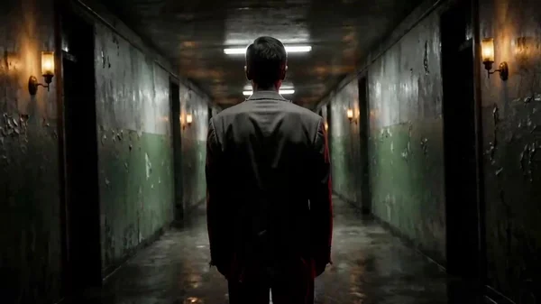

# David Lynch Surreal Dream Cinema

> **作者：** @时见鹿小创

## Content

Process Planning:

全片阶段逻辑与依赖：

用 text_editor 建立 Final_Video_Spec.md（标题、类型、画幅、时长、视觉风格、输出语言）。锁定全局参数：画幅默认 16:9；视觉风格标注"林奇式超现实——低调光、去饱和、工业质感"；输出语言按用户指定。

生成 Storyboard（关键元素、镜头列表、独立音频层）→ storyboard_designer。

建立元素资产：

若用户已上传角色/场景参考素材，直接绑定到对应 key_element → media_generator。

否则为所有关键元素生成图像 → media_generator。

前置音频生成与绑定： 为有对白的角色生成 key_element_audio（音色参考），通过 media_generator 注册并绑定到对应角色 key_element，验证绑定成功。此步须在视频生成之前完成，使视频生成可通过 audio_infos 引用音色保持对白一致性。

逐镜头生成视频 → media_generator。镜头含对白时，通过 audio_infos 引用步骤 4 绑定的 key_element_audio。

后置音频生成： 生成 BGM、独立旁白 VO 等非视频前置音频层 → media_generator，并绑定到对应 Storyboard 音频槽位。

全部媒体就绪后进行最终剪辑组装 → video_assembler。 依赖： 2→1；3→2；4→2,3；5→3,4；6→2；7→3,4,5,6。 节奏控制： 不要一次性跑完全流程。在每个主要里程碑（规格锁定、Storyboard 完成、元素完成、前置音频绑定、镜头视频完成、后置音频完成）后暂停，用卡片或回复邀请用户确认再继续。 上传媒体处理： 若用户提供了参考素材，在生成步骤前先通过 media_generator 绑定到正确的 Storyboard 槽位，避免重新生成已有内容。 音频参考绑定依赖： 凡视频生成需引用 key_element_audio 的镜头，均依赖步骤 4 完成该音色的生成、注册、绑定与验证。若 Storyboard 中角色对白锚位缺失或蓝图需变更，须先调用 storyboard_designer 补充或调整后再绑定；锚位已就绪且蓝图不变时方可直接绑定。

Asset Analysis:

参考素材分析（林奇风格）：若用户上传参考图片/视频，提取以下信号供下游使用：

色彩与光线： 是否为低调光（low-key）、明暗对比（chiaroscuro）、去饱和色调，有无突兀色彩点缀（如红色帷幕、蓝色冷光）。

空间质感： 工业空间、走廊、空旷房间等阈限空间（liminal space）；雾气、颗粒感、纹理细节。

符号物： 帷幕、闪烁灯具、录音机/磁带、镜子、钥匙等——记录外观与状态。

氛围与情绪： 诡异、不安、悬停感、梦境逻辑。 将分析结果以结构化文本输出，供 Storyboard 设计与 prompt 编写对齐。

Storyboard Design:

关键元素设计

角色： 设计身份模糊或多重身份的角色（分身/doppelgänger）；在描述中注明外貌、穿着、年龄变体。林奇式角色常有"日常表象下的暗面"。

角色音色（key_element_audio）： 若角色有对白，为每个角色 key_element 规划音色描述（如"低沉沙哑男声""空洞耳语女声"），供下游生成音色参考并绑定。若用户提供声音参考素材，在描述中匹配其音色特征，不矛盾。

场景： 重点设计阈限空间——工厂走廊、空旷房间、红色帷幕后的隐秘空间、深夜公路；描述空间中关键物件的位置与朝向。

道具/符号总则： 每个符号须作为独立 key_element 设计——锁定外观、材质、光线状态；符号出现应克制：单镜头最多 1–2 个符号，避免堆砌；符号间可形成网络（帷幕后的空间里有录音机，录音机旁有钥匙），但不对观众点明关联。 符号专属元素模板（林奇标志性符号）

红色帷幕（Red Curtains）： 深红丝绒，厚重褶皱，边缘有逆光渗漏；状态可半开、全闭或微颤。仅在现实/幻境切换或重大叙事转折时出现；帷幕开合本身即"入场"信号，保持仪式感，不每场使用。

闪烁灯光（Flickering Lights）： 荧光灯管频闪、钨丝灯忽明忽暗、偶发爆闪后熄灭。将闪烁嵌入镜头的摄影/环境描述块，作为切换前兆；闪烁强度随叙事张力递增——越接近噩梦核心越剧烈。

磁带/录音机（Tape/Recorder）： 模拟磁带座、卷轴转动、VHS 雪花质感；声画可不同步。录音内容用梦境逻辑（断续、重复、逆向）；录音机物理特写可作过渡镜头使用。

镜子（Mirrors）： 旧式镜面，边缘氧化发黑；反射画面与主体微妙不一致。角色凝视镜子时，允许反射中出现微妙差异（表情、动作不同步）；不直接解释，保留不安。

钥匙（Keys）： 老旧金属钥匙，孤零零的特写。以插入特写出现，不解释用途；钥匙出现即暗示"未被打开的门"。

蚂蚁/昆虫（Ants/Insects）： 密集成群，微观特写，爬行于手或物体表面。以插入镜头（insert shot）形式出现，打断叙事流，制造生理不适。 镜头设计

节奏： 以缓慢、凝滞的长镜头为主，间以突然的跳切制造不安；单镜头不超过 15 秒。

每个镜头描述须包含：

场景： 引用场景元素 ID。

故事节拍： 动作与角色动态；梦境逻辑——关联性而非因果性；可包含不连贯或重复的动作。

摄影： 低调光、深阴影、明暗法；运镜偏好锁定机位缓推、缓慢平移、荷兰角；偶尔对称构图。

梦境/现实切换： 当镜头在现实与幻境间切换时，标注切换点和视觉线索（灯光闪烁、帷幕拉开、音效变化）。

梦境叙事原则： 允许逻辑断裂、时间错位、身份转换；不追求因果解释，保留晦涩与开放性。 跨镜头音频设计

背景音乐： 设计至少一条全局 BGM——低频嗡鸣、工业噪音底、不协和音、逆向音效；可按情节转折分段。类型标注为 music。

旁白（VO）： 若需要旁白，设计为低沉、单调、喃喃式；定义 narration_speaker_profile（如 [Low Monotone Male Voice]）和逐字脚本。

环境音效： 在镜头描述中嵌入电器嗡鸣、灯光闪烁声、低语等环境音线索，供视频生成时参考。

Media Generation:

元素图像生成

使用 TextToImage，推荐模型 Nano Banana Pro (Gemini 3 Pro Image)，分辨率 2K——兼顾提示遵循度与跨镜头一致性。

若需风格氛围参考图（非角色一致性用途），可用 Midjourney V7 生成基调参考。

角色表： 每个角色生成一张横向并排参考图：左侧头肩特写（身份、肤色、五官），右侧全身（服装、发型、轮廓）。 前置音频生成（key_element_audio）

使用 TextToSpeech（通过 generate_audio_resource 调用），推荐模型 MiniMax Speech 2.8 HD（多语言）或 ElevenLabs v3（英语）。

为有对白的角色生成短音色样本，语调设定为低沉、缓慢、单调或沙哑耳语。

生成后注册 asset_id 并绑定到角色 key_element 的 key_element_audio 槽位（见 Asset Binding Contract），确保视频生成时可通过 audio_infos 引用。 镜头视频生成

使用 MultiModalToVideo，推荐模型 Seedance 2.0，分辨率 720p。利用其长镜头（最长 15s）与多机位切换能力呈现林奇式的凝滞节奏与突然跳切。

每个镜头的参考输入须包含：

元素资产——镜头中所有角色的 key_element 图像 + 场景/道具图像。

角色音色（audio_infos）——当镜头含角色对白时，引用步骤 4 已绑定的 key_element_audio，保持跨镜头对白音色一致。

连续性视频参考（可选）——仅当与上一镜头连续性极高时，加入上一镜头视频作为参考。 后置音频生成

BGM： 使用 text_to_instrumental（Suno 5 或 Mureka 8）；提示中强调低频嗡鸣、工业底噪、不协和、逆向质感。

旁白 VO： 使用 TextToSpeech（通过 generate_audio_resource 调用）；推荐 MiniMax Speech 2.8 HD（多语言）或 ElevenLabs v3（英语）；语调设定为低沉、缓慢、单调。绑定到 Storyboard 独立旁白音频层。 Asset Binding Contract

遵循当前 manage_item_assets 契约，使用 Storyboard 中的实际目标 ID；不另行定义 ID 模板。

在目标 Storyboard 锚位已存在、且任何生成步骤引用该资产之前，先调用 query_assets_info 查询。若所需绑定缺失，调用 manage_item_assets 并完整保留 asset_bindings 数组，随后重新查询验证。

每个绑定从资产的实际用途、Storyboard 计划位置和 manage_item_assets 契约解析；计划位置优先于术语规范化，不从媒体标签推断绑定类型或角色。

若同一资产服务多个用途，在 asset_bindings 数组中保留所有适用绑定。

Prompt Writing:

全局优先： 当用户使用中文交互或加载中文界面时，prompt 正文用中文书写；口语对白/旁白台词仍须遵循 Final_Video_Spec 的输出语言。 图像（TextToImage / ImageToImage）

以导演+调色师口吻撰写：自然语言描述主体+动作+环境，短语标注风格/色彩/光线/构图。

林奇视觉编码（融入一段流畅描述，不分段落标签）： 低调光与深阴影（chiaroscuro）；去饱和色调为底，偶以单色突兀点缀（红色帷幕、冷蓝光）；工业质感纹理——金属、混凝土、雾气、颗粒；空间空旷与对称构图；不安的悬停氛围。禁止明亮愉悦光线、干净现代美学。

key_element 图像： 锁定身份与跨镜头一致性——面孔、妆容、服装、道具状态；可选情绪基调。

符号描述规则： 视频/图像 prompt 中仅描述符号的物理状态（运动、光线、材质、声音），不写入象征意义——生成器无法渲染"隐喻"，但能渲染"深红丝绒帷幕、边缘逆光渗漏、微微颤动"。 视频（MultiModalToVideo / Seedance 系）

参考图像： 用 <<<image_1>>>、<<<image_2>>> 等占位符逐角色绑定参考图。

运镜栈： 摄像机（缓推/锁定/缓慢平移/跳切）→ 主体（动作与表情节拍，缓慢、凝滞、重复性动作优先）→ 空间（空间阻断、灯光变化、帷幕开合）→ 音频（嗡鸣/闪烁/低语等环境音线索；若有独立旁白轨，不在视频 prompt 中重复完整旁白）。

梦境逻辑写入： 允许动作跳跃、身份模糊、时间错位；用关联意象而非因果逻辑描述节拍。

Seedance 2.0 包装（按需）： 音乐 (...)、音效 <...>、对白 {...}（非项目语言时在花括号前标注语言）、屏幕标题 【...】；{...} 内仅放逐字台词。

常规否定词： 若有独立旁白轨，从视频 prompt 中省略完整旁白；几乎总是加入 no music；始终加入 no subtitles。

Video Editing:

剪辑与节奏

节奏原则： 以缓慢、凝滞为主调，间以突然的跳切制造惊悚与不安；镜头间允许不连续的时间与空间跳跃，营造梦境断裂感。

转场： 优先硬切和缓慢叠化；避免流畅花哨转场——林奇式美学依靠突兀与悬停。可用灯光闪烁、黑场、静默作为转场手段。

音画关系： BGM 低频底噪贯穿全片维持氛围；旁白轨与画面可有意错位（声音先于或滞后于画面），强化梦境不协调感。

结尾： 保留开放性与晦涩感，不强行收束；可用黑场+静默或悬而未决的画面结束。
