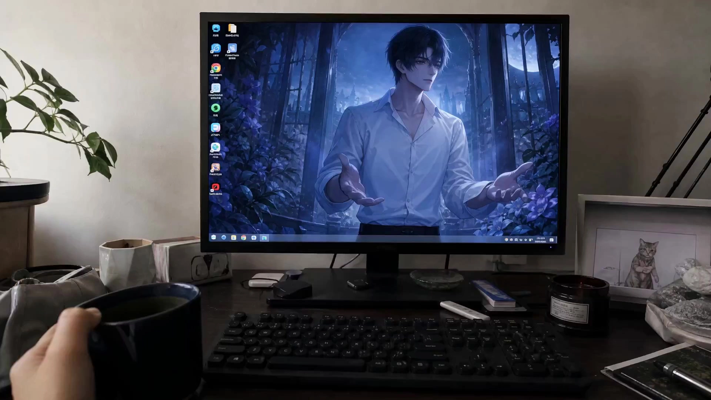

# Dimensional Screen Break Experience

> **作者：** @みお

## Content

Process Planning:

Core Principles

This Skill supports two plot directions, and the user must be prompted to choose one every time it is launched:

Direction A — Character pulls me in (Active Selection)

The otherworld comes to pick up the audience. The character is in another world → spots the audience → approaches actively → breaks through the screen (wrapped in a liquid water membrane, concentric ripples) → grabs and takes the audience away → enters the new world.

Direction B — I save the character (Hardcore Wall-breaking Rescue in One Continuous Shot)

Cinematic, "one-take" feel (no editing cuts or stutters). Realistic daily environment (standard room lighting), the monitor displays a realistic wallpaper (character appearance matches the reference image or selected style perfectly, smiling at the camera, e.g., silver-haired girl, cat-eared girl, etc.), the otaku's hands are frozen in shock near the keyboard → the character's eyes move slightly and look at the camera → reaches out to touch the screen, causing hard glass to crack (white spiderweb cracks) → right hand punches through the hard screen (glass shatters, shards floating, blue-white pixel arcs at the edges; water membranes/soft rubber surfaces are strictly forbidden) → audience lunges forward with both hands and grips tightly (one hand holding the palm, one hand supporting the wrist, with slight trembling and a sense of strength) → explosive pull backward (strong backward inertia and camera shake) → character transforms from 2D pixel line art to 3D realistic entity at the boundary (hair, hands, and unique decorative sleeves materialize first) → a large burst of [Theme Color] fantasy light waves and [Character Theme Specific Element Particles] (e.g., feathers, petals, digital particles, etc., depending on the character style) matching the character's style → descends in front of the real computer desk (subconsciously steadying the arm/shoulder, the room is illuminated by soft [Theme Color] light, shards and [Character Theme Specific Element Particles] drift slowly down). Background music (BGM) is strictly forbidden throughout; pure realistic sound effects should be amplified. \n> Both directions share the same emotional structure and action logic; only the active party, media material, and special effect forms are completely different.

Dialogue Language Rules

Dialogue language is selected by the user via cards upon startup and remains consistent within the same round (In Direction B, the pull-and-drag stage mainly uses realistic gasping, exclamations, clothing rustling, and specific element sounds (e.g., feathers or petals, self-adaptive), dialogue is optional):

Japanese: Character lines use Japanese (plain form, ≤8 characters)

Hook line (Direction A, Paragraph 2): 「やっと見つけた。」/「ずっと待ってた。」/「迎えに来たよ。」

Rescue line (Direction B, Paragraph 2): 「助けて。」/「お願い、助けて。」/「引っ张って。」

Exclamation line (Paragraph 5, universal for both): 「あっ！」

Belonging line (Direction A, Paragraph 6): 「これから一緒だよ。」/「ここが君の居场所だよ。」/「もう離さないから。」

Thank you line (Direction B, Paragraph 6): 「ありがとう。」

Embedded format: {ja: やっと見つけた。} / {ja: 助けて。} / {ja: あっ！}

Chinese: Character lines use Chinese (colloquial short sentences, ≤10 characters)

Hook line (Direction A, Paragraph 2): 「终于找到你了。」/「我一直在等你。」/「我来接你了。」

Rescue line (Direction B, Paragraph 2): 「救救我。」/「帮帮我。」/「把我拉出来。」

Exclamation line (Paragraph 5, universal for both): 「啊！」

Belonging line (Direction A, Paragraph 6): 「以后我们在一起。」/「这里就是你的居所。」/「我不会再放开你了。」

Thank you line (Direction B, Paragraph 6): 「谢谢你。」

Embedded format: {zh: 终于找到你了。} / {zh: 救救我。} / {zh: 啊！}

English: Character lines use English (colloquial short sentences, ≤6 words)

Hook line (Direction A, Paragraph 2): "Finally found you." / "I've been waiting." / "I came for you."

Rescue line (Direction B, Paragraph 2): "Save me." / "Please help me." / "Pull me out."

Exclamation line (Paragraph 5, universal for both): "Ah!"

Belonging line (Direction A, Paragraph 6): "You belong here now." / "We're together forever."

Thank you line (Direction B, Paragraph 6): "Thank you."

Embedded format: {en: Finally found you.} / {en: Save me.} / {en: Ah!}

Lines must be embedded into the video prompt using {...} dialogue tags from Seedance 2.0, with language prefixes as formatted above.

Launch Conditions

No need to upload images (users may choose to upload character reference images as a visual reference for generation, but standard keyframes must still be generated in Stage 2 to ensure a perfect one-take effect). \nDefault Attribute Values:

Audience Gender: Default is male. If the user specifies otherwise, it can be modified to female.

Character Voice and Audio: Must match the character's gender and age characteristics. Direction B's voiceover should focus on realistic, hurried gasping, exclamations, sounds of tugging clothing, and specific element flying/rustling sounds (e.g., feathers/petals, self-adaptive based on style), ensuring there is no background music (BGM). The voice timbre must match the visual appearance perfectly; inconsistent gender/voice profiles are prohibited. \n Depending on whether the user has uploaded a character reference image, card collection follows an adaptive branching logic:

Scenario 1: If the user has NOT uploaded a character reference image (uses three rounds of cards)

Round 1 Card — Video Dialogue Language (Single choice)

Japanese (Character speaks Japanese, dreamy 2D anime feel)

Chinese (Character speaks Mandarin, intimate and natural)

English (Character speaks English, international feel)

Round 2 Card — Plot Direction (Single choice)

Direction A: Character pulls me in (Character-led, liquid water membrane wrapping, pickup from another world)

Direction B: I save the character (Hardcore one-take wall-breaking, glass shattering, fantasy light waves)

Round 3 Card — Character Style + Color Tone (Both style and tone are mandatory single-choice, no multi-selection or free input allowed)

Character Style options example (Single choice): Silver-haired blue-eyed anime girl, Cat-ear VTuber, Mecha pilot, Ghost girl, Elf/Fairy type

Color Tone options example (Single choice): Cold Blue Fantasy, Warm Amber, Cherry Blossom Pink, Midnight Neon, Dark Purple Black Gold

Scenario 2: If the user HAS uploaded a character reference image (skips style selection, uses only two rounds of cards)

Since the character appearance and style are locked by the uploaded image, it is strictly forbidden to pop up the "Character Style" single-choice card. Style is intelligently analyzed and extracted by multimodal_analyze_tool, with only other pending parameters collected via cards. Round 1 Card — Video Dialogue Language (Single choice)

Japanese (Character speaks Japanese, dreamy 2D anime feel)

Chinese (Character speaks Mandarin, intimate and natural)

English (Character speaks English, international feel)

Round 2 Card — Plot Direction + Color Tone (Plot direction and color tone are mandatory single-choice, character style is automatically bound to the uploaded reference image)

Plot Direction options (Single choice):

Direction A: Character pulls me in (Character-led, liquid water membrane wrapping, pickup from another world)

Direction B: I save the character (Hardcore one-take wall-breaking, glass shattering, fantasy light waves)

Color Tone options (Single choice): Cold Blue Fantasy, Warm Amber, Cherry Blossom Pink, Midnight Neon, Dark Purple Black Gold In both branching scenarios, once all card responses are received, proceed immediately to Stage 1.

Stage Breakdown

Stage 1: Create Final_Video_Spec.md

Use text_editor to create/update Final_Video_Spec.md, fixing global parameters: Duration 15 seconds, Seedance 2.0, Visual Style (filled based on user description), Dialogue Language (determined by language rules), Audience Gender (Default: male, modified if requested: female).

Aspect ratio defaults to 16:9 · 720p (supports 1080p), users can specify to override.

Stage 2: Keyframe Image (One frame)

Regardless of whether a character reference image was uploaded, a keyframe for this stage must be generated to ensure the video has a highly realistic environment starting point that can perfectly connect to the subsequent one-take sequence:

If the user has uploaded a character reference image: Invoke media_generator (ImageToImage path, recommended model GPT Image 2, 2K resolution), using the uploaded reference as the sole visual reference for character style, hair color, and clothing, to synthesize a realistic environment keyframe with the "subject inside the screen."

If the user has not uploaded a reference image: Invoke media_generator (TextToImage path, recommended model GPT Image 2, 2K resolution), generating a realistic environment keyframe with the "subject inside the screen" based on the character style collected from cards or descriptions.

Specific visual specifications:

Direction A: Realistic daily life scene, first-person perspective, visible real computer desktop/monitor/room environment, monitor screen displays normal computer desktop UI (e.g., some small files, folders, desktop icons, and system taskbar, ensuring it acts as a running real computer screen) and anime character wallpaper, character smiling and looking at the camera, overall atmosphere is completely realistic, monitor casing remains as a standard monitor, no added colored glows or particle effects. Any part of the character's body must be completely within the screen frame; limbs protruding are forbidden.

Direction B: Realistic daily life scene, first-person perspective, visible real computer desktop/monitor/room environment, keyboard, mouse, and first-person forearms and hands (in a frozen state of shock) are visible, monitor screen displays normal computer desktop UI (e.g., small files, folders, desktop icons, system taskbar, ensuring it acts as a running real computer screen) and character wallpaper matching the user's selected or uploaded style (smiling at the camera, with styling, clothing, and hair color 100% consistent with reference or style choice), overall atmosphere is completely realistic, monitor casing remains as a standard monitor, no added colored glows or particle effects. Any part of the character's body must be completely within the screen frame; limbs protruding are forbidden.

Pause to display the keyframe; proceed to Stage 3 after user confirmation or adjustment.

Stage 3: Video Generation

Invoke media_generator, using Seedance 2.0 (MultiModalToVideo), default 720p.

Use the keyframe or user-uploaded image as visual reference.

Construct the prompt according to the 15-second one-take structure of the chosen direction (see <write_the_prompt>), ensuring Direction B has absolutely no BGM and is perfectly smooth without stutters.

Pause after generation is complete to allow user preview and confirmation.

Stage 4: Iterative Adjustment

Users can propose modifications for specific time segments.

Use Seedance 2.0 MultiModalToVideo Video-to-Video mode, using the previous version of the video as a basis for partial adjustments.

Pause for confirmation after each adjustment; supports multi-round iterations.

Interaction Rhythm

Pause after Stage 2 (keyframe confirmation, if generated).

Pause after Stage 3 (video preview confirmation).

Pause after each iterative adjustment.

Do not execute multiple stages continuously without user confirmation.

Asset Analysis:

Key Points for Reference Image Analysis

When a user uploads character reference images, extract the following information:

Character appearance features: hair color, hairstyle, eye color, clothing style, and color scheme

Overall color tone and lighting style

If multiple images are uploaded, identify the distinction between the main character image and auxiliary reference images The focus should be on elements related to character visual consistency; detailed descriptions of the scene or environment are not required.

Storyboard Design:

Storyboard Design Specifications
1. Key Element Definitions (key_element)

In-Screen Character Illustration (element character): The visual details of the character (hair color, eyes, clothing, facial expression) must be defined in detail. This serves as the visual benchmark for the entire project generation and must remain 100% consistent both before and after the crossover.

Direction A: Anime-style character (e.g., hair color, eye color, clothing style, and color scheme).

Direction B: Anime/Fantasy character corresponding to the selected style (hair color, eye color, clothing style, and unique accessories must be 100% consistent with the reference image or selected style; styling should be beautiful and tranquil).

Audio Reference (key_element_audio): The character's voice characteristics must be defined at the element level (female characters: gentle/sweet; male characters: magnetic/clear; Direction B must include realistic breathing and sharp gasps due to intense physical movement during the crossover). The timbre must perfectly match the character illustration; mismatching vocal characteristics are not permitted.

2. Shot Design (shot)

When planning the 15s full-video storyboard, accurately segment each time period. As this Skill includes two directions, the shot structure must be strictly aligned with their respective physical properties to ensure fluid motion and seamless, non-jittery transitions, achieving a perfect one continuous shot:

Direction A (Liquid Envelopment & Pull-in): 00:00–00:03 [Discovery], 00:03–00:05 [Confirmation], 00:05–00:07 [Wall Breach], 00:07–00:10 [Contact], 00:10–00:13 [Crossover], 00:13–00:15 [Belonging].

Direction B (Rigid Glass Shattering One Continuous Shot): 00:00–00:02 [Wallpaper Awakening], 00:02–00:04 [Glass Cracking], 00:04–00:06 [Rigid Breakthrough], 00:06–00:08 [Violent Grasp], 00:08–00:11 [Explosive Tug], 00:11–00:13 [Exit Screen], 00:13–00:15 [Arrival in Reality].

The shots must utilize a first-person POV, clearly limiting the audience's line of sight, the relative position of the screen, and the physical interaction details of the hands in front of the lens.

3. Physical Interaction Details and VFX Response

Direction A (Liquid Water Membrane Envelopment):

Cross-Dimensional VFX Overflow (00:05–00:07): Describe the character reaching one hand out of the computer screen, with the screen edges enveloping the arm like a transparent water membrane, accompanied by dazzling 2D pixel light particles and drifting cherry blossom petals flowing onto the real-world desktop and room.

Grasping and Pulling (00:07–00:10): The character's five fingers grip the viewer's wrist, showing realistic contact and deformation from the force. The viewer's sleeve is pulled tight, and the other hand extends to press against the desktop to resist. The desktop keyboard, mouse, and water cup tremble and slide; all speed lines and light currents converge radially toward the center of the screen.

Direction B (Rigid Glass Shattering One Continuous Shot):

Realistic Computer Screen Background and Continuous Camera Movement: The visual from the first frame to the last is a continuous, fluid action. The computer monitor displays not only the character wallpaper but also, like Direction A, a realistic OS UI, various desktop files, folders, software shortcut icons, and the bottom system taskbar to establish a completely photorealistic and vivid computer screen background. 0-3s: Camera pushes slightly toward the screen; 3-6s: Focus transitions smoothly from screen pixels to the character's eyes and extended hand; 6-11s: Camera surges forward with the viewer's hands, then pulls back significantly with the tug, creating intense handheld camera shake and recoil inertia; 11-15s: Camera settles steadily into a close-up of the character after being pulled into reality.

Rigid Glass Cracking and Shattering (00:02–00:06): Absolutely no water membrane, definitely not liquid/soft-rubber surface. The screen must be rigid glass being cracked by fingertips. 00:02–00:04: White spiderweb-like cracks appear on the glass surface; 00:04–00:06: The right hand violently breaks through the screen, the rigid glass shatters completely and pops outward. Glass shards are crystal clear, suspended in front of the monitor and in the room's air in slow motion, each shard exhibiting realistic light reflection and refraction, reflecting the wallpaper and UI inside the monitor, with blue and white pixel arcs jumping along the shattered edges. Dazzling light matching the [Theme Color] shines from within the cracks.

Bidirectional Grasp and Explosive Strength (00:06–00:11): The viewer's hands surge forward, one hand tightly gripping the character's palm, the other firmly supporting her wrist. Fingers show slight, tense tremors before tightening rapidly; knuckle effort is apparent; finger count is accurate (5 fingers, no extra digits/deformities). During 00:08–00:11, the viewer pulls with explosive force, yanking both arms back, and the character's upper body is violently pulled out. The character's hair, clothing, and unique accessories (color, material, and styling 100% consistent with reference/selection) fly forward crazily and beautifully along the direction of the pull. At this moment, the monitor glass undergoes massive shattering, and a beautiful, stunning shockwave of [Theme Color] fantasy light effects and [Character-Specific Elemental Particles] (e.g., feathers/petals/digital particles, depending on character style) explodes from the center of the screen, accompanied by flying pixel debris, suspended broken glass, and scanning line trails stretched into light ribbons.

Boundary Cross-Dimensional Conversion (00:08–00:13): As the character crosses the narrow band at the edge of the monitor frame, they must demonstrate a material transformation from 2D pixel line art to a 3D real-world entity. The character's hands, hair tips, and clothing accessory edges materialize first, then pull the entire body off the virtual screen.

Tranquil Arrival and Aesthetic Aftermath (00:13–00:15): The character lands safely in the real-world space, dropping to the desk or kneeling on the edge. The viewer's hands subconsciously steady her arms or shoulders. The character's chest heaves, breathing slightly; she lifts her eyes to stare affectionately into the first-person camera, her expression shifting from initial cold puzzlement to tenderness, awe, and peace. The character's hair and clothing (colors and materials perfectly matching her character style) drift gently in the room's air currents; countless [Character-Specific Elemental Particles] and glass shards rotate slowly in the air as they fall. The room is illuminated by a soft, beautiful [Theme Color] glow. The broken monitor behind her emits lingering [Theme Color] crack-light.

No Background Music Constraint: Do not include any background music (no BGM) in the storyboard planning; set sound effects to audio tracks and increase their decibel levels (see Assembly Strategy).

Media Generation:

Generation Strategy
Keyframe Image Generation (Stage 2)

Generation Path and Model Selection:

If the user has not uploaded a reference image: Path: TextToImage, use GPT Image 2.

If the user has uploaded a character reference image: Path: ImageToImage, use GPT Image 2. The character reference image uploaded by the user must be the sole reference source for character appearance, hair color, and clothing/accessories. Convert it intelligently into a monitor wallpaper, integrated into a computer desktop UI and a daily indoor environment, rendering a standard environmental keyframe with the "subject inside the screen." It is strictly prohibited to skip this stage.

Aspect Ratio: Follow the current project settings (default 16:9, or as specified by the user).

Generate one keyframe, strictly executed according to the plot direction:

Direction A: Realistic daily life scene, first-person perspective, visible real computer desktop/monitor/room environment (keyboard, clutter, ordinary lighting, etc.). The monitor screen displays a normal computer desktop (with system UI details like desktop icons, bottom taskbar, and small file folders). The wallpaper content is a half-body portrait of a 2D anime character smiling and looking at the camera. The overall atmosphere is completely realistic, with no glowing or particle effects, and limbs must not extend out of the screen.

Direction B: Realistic daily life scene, first-person perspective, visible real computer desktop/monitor/room environment (keyboard, clutter, ordinary lighting, etc.). The desktop shows the keyboard, mouse, and first-person hands and forearms in a state of shock and freezing. The monitor displays a normal computer desktop UI (with details like desktop icons, small files, folders, and the bottom system taskbar, ensuring it functions as a real computer screen). The wallpaper is a character wallpaper consistent with the style selected or uploaded by the user (smiling and looking at the camera, with pose, clothing, and hair color perfectly matching the character style settings). The overall atmosphere is completely realistic, with no glowing or particle effects, and limbs must not extend out of the screen.

Video Generation (First Pass)

Path: MultiModalToVideo

Model: Seedance 2.0, duration 15 seconds, resolution 720p (default, supports 1080p), aspect ratio 16:9 (default, adaptive to project ratio)

Visual Reference: Use the keyframe generated in Stage 2 as the sole visual reference (this keyframe already incorporates the user-uploaded character features or selected style), maintaining the highest consistency (one continuous shot, no scene switching, no changes to character appearance).

Prompt Generation:

Direction A: Write according to the six-segment liquid water film wrapping structure.

Direction B: Strictly write according to the one-continuous-shot hardcore glass shattering, themed fantasy light effects with unique massive particle bursts, 2D to 3D, explosive pulling/stretching, and completely BGM-free structure (see <write_the_prompt>).

Video Iteration and Adjustment

Path: MultiModalToVideo (Video-to-Video mode)

Model: Seedance 2.0, duration 15 seconds, resolution 720p (supports 1080p), aspect ratio 16:9

Base the generation on the previous version of the video (video reference)

Only describe the time segments that need to be changed; for the remaining segments, explicitly state in the prompt that they should remain unchanged

Prompt Writing:

Prompt Writing Standards
Global Constraints (Mandatory)

Zero Change to Audience Appearance (Universal for both directions): The audience's hands and arms must not have any electromagnetic, pixel, liquid, or magical effects applied at any point; the arms and body must always be presented with pure, photorealistic textures.

Effects Only Follow "The Character Part Crossing the Boundary":

Direction A: The liquid wrap and pixel particle materialization only affect the part of the character currently intersecting with the liquid boundary. Once fully pushed out, the effect vanishes with the boundary's recoil; the parts of the character still within the screen remain normal.

Direction B: The material transition from 2D sketch to 3D solid only happens at the monitor frame boundary zone. Hands, hair, and sleeves first undergo a smooth materialization from 2D pixel lineart to 3D solid at the intersection point, pulling the rest of the body through; the rest of the body does not deform prematurely.

Audience Gender-Adaptive Prompt Description:

Default (Male):

Normal: large masculine hand, strong man's arm, prominent knuckles, thick wrists.

Exerting Force and Gripping (00:07–00:10 / 00:06-00:11): veins popping on the back of the male hand, tensed forearm muscles, tight grip showing hand strength, interlocking fingers squeezing hard, skin on the knuckles whitening slightly under pressure, visible tendons under tension.

Female:

Normal: slender feminine hand, delicate woman's arm, soft skin texture, elegant fingers.

Exerting Force and Gripping (00:07–00:10 / 00:06-00:11): delicate but firm grip, elegant feminine fingers wrapping tightly, slight whitening of skin around joints under pressure, highlighted forearm tendons under tension, knuckles slightly flexed with strong engagement, skin depression at contact points showing real squeezing force.

Hand Anatomy Constraints (Hard Requirement): Both hands must demonstrate extremely clear, realistic, and natural gripping and supporting actions, ensuring accurate finger counts (no extra fingers, no deformities, no floating or unprompted melting phenomena).

Keyframe Image Prompt Standards (Phase 2, TextToImage / GPT Image 2)

Direction A:

Composition: First-person POV, center of the frame is an ordinary home monitor or laptop screen displaying a half-body anime character illustration (style: illustration/game art); visible realistic desktop UI (with icons and taskbar) on the screen; realistic everyday room outside the screen: cluttered desk (keyboard, mouse, water cup, sticky notes, etc.), ordinary indoor lighting, slight reflections.

Rendering Parameters: photorealistic everyday room, natural indoor lighting, shallow depth of field, no screen glow, no particles, no light effects, ultra detailed, 2K.

Direction B:

Composition: First-person POV, bottom half of the frame shows the otaku's arms and stiff hands (showing shock) resting on the desk, in front of a hard computer monitor with keyboard and mouse. The entire room is a realistic daily life scene (ordinary indoor home, natural indoor lighting). The monitor screen displays a normal computer desktop UI (with icons and taskbar), with wallpaper matching the chosen or uploaded style of the anime character (smiling and looking at the camera, with hair color, clothing, and accessories perfectly matching the character design). The overall scene is completely photorealistic, without any glowing or particle effects, and limbs do not pass through.

Rendering Parameters: photorealistic everyday room, natural indoor lighting, shallow depth of field, hands and arms in front of the desk, no screen glow, no particles, no light effects, computer operating system UI, tiny file folders, shortcut icons, system taskbar, anime girl wallpaper matching the chosen character style on pristine screen, no glass cracks, ultra detailed, 2K.

Core Video Prompt Structure

Technical Disclaimer (Beginning): \nUltra realistic immersive POV footage, first-person handheld camera, one continuous shot no cuts, aspect ratio matching project setting (e.g., 16:9 or 9:16), 15 seconds.

Direction A — Character Pulls Me In (Video Prompt Template)

00:00–00:03 [Discovery]\n[User-defined realistic scene description], first-person POV aimed at the screen. The screen displays a complete OS desktop UI: taskbar visible at the bottom (with system tray/clock), several desktop icons in the corner, wallpaper featuring a half-body illustration of [Character appearance description]—overall looking like a real home monitor displaying a Windows/macOS desktop, UI details clearly discernible; normal monitor brightness inside and outside the screen, no extra glow.\n[Full character appearance description] active within the wallpaper, suddenly stops, notices the camera, expression changes—she is looking at me. The atmosphere is quiet, with a strong sense of contrast. 00:03–00:05 [Confirmation]\nCharacter leans towards the camera, shows a surprised/gentle expression, speaks: {ja: [Hook line, e.g., "やっと見つけた。"]}; extends hand, fingertips pressing firmly against the inside of the screen, the hard screen surface slightly deforms like a liquid film. 00:05–00:07 [Breaking the Wall]\nPhysical Liquid Breakthrough and Trans-dimensional Effect Leakage Phase (Transparent water film wrap, strictly no hard cracks or broken glass):\nCharacter pushes the screen panel outward with one hand—the display surface exhibits obvious physical stretching and indentation towards the viewer, a high-tension transparent water film membrane tightly wraps the arm's contour, creating concentric ripples at the intersection that slowly spread outwards.\nAt the same time, shimmering pixel light particles and drifting pink cherry blossom petals continuously leak and float out from the intersection of the arm and the screen, dancing lightly into the realistic room.\nThe entire screen retains a transparent water film liquid texture; absolutely no cracks, scanlines, or electrical noise interference are allowed. The real space is slightly distorted, and the camera shakes weakly following the gravity. 00:07–00:10 [Contact]\nPhysical Slow-Grip Loading and Sudden Pull (00:07–00:09.8 pure physical, no electrical noise):\nThe character's hand has completely crossed the liquid boundary and is open in the air towards the audience; first-person POV audience extends hand towards the character's palm.\nCharacter firmly grabs the audience's wrist and pulls hard towards the inside of the screen. The finger grip must be clear and convincing, with genuine contact and wrist deformation under force. Adaptive presentation of detailed exertion based on the chosen audience gender (Male: veins popping, tensed muscles; Female: delicate but firm grip, forearm tendons tension).\nEnvironment and desktop response: Audience's sleeve is pulled tight instantly, the other hand reaches out and braces desperately on the desk surface. Keyboard, mouse, drink can, and papers on the desk tilt and slide due to violent pull. All speed lines and optical flow converge radially towards the center of the screen (viewer's sleeve pulled tight, another hand bracing on desk surface, desk keyboard, mouse, drink can, and papers sliding, dramatic radial speed lines and optical flow converging towards screen center).\n00:09.8–00:10.0 [Stutter/Transition Snap] (Transition critical point):\nHands are completely locked, pulling force reaches the breaking point. The frame freezes instantly at 00:09.8 for 0.2 seconds (zero movement snap), camera hovers, creating an extremely intense sense of space-time solidification and held breath. 00:10.0–00:13.0 [Crossing]\n00:10.0–00:10.3 [Instant Glitch Burst]:\nAt the moment of the explosive pull starting at 00:10.0, accompanied by the character's shouted exertion (insert dialogue like {ja: あっ！}), trigger a 0.3-second full-screen digital glitch burst: RGB channels violently misaligned from the hand grip point across the whole screen, digital pixels randomly flickering, horizontal scanlines rapidly and chaotically arranged, accompanied by radio booming sound.\n00:10.3–00:12.8 [Ultra-High Speed Suction and White Light Boom]:\nAt 00:10.3 seconds, the full-screen electrical noise suddenly dissipates, the signal instantly recovers to clarity. The frame instantly switches to 3–4x super-speed pulling: camera rushes forward towards the liquid plane, first-person camera is violently yanked towards the inside of the monitor. The frame undergoes extreme Dutch Tilt (tossed sideways rather than smooth rotation), radial blur explodes outwards, continued powerful dragging, accompanied by deep space suction and roaring wind.\nAt 00:12.8 seconds, a 0.2-second short, soft white light fills the first-person field of view (bright but not harsh, the white light fades quickly), the new fantasy world unfolds from the center of the vision outwards. The character's hand is still firmly holding the audience's hand in the foreground; audience's hands retain photorealistic texture, without any effects or style switching.\n00:12.8–00:13.0 [Sudden Stop/Cut]:\nBy 00:13.0 seconds, high-speed suction force cuts to zero instantly, white light fades. All crossing sound effects vanish instantly (Hard Cut to Silence), entering extreme calm. 00:13–00:15 [Belonging]\nNew fantasy world unfolds instantly—[Short fantasy world scene description].\nCharacter turns back, still holding hands, smiling (no dialogue); ends with character smile + pink cherry blossom petals/light effects.

Visual Rendering Parameters (Ending): \n[Theme color] color palette, Makoto Shinkai inspired aesthetics, volumetric light, god rays, lens bloom, cinematic depth of field, FPV motion blur, high detail line work. Screen effect: liquid ripple membrane, liquid surface refraction. Particle effects: pink petals and shimmering particles.

Direction B — I Save the Character (One-Shot Hardcore Wall-Breaking Video Prompt Template)

00:00–00:02 [Wallpaper Awakening] (Daily life and suspicion)\nOne-shot, no editing or stitching. First-person POV sitting in front of the computer desk, room is a realistic daily life scene (ordinary indoor home, natural indoor lighting, photorealistic everyday room, natural indoor lighting), realistic forearm, back of hand, keyboard, and mouse in front.\nThe monitor screen displays a real computer OS desktop UI, including some small files, folders, desktop icons, and system taskbar, details are clear and realistic, overall resembling a real running monitor; a wallpaper of the character [Character appearance, hair color, and clothing/accessory description] rests in the center of the screen (her clothing, hair color, etc., are adaptively replaced based on reference images or style selection, smiling and looking at the camera, smiling and looking at camera).\nThe otaku's hands are originally resting on both sides of the keyboard, fingers frozen completely due to shock (hands frozen in shock next to keyboard). The character within the wallpaper suddenly blinks, eyes move slightly, looks at the camera.\nThe image is completely photorealistic with a strong sense of camera breathing, perfectly presenting a real computer monitor with desktop UI elements, without any glow or cracks. 00:02–00:04 [Glass Cracking] (Hard-surface stress)\nCamera pushes in slightly towards the screen (subtle camera push-in).\nCharacter leans forward, extends right hand to touch the screen. As she presses, the hard screen surface immediately generates wide, white, clear, radial spiderweb-like cracks from the point of contact (spiderweb glass cracks radiating from hand contact point). Deep within the cracks, a dazzling, aesthetic light consistent with [Theme color] shines through ([Theme-color English description] glow from inside cracks).\nAbsolutely no water ripples, water films, melting, or soft jelly-like surfaces allowed. 00:04–00:06 [Hard Breakthrough] (Glass shattering and suspension)\nFocus shifts smoothly from the screen glass texture to the girl's eyes.\nThe girl pushes her right hand outward violently. Accompanied by the shattering of the hard screen glass, countless sharp, crystal-clear, hard glass shards (hard glass shards) spray out from the screen.\nPhysical slow-motion explosion: massive amounts of glass shards float suspended in mid-air in front of the monitor and in the realistic room (broken glass shards floating and suspended in mid-air in front of the screen). Each shard edge flickers with blue-white digital pixel electric arcs (blue-white pixel electric arcs on shard edges), shard surfaces reflect realistic light, refracting and reflecting the residual wallpaper light/shadow from the monitor.\nAbsolutely no full-screen electromagnetic electrical noise; only keep the spectacle of light and shadow of the glass shards suspended in slow motion in the air. 00:06–00:08 [Violent Grasp] (Tactile contact)\nThe otaku's hands plunge forward, reaching directly into the mid-air filled with floating glass shards, accurately gripping the girl's outstretched right hand: one hand tightly locking the girl's palm, the other hand holding her wrist (one hand tightly gripping her palm, other hand supporting her wrist, correct fingers, no double hands, no distorted digits).\nThe otaku's fingers tremble slightly due to explosive exertion, then muscles tense extremely, showing absolutely realistic hand-exertion and gripping power, knuckles are white and distinct due to force. 00:08–00:11 [Explosive Pull] (Pulling force and material materialization)\nThe otaku's arms pull backward with crazy intensity; the action is full of explosive impact.\nFollowing this violent pull, the first-person camera is forced to produce violent handheld shaking and leans backward significantly along with the pulling action (dramatic camera shake and violent backward tilt dutch angle).\nThe girl's upper body is pulled out completely from the broken screen in one go, silkily without stuttering, losing balance under the pulling force and rushing towards the real desk. The character's hair, clothing, and unique accessories (hair color, material, and style perfectly matching 100% with the reference image or character selection) fly forward wildly and beautifully under the drag force (character clothing and hair matching her specific style flying forward intensely under drag force).\nOn the narrow boundary strip of the physical monitor frame, show the extremely precise material conversion from 2D anime pixel lineart to 3D realistic solid entity (2D lineart sketching to 3D realistic solid entity materialization). The character's hands, hair tips, and clothing accessory edges materialize first, then lead her shoulders and upper body to completely break away from the virtual monitor.\nAccompanying the pull, a wave of extremely aesthetic and shocking [Theme color] fantasy light effects and [Character-theme specific element particles] (e.g., feathers/petals/digital particles, depending on character style) energy shockwave ( [Theme-color English description] energy shockwave and character-theme particles burst, e.g., pink petals or feathers) explodes from the center of the screen across the whole room. Sky-filling [Character-theme specific element particles], pixel debris, and residual scanline shadows are torn and stretched into long light trails; broken glass vibrates over a large area in the air and continues to remain suspended and frozen. 00:11–00:13 [Detachment from Screen] (Force inertia)\nThe girl's entire body is almost completely detached from the screen. Due to huge inertial gravity, the otaku's hands retract, and the camera leans slightly backward.\nThe aftermath of the explosive pull vibrates the desk; the keyboard, mouse, and water cup on the desk tilt, friction, and vibrate/slide under the light and impact.\nThe broken screen frame behind the girl flickers with broken [Theme color] crack light in the background (broken screen flickering [Theme-color English description] crack light). Hands pull and hold, never letting go. 00:13–00:15 [Arrival in Reality] (Dust settles and aesthetic white light)\nThe camera stabilizes, stopping at a close-up of the character pulled to the real desk, half-kneeling by the desk.\nThe otaku's hands instinctively steady the girl's shoulders and arms (hands supportively holding her shoulders and arms, natural grip).\nThe girl's long hair and clothing (hair color, material, style perfectly matching 100% with the reference image or character selection) gently rise and fall in the room's airflow, her chest heaves sharply, emitting a low, slight exclamation and realistic rapid panting (soft audible panting, deep gasp), then she slowly lifts her eyelids, gazing affectionately into the first-person camera, expression transitioning from panic and weightlessness to endless tenderness, shock, and relief (warm expression of relief and disbelief).\nCountless suspended [Character-theme specific element particles] and crystal glass shards in the air, under the soft [Theme color] warm light, fall and scatter silently and extremely slowly in the computer room air. The entire room is illuminated by [Theme color] light, filled with a fantastic atmosphere, shocking and aesthetic.\n Visual Rendering Parameters (Ending): \ncinematic movie photography, photorealistic everyday room, natural indoor lighting, soft [theme-color] lighting, pristine lens bloom, volumetric light, cinematic depth of field, real motion blur, high detail texture, zero BGM. Hard shattered glass effect: sharp tempered glass pieces, floating frozen glass shards, realistic refraction and light reflections. Character effect: [character-theme particles] blast, glowing [character-theme particles] drifting, 2D lineart sketch to 3D solid model. No music. No horror, no blood.

Dialogue and Voice-over Embedding Rules

Use {ja: あっ！} for exclamations in both Direction A and B (or the exclamation corresponding to the user's selected language {zh: 啊！} / {en: Ah!}), embedded at the respective breakthrough points (00:10.0–00:10.3 / 00:08–00:11).

Exclamation lines, breathing sounds, etc., must be strictly synced with the corresponding accented sound effects on the audio track; never early or late.

Video-to-Video Iteration Prompt Standards

Start clearly: "Based on the existing video. Keep [Retain time range] unchanged."

Only describe the time segments that need to be changed in detail; use "same as before" for other segments.

Descriptions for changed segments should be more specific than the initial generation, specifying rhythm words: faster / compressed / no pause / instant / more intense.

Video Editing:

Video and Audio Assembly Strategy

Audio-Visual Synchronization:

Ensure that when the character speaks (hook/attribution lines for Direction A, gratitude lines/realistic panting for Direction B), the dialogue audio, breathing sounds, and the character's lip movements, gestures, and physical body motion in the footage are precisely aligned, with no desynchronization.

Sound Effect Layering and Mixing:

Direction A: Ensure heavy sound effects (heavy sub-bass slam, deep spatial suction echo/roaring wind, physical impact sounds, etc.) reach peak decibel intensity during the transition and pulling moments (00:07–00:13), then abruptly cut off in the sixth segment (00:13–00:15) to achieve a sharp contrast through silence.

Direction B (Hard Impact, One-Take, Lossless Realistic Audio Track):

Absolute prohibition of any Background Music (BGM); the background must remain completely realistic and silent.

Increase overall sound effect volume, focusing on the interplay of the following physical impacts and detailed sound effects (Sound Design Stack):

00:00–00:02: Low room tone hum in a silent room; subtle faint clicks when the keyboard is frozen.

00:02–00:04: Crisp glass cracking sound as the rigid screen glass is touched, cracks, and physically extends.

00:04–00:06: Shattering screen impact sound, immediately followed by the glistening tinkling and high-pitched resonance of floating glass shards suspended in slow motion, accompanied by buzzing pixel electric arcs.

00:06–00:08: Low-frequency friction sounds of fabric against air as hands lunge forward; subtle joint sounds as fingers forcefully pull and grip.

00:08–00:11: Heavy pulling air-blast sub-bass impact sound during the violent pull, the swooshing sound of fabric and theme-specific elements (e.g., feathers/petals/accessories, adapted to character style) flying in the rushing wind, and larger-scale glass shattering explosions.

00:11–00:13: Physical friction sounds of desktop items (keyboard, mouse, soda can) sliding due to gravitational inertia; faint electric buzzing when the shattered screen flashes white light.

00:13–00:15: Subtle sounds of long hair and clothing brushing against each other after the character arrives in reality; the girl's chest heaving with soft audible panting, heavy deep breathing, and physical sighs; faint friction sounds of theme-specific elemental particles (e.g., feathers/petals) landing silently.

All sound effects for Direction B and character movements should be 30% louder than usual to create an extreme, realistic, and highly immersive fantasy atmosphere in the absence of BGM.
