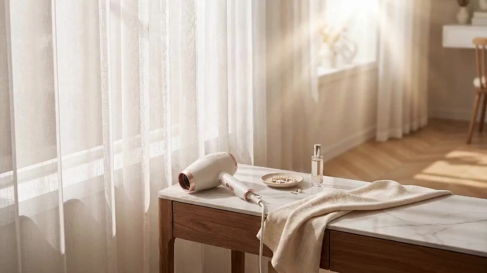

# E-commerce Product Visual Suite

> **作者：** @境在丨米叔

## Content

Process Planning:

This Skill focuses on static image generation. Unless the user explicitly requests video, the video generation process will not be invoked, and no tasks will be dispatched to the video_assembler.Full-Suite Phase Planning and Dependencies:

Analyze user-uploaded product images and text parameters → resource_prepare_and_analyze; organize visual selling points, materials, and color styles into a structured summary.

Draft Ecom_Product_Spec.md (product name, visual style positioning, core HSL color arc, target platform aspect ratio specifications) → text_editor; serve as the global parameter anchor for all subsequent image generation.

Plan the full-suite Shot List structure (3 core main images + 6-8 detail page images) → storyboard_designer; simultaneously register a unique asset tag, Product_Asset_01, for the original product in key_element, locking the body proportions, core colors, material reflections, and LOGO position.

Bind the uploaded product image to the asset_id of Product_Asset_01 → media_generator.

Batch generate the full set of image assets in Shot List order → media_generator (each image uses Product_Asset_01 as the reference base).

Output the full-suite image audit report, confirm product body shape consistency and color arc deviation, then guide the user to export → present results directly via reply_to_user, no need to call video_assembler.

Dependencies: 2→1; 3→2; 4→3; 5→3,4; 6→5.

Milestone Confirmation: After completing each major phase (specification locking, Shot List confirmation, element image generation, batch detail page completion), pause and display progress to the user, and continue only after receiving confirmation.

Asset Analysis:

Product Shape Baseline Extraction

After receiving the user-uploaded product image, prioritize the structured extraction of the following six visual attributes and write them into the product baseline profile (for subsequent full-suite consistency auditing):

Attribute Category

	

Extraction Target

	

Output Format Example

Outline and Proportions

	

Overall product aspect ratio, key section shape (cylinder / rectangular / complex shape), local curvature radius estimate

	

aspect_ratio: 1:2.4; top_radius: ~8mm; body_taper: subtle inward

Main Color HSL Arc

	

Dominant, secondary, and highlight reflection colors, precise to HSL values; no inferred colors outside the product image allowed

	

primary: H210 S30 L55; accent: H35 S60 L70; specular: H0 S0 L95

Material Surface Features

	

Gloss type (matte / semi-gloss / mirror / frosted / brushed), micro-texture description, reflection intensity 0–100 quantification

	

finish: brushed metallic; reflectivity: 72; micro-texture: horizontal grain lines

LOGO and Text

	

LOGO position (normalized coordinates), perceived font size, printing process (debossed / flat print / laser), color

	

logo_pos: (0.50, 0.18); process: debossed silver; size_ratio: ~6% of face

Structural Zones

	

Relative positions and visual weights of functional areas (e.g., cap, buttons, ports, seams)

	

zones: cap(top 20%), body(mid 60%), base(bot 20%); primary_feature: cap edge seam

Product Orientation Baseline

	

Default orientation in the original uploaded image (front / left-oblique / right-oblique / top-down), serving as the orientation anchor for the main image sequence

	

default_facing: left-oblique ~30°

Post-Generation Consistency Audit Rules

Before the generated image assets are finished and the user is guided to export, the following attributes must be audited one by one for consistency. If any item exceeds the tolerance threshold, it should be marked as "⚠️ Deviation Warning" in the audit report, prompting the user to review or regenerate the corresponding Shot List.

Mandatory Audit Attributes and Tolerance Thresholds

Outline and Proportions Consistency

The overall aspect ratio of the product in all shots must not deviate by more than ±5%.

Local features (e.g., cap thickness, button protrusion) must not show visible deformation or disappear between adjacent shots.

Audit method: Compare the aspect_ratio from the product baseline profile with the product projection outline in each generated image.

Color Arc Consistency

The hue of the product's dominant color must not deviate by more than ±15° (HSL-H), lightness by more than ±10% (HSL-L), and saturation by more than ±15% (HSL-S).

Special attention to color temperature deviation between white-background KV images and scene atmosphere images—the product must not show color casts (yellowish/bluish) in white-background environments; comparison with the product baseline HSL profile is required.

Material Surface Consistency

Gloss type must match the baseline profile; matte products must not show mirror highlights, and mirror products must not be flattened into a matte state.

Reflection intensity deviation must not exceed ±15 (on a 0–100 quantification scale).

LOGO and Text Consistency

LOGO position deviation tolerance: Normalized coordinates ΔX or ΔY must not exceed 0.05.

LOGO font, color, and printing process visual perception must match the baseline; no unrelated text or logo replacements allowed.

Clarity requirements for the LOGO are highest in white-background KV images and selling point structure diagrams, requiring separate verification.

Product Orientation and Structural Zone Consistency

Product orientation in the main image sequence (Hero_01–03) must match the baseline profile default_facing; mirror flipping is not allowed across the three main images.

Angle adjustments are permitted for detail pages, but the relative positional relationships of core structural zones (e.g., cap, main functional surface) must not have spatial logic contradictions.

Background and Prop Contamination Detection

White-background KV images: Average RGB of the background area must be above (245, 245, 245); no colored projections or residual props allowed.

Scene atmosphere images: Props and background style must be consistent with the visual style positioning locked in Ecom_Product_Spec.md; no furnishings contradicting the product tonality allowed.

Transformation of Selling Point Visual Subtext

Automatically convert text parameters (e.g., "micron-level waterproofing", "aero-grade aluminum") into high-texture visual imagery (e.g., "perfect tension arc of transparent water droplets on matte metal edges", "clear alloy brushed texture visible under backlighting"), and write them into the corresponding shot's Visual Intent field for direct reference by prompt generation.

Platform Conversion Rate Tone Audit

Analyze the compositional relationship, golden ratio points, and perspective lines of the reference assets versus high-conversion platform images, automatically convert light source intensity and rendering contrast (Chiaroscuro) into quantitative image parameters, and write them into the rendering parameter section of Ecom_Product_Spec.md. Prompt writing logic example (Product material analysis): Analyze product alignment: Center of viewport, specularity metallic chrome, primary light source top-right 60 degrees, shadow softness 85%.

Storyboard Design:

Full-Suite Shot List Structure Planning

The E-commerce full suite is divided into two types of image sets, each with a fixed shot sequence; the order must not be altered arbitrarily: Main Image Sequence (3 images, corresponding to E-commerce platform main image slots 1–3)

No.

	

Shot Type

	

Shot Size

	

Typical Angle

Hero_01

	

Scene Atmosphere

	

Establishing Shot

	

Low-angle (15–25°), golden ratio composition, product at visual center

Hero_02

	

Selling Point Structure

	

Medium Shot

	

Eye-level, product occupies 60–70% of the frame

Hero_03

	

White-background KV

	

Neutral Studio Shot

	

Slightly low-angle (5–10°), product centered, no environmental props

Detail Page Sequence (6–8 images, recommended order)

No.

	

Shot Type

	

Shot Size

	

Visual Narrative Goal

Detail_01

	

Functional Scene

	

Medium-Wide Shot

	

Restore usage scenario, establish emotional link between product and lifestyle

Detail_02–03

	

Material Close-up

	

Macro / Extreme CU

	

Zoom in on craft details layer by layer, visualize tactile texture

Detail_04

	

Selling Point Exploded View

	

Medium Shot

	

Annotation-style composition, core functional zones guided by visual lines

Detail_05–06

	

Comparison Verification

	

Dual-panel / Split-frame

	

Before/after or usage comparison, strengthen decision persuasion

Detail_07–08 (Optional)

	

Size/Specification

	

Technical Flat Lay

	

Top-down flat lay, clearly presenting product proportions and accessory combinations

Visual Focus Coordinate Labeling Specification

Every shot must declare its main visual focus coordinates, formatted as normalized coordinates (X, Y), where (0,0) is the top-left corner and (1,1) is the bottom-right corner.

Main Image Sequence: The main visual focus should be distributed near the 1/3 or 2/3 dividing lines of the frame. Avoid complete overlap of the focus points across the three main images, ensuring a natural guiding rhythm for the user's gaze while swiping on the E-commerce platform.

Suggested distribution example: Hero_01 → (0.38, 0.50); Hero_02 → (0.50, 0.45); Hero_03 → (0.50, 0.50) (centered standard).

Detail Page Sequence: Focus coordinates should form a "Z-pattern" or "F-pattern" scanning path between adjacent shots, consistent with natural eye movement patterns as users scroll down.

Odd-numbered page focus biased left (X ≈ 0.33), even-numbered page focus biased right (X ≈ 0.67), with the Y-axis floating between 0.35–0.60 depending on narrative rhythm.

Focus coordinates must be clearly stated in the Shot List description as Focus: (X, Y), and the downstream media_generator will translate them into specific compositional descriptions in the prompt.

Mandatory Fields for Shot Descriptions

Every shot entry must include the following five fields. Missing any of these renders the shot incomplete and it must not proceed to the generation process:

Shot ID: Unique identifier, e.g., Hero_01, Detail_03.

Shot Type: Shot size type (select standard terms from the table above).

Focus: Main visual focus coordinates (X, Y).

Visual Intent: A one-sentence description of the core narrative goal or selling point intention for this image.

Key References: The list of key_element assets to be bound to this image (must include Product_Asset_01; list others if atmosphere references are needed).

Cross-Shot Consistency Constraints

Color Arc Consistency: The dominant color of all shots must remain consistent with the HSL color arc locked in Ecom_Product_Spec.md, allowing lightness to float within ±10%, with hue deviation not exceeding 15°.

Product Orientation Consistency: The primary orientation (left/right/front) of the product in the main image sequence must be unified across the three images; detail pages may adjust angles based on selling point needs, but the reason for the turn must be clearly noted in the Shot description.

Shot Size Span Constraint: The span between adjacent detail page shots must not exceed two levels (e.g., jumping directly from Medium Shot to Extreme CU requires an intermediate CU transition shot) to prevent disruption of the visual narrative rhythm.

Media Generation:

E-commerce Matrix Batch Crafting (Image 2): Within standard square 1:1 (main images) and rectangular 3:4 / 16:9 (detail pages) aspect ratios, batch craft a full set of visual assets with high-end commercial photography quality. Lock natural white balance in the image, strictly prohibiting physically illogical lighting pollution or random distortions. Dynamic Rendering Parameter Quantification: Apply 'Commercial-Grade Prompt Rules', enforce a 9:1 color restraint algorithm, allowing contrast colors only on core selling points to enhance visual appeal. Example of Prompt Writing Logic (Main Image Visual Design): Subject: <<<Product_Asset_01>>>; Layout: Center framing commercial photography; High-end e-commerce aesthetic, soft product lighting, neutral tone backdrops, volumetric dust particles floating in Tyndall light ray, 1:1 ratio.

Prompt Writing:

General Writing Principles

Construct prompts from a director's perspective: use natural language to describe Subject + Action/State + Environment, and short phrases to describe Style / Color / Light / Composition. Do not write content that is invisible outside the screen.

All prompts must be written in English to maximize model response accuracy.

Keep prompt length for each image within 120–200 words to prevent information noise from diluting core visual instructions.

Model Alignment Rules

Default Model: Nano Banana Pro (Gemini 3 Pro Image), recommended resolution 2K.

Nano Banana Pro has the strongest prompt adherence, excels at complex multi-image reference, precise text rendering, and multi-region composite layout; suitable for all E-commerce main image and detail page generation.

Alternative Model Seedream 4.5: Emphasizes product material texture and delicate lighting; suitable for high-end beauty, jewelry, and other scenarios requiring extreme material expression, with 2K or 4K resolution.

Alternative Model Nano Banana 2 (Gemini 3.1 Flash Image): Faster speed, suitable for batch draft previews or auxiliary images with low visual weight on detail pages.

Product Reference Citation Rules (ImageToImage Path)

Product reference tags must appear at the beginning of the prompt, format: <<<image_1>>> corresponds to Product_Asset_01. If there are multiple reference images, follow with <<<image_2>>>, <<<image_3>>>, etc.

Immediately after the reference tag, declare the inheritance intent in one sentence, for example: inherit the exact industrial form, proportions, surface finish, and logo placement of the product.

Reference binding priority: Product Subject Image (Product_Asset_01) > Atmosphere/Scene Board (optional auxiliary reference) > Color Style Reference (optional).

E-commerce Image Prompt Hierarchical Structure

Organize instructions strictly in the following order, connecting sections naturally with commas or periods. Do not use section headers or bracketed notes, output as a single continuous English paragraph:

[Camera Parameters and Perspective] — Shooting distance (macro / close-up / mid-shot / establishing), angle (eye-level / low angle / bird's eye), focus perception (shallow DOF / deep focus).

[Product Subject Description] — Position of the product in the frame, placement state, and core visual features, explicitly referencing the reference tag.

[Scene and Props] — Background material, set props, spatial depth; follow the color arc locked in Ecom_Product_Spec.md, with dominant color accounting for about 90%, and contrast/accent colors only used to highlight core selling point areas.

[Light and Rendering] — Main light position, fill/rim light, shadow softness, Tyndall / Chiaroscuro effects, etc.; no lighting effects that contradict physical laws allowed.

[Material and Detail Finishing] — Quantifiable material keywords like brushed metal / glass refraction / leather texture / fabric stitching, etc.

[Aspect Ratio and Quality Anchors] — Declare 1:1 ratio / 3:4 ratio / 16:9 ratio according to the shot specification; use standardized quality keywords: photorealistic commercial photography, sharp details.

Negative Word Blocking Rules

Forced append the following blocking words to the end of all batch prompts, in fixed order, never omit: no product morphing, no distorted proportions, no messy reflections, no floating artifacts, no random on-screen text, no watermarks, no brand identifiers, no subtitles, no oversaturated colors, no physically impossible shadows, no ugly digital noise

If the current shot is a White-background KV image, additionally append: white seamless background only, no environment props, no colored cast.

If the current shot is a Selling Point Structure Diagram, additionally append: no decorative clutter outside designated callout zones.

Example 1: E-commerce Main Image (ImageToImage + Nano Banana Pro, 1:1)

<<<image_1>>> inherit the exact industrial form, proportions, surface finish, and logo placement of the product. Eye-level studio shot, centered layout, product placed on a minimalist matte ceramic floating platform surrounded by elegant premium cosmetics props. Deep sage green dominates 90% of the frame, soft negative fill lighting creating subtle chiaroscuro contrast on the left edge. Top-right key light at 60°, shadow softness 85%, photorealistic chrome specularity on the cap. Shallow depth of field, background bokeh with fine volumetric dust in Tyndall light ray. Photorealistic commercial photography, sharp details, 1:1 ratio. no product morphing, no distorted proportions, no messy reflections, no floating artifacts, no random on-screen text, no watermarks, no brand identifiers, no subtitles, no oversaturated colors, no physically impossible shadows, no ugly digital noise

Example 2: Detail Page Close-up — Fabric Stitching (Macro CU, ImageToImage + Nano Banana Pro, 3:4)

<<<image_1>>> inherit the exact stitching pattern, thread color, fabric weave structure, and surface texture of the product. Extreme macro close-up shot, lens positioned at 5–8 cm from subject surface, ultra-shallow depth of field isolating a single seam row as the sharpest focal plane. Fabric occupies 80% of the frame; muted off-white linen background visible at soft-blurred edges. Single diffused side light from the left at 30° grazing angle to accentuate thread relief and micro-shadows within each stitch indent; right-side fill card adds 15% reflected warmth to reveal weave depth without flattening texture. Photorealistic textile macro photography, razor-sharp stitching detail, natural fiber grain visible at pixel level, 3:4 ratio. no product morphing, no distorted proportions, no messy reflections, no floating artifacts, no random on-screen text, no watermarks, no brand identifiers, no subtitles, no oversaturated colors, no physically impossible shadows, no ugly digital noise

Example 3: Main Image — White-background KV (ImageToImage + Nano Banana Pro, 1:1)

<<<image_1>>> inherit the exact industrial form, proportions, surface finish, reflectivity, and logo placement of the product. Eye-level studio shot, centered layout with the product occupying 65–70% of the frame height, product base resting on a seamless white surface with a soft natural contact shadow directly beneath. Pure white seamless background fills the entire frame; no environment props, no scene objects, no decorative elements of any kind. Single large softbox overhead at 90°, even diffused illumination across all surfaces; secondary front fill panel at 20% intensity to eliminate harsh underside shadows while preserving gentle dimensional shading on curved edges. Product highlights remain crisp and accurate to material type; no blown-out specular spill beyond product boundary. Photorealistic commercial photography, razor-sharp product contour, clean white negative space, 1:1 ratio. no product morphing, no distorted proportions, no messy reflections, no floating artifacts, no random on-screen text, no watermarks, no brand identifiers, no subtitles, no oversaturated colors, no physically impossible shadows, no ugly digital noise, white seamless background only, no environment props, no colored cast

Example 4: Detail Page Close-up — Waterproof Droplets (Macro CU, ImageToImage + Seedream 4.5, 3:4)

<<<image_1>>> inherit the exact surface material, finish sheen, edge geometry, and color of the product. Extreme macro close-up, low camera angle at 15° above the product surface to capture water droplet silhouette against a shallow depth-of-field background. Three spherical water droplets in mid-slide motion across the product surface: largest droplet (foreground) fully sharp, exhibiting high surface tension, convex meniscus, and transparent internal caustic light; two smaller trailing droplets slightly motion-blurred to imply downward velocity. Background: deep charcoal matte, occupying 85% of frame, evoking premium waterproof performance. Primary top-right backlight at 70° creates bright specular highlight crowning each droplet; secondary front fill light at 20% intensity to retain product surface color accuracy. Photorealistic product macro photography, physically accurate water surface tension, sharp caustics, 3:4 ratio. no product morphing, no distorted proportions, no messy reflections, no floating artifacts, no random on-screen text, no watermarks, no brand identifiers, no subtitles, no oversaturated colors, no physically impossible shadows, no ugly digital noise
