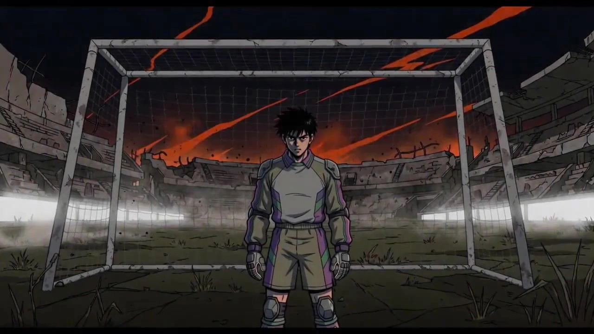

# EVA-Inspired Video Style

> **作者：** @黄炜炜

## Content

Process Planning:

Overall Process and Stage Dependencies:

Lock Global Specs → Establish Final_Video_Spec.md using text_editor, recording: aspect ratio (2.39:1 TV/EOE style or 16:9 Rebuild style), target duration, EVA version preference, language, and output resolution.

Analyze Reference Assets (if any) → Call resource_prepare_and_analyze to break down assets by six dimensions and map them to five aesthetic themes.

Design Storyboard → Call storyboard_designer to design key elements (mecha/giant bio-machines, pilot characters, scenes, etc.), shot list, and audio layers based on the selected aesthetic theme (single or combination).

Generate Visual Element Assets → Call media_generator to generate key element images; if the user has uploaded reference images, prioritize registering them as asset_id and binding them to the corresponding key element slots instead of regenerating.

Generate Video by Shot → Call media_generator to generate the video for each shot using the key element images as a reference.

Generate Audio Layers → Call media_generator to generate BGM and voiceover (VO).

Editing & Assembly → Call video_assembler to complete timeline assembly.

Dependencies: 2→1; 3→2; 4→3; 5→4; 6→3; 7→5,6.

Key Pause Points and User Confirmation Workflow:

Pause Point 1 — Aesthetic Theme Confirmation (After Step 2 is completed, before Step 3 starts)

If the user has uploaded reference images or audio, output the mapping results from resource_prepare_and_analyze (which aesthetic theme it matches and the core rationale), then display the cards below;

Regardless of whether reference assets exist, display the following three cards sequentially and confirm each item before proceeding to storyboard design.

Card 1 · Aesthetic Theme Selection (Single choice, default recommendation: Theme B · Berserk Theme)

Option

	

Label

	

Description Copy

A

	

Advent Theme

	

Giant oppression + apocalyptic night, extreme low-angle perspective, slow buildup → rapid impact cuts, suitable for "Angel Advent" scenes

B

	

Berserk Theme ★Default Recommended

	

Awakening of an out-of-control berserker, high-frequency quick cuts + skull armor shattering + wing expansion, strongest visual impact

C

	

Monologue Theme

	

Solid color background psychological space, ultra-long static shots, VO-driven, stream-of-consciousness text fragments

D

	

Instrumentality Theme

	

Grand apocalyptic sublimation, overhead view of collective dissolution + amber ocean + cross-shaped light pillar, epic long shot

E

	

Final Theme

	

Farewell healing twist, sunny green fields + railway platform, silent negative space, gentlest emotion

B+C

	

Berserk Monologue

	

External rage ↔ internal collapse, EVA's most iconic contrast, hard cut to black, sudden emotional drop

D+E

	

Instrumentality Rebirth

	

Grand sublimation → reversed healing, extreme color temperature difference, suitable for complete arc narratives

All 5

	

Progressive Arc

	

A→B→C→D→E complete narrative arc, suitable for 90s+ short films or MVs, 22—32 shots

Card 2 · EVA Version Aesthetic Preference (Single choice, default recommendation: Rebuild 1.0/2.0)

Option

	

Label

	

Description Copy

TV

	

TV Series (1995)

	

16mm film grain + cel shading + low saturation, retro animation texture, 4:3 composition feel

EOE

	

EOE (1997 Movie)

	

35mm extreme high contrast + red/white/black primary color scheme + live-action mixed media feel, most experimental

Rebuild 1/2

	

Rebuild 1.0/2.0 (2007—2012) ★Default Recommended

	

4K digital precision + highly saturated vivid colors + soft highlights, strongest modern animation production feel

Rebuild Q

	

Rebuild Q (2012)

	

Cold gray primary tone + deep red accents + withered purple depression, most restrained color palette, strictly excludes warm colors

Rebuild 3+1

	

Rebuild 3.0+1.0 (2021)

	

4K warm golden sunlight + green fields and blue skies + realistic background fusion feel, the preferred version for Theme E

Card 3 · Voiceover (VO) Enablement (Single choice, default recommendation: Do not enable VO)

Option

	

Label

	

Description Copy

None

	

Do not enable VO ★Default Recommended

	

Pure visual + BGM driven, suitable for A/B/D/E single theme or fast-paced combination plans

CN

	

Enable Chinese VO

	

Cross-shot Mandarin VO, recommended MiniMax Speech 2.8 HD, mandatory for Theme C / 5-theme progression

JP

	

Enable Japanese VO

	

Japanese VO, recommended MiniMax Speech 2.8 HD, reinforces original work atmosphere

EN

	

Enable English VO

	

English VO, recommended ElevenLabs v3, suitable for international release scenarios

Bi

	

Enable Bilingual (CN+JP)

	

Alternating CN/JP VO, exclusive for Theme C monologue segments, strongest emotional layering

After all three cards are confirmed, write the selected results (Aesthetic Theme / Version Aesthetic / VO Plan) into Final_Video_Spec.md, then call storyboard_designer.

Pause Point 2 — Storyboard Review (After Step 3 is completed, before Step 4 starts)

Output the storyboard summary, structured as follows:

Key Elements List: List all designed key elements (Name / Type / Brief Description), marking which ones come from user uploads (existing) and which need to be generated;

Shot List Overview: List shot number, shot size, duration, and visual highlights (max one line per shot) by aesthetic segment;

Audio Layers Overview: List BGM segment count, VO segment count, and corresponding emotional tags;

Clearly ask the user: Do any shots need adjustment (shot size / duration / content), or should we proceed directly to the generation stage;

Proceed to call media_generator to start element image generation only after confirmation.

Pause Point 3 — Element Asset Review (After Step 4 is completed, before Step 5 starts)

Output the Element Asset Review Checklist, listing item by item:

#

	

Key Element Type

	

Asset Source

	

Reference Image Count

	

Status

1

	

[Mecha Name]

	

Giant Bio-Machine

	

Generated / User Uploaded

	

2 (Full body + Close-up)

2

	

[Pilot Name]

	

Pilot Character

	

Generated / User Uploaded

	

1 (Two-frame horizontal)

3

	

[Scene Name]

	

Scene

	

Generated / User Uploaded

	

1—2

Clear prompt: If any element status is "Pending", user feedback is required after reviewing the images; proceed to start shot-by-shot video generation only after all are marked as "✓ Ready";

In the same confirmation step, ask if any elements need to be regenerated (simply point out the specific issue; no need to re-describe parameters).

Pause Point 4 — After Video and Audio Completion (Before Step 7 starts)

List all generated shot videos and audio layers, note durations, and prompt the user to preview and confirm;

Ask if any shots need regeneration (if so, regenerate only that specific shot; do not re-process others);

Call video_assembler to execute timeline assembly after confirmation.

Copyright Safety Principles: The use of copyright-infringing keywords is strictly prohibited throughout the entire process (refer to prompt writing rules); all prompts must use safe, substitute vocabulary.

Asset Analysis:

Reference Image Six-Dimension Decomposition Framework:

Upon receiving a user's reference image, it must be analyzed one by one according to the following six dimensions. Structured analysis results must be output before performing the aesthetic line mapping:

Composition Structure: Low angle / High angle / Eye level? Centered / Offset / Symmetrical?

Tone Tendency: Cool / Warm / Low saturation / High contrast?

Subject Type: Character / Mechanical / Scene / Abstract?

Emotional Atmosphere: Lonely / Oppressive / Cozy / Post-apocalyptic?

Light Characteristics: Backlit / Top lighting / Side lighting / No light source?

Texture and Quality: Film / Digital / Hand-drawn / Photorealistic?

Mapping Rules from Reference Image to EVA Aesthetic Lines:

Reference Image Characteristics

	

Mapping Direction

	

EVA Aesthetic Placement

Low saturation, cool tone, character

	

Rei Ayanami Line

	

Pure white void + pale blue moonlight + hollow pupils

High saturation, warm tone, conflict

	

Asuka Line

	

Fiery battle + flaming background + strong contrast

Silent teenager close-up

	

Shinji Line

	

Solid color background + inner monologue + text fragments + ellipses

Huge creature/architecture

	

Angel Descent Line

	

Extreme perspective from low angle + giant oppression + blue-black night sky

Post-apocalyptic ruins

	

Human Instrumentality Line

	

Amber ocean + rising white figures + cross-shaped light pillars

Sunny field

	

Final Version Line

	

Golden light + green field + train station + sense of farewell

Mechanical/Tech

	

NERV Line

	

Cold gray corridor + orange alarm + terminal screen

Intimate pair

	

Kaworu-Shinji Line

	

Bathroom/moonlight/water reflection + silver-white + warm

After the analysis is complete, clearly inform the user which aesthetic line has been mapped and ask whether to maintain a single line or use a combination, then pass it to storyboard_designer for use.

Audio Reference Asset Analysis Framework:

Upon receiving the user's reference music/audio, analyze it one by one according to the following five dimensions and output the structured analysis results before performing the aesthetic line mapping:

Speed and Rhythm Density: BPM range estimation (Extremely slow <60 / Slow 60–90 / Medium 90–120 / Fast 120–150 / Extremely fast >150); Is the beat regular? Are there sudden pauses or stops?

Timbre Composition: Dominant timbre category (Strings / Brass / Piano / Guitar / Electronic Synth / Percussion / Vocals); Are there special timbres like industrial noise, distorted electric guitar, or vocal sample fragments?

Dynamic Range: Overall volume progression (Steady / Crescendo / Decrescendo / Alternating peaks and valleys); Are there sudden stops or impact points?

Emotional Arc: Overall emotional tendency (Oppressive / Furious / Introspective / Sublimated / Healing); Are there obvious paragraph transitions in emotion?

Sound Quality/Texture Tag: Orchestral / Cinematic / Atmospheric / Cel-shading retro / Digital HD? Does it contain reverb tails or a distinct sense of space?

Mapping Rules from Reference Audio to EVA Aesthetic Lines:

Audio Characteristics

	

Mapping Direction

	

EVA Aesthetic Placement

Extremely slow BPM + dissonant brass forte + industrial percussion

	

A-Line: Descent Line

	

slow apocalyptic orchestral, oppressive BGM

High BPM + distorted electric guitar + impact percussion + sudden stops

	

B-Line: Berserk Line

	

aggressive industrial strings, violent loss of control

Sparse piano + vocal fragments + heavy reverb tails + near silence

	

C-Line: Monologue Line

	

sparse jazz piano + fragile vocal fragments, introspective stream of consciousness

Choral timbre + cheerful melody with melancholy undertone + ascending string crescendo

	

D-Line: Human Instrumentality Line

	

bittersweet choir, sublime post-apocalyptic grandeur

Gentle acoustic guitar/piano + airy strings + low volume soothing

	

E-Line: Final Version Line

	

warm acoustic guitar, healing sense of farewell

Segment 1: High BPM impact; Segment 2: Sparse piano after sudden stop

	

B+C Combination Line

	

Berserk → Monologue, internal/external contrast

Segment 1: Grand choral crescendo; Segment 2: Soft guitar after sudden stop

	

D+E Combination Line

	

Human Instrumentality → Rebirth, extreme contrast

Complete arc containing multiple emotional progressions above

	

All-Five Line

	

Progressive A → B → C → D → E complete narrative arc

Processing Rules After Audio Analysis:

If the audio maps to a single aesthetic line: Inform the user of the matching result and the basis for the match, pass the corresponding BGM style description to the storyboard_designer's Audio Layers design, and prioritize this style description in the media_generator's BGM generation prompts.

If the audio has obvious paragraph transitions (e.g., from high BPM to sparse piano): Recognize it as a combination line signal and confirm with the user whether to adopt the corresponding combination scheme (B+C / D+E / All-Five).

If the audio style is ambiguous and a single mapping cannot be determined: Output the two closest candidate lines and ask the user to choose via a card.

If the user wishes to use the uploaded reference audio directly as BGM rather than just as an analytical reference: Register as an asset_id, bind it to the corresponding audio layer in media_generator, and do not regenerate BGM; meanwhile, pass the audio duration and rhythmic characteristics to storyboard_designer to calibrate the duration ratios of each shot.

Storyboard Design:

Key Elements Design Principles:

Giant Bio-Mechanical Entity (Main Mecha): Define the color scheme (e.g., "purple-green" for rampage mode), armor texture (fusion of bone/metal/organic tissue), and signature anatomical parts (cranial armor, dorsal wing-like structures, abdominal core).

Pilot Character: Define appearance according to security descriptors (hair color/eye color/clothing), and specify emotional state and posture.

Scene: Differentiate between urban ruins on the surface, underground command centers, and void psychological spaces; indicate light source color temperatures.

If the user has uploaded reference images corresponding to a specific key element, ensure the visual characteristics in the description align with the reference images to avoid contradictions.

Storyboarding Design Points for the Five Aesthetic Arcs:

Arc A · The Descent (Apostle / Giant / Apocalyptic Oppression)

Camera Language: Extreme low-angle shots, silhouette of the giant biological entity filling the sky, contrast with the insignificance of humans;

Color Palette: Deep midnight blue-black #1A1A2E + orange-red alert light #FF6B35 + dark purple #4B0082;

Storyboard Rhythm: Slow buildup → sudden cut to detail close-up to create a sense of oppression.

Recommended Shot Count: 4–6 shots (including 1 impact frame).

Shot Duration: Buildup long shots: 8–15s; impact close-ups: 0.5–1s.

Typical Sequence Example (5 shots):

Extreme Long Shot: City ruins at night, scanning orange alert lights, silhouettes of crowds (10s)

Extreme Low-Angle Shot: Giant bio-mechanical foot crushing the ground, close-up of ground cracking (8s)

Medium Shot (Eye Level): Pilot staring at monitor in cylindrical cockpit (8s)

Impact Frame (Close-up): Rhombus-shaped glowing eyes of the alien intruder suddenly open (0.5s flash red)

Long Shot: Hexagonal grating barrier unfolds, pillar of light shoots into the sky (12s)

Arc B · The Rampage (Out of Control / Berserker / Biological Awakening)

Camera Language: Handheld shake, close-up of cranial armor cracking, slow motion of dorsal spine unfolding;

Color Palette: Purple-green base #4A0E4E → rampage yellow-green #7CFC00, orange-red liquid spraying;

Storyboard Rhythm: High-frequency fast cuts, 2–4s per shot, coordinated with impact frames.

Recommended Shot Count: 6–10 shots (the arc with the highest rhythmic density).

Shot Duration: Standard fast cuts: 2–4s; rampage slow-motion shots: 6–8s; impact frames: 0.5s.

Typical Sequence Example (7 shots):

Medium Shot: Cracks appear on the mecha's cranial armor, amber fluid seeps out (4s)

Impact Frame (Close-up): Entire cranial armor piece shatters and scatters (0.5s flash white)

Slow-Motion Low-Angle Shot: Dorsal wing-like bone structure unfolds and spreads (8s)

Fast-Cut Close-up: Yellow-green eyes flare up suddenly (0.5s)

Handheld Shake Medium Shot: Mecha punches opponent, orange-red fluid sprays (3s)

Fast-Cut Close-up: Pilot's face twisting in pain, synchronization index off the charts (2s)

Long Shot: Mecha acts autonomously, circular depression formed on the surrounding ground (4s)

Arc C · The Monologue (Psychological / Stream of Consciousness / Text & Image Mix)

Camera Language: Solid color background (white/black/red), character stationary, multiple self-overlapping shadows;

Color Palette: Extremely low saturation or extreme monochrome;

Storyboard Rhythm: Extra-long static shots (10s+), no obvious cuts, reliance on fades; rhythm driven by voice-over (VO).

Recommended Shot Count: 3–5 shots (few shots but extremely long duration).

Shot Duration: 10–15s; up to 15s (maximum per shot); multiple shots can be chained to create longer monologue segments.

Typical Sequence Example (4 shots):

Pure white background, boy standing front-facing, hollow gaze, overlapping shadows gradually appearing (15s, VO-driven)

Pure black background, multiple silhouettes of self dissolving/fading, text fragments emerging (12s, VO continues)

Pure red background, close-up of side profile, lips moving slightly, silent dialogue (10s)

Gradient white field, silhouette dissolves, leaving only outlines (fade to white, 12s)

Arc D · The Complement (Apocalyptic Sublimation / Collective Consciousness / Light & Melting)

Camera Language: High-angle global perspective, white sphere of light ascending, earth shattering into prisms;

Color Palette: Amber-orange #FF8C00 + pure white light + dark earth;

Storyboard Rhythm: Epic slow pace, 10–15s long shots, grandiose sense of space.

Recommended Shot Count: 4–6 shots (grandiose narrative, should not be too fragmented).

Shot Duration: Primarily 10–15s, aiming for narrative integrity within single shots.

Typical Sequence Example (5 shots):

Extreme High-Angle Shot: Amber ocean covers the earth, white silhouettes rising in groups (15s)

Low-Angle Long Shot: Double-helix red spears pierce through clouds, cruciform pillar of light blooms into the sky (12s)

Medium Close-up: Individual white silhouette face melting, expression shifts from pain to calm (10s)

Extreme Long High-Angle Shot: Earth's surface prismatized, orange light spreading to the edges (15s)

Cosmic Perspective: Sphere of light floating calmly in darkness (12s, VO outro)

Arc E · The Finale (Farewell / Rebirth / Inverted Healing)

Camera Language: Eye-level warm light, green fields in sunlight, backlight figures, train platform;

Color Palette: Golden sunlight #DAA520 + green fields #80CBC4 + sky blue #87CEEB;

Storyboard Rhythm: Soothing, silent, creates an extreme emotional inversion from the apocalyptic arcs.

Recommended Shot Count: 4–6 shots (restrained, strong sense of negative space in each shot).

Shot Duration: 8–12s; allows for many static frames, using silence as an aesthetic goal.

Typical Sequence Example (5 shots):

Long Shot of Morning Light: Train platform, back view of boy in silhouette, golden halo overflowing (10s)

Eye-Level Medium Shot: Breeze in green fields, boy turns side profile toward camera, calm expression (8s)

Close-up: Hands overlapping, sunlight streaming through fingers (8s)

Low-Angle Long Shot: Blue sky and white clouds, a paper airplane flies by (10s, no dialogue)

Fixed Long Shot: Silhouette walking further away, empty shot of platform, BGM fades out (12s)

Combination Gameplay Instructions (To be written into the corresponding shot descriptions):

Arc B + Arc C · Rampage Monologue (Outer Violence ↔ Inner Collapse)

Emotional Logic: Create extreme tension with high-frequency fast cuts of the rampage, then hard cut to a static solid color background to suddenly lower the temperature, forming the most iconic internal/external contrast of EVA.

Recommended Shot Count: 9–13 shots (Arc B segment 5–7 + Arc C segment 4–6).

Shot Duration: Arc B segment continues fast cuts 2–4s + impact frame 0.5s; Arc C segment long static shots 10–15s.

Typical Sequence Example (11 shots):

Medium Shot: Cracks appear on mecha cranial armor, amber fluid seeps out (4s)

Impact Frame (Close-up): Cranial armor piece shatters and scatters (0.5s flash white)

Slow-Motion Low-Angle Shot: Dorsal wing-like bone structure unfolds (8s)

Fast-Cut Close-up: Yellow-green eyes flare up suddenly (0.5s)

Handheld Shake Medium Shot: Mecha strikes opponent autonomously, orange-red fluid sprays (3s)

Fast-Cut Close-up: Pilot's face twisting in pain, sync index off the charts (2s)

Hard Cut·Transition Frame: Solid black static, 0.5s silence (emotional fracture)

Pure white background, boy standing front-facing, overlapping shadows gradually appearing (15s, VO begins)

Pure black background, multiple silhouettes of self dissolving/fading, text fragments emerging (12s)

Pure red background, close-up of side profile, lips moving slightly, silent dialogue (10s)

Gradient white field, silhouette dissolves, leaving only outlines (fade to white, 12s)

Arc D + Arc E · Complement Rebirth (Apocalyptic Grandeur → Inverted Healing)

Emotional Logic: Create an emotional climax with high-angle grandiose collective dissolution, hard cut to sunny fields at the moment of highest brilliance, using the extreme drop in color temperature and scale to create a healing impact.

Recommended Shot Count: 9–12 shots (Arc D segment 5–6 + Arc E segment 4–6).

Shot Duration: Arc D segment 10–15s long shots; Arc E segment 8–12s, strong sense of negative space.

Typical Sequence Example (10 shots):

Extreme High-Angle Shot: Amber ocean covers the earth, white silhouettes rising in groups (15s)

Low-Angle Long Shot: Double-helix red spears pierce clouds, cruciform pillar of light blooms (12s)

Medium Close-up: Individual white silhouette face melting, expression shifts from pain to calm (10s)

Extreme Long High-Angle Shot: Earth's surface prismatized, orange light spreading to edges (15s)

Hard Cut·Transition Frame: Instant cut to pure golden overexposed frame (0.5s, audio track stops abruptly)

Long Shot of Morning Light: Train platform, back view of boy in silhouette, golden halo overflowing (10s)

Eye-Level Medium Shot: Breeze in green fields, boy turns side profile toward camera, calm expression (8s)

Close-up: Hands overlapping, sunlight streaming through fingers (8s)

Low-Angle Long Shot: Blue sky and white clouds, a paper airplane flies by (10s, no dialogue)

Fixed Long Shot: Silhouette walking further away, empty shot of platform, BGM fades out (12s)

All Five Arcs Progression · Complete Narrative Arc (A→B→C→D→E)

Emotional Logic: Descent (External Threat) → Rampage (Out of Control Explosion) → Monologue (Internal Collapse) → Complement (Dissolution Sublimation) → Finale (Newborn Farewell), suitable for short films over 90s or complete MV structures.

Recommended Shot Count: 22–32 shots (Use the minimum recommended count for each segment to control total length).

Arc A segment: 4–5 shots; Arc B segment: 5–7 shots; Arc C segment: 3–4 shots; Arc D segment: 4–5 shots; Arc E segment: 4–5 shots.

Shot Duration: Each arc continues its own specifications; overall film rhythm follows a "Slow → Fast → Still → Slow → Gentle" arc.

Transition Anchors (Linkage between segments):

A→B: Impact frame at the end connects directly to the first shot of Arc B, hard cut, audio effects hit peak;

B→C: Insert a 0.5s solid black static frame after the last fast cut of Arc B, hard cut to Arc C pure white background, audio track stops abruptly;

C→D: Fade out the white field at the end of Arc C, dissolve into the Arc D amber high-angle long shot, VO seamlessly continues;

D→E: Hard cut from the peak light frame of Arc D to the Arc E golden overexposed morning light, audio tone shifts suddenly from grandiose orchestral to gentle guitar.

Typical Segment Allocation Example (27 shots):

Arc A segment (5 shots): City ruins → Giant descent → Pilot in position → Glowing eyes open → Hexagonal barrier unfolds

Arc B segment (7 shots): Cranial cracks → Shattering impact frame → Wing-like expansion → Eyes flare → Punching/spraying → Pilot twisting → Autonomous action long shot

B→C Transition: 0.5s solid black silence frame

Arc C segment (4 shots): Pure white overlapping shadows → Pure black text fragments → Pure red side profile → White field dissolution

Arc D segment (5 shots): Amber sea high-angle → Spear piercing → Individual melting → Earth prismatized → Cosmic sphere of light

D→E Transition: Golden overexposed hard cut frame (0.5s)

Arc E segment (5 shots): Platform morning light → Green field profile → Hand close-up → Paper airplane → Silhouette walking away empty shot

Independent Audio Layers Design:

Single Arc BGM Style Keyword Library (For direct reference in text_to_instrumental prompts):

Aesthetic Arc

	

BGM Style Descriptor

	

Emotional Goal

Arc A · Descent

	

Low-frequency string drone + dissonant brass surges + industrial noise percussion, slow apocalyptic orchestral, dissonant brass surges

	

Oppression, fear, irresistible force

Arc B · Rampage

	

High-frequency fast-tempo string rampage segment + distorted electric guitar + impactful percussion, aggressive industrial strings, distorted electric guitar riff, breakneck percussion

	

Out of control, frenzy, biological awakening

Arc C · Monologue

	

Sparse jazz piano + fractured vocal samples + long delay reverb, sparse jazz piano, fragile vocal fragments, reverb decay, near-silence

	

Loneliness, introspection, consciousness fragmentation

Arc D · Complement

	

Upbeat melody with apocalyptic lyrics (counterpoint aesthetics) + grandiose choir + ascending strings, bittersweet choir, paradoxically cheerful melody over apocalyptic undertones, rising strings

	

Sublimation, dissolution, apocalyptic sublime

Arc E · Finale

	

Gentle acoustic guitar + light piano + airy strings, warm acoustic guitar, soft piano, airy strings, healing pastoral

	

Farewell, rebirth, healing tranquility

Combination Arc BGM Segment Design:

Arc B + Arc C · Rampage Monologue

Arc B BGM: aggressive industrial strings + distorted electric guitar, bass pushed to peak, brass surges synchronize with rampage burst shots; maintain high volume throughout.

B→C Transition: Audio track of the same frame as the black frame stops abruptly to zero, silence duration equals black frame length (0.5s), no fading—must use "fracture" as the aesthetic goal.

Arc C BGM: Do not immediately start BGM after entering the white field; let the VO monologue carry for 10–20s; if BGM is needed, choose sparse jazz piano, volume controlled below -18dB, must not cover the VO.

Arc C VO Emotional Setting: narration_speaker_profile = "Deep, low-pitched young male voice, very slow speech rate, strong breathy quality, slight tremor at the end of every sentence; Emotion: numbness revealing the edge of collapse"; VO enters 0.5–1s after the white field appears.

Arc D + Arc E · Complement Rebirth

Arc D BGM: bittersweet choir + paradoxically cheerful melody + grandiose ascending strings; volume climbs within Arc D according to the degree of visual grandeur, reaching the film's secondary peak during the 4th–5th shots (cosmic high-angle shot).

D→E Transition: Audio track of the same frame as the golden overexposed frame stops abruptly; 0.5s after the first frame of Arc E, warm acoustic guitar fades in over 0.5–1s, starting volume approx -20dB, slowly rising back to normal narrative volume, creating an extreme drop from "grandiose strings → a single guitar".

Arc E BGM: warm acoustic guitar + soft piano, never exceeding -10dB throughout, forming a volume drop of over 8dB from Arc D's peak, maintaining the feeling of farewell.

Arc E VO Emotional Setting (if applicable): narration_speaker_profile = "Gentle gender-neutral voice, stable speech rate, slight upward inflection at the end; Emotion: calm, with a hint of relief and farewell"; VO enters in the last 1–2 shots of Arc E, BGM lowers to -15dB synchronously with the VO fade-in.

All Five Arcs Progression · A→B→C→D→E

Arc A BGM: slow apocalyptic orchestral + dissonant brass, medium volume to establish oppression; starts to crescendo 1s before the impact frame at the end of Arc A, sound effects hit peak synchronously with the impact frame.

Arc B BGM: Seamlessly continues from Arc A's audio peak, cuts into aggressive industrial strings + breakneck percussion; maintain highest volume throughout (film's peak).

B→C Transition: Arc B end frame → solid black silence frame, audio track stops abruptly, strictly enforced.

Arc C BGM: Same as Arc B+C independent rules; sparse jazz piano at extremely low volume or VO only.

Arc C VO Emotional Setting: Same as VO setting in Arc B+C independent rules.

C→D Transition BGM: When fading out Arc C white field and dissolving into Arc D, bittersweet choir fades in during the middle of the dissolve (around 0.5s), VO can seamlessly continue across this transition.

Arc D BGM: Same as Arc D+E independent rules; Arc D is the "second volume peak" in the full five-arc progression, approx 3–5dB lower than Arc B peak.

D→E Transition: Same as Arc D+E independent rules; abrupt stop at the same frame as the golden overexposed frame.

Arc E BGM + VO: Same as Arc D+E independent rules; film fades out with warm acoustic guitar.

Full Film VO General Setting (if cross-segment narration is enabled): Same narration_speaker_profile throughout the film, recommended "Deep, low-pitched young male voice, strong breathy quality"; Arc C is the most collapsed emotion, Arc D tone tends toward detachment, Arc E finally falls back to calm; annotate emotional instructions by shot span in audio_layer.

Media Generation:

Element Image Generation:

Use TextToImage, recommended model: Nano Banana Pro (Gemini 3 Pro Image), resolution 2K.

For multiple versions of the same character (e.g., pre/post-berserk), use ImageToImage with the first version image as a reference to maintain consistency.

Scene images (Underground Command Center, Ruined City, Void Psychological Space) should also use TextToImage, ensuring the color tone aligns with the selected aesthetic line.

Character Reference Image Binding Strategy (Three Categories of Key Elements):

Generation Order and Dependencies:

Prioritize generating/binding the Giant Bio-Mechanical Body (Main Mecha) as the visual anchor;

Next, generate/bind the Pilot Character;

Finally, generate/bind the Scene;

Shot video generation must only begin after the images for all three categories of elements are in place.

① Giant Bio-Mechanical Body (Main Mecha)

Number of Reference Images: Each Mecha Key Element requires 2 reference images: (1) Full Body Front View (locks in overall color scheme, armor structure, back wing-like parts, abdominal core position); (2) Cranial Armor + Upper Body Close-up (locks in head shape, glowing eyes, cranial armor details, used for precise reference in berserk shots where the cranial armor cracks/eyes flare bright).

Multi-version Mecha (Pre/Post-Berserk): The post-berserk version must use the pre-berserk full-body image as an ImageToImage input reference. Differences (cracked cranial armor, wing deployment, eye color change) must be clearly described in the prompt. Ensure that, except for the differing parts, the body proportions and color scheme of the two versions are strictly identical.

When user has already uploaded Mecha reference images: Register as an asset_id and bind to the corresponding Mecha Key Element. If the user only uploaded a partial image (e.g., only a close-up of the cranial armor), use that partial image as an ImageToImage reference to regenerate the full-body image. Do not skip the full-body image generation.

Consistency Check: The full-body image and the close-up image must be generated in the same batch or the same ImageToImage chain. If there is a clear discrepancy in color or structure between the two, regenerate the close-up image using the full-body image as the baseline. Do not rely on text descriptions in the shot prompt to bridge the differences.

② Pilot Character

Number of Reference Images: Generate 1 horizontal side-by-side two-panel character reference image for each Pilot Key Element—Left panel: Compact half-body portrait (locks in facial features: hair color, eye color, eyebrow shape, lips; pilot suit collar details); Right panel: Full-body standing pose (locks in overall body shape, pilot suit color and seams, glove/boot material). Both panels must be generated within the same image; do not split into two separate generations (to prevent facial consistency drift).

Multiple Emotional States (e.g., Calm/Agonized/Hollow): Use the standard reference image as an ImageToImage input and only describe the emotional difference in the prompt. Do not change the reference image to ensure stability in underlying facial features.

When user has already uploaded Pilot reference images: Register as an asset_id. If the uploaded image is not in the dual-panel format, use it as an ImageToImage input to regenerate a standard reference image that meets the dual-panel specification, then bind it. Keep the original uploaded image as an auxiliary reference.

key_element_audio binding (if character voice is included): The pilot character's dialogue voice reference audio should be bound as key_element_audio at this step, for use in subsequent MultiModalToVideo audio_infos, ensuring consistent voice timbre across shots.

③ Scene (Location/Psychological Space)

Number of Reference Images: Generate 1 wide-angle composition reference image for each Scene Key Element, covering global spatial relationships, placement of major props, and light source color temperature. If there is a core area where characters act (e.g., inside the cockpit, command console), generate 1 additional mid-shot detail image of that area (maximum of 2 images total).

Aesthetic Line Color Tone Locking: The color tone of the scene image must strictly match the selected aesthetic line color values (e.g., Line A Midnight Blue-Black #1A1A2E, Line D Amber #FF8C00). After generation, visually compare with the Storyboard design color specifications. If the color deviation exceeds half a grade, regenerate it. Do not attempt to fix this in the prompt description with words like "warmer/colder".

Psychological Space (Line C Solid Color Background): Line C Psychological Space does not require scene reference images. Use a solid color background (white/black/red) directly in the shot prompt. Do not register an asset_id for solid color backgrounds to avoid redundant assets.

When user has already uploaded Scene reference images: Register as an asset_id and bind. If the uploaded image's color tone conflicts with the selected aesthetic line, inform the user and confirm whether to proceed with the uploaded image's tone or the aesthetic line specification. Do not silently override the user's intent.

Shot Video Generation:

Uniformly use MultiModalToVideo, recommended model: Seedance 2.0, resolution 720p, duration 4—15s.

General Principles:

The input order of reference images for each shot should be: "Mecha Image → Pilot Image → Scene Image". Priority is determined by the main visual subject of that shot. Key Element images unrelated to the subject may be omitted; it is not mandatory to include all three types.

reference_video (previous shot video) is an optional input, and is not included by default; only add it when the specific trigger conditions for each line below are met. Do not use "want to keep consistency" as a default reason.

If the user has already uploaded reference images or videos, register as an asset_id and bind to the corresponding Storyboard element slot; do not generate repeatedly.

Reference Image Count Limits and reference_video Trigger Conditions by Aesthetic Line:

Line A · Advent Line

Reference Image Limit: Maximum 3 per shot (Mecha Full-Body + Scene Wide-Angle + Optional Mecha Close-up). When a pilot appears, add the Pilot reference image, raising the limit to 4.

reference_video Trigger Condition: Only add the previous shot video when the Giant Bio-Mechanical Body maintains the same movement direction across two consecutive shots and the camera angle changes very slightly (e.g., continuous shots tracking the same giant object looming closer from a low angle). Advent Line scenes are mostly separated scene cuts and usually do not trigger this.

Line B · Berserk Line

Reference Image Limit: For berserk outburst shots (cranial armor crack, eyes flare, wing expansion), maximum 3 per shot (Mecha Full-Body + Mecha Cranial Close-up + Optional Scene Image). Regular action shots, maximum 2 (Full-Body + Scene). Impact frames (0.5s flash white/black) do not use reference images, only text prompts.

reference_video Trigger Condition: Line B has a fast-cut rhythm and rarely triggers this. Only add the previous shot video when a slow-motion long shot (6—8s) of the berserk outburst needs to strictly connect with the mecha posture of the previous shot (e.g., a wing expansion shot following a cranial cracking shot). Shots immediately before or after impact frames do not include a reference_video.

Line C · Monologue Line

Reference Image Limit: Maximum 2 per shot (Pilot reference image + Optional overlay variant). Line C mainly uses solid color backgrounds; do not add scene reference images. Do not add Mecha reference images to avoid disrupting the purity of the psychological space.

reference_video Trigger Condition: Line C consists of long, static shots; in principle, do not add reference_video. Only when two adjacent shots are the same character's overlapping projections and require continuity of the state, it may be added at your discretion, but ensure the previous shot does not contain residual imagery from Line B berserk scenes.

Line D · Completion Line

Reference Image Limit: Maximum 2 per shot (Scene Wide-Angle + Optional light effect reference). Line D is a grand collective perspective; generally do not add mecha or pilot reference images. For individual dissolving close-ups, you may add a Pilot reference image, in which case the limit is 3.

reference_video Trigger Condition: Line D features long shots with a strong epic feel. It can be added in the amber ocean overhead pan sequence (shots 1-4) when adjacent shots belong to the same continuous overhead pan movement. The final shot from the cosmic perspective is usually an independent composition and does not trigger this.

Line E · Final Version Line

Reference Image Limit: Maximum 3 per shot (Pilot reference image + Scene Wide-Angle + Optional prop/hand detail image). Do not add Mecha reference images.

reference_video Trigger Condition: Line E has a soothing rhythm, and shots are mostly scene cuts; it usually does not trigger. Only add the previous shot video when the movement of characters in two consecutive railway platform shots requires consistency in direction (e.g., a continuous zoom-out shot of a figure walking away).

Combination Line Additional Rules:

B+C Combination: Each shot in the B segment follows the Line B rules. Upon entering the first shot of the C segment, force clear all reference_video from the B segment. The C segment is executed independently according to Line C rules; do not carry B segment videos into the C segment psychological space.

D+E Combination: Each shot in the D segment follows the Line D rules. The first shot of the E segment does not add a reference_video (the golden overexposed transition frame cannot be used as a reference_video input). From the second shot of the E segment onwards, it can be triggered at your discretion according to Line E rules.

Full Five-Line Progression: Each segment strictly follows its corresponding single-line rule. Segment transition frames (all-black silent frames, golden overexposed frames) are not registered as asset_ids and are not used as reference_video inputs for any shots.

Audio Generation:

BGM: Use text_to_instrumental, recommended model Suno 5 or Mureka 8. Note: Do not include names of famous artists in prompts for Suno 5.

Narration (VO): Use text to narration, recommended model MiniMax Speech 2.8 HD (supports Chinese-Japanese bilingual). English narration can use ElevenLabs v3.

Version Image Quality Specification (Reference when writing prompts):

Version

	

Style Keywords

TV Series (1995)

	

16mm film grain, cel-shading, low saturation cel painting

EOE (1997)

	

35mm film, high contrast, red/white/black primary palette, mixed feeling of live-action footage

Rebuild (Introduction/Break) (2007—2012)

	

4K digital, refined lighting, digital HD

Rebuild Q (2012)

	

4K digital, cold gray + deep red + withered purple, most oppressive color tone

Rebuild Final (2021)

	

4K digital + live-action fusion, golden warm light + green fields + blue sky

Prompt Writing:

Copyright Safety Principles (Highest Priority)

The following terms will trigger copyright detection on AI generation platforms and are strictly prohibited from appearing in any prompts:

Evangelion / EVA / NERV / SEELE / 碇真嗣 / 绫波丽 / 明日香 / 渚薰 / Shinji Ikari / Rei Ayanami / Asuka Langley / Kaworu Nagisa / GAINAX / khara / 庵野秀明 / Hideaki Anno / Entry Plug / LCL / 第一适格者 / Second Children / 第三新东京市 / Neo Tokyo-3

All of the above concepts must be replaced with the safe substitute terms in the table below before writing the prompt.

Safe Substitute Term Table:

Original Meaning

	

Safe Substitute (Chinese)

	

Safe Substitute (English)

EVA Machine

	

巨型生物机械人

	

giant biomechanical humanoid

Unit 01

	

紫绿配色狂战士巨人

	

purple-green berserker giant

Entry Plug

	

圆筒形驾驶舱

	

cylindrical cockpit

LCL

	

琥珀色羊水液

	

amber amniotic fluid

AT Field

	

六边形光栅屏障

	

hexagonal energy barrier

Apostle

	

异形降临者 / 巨型生物兵器

	

eldritch descender / giant bio-weapon

NERV Headquarters

	

地下军事指挥中心

	

underground military command center

Sync Ratio

	

融合指数

	

sync index / fusion rate

Berserk

	

狂战士化 / 自律行动

	

berserker mode / autonomous awakening

Third Impact

	

大融合 / 终末净化

	

The Great Convergence / eschatonic cleansing

Human Instrumentality

	

集体意识升华

	

collective ascension / soul convergence

Cruciform Light Pillar

	

十字形升空光柱

	

cruciform ascending light pillar

Spear of Longinus

	

双螺旋红色长枪

	

double-helix crimson spear

EVA Style

	

90年代赛璐珞动画风格，深沉心理叙事美学

	

biomechanical dark anime aesthetic, 1990s cel-shaded animation

Hideaki Anno Style

	

实验性心理动画导演风格，意识流构图

	

experimental psychological animation director style, stream-of-consciousness framing

Prompt Structure (General Basic Structure for Images / Videos)

[Style Safety Tags] + [Main Subject (using substitute terms)] + [General Scene Description] + [Lighting] + [Color Tone] + [Technical Parameters]

Image Prompt Writing Rules (TextToImage / ImageToImage)

Subject Priority: Write the subject and actions first, then the environment, and finally the lighting/tone/texture. Do not write invisible content such as psychological motivations.

Key element Image: Lock in stable identity features (hair color, eye color, clothing material, color scheme) to avoid irrelevant text appearing in the image.

Aesthetic Line Tags (Choose by line):

Line A: extreme low-angle, city-scale, bone-white chitinous armor, diamond-shaped luminous eyes

Line B: berserker mode, cranial armor shattering, glowing yellow-green eyes, dorsal fins spreading

Line C: pure void background, overlapping silhouettes, floating text fragments, stream-of-consciousness

Line D: eschatonic convergence, white orbs ascending, amber ocean, cruciform light pillars

Line E: sun-drenched pastoral, railway tracks, warm golden light, healing farewell silhouette

Video Prompt Writing Rules (MultiModalToVideo / Seedance 2.0)

Reference Image Binding: Mark each character reference image with placeholders <<<image_1>>>, <<<image_2>>>, etc.

Motion Description Stack Order: Camera movement → Subject action and expression → Spatial environment changes → Sound effects/dialogue hints.

Seedance 2.0 Special Tags (Use as needed):

Music: (...); Sound effects: <...>; Dialogue: {Original dialogue text}; Subtitles: 【...】

Subtitles are handled in post-processing; always add "no subtitles" to the prompt. If there is an independent Voice Over (VO) audio layer, do not repeat the full VO text in the video prompt. Almost always add "no music" (BGM goes on an independent audio track).

Do not use absolute time segments (e.g., "0-3 seconds"); instead, describe the action beats in narrative order.

Negative Prompt Rules for Each Aesthetic Line

Negative prompts are used to exclude visual elements that contradict the temperament of the corresponding aesthetic line. Select strictly by line; do not mix.

Universal Negative Prompts (Applies to all lines):

no subtitles, no watermark, no logo, no text overlay, no UI elements, no modern smartphone, no copyright characters

Line A · Descender Line

no bright daylight, no cheerful colors, no cute characters, no small-scale environments, no pastel tones, no warm golden light, no smiling expressions, no close indoor shots

Exclusion Logic: The Descender line centers on giant-scale oppression + deep night blue-black; warm colors, small scenes, and cheerful elements destroy the apocalyptic sense of oppression.

Line B · Berserker Line

no static poses, no clean undamaged armor, no soft lighting, no pastel tones, no peaceful expressions, no wide establishing shots without action, no slow dissolves in-shot

Exclusion Logic: The Berserker line emphasizes destruction and out-of-control dynamics; pristine mecha and peaceful scenes weaken the berserker aesthetic.

Line C · Monologue Line

no busy backgrounds, no crowds, no action motion blur, no saturated colors, no mechanical detail close-ups, no dramatic explosions, no multiple characters interacting

Exclusion Logic: The Monologue line relies on minimalist solid backgrounds and isolated silhouettes; cluttered environments and high-dynamic elements destroy the silence of the stream-of-consciousness.

Line D · Instrumentality Line

no individual character faces in focus, no modern architecture, no nighttime darkness, no desaturated cold tones, no small-scale scenes, no violent impacts, no single protagonist framing

Exclusion Logic: The Instrumentality line is a grand collective perspective; individual close-ups and cold-toned dark scenes contradict the amber sublimation atmosphere.

Line E · Final Line

no dark environments, no mechanical subjects, no explosions, no crowds, no high-contrast lighting, no apocalyptic landscapes, no dramatic action, no cold blue or purple tones

Exclusion Logic: The Final line centers on healing warm colors + negative space/silence; apocalyptic mecha elements directly conflict with the farewell healing aesthetic.

Additional Negative Prompts for Combined Lines:

B+C Berserker Monologue

Use B-line negative prompts for the B segment; C-line negative prompts for the C segment;

Additional for C segment: > no residual motion blur from prior shots, no orange or yellow tones bleeding into void background (prevents B-segment color tones from bleeding into the C-line void space)

D+E Instrumentality Rebirth

Use D-line negative prompts for the D segment; E-line negative prompts for the E segment;

Additional for E segment: > no amber tones, no ascending orbs, no cruciform light (prevents D-segment Instrumentality elements from contaminating the E-line healing scene)

Differences in Texture Parameter Writing for EVA Versions

Different versions correspond to different technical textures. When writing prompts, select the corresponding parameter group according to the version selected by the user; do not mix.

TV Version (1995) — Retro Cel-Shaded Style

Prompt Texture Parameter Writing:

16mm film grain, cel-shaded flat coloring, low saturation, visible halftone texture, slight color bleed at edges, retro anime screentone, 4:3 aspect ratio feel, analog noise overlay, faded ink outlines

Tone Processing: Low saturation, clear color separation, no gradient transitions;

Light & Shadow: Primarily flat shading; highlights are solid white blocks rather than gradient light;

Image Quality Marking: Do not write "4K" or "photorealistic"; may write "1990s anime aesthetic, production art quality";

Camera Features: Anamorphic lens flares are not suitable for the TV version; change to "standard lens, no lens flare, flat composition".

EOE (1997 Theatrical Version) — Extreme Experimental Style

Prompt Texture Parameter Writing:

35mm film, extreme high contrast, red-white-black dominant palette, live-action mixed media feel, overexposed white flares, film burn artifacts, grain texture heavy, raw documentary aesthetic, handheld camera instability

Tone Processing: Red, white, and black dominate; other colors are desaturated to near monochrome;

Light & Shadow: Overexposed white fields and dark shadows appear simultaneously; high contrast with no mid-tones;

Special Processing: Allowed to write "mixed media collage feel, photographic texture bleeding into animation";

Camera Features: Anamorphic lens flares are applicable; may add "anamorphic lens distortion, widescreen cinematic bars".

Rebuild 1.0/2.0 (2007—2012) — Digital Precision Style

Prompt Texture Parameter Writing:

4K digital animation, precise cel shading with soft gradient highlights, vibrant saturated colors, sharp linework, cinematic depth of field, modern anime production quality, clean digital render, no film grain

Tone Processing: High saturation, vibrant colors; light and shadow have gradients but maintain an anime style;

Light & Shadow: Precise digital lighting, with soft highlights and ambient occlusion feel;

Image Quality Marking: May write "4K digital"; suitable for pairing with "cinematic lighting, volumetric light rays";

Camera Features: "anamorphic widescreen 2.39:1, subtle lens flare, digital precision".

Rebuild 3.0 (2012) — Oppressive Minimalist Style

Prompt Texture Parameter Writing:

4K digital, cold grey-blue palette, deep crimson accents, withered purple tones, desaturated oppressive atmosphere, clinical sterile lighting, sharp but emotionally cold render, no warm colors

Tone Processing: Cold grey dominant + deep crimson accents + withered purple; strictly exclude warm color palettes;

Light & Shadow: Cold white top lighting or cold blue side lighting, no warm light sources;

Special Processing: Additional negative prompt: "no warm tones, no golden light, no green nature";

Camera Features: "clinical wide lens, flat cold lighting, no lens warmth".

Rebuild 3.0+1.0 (2021) — Warm Light Integration Style

Prompt Texture Parameter Writing:

4K digital with live-action integration feel, warm golden sunlight, lush green fields, clear blue sky, photorealistic background elements, soft natural lighting, hopeful color grading, bright high-key exposure

Tone Processing: Golden warm light as the dominant tone; allowed to write realistic backgrounds mixed with animated characters;

Light & Shadow: Natural sunlight, high-key exposure, no apocalyptic feel;

Special Processing: The Final line overlaps highly with Rebuild 3.0+1.0; E-line prompts should prioritize using this version's parameters;

Camera Features: "natural lens, warm bokeh, golden hour lighting, 16:9 cinematic".

Output Format (Include the following structure every time you generate a prompt)

【Aesthetic Line】[Line Name]-[Emotion]-[Version Preference] 【Copyright Status】✓ All safe substitute terms used

【中文提示词】 「...」

【English Prompt】 「...」

【日本語プロンプト】 「...」

【Technical Parameters】 Aspect Ratio: 2.39:1 (TV/EOE Style) / 16:9 (Rebuild Style) Texture: [Corresponding Version Parameters] Lens: Anamorphic lens flare (TV/EOE) / Digital precision lighting (Rebuild)

【Gameplay Expansion】 → Combinable: [Suggested Aesthetic Lines to Combine] → Variants: [Variation Direction]

Video Editing:

Editing Rhythm and Aesthetic Alignment:

Line A (Arrival Line): Slow long shots → impact fast cuts, using peak points of sound effects for rhythmic cuts; recommended single shot 8–15s, impact frame 0.5–1s.

Line B (Berserk Line): High-frequency fast cuts, each shot 2–4s; use flash white or flash black transitions between shots; audio-visual sync at the moment of the berserk explosion.

Line C (Monologue Line): Ultra-long static shots (10s+), no obvious cuts, relying on fade-ins/fade-outs; Voiceover (VO) drives the rhythm.

Line D (Completion Line): Epic slow-motion, cross-dissolves between shots or direct cuts without transitions; audio volume gradually rises with the grandeur of the visuals.

Line E (Final Version Line): Soothing rhythm, dissolve transitions between natural light shots; overall volume is lower than the previous section, creating an emotional closure.

Combination Line Editing Rules:

Line B + Line C · Berserk Monologue

Transition Rhythm: After the final fast cut of segment B, insert a 0.5s all-black still frame (no sound effects, no music), then a hard cut into the first shot of segment C with a pure white background; do not use fade-ins/fade-outs or dissolves, it must be a hard cut to strengthen the sense of emotional rupture.

Transition Method: The black screen silent frame itself is the signal for emotional "reset"; after the hard cut from the black screen to the first shot of segment C, the image should remain mostly static with no camera movement (zoom/pan).

Audio-Visual Sync: Keep BGM at peak volume throughout segment B (bass + brass fortissimo); audio track stops abruptly to zero at the black frame; start the C segment VO with a 0.5–1s delay after the black frame ends and the white field appears to avoid simultaneous starting that might cause premature emotional leakage.

Inside Segment B: Use direct cuts between flash white/flash black frames (0.5s), no soft transitions; sound effects (impact sounds/bone-cracking sounds) must be precisely snapped to the start frame of the flash.

Line D + Line E · Completion Rebirth

Transition Rhythm: At the end of the highest emotional peak frame of segment D (usually the 4th–5th shot, cosmic overhead peak), insert a 0.5s pure golden overexposed still frame, then a hard cut to the first shot of segment E (morning light platform); the entire transition should not exceed 0.5s, with no intermediate transitions.

Transition Method: Use dissolves (transition duration 0.5–1s) between shots within segment D to maintain the sense of grand continuity; switch to gentle dissolves (1–2s) after entering segment E to match the soothing rhythm of Line E; the D→E transition itself should be a hard cut to contrast with the dissolves within segment D.

Audio-Visual Sync: The string BGM of segment D begins to crescendo to its peak 1s before the transition frame; the audio track stops abruptly on the same frame as the golden overexposed frame; from the first frame of segment E, a gentle guitar/piano enters via fade-in (0.5–1s fade-in), creating an extreme drop from grand to light.

Full Five-Line Progression · A→B→C→D→E

A→B Transition: The impact frame at the end of segment A (0.5–1s flash red) hard cuts directly to the first shot of segment B; no silent frame; BGM sound effects hit peak on the impact frame and continue seamlessly into segment B.

B→C Transition: B segment last frame hard cut → 0.5s all-black silent frame (audio track stops abruptly) → hard cut to C segment pure white first shot; VO enters with a 0.5–1s delay after the white field appears (same rule as the B+C independent combination).

C→D Transition: Use a dissolve (transition duration 1–1.5s) to connect the fade-out of the C segment white field with the amber-colored wide overhead shot of segment D; VO can continue seamlessly across this transition, with music fading in during the middle of the dissolve.

D→E Transition: D segment highest peak frame → 0.5s pure golden overexposed frame (audio track stops abruptly) → hard cut to E segment morning light platform first shot; soft music fades in 0.5s after the first frame of segment E (same rule as the D+E independent combination).

Overall Volume Arc: Segment A mid-volume (build-up) → Segment B peak → Segment C drops abruptly to very low (VO dominant) → Segment D climbs again to secondary peak → Segment E fades out; the whole piece forms a "Mid→High→Low→High→Low" arc; do not bring volume back to high in Segment E.

Rhythm Arc: The average shot length of the entire film follows a "slow (A)→fast (B)→extremely slow (C)→slow (D)→slow (E)" arc; the average shot length of segment B should be significantly shorter than other segments, forming the density peak of the film.

Audio-Visual Sync:

Push BGM volume to peak at key emotional nodes (Apostle appearance, Berserk outbreak, Completion initiation); reduce to low volume during farewell scenes.

When Voiceover (VO) and BGM are present simultaneously, lower BGM to below -12dB so the voiceover remains clear.

Video embedded dialogue audio (generated from FirstFrameToVideo / VideoInterp) and independent VO tracks should not be layered at the same time.

Export Settings Reference:

TV/EOE style: 2.39:1, 720p, add film grain overlay.

Rebuild style: 16:9, 1080p (requires membership), digital sharpening.
