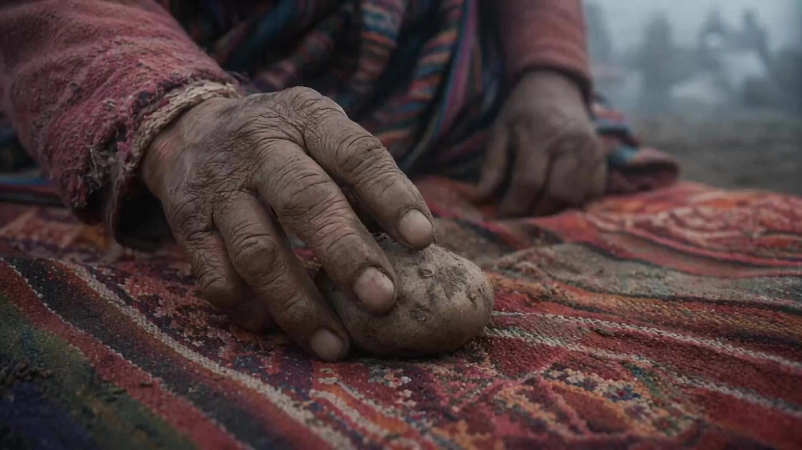

# East Asian Arthouse Film - Emotion-Driven Atmosphere

> **作者：** @Sangasong

## Content

Process Planning:

Workflow and Stage Logic

First, confirm the "emotional trajectory" with the user, rather than the plot outline.\n The core is not "what the audience understands happened," but "what the audience feels changing."\n Organize the final direction into Final_Video_Spec.md (Title, Emotional Theme, Estimated Duration, Aspect Ratio, Language, Visual Vibe, etc.) → text_editor

Enter the Storyboard Design stage (Key Elements, Shot List, Audio Layers) → storyboard_designer.\n The focus is not on advancing events, but on designing pauses, negative space, and the flow of emotion.\n Once finished, you must pause and wait for the user to confirm the overall rhythm and emotional structure.

Generate Key Element images (Characters, Scenes, Important Objects) → media_generator.\n Focus on confirming whether the "vibe is right," rather than whether the amount of information is sufficient.\n Once finished, pause and wait for the user to confirm the visual direction.

Generate the final video shot-by-shot according to the Shot List → media_generator.\n Generate videos referencing the Key Elements, strictly adhering to the emotional descriptions, spatial relationships, and breathing rhythm in the shots, without using strong plot conflicts as the driver.\n Pause for confirmation after completion.

Generate Audio Layers (Music, Narration) → media_generator.\n Sound does not just supplement the visuals; it carries the "emotional continuity."

Final Editing and Composition → video_assembler.\n Overall adherence to "breathing" editing logic: negative space, pauses, lingering resonance, prioritizing emotional continuity over information efficiency.

Dependencies: 2→1; 3→2; 4→3; 5→2; 6→3,4,5.

Execution Principles

After each stage is completed, you must pause and wait for user confirmation.\nIt is prohibited to execute the entire process continuously at once.

Quality Self-Check Before Generation

After every Shot List or Prompt output, you must check the following:

Are there shots with "forced dramatic conflict"?\n → Prioritize changing to negative space, metonymy, sound-image separation, or emotional aftershocks.

Are there characters performing intense emotions directly (crying, shouting, breaking down)?\n → Change to empty shots, environmental changes, object details, or let sound carry the emotion.

Do all shots retain enough dwell time?\n → Single shots should be ≥ 6 seconds, avoiding MV-style rapid cuts.

Is there a lack of "breathing room" between shots?\n → Must add empty shots, black screens, ambient sound, or rhythmic buffers.

Is the emotional progression too "expository"?\n → Reduce explanatory feel, increase observational feel and sense of space.

Are East Asian scenes being shot from an "exotic" or "touristy" perspective?\n → Return to the observational perspective of a local's daily life.

Do prompts contain overly direct expressions that destroy the arthouse vibe?\n → Delete overly dramatic, slogan-like, or performative descriptions.

Does the whole film conform to a "breathing structure":\n Setup (Inhale) → Emotional Stagnation (Hold Breath) → Emotional Release (Exhale)\n → If the rhythm is monotonous, the emotional curve must be readjusted.

Asset Analysis:

Principles for Analyzing Reference Assets:

If the user uploads reference footage (film stills, movie frames, photography), focus on extracting: main light source direction and texture, color tendency (color temperature/saturation/highlight-shadow relationship), depth of field and lens focal length feel, spatial relationship between characters and environment, and screen emotional density.

If the user uploads existing video assets, determine the camera movement style (check if it fits the recommended range for this Skill), identify the emotional stage (setup/buildup/peak/release), and extract information on character appearance and scene features that can be bound to key_elements.

If the user uploads a written script or outline, identify the "emotional nodes" rather than "event nodes," and map each emotional node to an emotional unit in the Storyboard Design.

All analysis results must align with the principle of "East Asian emotional inward expression": emotions are expressed through subtle behaviors, environmental resonance, and object metaphors, rather than through direct character dialogue or physical acting.

Storyboard Design:

Core Creative Principles

Do not rely on "event advancement" to complete the narrative. What truly drives the film forward is the slow change in characters' emotions over time. The goal of every shot is not for the audience to understand "what happened," but for the audience to feel: something is slowly changing inside the character. It emphasizes lingering resonance after emotional pauses, not information density.

Key Elements Design

Character (element character): Prioritize describing stable appearance features (sense of age, skin tone, hairstyle, clothing texture), and deliberately avoid descriptions of "perfect makeup"; allow for uneven skin tone and natural states. Write the character's emotional traits into the description (e.g., "accustomed to using silence instead of expression").

Scene (element scene): Describe the "traces of life" in the space—old wallpaper, a messy but orderly kitchen, potted plants on the windowsill. Record the main light source direction (e.g., "natural light from the window on the left") and time of day (e.g., "5 or 6 PM, dusk").

Important Objects: Symbolically recurring objects must be registered as key_elements separately, and their state changes across different emotional stages must be described (e.g., the same cup: steaming → no steam → taken away).

If the user has already provided reference images or video assets, the element description must remain consistent with the reference content and not conflict with it.

Shot Design Specifications
Camera Movement Specifications

Recommended Camera Movements (must choose from the following methods):

Camera Movement Method

	

Emotional Analogy

	

Recommended Duration

Static camera

	

Sitting quietly opposite you, watching but not speaking

	

8—15 seconds

Very slow push-in

	

Approaching someone lost in thought, not wanting to disturb but wanting to see clearly

	

10—15 seconds

Subtle handheld / breathing motion

	

Watching someone, natural swaying caused by breathing

	

6—10 seconds

Slow lateral tracking

	

Walking through a room, glancing over the table or windowsill

	

8—12 seconds

Static close-up

	

Staring at someone's hand or profile, lost in thought

	

6—10 seconds

Forbidden Camera Movements:

Rapid zoom in/out (subjects lose consistency)

Whip pan/Rapid shake (loss of motion blur control, frame-to-frame continuity breakdown)

Orbit shot (multi-angle character consistency cannot be guaranteed)

High-altitude drone dive (conflicts with arthouse film aesthetic)

Frequent focal length switching within a single shot (subject deformation)

Shot Pacing Iron Rules

The minimum duration of a single shot is 6 seconds

Narrative segments are recommended to consist of 3—4 shots forming an emotional unit, with a total duration of 30—50 seconds

Transitions between shots must use 1—2 seconds of black screen or empty shots; hard cuts are prohibited

The entire film's rhythm must follow the breathing structure: Inhale (emotional setup) → Hold Breath (emotional peak) → Exhale (emotional release/empty shot)

Each Shot Description Must Include

Scene Anchoring: Cite the ID of the corresponding element scene, and note the time of day and main light source direction.

Character State and Micro-actions: Describe the subtle things the character is doing (subtle facial expression changes, eyes moving away, slight finger movements); describing intense physical actions or emotional outbursts is prohibited.

Camera Instructions: Select one from the recommended camera movements and write it clearly.

Emotional Direction: Where this shot sits in the emotional arc (setup/buildup/peak/release).

Duration: Mark the recommended seconds (≥6 seconds).

Happy Horse Capability Boundaries and Alternative Plans

Stable Scenes (Can be generated directly):

Slow changes in character emotion: subtle facial expression changes, eyes moving away, changes in breathing rhythm

Static/micro-dynamic character states: daydreaming, silence, gazing, walking slowly

Resonance between environment and character emotion: wind blowing hair, rain on glass, light slowly moving across the face

Metaphorical expression of object close-ups: cold tea, unsent messages

Presentation of spatial atmosphere: empty corridor, street after rain, rooftop at dusk

Dangerous Scenes (High probability of collapse, must use alternative plans):

Dangerous Scene

	

Collapse Performance

	

Alternative Plan

Intense emotional outburst (crying/shouting/throwing things)

	

Facial deformation, jumping facial expressions

	

Sound-image separation: visual gives empty shot/objects, emotion carried by the soundtrack

Rapid physical movement (running/fighting/crashing)

	

Bodily distortion, motion blur buildup

	

Emotional pre-positioning (second before outburst) or post-positioning (after the outburst)

Intense multi-person interaction (confrontation/argument)

	

Loss of facial consistency for two people

	

Metonymy: replace character emotion with environmental change

Complex scene transition within a single shot

	

Continuity breakdown

	

Break into independent shots, connected by black screens/empty shots

Emotional Outburst Alternative Strategies (When the plot must present strong emotions):

Sound-image separation: Visual gives environment/objects/empty shots, emotion is entirely carried by music and sound effects.

Emotional pre-positioning: Generate the "second before the outburst"—eyes moist but not crying, fingers clenched but not hitting the table.

Emotional post-positioning: Generate "after the outburst"—an empty chair, a broken cup, an empty street in the rain.

Metonymy: Replace character emotion with sudden environmental changes—a light suddenly going out, paper blown away by the wind, a closing door.

Visual Aesthetic System
Color Direction

Saturation: Medium-low (retains color information, but never vivid)

Highlights: Soft overflow, slight overexposure for window light/backlighting is allowed

Shadows: Layered, details retained in dark areas, no dead blacks

Skin tone: Warm yellow bias, realistic without retouching, uneven tones allowed

Reference film aesthetics: Hirokazu Kore-eda's low-contrast soft daylight tones (Still Walking), Wong Kar-wai's warm yellow and deep green emotional color blocks (In the Mood for Love), Lee Chang-dong's sunset gold and dark blue-grey (Burning), Hou Hsiao-hsien's film-like natural warmth (Three Times).

Recommended Light Sources

Natural window light (side light dominant, creating light and shadow separation on the face)

Dusk/Dawn directional light (low angle, long shadows)

Overcast diffuse light (even and soft, suitable for outdoor emotional segments)

Interior practical lighting (desk lamps, fluorescent tubes, TV screen light)

Forbidden Light: Flat frontal light (eliminates emotional feel), colorful neon/artificial strong light (commercial feel), complete darkness without light sources.

Narrative Connection Strategy (Replacing hard cuts and dialogue advancement)
Empty Shot Transitions

Insert 1—2 environmental empty shots between two character segments to carry: passage of time / emotional sedimentation / geographic context.\nRecommended content: changes in sky clouds, empty streets, light moving across windows, ripples on water surfaces.

Symbolic/Object Narrative

Narrative needs symbolic substitutions to express: "Time has passed" The same cup: steaming → no steam → cup is taken away "Relationship breakdown" Two chairs: side-by-side → one is empty → chair is moved away "Waiting" Window plant: budding → growing → withering "Decision to leave" Suitcase: in the corner → pulled out → appears at the doorway

Background Music/Ambient Sound as Narrative Thread

Design emotional sound effect stages in audio_layer:

Emotional Stage

	

audio_layer Direction

Peaceful daily life

	

Primarily ambient sound: birds chirping, distant traffic, pendulum clocks, faucets

Emotional buildup

	

Add a single instrument line: single piano notes, cello long tones

Emotional peak

	

Sound-image separation—visual gives empty shot/objects, music carries the full weight of emotion

Emotional release

	

Return to ambient sound, but "emptier" than the beginning—wind sounds, distant human voices fade away

Slow Motion as an Emotional Amplifier

Do not use slow motion for action scenes

Use in micro-moments (looking back, reaching out, closing eyes, raindrops falling into water)

Slow motion is 2—3 times the original speed, do not over-decelerate (to avoid image blur)

East Asian Emotional Expression Norms

Core Principle: Shoot the "Asia seen daily by people living there," not the "Asia in travel promos." Use the daily perspective of a local, without the "exotic" Orientalism of Western perspectives.

East Asian narrative emotional expression is characterized by "inwardness" rather than "outwardness":

Emotion

	

Forbidden (Outward/Western expression)

	

Recommended (Inward/East Asian expression)

Sadness

	

Covering face and crying, wailing

	

Looking down in silence, gentle deep breath, turning to face the window

Affection

	

Hugging and kissing, verbal confession

	

Silently serving an extra bowl of rice, helping to tie an apron

Anger

	

Throwing things, shouting

	

Putting chopsticks down slightly hard, silent exit, door closing louder than usual

Longing

	

Calling to confide, running to meet

	

Looking through old photos, walking the path walked together before

Relief

	

Laughing and hugging, reconciling dialogue

	

Looking into the distance for a long time, then breathing out gently, opening a window that hasn't been opened in a long time

East Asian Daily Environment Reference Elements (Write into shot description and element scene):

Space: Narrow apartment corridor, clothes drying on the balcony, narrow alleys of traditional markets, late-night white lights of convenience stores, stairwells of old residential buildings, rooftops, under arcade walkways on rainy days

Objects: Steam from a rice cooker, old calendars on the wall, fruit in plastic bags, handwritten sticky notes, worn slippers, balcony potted plants, dripping clothes on drying racks

Time/Weather: Plum rain season, 5-6 PM dusk light, 5 AM dawn light, stuffy air before a typhoon, wearing long sleeves for the first time in autumn, white breath in winter

Media Generation:

Video Generation Tools and Models:

Preferred model for all shot video generation: Happy Horse, resolution 1080p, duration according to storyboard design (minimum 6 seconds, maximum 15 seconds).

If Happy Horse generation fails, first try switching to other models within ImagesToVideo (e.g., Vidu Q3); do not silently switch tool types; if all models fail, stop the task and report to the user, asking if they would like to try other tools.

Happy Horse Capability Boundaries (Mandatory check before generation):

Direct generation prohibited: Intense emotional outbursts (crying/shouting/throwing things), rapid physical movement (running/fighting), intense multi-person interaction, complex scene transitions within a single shot.

The above scenes must first be replaced in the storyboard layer with sound-image separation/emotional pre-positioning/emotional post-positioning/metonymy schemes before proceeding with generation.

Key Element Image Generation:

Use TextToImage, recommended model: Nano Banana Pro (Gemini 3 Pro Image), resolution 2K.

Character reference images should use a horizontal side-by-side composition: head and shoulder close-up on the left (facial features, skin tone, hairstyle) + full body on the right (clothing texture, body silhouette).

If the user has already provided reference images, register the asset_id directly and bind it to the corresponding key_element; do not regenerate.

Shot Video Reference Binding Rules:

When generating each shot, by default use the key_element of the characters and scenes involved in that shot as the reference_image.

Only when the current shot has extremely strong visual continuity with the previous shot (e.g., subsequent actions of the same character in the same space) should the final_shot of the previous shot be additionally bound as a reference_video. In general circumstances, do not add video references.

Audio Generation:

Use text_to_instrumental for background music (bgm), recommended model: Mureka 8; avoid including names of famous musicians in the prompt.

Use text to narration for narration, recommended model: ElevenLabs v3.

Ambient sound (SFX) is preferentially generated through the built-in audio capabilities of the FirstFrameToVideo model; if independent generation is required, inform the user of current tool limitations.

Processing User-Uploaded Assets:

For any images/videos/audios provided by the user, register the asset_id first, then bind them to the corresponding key_element or shot/audio_layer in the storyboard; do not overwrite or ignore user-provided assets.

Prompt Writing:

Prompt Writing General Rules

Language: Prompts must be written in English (for model execution); instructions on prompt structure and communication with the user should be in Chinese.

Core Stance: Writing prompts is like an arthouse director giving instructions to a cinematographer—describe things the camera can see; do not write character motivations, psychological analysis, or narrative background outside the frame.

Prompt Structure Template

[Style Anchor Words] + [Lighting Conditions] + [Subject/Character State] + [Specific Action (Micro)] + [Environmental Details] + [Emotional Direction] + [Texture Words] + [Camera Instructions]

Mandatory Keywords

Style Anchor Words (Choose at least 3 each time):\nslow cinematic, observational, emotionally restrained, East Asian arthouse, intimate, contemplative, naturalistic

Texture Words (Choose at least 2 each time):\nfilm grain, soft focus, natural lighting, muted palette

Camera Movement Description Words (Choose 1 mandatory each time):

Static: static camera, still frame, no camera movement

Micro-movement: subtle handheld, gentle drift, breathing motion

Slow zoom: very slow push-in, gradual zoom

Lateral tracking: slow lateral tracking

Conditional Keywords

Add for Character Emotional Segments:\nmicro-expression, subtle emotional shift, eyes looking away, quiet contemplation, internal emotion, restrained performance

Add for Empty Shot/Environmental Segments:\nempty space, lingering shot, atmospheric, environmental storytelling, symbolic object, passage of time, seasonal change

Add for East Asian Cultural Scenes:\nEast Asian daily life, local texture, humid air, narrow alley, warm interior light, handwritten sign, aging architecture, traditional market, monsoon season, quiet neighborhood

Texture Keyword Priority Reference

film grain > soft natural light > shallow depth of field > muted colors > warm skin tone > gentle lens flare > atmospheric haze > subtle motion > lived-in environment > imperfect composition > quiet intimacy

Visual Aesthetic System
Color Direction

Saturation: Medium-low (retains color information, but never vivid)

Highlights: Soft overflow, slight overexposure for window light/backlighting is allowed

Shadows: Layered, details retained in dark areas, no dead blacks

Skin tone: Warm yellow bias, realistic without retouching, uneven tones allowed

Reference film aesthetics: Hirokazu Kore-eda's low-contrast soft daylight tones (Still Walking), Wong Kar-wai's warm yellow and deep green emotional color blocks (In the Mood for Love), Lee Chang-dong's sunset gold and dark blue-grey (Burning), Hou Hsiao-hsien's film-like natural warmth (Three Times).

Recommended Light Sources

Natural window light (side light dominant, creating light and shadow separation on the face)

Dusk/Dawn directional light (low angle, long shadows)

Overcast diffuse light (even and soft, suitable for outdoor emotional segments)

Interior practical lighting (desk lamps, fluorescent tubes, TV screen light)

Forbidden Light: Flat frontal light (eliminates emotional feel), colorful neon/artificial strong light (commercial feel), complete darkness without light sources.

Narrative Connection Strategy (Replacing hard cuts and dialogue advancement)
Empty Shot Transitions

Insert 1—2 environmental empty shots between two character segments to carry: passage of time / emotional sedimentation / geographic context.\nRecommended content: changes in sky clouds, empty streets, light moving across windows, ripples on water surfaces.

Symbolic/Object Narrative

Narrative needs symbolic substitutions to express: "Time has passed" The same cup: steaming → no steam → cup is taken away "Relationship breakdown" Two chairs: side-by-side → one is empty → chair is moved away "Waiting" Window plant: budding → growing → withering "Decision to leave" Suitcase: in the corner → pulled out → appears at the doorway

Prohibited Keywords

Prohibited Word

	

Reason

dramatic, intense, explosive

	

Triggers the model to generate intense action

fast, rapid, dynamic, energetic

	

Triggers rapid movement causing image collapse

cinematic action, thriller

	

Style drifts toward commercial genre films

perfect skin, beautiful, glamorous

	

Triggers retouching aesthetics, loses realism

neon, cyberpunk, futuristic

	

Color system completely deviates

drone shot, aerial view

	

Triggers unstable high-altitude perspective

Reference Examples

Character Solitude Emotional Segment:

Slow cinematic, static camera, low angle, a woman sitting alone at a small kitchen table at night, cold meal untouched in front of her, fluorescent light overhead casting pale shadows, she stares at nothing, subtle breathing motion in her shoulders, cluttered kitchen background with aging wallpaper, quiet stillness, film grain, muted cool tones, shallow depth of field, East Asian apartment interior

Sound-Image Separation Empty Shot (Alternative visuals during emotional outburst):

Slow cinematic, static camera, an empty hallway in an old apartment building, afternoon sunlight coming through a dusty window, dust particles floating in the light beam, complete stillness, no people, worn tiles on the floor, a pair of old slippers by a door, atmospheric silence, film grain, warm muted tones

East Asian Daily Emotional Action (Don't shoot face, only hands):

Slow cinematic, soft morning window light, close-up of aged hands carefully placing food into a lunch box, steam rising from freshly cooked rice, worn cutting board and familiar utensils in background, no face visible only hands and food, gentle and meticulous movements, warm muted tones, film grain, subtle handheld breathing motion, intimate domestic atmosphere

Ending Emotional Release Shot:

Slow cinematic, very slow push-in, a figure seen from behind standing at an open window, morning light flooding in, curtain gently moving with breeze, the person takes a deep breath and their shoulders drop slightly in release, atmospheric haze from morning air, film grain, soft warm tones fading toward gentle overexposure, contemplative and hopeful

Video Editing:

Basic Editing Rule: Breathing RhythmFull film editing rhythm simulates human breathing frequency:

Inhale (Emotional Setup): Longer shots, fixed camera positions, establishing spatial sense and character state

Hold Breath (Emotional Peak): Extend single-shot negative space, do not speed up; at this time, music/ambient sound has higher weight than visuals

Exhale (Emotional Release): Empty shots or object close-ups, coordinated with sound effects "becoming empty"—quieter than the setup segment

Transition Rules Between Shots:

Hard cuts are prohibited; use 1—2 second black screen fade in/out between all shots, or insert a 6—8 second environmental empty shot as a buffer

Use short black screens (about 1 second) within emotional units (3—4 shots)

Use long empty shots (8—12 seconds) or long black screens (2 seconds) to transition between emotional units

Sound-Image Relationship:

bgm and ambient sound tracks must not be hard-cut; use fade in/out for all audio transitions, with a duration of 1—3 seconds

Emotional peak segments: reduce volume of the visual track (if there is dialogue/sync sound), increase bgm track to dominant position

Emotional release segments: gradually fade out bgm, leave ambient sound alone and slightly lower the volume, creating a "sense of emptiness"

There may be overlap between narration and sync sound generated by FirstFrameToVideo, which must be checked on the timeline and manually offset; narration priority is higher than sync sound generated by the model

Slow Motion Processing:

Slow motion segments (2—3 times deceleration of original speed) need corresponding extension of the shot's placeholder duration on the timeline

Do not apply more than one deceleration process to the same segment of material, to avoid image blurring

Overall Rhythm Check:

When there is no sound effect/music change for more than 3 consecutive shots, a faint sound effect layer (such as single-note piano or environmental sound changes) must be introduced at the end of the 3rd shot to prevent audience attention from drifting

After the last shot of the entire film ends, retain 2—3 seconds of pure black screen with audio fade out, before entering end credits (if any)
