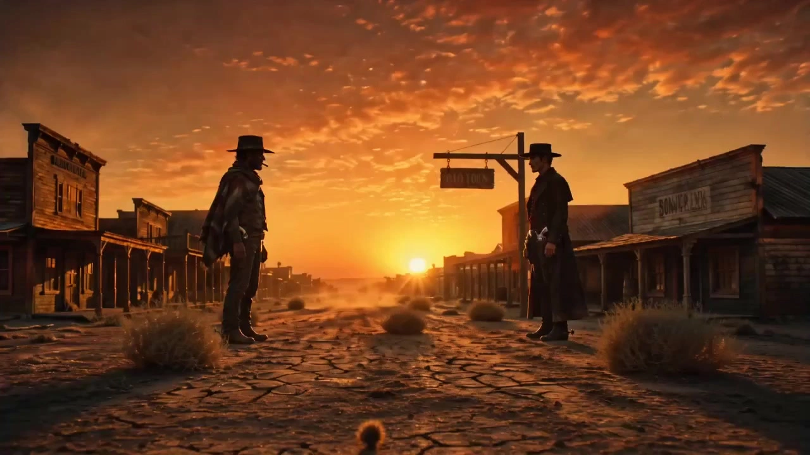

# Eastwood-Style Western

> **作者：** @Damon

## Content

Process Planning:

Core Model Uniqueness Statement and Authentication Downgrade Policy:

Exclusive Image Generation Model: You must use GPT Image 2 exclusively for creating all image assets throughout the process (including full-body three-view character sheets and four-quadrant scene reference images, whether via TextToImage or ImageToImage paths). The use of any other image models (such as Nano Banana, Seedream, Midjourney, etc.) is strictly prohibited.

Exclusive Video Generation Model: You must use Seedance 2.0 exclusively for creating all shot-list videos (via the MultiModalToVideo path) throughout the process. The use of any other video models (such as Kling, Sora, Google Veo, etc.) is strictly prohibited. Since Seedance 2.0 is a premium member-exclusive model, if you encounter a non-member user during execution, do not actively block or refuse before generation. You should fully delegate authentication and downgrade mechanisms (such as interface prompts or backend model substitution) to the downstream toolchain, maintaining the high-standard cohesion of the Playbook.

Global Settings and Execution Phases:

Establish Global Settings (Final_Video_Spec.md): Use text_editor at the very beginning of the project to create a global audiovisual specification brief, which serves as a unified parameter anchor for all downstream sub-tasks (storyboard design, media generation, video assembly). The core plot and creative concept must be based entirely on the script or screenplay framework provided by the user. The aspect ratio defaults to 16:9 cinematic widescreen (if the user specifically requests short-video platform release, it can be flexibly adjusted to 9:16 vertical aspect ratio, with lens composition adjusted accordingly). The default video resolution is 720p. The output language and visual style are defined as "Eastwood-style Spaghetti Western." Final_Video_Spec.md Standardized Markdown Template:

Title: Project Name/Duel Theme (e.g., The Good, the Bad and the Ugly: Frontier Showdown)

Type: Action/Psychological Standoff/Revisionist Western

Aspect Ratio: 16:9 (Default Cinematic Widescreen) or 9:16 (Mobile)

Resolution: 720p (Default Standard)

Output Language: Target output language for narration and character lines (e.g., English / Chinese)

Visual Style: Desolate and weathered aesthetic (Sergio Leone style, faded film, Technicolor, backlit volumetric lighting)

Audio Tone: Morricone-esque symphonic acoustics (Ennio Morricone, lonely whistling, wind chimes, iron spurs)

Story Outline: Core plot summary of the fateful duel's beginning, development, climax, and resolution

Storyboard Design (storyboard_designer):

Based on the user's plot concept, design key_elements including core characters and scenes (e.g., a lonely wilderness gunslinger, the dusty streets of a frontier town).

Lens design should follow the rhythmic logic of "extreme stillness (buildup/standoff) to extreme action (instant explosion)," incorporating eye close-ups, ultra-wide panoramic shots, low-angle shots, and slow push-in shots.

In any long-distance duel scene, the storyboard must first establish a "Standoff Spatial Lock": the relative position, distance, orientation, lens axis, bullet trajectory, and falling direction of both sides. All subsequent ECU/CU close-ups must inherit this spatial relationship; the physical distance between the two parties cannot be changed simply because the shot cuts to a close-up.

Acquire and Create Character/Scene Visual Assets (resource_prepare_and_analyze and media_generator):

Branch A (User provides reference images): If the user uploads character or scene reference images, first use resource_prepare_and_analyze to perform multimodal analysis, extract features, evaluate aesthetic style alignment, and specifically detect whether the character image is a standard "full-body three-view sheet" (must include front, side, and back views as a complete full-body portrait; half-body portraits are strictly prohibited) and whether the scene image is a "multi-angle, character-free four-quadrant scene reference":

If fully aligned and compliant with full-body three-view and four-quadrant standards: Use media_generator to directly register and bind it to the corresponding key_element's asset_id.

If the style does not match, or the character image is not a standard full-body three-view, or the scene image is not a standard four-quadrant grid: Use the user's material as a physical, character, and compositional reference, and call the ImageToImage path of media_generator (using the GPT Image 2 model) to regenerate: a full-body three-view character sheet conforming to the film's style (side-by-side front, side, and back full-body portraits, not half-body), and a multi-angle, character-free scene reference conforming to the standard four-quadrant grid (panoramic establishing shot/prop close-up/depth perspective/atmospheric lighting), then register and bind it to the corresponding key_element.

Branch B (User did not provide reference images): If the user did not provide materials, directly call media_generator using GPT Image 2's TextToImage to generate 16:9 aspect ratio, 2K resolution character assets that fit the Eastwood Western gritty feel (standard full-body three-view character sheet: front, side, and back full-body portraits side-by-side in a single image, no half-body shots) and scene assets (a standard multi-angle, character-free four-quadrant scene image with a fixed distribution of panoramic establishing shot, prop close-up, depth perspective, and atmospheric lighting), and register and bind them to the corresponding key_element.

Comprehensive Verification Mechanism (Strictly prevent omissions): After visual assets are established, you must check all key_elements (character and scene elements) defined in the storyboard one by one to ensure each has successfully bound the corresponding asset_id. If there are any missing or unbound elements, proceeding to the shot video generation step is strictly prohibited.

Generate Shot-List Video (media_generator):

For each shot, based on the duration planned in the storyboard, use the MultiModalToVideo tool to call Seedance 2.0 (resolution 720p, 16:9 aspect ratio, single shot duration controlled between 4s - 15s; generating shots shorter than 4s is strictly prohibited).

Prompt Alignment and Anti-Omission Review: Before generating each shot, you must compare the upcoming prompt against the storyboard script to perform a multi-dimensional check, ensuring that scene references, character references (placeholder bindings), lines, and dialogue information are all accurately aligned with no omissions.

Visual Consistency (Anti-Jumping/Glitch): Each shot must explicitly bind its associated scene key_element from the storyboard. When calling video generation, the corresponding character key_element image and the scene four-quadrant reference image must be passed as reference_image (dual-strong baseline binding). It is strictly forbidden to have shots without a bound scene reference image to completely prevent background drifting, jumping, or scene inconsistency between shots. If adjacent shots have extremely strong action continuity, the previous shot video can be bound as a reference_video.

Tone Consistency: If a shot contains character dialogue, the key_element_audio sound asset (via audio_infos) owned by the corresponding element character must be explicitly bound in the generation parameters to ensure the dialogue voice characteristics are perfectly preserved across shots.

Generate Audio and Video Layers (media_generator):

Independent Audio Track Design: Design Morricone-style whistling, silent wind sounds, wind chimes, and spur metal clinking sound effects as independent audio_layers; if there is narration (VO), call the narration voice generation tool, selecting the classic voiceover model that best fits the Western film texture.

Final Timeline Assembly and Image Quality Enhancement (video_assembler and media_generator):

Montage splicing of generated video segments, sound effects, and background music is completed by video_assembler.

Upscaling and Frame Interpolation for Final Cut: Utilize the super_resolution tool of media_generator to apply the MediaKit model for upscaling and frame interpolation on the assembled final video, giving the final cut cinema-grade, detailed image quality and a 24fps or 30fps film-like frame rate while maintaining the gritty visual style.

Pause Confirmation Control (Strict Phased Confirmation Mechanism):

Before generating any new assets, you must pause and request explicit confirmation from the user; automatic continuous execution without confirmation is strictly prohibited:

Before generating key_element character/scene images (Step 3 Branch B): After designing the storyboard, you must pause, report the storyboard concept and key_element plan to the user, and only start the GPT Image 2 image generation after receiving permission.

Before generating shot-list video (Step 4): Before proceeding to the next step, you must first check and ensure that all key_element assets (including characters and scene four-quadrant images) defined in the storyboard have been generated and bound; simultaneously, you must check the Prompt of each shot video one by one, comparing it with the storyboard script to confirm that the corresponding character placeholders and their respective scene placeholders have been perfectly bound, with no missing scene references, character references, or character dialogue. Ensure that every shot is forced to bind its corresponding scene key_element four-quadrant image as reference_image during video generation to strictly prevent video background drift or jumping due to unbound or missed scenes. After the check is complete, pause and fully display the asset binding status, check results, and visual baseline assets to the user. Only after receiving the user's explicit confirmation that assets are complete and without omissions, and that the image and style meet expectations, can you start the Seedance 2.0 video generation.

Before generating audio and background music (Step 5): Before starting to call Suno 5 or TTS to produce the score/narration, you must pause, confirm the soundtrack style and narration plan with the user, and only proceed with generation after confirmation.

Before final timeline assembly (Step 6): After all video and audio assets are generated, you must pause and show the user all individually generated media results; final timeline assembly can only be performed after confirmation that everything is correct.

Asset Analysis:

User Reference Material Analysis Guide:

When users proactively provide assets (such as character reference images, Scene Reference Images, videos, or audio), the primary responsibility is to precisely distill them into structured visual features:

Character Full-Body Three-View (Turnaround) Analysis and Detection: Check whether the images uploaded by the user are full-body three-view (front, side, back) turnarounds. If so, extract the body proportions, facial contours, hairstyle, skin texture, classic costume details (such as capes, felt hats, holster designs), color schemes, and unique markings (such as scars, stubble, etc.) from each angle, and merge them into a highly complete descriptive report. If the user does not upload a three-view turnaround, or only uploads half-body shots/portraits, it must be determined as a "format mismatch" and a reconstruction process must be initiated.

Scene Reference Image Analysis and Layout Detection:

Check if the scene images uploaded by the user are person-free, multi-angle "standard four-grid" layouts (containing 4 independent image frames).

Extract the spatial layout, core architecture, representative props (such as saloon bars, tombstones), color tone (faded earthy tones), and light and shadow (high contrast).

Aesthetic Alignment and Format Verification (Core Responsibility):

Evaluate whether the assets possess the underlying tone of a Western film (high-hardness contrast lighting, sandy/dusty feel, weathered textures, a sense of rugged age) and strictly verify the format: character images must be full-body three-view turnarounds, and scene images must be person-free four-grid scene reference images.

If fully aligned (character is a standard full-body three-view, scene is a standard four-grid, and style is consistent): Extract the features of each view/grid for output and mark them as ready for direct binding.

If not aligned (e.g., style mismatch, character is not a full-body three-view or is a half-body shot, scene does not meet the four-grid requirement or contains people): It must be determined as a "format/style mismatch", and a "Western Style Conversion and Format Reconstruction Plan" must be formulated:

Character Full-Body Three-View Reconstruction Plan: Using the facial and basic features from the user-uploaded image (such as half-body shots, portraits, or non-three-view images) as the base reference, strip away modern/anime clothing, re-compose and redraw them into a full-body three-view (front/side/back displayed horizontally side-by-side) that conforms to the film's style (displaying complete hats, capes, belts, holsters, leather boots, and full-body proportions—displaying only half-body or heads is strictly prohibited), and perfectly integrate facial features into Western-style clothing (wide-brimmed hats, striped cloaks, leather holsters, stubble).

Scene Four-Grid Reconstruction Plan: Using the spatial geometry of the user-uploaded scene as the underlying framework, plan and reconstruct a standard person-free four-grid scene reference image. The content of the four grids must be fixed as follows:

Top-Left (Establishing Full Shot): Wide, deserted Western architecture or grand wilderness setting.

Top-Right (Close-up of Furnishings): Close-up of weathered wooden furniture, old firearms, or a saloon bar.

Bottom-Left (Depth Perspective): Town street or canyon depth with strong perspective lines.

Bottom-Right (Atmospheric Lighting): High-tension lighting effects with flying dust cast under strong backlight or a sunset horizon.

Voice Analysis: Analyze whether the voice is hoarse, deep, dry, or weathered; record the audio features into key_element_audio to maintain consistency in voiceover.

Reference Video Dynamics and Camera Feature Analysis: If the user has uploaded a classic Western film video as a reference for editing, camera work, or motion, the system should use resource_prepare_and_analyze to deeply parse:

Camera Motion Path: Extract camera techniques such as extremely slow facial push-ins (Slow Zoom-in/Push-in), low-angle pans (Low-angle Pan/Dolly), etc.

Physical Motion Feedback: Extract the transient frequency of the draw action, the diffusion rate of gun smoke, and the amplitude of physical trembling upon being hit.

Light and Shadow Texture: Extract the ratio of high-contrast hard lighting (Chiaroscuro) and air dust density in the frame, and output these camera and motion features as descriptive text, directly written into the shot descriptions of the Storyboard.

Normalize these analysis results into text descriptions and seamlessly inject them into the key_element descriptions of the Storyboard to ensure the final generated video perfectly aligns with the physical assets provided by the user.

Storyboard Design:

I. Core Characters and Scene Settings for Storyboard (Key Elements Design)

The Gunslinger —— Defining the Ultimate Portrait, Expression, and Attire:

Facial Features: Weathered sun-bronzed skin, squinting piercing steel-blue eyes, sun-cracked lips, with a half-burnt cigarillo dangling from the corner of the mouth.

Attire: Draped in a classic faded Mexican striped wool poncho, worn over a distressed leather vest.

Weapons & Accessories: Leather belt with brass bullets and Colt holster at the waist; worn leather boots with clinking brass spurs, featuring tiny gears on the heels that chime when walking.

The Antagonist —— Defining the Ultimate Sinister Expression and Dark Attire:

Facial Features & Sinister Gaze: Sinister cold facial features. Hawk-like eyes are half-hidden in the deep shadow of the cowboy hat brim, suddenly shooting a sharp, razor-cold glare through the darkness; intense side backlighting reflects a cold metallic gleam on the irises, with a gaze that seems to freeze the flying sand in the air. A cold smirk reveals slightly yellowed teeth with subtle metal inlays, with a cruel curve at the corners of the mouth. A meticulously groomed black handlebar mustache casts a sharp silhouette in the shadows.

Attire: Wearing a stiff but dust-covered black double-breasted duster coat, with the hem fluttering slowly in the dry sand wind, showcasing the texture of the heavy fabric. Underneath, a deep crimson silk vest and a black high-collar shirt.

Weapons & Lighting: High-crowned black cowboy hat. Two engraved silver-plated revolvers in dual matching black holsters at the waist or thighs, reflecting blinding, cold sun glints; intense high-contrast metallic highlights and deep dramatic shadows on the engravings, hinting at brutal killing momentum.

Cold Spurs & Actions: Worn black boots with dark cast-iron spurs reflecting a faint cold metallic sheen on the heels. As he slowly and heavily lifts his heel or adjusts his stance, the black gears of the spurs rub slightly against the dry sand, accompanied by a slow, ominous metallic clinking and crashing echo of heavy boots sinking into the dry dirt.

Border Town —— Reshaping Spatial Texture and Desolate Environment:

Establishing Shot: A full view of the dead, empty town, with wooden boards of the buildings warped and cracked from the sun, presenting an extreme sense of desolation.

Props Close-up: A creaking, sun-baked wooden sign hanging outside the saloon, supported by only a single rusty iron nail, along with rusty horse hitching posts covered in verdigris.

Depth Perspective: The straight-extending, dust-filled main street, tumbleweeds lazily rolling on the dry, cracked mud ground, and dust devils spinning slowly in the empty, abandoned alleys.

Atmospheric Lighting: Strong backlighting from the sunset on the horizon, with flying dust and coarse burlap shreds permeating the air under the intense orange-gold halo, along with tattered black fabric torn and flapping violently in the gale.

II. Camera Design, Rhythm, and Action Logic

Rhythm from Extreme Stillness to Extreme Motion: The camera design follows the rhythm logic of "Extreme Stillness (building tension) to Extreme Motion (instant explosion)." During the standoff phase, prioritize long-focal-length close-ups with extremely shallow depth of field (e.g., eye close-ups, hand close-ups, spur close-ups), maximizing tension through Eyeline Match and minimal camera movement.

Spatial Continuity Lock: In any long-range standoff/duel sequence, the Storyboard Designer must first establish the physical relationship between the two parties using a wide shot or OTS (Over-the-Shoulder) shot: Party A's position, Party B's position, distance, facing direction, screen left/right or depth axis, and firing/falling direction. Subsequent ECU/CU shots of eyes, hands, holsters, and spurs can only change the shot scale, not the true distance or position between the characters.

Declaration of Relationships in Local Close-up Shots: Whenever a partial close-up shot mentions body parts, weapons, or action details of "both parties," "the two," or "each other," it must be explicitly stated whether it is "in the same frame" or "cross-cutting." Close-ups of hands, spurs, eyes, and holsters in long-range duels should be written as intercut close-ups / hard cuts by default; do not use ambiguous phrasing like "both hands" or "the two holsters" to describe a single close-up, unless the plot explicitly requires the two to be in the same frame at close range.

Aesthetic of Minimalist Dialogue Pauses: Character dialogue should be extremely restrained (actions speak louder than words), and any long-winded monologues are prohibited. In dialogue design, it is mandatory to consciously include dashes or ellipses ... (e.g., {No... I don't think so...}) to guide the voice-synthesis model to produce a gritty, weary articulation with dramatic pauses and breathing.

III. Classic Duel Shot & Dialogue Blueprint

When designing the storyboards for a duel, you must arrange the plot according to the following standard "Two-Stage, Eight-Shot" logic and specific dialogue details to achieve perfect audio-visual and screen consistency:

Stage 1: Gaze & Standoff Phase - Building Ultimate Psychological Tension

Shot 1 (Environment & OTS of Both Parties / Establishing Spatial Lock): Use a 135mm+ telephoto medium shot (MS/OTS), cutting between the duelists (Gunslinger and Antagonist), explicitly establishing the spatial lock: the two stand at either end of the border town's main street or on opposite sides of the depth axis, quite far apart, facing each other in a stalemate; the lens axis, left/right screen position, depth direction, and orientation of both parties remain constant in subsequent shots. The wind blows, and the characters' ponchos and dusters sway slightly in the heat, creating a sense of spatial compression and suffocating eye contact.

Shot 2 (Facial Features & Eyeline Match / Cross-cutting): Extreme close-up (ECU) shots cut rapidly between the pupils and micro-expressions of both parties (Eyeline Match). This shot is an intercut close-ups sequence, not a two-shot of their faces; each ECU presents only one character's facial features and inherits the long-range standoff relationship established in Shot 1. The Gunslinger's gray-blue pupils contract coldly (with sweat sliding down), while the Antagonist's hawk-like eyes shoot cold light from under the shadow of the black cowboy hat brim, with metallic reflections on the irises, maximizing the tension of the standoff amidst the heat haze in the background.

Shot 3 (Hand Tension & Spur Friction / Intercut Local Close-ups): This shot is not a "two-person hand close-up," but a series of intercut local close-ups in a long-range standoff, which must be broken down into 3A / 3B / 3C or explicitly described as hard cut / intercut:

3A Gunslinger Hand ECU: Lock only on the Gunslinger's right hand, Colt grip, holster, and bullet belt. The palm hovers tensely one inch above the revolver holster, fingers moving slightly; the Antagonist's hand, holster, or body parts must not appear in the frame.

3B Antagonist Hand & Spur CU: Lock only on the Antagonist's fingers, black holster, black boot, and cast-iron spur. The Antagonist slowly lifts the heel, the cast-iron spur rubbing against the dry sand with a harsh metallic echo, center of gravity adjusted slightly; the Gunslinger's hand, holster, or body parts must not appear in the frame.

3C Hard Cut Alternating Rhythm: Use high-pressure hard cuts between 3A and 3B, maintaining the long-range spatial relationship established in Shot 1; the close-ups only create psychological pressure and do not change the two's positions or distance.

Standoff Dialogue Pause Blueprint: Dialogue must be extremely short and cold, incorporating numerous physical breathing pauses (marked by ...), and continuous long sentences are strictly prohibited.

Antagonist Dialogue Paradigm: {There are two kinds of people in this world... those with loaded guns... and those who dig...} (use a very slow, breathy, metallic, gravelly voice to exert psychological pressure).

Gunslinger Dialogue Paradigm: {You... dig...} (perform the final verdict with an extremely dry, weary, deep nasal tone).

Stage 2: Strike & Kinetic Phase - Instant Release like Lightning

Shot 4 (Quick-draw): A lightning-fast 1.5s transient extreme close-up shot (edited to 1s - 1.2s in the assembly phase). The hand drops rapidly, presses the holster, and fits perfectly against the engraved gun handle, with the revolver sliding out of the holster at explosive speed.

Shot 5 (Muzzle-flash): Medium close-up (MCU) low-angle shot. Pull the trigger, orange-gold fire erupts fiercely from the muzzle, and large clusters of thick, bluish-white gun smoke explode outward in the wind and sand, accompanied by a 0dB thundering gunshot.

Shot 6 (Bullet Grazing Hat Brim / Micro Impact): Macro Close-up (Macro Close-up). A high-temperature bullet whistles past the edge of the felt hat, the physical shockwave instantly tearing the rough fabric, damaged fibers and threads splashing in slow motion, and the hat tilting violently and spinning away under the impact.

Shot 7 (Collapse / Impact & Dust Agitation): Low-angle medium wide shot (MWS) capturing the forceful impact on the torso. Must inherit the spatial lock of Shot 1: the one hit faces the shooter directly, the bullet strikes the chest from the shooter's direction; the body should fall backward along the direction of the force, i.e., fall away from the shooter, back touching the ground first, not lunging toward the shooter or the camera. The Antagonist's chest recoils violently from the bullet impact, knees go limp instantly, and the body falls backward with heavy physical inertia, the back hitting the sand with a heavy thud, causing a thick ring of sand to explode from the ground.

Shot 8 (Aftermath & Silhouette on the Horizon): Slow zoom-out wide shot (WS/EWS). The Gunslinger looks calm, slowly and deliberately holstering the smoking revolver, with a crisp metallic click. The sun hangs low like blood on the horizon, the sky a blend of deep orange and crimson, stretching the winner's lonely silhouette infinitely in the desert gale, with the poncho flapping violently.

Media Generation:

Core Model Restriction Statement:

Exclusive Image Model Restriction: This Skill must use only the GPT Image 2 model for all image generation tasks (including TextToImage and ImageToImage paths). The use of any other image models (such as Nano Banana, Seedream, Midjourney, etc.) is strictly prohibited.

Exclusive Video Model Restriction: This Skill must use only the Seedance 2.0 model for all video generation tasks (including MultiModalToVideo paths). The use of any other video models (such as Kling, Sora-2, Google Veo, Happy Horse, etc.) is strictly prohibited.

I. Image Asset Management and Generation (key_element visual definition)

Processing Strategy:

Path A: User has provided reference assets (e.g., character reference, scene reference):

Perfect Fit: If the character image provided by the user fits the style and is a standard full-body three-view (front, side, and back views side-by-side, as a complete full-body image rather than a half-body shot/avatar), and the scene image is a multi-angle standard 4-grid layout without characters, register it as an asset_id via media_generator and bind it to the key_element.

Mismatch or Incorrect Format (Refactoring/Repair Mechanism): Do not bind directly under any circumstances. You must use the ImageToImage path (model: GPT Image 2, resolution: 2K), using the user-uploaded image as the physical structure and character face reference, combined with the style conversion and refactoring plan from the 《multimodal_analyze_tool》:

Character Refactoring: Refactor into a full-body three-view conforming to "Eastwood-style Western" specifications (full-body character standing views of front, side, and back arranged side-by-side in a single image; half-body portraits are rejected). Incorporate a wide-brimmed felt hat, heavy stubble, poncho, holster, and leather boots, while striving to retain the original facial features and expressions.

Scene Refactoring: Retain the original spatial framework, but redraw as a multi-angle, character-free standard 4-grid scene reference image, with content strictly distributed according to the 4-grid standard.

Once generated and approved, register as an asset_id and bind.

Path B: User has not provided reference assets:

Use the GPT Image 2 model via the TextToImage path (aspect ratio 16:9, resolution 2K) for generation.

Character Design Composition Specification: Force the generation of a standard full-body character three-view (using a layout with front, side, and back views side-by-side in the same frame). It must include complete full-body portraits (capturing facial features, vigilant gaze, stubble and hat-brim shadows, poncho/cape, waist holster, leather boots, and overall silhouette), side-view full-body, and back-view full-body, showcasing 360-degree clothing and weapon details. Strictly prohibit generating any half-body shots, close-ups of the head, or overlapping images.

Scene Design Composition Specification (Standard 4-Grid): Force the generation of a multi-angle, character-free 4-grid scene reference image, fixing the four grid contents to the following standard distribution to maximize information density:

Top-left grid: Establishing Shot — Desolate, vast Western landscape or building.

Top-right grid: Props Close-up — Weathered wooden bar, rusty spurs, old-fashioned revolver close-up.

Bottom-left grid: Depth Perspective — Dusty streets or canyon paths with strong linear perspective.

Bottom-right grid: Atmospheric Lighting — Harsh direct noon light, sunset backlight, drifting dust.

II. Video Shot Generation and Multi-dimensional Consistency Maintenance

Use the Seedance 2.0 model via the MultiModalToVideo path (as Seedance 2.0 offers state-of-the-art camera control and multi-shot cutting capabilities, it is the absolute priority for expressing the tension of a Western duel).

Resolution and Aspect Ratio: Fixed to 720p (non-member limit/default best), aspect ratio 16:9.

Dynamic Duration Planning and Generation Lower Limit: Plan individual shot durations dynamically based on the storyboard's pacing, controlled between 4s - 15s (strictly following the hardware and model limits of Seedance 2.0, which requires a minimum generation duration of 4s; never generate shots shorter than 4s).

Cross-Shot Visual Consistency Strategy (Visual Consistency):

Strong Baseline Two-Way Binding (reference_image) —— Dual Defense for Visual Consistency: When generating shot videos, you must simultaneously and seamlessly bind both the character asset and scene asset as reference_image to completely prevent "scene jumping" and "character drift":

Character Consistency: If a shot contains a specific character, you must bind that character's key_element image asset (the full-body three-view generated by GPT Image 2 or the Western-style full-body three-view provided by the user) as a reference_image. Use this to constrain Seedance 2.0, ensuring consistent facial features, hairstyle, wide-brimmed hat, and poncho attire across different camera angles.

Scene Coherence (Strict Prevention of Scene Jumping): For every shot video (regardless of whether it contains a character), you must force the multi-angle, character-free 4-grid scene reference image corresponding to the element scene bound to that shot to be passed as a reference_image. Use the high-density visual reference of the scene 4-grid to powerfully anchor Seedance 2.0's background space, prop style, and lighting, ensuring that the previous shot and the next shot exist in the same space, fundamentally eradicating background drift, jumping, or spatiotemporal discontinuity caused by the lack of scene baseline references.

Facial Close-up and Close-range Gun Draw Generation Control (Anti-collapse and Anti-drift Mechanism):

Facial ECU Control: When generating close-ups of eyes or facial micro-expressions, even if the shot does not show the full body, you must force the binding of the character's full-body three-view as a reference_image. The prompt must explicitly state that the camera is aimed at specific facial features of <<<image_1>>>, limiting micro-expression descriptions to the facial area, forcing Seedance 2.0 to extract and zoom in on those specific eye or stubble details from the reference image, absolutely disallowing it from hallucinating, distorting, or drifting into other faces outside the original character setting.

Close-up Weapon Draw Control: When depicting high-difficulty hand joint interactions such as slight finger movements, pressing, or sliding a revolver out of the holster, to prevent hand deformation or clipping, you must pass both the character's full-body three-view and the scene 4-grid (props close-up grid) as two-way visual references. The prompt must explicitly deconstruct the physical action: from the hand hovering in anticipation (Anticipation state: hovering open fingers) to the palm instantly dropping and firmly gripping the handle (Grip state: wrapping fingers around the grip), and then sliding out of the holster. Constrain and guide the model's physical joint rendering by describing the displacement trajectory from "state to state".

Action and Camera Continuity (reference_video): Only when generating adjacent shots with strong action correlations that require extreme spatiotemporal or action衔接 (e.g., continuous gun drawing and firing, mounting a horse, quick cuts between dueling glares) should the final video of the previously generated shot be passed as a reference_video. This allows Seedance 2.0 to automatically extract the action inertia and camera movement trajectory of the previous shot, ensuring smooth dynamic transitions.

Vocal Consistency Strategy (Vocal Consistency):

Voice Baseline Asset Binding (key_element_audio): When generating any shot video containing spoken dialogue (where the video prompt contains {...} tags), if that character has acoustic features configured in the storyboard key_elements (analyzed and recorded or user-uploaded key_element_audio voice asset), that key_element_audio must be explicitly bound in the audio_infos of the generation parameters. The character's accent, huskiness, and weathered vocal timbre will be perfectly matched, ensuring consistency in sound.

III. Audio Generation and Video Upscaling Strategy

Audio Asset Reuse and De-duplication Strategy (Highest Priority): If the user has already uploaded background music (BGM), voiceover (VO), or specific effect audio, the system should force direct binding and reuse of the user-uploaded physical asset; ignoring user assets to trigger AI regeneration is strictly prohibited. Only trigger the following generation steps if the user has not provided relevant assets:

Independent Audio Asset Generation and Model Parameters:

Background Music (BGM): Use the Suno 5 model via the text_to_instrumental path. Add the following to the prompt: Spaghetti Western orchestral soundtrack, epic acoustic guitar, dramatic high-register trumpet, crescendo, Sergio Leone style, building extreme tension, high dynamic range.

Whistle Theme: Use the Suno 5 model via the text_to_instrumental path. Add the following to the prompt: Spaghetti Western solo human whistle, haunting melancholic whistling theme, dry acoustic guitar backbeat, vast empty space, high cathedral reverb, distant echoing shadow, Ennio Morricone aesthetic.

Desert Wind & Wind Chimes: Use the Suno 5 model via the text_to_instrumental path. Add the following to the prompt: Ambient soundscape, desolate howling desert wind, deep low rumbling air, sparse metallic rusty wind chimes clinking slowly, hollow cold draft, no musical melody, pure cinematic atmosphere.

Spurs & Tension Beats: Use the Suno 5 model via the text_to_instrumental path. Add the following to the prompt: Slow tense rhythm, dry acoustic percussion, rhythmic heavy boot thuds on gravel, sharp metallic clinking brass spurs, ticking clock tension, dramatic suspenseful heartbeat pulse.

Narration VO: Use the text_to_narration path:

English Narration: Default and preferred ElevenLabs v3 model (it provides the fullest expression for husky, deep, gritty Eastwood-style cinematic narration voices and emotions).

Chinese/Multi-language Narration: Use the MiniMax Speech 2.8 HD model.

Video Super Resolution and Interpolation: Use the MediaKit model under the super_resolution tool (this step is scheduled by the planner during the assembly phase):

resolution: Default to "1080p" (for non-members); if membership access is available, it can be increased to "2K".

fps: Recommended to be set to "24" or "30" (never use high frame rate 60fps; it must be limited to 24fps or 30fps to ensure the retention of classic 35mm/70mm film-grade vintage physical motion texture).

Prompt Writing:

I. Image Prompt Writing Specification (GPT Image 2)

Adopt a professional, realistic descriptive style similar to a "Director + Colorist." Describe only concrete objects, lighting, details, and colors visible in the shot. Strictly prohibit any abstract psychological descriptions that are not visually apparent.

Visual Style Modifier Stack (Integrated into the prompt in English):

Base Style: Spaghetti Western style, Clint Eastwood cinematic aesthetic, Sergio Leone directing style, Revisionist Western, gritty, raw, morally ambiguous, epic, atmospheric.

Lens & Environment (Telephoto Blur & Heat Waves): 135mm+ telephoto lens, cinematic lens blur, extremely shallow depth of field (DoF), sharp focus on subject with beautifully blurred out-of-focus background (bokeh), shimmering desert heat waves rising from the sun-baked ground, rippling hot air waves (mirage effect), heavy desert heat haze distorting the horizon.

Lighting & Color Tone (Technicolor & Faded Film):

Vintage Technicolor: vintage Technicolor dye-transfer process, highly saturated warm organic earth tones, vibrant but weathered red and deep turquoise/teal color scheme, bold chemical color saturation, retro chromatic contrast, intense amber, sepia, and sun-drenched yellow undertones.

Faded Film & Analog Texture (Faded 35mm film stock): faded 35mm celluloid film stock, chemically aged film emulsion, sun-bleached desaturated colors, washed-out low-contrast analog shadows, sun-weathered vintage patina, subtle organic color shifting, heavy organic analog film grain, vintage print scuffs, minor dust and scratches textures, warm-toned highlights and faded cold shadows (split-toning).

High-Tension Lighting (Chiaroscuro & Shadows): harsh high-contrast direct noon sunlight, dramatic chiaroscuro lighting with pitch-black heavy shadows, low-angle golden hour sunset backlighting (intense rim light), exaggerated razor-sharp silhouettes.

Sunset Sand & Volumetric Light (Sunset Sand Volumetric Light & Solar Refraction): blazing golden solar disk refraction through swirling dust storms (sunwheel refraction), blinding corona glare of the sunset low on the horizon, volumetric god rays and sun shafts piercing through dense airborne sand grains, crepuscular rays illuminating floating dust motes, hazy golden volume lighting, cinematic backlight scattering.

Texture Details: weathered skin, heavy stubble, squinting piercing eyes, cigarillo in mouth, wide-brimmed dusty hat, Mexican poncho, hand hovering over Colt revolver, sweat and dirt textures, weathered leather, rusted metal.

Character Full-Body 3-View Prompt Specification:

Must explicitly constrain the composition in English within the prompt to generate a complete full-body image of the front, side, and back views side-by-side on a single canvas (show from head to toe, avoid half-body, headshots, or overlaps): A 3-view character concept sheet of the same person, split horizontally into 3 equal views on a single canvas: left is full-body front view, middle is full-body side view, right is full-body back view. Showing the full-body character from head to toe, wearing their signature outfits [Character Outfits Specification]. No overlaps, clean presentation, standing postures. When writing the prompt, dynamically replace [Character Outfits Specification] with the character's signature clothing and accessory details from the storyboard (e.g., Gunslinger: wide-brimmed dusty hat, Mexican poncho, leather belt with a Colt holster, worn leather boots; Villain: black high-crowned cowboy hat, dusty black double-breasted duster coat, deep crimson silk vest, engraved silver-plated revolvers in dual matching black holsters reflecting blinding cold sun glints, worn black boots with dark cast-iron spurs).

Scene 4-Quadrant Prompt Specification:

Must explicitly write the layout and fixed content of the 4-quadrant grid in English within the prompt: A 4-quadrant multi-angle landscape reference sheet without any people, split into 4 equal grids. Top-Left: Establishing Shot (EWS) of a desolate border town... Top-Right: Props Close-up of a weathered wood bar... Bottom-Left: Depth Perspective of a dusty street stretching out... Bottom-Right: Atmospheric Lighting with harsh sunlight and floating dust. Ensure the physical grid output by GPT Image 2 is perfectly aligned.

II. Video Prompt Writing Specification (Seedance 2.0)

Dialogue Multi-language Tags & Prefix Syntax (Primary Acoustic Mechanism): To ensure Seedance 2.0 accurately matches lip-sync and acoustic features when rendering shots with dialogue, you must force the addition of a language prefix when wrapping dialogue in {...} tags in the video prompt. For example:

When the output language is English: {en: "verbatim dialogue line"}

When the output language is Chinese: {zh: "一字不差的台词"}

Failure to include the language prefix is strictly prohibited, as it will cause lip-sync drift and speech pronunciation errors in the multimodal video model.

Reference Placeholders & Descriptive Consistency: Use placeholders such as <<<image_1>>> to bind characters/scenes generated by GPT Image 2, for example: A lone gunslinger <<<image_1>>> is standing on the dusty main street <<<image_2>>>. The prompt text should only describe transient actions, micro-expressions, and environmental interactions. Never mention physical appearance features that contradict the key_element image asset (e.g., if the character wears a black hat in the image, the prompt must never say "wearing a brown hat"), to prevent the model from causing visual confusion that leads to character or clothing drift.

Multi-Character Physical Isolation (Preventing Character Feature Confusion): When a video shot involves two or more characters (e.g., the hero <<<image_1>>> vs. the villain <<<image_2>>>) in the same frame, to prevent "color bleeding" or "cross-contamination" of facial features, clothing, or accessories during Seedance 2.0 rendering, the video prompt must:

Strict Binding of Entities and Placeholders: The corresponding reference image placeholder must immediately follow the specific character noun or exclusive title for explicit declaration. For example: The weathered hero <<<image_1>>> and the cold-eyed outlaw <<<image_2>>> face each other...

Rigid Spatial Separation: Explicitly state each character's physical position in the frame or depth in the prompt, for example: <<<image_1>>> stands on the left in close-up, while <<<image_2>>> is positioned on the right in medium shot.

Reject Ambiguous Plural Pronouns: Strictly prohibit the use of ambiguous plural pronouns such as "are," "they," or "both" to describe their respective exclusive actions. You must describe each character's actions or micro-expressions separately to achieve absolute physical isolation in conceptual space.

Inherit Storyboard Spatial Locks & Cross-Cutting Structure: When the storyboard has declared long-distance standoffs, intercut close-ups, hard cuts, or 3A/3B/3C sub-shots, the video prompt must faithfully retain this lens structure. Do not merge hands, holsters, spurs, eyes, or body parts of multiple characters into a single close-up frame. If a shot needs to contain cross-cutting close-ups in a single video generation, the prompt must be clearly written as "a sequence of hard-cut intercut close-ups," and each sub-shot must declare that it only shows a partial body or prop of one character; if the generation tool is better suited for stable single-shot output, split into multiple shot videos and assemble them via video_assembler with hard cuts.

Action Vector Triple Anchoring: When involving physical movements like being shot, falling, drawing a gun, colliding, or dodging, the prompt must anchor the action direction to three relationships simultaneously: character body direction (e.g., falling backward), opponent/shooter direction (e.g., away from the shooter), and camera/screen direction (e.g., toward background / away from camera / screen left). Avoid using single relative terms like "backward," "forward," "left," or "right" to prevent the model from misinterpreting the direction of force.

Prompt Cross-Check (Dialogue & Reference Verification): Before writing the prompt for each final Shot video, you must establish a two-way comparison mechanism with the storyboard script:

Scene/Character Reference Check: Verify if the prompt contains all key_element scenes or characters involved in the script (explicitly introduced via corresponding placeholders like <<<image_x>>>), to prevent losing visual backgrounds or key actors.

Dialogue Check: Check all spoken dialogue and lines in the storyboard script to ensure they are embedded in the prompt using {...} tags without omission to activate lip-sync and acoustic feature reuse; if there are environmental sound effects, they must be written using <...> tags.

Anti-Grid Video Generation Mechanism (Grid Reference Disambiguation):

Key Challenge: To completely prevent the model from incorrectly generating a video with four grids (split-screen) when using a 4-quadrant scene reference (like <<<image_2>>>), you must explicitly clarify the structure of the image to Seedance 2.0 in the prompt and issue single-frame shot instructions.

Declaration Rule: You must add a semantic deconstruction explanation for the input 4-quadrant placeholder within the prompt. Tell the model via text: "<<<image_2>>> is a 4-quadrant reference sheet containing establishing shot, props, depth, and lighting."

Explicit Shot Instruction: Immediately follow with a single-shot instruction, explicitly ordering the model to fuse these collage pieces into a normal Single-camera cinematic shot, and strictly prohibit generating a split-screen. For example: "Generate a single-camera shot focusing on the depth perspective of the street and the atmospheric dust from the reference sheet <<<image_2>>>. Do not generate a split screen or 4-grid video. Single view only."

Camera Movement & Action Stack (Camera -> Action -> Environment):

Write according to the layers of camera movement, subject dynamics, and physical environment. When describing these layers, you must precisely control Motion Amplitude and camera trajectory, blending lens focal length, physical lighting/shadows, and high-speed microscopic physics.

Lens Depth of Field, Perspective, & Environment Specification:

Macro/Close-up & Depth of Field Control: When focusing on details, must use 135mm+ telephoto lens, extremely shallow depth of field (DoF), cinematic lens blur, beautifully blurred background bokeh to lock the background. For grand scenes, use extreme wide shot (EWS), low-angle perspective to enhance the sense of oppression. For dynamic bursts, can introduce a whip pan (swish pan).

Environmental Physical Dynamics: Explicitly depict shimmering desert heat waves rising from the sun-baked ground, rippling hot air waves blurring the background, desert mirage effect distorting the dry air, floating atmospheric dust particles, crepuscular rays and volumetric god rays piercing through dense airborne sand grains (dust volumetric light), blinding golden solar disk refraction of the sunset wheel distorted by dust storms (sunwheel refraction), hazy volume lighting.

Face Close-up & Close-Range Gun Draw Anti-Distortion Syntax Rules:

Face Close-up Blocking Mechanism: When describing face close-ups (like eyes or micro-expressions), it is absolutely forbidden to describe the full body, limbs, or large-scale movements (to prevent the model from trying to stuff extra body composition into a small frame, leading to face stretching or distortion). You must write the prompt using the "lens focused on part + detail feature anchoring" method: e.g., 135mm telephoto extreme close-up (ECU) of <<<image_1>>>'s face, razor-sharp focus on the squinting steel-blue eyes and sun-cracked lips, micro-expression of the face, completely ignoring the rest of the body.

Close-Range Gun Draw Physical Transition Deconstruction: When describing actions like drawing the gun or pressing the holster, it is strictly prohibited to use high-frequency jump words in a single sentence (e.g., "he draws the gun directly"). You must adopt the three-stage blockage of "Preparation-Reach-Pull" to deconstruct the hand's physical transition, providing Seedance 2.0 with a smooth trajectory interpolation basis to minimize the probability of hand deformation and joint twisting:

Anticipation: the tensed hand of <<<image_1>>> hovering inches above the leather holster, fingers spread wide in heavy anticipation.

Grip: the hand drops instantly, fingers wrapping firmly around the engraved silver grip <<<image_1>>>.

Draw: the gun sliding smoothly out of the holster <<<image_1>>> with explosive velocity.

Drawing the gun instant: Use high-speed, high-physical-tension action descriptions, paired with high-speed camera or subjective perspective instructions.

Lens instruction: extreme close-up (ECU) focusing on the holster, ultra-high-speed phantom slow-motion (slowed down to capture the kinetic explosion).

Action word stack: lightning-fast quick-draw motion, hand blurring as it snatches the grip of the revolver, revolver sliding smoothly but with explosive speed out of the leather holster, snapping leather strap popping open, muzzle flash blooming violently from the barrel in a fraction of a second, blinding orange spark blast and thick gun smoke erupting.

Bullet grazing hat brim & macro-level details: Use high-precision local microscopic physical impact dynamics vocabulary.

Lens instruction: macro lens close-up, ultra-slow-motion tracking shot following the bullet trajectory, high-velocity bullet-time panning.

Action word stack: a supersonic brass bullet grazing the frayed, sun-baked edge of the felt hat brim, micro-collisions tearing through the rugged fabric fibers. A localized kinetic shockwave ripping stray threads away in ultra-slow motion, air displacement and thermal heat ripples distorting the atmosphere behind the projectile. The intense kinetic momentum violently tilting and spinning the hat backward, whipping it off the head. Microscopic friction sparks and a faint puff of grey cordite smoke erupting at the precision grazing point, with airborne dust particles scattered instantly by the sonic shear.

Character hit, collapse and billowing dust: Focus on intense kinetic impact and high-physical-fidelity gravity collapse and ground dust/smoke effects.

Lens instruction: medium-wide shot (MWS) capturing the full body impact, low-angle dramatic perspective, high-speed camera tracking the kinetic fall.

Action & Gravity word stack: powerful blunt-force impact violently jolting the torso backward with massive kinetic displacement, chest fabrics buckling from the shockwave. The body loses all equilibrium, knees collapsing instantly as gravity drags the heavy physical inertia backward onto the cracked, sun-baked earth. Hard, concussive impact on the dry desert floor with a realistic heavy thud and dust scattering.

Dust & Environment word stack: the dry ground erupts in a violent, high-velocity explosion of fine yellow sand and billowing dust plumes on contact. Perfect concentric ring-like shockwaves of sand expanding rapidly outward from the impact zone. Volumetric, suspended particulate matter and airborne grit swirling dynamically, illuminated by harsh golden backlighting, slowly drifting and settling over the collapsed body as dry desert winds shear the edges of the dust cloud.

Duel resolution & lingering aftermath: Focus on the victor's calm holstering, the cloak flapping in the wind, the desolate grandeur and silent mood of the sunset horizon.

Lens instruction: wide shot (WS) or extreme wide shot (EWS) to capture the grand cinematic scope, slow cinematic pull-out (slow push-out camera movement), slow panning shot.

Action & Wind word stack: slowly and deliberately holstering the smoking Colt revolver, sliding the gun smoothly back into the leather holster with a decisive metallic click, clinking brass spurs, the striped wool poncho and duster coat flapping wildly in the strong desert wind, fabric rippling dramatically in the breeze, dry sand and loose dust swirling around the worn leather boots, wind-swept yellow dust blowing across the cracked ground.

Horizon & Sunset word stack: a massive blazing sunset low on the distant desert horizon, deep orange and crimson sky bleeding into the darkness, a low-hanging golden sun casting an elongated, dramatic shadow of the lone gunslinger, silhouette against the vibrant golden hour glow, cinematic lens flare, dark silhouettes of distant cacti and jagged dry mountain ridges.

Standoff Close-up Golden Template: 135mm telephoto extreme close-up, sharp focus on the squinting eyes with extreme cinematic background defocus bokeh. Slow deliberate camera zoom-in. Shimmering desert heat waves rise in the background, distorting and rippling the hot air. Blazing golden solar disk refraction through swirling dust storms (sunwheel refraction), volumetric god rays and sun shafts piercing through dense airborne sand grains (dust volumetric light), crepuscular rays illuminating floating dust motes in sunset light beams, rendered with chemically aged faded film emulsion and rich organic warm sepia undertones.

Gun Draw Burst Golden Template: Extreme close-up (ECU) of the worn holster, ultra-high-speed slow-motion. A blurred hand suddenly snatches the Colt revolver's grip with lightning-fast velocity, snapping the leather strap open. The gun is drawn with blinding speed, a dramatic muzzle flash exploding from the barrel with thick white gun smoke billowing out. Sparks and air distortion from the shockwave are visible, vintage Technicolor color saturation with heavy organic analog film grain.

Hit & Collapse Golden Template: Medium-wide shot (MWS), low-angle perspective, high-speed slow-motion. The outlaw's body violently jerks backward under a powerful blunt-force impact as the kinetic force buckles his chest. His knees collapse instantly, his heavy leather duster coat flapping wildly. He crashes backward with heavy gravitational inertia, hitting the sun-baked, cracked ground hard with a concussive thud. Upon impact, the dry desert floor erupts in a violent, high-velocity explosion of fine yellow sand and billowing dust plumes, expanding in perfect concentric shockwave rings. Volumetric sand particles and airborne grit swirl dynamically, illuminated by volumetric god rays and sun shafts piercing through dense dust clouds (dust volumetric light), with a chemically faded retro color palette and low-contrast analog shadows.

Duel Aftermath Golden Template: Wide shot (WS), slow cinematic pull-out. The lone gunslinger <<<image_1>>> slowly and deliberately holsters his smoking Colt revolver back into the leather holster with a clean metallic click. The heavy dry wind blows from the desert, making his striped wool poncho flap wildly and ripple dramatically. In the background, a massive blazing sunset sits low on the horizon with blinding golden solar disk refraction (sunwheel refraction), volumetric god rays piercing through the swirling dust clouds and illuminating floating sand particles with dramatic volume lighting (dust volumetric light), casting a long, dramatic shadow of the victor across the cracked desert floor. Loose sand and dust sweep past his worn boots. Silhouette view, vintage Technicolor dye-transfer color grading, faded 35mm celluloid film texture, sun-bleached warm patina.

Sound Wrappers:

Must use Seedance 2.0-specific sound tags to embed ambient sounds, sound effects, or minimalist dialogue into the video prompt, so that the visuals and physical sound field naturally fuse:

Use <...> tags for background sounds/sound effects: e.g., <wind howling, squeaking wooden saloon door>, add <loud gunshot echoing, metal spurs clinking> for gun draw shots.

Use {...} tags for minimalist dialogue: e.g., {I've seen your type before...}, with language prefix.

Negative Prompts: To prevent generating videos with unexpected subtitles or overlapping original audio, add no music (music is handled by the global track) and no subtitles to the Seedance prompts.

Video Editing:

Timeline Assembly and Editing Strategy:

Pacing & Rhythm:

Standoff Phase (Long Lens Progression Logic): Maintain extreme patience; do not shorten single shots lightly. Use alternating long-lens close-ups to elongate psychological time, establishing the following progressive switching logic:

Phase 1 (Environmental Establishment): Hold an Extreme Wide Shot (EWS) for approximately 10s to establish the grand scope of the characters facing off in the vast desert, with wind whipping up sand.

Phase 2 (Two-Shot OTS): Use long-lens Medium Shots (MS/OTS) to alternate between the two duelists. Maintain each shot for about 8s, showcasing their intensely calm, steady, yet murderous stances.

Phase 3 (Extreme Close-Ups): Switch to extreme shallow depth-of-field long-lens close-ups of eyes (pupil dilation, dripping sweat) and hands/holsters. Shorten the alternation frequency to 4s - 5s, compressing space through high-frequency eye contact competition to maximize suspense.

Phase 4 (Extreme Variable Pacing Before Explosion): In the final seconds before the gunshot, execute ultra-fast alternating "micro-extreme close-up quick cuts": Protagonist's eyes (2s) -> Antagonist's eyes (2s) -> Protagonist's twitching finger (1.5s) -> Antagonist's gripped pistol handle (1.5s). By exponentially decreasing physical lens length, make the sense of time and space feel absolutely suffocating before the moment of the duel arrives.

Explosion Phase (1s - 2s Flash-Cut Montage at the Moment of Drawing): At the lightning-fast moment of drawing, firing, and hitting the target, completely shatter long takes. Since the minimum generation length for Seedance 2.0 is 4s, it is impossible to output ultra-short shots from the generator; therefore, during the assembly phase, you must perform high-precision Trimming or partial Speed up (1.5x - 2x) on the generated 4s+ video clips, and stitch them into a 1s - 2s transient quick cut according to the following montage structure:

Quick cut shot 1 (1.0s): Close-up. The palm presses instantly, the revolver slides rapidly out of the wooden holster, capturing the first 24 frames of the Muzzle Flash (cut off the latter half of the generation, keeping only the first 1s with the most explosive speed).

Quick cut shot 2 (1.0s - 1.2s): Low-angle side medium shot. The gunman fires, accompanied by thunderous gunfire, with a large cloud of blue-white Gun Smoke exploding and expanding violently amidst the rolling dust.

Quick cut shot 3 (1.0s): Extreme close-up. The victim's pupils dilate, or debris flying when a bullet grazes clothing, or the instant a hat is blown into the air by the bullet's shockwave.

Quick cut shot 4 (1.5s - 2.0s): Low-angle long shot/wide shot. The person hit violently shakes due to physical impact and begins to fall backward, kicking up dust. By stitching these four 1s - 2s short clips together, form a overwhelming audio-visual impact that breaks the tension.

Post-Explosion Aftermath: Slow down the camera speed again, allowing 5s or more for the holstering of the gun, the dissipation of gunpowder smoke, and the silhouette of horses on the horizon, returning to desolate silence.

Precision Audio-Visual Synchronization and Multi-Track Control:

Vertical Multi-Track Mixing Structure: Vertically stack and mix all generated independent audio assets on the timeline according to the following hierarchy and Gain levels:

Track 1: Desolate Ambience: Wind, sand, and wind chime tracks, looping throughout the film. Volume controlled at -15dB to -20dB, serving as a low-frequency physical sound field background.

Track 2: Foley SFX: Rhythmic heavy footsteps and spur clinking tracks. Volume controlled at -6dB to -10dB, dynamically fading in and out with the character's movement or standoff status in the frame (pushed up when walking, quickly attenuated to -30dB as background when stopped).

Track 3: Theme/Whistle: Whistle or solitary main melody track. Volume maintained at -8dB to -12dB, with deepened spatial Reverb to create an ethereal sense of depth.

Track 4: Orchestral BGM: Guitar, brass, and cello orchestral score. During the silent standoff period, control at a very low level of -18dB to -24dB; during the climax and instant explosion, push directly to a 0dB explosive level with a sharp +6dB Crescendo.

Track 5: Voice & Narration: Narration or character dialogue. Maintain at 0dB to -3dB, prioritizing high clarity. When there is speech, use a Ducking mechanism to temporarily lower the BGM and ambient sound by -6dB.

Standoff Silent Vacuum Control:

In the fourth stage of the standoff (the final 3-4 seconds before the explosion), in addition to the extreme quick cuts on screen, acoustically, a dramatic fade-out or cutoff must be executed: The orchestral BGM and whistling fade abruptly to silence (Fade to -inf) 2 seconds before the gunshot, leaving only the very faint rustle of wind and a solitary, lonely wind chime sound, stretching dramatic tension to the limit.

On the 1st frame of the drawing and firing, the Gunshot SFX explodes at a saturated transient of 0dB, while the orchestral BGM (Track 4) heavy accent explodes with the brass section, frame-aligned with the visual moment of the draw, achieving a "breaking the ice from extreme silence to extreme action" effect through audio-visual synchronization.

Classic Film Transition Aesthetics:

Strictly forbid using any modern digital, high-dynamic transitions like Dissolve, Wipe, Light Leak, or 3D flips in the video assembly.

The main edit must use high-contrast Hard Cuts to transition between shots; this is key to shaping the cold, hardcore temperament of 1960s Italian Westerns.

Only when there is a major spatial shift between scenes (e.g., from a desert town to a canyon cemetery) or a large-scale time jump, is it permitted to use Fade to Black / Fade in. It is recommended to control the black frame duration between 1.5s - 2s to create a rich, classic epic film sense of fatalism.
