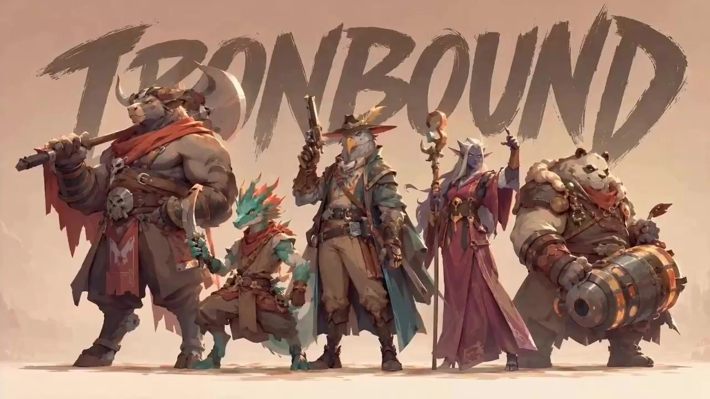

# Ensemble Intro Animation

> **作者：** @时见鹿小创

## Content

Process Planning:

Execution Process (6 steps, step-by-step confirmation)

Follow the sequence below. After Step 1 and Step 2 are completed, intermediate outputs must be displayed, and user confirmation is required. Steps 3–6 can be executed continuously after Step 2 is confirmed.

Multi-Image Processing Rules

If the user provides multiple group images, perform the complete process independently for each image: Step 1 analyzes all images at once (generating an individual character recognition report for each), Step 2 confirms parameters for each image separately, and Steps 3–6 generate independent video assets for each image. One group image → one video asset. Do not merge or split.

Step 1 — Image Analysis

Call resource_prepare_and_analyze to analyze the group images provided by the user (analyze all at once if there are multiple). Output an individual character recognition report (in table format) for each image. Display the report and wait for user confirmation or correction before proceeding to Step 2.

Step 2 — Parameter Confirmation

Calculate and confirm the following parameters with the user for each image based on the number of characters:

Video Aspect Ratio: Ask the user to choose 16:9 (landscape) or 9:16 (portrait).

BGM Requirement: Ask if background music is needed (default is no BGM; only ambient sound effects and action sound effects are kept). If BGM is required, infer a suitable BGM style description based on character attributes, weapon types, and overall style from the Step 1 character recognition report (one sentence, including style, main instruments, and emotional tone). Embed this into the BGM-included branch of the write_media_prompt placeholder {{Sound Effects & BGM}}, to be generated directly by the video generation tool; do not generate audio BGM separately.

Time Allocation: First 80% = Phase 1 entry stage, last 20% = Phase 2 assembly/outro, last 1 second = all-member micro-movements + title writing (if applicable).

Single-Character Edge Case: When there is only 1 character, total duration = min(1×4, 15) = 4 seconds, Phase 2 = 4×20% ≈ 1 second. In this case, the entire 1 second of Phase 2 is used for micro-movement outro; skip the Finale A sequential formation stage (no need for sequential assembly for a single person). Phase 1 = 3 seconds, focusing only on the character's solo showcase and weapon skill release. Camera shots are compressed into three types: Close-up + Wide Shot + Strong Perspective (Mid-shots can be omitted due to duration limits). Display the parameter confirmation table and wait for user confirmation before proceeding to Step 3.

Steps 3–5 — Placeholder Calculation and Branch Confirmation

Do not call any tools. The planner performs placeholder value calculation and branch selection internally. Do not create a Storyboard, do not call storyboard_designer, and do not register any key_element:

Step 3 Scenes: Do not plan scenes separately. In the template, "automatically generate scenes that fit the character's style based on character traits" is fixed text. Scenes are inferred and generated by the video generation model based on the reference image; do not insert any specific scene descriptions into the prompt.

Step 4 Placeholder Calculation: Based on the number of characters and the results confirmed in Step 2, calculate values for {{Total Duration}}, {{Phase 1 Duration}}, and {{Phase 2 Duration}}, and determine the branch selections for {{Ratio}}, {{Title Handling}}, and {{Title Writing}}. Camera planning, entry methods, camera movement, transitions, lighting, wind, etc., are all handled by fixed template text; the planner no longer performs per-character camera inference.

Step 5 BGM Style Description (only if the user selects BGM): Based on character attributes, weapon types, and overall style from the Step 1 character recognition report, infer a BGM style description (one sentence, including style, main instruments, emotional tone). Pass this as the embedded content for the BGM-included branch of the {{Sound Effects & BGM}} placeholder to Step 6. All calculation results are retained as internal context and passed directly to Step 6. Do not output any Storyboard entries or shot entries, and do not show storyboards to the user.

Step 6 — Prompt Synthesis and Video Generation

Call media_generator (via write_media_prompt) to synthesize the placeholder calculation results from Steps 3–5 into a video generation prompt. Call MultiModalToVideo only once to generate the unique video asset. Key Constraints:

Skip storyboard_designer entirely: Do not call the storyboard designer tool throughout the process; do not generate any Storyboard or shot entries. Steps 3–5 are internal planner calculations, not tool calls.

Do not register or generate key_element images: The user has provided the original group image as a visual consistency reference. Use the original image directly as the reference input, skipping key_element registration and image generation steps.

media_generator executes only once: Placeholder calculation → unique prompt → unique MultiModalToVideo call → unique video asset.

All audio generated directly, not separately: All audio (BGM, ambient sound effects, action sound effects, etc.) is generated directly by the video generation tool. Do not call any audio generation tools separately. If the user selects BGM, use the BGM style description inferred from the Step 1 character analysis and embed it into the BGM-included branch of the {{Sound Effects & BGM}} placeholder.

Generate separately for multiple images: If the user provides multiple group images, perform complete Steps 3–6 for each image, producing an independent video asset for each.

Input Compatibility

Group image (image only): Step 1 full process, ratio and BGM confirmation required.

Group image + specified ratio: Step 2 skips ratio confirmation, BGM confirmation still required.

Group image + ratio + duration: Step 2 second half skips duration calculation, BGM confirmation still required.

Group image + ratio + duration + BGM: Step 3 all parameters confirmed, proceed directly to placeholder calculation.

Multiple group images: Step 1 analyzes each separately at once, each image produces one video asset.

Note: This Skill only supports image input. If the user only provides text descriptions without group images, prompt the Planner to guide the user to provide group images before continuing.

Asset Analysis:

Group Image Analysis Task

Analyze the provided group image and generate a structured character identification report (in table format). Each character entry must include the following fields:

ID: Numbered from left to right or based on composition.

Physical Appearance: Hairstyle, hair color, build, skin tone, facial features.

Clothing Details: Style, color, material, accessories.

Weapon Type: Type and appearance description.

Props: Carried items, special equipment.

Combat Attributes: Melee/Ranged/Magic/Agility/Strength, etc.

Positioning: Description of their location in the frame. Multiple Images: If multiple images are provided, analyze each one separately. Generate an independent character report for each, clearly labeled with the source image. Each image will independently generate a video asset later. Additional Detection: Identify if any title text exists in the reference image; if so, record the text for use in the Finale B phase. Precision Requirements: Clothing details, weapon types, and props must be detailed to ensure character consistency in subsequent video generation.

Media Generation:

Video Generation Configuration

Generation Tool: MultiModalToVideo, recommended model Seedance 2.0 (720P, Member Exclusive). If Seedance 2.0 is unavailable, try Seedance 2.0 Fast and then Seedance 2.0 Mini (both limited to 720P) within the same tool; if all models in the same tool fail, terminate the task without switching tools.

Reference Input: User-provided original group image (for visual consistency reference)

Resolution: 720P

Aspect Ratio: Based on the result confirmed by the user in Step 2 (16:9 or 9:16)

Duration: Based on the result calculated in Step 2, min(number of characters × 4s, 15s), with a maximum of 15 seconds per generation. Key Constraints:

Skip Character Element Image Generation: Since the user has provided an original group image as a visual consistency reference, use the original image directly as a reference input. Do not call TextToImage / ImageToImage to generate character element images.

One Group Image → One Video Asset: Generate one complete video per group image, including all character entrances and the final assembly. Do not split into multiple videos or shot assets.

Separate Generation for Multiple Images: If the user provides multiple group images, generate one independent video asset for each image.

All Audio Generated Directly: All audio (BGM, ambient sound effects, action sound effects, etc.) must be generated directly by the video generation tool. Do not call any separate audio generation tools. If the user chooses to include BGM, infer the BGM style description based on character analysis and embed it into the BGM branch of the placeholder {{Sound Effects and BGM}}. Before generation, use write_media_prompt to synthesize the complete prompt, then call MultiModalToVideo for generation.

Prompt Writing:

I. Golden Rules for Templates

Language: Write all prompts in Chinese. If the title text in the reference image is in a foreign language, keep it as is; otherwise, use Chinese for everything.

Literal Retention: Except for replacing {{placeholders}}, all text in the template must be preserved exactly as is. No rewriting, additions, deletions, or substitutions. Do not insert <<<image_1>>> or any form of reference image binding/citation syntax anywhere in the prompt. The text "Based on the reference image" at the start is the only reference image instruction allowed.

No Role Description Insertion: The template text "First, identify the number, appearance, clothing, attributes, weapons, and props of all characters in the reference image" must be kept verbatim. Do not insert lists of characters; role identification is handled by the video generation model based on the reference image.

No Scene Description Insertion: The template text "Automatically generate scenes that fit the character's style based on character traits" must be kept verbatim and followed immediately by the next sentence. Do not insert scene descriptions; the video generation model handles scene inference based on the reference image.

Movement/Camera/Transition/Perspective: Do not rewrite or replace generic movement, camera, transition, or perspective descriptions with specific character-based narratives. Keep the template text verbatim.

Narrative Style: Prompts should be continuous Chinese paragraphs. Do not use segmentation tags (e.g., [Scene], [Lighting]) or timestamps (e.g., 0–2.4s / 2.4–4.8s).

Placeholder Filling: Except for the BGM branch of {{Audio & BGM}}, all placeholders must be filled verbatim with the specified text from the 'Placeholder Filling Rules'. Do not expand or rewrite. The BGM branch of {{Audio & BGM}} is the only exception; <BGM Style Description> must be inferred from the Step 1 Character Recognition Report (one sentence covering style, main instruments, and emotional tone). All other text remains fixed.

Context Isolation: Content from Step 1 (Role Report) and Step 3–5 (Planning) is for internal inference only and must NOT be inserted into the prompt. The only exception is the BGM style description mentioned above. Prompts must consist ONLY of: Template text + Filled placeholder text.

Self-Check: Before outputting, ensure none of the following are present: <<<image_N>>> syntax, role-specific attribute lists, specific environment descriptions (e.g., "ruins", "temple"), style buzzwords, character-specific action narratives, timestamps, or text not in the template. If the total character count exceeds 2300 (limit for Seedance 2.0), compress decorative descriptions, but keep structural constraints (camera/lighting/wind rules).

II. Prompt Template (with Placeholders)

The following is the template text. {{}} marks placeholders, which should be replaced according to the filling rules during generation. All other text must be preserved verbatim.

Based on the reference image, generate a {{Total Duration}}-second, 720P resolution, {{Aspect Ratio}} character assembly animation with top-tier theatrical CG animation film texture, 'League of Legends: Arcane' style. First, identify the number, appearance, clothing, attributes, weapons, and props of all characters in the reference image, ensuring consistent character likeness, clothing details, weapon types, prop configuration, and combat attributes throughout the video, avoiding character errors, costume changes, weapon replacement, proportion distortion, expression errors, or character confusion; {{Title Handling}}; automatically generate scenes that fit the character's style based on character traits. The overall image is high-fidelity cinematic CG rendering with delicate textures and high-contrast lighting (close-ups use side or backlighting, with uneven light distribution, enhancing contours, eyes, facial expressions, and weapon materials; medium and wide shots maintain high-contrast lighting, avoiding flat or overexposed light). Character movements follow physical logic and classic animation principles, being exaggerated but not distorted, agile, and vivid, avoiding limb breakage, clipping, slipping, loss of center of gravity, weapon misalignment, or spatial confusion. The entire scene is in a strong wind environment, with floating elements (hair, capes, cloaks, skirts, ribbons, ropes, accessories) swaying significantly and continuously; dust, fog, debris, flags, fabric, and plant fragments in the scene are also lifted by the strong wind, forming three spatial layers (foreground debris, mid-ground character wind effects, background fog/flags/fabric), with consistent wind direction. Close-ups feature side or backlighting to enhance eyes, contours, weapon highlights, and clothing textures. In the first 80% (approx. first {{Phase1 Duration}} seconds), characters appear in sequence, each completing a cool personal display, followed by a weapon skill, and then a smooth transition to the next character, ultimately gathering in a unified scene consistent with the world-view. Each character must have at least three shot types (close-up, medium, wide) and at least one strong perspective shot (showing the full body, limb details, weapon tip, clothing, jumping pose, falling trajectory, or spatial pressure). Shot combinations are randomly assigned to avoid repetitive rhythm or camera movement; avoid identical entry methods for adjacent characters. Characters may enter by dropping from the sky, falling from high altitude, jumping in, diving, crossing obstacles, landing, or sliding. Dynamic actions include running, jumping, turning, dodging, charging, attacking, blocking, sliding, backflipping, landing, switching positions, and short pauses, matching weapon attributes. Camera work needs rich spatial variation, not just flat movement; use rapid zooms (wide to close-up, close-up to wide), tracking shots, and dynamic movements. The entire video uses free camera movement: orbiting, rotating, pushing/pulling, panning, tracking, craning, diving, whip pans, etc. Vertical compositions enhance vertical movement (craning, diving); horizontal compositions enhance horizontal movement. Mix slow motion for key impacts with fast-paced transitions and actions. Transitions prioritize momentum, weapon trajectories, occlusion, similar actions, smoke/dust, light flashes, whip pans, and camera shake; avoid hard cuts. Character entry transitions should use the previous character's motion or occlusion as a visual anchor. Entries must demonstrate significant displacement, explosive limb movement, and signature weapon highlights, integrated with the strong wind environment (hair/capes blowing, dust swirling, weapon trails). No static poses. The last 20% (approx. last {{Phase2 Duration}} seconds) is the finale: characters appear in order based on the reference image, each performing a signature pose and landing in the corresponding position. If 5+ characters, poses are quick (0.3–0.4s each). For 1 character, skip to subtle movement. In the final second, all characters maintain positions with natural micro-movements (breathing, eye movement, swaying) {{Title Writing}}; the final composition is complete, with clear character hierarchy, accurate placement, unified lighting, and consistent style. {{Audio & BGM}}

III. Placeholder Filling Rules

{{Total Duration}}: min(Number of characters × 4, 15), enter as a number (e.g., "12", "15").

{{Aspect Ratio}}: Enter "16:9" or "9:16" based on user confirmation in Step 2.

{{Phase1 Duration}}: Total duration × 80%, rounded to the nearest integer second.

{{Phase2 Duration}}: Total duration × 20%, rounded to the nearest integer second. {{Title Handling}} (between "character confusion;" and "; automatically generate"):

With Title: If the reference image contains title text, trigger the effect of the text being written stroke by stroke in the background at the end of the video.

No Title: If there is no title text in the reference image, add nothing. {{Title Writing}} (between "body center of gravity adjustment" and "; the final composition"):

With Title: , simultaneously, the title text appears in the background, written stroke by stroke.

No Title: Leave blank (insert nothing; follow "body center of gravity adjustment" immediately with "; the final composition"). {{Audio & BGM}} (at the end of the template):

No BGM: No background music. Keep only ambient wind, weapon swishes, impact sounds, etc. No extra subtitles or text.

Has BGM: Include <BGM Style Description> background music. Keep ambient wind, weapon swishes, impact sounds, etc. No extra subtitles or text. (<BGM Style Description> is inferred from Step 1 Character Recognition Report, summarizing style, main instruments, and emotional tone in one sentence).
