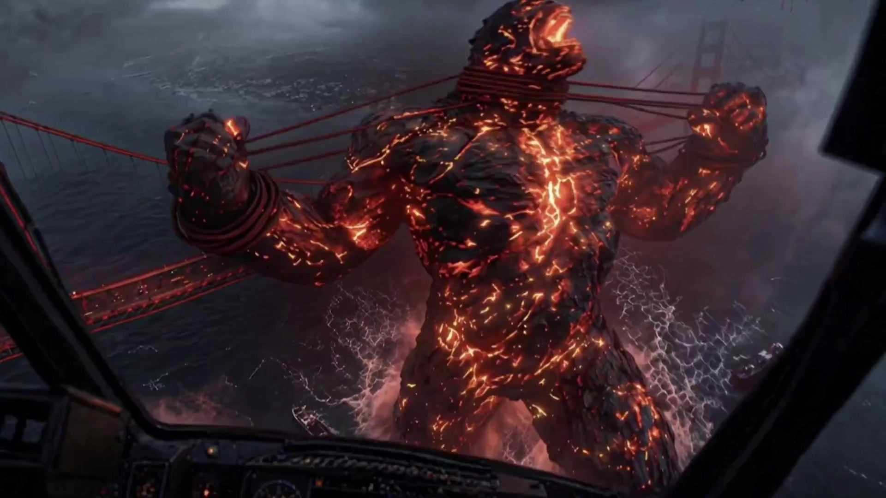

# Epic Giant Monster Disaster Film

> **作者：** @Ai创意研习社

## Content

Process Planning:

Epic Gargantuan Sci-Fi Short Film Generator Suitable for: 30-second to 5-minute giant monster/mecha sci-fi shorts. Cinematic language based on Pacific Rim / MonsterVerse / Kaiju Cinema Language.

Core Visual Keywords: Gargantuan Scale, Low-Angle Worship Shot, Size Reference, Weather Atmosphere, Surface Tension, Delayed Reveal, Megastructure, Industrial Heavy, Bioluminescent, Deep Sea, Urban Destruction, Slow Motion Impact, Subsonic Rumble, Epic Silhouette, 35mm Lens, Anamorphic, IMAX, Teal & Orange, Desaturated Disaster

Communication Rules (Global)

Do not mention internal step numbers when communicating with the user. Always use functional descriptions instead.

Error: Entering Step 3 / Starting Step 5 / After Step 4 is complete Correct: Now beginning asset analysis / Now designing storyboard / Starting media generation after all shots are confirmed / Starting sound design / Starting final composition

Step 1: Collect User Creation Information

A Creative Assets Supports any combination: Story idea, full script, novel, screenplay, mecha/monster profiles, character profiles, world-building, reference films, image references, video references.

B Basic Parameters

Title

Target Duration: 30 seconds / 1 minute / 2 minutes / 3 minutes / 5 minutes

Aspect Ratio: Default 2.39:1 CinemaScope; optional 16:9, 2.76:1 (70mm IMAX)

Video Generation Model: Seedance 2.0 (Default)

Film Language: Chinese / English / No Dialogue. Must be consistent throughout the film.

Need Narration? Yes / No (Recommended "No" for giant sci-fi; use visuals and sound design to tell the story)

Epic Gargantuan Score? Default

Asset Analysis:

Epic Scale Sci-Fi Movie Asset Analysis Rules

The entire analysis phase follows the narrative principles of Pacific Rim/MonsterVerse giant-creature movies: first analyze the scale of the world, then the giant creatures themselves, and finally the human perspective. Giant creatures are always larger than humans; scale determines the sense of fear.

A Script/Story Text Analysis

Extract the following information:

1. Setting/Era: Determine the time period of the story. Examples: Near-future 2050 mech defense era, modern-day monster awakening, ancient giant beast sealing, post-apocalyptic wasteland, alien invasion era. If not specified by the user, AI will infer the most reasonable era based on the story.

2. Spatial Analysis: Identify main spaces: deep-sea trenches, the Pacific Ocean, rain clouds, high-ceiling industrial factories, giant assembly platforms, abandoned cities, coastlines, volcanic craters, alien surfaces, orbital space stations, underground mech bases, shattered streets, capsized cargo ships, whirlpools, storm eyes.

For each space, look for: adaptability to giant scale, weather conditions, lighting conditions, seawater depth, ground load-bearing capacity, spatial volume, and human activity range.

3. Giant Creature Analysis (Core): Extract details for mechs and monsters separately:

Mech Extraction Items:

Name, height, weight, color scheme, material, armor structure

Head design (visor shape/light color/antenna style)

Joint structure (hydraulic/exposed mechanical/concealed)

Battle damage status (pristine/light damage/heavy damage)

Glowing elements (visors/stripes/joints)

Human scale reference (comparison to maintenance worker size)

Monster Extraction Items:

Name, height, weight, material texture, biological features

Glowing elements (fluorescent veins/eyes/inside the mouth)

Attack methods (physical biting/energy attacks/tail strikes)

Blood color, skin texture, bone spur location

Human scale reference (comparison to fishing boat/building size)

4. Reference Object Analysis: Extract elements used for scale comparison: humans, maintenance workers, fishing boats, cargo ships, cars, buildings, bridges, helicopters, factory platforms. Establish a scale comparison table: Giant creature height vs. reference object height.

5. Weather and Atmosphere Analysis: Extract: heavy rain, dense fog, lightning, dark clouds, ocean waves, tsunamis, earthquakes, volcanic ash, radiation storms, alien atmospheres. Analyze how each weather condition enhances the sense of scale.

6. Combat/Disaster Intensity Analysis: Determine: light contact (oppressive feeling only, no combat), moderate combat (fist-to-fist), heavy destruction (shattered cities, tsunamis, explosions). Match with corresponding visual intensity.

7. Sound Design Analysis: Extract: low-frequency rumble, footstep tremors, snapping steel cables, hydraulic whining, monster roars, crashing waves, white noise of rain, electric arc flashes, metal twisting sounds. Establish a sound layering table.

B Visual Reference Analysis

If images or movie screenshots are uploaded, extract the following information:

Lighting

Natural light direction (stormy daylight/sunset backlight/diffused cloud light/moonlight)

Artificial light sources (welding sparks/warning lights/mech visors/monster bioluminescence/factory spotlights)

Volumetric light (beams in fog/light pillars in rain/sea surface reflections)

Cinematography

Low-angle worship shot

Ultra-wide angle (14mm/16mm) to exaggerate the foreground

Deep depth of field (f/8–f/11) to ensure the giant creature is entirely clear

Camera movement (slow push back/static low angle/micro-shake tremors)

Composition (symmetrical/low angle/giant creature occupying 2/3 of the screen)

Giant Creature Aesthetics

Mechs: Heavy industrial feel, hydraulic joints, exposed copper cables (damage/rust levels determined by story phase, not default properties)

Monsters: Biological horror, fluorescent veins, sharp bone spurs, giant fangs

Scale: Giant creatures occupy the main frame, humans are invisible or tiny

Color

Mech palette: Red/black/gold, white stripes, cold white visors

Monster palette: Gray/black petrified, blue/green fluorescence, cyan-blue glowing eyes

Environment: Dark murky green sea, dark factories, dark cloudy storms, foggy white

Contrast: Cold white of mechs vs. blue-green of monsters / deep sea darks vs. fluorescent veins

Materials

Mech: Steel plate, copper cables, hydraulic tubes (damage/rust/oil stains determined by story stage)

Monster: Rock, fossilized wood, fluorescent veins, spikes, slime

Environment: Concrete, steel beams, seawater, foam, mist, heavy rain

C Analysis Limitations

Do not analyze real human identities. Do not replicate real actor likenesses. Do not copy full movie shots. Only learn: giant-creature movie language, scale presentation techniques, lighting patterns, compositional logic, artistic language, industrial/biological design features, spatial organization, and weather enhancement techniques.

D Script Completeness Judgment

Ready for Visual Design (if meeting the following): Contains giant creature settings, main spaces, event progression (charge/combat/reveal), and inferable scale comparison relationships → No expansion needed.

Requires Story Expansion (if any of the following occur): Only one creative sentence, only a creature name, no human perspective, no spatial transition, no weather design, no scale references, no conflict, no ending → Automatically marked as "requires story expansion".

Output Format: Completeness judgment (Requires Story Expansion/No Expansion Needed) + Missing content (Giant creature settings, human perspective, spatial information, weather design, scale references, conflict events, ending, sci-fi realism, mech/monster design details, reference object settings).

Storyboard Design:

Gargantuan Sci-Fi Storyboard Design Rules

Execute after visual specifications are confirmed. If "story expansion needed" is determined during script analysis, automatically perform gargantuan sci-fi plot expansion at the end.

I. Five Mandatory Constraints for Gargantuan Scale (Core Rules)

Every storyboard design must use at least 3/5 items, with Item 1 (Low-Angle Worship Shot) being mandatory.

Constraint 1: Low-Angle Worship Shot (Mandatory) All shots involving the gargantuan entity must use an extreme low-angle worship shot. Place the camera near the ground/sea level, looking up at the entity to create the oppressive feeling of "humans looking up at a giant god." Eye-level or high-angle overhead shots are forbidden.

Constraint 2: Scale Reference Comparison (Mandatory, pick one) Each scene must include a scale reference: humans (maintenance workers/pilots/pedestrians), fishing boats/freighters, cars, buildings, or helicopters. The reference must be visible in the frame with the entity; the greater the scale difference, the better. The entity appearing alone without a reference is forbidden.

Constraint 3: Weather and Atmospheric Effects (Recommended) Each scene must include weather elements: heavy rain, dense fog, lightning, dark clouds, ocean waves, steam, smoke, or sandstorms. Weather not only adds realism but, more importantly, enhances the sense of spatial distance (outlines in fog, beams in rain, scale in waves). Filming the entity in perfectly clear weather without any atmospheric state is forbidden.

Constraint 4: Ground/Water Interaction (Recommended) The entity must physically interact with the environment: water lapping over shins when walking in the sea, leaving deep footprints, creating V-shaped wake walls; cracking concrete, crushing buildings, or causing ground depression when standing. Emphasize "weight" rather than "floating." Static splashes or unmarked ground when walking are forbidden.

Constraint 5: Gradual Reveal/Delayed Exposure (Recommended) Avoid showing the full entity in the first shot. Use a progressive reveal rhythm: silhouette in fog → partial body → full entity → oppressive close-up. Or: tiny in long shot → dolly back → entity gradually occupies the frame → finally fills the screen. Showing a full-body close-up immediately is forbidden.

II. Gargantuan Set Design Standards

1. Scale is Fear (Core Principle) In gargantuan films, the true source of fear is not what the monster looks like, but "how big it is." Every scene must answer: How small are the humans here? Superimpose the use of references, low angles, and wide-angle distortion.

E.g.: Mech foot vs. maintenance worker (worker like an ant); monster head vs. fishing boat (boat like a leaf); giant hand slapping sea vs. ocean (50m crater). Scale comparison must be part of the narrative.

2. Environment Before Entity The entity cannot appear from nowhere. All outdoor shots must first establish: sky, sea surface, distant city skyline, followed by partial appearances, and finally the full entity. Establish the Pacific Rim rhythm: Environment → Partial Reveal → Full Body → Scale Impact.

3. Industrial/Biological Realism

Mechs: Appearance depends on the plot stage—factory/deployment stage remains clean (new metal, no battle damage, minor manufacturing oil stains); minor scratches and battle damage after first combat; severe damage, rust, and grime after continuous combat or heavy injury. Retain heavy industrial feel, exposed copper cables, and hydraulic joints. Forbidden: plastic look, smooth CGI, no material details.

Monsters: Biological horror, rough skin texture, fluorescent veins, spikes/bones, massive maw, blood color. Forbidden: smooth skin, no texture details, cartoonish look.

4. Weather Rules Weather is narrative, not decoration. E.g.: Fog = hidden fear; Storm = disaster arrival; Lightning = horn for appearance; Waves = proof of weight. Weather in the same scene must not change randomly; it requires narrative justification.

5. Lighting Rules Light sources must be reasonable: mech eyes/windows, monster bioluminescence, factory welding sparks, stormy daylight, harsh lightning flashes, moonlight. "Self-illuminating" shots without light sources are forbidden. Volumetric light (beams/rays) is key to enhancing the gargantuan feel.

III. Gargantuan Narrative Structure

Use the classic Pacific Rim / MonsterVerse structure: Ambuscade (implied presence) → Reveal (partial appearance) → Confirmation (full exposure) → Conflict (confrontation/battle) → Ultimate Oppression (third-party intervention or final strike) → Aftermath (disaster consequences).

Every shot must advance one of these three: recognition of scale, human fear, or environmental destruction. No repetitive info. No empty shots without narrative function.

IV. Chapter Design

Default to three chapters (suitable for shorts):

Chapter I: Presage Establish environment, hint at existence, humans discover abnormalities. Key shots: extreme long shot of sea, silhouette in fog, reference object tossing, low-angle prep. Slow pace, fear comes from "the unknown."

Chapter II: Arrival Full entity appears, scale fully revealed, first contact with humans/city. Pace accelerates, oppression comes from "known but impossible to fight."

Chapter III: Impact Battle/destruction/ultimate oppression. Entity releases full power, environment shattered. Fastest pace, maximum visual impact.

Chapter titles should use a formal, epic style. E.g., "The Abyss," "Awakening," "Retribution," "Behemoth," "Tsunami," "Doomsday," "First Wave," "Last Line of Defense." Users can edit titles.

Recommended backgrounds for title cards: ocean ripples, concrete cracks, steel texture, monster skin, mech armor. Font: heavy industrial serif/corroded metal style. Color: dark gray/rusted iron/fluorescent blue-green/cold white.

V. Shot Design Principles

Shots in gargantuan films are not for show; they must serve scale, oppression, and weight. Camera movement should be restrained and powerful. Heavily use: static low-angle, slow dolly back, long duration, realistic physical tremors. Forbidden: fast pans/zooms, frequent cutting, handheld shaking (unless in chaotic disaster scenes), MV-style editing, exaggerated lens language.

Every shot must include: spatial target, entity status, human/reference position, source of oppression, primary light source, camera movement, shot duration, audio source, ending state.

E.g.: Space—deep sea; Entity—monster head emerging from fog; Reference—fishing boat below; Oppression—unknown silhouette; Light—faint pulsating glow; Camera—slow dolly back; Duration—10s; End—fog clears to show full body.

VI. Gargantuan Camera System

All shots adopt the G-series (Gargantuan):

G-00 Static Low-Angle: Fixed extreme low-angle, entity fills frame, humans minimal/absent. Most used.

G-01 Slow Dolly Back: Slow zoom out, gradually revealing full scale, from partial → full body.

G-02 Slow Dolly Forward: Slow push in, from wide shot → detail (eye/skin texture).

G-03 Worship Rise: Tilt up from ground, see feet → shins → torso → head, fully establishing scale.

G-04 Scale Reveal: Reference enters frame first, then entity, using relative scale to establish size.

G-05 Surface Tension: Focus on ground/water impact, entity steps in → depression → wake wall/cracks.

G-06 Fog Reveal: Gradual reveal in fog, silhouette → partial → full, escalating fear.

G-07 Impact Hold: Fixed shot at moment of impact, no cuts, tension from on-screen action, not editing.

G-08 Dual Charge: Symmetrical composition, mech and monster charge toward center from sides.

G-09 Hand from Sky: Third-party giant hand/object smashes down from above, extreme low-angle shot.

G-10 Submerged POV: Underwater view, entity emerges from water surface silhouette above.

VII. Classic Shot Combinations

Use classic Pacific Rim / MonsterVerse combinations:

Combo 1: Wide shot of sea → silhouette in fog → partial reveal → full body → low-angle close-up

Combo 2: Factory maintenance (human scale) → dolly back → mech full body (gargantuan scale), scale jump in one shot

Combo 3: Fishing boat tossing → silhouette in fog → monster looking down, fear escalating from human POV

Combo 4: Close-up of mech walking in sea (legs) → tilt up → head → eyes light up

Combo 5: Symmetrical composition → dual charge → collision → shockwave → slow-mo shattering

Combo 6: Human looking up → giant looking down → eye contact → roar/glow

Combo 7: Dark clouds → giant hand smashes down → sea depression → shockwave spreads → underwater POV

VIII. Gargantuan Shot Pacing

Recommended Shot Durations: Reveal shots (fog/distance) 8–15s, Scale comparison shots (with references) 6–12s, Walking/impact in sea 8–15s, Factory maintenance (human scale) 6–10s, Charge/battle shots 5–10s, Impact moments 3–8s (can be extended with slow-mo), Ultimate oppression (looking down/eye contact) 10–20s, End aftermath (after giant leaves/disaster) approx 15s.

Always maintain: slow pace to establish scale, fast pace to release impact.

IX. Cross-Shot Continuity

Maintain consistency across all shots, including: entity color scheme, glow element colors, skin/armor texture, weather state, sun/lightning direction, sea wave direction, wake wall shape, reference position, entity stance, light direction, camera axis. If spanning chapters, maintain continuity unless plot explicitly dictates changes in time, weather, or location.

Media Generation:

Epic Giant-Scale Sci-Fi Visual Asset Generator

Goal for this stage: Establish unified visual assets for the entire film. All mechs, monsters, environments, and props must be designed and confirmed before keyframe generation begins. Modifying settings while generating video is strictly prohibited.

Generation Order: Mech Settings → Monster Settings → Reference Object Settings → Weapon/Equipment Settings → Environment Settings → Keyframe Fusion → Confirmation → Proceed to Shot List.

0. Model and Tool Selection (Global Mandatory)

Image Generation (TextToImage / ImageToImage):

Preferred Model: GPT Image 2, recommended resolution 2K (supports 1K / 2K / 4K).

Fallback Plan: If GPT Image 2 fails, switch to Nano Banana 2 (Gemini 3.1 Flash Image) at 2K resolution. If this also fails, stop the task and notify the user; do not switch to other tools without authorization.

All element images, reference images, environment images, and keyframes must follow this priority.

Video Generation (MultiModalToVideo):

Designated Model: Seedance 2.0, default resolution 720p (unless the user explicitly requests 1080p).

Seedance 2.0 is a member-exclusive model. If unavailable due to permissions, hand off to downstream modules; no substitute models are predefined within this Skill.

When generating each shot, you must reference the specific element images (mech/monster/environment/prop) bound to that shot as input. Only include the preceding shot's video as a reference if continuity is extremely high.

I. Mech Element Images

Establish unified assets for each mech. Output: Head (Front/Side/Back), Full-Body (Front/Side/Back), Eye Close-up (Dark/Light states), Joint Close-up, Armor Texture Close-up, Battle-damaged state, Pristine state, and Scale comparison with workers during maintenance.

Fixed Content: Name, Height, Weight, Color Scheme, Armor Material, Joint Structure, Eye/Window Shape & Light Color, Antenna/Feature Structure, Battle Damage Level, Light Source Position & Color.

Mech Photography: Uniformly apply Low-Angle Worship Shot, Industrial Background, Cold Lighting, 14–24mm Wide Lens, Deep Focus, Cinematic Realism. Surface state dynamically adjusts based on battle damage: use 'pristine metal finish, factory-fresh look' for new states; 'weathered battle damage, oil stain, rust' for damaged states; and 'welding sparks' for maintenance scenarios. Commercial photography and CGI plastic aesthetics are prohibited.

II. Monster Element Images

Establish unified assets for each monster. Output: Head (Front/Side), Full-Body (Front/Side), Eye Close-up (Dark/Light), Bioluminescent Vein Distribution, Oral Cavity, Skin Texture Close-up, Spine/Bone Spur Close-up, Scale comparison with reference objects.

Fixed Content: Name, Height, Weight, Skin Material, Bioluminescent Vein Color & Distribution, Eye Glow Color, Attack Method, Blood Color, Spine Position.

Monster Photography: Uniformly apply Low-Angle, Fog Background, Bioluminescent Glow, Deep Focus, Dark Tone, Cinematic Horror Realism. Cartoony aesthetics and smooth skin are prohibited.

III. Reference Object Assets

Establish unified references: Human (Front/Side/Back/Working pose), Fishing Boat (Intact/Capsized/Broken), Cargo Ship (Intact/Capsized), Car (Intact/Broken), Building (Intact/Ruined), Helicopter (Intact/Held).

Record for all reference objects: Actual size, state of damage, and scale ratio relative to the giant. Maintain consistency throughout the film.

IV. Environment Assets

Establish unified references for each scene: Deep Sea Surface (Storm/Dense Fog/Sunny), Super-tall Factory Interior (Full View/Partial/Maintenance Platform), City Ruins (Panoramic/Street Level/Ruined Buildings), Coastline (Sunrise/Storm/Tsunami), Crater (Lava/Steam/Dark).

Output per scene: Extreme Long Shot, Medium Shot, Close-up, Ground-level view, High-angle view, Adverse weather state. Maintain consistent color tone and light direction.

V. Keyframe Fusion

Generate keyframes after completing all assets. Each keyframe must fuse: Mech/Monster, Reference Objects, Environment, Weather, Lighting, Spatial Relationships, and Camera Motion.

Keyframe Requirements: Cinematic composition, realistic space, realistic proportions, realistic perspective, realistic lighting, realistic weather, and visible physical impact. Each keyframe must output: Purpose, Chapter, Shot Number, Giant's Status, Reference Objects, Location, Weather, Photography Method, Camera Motion, Image Prompt, Video Prompt, Negative Prompt.

VI. Continuity Check

Before proceeding to the shot list, automatically verify: Mech/Monster appearance, color scheme, light source/glowing elements, battle damage matching the plot, weather, light direction, sea wave direction, reference object scale, and sense of scale. If conflicts are found, regenerate the corresponding assets automatically.

Once completed, output Visual_Assets.md and pause to wait for user confirmation. Do not proceed to the next stage without confirmation.

Prompt Writing:

Gargantuan Prompt Engine This module is responsible for generating standard Prompts for the entire project.

Principles: All Prompts must originate from Visual_Assets.md and cannot deviate from confirmed visual assets. It is strictly forbidden to add gargantuan objects, change color schemes, alter bioluminescent glow colors, or modify scale ratios on the fly.

Prompt Structure

Uniformly use: Subject → Environment → Weather/Lighting → Action/Camera Motion → Camera/Technical Parameters → Quality → Style → Negative Prompt

Standard Format: Subject, Environment, Weather/Lighting, Action/Camera Motion, Camera/Technical, Quality, Style, --ar XX:XX, Negative Prompt

I. Global Cinematic Style Prompt

Uniformly fixed for the entire project: Pacific Rim kaiju sci-fi cinema, epic gargantuan scale, low-angle worship shot, industrial heavy mecha, bioluminescent kaiju, deep sea atmosphere, storm rain weather, volumetric fog, cinematic realism, IMAX anamorphic, 35mm film grain, teal and orange color grading, desaturated disaster tone, masterpiece, best quality

Must not be modified throughout the entire film.

II. Mecha Image Prompt

Uniform Format: Mecha Name, Color Scheme, Armor Texture, Battle Damage State (factory-new/light damage/heavy damage/rust), Eye Window Status (dark/lit/color), Action/Posture, Environment, Lighting, Camera Angle, Lens, --ar 16:9, Negative Prompt

Battle Damage Rules: Dynamically select based on plot stage—use 'factory-new, pristine metal finish' for factory/deployment stages; 'light battle damage, scratches' after the first battle; 'heavy battle damage, oil stain, rust' after sustained combat or severe injury. Do not mix different battle damage states within the same shot.

Example (New Condition): VANGUARD mecha, red black gold heavy industrial armor, white surface stripes, pristine factory-fresh metal finish no battle damage, rectangular white light eye window glowing, standing upright in ultra-high factory interior, cold industrial lighting, low-angle worship shot, 14mm ultra-wide lens, deep focus, Pacific Rim sci-fi cinema, cinematic realism, 8K

Example (Heavy Battle Damage): VANGUARD mecha, red black gold heavy industrial armor, white surface stripes, heavy battle damage weathered rust oil stain, rectangular white light eye window glowing, standing upright in stormy sea, cold industrial lighting, low-angle worship shot, 14mm ultra-wide lens, deep focus, Pacific Rim sci-fi cinema, cinematic realism, 8K

Mecha fixed information must come from Visual Assets and must not be modified.

III. Kaiju Image Prompt

Uniform Format: Kaiju Name, Skin Texture, Bioluminescent Vein Color, Eye Glow Color, Mouth State, Action/Posture, Environment, Lighting, Camera Angle, Lens, --ar 16:9, Negative Prompt

Example: HOLLOW kaiju, dark gray petrified wood skin texture, sharp bone spines on spine, blue-green fluorescent veins pulsing across entire body, glowing cyan-blue eyes, massive jaws slightly open, towering over small fishing boat on stormy sea, low-angle worship shot, 16mm wide lens, deep focus, Pacific Rim kaiju horror cinema, cinematic realism, 8K

Kaiju fixed information must come from Visual Assets and must not be modified.

IV. Scene Image Prompt

Uniform Format: Location, Weather, Time, Landscape Layers (foreground/middle/background), Scale Reference Visible, Lighting, Camera Angle, Lens, --ar 16:9, Negative Prompt

Example: Deep sea stormy surface, heavy rain, dark thunderclouds, massive waves, foreground choppy water, middle ground fishing boat tiny scale, background thick fog hiding kaiju silhouette, blue-green bioluminescence pulsing faintly in fog, low-angle wide shot, 24mm lens, deep focus, Pacific Rim cinema, 8K

Always follow: Environment First, Scale Reference Visible.

V. Video Prompt Core Structure (Crucial)

Video Prompts must include action descriptions with timestamps accurate to the second. Use a three-layer parallel approach:

Layer 1: Subject Action (Gargantuan/Reference Object) Layer 2: Environmental Feedback (Weather/Water Surface/Ground/Smoke Changes) Layer 3: Camera State (Movement/Static/Shake/Wobble)

Standard Format:

【Subject Description】+【Environment Description】+【Camera Description】\n【Action Timeline · Accurate to the second】\n00:00-00:0X (Stage Name)\nSubject Action: xxx\nEnvironment Feedback: xxx\nCamera State: xxx\n00:0X-00:0Y (Stage Name)\n...\n【Technical Parameters】+【Negative Prompt】

VI. Video Prompt Writing Rules (11 Rules)

Rule 1: Timelines must be accurate to the second. Prohibit writing "early/middle/late stage". Must write "00:00-00:03", "00:03-00:06".

Rule 2: Three-layer parallel, something must happen every second. Every time segment must describe: Gargantuan object action + Environmental feedback + Camera state. Prohibiting single-action descriptions.

Rule 3: Physical feedback must have a causal chain. E.g.: Giant hand smashes down → sea surface creates depression → ring-shaped massive waves → shockwave spreads. Every step must be the result of the previous one.

Rule 4: Bioluminescent changes must describe the process, not just the result. E.g.: Eye window "from dark → faint pulse → sudden ignition → brightness climbing → steady glow", 5 stages; cannot just write "eye window lights up".

Rule 5: Sense of oppression must be progressive, not immediate. Increase over time segments: Unknown fear (silhouette) → Partial reveal (part of the body) → Full exposure (complete scale) → Ultimate oppression (low-angle looking up/eye contact).

Rule 6: Negative Prompt = Reverse lock key actions. Not only write "what not to have", but also lock "what must happen". E.g., multi-shot editing locked for one-shot sequence; giant not turning to camera locked for final eye contact.

Rule 7: Prohibit abstract words AI cannot understand. Prohibit writing: "core gargantuan directive", "epic feel", "shocking feel". Only write pure visual action descriptions.

Rule 8: Material details must be specific. Prohibit writing: "steel cable tight". Must write: "steel cable pulled to extreme tension, metal surface slightly twisted and deformed".

Rule 9: Weather/Atmosphere must exist throughout. Prohibit "weather disappearing" in the middle of a video. Storm/heavy fog/smoke must persist throughout, or have a clear narrative reason for "dissipating/intensifying".

Rule 10: Camera language must match the action.

Gargantuan object appears → slow pull back

Impact moment → intense camera shake

Oppressive feel → extreme low-angle shot, static

Time freeze → camera suddenly stops

Rule 11: Every video prompt must include a Negative Prompt. Both images and videos need Negative Prompts, and the content must differ. Video Negative Prompts must include "stable static frame, no wobble" (if the camera should shake), "multi-shot editing" (if it should be a one-shot sequence), etc., as reverse locking words.

VII. Image Negative Prompt (Uniform Template)

cartoon, anime, low quality, blurry, bright saturated color, smooth monster skin without texture, tiny scale, high-angle overhead shot, modern city, sunny weather, no fog no rain, floating object, suspended in air, incorrect scale reference, extra limbs, bad anatomy, watermark, text, logo, 3D render, CGI plastic look

VIII. Video Negative Prompt (Uniform Template)

shot cut, multi-shot editing, stable static frame no camera motion, high-angle overhead shot, bright sunny weather, no rain no fog, mecha/monster disappears from frame, scale reference missing, tiny mecha/monster, cartoon anime style, low quality blurry, floating suspended in air, no physical interaction with water/ground, no splash no impact, no lightchange no glow process, eye window stays dark, gentle soft lighting no strong contrast, bright high-saturation color, modern building, 3D render, watermark text logo

IX. Prompt Auto-Concatenation Rules

The system automatically combines in a fixed order: Global Style → Subject Prompt → Environment Prompt → Action/Timeline Prompt → Camera Prompt → Camera/Technical Prompt → Quality Prompt → Negative Prompt

Output format: Image Prompt, Video Prompt, Negative Prompt output separately, not mixed.

X. Unified Check

Automatically check after generating Prompts: Gargantuan object appearance consistency, color scheme consistency, bioluminescent element consistency, battle damage state matches plot stage, weather consistency, light direction consistency, sea wave direction consistency, reference object scale consistency, camera direction consistency, technical parameter consistency, color consistency. If conflicts exist, regenerate the Prompt. \nOutput file: Prompt_Bible.md, proceed to video generation phase after confirmation.

Video Editing:

Gargantuan Cinema Video Assembler This module is responsible for: Shot Generation → Sound Design → Score → Subtitles → Color Grading → Enhancement of 'Gargantuan' Scale → Final Output

Video Generation Principles: All video must be derived from: Storyboard.md, Prompt_Bible.md, and Visual_Assets.md. Do not reinterpret the script, modify the appearance of gargantuan entities, or change scale ratios.

I. Shot Generation

Generation Order: Chapter 01 → Chapter 02 → Chapter 03. Every shot must output: Shot ID, Duration, Image Prompt, Video Prompt, Negative Prompt, Camera Motion, Transition, and Audio Layer.

Shot Numbering Example: C01-S001, C01-S002, C01-S003 … maintain unique IDs throughout the entire project.

II. Final Video Prompt Format

Uniform Format: Scene → Gargantuan Subject → Scale Reference → Action → Environment → Camera Motion → Lighting → Atmosphere → Film Style → Quality → Negative Prompt

Example: Massive mecha and kaiju charging toward each other on stormy sea, seawater just below calf level, V-shaped wave walls blasting outward, low-angle worship shot, 14mm ultra-wide, slow dolly back revealing both subjects, lightning flashing, Pacific Rim cinema, 8K, cinematic realism, --ar 16:9

Do not add plot points or create new gargantuan entities.

III. Camera Motion Restrictions

Allowed: Static Low-Angle, Slow Dolly Back, Slow Dolly Forward, Slow Pan, Tracking (with wobble), Crane Rise, Reveal Shot, Impact Shake

Prohibited: FPV, Handheld Shaky Cam (unless disaster chaos), Fast Zoom, Crash Zoom, Hyperlapse, Whip Pan, Drone Racing, Selfie Angle. The camera must convey the weight of a real cinematic camera.

IV. Transitions

Default to Cut (Hard Cut).

Allowed:

Fade In / Fade Out (between chapters)

Cross Dissolve (passage of time)

Fade To Black (finale)

Match Cut: matching gargantuan movement or lighting

Prohibited: Modern motion graphics, flashy transitions, flash/whiteout transitions, pixelated transitions.

V. Ambient Sound Design

Ambient sounds are generated independently and layered:

Base Layer (Constant): Wind, ocean waves, heavy rain, thunder/lightning, distant low-frequency rumble (gargantuan heartbeat).

Mid Layer (Contextual): Mecha hydraulics, steel cable tension, welding sparks, monster footsteps/vibrations, water splashing, low-frequency echoes in fog.

Top Layer (Impact Moments): Collision shockwaves, twisting metal, shattering glass, building collapse, tsunami roar.

At least one base layer per shot; impact shots require three-layer stacking.

VI. Gargantuan Entity Sound Design

Mecha Sound Assets:

Hydraulic joint operation (low-frequency hum)

Heavy footfalls (sub-woofer impact feel)

Snapping steel cables (high-frequency metal tearing + low-frequency echo)

Powering up ocular lenses (electrical hum + light burst sound)

Factory maintenance (welding, hammering, metal clashing)

Monster Sound Assets:

Footstep vibrations (sub-frequency, ground transmission feel)

Roars/Growls (low-to-mid frequency, not a lion's roar)

Pulsing bioluminescence (organic low-frequency hum)

Skin friction (rock/stone rubbing sound)

Blood dripping (liquid diffusion sound in sea)

Prohibited: Video game gunfire, sci-fi laser sounds, cartoon sound effects.

VII. Score Design

Sci-fi Gargantuan Scoring Principle: Low frequencies override everything; melody is secondary to scale.

Recommended Score per Chapter:Presage: Ultra-low frequency drone + distant thunder + faint single piano note Arrival: Gradual strings + timpani + brass ensemble burst Impact: Full orchestra + percussion + sub-frequency sound design Aftermath: Piano + fading strings + returning wind sound

Prohibited: Electronic music, EDM, Trap, Synthwave, pop songs.

VIII. Gargantuan Scale Editing Rules (Core)

Rule 1: Shot duration correlates with scale. Epic wide shots/reveal shots ≥ 8 seconds, allowing the audience to "feel the scale." Cuts shorter than 3 seconds are prohibited.

Rule 2: Extend impact shots with slow motion. For collisions, slams, or flying debris, use slow motion (50% speed) to prolong the sense of destruction.

Rule 3: Audio precedes visuals. For gargantuan character entrances, play the low-frequency rumble/ground vibration for 0.5–1 second before the visual appears.

Rule 4: Create oppression through static shots. For ultimate moments of oppression (gargantuan staring down/eye contact), keep the camera perfectly static for 3–5 seconds; tension comes from "stillness."

Rule 5: Use single-take for scale jumps. From human scale (factory maintenance) to gargantuan scale (mecha full view), use a single pull-back shot; do not cut.

IX. Subtitles

Default: Disabled. If enabled, use: Sans-serif industrial font, color: Desaturated White/Cold Blue, position: lower third. Colored or animated subtitles are prohibited.

X. Color Grading

Goal: True filmic aesthetic + disaster/dark tone.

Increase: Cool tones, deep blue, dark green, rusted iron, neon cyan/blue.

Decrease: Warm tones, greens, purples, neon colors.

Film Grain: Subtle 35mm grain.

Black Levels: Slightly lifted (keep shadow detail; gargantuan textures must be visible).

Highlights: Natural; bioluminescence can have localized highlight bloom.

Prohibited: Excessive HDR, high-saturation candy colors, cyberpunk palettes, bright commercial advertising colors.

XI. Final Check

Automated pre-output check: Gargantuan appearance, color schemes, glowing elements, battle damage state matching plot stage, weather, light direction, wave direction, scale reference, shot numbering, prompts, sound/visual sync, and emotional score alignment.

If conflicts exist, return to the corresponding chapter and regenerate.

XII. Final Output

Output Files:

Final_Video_Spec.md

Storyboard.md

Prompt_Bible.md

Visual_Assets.md

Sound_Design.md

Music_Design.md

Color_Script.md

Final_Render.md

Output Format: Markdown, UTF-8, fully editable.

Generation complete, awaiting user confirmation.
