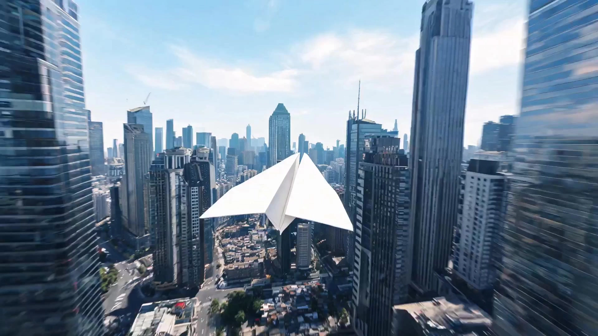

# FPV Tour

> **作者：** @阿娴AIGC

## Content

Process Planning:

Workflow Stages and Dependencies:

Analyze Reference Assets → resource_prepare_and_analyze: Identify subject type (person / architecture / landscape / vehicle), spatial depth, light direction, and traversable structures (doorways, arches, architectural gaps, etc.). If the user uploads multiple images, first determine the role of each (main image / environment / multi-angle reference) and consolidate into a unified analysis result before proceeding to the next step. If there are obvious conflicts in lighting or time of day between images, pause and notify the user to confirm which one to use as the standard. If the user uploads a reference video, simultaneously extract camera movement style, speed, rhythm, and altitude change sequences as supplementary references for flight path design. When both images and videos are uploaded, the images provide subject/scene appearance anchors, and the video provides camera movement style signals; integrate these complementarily before proceeding.

Plan Trajectory Storyboard → storyboard_designer: Based on the analysis results, select the corresponding trajectory rule library according to the subject type to design the storyboard sequence for the continuous flight path.

Pause for Confirmation: After the storyboard is completed, present the flight path summary (altitude changes, key actions, light direction) to the user and wait for confirmation or requests for fine-tuning (e.g., "change the orbit radius to 3 meters," "add a doorway traversal"), then proceed to the generation stage.

Generate Video Assets → media_generator: Generate FPV video segments based on the reference images, with each segment not exceeding 15 seconds.

Synthesize Output → video_assembler: If generated in segments, splice them seamlessly in the order of the flight trajectory, maintaining movement continuity.

Dependency Order: 2→1; 3→2; 4→3; 5→4.

About Duration: Flova's current video generation limit is 15 seconds per segment. If the user requests more than 15 seconds, split the trajectory into multiple segments to generate and then splice them seamlessly, informing the user accordingly.

Style Preset Detection: If the user explicitly specifies a style such as "Low-altitude skimming," "High-altitude dive," "Spiral orbit," or "High-speed shuttle," directly call the corresponding style parameter library during the storyboard planning stage (see Storyboard Design). If not specified, automatically match the default style based on the subject type (Person → Spiral orbit / Architecture → High-altitude dive / Landscape → Low-altitude skimming / Vehicle → High-speed shuttle).

Difficulty Level Detection: If the user explicitly specifies a level such as "Simple," "Standard," or "High difficulty," call the corresponding complexity parameters during the storyboard planning and prompt writing stages (see Storyboard Design). If not specified, the "Standard" level is used by default. The difficulty level and style preset are orthogonal and can be combined freely (e.g., "High-altitude dive × Simple" or "High-speed shuttle × High difficulty").

Vertical Screen Mode Detection: If the user explicitly mentions "vertical screen," "Douyin," "Reels," "9:16," or "short video platform," or if the uploaded reference image itself is in a vertical composition (height > width), lock the aspect ratio to 9:16 and automatically enable the vertical camera movement rule library during the storyboard planning stage (see Storyboard Design). If not explicitly stated, use horizontal 16:9 by default.

Exception Handling:

Image subject is blurry/unrecognizable: Inform the user, "Please upload an image with a clearer subject."

Image lacks spatial depth (e.g., solid color background): Advise the user, "Please replace with an image containing a background/environment, or choose a landscape/architectural scene."
