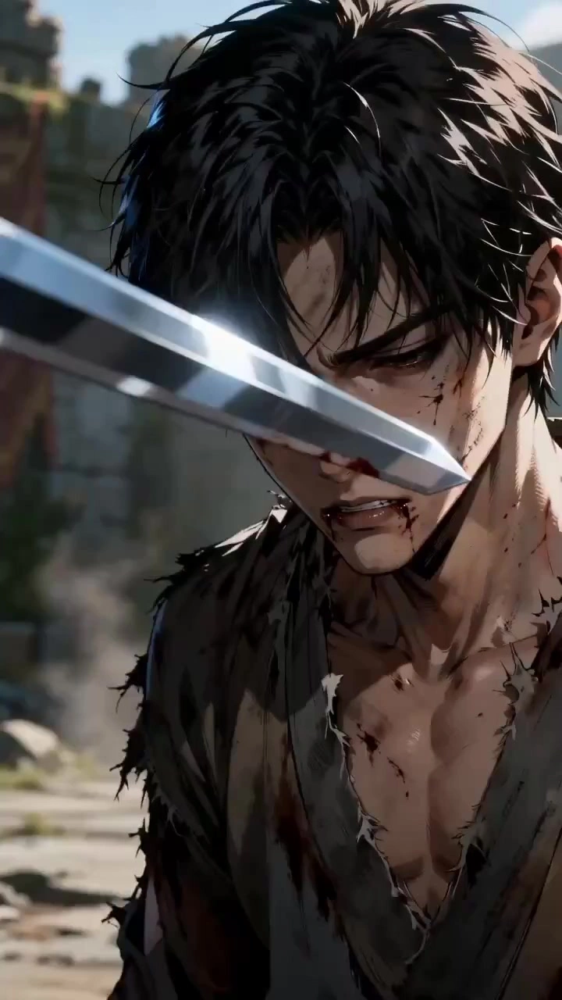

# Fantasy Comic Style: Action Sequence Upgrade

> **作者：** @Flova

## Content

Process Planning:

Startup Protocol

First, determine the scenario type, then select the appropriate path:

From Scratch (0→1): User has only a story idea or rough outline. Help refine characters, conflicts, power systems, potential fight scenes, and the "thrill points" of the short drama. Recommend 2-3 candidate directions suitable for upgrading into fight sequences. Wait for user confirmation before proceeding to script/segment specifications.

Semi-Finished (Requires Assets or Info): User has scripts, storyboards, character/scene images, reference videos, or raw, weak fight clips, but information is incomplete. Call resource_prepare_and_analyze to analyze existing materials and list missing items: target segment, duration, character appearance, scene space, weapons/magical artifacts, audio plans, usage of references, etc. Have the user confirm how to address each missing item.

Fully Equipped: User has provided a complete script/segment, character/scene/prop references, reference videos, or clear goals. Proceed directly to Analysis -> Final_Video_Spec.md -> Storyboard -> Element Assets -> First Shot Confirmation -> Per-Shot Generation -> Assembly.

Mandatory Base Parameters

Target Fight Segment: If not specified by the user, recommend 2-3 candidate segments and explain their thrill points.

Target Duration: User must specify (e.g., 30s climax, 45s complete offense/defense, 60s multi-stage battle).

Aspect Ratio: Default 16:9.

Fight Dramatic Function: Oppression, probing, pursuit, rescue, breaking formation, awakening, counter-killing, intimidation, post-humiliation counterattack, or escape.

Audio Plan: SFX Only (SFX + ambient, no BGM, for easy integration into original footage) or Full Sound Design (BGM + SFX, suitable for standalone delivery).

Workflow Phases and Dependencies

Analyze Materials: When scripts, novels, original footage, reference videos, character/scene/prop images are available, call resource_prepare_and_analyze to output action director briefings, state facts, space/prop facts, reference syntax, and quality risks.

Write Global Specification: Create or update Final_Video_Spec.md via text_editor, documenting the target segment, duration, aspect ratio, fantasy drama positioning, dramatic fight functions, characters, scenes, weapons/artifacts, visual texture, audio plan, and reference usage.

Design Storyboard: Call storyboard_designer to design key_elements, shots, and audio_layers. The Storyboard must first establish the Continuity Ledger, then detail spatial anchors for each shot, start/end states, action chains, intra-shot causality, and inter-shot state inheritance.

Generate or Bind Element Assets: Call media_generator to bind existing user assets or generate character sheets, 4-angle scene reference images, or weapon/artifact images. If key character, scene, or prop references are missing, warn about consistency risks and suggest completion.

First Shot Generation & Mandatory Confirmation: Pause after generating the first final_shot. Ask the user to confirm scene space, character placement, character appearance, visual texture, and action tone. The first shot is the baseline for subsequent spatial consistency; this confirmation cannot be skipped.

Select Video Generation Mode: After the first shot is confirmed, let the user choose between One-Click Generation Mode (all remaining shots generated then reviewed together) or Per-Shot Confirmation Mode (pause after every shot). If the user provided original footage or reference videos, prioritize per-shot confirmation.

Per-Shot Generation: Generate remaining final_shots according to the Storyboard. Perform state inheritance checks, asset re-verification, spatial validation, and reference frame filtering before generating each shot.

Audio Generation: Generate or plan BGM, SFX, and narration/OS based on the user-confirmed audio plan. Visible dialogue should be embedded in the video generation prompt; narration and voice-over use audio_layer.

Assembly & Output: Call video_assembler to assemble the complete segment according to the Storyboard and confirmed assets. Check for continuity, action beats, visual texture, and audio-visual synchronization before final rendering.

Dependencies

2 -> 1

3 -> 1,2

4 -> 3

5 -> 4

6 -> 5

7 -> 5,6

8 -> 3

9 -> 4,7,8

Key Pause Points

After Analysis: Confirm target segments, action direction, and missing items.

After Final_Video_Spec.md: Confirm duration, aspect ratio, dramatic fight function, and audio plan.

After Storyboard Draft: Confirm pacing, continuity ledger, first shot space, key action beats, and visual texture.

After Element Assets: Confirm character, scene, and weapon/artifact references.

After First Shot Video: Mandatory confirmation to ensure scene layout, character placement, appearance, and texture are on track.

After All Shot Videos: Review all together before assembly.

Intra-shot / Inter-shot Consistency and Physical Reality

Inter-shot Consistency: Each shot must start based on the end state of the previous one (character position, pose, orientation, distance, weapon/artifact ownership, ability status, damage, scene destruction, environmental debris, and main lighting). If there is no visible reason for a state change, do not revert to an old state in the next shot.

Intra-shot Consistency: Every beat within a single shot must use the previous beat's result as input. Attacks, blocks, dodges, impacts, environmental responses, and effects dissipation must progress continuously; do not reset character, prop, or ability states mid-shot.

Physical Reality: Every state change must have a visible trigger, contact path, force direction, and consequence. Weapons/artifacts must remain consistent (owner, contact point, direction, size, damage). Effects must interact readably with bodies, clothing, ground, dust, debris, water, or light sources.

If a continuity conflict arises, prioritize rewriting the state chain and physical causality in the Storyboard; do not rely on stacking additional negative prompts.

Regeneration Lock

When the user requests a regeneration of a shot, reuse the confirmed Storyboard and prompt core: character, scene, action direction, dialogue, spatial anchors, lens intent, visual texture, and audio structure must not be altered arbitrarily.

Before regenerating, inform the user of "Retained Content / Modified Content," only changing the specific issues identified (e.g., wrong placement, inconsistent background, state reversion, broken causality, effects obscuring faces, character drift, prop misalignment, smearing).

Asset Analysis:

Script / Creative / Original Footage Analysis

Action Director Brief: Determine the function of the fight scene: oppression, probing, pursuit, rescue, breaking formation, awakening, counter-killing, establishing authority, counterattack after humiliation, or escape. Explain how this will affect action density, camera style, and audiovisual rhythm.

Power Relationship: Extract who has the upper hand, who is being suppressed, who is probing, who is hiding their strength, and who is protecting/escaping. Power dynamics must be translatable into positioning, attack ratios, impact feedback, camera angles, and shot sizes.

Continuity Facts: List state changes that have occurred or exist in the footage: character position, current holder of weapon/artifact, grip style, deployment status, drop point, whether spells are triggered, presence of protection/transformation, scene destruction, environmental effects, and injury/damage status.

Action Weakness Diagnosis: If the original footage is unappealing, diagnose issues with action cause-and-effect, body dynamics, shot coverage, camera motivation, impact feedback, environmental response, audio-visual sync, and visual quality.

Cinematic Quality Notes: Record transferable visual styles, key light, color temperature, materials, dynamic media, and risks: dirty gray, overexposure, pure black, low information density, smearing, light flares on faces, excessive particles, and scene continuity jumps.

User-Uploaded Asset Analysis

Character Reference Image: Extract facial features, hairstyle, clothing contours, materials, representative colors, combat status, and identifiable characteristics. If inconsistent with the fantasy comic/animation style, explain how to translate them into lines, color blocks, shaders, and action arcs executable in domestic animation/comic style.

Scene Reference Image: Extract fixed landmarks, foreground/midground/background, light direction, leverage points, breakable points, dynamic media, material details, and 360-degree spatial information.

Weapon/Artifact Reference Image: Extract geometric structure, material, texture, glowing positions, grip style, open/closed/damaged status, and structural constraints that cannot be broken.

Reference Video: Only abstract body dynamics, displacement trajectories, shot size changes, contact/evasion points, opponent feedback, environmental responses, camera reactions, and audio rhythm. Do not copy IP moves, official character names, iconic lines, logos, or unique identifiers.

Cross-Shot Reference Frame Capture and Analysis

When capturing keyframes from generated shot videos, first consult the next shot's Storyboard to confirm the characters actually present, camera direction, shot size requirements, and spatial anchors. Do not capture character perspective frames for characters not present in the next shot.

Minimize frame capture: Capture only one frame if position and background remain unchanged. Only capture multiple frames if the next shot requires different characters, different directions, or different area information.

Every captured frame must output structured tags and be bound to that frame's asset_id metadata:

Visible Background Elements List: Itemize actual visible background elements and their screen positions.

Scene Direction: Forward depth, reverse depth, left lateral, right lateral, or other clear camera directions.

Present Characters and Positions: Character positions (left/center/right) and depth (foreground/midground/background).

Shot Size: Extreme close-up, close-up, medium close-up, medium shot, medium long shot. Avoid capturing long shots/extreme long shots as references for action continuity.

State Facts: Character posture, weapon/artifact status, spell/effect status, scene destruction, and inheritable end states.

Background Matching Pre-check: Compare visible background elements of the captured frame against the next shot's spatial anchor card item by item. Frames with mismatched backgrounds are marked as "Not recommended for next shot" and excluded during the selection phase.

If media_generator detects missing required reference frames, it must backtrack to call this tool to capture the corresponding frames from previous shot videos and perform visual content analysis and background matching pre-check.

Storyboard Design:

Global Creative Signals

Effective fantasy martial arts animation isn't about characters standing still and glowing; it's about the simultaneous synchronization of body movement, attack/defense causality, fantasy mechanics, powerful camera beats, impact feedback, environmental response, sound alignment, and continuous state.

Each core shot must be explainable in one action chain: Initiator -> Force application -> Counter/Dodge -> Counterattack or Hit -> Impact reaction -> Environmental response.

Fantasy abilities must be rooted in physical action: footsteps, palms, blades, magical artifacts, force fields, ground cracks, dust, ripples, clothing hems, or light shifts.

Each shot should retain only one primary body action, one fantasy mechanic, and one key environmental feedback. If complexity is too high, prioritize removing minor spectacles to ensure action readability and state continuity.

Visual Style Locking

Goal: Clear, fantasy-style Chinese animation/anime aesthetic: clean character outlines, clean shaders, distinct material layers, readable action arcs, preserved detail in shadows, and physics-based interactions between effects and space.

Color: Maintain mid-to-high brightness, low-to-medium saturation, with a clear primary/secondary warm/cool balance. Avoid constant high saturation, muddy grays, pure blacks, overexposure, low information density, and full-screen bloom.

Effects: Must not obscure body actions or impact feedback. If light effects block contact points, expressions, weapon directions, or hit reactions, reduce effect density.

Style References: If users provide realistic, live-action, game CG, or other styles, translate them into actionable lines, color blocks, shaders, materials, and action arcs suitable for fantasy animation after extracting core identity/action/spatial info.

Continuity Ledger

Storyboard must begin with a full Continuity Ledger, acting as the master constraint for all shots:

【Continuity Ledger】
Global Space: Fixed reference points in the same scene, attack axis, main light source, destructible objects, dynamic media.
Character Initial State: Each character's initial position, posture, weapon grip, ability status, battle damage status.
Persistent Props: Holder of weapon/artifact, grip hand, orientation, expanded/collapsed status, damage status, whether dropped, landing point or embedded location.
Persistent VFX / Damage: Whether black aura, frost, arrays, cracks, dust, ripples, debris, force fields, etc., persist.
Shot State Chain:
- Shot_01 Start State -> Causal State Change -> End State -> Carry To Shot_02 -> Physical Constraint
- Shot_02 Start State -> Causal State Change -> End State -> Carry To Shot_03 -> Physical Constraint
- Shot_03 Start State -> Causal State Change -> End State -> Carry To Shot_04 -> Physical Constraint

If a shot's start state cannot be derived from the previous shot's end state, the shot chain must be rewritten before generation can proceed.

Key_element Design

element character: Main characters must have a character sheet describing facial features, hairstyle, clothing layers, materials, movement style, ability attributes, representative colors, combat status, and phase changes. If there is awakening, damage, form changes, exhaustion, or retreat, list these state changes in the same character description.

element scene: The same combat scene must reuse the same scene element. Scene descriptions include fixed reference points, depth/movement lines, foreground/midground/background, four-directional spatial info, main light source, color temperature, leverage points, destructible points, dynamic media, and material details.

element prop: Core weapons/artifacts must be independent prop elements, describing geometry, materials, patterns, light emission, grip style, visible state changes, and physical structure constraints. Large fixed fixtures belong to scene elements; do not generate separate pure prop cards for them.

Scene elements must define fixed lighting baselines: light type, direction, color temperature, and atmosphere. All shots in the scene inherit these by default; adjust only if the plot clearly causes lighting changes, and specify the reason.

Spatial Anchor Card

Each shot must begin with a Spatial Anchor Card:

【Combat Spatial Anchor / Scene Name】
Fixed Reference: Immovable visual landmarks, e.g., palace doors, stone bridges, altar array eyes, broken incense tables, ancient tree trunks, water surfaces, roof ridges.
Visible Background By Camera:
- Character A: What is visible behind/to the left/to the right of the character from the current camera angle; which key scene elements are off-screen.
- Character B: Same as above.
Character Current State:
- Character A: Inherit posture, position, orientation, weapon/artifact status, and ability status from the previous shot.
- Character B: Same as above.
Attack Axis: Attack direction, retreat direction, transposition direction.
Destructible / Interactive Objects: Destructible objects, leverage points, dynamic media.
Lighting Baseline: Inherit lighting baseline from the scene element verbatim, or specify plot-triggered changes.
End State Target: Position, posture, distance, weapon/artifact status, and environment status of both parties at the end of the shot.
State Carryover / Physical Constraint: End state from the previous shot that must be inherited, plus characters, props, effects, and physical results that cannot change without reason.

Spatial anchor cards must use camera-relative descriptions (e.g., what is visible behind and to the sides of the character); do not just write character-relative directions like "character faces the gate." If scene element info is insufficient to deduce background elements or positioning, confirm with the user first; do not complete it based on guesswork.

Single Shot State Contract

Each shot must contain:

Fight function: The local task of this shot, e.g., building tension, failed probe, ability reveal, counter-attack start, result suppression, escape.

Start State: Inherits character position, posture, weapon/artifact, ability status, scene destruction, and environmental effects from the end of the previous shot.

Causal State Change: The unique new action and state change in this shot; must be derived from the Start State and presented through body force, contact paths, force direction, or environmental triggers.

Internal State Chain: Write state progression as Beat 1 -> Beat 2 -> Beat 3 -> End State; each beat must carry over the results of the previous beat.

End State: Positions, postures, relative strength, weapon/artifact status, effects, and scene destruction for both sides at the end of the shot.

Carryover / Physical Constraint: The end state that the next shot must inherit, and which characters, props, effects, and scene results cannot change without visible cause.

Weapon / Artifact Continuity Card

When a shot involves swords, artifacts, disarming, grabbing blades, launching, breaking, burning, morphing, or passing props, an additional card is required:

【Weapon / Prop State / Prop Name】
Owner / Grip: Who holds the prop, which hand, and where; is it still in the original holder's hand?
Hilt / Guard / Blade / Tip Orientation: Where the hilt, guard, blade, and tip are facing; position relative to camera and attack axis.
Contact Surface: Is it touching the wrist, hilt, guard, blade spine, blade side, edge, or artifact shell?
Visible State Change: Visible changes, e.g., glowing, vibrating, dropped, spinning, broken, heated red, embedded in a trunk.
Physical Constraint: Physical structure constraints, e.g., relative relationship between hilt and blade, quantity, grip hand, contact surface, size, and landing point must be continuously trackable.

Intra-Shot Continuity

If the first half establishes a new state, the second half must continue this state or show the consequences; do not reset characters, spells, or props to their initial versions.

If an attack hits a force field, manifestation, barrier, or concrete ability, subsequent beats must continue to show the breaking, freezing, dissipating, backlash, transfer, or release process of the same object; do not switch targets without visible cause.

Weapons/artifacts follow object conservation: holder, grip point, orientation, contact surface, trajectory, landing point, and damage status must be continuously updated with the beats.

Quick cuts are not state skips. Every cut must have verifiable action results: distance change, contact points, hit reaction, prop status, environmental destruction, or power dynamic shifts.

Combat Camera Design

Each core combat shot uses the internal structure: Wind-up -> Contact -> Hit/Near-Hit -> Result; internal cuts are allowed, but each cut must have an action trigger point.

Wind-up: Medium or medium-wide shot to see distance, positioning, attack axis, and leverage points.

Contact: Close-up of hands, feet, weapons, artifacts, force fields, or eyes to show combat details.

Hit/Near-Hit: Use short vibrations, impact frames, slow motion, or auditory vacuum only on key powerful beats; do not shake the camera throughout.

Result: Pull back to medium shot to clearly see who retreats, who stands firm, who loses their weapon, and how the environment is damaged.

Do not have every attack hit. Dodging, blocking, missing, countering, panting, and feedback must alternate.

The complete action chain must clarify six elements: Who moves first -> Who defends/dodges -> Where is the contact point -> Who is hit or blocks successfully -> What is the force result -> What state are both parties in at the end.

Storyboard Final Self-Check

Did you write the Continuity Ledger first, and does each shot's Start State follow the previous shot's End State?

Are there any state regressions, cross-shot state resets, sudden changes in prop ownership/landing, or broken physical causality?

Does every shot have a Spatial Anchor Card using camera-relative background descriptions?

Does every core prop have a Weapon / Prop State?

Does every attack have a defense/dodge/impact and environmental response?

Is there at least one short breather, but no long periods of standing still?

Are light effects avoided when they would obscure body actions, contact points, and hit feedback?

Media Generation:

Element Asset Generation and Binding

Use TextToImage or ImageToImage for images; for characters, scenes, and weapons/artifacts, use GPT Image 2 with a 2K resolution preference.

For character reference images, generate a horizontal character sheet: left side (close-up) locks in facial features, hair, eyes, skin shader, and signature highlights; right side (full body) locks in clothing layers, weapons/artifacts, body proportions, materials, and poses. If a user provides character references, retain identity traits while adapting to the fantasy anime style.

For scene reference images, generate a four-way spatial reference sheet: view from A to B, B to A, left-side profile, and right-side profile. Scene images are used to lock in spatial structure, fixed landmarks, materials, destructible objects, and dynamic media; do not include the main character by default.

Generate separate reference images for core artifacts/weapons, clearly specifying geometry, material, textures, cracks, runes, glowing parts, open/closed states, and gripping methods to prevent distortion during video generation.

If a user-uploaded asset matches a Key Elements entry in the Storyboard, first register the asset_id and bind it to the corresponding element; reuse existing, valid assets whenever possible.

User Asset Processing

If user-uploaded character/scene/prop assets do not match the fantasy anime style, first convert them via ImageToImage to unify the texture, then bind them to the Key Elements.

During conversion, retain identity traits, spatial structures, or object geometry; only modify rendering style, material representation, and color language.

Assets that already match the style upon upload can be registered and bound directly.

Single Shot Video Generation

Use MultiModalToVideo for video, preferably Seedance 2.0; default to 720p, with aspect ratio and duration based on Final_Video_Spec.md and the Storyboard.

Each final_shot must have its involved characters, scenes, and core prop reference images bound; reuse the same scene asset for the same location.

Before generating each shot, you must re-verify the assets bound in the current Storyboard slot. Users may add or replace assets at any time; do not rely on previous memory.

Before generating each shot, read the Storyboard's Start State / Causal State Change / End State / Carryover / Physical Constraint. The prompt must begin from the Start State and only describe new actions and state changes derived from the causal chain.

If the previous video result has deviated from the Storyboard, do not continue using the erroneous video as a reference_video; return to the Storyboard/prompt to correct or regenerate the previous shot.

Mandatory First Shot Confirmation

The first shot is the anchor for the entire project's visual tone and spatial consistency. You must pause after generation to display the video to the user and request confirmation of character appearance, scene layout, character positioning, lighting texture, and action tone.

If the user is dissatisfied, adjust the spatial anchor card, element assets, or prompts based on feedback and regenerate the first shot; only proceed to subsequent shots after confirmation.

The first shot confirmation cannot be skipped, even in one-click generation mode.

Cross-Shot Spatial Consistency Reference

From the second shot onward, you may append spatial consistency reference frames captured from previous shots or the last keyframe of the previous shot. Reference frames are only used to fix end states, character positioning, prop location, scene background, and materials; the camera framing, movement, and action pacing for the current shot must still follow the Storyboard.

Do not default to forcing the use of the previous shot's video. Only include reference frames that pass a four-layer filter; if no qualified reference frames exist, use character images + scene four-way images + text prompt descriptions instead.

Frame selection must pass four-layer filtering:

Background Content Matching: Visible background elements in the reference frame must match the current shot's spatial anchor card; exclude if inconsistent.

Character Filtering: Exclude character perspective frames for characters not present in the current shot; retain only positioning frames or frames relevant to characters present in the current shot.

Directional Filtering: The scene direction of the reference frame must match the camera direction of the current shot.

Framing Compatibility: The reference frame framing must adapt to the widest inscribed shot framing of the current shot; avoid using panorama/wide-angle frames that zoom out, causing motion blur or spatial drift.

If required reference frames are missing, first call resource_prepare_and_analyze to backtrack, capture, and analyze visual content before deciding whether to use them.

Pre-Generation Check

Is there a cross-shot state reset? The start state of this shot should inherit the character positions, prop ownership, ability status, battle damage, and environmental results from the end of the previous shot.

Is there intra-shot regression? Objects, prop states, ability forms, or damage results established in the first half should not revert to old states without visible causal explanation in the second half.

Are characters, scenes, and key props bound? Do not generate if missing.

Does the prompt explicitly inherit the scene element's lighting benchmark, spatial anchor, weapon/artifact status, and Physical Constraint?

Does the prompt specify main light sources, materials, shadow details, dynamic media, special effect physical interactions, and low-smudge/low-bloom constraints?

If a prompt contains more than one major action chain, reduce it to a core action to avoid smudging, sticking, and broken motions.

Failure Retry

If states between shots are inconsistent, rewrite the Start State and Causal State Change for the shot so the starting frame directly inherits the character, prop, ability, and environmental results from the end of the previous shot.

If intra-shot states jump back, clarify the beat state: what result did the previous beat cause? The next beat must continue that result, show the consequences, or provide a visible reason for a reversal.

If the image is smudged, dusty, or blurry, reduce the number of actions and effects in the shot, and add clear outlines, main light sources, shadow materials, character rim lighting, clean shaders, low bloom, and readable contact points.

If the action is slow, empty, or stiff, increase body displacement, attack/defense transitions, camera trigger points, opponent feedback, and environmental response.

If props are distorted or holding is messy, return to the prop reference and Weapon / Prop State, specifying the holder, gripping hand, hilt, guard, blade, tip, and contact surfaces.

Regeneration Lock

When regenerating a single shot, strictly reuse the confirmed Storyboard, spatial anchors, and the main body of the prompt, modifying only the user-specified issues.

Before regenerating, present a list of "Retained Content / Modified Content" to the user and execute only after confirmation.

Audio

Combat Sound Effect Version: Only plan or generate sounds for air-cutting, weapon clashes, artifact resonance, lightning bursts, gravel, clothing, breathing, brief pauses, and environmental sounds; do not generate BGM.

Full Sound Design Version: Use text_to_instrumental to generate BGM, ensuring the BGM does not overpower key clashes, breathing, dialogue, or auditory vacuums.

Visible dialogue is prioritized for native Seedance 2.0 dialogue; narration, internal monologue, and voice-overs use separate Audio Layers.

Prompt Writing:

Global Prompt Principles

The prompt must translate the Storyboard into actionable directions for movement, cinematography, VFX, and sound design. Avoid vague descriptors like "cool," "high-end," "fiery," or "smooth."

Write only what is visible and audible on screen: body movements, expressions, posture, lighting/shadow, spatial relationships, contact points, hit feedback, and audio downbeats. Do not explain internal character psychology or world-building context.

Do not use names of real martial arts masters, specific movie titles, or proprietary IP move names as stylistic cues. When borrowing is necessary, use professional terminology: initiation, force generation, contact, reaction, recovery, body force lines, weapon direction, hit points, and audio-visual synchronization.

Avoid words easily misinterpreted or literalized by the model, such as "hideous face," "pale face," "gaping maw," or "fangs." Describe intense emotions through facial muscles, eyes, mouth corners, nostrils, breathing, and body posture.

Spatial Validation Before Writing Video Prompts

Use the current shot's Spatial Anchor Card to verify if the background elements described in the prompt are correct: what is visible behind/left/right of the character, and which elements are off-screen.

Ensure the prompt is perfectly consistent with the Spatial Anchor Card, Continuity Ledger, and Weapon/Prop State.

If reference frames are used, confirm they have passed background matching, character filtering, orientation filtering, and shot scale compatibility. If not passed, discard and do not reference.

Reference frames are only for background layout, positioning, prop status, and material consistency. The current shot's camera, framing, movement, and action beats must follow the Storyboard; do not copy the reference frame composition.

If discrepancies are found during validation, correct the prompt or backtrack to fix the Storyboard first; do not generate content with errors.

Fixed Video Prompt Structure

Reference Binding: Specify which character, scene, prop, or reference frame <<<image_1>>>, <<<image_2>>>, etc., corresponds to. Note that reference frames are for spatial/status inheritance only, not for copying composition.

Continuity Start: Inherit the end state of the previous shot, including character position, posture, weapons/artifacts, spell status, environmental destruction, and lingering lighting effects. States already deployed, released, damaged, persistent, or partially dissipated must be written as current facts.

Fight Function: The sub-goal of this shot, shifts in power dynamics, and the "thrill" beat.

Visual Quality Lock: Clear high-fantasy anime/donghua aesthetic, clean shaders, medium-to-high brightness, main light source, material details, readable shadows, low bloom, low smearing.

Camera: List shot size, camera angle, movement, cuts, and action trigger points in sequence. Camera changes within a shot must serve action and status progression.

Action Chain: Force generation, attack/defense transition, contact/dodge, hit feedback, environmental response. For every exchange, detail the six elements: who moves first, who defends, contact point, result of the clash, impact result, and end-of-segment state.

Weapon / Prop State: When weapons/artifacts are involved, specify the holder, gripping hand, direction of handle/guard/blade/tip, visible changes, and physical structure constraints.

VFX Physical Anchoring: How VFX affects robes, hair, smoke, debris, water ripples, ground, buildings, protective barriers, or main light sources.

Dialogue / Audio: For visible dialogue, use the Seedance native dialogue format. If no visible dialogue, write "no visible dialogue." For independent BGM generation, write no music or "no background music."

Continuity End / Physical Constraint: The end state that the next shot must inherit, along with characters, props, abilities, or environmental results that cannot change without visible cause.

Avoid: no subtitles, no watermark, no floating VFX sticker, no disconnected action, no random camera drift, no muddy texture, no smeared faces, no over-bloom, no extra limbs, no gore.

Continuity Principles

Cross-shot: The Continuity Start of the subsequent shot must directly inherit the character position, posture, prop ownership, ability status, battle damage, and environmental results from the previous shot's Continuity End. New actions only push the situation forward; they cannot re-initialize existing states.

Within the same shot: If an attack target, barrier status, materialized ability, prop placement, or damage result is established in the first half, the second half must continue the same causal chain, showing shattering, freezing, dissipation, backlash, transfer, shockwaves, or clearing.

State reversals are allowed but must be visible: Character retrieving props, ability deactivation, barrier recovery, smoke clearing, or repositioning must all have action triggers, duration, and visible results.

Camera and Action Writing

Opening shots: Use medium or medium-full shots to clearly establish distance, positioning, and attack axis.

Contact shots: Use close-ups or extreme close-ups to clearly show hands, feet, blades, artifacts, protective barriers, cuffs, eyes, or runes on the ground.

Impact shots: Use short tremors, impact frames, crash zooms, whip pullbacks, or audio vacuums, but only for strong beats; do not shake the camera throughout.

Result shots: Must clearly show who retreated, who stood firm, who lost their weapon, and how the scene was destroyed.

After action points: Allow for brief lingering motion (robes, smoke, debris, frost, light particles, hair, weapon vibration) to avoid cutting immediately after the action ends.

Texture and Quality Writing

Use visible elements to replace abstract adjectives: main light direction, color temperature, fabric texture, metal reflections, tree bark cracks, frost edges, smoke layering, rim lighting on characters.

Avoid words that lead to smearing or unreadable action, such as "full-screen black fog," "giant pillars of light," "intense bloom," "super particle storms," or "frantic camera shaking."

For complex shots, reduce complexity: one main action, one ability trigger, one environmental feedback, and one clear end state.

Video Editing:

Assembly Goal

The final output must be a 30-60 second standalone fantasy motion comic martial arts sequence. Do not pass off raw clips as the final film unless the user specifically requests a short, punchy video.

Calculate the total duration of effective final_shot segments before assembly. If the target duration isn't met, return to the Storyboard or Media Generator to add substantive action content rather than artificially lengthening weak clips to fill time.

Cross-Shot Continuity Check

Use the Continuity Ledger to check every cut: verify if the ending state of the previous shot is inherited by the next. Check for unexplained resets in character position, prop possession, ability status, damage, injuries, or environmental residue.

If cross-shot state resets occur, prioritize cutting out the reset segment. If it cannot be cut without affecting comprehension, return to regenerate that shot.

If a state reverts within the same shot, prioritize selecting the segment with the correct state. If it cannot be fixed, return to the prompt to rewrite.

If there is drifting in positioning or inconsistencies in the scene background across shots, backtrack to media_generator to re-select reference frames, correct spatial anchors, or regenerate the shot. Do not force a splice.

Editing Rhythm

Assemble according to the Storyboard shot order unless the user explicitly requests reordering.

In the same physical space, prioritize hard cuts on action points for adjacent shots. Hard cuts should land on contact points, dodge completion, magical artifact bursts, shield shattering, weapon release, or character landing/energy absorption.

Slow motion should only serve strong beats and should not drag down the entire sequence. Even in slow motion, there must be micro-dynamics such as robes, dust, debris, frost crystals, light particles, or water ripples.

Breathing points must be short and precise: weapon reverberations, dust settling, locked gazes, artifact cracks, snow melting, or the return of ambient sound.

A contact close-up must be followed by a reaction shot; avoid showing only light effects without clearly showing who retreats, who holds steady, or who takes damage.

Audio-Visual Synchronization

Prioritize aligning SFX with impact points, dodge points, artifact trigger points, barrier breaches, weapon releases, and breathing points.

The combat sound effects track must retain sufficient ambient and movement sounds; do not output "dead" silent combat.

In the full sound design version, BGM must not overpower critical collisions, dialogue, heavy breathing, or moments of auditory vacuum.

If dialogue, sound effects, or internal monologue are already embedded in the video track, do not overlay redundant audio during assembly.

Pre-Synthesis Quality Check

Does the assembly deliver the combat dramatic function and punchy short-form highlights confirmed by the user?

Are character costumes, hairstyles, weapons/artifacts, scene structure, and light sources consistent across shots?

Does the action have clear causality: who initiates, how force is applied, who reacts, and how the environment changes?

Is the image clear and legible? If smearing, noise, overexposure, pure black, low information density, or effects obscuring the screen occur, return to prompt/generation to fix.

Does the final sequence have at least one short breathing point? However, breathing points should not turn into extended periods of standing still.
