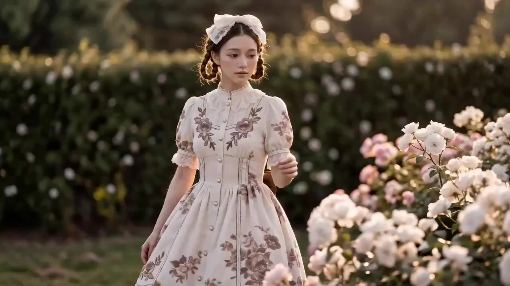

# Fashion Showcase Video

> **作者：** @境在丨米叔

## Content

Process Planning:

Phase Workflow and Tool Scheduling:Phase 1: Global Parameter LockingCreate Final_Video_Spec.md (Title, Aspect Ratio, Duration Intent, Visual Style Tone, Language) → text_editor. Simultaneously, based on the clothing type and user intent, clearly lock the shooting style in Final_Video_Spec.md: Runway or Lifestyle (Street Style/Buyer's Show). All subsequent phases (Scene Selection, Storyboard, Prompt Style) must branch based on this decision and cannot be reassessed in later stages.

Phase 2: Clothing Asset Analysis (If uploaded by user)If the user provides clothing images or reference videos, first extract structured information such as style, fabric, color, and dynamic physics → resource_prepare_and_analyze

Phase 3: Clothing and Character Design Confirmation (Proceed step-by-step; must pause and wait for explicit user confirmation after each step; do not auto-proceed)

Step 3a: Generate Technical Flat Sketches (3-View) (Front/Side/Back technical drawings, no model, pure clothing structure, horizontal wide-format layout) → media_generator; Pause and wait for the user to reply "Confirmed" or provide modification feedback before proceeding to step 3b.

Step 3b: After user confirmation of the flat sketches, use them as a reference to generate the Model Lookbook Card (Horizontal wide-format; Left: Facial close-up, Right: Front/Side/Back full-body views of the model wearing the clothing) → media_generator; For multiple outfits or characters, generate corresponding Model Lookbook Cards one by one in A/B/C order; Pause and wait for user confirmation of the model image and fabric rendering before proceeding to step 3c.

Step 3c: After user confirmation of the Model Lookbook Card, the Planner will present 3 candidate scene proposals directly in text form that match the clothing style (Scene Type + Lighting Tone + Core Atmosphere Keywords), no tool calls required; If the user has custom scene requirements, follow the user's description directly; Pause and wait for the user to choose from the candidates or provide custom directions before proceeding to step 3d.

Step 3d: After user confirmation of the scene choice, generate the corresponding Empty Scene Image based on the selected proposal (No characters, no clothing, pure environment atmosphere, horizontal wide-format) → media_generator; Generate one image for each element scene if there are multiple scenes; Pause and wait for the user to confirm that the scene style and lighting tone meet expectations before entering the storyboard phase.

Phase 4: Storyboard Design, Asset Binding, and Shot Confirmation (Three steps)

Step 4a: Declare key_elements (Model character, clothing, core scenes, and accessories) and shot list (including shot size strategies), audio tracks → storyboard_designer. key_element descriptions must remain consistent with the Model 3-view in step 3b and the Empty Scene Image in step 3c; no contradictions allowed.

Step 4b: Register the asset_id for the Model 3-view generated in step 3b and bind it to the corresponding element character in the storyboard; register the asset_id for the Empty Scene Image generated in step 3c and bind it to the corresponding element scene in the storyboard → media_generator. This step is a necessary prerequisite before video generation; do not proceed to Phase 5 without completing the binding.

Step 4c: Using the bound element character image (step 3b) and element scene image (step 3c) as reference inputs, generate a 6-grid cinematic storyboard preview → media_generator; Pause and wait for user confirmation of storyboard composition, scene matching, and shot pacing.

Phase 5: Video GenerationAfter the user confirms the 6-grid storyboard, use the 6-grid storyboard preview as direct reference input, combined with the locked model, clothing, and scene key_element assets from the storyboard, to generate a complete 15-second fashion short film in one go, no need to split by individual shots → media_generator

Phase 6: Audio and AssemblyGenerate BGM that matches the clothing style → media_generator; After all assets are ready, perform timeline assembly → video_assembler

Dependencies: 3a→2 (if uploaded); 3b→3a; 3c→3b; 3d→3c; 4a→3d; 4b→4a; 4c→4b; 5→4b,4c; BGM generation→4a; Final assembly→5, BGM generation

"One Round = One Storyboard Set + One Video" Principle:

Each complete process (Phases 3→6) produces one scene + one storyboard set + one 15-second video, which is an independent creative unit.

Change Scene: After the current round's video is generated, if the user proposes a new scene, the Planner restarts from step 3c (Scene Candidates), reusing existing Model Lookbook Cards (element character assets do not need to be regenerated) to generate a new Empty Scene Image → New 6-grid storyboard → New 15-second video.

Change Clothing: If the user proposes new clothing, the Planner restarts from step 3a (Technical Flat Sketches) and goes through the complete Phase 3 to 6 process to produce new Lookbook Cards and video.

Each generated video exists independently; the user can freely decide whether to merge and assemble with videos from other rounds; if merging is required, perform unified processing in video_assembler after all target videos are completed. BGM can be shared or segmented by round.

At the end of each round, the Planner proactively asks the user: "Do you need to change the scene or the clothing to continue to a new round of creation?"

Asset Analysis:

Clothing Asset Analysis: When the user provides clothing images or reference videos, prioritize extracting and outputting the following information in structured text for use in the Storyboard phase to generate scene matching proposals and shot dynamic descriptions:

Silhouette: Shape type, neckline, sleeve type, skirt/pant cut

Fabric Material: Texture type (silk/wool/leather/sheer/knit, etc.), glossiness, transparency, weight

Color Features: Hue and saturation characteristics of main colors, secondary colors, and patterns/textures

Dynamic Physics Prediction: Drape and swing inertia of the fabric in motion (e.g., silk floating vs. wool stiffness), providing a basis for camera movement descriptions

Storyboard Design:

Key Elements Declaration Specification:

Model Character (element character): Describe facial features, skin tone, makeup style, hairstyle; must be locked to match the model 3-view generated in Phase 3; no contradictions.

Clothing (element): Using the technical flat sketches from Phase 3 as an anchor, precisely describe style, silhouette, fabric material (texture/gloss/weight), color, and key details (zippers/buttons/embroidery/patterns/special textures) as the visual consistency benchmark for the entire video.

Core Scene (element scene): Based on the scene proposal confirmed by the user in Phase 3, Step 3c, describe spatial structure, main light source direction and color temperature, light-to-dark ratio, and visual negative space design; key_element descriptions must be consistent with the Empty Scene Image generated in step 3d; declare a separate element scene for each scene if multiple exist.

Accessories and Props (element): Significantly visible accessories (jewelry/bags/shoes/hats) should be declared as independent elements for precise reference in shots.

Video Style Type Judgment (Lock in Phase 1 preferred):Based on clothing style and user intent, categorize the shooting style into one of the following two types, which will guide subsequent scene selection, storyboard design, and prompt specifications:

Style Type

	

Trigger Conditions

	

Overall Tone

Runway

	

Evening wear, haute couture, conceptual/functional wear; User explicitly requests "Runway feel"

	

Dramatic lighting, minimalist background, model maintains runway gait and restrained expression throughout

Lifestyle

	

Casual, street, daily wear, winter wear, ethnic/traditional; User explicitly requests "Realism/Everyday feel"

	

Natural ambient light, realistic daily scenes, model has spontaneous interactions and emotional expressions

Runway Scene Mapping:

Evening wear/Gowns → Ballroom or classical theater, Chiaroscuro side lighting, silk/sequin refraction

Functional/Conceptual → Industrial ruins or surreal digital space, structuralist lines

Haute Couture/Ethnic → Traditional architecture or high-contrast studio, high-saturation color backdrops

Lifestyle Scene Selection Logic:Automatically match to the following scene candidates based on clothing features, with recommended lighting schemes for each:

Casual/Commuter → City streets (sidewalks, crosswalks, glass curtain reflections); Front or back-side lighting, hard shadows to emphasize texture

Cafe/Social → Independent cafes, bookstores, or gallery corridors; Warm diffused window light, low-saturation backgrounds to highlight clothing color

Natural Outdoor → Park lawns, forest trails, seaside rocks; Golden hour back-side lighting, environmental colors bleeding into the fabric

Urban Night → Neon convenience store entrances, wet asphalt surfaces; Mixed color temperature (warm yellow street lights + cool blue sky), specular highlights

Home/Light Living → Floor-to-ceiling windows, studies, bathroom entrances; Soft natural side lighting, emphasizing the static beauty of fabric drape

Warm/Winter → Nordic snowy fields, warm indoor coffee nooks; Low color temperature warm light emphasizing volume and plush textures

Ethnic/Traditional → Ancient town streets, courtyard corridors, natural mountains; High-purity environmental colors, emphasizing color interaction

Scene Composition Principles (Lifestyle Exclusive):

Keep real-life props (coffee cups, shopping bags, books, bicycles, etc.) in the scene, but ensure props do not distract from the subject;

Allow moderate blurring of pedestrians or background elements to create a sense of depth and daily life;

Avoid overly symmetrical runway-style corridor compositions, prioritize street/candid perspective angles.

Lifestyle Model Interaction Action Library (Lifestyle Exclusive):Unlike the restrained gait of runway shows, Lifestyle models should present spontaneous, non-performative, real-life actions. Categorized by shot function: Movement (Replacing runway gait):

Strolling across a street, skirt swaying naturally with steps

Pushing open a cafe glass door, entering the frame from the side

Cycling or pushing a bicycle, wind blowing through hair and collar

Walking up/down stairs, clothing silhouette deforming with the shift in center of gravity

Stationary/Waiting (Static shot anchors):

Leaning against a wall or railing, feet crossed, looking down at a phone then looking up

Sitting on steps or a bench, elbows on knees, looking thoughtful

Pausing in front of a shop window, looking sideways, face 3/4 angle toward the camera

Prop Interaction (Detail-driven):

Adjusting scarf or collar, fingers hooked on the edge of the fabric

Holding a coffee cup, cup obscuring half the face, eyes looking over the rim

Picking up or adjusting bag straps, shoulder movement driving the garment's shoulder line

Flipping pages of a book or menu, gaze lowered, side light illuminating fabric texture

Emotion/Expression (Lifestyle specific, disabled for Runway):

Turning head with a slight smile, making eye contact with an imaginary person off-camera

Looking up after a slight head tilt, creating a "candid snapshot" moment looking directly at the camera

Wind messing up hair, gently tucking it behind the ear, expression natural and unforced

Multi-person Scenes (Optional):

Two people walking side-by-side, no physical contact, clothing contrast composition

One person sitting, one standing, asymmetric gaze, emphasizing layering

6-Grid Storyboard Design Specification:The 6-grid is a visualized storyboard preview presented to the user for confirmation, using a Portrait (9:16) layout, arranged in 3 rows × 2 columns, representing six core visual nodes of the entire film, covering different shot sizes and narrative functions:

Grid 1 (Wide Shot, WS): Establish the scene and model entrance, defining spatial relationships and overall silhouette

Grid 2 (Medium Shot, MS): Runway gait or turning, showcasing clothing silhouette and fabric dynamic deformation

Grid 3 (Medium Close-Up, MCU): Upper body composition, focusing on makeup, hairstyle, and upper garment details or accessories

Grid 4 (Close-Up, CU): Microscopic fabric texture, stitches, zippers, embroidery, etc., with high contrast; or character expression/accessory close-up

Grid 5 (Dynamic Freeze): High-frame/whip-pan moment, capturing fabric dynamic forces like skirt flare or jacket movement; or character interaction/emotional action freeze

Grid 6 (Closing Wide Shot, WS): Model walking away or over-the-shoulder shot, blending with the scene, closing with visual negative space

For multiple scenes, plan a 6-grid for each scene; if there is a significant emotional shift within a single scene, the grid functions can be adjusted accordingly.

The entire storyboard image is vertical wide-format (3 rows × 2 columns grid), with a unified cinematic film tone, and the composition within each grid must reflect a 9:16 vertical view.

Each shot must include:

Associated scene, model, clothing, accessory element ID

Shot size, camera movement (Push-in, Pan, Whip-pan, Lock-off, Crane, etc.)

Model action and interaction details: gait rhythm, turning angle, hand gestures, expression management (eye direction/micro-expressions), interaction with scene props

Light and shadow texture description (must include all four items below): ① Main light source direction and color temperature; ② Shadow hardness and coverage ratio; ③ Highlight placement (specific location on fabric or skin); ④ Environmental reflection fill color (surrounding environment color penetration onto the subject)

Visual negative space guidance: positioning and scale intent for negative space in the frame

Special fabric texture annotation: physical properties of the fabric to be emphasized in this shot (drape/swing inertia/refraction spectrum, etc.)

Duration suggestion (calculated by merging continuous shots, total duration for all shots in one outfit is approx. 15s, cannot exceed 15s limit)

Shot Continuity Marker: Indicate the shot size relationship with the adjacent shot ("Different shot size → cut transition" or "Same shot size → merge into one long take")

Independent Audio Track Design:

One BGM track throughout the film, select tone based on clothing style: Casual/Street → Nu-Jazz or Lo-fi Hip-hop; Evening wear/Gowns → Chamber Jazz or Symphonic Strings; Functional/Conceptual → Industrial Techno or Dark Ambient; Ethnic/Traditional → Contemporary arrangements with fused ethnic instruments

Can optionally plan a Foley sound effect layer (high heels hitting the ground, fabric rustling) as an independent audio_layer

Media Generation:

Phase 3: Clothing Asset Generation

Step 3a — Clothing 3-View Technical Flat Sketches: Tool TextToImage, Model Nano Banana Pro(Gemini 3 Pro Image), Resolution 2K. Generate a single horizontal wide-format image, three frames side-by-side: Front / Side / Back pure technical drawings, no model, no background (pure white or light gray); precisely restore style silhouette, seam structure, zippers/buttons/patterns, and other craft details; fabric materials indicated with supporting text annotations.

Step 3b — Model Lookbook Card: Tool ImageToImage (using flat sketches as reference), Model Nano Banana Pro(Gemini 3 Pro Image), Resolution 2K. Generate a single horizontal wide-format image, left and right zones: Left for model facial close-up (half-body, highlighting makeup, bone structure, hairstyle, and skin texture); Right for the 3-view of the model wearing the clothing (Front / Side / Back full-body freeze), focusing on restoring real fabric physical texture (drape/folds/reflections/texture), neutral background. For multiple outfits or characters, generate a separate Lookbook Card for each character in A/B/C order, naming convention: Model_Lookbook_A, Model_Lookbook_B…

Step 3c — Scene Candidate Proposal Presentation (Replied directly by Planner to user, no need to call this tool):

This step is handled by the Planner based on the style type (Runway / Lifestyle) locked in Final_Video_Spec.md and the clothing analysis results, presenting 3 scene candidate proposals directly to the user in text format; no need to call media_generator.

Each proposal includes: Scene type name, core atmosphere description (1–2 sentences), recommended lighting tone (main light source direction + color temperature), and the reason for matching this clothing style.

For projects with multiple scenes, list 3 candidates for each scene to be planned, and the user can select them one by one.

After the user confirms all scene selections, the Planner calls media_generator to enter step 3d.

Step 3d — Empty Scene Image Generation:

Tool TextToImage, Model Nano Banana Pro(Gemini 3 Pro Image), Resolution 2K.

Based on the proposal selected by the user in step 3c, generate an Empty Scene Image for each element scene: No people, no clothing, showing only the environmental atmosphere—spatial structure, main light source direction and color temperature, light-to-dark ratio, depth of field levels.

Runway Scene: Highlight artificial lighting quality (direction, shadow hardness, highlight placement), minimalist background, leave large areas of visual negative space for later model entry.

Lifestyle Scene: Reflect real environmental light and daily props (coffee tables, streets, windows, etc.), allow moderate depth-of-field blur, background has a lived-in feel but is not cluttered.

Bind the generation result to the corresponding element scene in the storyboard as the scene reference input for subsequent 6-grid storyboard preview and video generation (<<<image_2>>>).

Phase 4: Storyboard Asset Binding and 6-Grid Storyboard Preview Generation

Step 4b — Asset Binding (Must be completed before 6-grid generation):

Register the asset_id for the model wearing the clothing generated in step 3b and bind it to the corresponding element character in the storyboard (if multiple outfits correspond to multiple character elements, bind them one by one).

Register the asset_id for each Empty Scene Image generated in step 3c and bind it to the corresponding element scene in the storyboard.

Do not enter the video generation phase until binding is complete; if binding is missing, prioritize finishing it before continuing.

Step 4c — 6-Grid Storyboard Preview: Tool ImageToImage (input is bound element character Lookbook Card + element scene Empty Scene Image), Model Nano Banana Pro(Gemini 3 Pro Image), Resolution 2K.

Generate a single vertical wide-format image (9:16 vertical composition), arranged in a 3 rows × 2 columns 6-grid, each grid corresponding to the static frame composition of a core shot in the storyboard; maintain consistency in character, clothing, scene, and key_element description within each grid; uniform cinematic film tone.

Bind this image to the corresponding shot sequence in the storyboard, serving as the basis for manual confirmation before video generation.

Phase 5: Video Generation

Tool MultiModalToVideo, recommended model Seedance 2.0, Resolution 720p, Duration 15s.

Generation Strategy: Use the 6-grid storyboard preview as the main reference input, combined with the bound element character Model Lookbook Card and element scene Empty Scene Image, to output a complete 15-second fashion short film in a single generation task; describe action beats and shot transitions sequentially within the prompt following the 6-grid narrative order, no need to split into multiple individual shots for generation.

Reference inputs for each video generation task (must use asset_id bound in step 4b):

6-Grid Storyboard Preview (from step 4c, as the core composition and rhythm reference)

Model Lookbook Card (element character bound asset, from step 3b, locking character image consistency)

Empty Scene Image (element scene bound asset, from step 3d, locking scene lighting and atmosphere)

Multiple Outfit Handling: Each outfit (Outfit_01, Outfit_02...) completes the full process from Phase 3 to Phase 5 independently, producing a separate 15-second complete video; element assets for different Outfits are strictly isolated and cannot be referenced across groups. After all Outfit video groups are generated, they proceed to Phase 6 for assembly.

Phase 6: BGM Generation

Tool text_to_instrumental, recommended model Suno 5 (Prompt must not contain names of famous artists, otherwise switch to Mureka 8).

Generate duration aligned with the storyboard BGM audio_layer plan, emotional arc needs to cover three phases: Opening establishment → Mid-section showcase → Closing negative space.

Prompt Writing:

Global Priority: If the user interacts in Chinese or loads a Chinese interface, the main body of the prompt should be written in Chinese; dialogue language follows the output language setting in Final_Video_Spec. Clothing 3-View Technical Flat Sketch Prompt (TextToImage):

Explicitly specify "3-view technical flat sketch (front / side / back) arranged horizontally, pure white background";

Describe style silhouette, structural lines, stitching details, hardware accessories; request generation of annotation text near key details in the image (fabric names, craft instructions);

No human body, no shadows, no environment, maintain engineering drawing style.

Model Lookbook Card Prompt (ImageToImage):

Reference placeholder annotation for flat sketches <<<image_1>>>;

Explicit horizontal wide-format layout: left for model facial close-up (half-body, highlighting makeup, bone structure, and hairstyle), right for 3-view of wearing the clothing (front/side/back full-body standing);

Model Image Texture Enhancement Phrases (Required, stacked by style):

General Base Layer (Must add for all styles): editorial fashion model, striking bone structure, high-contrast facial features, defined cheekbones, sharp jawline, luminous skin with subtle texture, confident yet neutral expression, elongated proportions

Runway Exclusive: haute couture posture, severe angular beauty, piercing gaze, statuesque silhouette, razor-sharp brow arch

Lifestyle Exclusive: approachable yet aspirational look, natural warm skin tone, soft expressive eyes, effortlessly cool demeanor, candid beauty

Makeup Precision Words (Select by style): Runway → sculpted contouring, graphic eyeliner, editorial lip; Lifestyle → dewy no-makeup makeup, brushed-up brows, glossy natural lip

Fabric Texture Emphasis Phrases (Select by material): Silk → flowing liquid drape, light-catching sheen; Wool → dense woven texture, structured weight, matte surface; Leather → high-gloss specular, tight grain, stiff silhouette; Knit → ribbed knit relief, soft stretch, micro-loop texture;

Neutral studio light, no wind, high-contrast background to highlight the silhouette; no clothing deformation, no unexpected accessories.

6-Grid Storyboard Preview Prompt (ImageToImage):

Reference placeholder annotation for Model Lookbook Card <<<image_1>>> and Empty Scene Reference <<<image_2>>>;

Explicit "vertical 9:16 composition, 3 rows × 2 columns cinematic storyboard grid, unified silver halide film tone, vertical screen perspective composition in each grid";

Describe the shot size, camera angle, model posture, and scene lighting for each grid's corresponding shot in sequence;

Lighting Texture Words: chiaroscuro side lighting, golden hour rim light, diffused overcast fill (select based on scene);

Visual Negative Space Guidance: In appropriate grids, specify "large area of negative space at the top/side of the frame, subject offset in rule of thirds composition";

Clothing Texture Enhancement Words: macro fabric grain visible, thread-level weave detail, specular highlight on surface micro-texture.

Video Generation Prompt (MultiModalToVideo / Seedance 2.0):

Reference image placeholder order: <<<image_1>>> 6-grid storyboard preview (main anchor for composition and rhythm), <<<image_2>>> Model Lookbook Card (character consistency), <<<image_3>>> Empty Scene Image (anchoring light and atmosphere);

Prompts describe each beat in segments following the narrative order of the 6-grid (wide shot establishment → runway/interaction → close-up makeup/outfit → close-up texture → dynamic freeze → closing negative space), disable absolute timestamps (e.g., "0–3s"), replace with action beat transitions;

Seedance 2.0 tag specification: Foley sound effect <...>, dialogue {...} (verbatim lines only), music (...), subtitles 【...】;

Fixed negative constraints: no clothing morphing, no subtitles, no music (when BGM is generated independently).

Light and Shadow Description Core Specification (Common to all styles, every shot must include the following light/shadow layers):

Main Light Source Positioning: Specify light source direction (side light/back-side light/top light/window light), color temperature (warm 2700K–3200K / neutral 5000K–5500K / cool blue 6500K+), and incident angle;

Shadow Shaping: Describe shadow hardness (hard sharp cast shadow / soft feathered shadow) and shadow coverage ratio (e.g., "shadow covers 40% of the frame, strengthening the 3D silhouette");

Highlight Placement: Specify the exact location of highlights on the fabric or skin (e.g., "highlight glides along the shoulder line, transitioning to the back of the hand", "sequins form point-like scattering halos under back-side light");

Environmental Reflection Fill: Describe the color reflection of the surrounding environment on the subject (e.g., "glass curtain wall diffuses urban blue light onto the back of the garment", "warm wall surface fills environmental color onto the model's left cheek");

Light/Shadow Emotion Anchoring: End the last sentence with emotional words, anchoring the overall light/shadow atmosphere (e.g., "light and shadow unfold a detached and restrained cinematic texture", "diffused light makes the fabric texture emerge gently, like film positive").

Runway Style Command Hierarchy:Camera movement → Model gait and limb control → Clothing material dynamics (drape inertia/swing amplitude/refraction spectrum) → Light/shadow layer description (per above spec) → Scene artificial lighting and negative space → Foley sound effect tags

Emphasize the ritualistic and restrained nature of the gait; prohibit spontaneous smiling or casual interactions by the model;

Light/shadow instructions prioritize the directionality and hardness of artificial lighting, high shadow ratio (≥50%), strengthening high-contrast dramatic feel;

Recommended light/shadow phrases: single-source hard sidelight casting deep chiaroscuro, rim light tracing the garment silhouette against dark void, specular glide along silk surface with 90% shadow fill.

Lifestyle Style Command Hierarchy:Scene environment and natural light → Camera movement (handheld feel/slight sway allowed) → Model natural actions (select from Storyboard Lifestyle Action Library) → Clothing physical deformation with motion → Emotion/micro-expression description → Light/shadow layer description (per above spec) → Environmental sound effect tags

Camera descriptions can include phrases like handheld slight sway, candid street photography feel, etc., to create an unforced feel;

Action descriptions prioritize extraction from the Storyboard Lifestyle Action Library, maintaining a non-performative feel;

Clothing dynamics focus on "natural deformation caused by gravity and wind" rather than runway-style exaggerated swinging;

Emotion phrase examples: genuine half-smile, lost in thought gaze, caught mid-laugh;

Light/shadow prioritizes describing the direction and diffuse characteristics of natural light, soft shadows;

Recommended light/shadow phrases: golden hour backlight diffusing through fabric weave, overcast diffused daylight wrapping evenly over texture, warm window spill casting a soft elongated shadow on the wall, mixed-temperature ambient — warm tungsten bounce from pavement, cool open-sky fill from above;

Allow blurred passersby or real street noise <ambient city murmur> in the environment to increase the texture of life;

Prohibit describing any runway walkways or catwalk-related imagery.

BGM Prompt (text_to_instrumental):

Describe style tone, core instrument configuration, BPM range, emotional arc (opening establishment → mid-section showcase → closing negative space);

Do not include famous artist names (Suno 5 compliance requirement).

Video Editing:

Single Outfit Video Assembly:Each outfit corresponds to a 15-second complete video generated directly from Phase 5, no need for internal cutting; proceed directly to multi-outfit assembly workflow.

Multi-Outfit Group Assembly:

Each outfit (Outfit_01, Outfit_02...) corresponds to an independent video group, each assembled into a complete short film of about 15 seconds, no cross-Outfit mixing;

When outputting multiple outfits, video groups are arranged in sequence, with brief black frame transitions (0.5s) or direct hard cuts between groups, depending on the Final_Video_Spec style;

BGM can be shared throughout the entire film, or switched by segment based on Outfit style differences—subject to the Storyboard audio_layer plan.

Rhythm and Audio-Visual Synchronization:

BGM beat points aligned with shot transition points;

Foley sound effects (high heels hitting the ground, fabric rustling) can use J-Cut to enter the frame early, strengthening the anticipation of the action;

The fade-out of each Outfit video's closing shot is synchronized with the tail end of the corresponding BGM segment; total duration of the entire film is controlled within the limits specified by Final_Video_Spec.

Volume Levels:

BGM serves as the bottom-layer background, Foley sound effects are briefly elevated to the foreground at action peaks, the two do not compete for narrative space.
