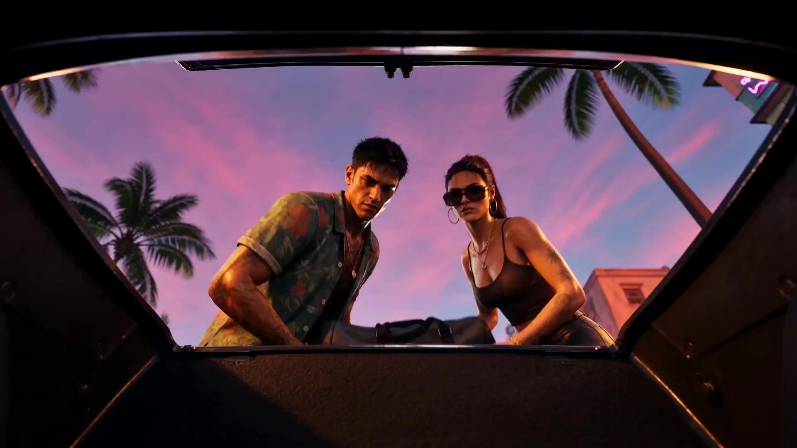

# GTA 6 Life Demo

> **作者：** やはたうみり

## Content

**Process Planning:**

**Full Process Planning Logic and Dependencies:**

1. **Global Settings Initialization**: Create and lock Final_Video_Spec.md (clarify aspect ratio defaults to 16:9; **themed videos, shot lists, prompts, and visual reviews inspired by open-world crime/street themes. Only borrow its visual grammar, urban atmosphere, camera organization, and character archetypes; do not replicate official shots, logos, UI, trademarks, license plates, or specific dialogue.**) → **text_editor**.
   - The visual style is not just "neon crime," but a hybrid of "tropical vacation advertisement + true crime documentary + absurd social media short video + open-world city showcase." The surface of the visuals is lively, sexy, sunny, and exaggerated; the underlying layer consistently carries the pressure of manhunts, debt, human connection, smuggling, the music industry, gangs, and couples on the run.
2. **Storyboard Design**: Design a complete storyboard script (duration controlled by default to a small 30-60s gameplay demo unless the user has specific long-story requirements), including key_elements (characters, scenes, props) and shot lists. Two character creation paths are provided here for the user to choose:
   - **Option 1 (Classic Character Archetypes)**: Use the built-in **Character Archetype Library to create characters** (e.g., fugitive partners, underground kingpins, social media influencers, etc.).
   - **Option 2 (User-Customized Character)**: The user uploads personal photos (used only as creative reference). Use **resource_prepare_and_analyze** to analyze only the user's gender and general image, outputting a minimalist description. During image generation, use the original photo as a visual reference (ImageToImage) for the model to identify clothing and makeup, generating it into a custom key_element character to start an exclusive open-world escape journey.
3. **Asset Preparation and Character Image Generation**:
   - **Option 1**: Directly generate 3D render reference images with GTA style and 3D gameplay texture for built-in archetype characters → **media_generator**.
   - **Option 2**: Based on the analyzed user features, use **ImageToImage** to generate a key_element character image that matches the user's appearance, possesses GTA style, 3D game, third-person game, and UE render texture characteristics, and bind it to the corresponding character asset_id.
4. **Video Shot Generation**: Iterate through the shot list, calling **MultiModalToVideo** to generate final_shot videos one by one, binding the previously generated key_element character and scene image assets as visual references during generation.
5. **Audio Layers Generation**: Based on the audio planning in the storyboard (sirens, nightclub bass, radio, character voiceover), call **generate_audio_resource** to generate BGM assets.
6. **Video Editing Synthesis**: Call **video_assembler** to synthesize audio and video tracks, control the gameplay editing rhythm, and finally guide the user through rendering output.

**Dependencies**: 2 → 1; 3 → 2; 4 → 3; 5 → 2; 6 → 3, 4, 5.

**Pause Checkpoints**:

- After **Final_Video_Spec.md** and **Storyboard** are generated, pause and let the user confirm the story outline and shot planning.
- After the **key_element character image (especially for Option 2's user-customized character)** is rendered, pause to display it, and proceed with video generation only after the user confirms it meets the style characteristics.
- Do not run everything at once; frequently use tabs to interact with the user.

**Asset Analysis:**

**Analyze User Uploaded Images/References:**
- **User Photo Feature Extraction (Option 2 only)**: When the user chooses "Upload photo, render as GTA6 style character," this tool is responsible for performing multimodal analysis on their uploaded real-life photo.
  - Only analyze and describe the user's **gender and general image/vibe** (e.g., gender, approximate age range, general facial contour, or core expression/eyes).
  - **Do not describe or extract specific details like hairstyles, makeup, clothing, or accessories.**
  - Output very concise English feature words, e.g.,: A Hispanic male in his 20s, with sharp facial features and determined eyes. During the image generation phase, the image generation model will adaptively refine details like hairstyle and clothing by directly referencing the user's photo through the ImageToImage visual reference path, without the need for rigid rules in the prompt.
  - Emphasize abstracting the user's real-life base image into the foundation of "GTA style, 3D game character, third-person game gameplay, UE render," removing background and lighting interference from the photo.
- **Art Style and Video Reference Analysis**: If the user uploads third-party videos/GIFs as motion or color references, analyze their camera movement (e.g., third-person trailing, low-angle vehicle chase) and color composition, generating transcription text to provide for the storyboard and media generator.

**Storyboard Design:**

**1. Design Key Elements (key_elements)**
In the Storyboard, the following high-frequency character, scene, and prop archetypes can be predefined based on specific project themes to support highly flexible custom script expansion:
- **Classic Character Archetype Library (element character)**:
  - MALE_LEAD: Typical male protagonist (e.g., hot-blooded driver, street youth), sturdy, weary and alert, skilled at extreme immediate reactions.
  - FEMALE_LEAD: Typical female protagonist (e.g., calm decision-maker, capable career woman), tough, decisive, finding a way out in adversity.
  - UNDERGROUND_BOSS: Underground industry mogul/behind-the-scenes boss, often wears sunglasses, dressed in luxury, unreadable eyes.
  - INFLUENCER_STREET: Social media influencer/street clamorer, pursues traffic and attention, often holding a phone for live streaming or obsessed with parties.
  - MASTERMIND_PLANNER: A meticulous action planner, experienced, sophisticated, and elusive.
  - REGIONAL_SMUGGLER: Old-school island/border smuggler, gritty, unbridled, representing the remnants of old-era crime rules.
  - PARANOID_MONITOR: Paranoid monitor, relaxed posture, skilled at obtaining clues in a dark room full of screens and radios.
  - CUSTOM_USER_HERO (Option 2 only): A custom protagonist converted from user photo analysis, inheriting the user's core appearance and eye features, with a strong sense of identity immersion.
- **Classic Scene Template Library (element scene)**:
  - METROPOLIS_NEON: Tropical neon metropolis, bustling beaches, overpasses, pink-purple streets, wet roads.
  - COASTAL_ISLANDS: Island smuggling belt, blue-green sea, docks, white yachts, twilight cross-sea long bridges.
  - WILD_SWAMP: Wetland wilderness, swamp reeds, helicopter searchlights, muddy fog.
  - DECAYED_HARBOR: Cheap harbor town, motels, motel parking lots, old gas stations.
  - INDUSTRIAL_TOWN: Industrial peripheral town, steel factories, chimneys, motorcycle gangs, rolling dust.
  - STORMY_MOUNTAIN: Mountain national park, forest dark mountain roads, rainstorms and lightning.

**2. Design Shot Organization (shots)**
- **Shot Count Specification**: The entire script design is not recommended to be too long by default; controlling it to **1-3 shots** is sufficient. Unless the user explicitly requests a longer and more complex plot, prioritize a concise volume to ensure ultimate rendering efficiency and single-shot quality.
- For different creative purposes, provide two highly scalable narrative structure design requirements:
- **Structure A: Fast-Paced Event Narrative (Multi-cut combination, suitable for trailers or action scenes)**: You need to confirm the core plot with the user:
  - **Opening Segment - Atmosphere Setting**: Use wide-angle aerial shots, slow skyline pans, and incorporate ambient sounds like distant sirens or radio into the audio, showcasing "undercurrents beneath a calm surface."
  - **Middle Segment - Conflict Out-of-Control**: Action close-ups, character disputes, chase collisions, interspersed with social media handheld/live-stream perspectives. The rhythm switches from calm to high-frequency, with frequent multi-camera cuts.
  - **Closing Segment - Suspense Hanging**: Close-ups of eyes, car doors closing, rearview mirrors, etc., music stops abruptly, leaving only engine, breathing, or monotonous sound effects, leaving a dramatic hook.
- **Structure B: Single-Shot Life/Gameplay Slice (One-take, 5-12s)**:
  - Emphasize high readability, single continuous action (e.g., fueling a muscle car, standing at a wet intersection looking at palm trees, walking in front of a theater, slow vehicle collision metal squeezing physical moment, "leaked texture" of filming a game screen with a phone).
  - Must strictly regulate: Do not switch time/space or splice montages within a single shot; maintain an extremely smooth game-like third-person trailing camera delay.

**3. Camera Language Classification and Proprietary Perspectives**
1. **Game-like Third-Person Perspective**: Camera is low, slightly to the side, behind the character, retaining third-person spatial sense, with slight delay, hiding game UI.
2. **Car/Side-Car Mixed Perspective**: Camera is behind the passenger's shoulder, in the rearview mirror, or at a very low position on the rear bumper, with the car body in the foreground and neon lights sliding at high speed over the wet car body and glass.
3. **Social Media Vertical Screen Perspective**: Mimics phone selfies, handheld live streaming, occasional shaking, brief loss of focus, and edge distortion; aspect ratio can be converted to 9:16 for insertion.
4. **Surveillance / Police Bodycam Perspective**: CCTV fixed wide-angle, with compression and noise; bodycam strongly shaking, with close-range fisheye distortion.
5. **Intimate Escape Duo Perspective**: Composition blocked by car windows, motel door frames, or shutters, creating "warmth and defense under criminal pressure."

**4. Audio Layers Planning (audio_layers)**
- Configure one global theme music track (BGM: synthwave, modern rap, southern radio rock).
- For dialogue, use key_element_audio to maintain the protagonist's gritty/hoarse or Latin tone.

**5. Shot Design Recipe and Scene Action Grammar**
For the two shot structures in video creation, the following scene action design rules must be strictly followed when designing the Storyboard:
1. **Single-Shot One-Take (Life Slice / Single Action) Design Rules**:
   - **Core Design Intent**: Suitable for 5-12 second stable short shots. The core is "one thing from start to finish," actions are never complex, shots never cut randomly, to establish the reality of the open world and gameplay texture.
   - **Action Design Constraints**: One-take only retains **1 main action** (e.g., fueling a car, handing over a hot dog, grabbing a beer, opening a car door, scanning for payment, wiping the windshield, lighting a cigarette, stuffing cash into a pocket). Do not design multiple parallel or continuous complex intense actions within a single shot (e.g., don't let the character call, draw a gun, and run while fueling).
   - **Camera Movement Constraints**: Retain only **1 type of movement** (e.g., slow push-in, side tracking, game-like fixed or floating perspective, slight handheld shake in car).
   - **Audio Coordination Design**: The audio track needs to provide highly immersive environmental sound anchors, such as traffic noise, distant sirens, nightclub bass, convenience store doorbells, gas pump ticking.

2. **Multi-Cut Event (Chase / Conflict / Robbery / Chaos Event) Design Rules**:
   - **Core Design Intent**: Recommend designing each multi-cut event (e.g., chase, conflict, etc.) as a **15s single shot**. This maximizes the video generation model's best performance in producing rich internal cuts, smooth scene transitions, and dense information density in a single 15-second generation.
   - **Shot Structure Formula (4-Cut Classic Flow)**:
     - **Shot 1 (Environment and Threat)**: Establish the scene, location environment, and sudden threat/opponent faced.
     - **Shot 2 (Action Detail Close-up)**: Showcase high-dynamic action partial close-ups (e.g., slamming the throttle, shifting gears, pushing, pulling the bolt).
     - **Shot 3 (Reaction and Obstacle)**: Show the character's reaction to being blocked, bystander chaos, physical impacts, or police lights flashing from different angles.
     - **Shot 4 (Suspense/Endgame Impact)**: Showcase escape, collision moment, or highly tense freeze-frame, leaving a suspense hook.
   - **Spatial Continuity Constraints**: High-dynamic shots must maintain consistency in space, time, and light/shadow. Characters and vehicles must be in the same block or space, moving in the same direction, avoiding visual jumps that cause continuity errors.
   - **Cut and Audio Coordination**: Each short shot only carries 1 clear information point. Shots should be mixed with panoramic, interior, low-angle, close-up, social media screens, and reserve precise audio alignment points in Audio Track 1 for every collision, roar, or shattering sound (e.g., engine roar, glass break, police radio, tire friction).

**Media Generation:**

**1. Model Selection and Parameter Constraints**
- **Character 3D Render Image Generation (TextToImage / ImageToImage)**:
  - Recommended Model: **Nano Banana Pro**.
  - Option 2 generation strategy: Input user photo under ImageToImage to generate an exclusive 3D render full-body shot and facial profile of the custom protagonist.
- **Shot Video Generation (MultiModalToVideo)**:
  - Default and preferred model: **Seedance 2.0** (provides up to 15s of excellent image quality and natural scene representation with natural camera transitions).
  - **Video Generation Duration**: For multi-cut event videos, uniformly set the generation duration to **15s** to ensure the best performance in internal cuts and natural transition rendering.
  - Resolution defaults to **720p**. If the user is a premium member, prioritize **1080p** (supports extremely fine sweat and metal reflection details).
  - During video generation, reference the character and scene image assets generated by key_elements to ensure the protagonist's appearance in every shot never deviates.

**2. Binding & Grounding Rules**
- When generating each shot video, you must use **MultiModalToVideo** and perform the following logical bindings:
  - Visual Reference:
    1. Must bind the character asset_id appearing in the shot (e.g., custom protagonist or classic protagonist archetype).
    2. Must bind the current scene asset_id (e.g., motel, neon city night street).
  - Continuity Reference: If it belongs to a high-intensity multi-cut chase or car crash scene, when generating Shot N, bind the video of Shot N-1 as a reference to ensure smooth transitions of vehicle color, damage level, and light/shadow.
  - Sound Binding: If there is dialogue in the shot (dialogue), you must bind the key_element_audio (voice reference asset) exclusive to that character in audio_infos to achieve audio-visual synchronization.

**Prompt Writing:**

**1. General Prompt Construction Principles (TextToImage & ImageToImage)**
- Absolutely forbid the inclusion of specific commercial game names, copyright marks, or brand logos.
- Adopt a "Director and Colorist" perspective: Use more action descriptions and concrete material words, do not write emotional guessing.
- **Tone and Light/Shadow Mnemonic**:
  - *Urban Neon Night*: pink and purple neon, wet black asphalt reflections, cyan highlights, dynamic sodium lights.
  - *Tropical Coast Twilight*: golden hour glow, teal sea, distant silhouette of palms, hazy sunset sky.
  - *Morning Fog Wetland*: olive green muddy water, dense morning fog, silver gray, intense helicopter searchlight beam cutting through haze.
  - *Daylight*: harsh tropical sunlight, overexposed edges, deep dark hard shadows, heat shimmer.
**2. Character 3D Render Prompts Construction Structure**
- Uniformly adopt GTA style, 3D game, third-person game, UE render high-definition realistic 3D game texture style to generate a "Character 3D In-game Render Chart" (horizontal side-by-side layout):
  - A 3D game character render of [character name], a [gender] with [hair/face features], wearing [outfit], GTA style, 3D game model, third-person game gameplay character, Unreal Engine 5 render, high fidelity, realistic game engine shaders, wet skin texture, high contrast tropical lighting.

**3. Video (MultiModalToVideo / Seedance 2.0) Prompt Construction Structure**
- Uniformly format the prompt as: **Camera Angle + Visual Reference Placeholder + Action Motion Stack + Ambient Acoustic Tags**.
- **Format Example**:
  - [Camera: third-person trailing angle with slight delay] <<<image_1>>> [Character: young male protagonist] is fueling his dusty muscle car at a neon-lit gas station, simple action of holding the gas nozzle. [Background: wet asphalt, pink and cyan glowing neon signs, swaying palm trees, humid metropolis night atmosphere]. [Audio: (ambient club bass), <distant police siren>]
- **Motion Stack Design**: Start description with camera movement (Camera), then subject character/vehicle action (Action), then spatial environment changes (Environment), finally wrap audio or dialogue details in brackets.
- Wrap dialogue in the video with {dialogue}, e.g., {We are in this together, okay?}.
- Use (music) / (ambient club bass) for musical atmosphere; use <tire screech> / <siren> for action sound effects.
- Video Prompt tail defaults to include no music, no subtitles, no logo, no branding, photorealistic game trailer concept negative filtering words, leaving background music to be uniformly synthesized by the audio track to prevent audio overlap.
**4. Scene Grammar, Prompt Templates, and Recipe Examples**
To ensure the generated shots present perfect realistic texture and X-community viral game feel, the following scene recipes and templates must be strictly applied when generating video prompts:

### 1. Single-Shot One-Take (Life Slice / Single Action) Recipe
- **One-Take Structure Formula**:
  one continuous shot, single simple action, [character] in [location] doing [action], camera [single movement], background shows [representative environmental elements], humid realistic tropical metropolis atmosphere, no cuts, no montage, no logo
- **Single-Shot Prompt Template**:
  One continuous cinematic shot in an open-world inspired metropolis. A [character type] performs one simple action: [action]. Location: [place]. Camera: [slow push-in / side tracking / fixed CCTV-like frame / handheld phone follow]. Background: palm trees, humid neon, wet asphalt, traffic, random NPCs, distant police siren. Keep the action simple and readable, no cuts, no montage, no official logos, no readable real brands.
- **Classic Application Examples**:
  - **Example: Refueling**
    One continuous cinematic shot in a neon-lit metropolis gas station at night. A young male protagonist refuels a dusty muscle car, one simple action from grabbing the nozzle to putting it into the tank. Camera slowly tracks sideways from the rear wheel to his face, wet asphalt reflecting pink and cyan lights, palm trees and traffic in the background, distant police siren, humid air, no cuts, no montage, no logos.
  - **Example: Selling Hot Dogs**
    One continuous street-life shot in sunlit coastal city. A hot dog vendor hands a wrapped hot dog to a tourist while scooters and beachgoers pass behind them. Camera is fixed at chest height with slight handheld sway, bright tropical sun, palm shadows, ocean breeze, colorful NPC crowd, simple readable action, no cuts, no montage, no official logos.
  - **Example: Third-Person Wet Road Walking**
    One continuous game-inspired third-person gameplay shot. A young man in a sleeveless shirt stands on a wet boulevard after rain, then slowly starts walking forward. Camera follows from behind at shoulder height with slight floating game-camera movement. The road is covered with puddles reflecting high-rise hotels, palm trees, neon signs, traffic lights and passing cars. Keep one simple movement, no cuts, no montage, optional minimal HUD feeling, no official logos.
  - **Example: Night Street Entertainment District Exploration**
    One continuous third-person exploration shot in a humid entertainment district at night. A playable character walks toward a bright movie theater entrance, passing food stalls, NPC crowds, LED billboards and glossy wet pavement. Camera stays behind the character with a slow forward follow, like open-world gameplay with cinematic lighting. No cuts, no combat, no logos, no readable real brands.

### 2. Multi-Cut Event (Chase / Fight / Robbery / Chaos Event) Recipe
- **Multi-Cut Structure Formula**:
  multi-shot sequence, 4 fast cuts, same event continuity: Shot 1 establish location and threat, Shot 2 close-up action detail, Shot 3 reaction / obstacle, Shot 4 escape / impact / hook. Keep same characters, same location, same time of day, no official logos.
- **Multi-Cut Prompt Template**:
  Create a crime-action inspired multi-shot sequence with 4 quick cuts, same characters and same location continuity. Shot 1: [wide establishing shot, location, threat]. Shot 2: [close-up action detail]. Shot 3: [reaction or obstacle, different camera angle]. Shot 4: [escape / impact / cliffhanger]. Style: humid metropolitan realism, handheld urgency, low vehicle angles, wet reflections, social media chaos in background. No official logos, no real brands, no gore.
- **Classic Application Examples**:
  - **Example: Chase**
    Create a high-speed multi-shot chase sequence with 5 quick cuts, same car and same street continuity. Shot 1: wide night street outside a neon motel, a muscle car suddenly reverses as police lights appear. Shot 2: close-up on tense driver slamming the gear shift, dashboard shaking. Shot 3: low rear bumper camera as the car fishtails across wet asphalt, pink neon reflections stretching behind it. Shot 4: vertical phone video from a bystander as the car blasts past a hot dog stand and people jump back. Shot 5: car interior rear-view mirror showing police headlights closing in. Style: humid metropolitan night, handheld urgency, fast cuts, tire smoke, sirens, no logos, no gore.
  - **Example: Fight**
    Create an action-heavy multi-shot motel fight sequence with 4 quick cuts, same parking lot continuity. Shot 1: wide shot of a cheap neon motel parking lot, two men arguing beside a pickup truck. Shot 2: handheld close-up as a sharp female protagonist grabs one attacker by the shirt. Shot 3: low angle as the attacker hits the car door and beer cans scatter on wet pavement. Shot 4: male partner opens the passenger door and shouts for her to get in as police sirens rise. Style: gritty coastal harbor night, sodium lights, wet asphalt, fast handheld cuts, no gore, no logos.
  - **Example: Vehicle Collision Physics**
    Create a high-fidelity vehicle collision sequence with 4 quick cuts, same highway continuity. Shot 1: side-rear camera of a sports car scraping against a police cruiser on a sunlit highway. Shot 2: close-up of crumpling metal, shattered headlight glass and tire smoke as the vehicles grind together. Shot 3: overhead tracking shot as both cars drift across lanes, the police car pushing into the sports car's rear quarter. Shot 4: low bumper camera as the sports car breaks free and accelerates, leaving debris and skid marks behind. Style: realistic in-game vehicle physics, hard sunlight, road vibration, metal deformation, fast but readable cuts, no logos.

### 3. Visually Stunning High-Frequency Shot Recipe
When performing specific scene generation, you can directly reference or call the following highly optimized prompts:
- **City Intro**:
  Metropolis-inspired coastal city at dusk, palm trees, high-rise hotels, neon signs turning on, wet asphalt, traffic and pedestrians, humid air, distant police siren, slow aerial push-in to street level, saturated but realistic, no logo, no real brands.
- **Fugitive Escape**:
  two fugitives in a motel parking lot at night, young tense couple, muscle car idling, pink neon reflected on wet pavement, cash bag and old phone, handheld camera, intimate criminal tension, police lights far away, cinematic game trailer realism.
- **Nightclub & Livestream Chaos**:
  Coastal city nightclub exterior, crowd livestreaming with phones, luxury cars, pink and cyan neon, police cruiser nearby, people laughing and arguing, social media chaos, stabilized tracking shot through the crowd, humid night reflections, no logo.
- **Swamp Pursuit**:
  Tropical swamp at dawn, fog over muddy water, reeds in foreground, airboat cutting through, helicopter searchlight far away, two fugitives hiding near abandoned boat, handheld low camera, tense quiet, olive green and gold sunrise palette.
- **Port Deal**:
  night port deal between shipping containers, sodium orange lights, wet concrete, trucks and cranes, duffel bag exchange goes wrong, fast lateral tracking shot, sparks and police radio fragments, gritty realistic crime trailer.
- **X-style Gameplay Drive**:
  Open-world inspired third-person gameplay-like driving shot, UI hidden, camera mounted low behind the side of a muscle car, driving through a humid coastal metropolis at night, wet asphalt reflecting pink neon and police lights, camera follows with slight delay and realistic shake, not a clean car commercial, cinematic in-game footage feel, no logos.
- **X-style Phone Livestream**:
  vertical phone livestream from a random bystander in a neon city, crowd filming a police chase outside a nightclub, shaky imperfect framing, people blocking the lens, pink and cyan neon, wet street reflections, comments implied but no readable UI text, chaotic social media realism, no official logos.
- **X-style CCTV Surveillance**:
  fixed CCTV camera inside a small convenience store, humid night outside, an absurd incident suddenly enters frame, compressed surveillance texture, wide-angle corner view, fluorescent lights, reflections on glass doors, grounded dark comedy, no gore, no logos.

**Final Assembly:**

**Editing and Post-Production Track Assembly Control:**
- **Pacing & Rhythm**:
  - For **Fast-Paced Event Narrative (Multi-cut combination)**: In the opening stage, keep each shot duration to 4-5 seconds, with screen fades and smooth transitions. Entering the middle stage of relationship network chaos, editing points must be dense: 0.8 - 1.5 seconds per cut, using hard cuts and flash cuts to simulate high-speed heartbeats. In the final escape suspense, stretch shots to 6-8 seconds, fading to black.
  - For **Game-like Life Slices**: One-take, full length 5-12 seconds without any editing points.
- **AV Sync & Audio Layers**:
  - Audio Track 1 (Ambient SFX): Strictly align gunshots, collision sounds, engine roars with the frame where video action occurs. At the moment of physical vehicle collision, instantly increase volume by 6dB and add bass vibration effect.
  - Audio Track 2 (Dialogue / Narration): 0.3 seconds before the dialogue starts, background music (BGM) automatically attenuates by 12dB (Ducking processing), and rises smoothly 0.5 seconds after the dialogue ends.
  - Audio Track 3 (BGM): In the last 10 seconds of the video (suspense part), BGM suddenly empties or undergoes Low-pass filter processing, leaving only heavy breathing and monotonous residual siren echoes, strengthening the tension of the dead end.
- **Output Specification Control**: The export stage strictly follows the parameters in Final_Video_Spec.md, and no black bars or stretched images are allowed.
