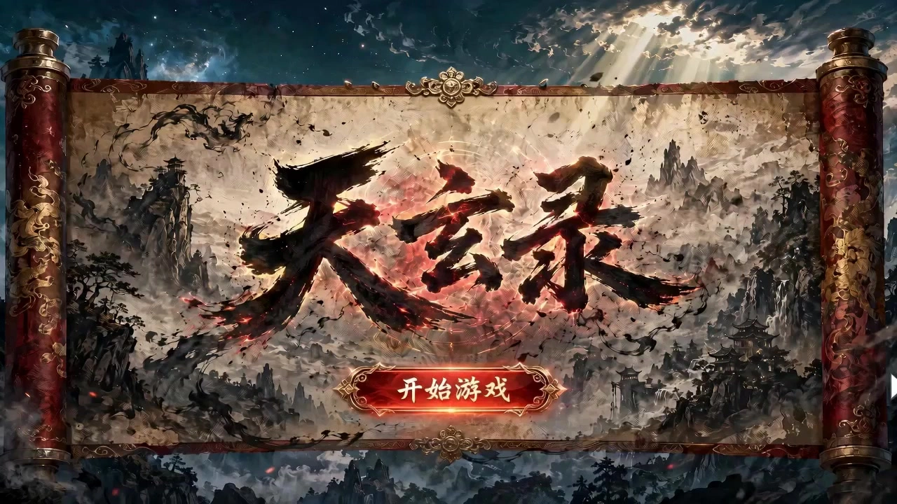

# Game Demo Video Designer

> **作者：** @境在丨米叔

## Content

Process Planning:

Determine the preliminary story background and game style according to user requirements. Write Final_Video_Spec.md (Title, Genre, Aspect Ratio, Duration, Visual Style, Language) → text_editor Background and Style Setting: Receive user-inputted theme keywords to automatically set the story background and establish the overall game style (e.g., realistic, fantasy, cyberpunk, etc.).

Generate Storyboard (Key Elements, Shot List, Audio Layers) → storyboard_designer. Three-Part Script Breakdown: Automatically divide the demo content into a three-part (15s each) structured script:

Video A (15s): System interaction and awakening (including login/character selection UI interaction, scene transition, first in-game experience).

Video B (15s): Narrative interaction and tracking (including NPC dialogue display, world-building, encountering objectives).

Video C (15s): Core combat and settlement (including 8x speed fierce battle, ultimate move demo, Boss defeat, and Victory UI pop-up).

Element Design:

High-precision character asset generation: Use GPT to generate original design art for the protagonist/Boss, then use Nanobanan to convert them into 3D realistic character image cards/character four-view drawings (left side face close-up, right side full-body front, back, and side views).

Consistent visual generation: Use GPTImage 2 to generate a fully consistent game UI interface and game scene keyframes (including: start screen/character selection screen/loading screen/dirt hut perspective/third-person observation scene/entering Boss fight).

Segmented Video Generation: Use Seedance 2.0 to generate the game's demo video. Describe in detail the content of each scene, the simulated UI feedback after mouse clicks, and high-intensity Boss combat actions.

Video Assembly and Output: Logically splice the three 15s video segments and unify the output into a high-quality game demo video.

Video Output Specifications: Set final rendering standards (resolution, frame rate, motion smoothness). Asset Planning: The full link of GPT character design -> Nanobanan 3D conversion -> GPTImage environment generation -> Seedance video generation. When to Pause: Do not run all steps at once. Pause after each key stage mentioned above (e.g., after the specification is finalized, after the Storyboard is completed, after elements are finished, after shot video generation, after audio generation), and confirm with the user before proceeding to the next step. Use cards or reply_to_user to invite the user to review before continuing.

Asset Analysis:

3D Asset Analysis: Utilize Nanobanan to deeply analyze the materials of the 3D image cards (e.g., metal reflections, skin texture, clothing texture) to provide light and shadow description parameters for subsequent video generation. UI Pixel Anchoring: Analyze the screenshots with HUD generated by GPTImage, record the precise pixel positions of health bars, skill bars, and dialogue boxes, and set these as 'video generation forbidden deformation zones'. Color and Lighting Control: Extract the overall color tendency (LUT) to ensure the tone and brightness of the three video segments remain highly consistent from start to finish, preventing color cast.

Storyboard Design:

Shot A (15s) [Guide Flow]:

0-3s: Cover image. Simulate breathing light effects, execute [Start] button interaction.

3-10s: Character/Skill display. Simulate mouse hover highlights, display character 3D idle pose or signature action.

10-15s: First-person POV. Scene cut-in, showing the HDR effect of transitioning from a specific viewpoint (e.g., waking up/transition) to a vast environment.

Shot B (15s) [Plot Flow]:

15-25s: NPC interaction. Call out dialogue UI, text displays character by character, background maintains ambient animation.

25-30s: Scene tracking. Camera follows the character moving quickly to a specific visual landmark, creating a sense of encounter.

Shot C (15s) [Combat Flow]:

30-40s: In-game combat. Execute fast-paced confrontation. UI health bars and skill slots change dynamically in real-time.

40-45s: Combat settlement. Boss defeat action, victory UI pops up, and reward settlement special effects.

Media Generation:

Character Design (Core Logic):

GPT Original Art Generation: Call GPT to generate master-level 2D design drawings of characters.

Character Four-View Drawing Generation: Use ImageToImage (Recommended model: Nano Banana Pro(Gemini 3 Pro Image), resolution 2K) based on the GPT original art to generate a four-view drawing with a white background. Layout rules: left side is face close-up (used to capture facial details, skin texture, makeup), right side sequentially arranged with full-body front view, full-body back view, and full-body side view (used to capture body proportions and equipment layers). All views must maintain strict consistency with the original art in character styling, color scheme, and material.

Then use Nanobanan to convert into 3D realistic character image cards/character four-view drawings. 3D conversion: Input the four-view drawing into Nanobanan to convert it into a 3D realistic image card.

Keyframe Image Generation: Use GPTImage 2 to generate a fully consistent game UI interface and game scene keyframes (including: start screen/character selection screen/loading screen/dirt hut perspective/third-person observation scene/entering Boss fight).

Generate 5 related images required for Video A (cover, selection page, skill page, scene starting point).

Generate key images required for Video B/C (dialogue UI image, movement scene, start and end frames of combat with HUD, settlement image).

Segmented Video Synthesis: Use Seedance 2.0 to generate the game's demo video. Describe in detail the content of each scene, the simulated UI feedback after mouse clicks, and high-intensity Boss combat actions.

Prompt Writing:

Interactive Segment Commands: Use Image_A1 to A5 as nodes. Simulate realistic keyboard and mouse interaction feedback (clicks, highlights, lighting effects). Maintain visual consistency of the 3D model across all interfaces. Narrative Dialogue Commands: Keep the dialogue UI absolutely clear, without shaking or blurring. Text display is synchronized with character status. Action Combat Commands: Use the combat standoff image as the first frame and the victory settlement image as the last frame. Core Commands: Forcefully lock the UI interface, preventing any displacement, artifacts, or distortion of health bars and skill icons. Action descriptions include high-frequency movement, particle effects, and screen-shaking impact.

Video Editing:

Full Segment Assembly: Stitch the three video segments together, synchronize and match the corresponding sound effects (UI sounds, ambient sounds, impact sounds), and output a complete in-game demo video. Audio: Ensure both the video layers and audio layers (background music) are enabled.
