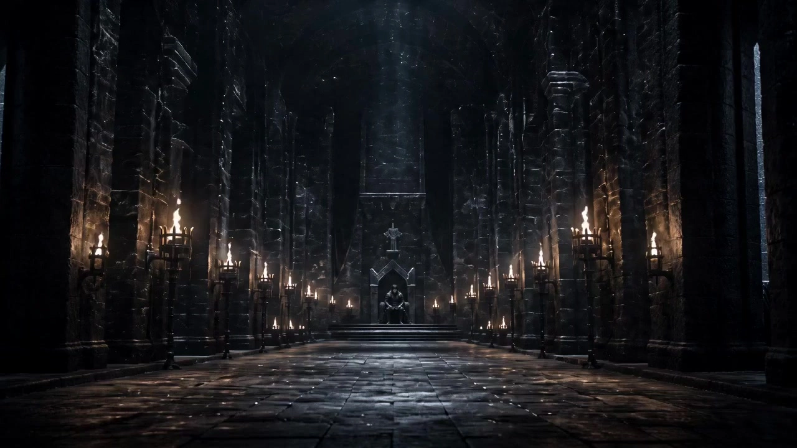

# Game of Thrones–Style Cinematic Aesthetic

> **作者：** @境在丨米叔

## Content

Process Planning:

Five-Stage Pipeline and Sequential Dependencies
Stage 1 · Script Confirmation

Call text_editor to create Final_Video_Spec.md and lock the following global parameters: Title/Plot Summary, Aspect Ratio (default 16:9, hot-swappable to 9:16), Target Duration, Output Language, and GoT industrial aesthetic tone.

If the user has provided a script or story outline, call resource_prepare_and_analyze to parse the text structure, extract scenes, characters, emotional beats, and key dialogue points, and write them into Final_Video_Spec.md.

[Milestone Intercept A] Present the Final_Video_Spec.md summary to the user and wait for confirmation of core plot points and global parameters before proceeding.

Stage 2 · Character and Scene Asset Generation

Call storyboard_designer to define all Key Elements:

element character: Appearance, makeup, and battle-damage details for costumes for each character;

element scene: [Regional_Stage] geographical color palette attribution and spatial geometric description for each scene.

Call media_generator to batch-generate asset images:

Character sheet: GPT Image 2 @ 2K.

Scene concept art and spatial blueprints: GPT Image 2 @ 2K.

Register asset_id for all generated images and bind them to the corresponding Key Elements.

If the user has uploaded character images, scene images, or reference audio, prioritize binding user assets and skip the corresponding generation steps.

[Milestone Intercept B] Display thumbnails for all Key Elements, and ask the user to confirm character appearances, scene atmosphere, and key_element_audio voice bindings (if there are speaking characters).

Stage 3 · 3x3 Grid Shot List Generation

Call storyboard_designer to refine the Shot List based on confirmed script beats and Key Elements: each shot includes scene attribution, story beats, dialogue, and camera language (composition/movement/duration).

Determine the 3x3 grid specifications based on the dynamic intensity of each shot:

Dialogue/Static Scenes (dialogue, gazing, intrigue, etc.): Generate 4–6 panel horizontal storyboard large image;

Action/Dynamic Scenes (combat, chases, high-motion scenes): Generate 9-panel full-page continuous action storyboard large image.

Call media_generator to generate corresponding storyboard large images according to the above specifications, passing the corresponding Key Element asset images as reference_image; models follow the same priority as Stage 2 (GPT Image 2 @ 2K).

[Milestone Intercept C] Display the 3x3 grid storyboard large images, and ask the user to confirm the number of shots, order, and composition direction; proceed to Stage 4 only after explicit user confirmation—do not auto-advance.

Stage 4 · Video Prompt Writing and Shot Video Generation

For each shot, call write_media_prompt to write video prompts, integrating all the following reference inputs (Smart Reference Mode):

Storyboard Group Reference: Use the confirmed 3x3 grid storyboard large image as reference_image to anchor composition direction and camera rhythm;

Character Reference: Bind all element character asset images (character sheet) involved in this shot as reference_image;

Scene Reference: Bind the element scene asset image belonging to this shot as reference_image;

Voice Reference: If the shot includes speaking characters, bind the corresponding key_element_audio voice as audio_infos to ensure consistent accent/voice across shots;

Prompt + Dialogue: Embed dialogue from the shot into the prompt using {...} syntax, simultaneously writing in camera movement, character actions, and emotional beats.

Call media_generator to generate shot videos (final_shot) one by one using MultiModalToVideo + Seedance 2.0 @ 720p:

Only append the final_shot video of the previous shot as reference_video when there is strong motion continuity between the current shot and the previous shot; otherwise, do not use video reference.

Target duration: 10–15s, fully utilizing Seedance 2.0's multi-lens cutting and motion control capabilities.

[Milestone Intercept D] Display previews of all final_shots, and ask the user to confirm motion trajectories, dialogue lip-sync, and camera shake intensity.

Stage 5 · BGM and Narration Generation (On-Demand)

If the script requires BGM: Call media_generator's text_to_instrumental to generate epic background music, and register it as audio_layer bgm.

If the script requires narration (VO): Call media_generator's text to narration (recommended MiniMax Speech 2.8 HD) to generate narration audio, and register it as audio_layer narration.

[Milestone Intercept E] Display previews of all Audio Layers, and ask the user to confirm the music style and narration voice before proceeding.

Stage 6 · Timeline Assembly and Export

Call video_assembler using the confirmed list of final_shots, narration, bgm, and dialogue as input to construct the timeline in the order of shots in the Storyboard:

Video track: Arrange in shot order, using fade-in/fade-out or hard cuts between adjacent shots (selected based on plot rhythm); Dialogue scenes default to hard cuts, while action sequences with continuous motion can use short fades (≤12 frames).

BGM track: Applied throughout the entire duration, with 1.5s volume fade-in/fade-out at the beginning and end.

Narration/VO track: Aligned with the corresponding shot timeline, with volume set ~6dB higher than BGM to ensure dialogue clarity.

Dialogue embedded in video: If synchronized dialogue has already been generated within the video by Seedance 2.0, no additional track overlay is needed; if re-recording is required, align as an independent audio track.

[Milestone Intercept F] Present the timeline assembly preview, explaining the total duration and track structure, and trigger final rendering and export after user confirmation.

Dependencies: Stage 1 → Stage 2 → Stage 3 → Stage 4 → Stage 5 → Stage 6.

Pause Rule: Must stop when each [Milestone Intercept] is triggered, present the current stage deliverables to the user, and wait for explicit confirmation before proceeding to the next stage. Do not auto-advance across stages.

Copyright Warning (Triggered by Character Recognition): In the Stage 1 Script Confirmation phase, if specific character names from "Game of Thrones" (e.g., Jon Snow, Sansa Stark, Tyrion Lannister, etc.) appear in the user input, a preliminary warning must be issued to the user immediately, stating:

During the image generation stage, these character names may cause copyright blocking;

During the video generation stage (Seedance 2.0), even if image generation is successful, if the prompt contains copyrighted character names or expressions related to "Game of Thrones", there is still a very high probability of triggering content interception;

It is strongly recommended that the user replace IP characters with similar-looking original characters (e.g., retain costume style, hair color, and personality, but assign a new name and background) to ensure smooth operation of the entire pipeline. Do not proceed to Stage 2 until the user explicitly accepts the copyright risks or completes the character replacement.

Copyright Block Handling (Triggered during Generation Phase): When any generation step triggers copyright or content compliance blocking, stop immediately, explain the specific content blocked to the user, and provide two options:

Option A: Replace Model — Switch to other available similar generation models to retry (only execute after explicit user authorization).

Option B: Avoid Risky Resources — Remove or modify the reference images, character names, or copyright descriptions that triggered the blocking, and proceed after the user confirms the adjustment plan. Do not automatically retry or silently replace content until explicit user instructions are received.

Asset Analysis:

GoT Industrial-Grade Regional Color Science and Destaging Texture Reverse Engineering
Regional Color Grading Inversion

The North & The Wall: Deliberately suppressing warm color channels while boosting teal/blue in the shadows to create a desaturated, high-contrast "Winter Teal/Ice Blue" aesthetic, externalizing despair and coldness.

King's Landing & Essos: Infusing amber and golden tones into highlights to create an atmospheric, dusty feel, resulting in a high-saturation, low-contrast "Dragon Gold/Warm Yellow" look.

Lighting Authenticity and Low-Key Inversion

Strictly avoiding modern, flat lighting; indoor scenes rely almost entirely on simulated candlelight, torches, and natural diffused light from windows. Emphasizing vast negative space (shadows) and utilizing backlighting to outline character silhouettes, thereby enhancing spatial depth in dim environments.

Destaging Real-Texture Reverse Engineering (Prosthetics & Weathering Inversion)

Character skin surfaces must never appear clean or blurred; fingernails must be filled with dirt, sweat mixed with carbon ash, and faces must display the authentic, translucent quality of multi-layered prosthetics under harsh, natural light. Costumes undergo heavy "distressing," including wear and tear on heavy-duty leather, dents on metal, and rough, hand-stitched details.

Storyboard Design:

Adaptive Flexible 3x3 Grid Display & Shot List Layout Syntax Specification
【3×3 Adaptive Flexible Shot List Layout Matrix】

Canvas Center [Grid 2,2]: Displays the fixed top-down 3D geometric blueprint (Top-down blueprint view) of the current venue ([Regional_Stage]). Fine colored dashed lines and geometric arrows must clearly map out the Technocrane movement tracks and the handheld camera's direction.

Surrounding Active Grids [Adaptive 4 to 9 Grid Planning]: Strictly derive continuous audiovisual shots (Shots 01 to 08) according to relative coordinates. Automatically fill empty grids with classic black flag color blocks. Grids must be strictly locked and showcase the following GoT cinematic composition logic:

Framing within a Frame: Frequently use shutter shadows, heavy arches, and narrow stone windows as picture-in-picture frames to evoke a sense of oppression, surveillance, and entrapment.

Low-Angle Shot: Use extreme low-angle shots to bestow a sense of holiness, dominance, or intense regal oppression upon the Iron Throne, leaders, or core subjects.

Symmetrical Composition: Showcase the absolute precision of the direwolf bench center line, full-frontal views of the Iron Throne, or phalanxes of the Unsullied to display the cold authority of the system.

Isolating Close-Up: For moments of brewing inner conspiracies in dark corners, fully blur the background to lock the visual center onto the subject's micro-expressions.

Voyeuristic Long Lens: The camera is often placed behind pillars, shadows, or obstacles, using telephoto lenses to "spy," embodying the espionage crisis permeating the continent of Westeros.

3x3 Grid Specification Rules
Dramatic Flow (4–6 Grid Landscape Layout)

Suitable for static or low-dynamic plots such as dialogue, staring, conspiracies, psychological games, and emotional close-ups.

The canvas uses an adaptive landscape layout, activating 4 to 6 grids. The remaining grids are filled with classic black flag color blocks—pure text description grids or empty, content-free black grids are prohibited; the black flag blocks themselves serve as effective negative space elements for the composition.

[Grid 2,2] continues to display the venue's top-down blueprint; active grids are arranged according to narrative rhythm, prioritizing facial micro-expressions, prop close-ups, and eye-line relationships.

There must be narrative continuity logic between adjacent grids: the scene, character positions, and emotional states in each grid must form a continuous narrative flow. Jump cuts that are disjointed or compositions without correlation are prohibited.

Action / Dynamic Flow (9-Grid Full Continuous Shot List)

Suitable for high-dynamic plots such as combat, chases, conflicts, and large-scale movement scenes.

The canvas adopts a standard 3×3 full-grid layout, with all 9 grids activated. Any empty grids, pure text grids, or black flag placeholder grids are prohibited.

Each grid must present substantive action content, arranged in chronological order (Left→Right, Top→Bottom), forming a coherent action montage:

Grid 1: Action starting state / conflict trigger point;

Intermediate grids (2–8): Continuous action breakdown, with each grid advancing the action scale or perspective;

Grid 9: Action climax / resulting freeze-frame.

The spatial relationship between adjacent grids must be self-consistent (teleportation of character positions without reason is prohibited), and camera perspective changes must adhere to the 180° axis rule.

Media Generation:

Image Asset Generation
Character Design Sheets and Scene Concept Art

Generate using TextToImage or ImageToImage (when reference images are available). Default model: GPT Image 2 @ 2K.

For each character, generate a landscape-oriented character sheet: left side shows a full-body three-view (front/side/back), right side shows a 2×3 grid of details (face close-up, hairstyle back view, armor texture, metal fasteners, skin texture, footwear).

Scene concept art includes spatial geometry blueprints and a geographic color palette tone.

All generated images must be registered with an asset_id and bound to the corresponding key_element.

3x3 Grid Storyboard

Generate using TextToImage + GPT Image 2 @ 2K according to storyboard specifications (4–6 frames for drama, full 9-frame grid for action).

Input the element character and element scene asset images related to the shot as reference_image to lock in visual consistency.

Final Shot Video · Intelligent Reference Mode

Use MultiModalToVideo + Seedance 2.0 @ 720p, target duration 10–15s, making full use of multi-shot internal cutting and motion control capabilities.

When generating each shot, integrate all available reference inputs according to the following priority:

Storyboard Reference — Use the screenshot of the corresponding frame from the confirmed 3x3 grid storyboard as reference_image to anchor the composition direction and shot pacing;

Character Reference — Bind all element character asset images (character sheets) involved in the shot as reference_image;

Scene Reference — Bind the element scene asset image belonging to the shot as reference_image;

Voice Reference — If the shot includes characters with dialogue, bind the corresponding key_element_audio voice sample to audio_infos to ensure consistency of accent and tone across shots;

Prompt + Dialogue — Integrate camera movement, action descriptions, and English dialogue embedded with {...} (see Prompt Writing rules for details);

Continuity Video Reference (Optional, low-frequency use) — Only when the current shot has strong motion continuity with the previous shot, append the final_shot video of the previous shot as reference_video; otherwise, do not use.

Audio Generation

BGM: Use text_to_instrumental (recommended Suno 5; prompt must not contain names of famous musicians), register as audio_layer bgm.

Narration/VO (as needed): Use text to narration, recommended MiniMax Speech 2.8 HD, register as audio_layer narration.

Prompt Writing:

Global Highest Priority: All generated content, including the prompt body and code blocks, must be presented in pure English; Chinese characters are strictly prohibited. Regardless of the language user inputs for dialogue, it must be translated into English before being embedded within {...} syntax blocks; the use of Chinese or any other non-English characters inside {...} is prohibited.

Video Prompt Opening Declaration Format (Mandatory):At the very top of each video prompt, immediately following the <<<image_n>>> placeholder, output a single line of pure English reference declaration stating the identity of each reference image, formatted as follows:

<<<image_1>>> is the storyboard panel set, <<<image_2>>> is [Character Name] character reference, <<<image_3>>> is [Character Name] character reference, <<<image_4>>> is the scene reference.

The quantity and order of reference images must perfectly match the actual provided reference_image list; do not fabricate numbers that were not provided;

Use the original character name for the current project (do not use IP-specific character names);

If a certain type of reference does not exist (e.g., no second character), skip that item and do not leave an empty placeholder;

Leave one blank line between this declaration line and the main body below.

Copyright Isolation Rules (Applies to both image and video prompts): The following forms of copyright identifiers are strictly prohibited in prompts:

Titles of works: Prohibited from using IP names and their abbreviations, such as "Game of Thrones," "GoT," "A Song of Ice and Fire," "House of the Dragon," etc.;

Specific character names: Prohibited from using specific character names from the original work/series (e.g., Jon Snow, Sansa Stark, Tyrion Lannister, etc.);

Substitution Strategy: Use visual descriptions to replace character identities (e.g., "a red-haired noblewoman in heavy wool robes"), use geographical aesthetic descriptions to replace place names (e.g., "a cold northern stone great hall with low candlelight" instead of "Winterfell"), and use style descriptions to replace IP identifiers (e.g., "medieval epic cinematic aesthetic" instead of "Game of Thrones style").

Example 1: [Initial Anchoring: Core Concept Art Prompt for Scenes and Characters]

<<<image_1>>> is the visual style reference, <<<image_2>>> is {Protagonist} character reference, <<<image_3>>> is the scene reference.

Cinematic full shot, a masterpiece historical scene from medieval epic fantasy cinematic aesthetic. Shot on ARRI ALEXA LF camera with Cooke S4/i prime lenses, capturing the signature warm oil-painting-styled "Cooke Look". High dynamic range with thick film-like texture and rich shadows. The variable protagonist {Protagonist} is framed within the bleak, low-light medieval stone great hall in the cold north [Regional_Stage: North & the Wall]. Low-key lighting strictly driven by natural source compliance, utilizing single-direction fire torch glow, leaving massive unlit negative space and deep shadows. The color science features the regional palette of "Winter Teal and Ice Blue", with heavy desaturation and high contrast on skin textures. The character wears distressed heavy textured armor with deep 3D bone-carved embroidery and raw unpolished fur. Real grit and charcoal on sweat-glistening skin roughness at 0.4. Perfect architectural symmetry composition with extreme depth-of-field isolation, photorealistic texture detailing, no text, no watermarks, landscape 16:9 ratio.

Example 2: [Simplified Medieval Epic Character Design Sheet Prompt] (GPT Image 2 · 16:9 Landscape)

<<<image_1>>> is the visual style reference.

High-definition, clean, and professional 3D character turnaround schematic on a pure solid white background. Medieval epic fantasy cinematic aesthetic, ARRI ALEXA XT rendering fidelity, Cooke S4/i premium optics quality. [Left Side - Main Full-Body Area]: Displays a full-body 3-view turnaround of the exact same character (front, left side, back view) under high-contrast dramatic backlight. The character wears custom medieval tactical garments crafted from heavy distressed leather, tight metal knittings, and asymmetrical rigid 3D wolf-bone embroidery. Hairstyle is complex, tactical hand-braided braids adhering to tribal winner tradition. The face, clothing weathering, and height proportions must be 100% identical. [Right Side - Simplified Detail Grid]: A neat 2x3 grid combining headshots and macro textures matching the character profile: 1. De-stage gritty portrait face with real mud texture under fingernails, fingernails and face mixed with sweat and carbon ash, 2. Back view showing complex braided hair parting lines, 3. Close-up of the rough heavy leather and unpolished fur textures, 4. Close-up of heavy iron metal buckles and geometric stitches, 5. Close-up of realistic physical prosthetics skin texture replicating grey-scale disease or scaly latex layers, 6. Close-up of mud-covered heavy boots. Landscape composition, pure white background, no text, no save buttons.

Example 3: [Adaptive 3x3 Grid Shot List Prompt] (e.g., "Action Stream: 9-Panel High-Frequency Continuous Motion")

<<<image_1>>> is the storyboard panel template, <<<image_2>>> is {Protagonist} character reference, <<<image_3>>> is the scene reference.

Professional cinematic multi-panel director's display sheet, 3x3 grid panel alignment system. Absolute visual DNA lock: all active panels are strictly rendered with ARRI ALEXA LF sensor characteristics and Angenieux Optimo zoom lens physics, executing cold, ruthless camera movement. Color palette strictly follows the regional color grading of [Regional_Stage: Southern Court & Golden Coast] with "Dragon Gold and Warm Yellow" amber highlights dominating the high-contrast lighting shadows. Centered at Grid [2,2], it displays a precise 3D top-down blueprint view of the grand royal throne hall, sketching brutal Technocrane paths and soldier square formations. Surrounding the center, 8 active panels display an intensive long-take handheld combat montage: Grid [1,1]: Voyeuristic long lens view hidden behind stone columns. The protagonist {Protagonist} unsheathes a broadsword, light fracturing off blood-stained metal. Grid [1,2]: Framing within a frame. Looking through a narrow arrow slit window, weapon kinetic movement cutting across natural window lighting. Grid [1,3]: Low-angle shot. The character lunges forward aggressively, sweat and soot flaring off the skin, high handheld camera shake and realistic blur. Grid [2,1]: Macro tracking close-up. Crimson blood splattering violently onto fine silk and gold-threaded 3D lion embroidery fabric. Grid [2,3]: Absolute symmetrical wide shot. An army of disciplined elite legion soldiers thrusting spears simultaneously, ruthless rigid authority framing. Grid [3,1]: Narrative cutaway shot. A crown forged of raw iron falls into blood-mixed mud on the battlefield, ultra-shallow depth of field. Grid [3,2]: Extreme kinetic view. Technocrane sweeping downward tracking a shield cracking under heavy blunt force impact, air particles and ash flying. Grid [3,3]: Isolating close-up. The character stands alone in a shadowed corner, back lit contour, face completely hidden, background fully blurred, capturing political isolation. Photorealistic film grain, pure solid borders partitioning the grids, no watermarks, no generic digital smoothness, landscape 16:9 ratio.

Video Editing:

Timeline Assembly Specifications
Rhythm and Transitions

Dramatic Scenes (dialogue, intrigue, gazing, etc.): Default to hard cuts between shots; for plot pivots, use ultra-short fades (≤12 frames). Slow dissolves or flashy transitions are prohibited—the GoT aesthetic prioritizes direct, hard cuts.

Action Scenes (combat, chases, conflict, etc.): Maintain a high-frequency, hard-cut editing rhythm within continuous action sequences; if adjacent shots have significant spatial jumps, use a fade-out/fade-in (≤8 frames) as a buffer.

The overall rhythm of the film should be guided by narrative emotional beats; do not switch shots mechanically at fixed time intervals.

Audio Track Processing

BGM: Play across the entire background of the film; apply a 1.5s fade-in/fade-out at the beginning and end. For climax action sequences, briefly increase BGM volume by ~3dB to enhance tension.

Narration/VO: Align with the timeline of the corresponding shot; keep volume ~6dB higher than the BGM to prioritize dialogue clarity.

Dialogue (in-camera sync sound): Seedance 2.0 has already generated sync dialogue within the video, so do not overlay additional tracks. If re-recording is necessary, align it as an independent dialogue track to avoid conflicts with the existing video audio.

Pre-export Technical Verification

Verify that all shot aspect ratios match the locked specifications in Final_Video_Spec.md (default is 16:9; if the user requests 9:16, perform full recalibration; do not mix them).

Default output resolution is 720p; ensure no black bars or incorrect cropping in the shot videos.

After delivering the final timeline JSON and before triggering the rendering service, re-verify the shot count, total duration, and number of audio tracks to ensure nothing is missing.
