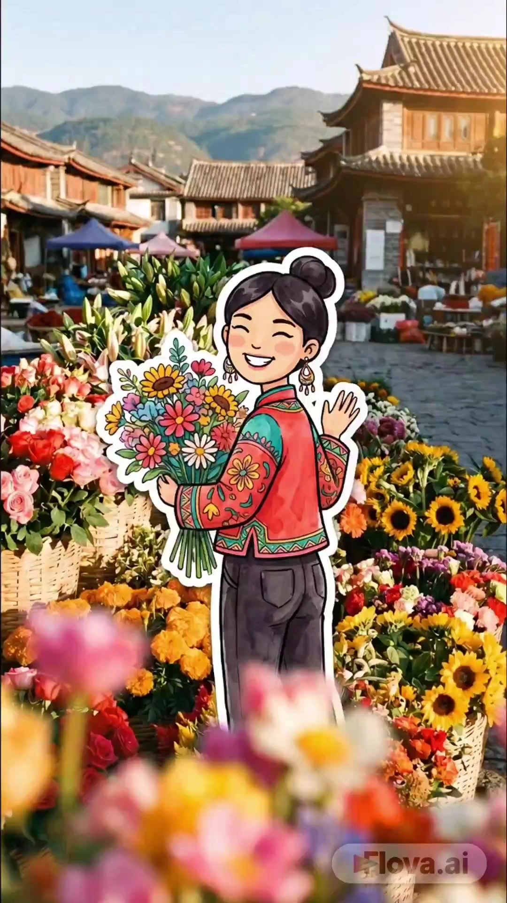

# Hand-Drawn Style Travel VLOG

> **作者：** @拾墨AI工坊

## Content

Process Planning:

Full Process Stages and Dependencies:

Establish Global Specs: Create Final_Video_Spec.md via text_editor to lock in title, aspect ratio (vertical 9:16), total duration (15-60s), visual style (collage hand-drawn sticker style), tone keywords, and output language.

Asset Analysis & Reuse Check: If the user uploads character reference images, travel photos, or style references, call resource_prepare_and_analyze to extract features and write results into Storyboard element descriptions. Prioritize existing assets; do not regenerate.

Generate Storyboard: Call storyboard_designer to produce key elements (1-2 characters + scene set), shot list (4-8 shots, arranged by 6-node narrative structure), and audio layers (BGM + optional subtitles).

Character Key_Element Image Generation: Call media_generator to generate full-body character sheets on white backgrounds (3-5 action variants each), bound to the corresponding key_element. Lock character appearance after generation.

Scene Composition Generation (Keyframe per shot): Call media_generator using character key_element images as references to generate collage composites of "hand-drawn sticker characters layered onto real travel landscape foregrounds." Generate the first as a style anchor; proceed to batch generation only after confirmation.

Video Clip Generation: Call media_generator using each scene composite as a start_frame to generate 3-5 second dynamic clips. Use a multi-model strategy (default Sora-2 → fallback Wan2.6 → quality-first Veo3.1 Fast).

Audio Generation: Call media_generator to generate BGM (text_to_instrumental, light/healing travel style).

Final Assembly & Export: Call video_assembler to splice clips in narrative order, align with BGM beats, balance clip audio against BGM, overlay optional subtitles, and export the final video.

Dependencies: 2→1; 3→1,2; 4→3; 5→4; 6→5; 7→3; 8→5,6,7.

Pause & Confirmation Nodes (Process is not single-run):

Narrative Confirmation: After step 3, pause to display the Storyboard summary (6-node structure, duration allocation). Wait for user confirmation or adjustment before continuing.

Character Setting Confirmation: After step 4, pause to display character sheets. Wait for user confirmation of appearance, color scheme, and style.

Style Anchor Confirmation: After generating the first scene composite in step 5, pause to confirm if the collage effect, tone, and perspective are satisfactory before batch generating the remaining scene images.

Final Video Confirmation: After step 8, display the final video and ask for confirmation or fine-tuning requests.

Exception Handling:

Character & Scene Mismatch: Add "natural perspective, consistent scale" to prompts and regenerate.

Character Inconsistency: Verify key_element binding; restate character appearance in the prompt and retry.

Video Generation Failure: Stop current shot generation, inform the user, and suggest adjusting the start_frame or switching models.

Total Duration > 60s: Prompt the user to split the narrative into multiple segments, produce them separately, and splice them together; keep single sessions under 1 minute.

Asset Analysis:

User-Uploaded Asset Analysis:

Character Reference/Sketch: If a user uploads a character reference, extract features such as gender, age, hair style/color, clothing color scheme, and accessories to create character prompts. Character key_elements in the Storyboard must be consistent with uploaded assets and avoid contradictions.

Travel Photo/Scene Reference: If a user uploads real-world travel photos, analyze the scene type, tone, lighting, and composition (depth, leading lines) as references for scene generation. Extract tone and lighting as fixed keywords for reuse in later scene generation.

Style Reference: If a user uploads collage or hand-drawn style references, extract style characteristics such as stroke thickness, sticker effects, and collage layering to include in style keywords.

Storyboard Design:

Key Elements Design:

Character (element character): Design 1-2 core characters; maintaining consistency becomes significantly harder with more than 2. Define the protagonist's full appearance: gender, age, hairstyle/color, clothing palette, and iconic accessories. Include fixed style keywords: "flat 2D cartoon, thick black outline, sticker style." If multiple poses are needed (walking, looking back, sitting), list each variation in the description.

Scene (element scene): Define key scenes along the travel narrative. Each description must include: location type, atmospheric tone, lighting conditions, and depth/leading line compositional elements. Reuse the color tone keywords established initially (e.g., "warm golden hour" / "cool fresh morning") for subsequent scenes.

Shots Design:

Default narrative structure (adjustable; nodes can be added/removed based on trip duration or emotional arc). Durations are based on a 20s clip; scale proportionally for total duration changes, ensuring individual shots are 3-5 seconds long:

Arrival (15% ≈ 3s): Character at station/airport/entrance, holding luggage/backpack, looking back or at destination signage—establishes travel start and anticipation.

Initial Exploration (15% ≈ 3s): Character walking in an iconic street/square/attraction entrance, looking around, taking photos—showcases first impressions.

Culinary Experience (20% ≈ 4s): Character at a street stall/café, holding local food, expressing satisfaction—captures sensory memories and local atmosphere.

Immersion (15% ≈ 3s): Character deeper in the location (shrine approach/seaside boardwalk/alley steps), interacting with the environment (touching walls, gazing, looking at flowers)—deepens ambiance.

Cultural Interaction (20% ≈ 4s): Character engaging with locals/vendors/performers, or participating in activities—adds emotional depth.

Farewell (15% ≈ 3s): Character looking back at the view/sunset silhouette/passing scenery from a window, waving or watching quietly—concludes the narrative, echoing the arrival.

4-8 shots total. Generate one collage as a keyframe per shot, then convert to 3-5s video.

Each shot description must include:

Scene: Reference the scene element ID.

Character Action: Specific pose and movement.

Cinematography: Composition (character in lower foreground or side, background depth), camera movement (slow pan/dolly).

Atmosphere: Lighting and tone (must match locked scene tones).

Audio Layers Design:

BGM: At least one global background music track, light and healing travel style. Specify mood and tempo.

Subtitles (Optional): If needed, specify handwritten style, location markers, or short phrases; these are added in post-editing, not generated in the audio layer.

Media Generation:

Character Key Elements Image Generation:

Use TextToImage with recommended model Nano Banana Pro (Gemini 3 Pro Image), resolution 2K.

Output a full-body, front-facing character reference sheet on a white background.

Use the same prompt to vary pose descriptions, generating 3-5 action versions (walking, looking back, sitting, etc.) for backup, all bound to the same Key Elements.

Lock the character design after generation; character appearance must not change in subsequent steps.

Scene Composition Generation (Keyframe for each shot):

Use ImageToImage with recommended model Nano Banana Pro (Gemini 3 Pro Image), resolution 2K.

Reference input: Character Key Elements image (mandatory) to ensure consistency. If the user uploads real travel photos, use these as additional reference images.

Generate a collage composite: "hand-drawn sticker character overlaid on real travel scene foreground."

Composition rule: Character in the foreground (bottom or side), real-world background with depth or leading lines, creating a sense of depth.

Video Clip Generation:

Use FirstFrameToVideo, aspect_ratio "9:16", resolution "720p" (1080p requires membership).

Multi-model strategy (by priority):

Default: Sora-2 — Best for intra-shot transitions and narrative quality, suitable for collage-style expressions. Character is a 2D cartoon sticker (not realistic), avoiding Sora-2's realistic human failure rate. Supports 720p only, 4-second clips.

Alternative: Wan2.6 — Faster generation, suitable for batch production; 5-second clips.

Quality Priority (Key memory point shots): Google Veo3.1 Fast — Best image quality, for emotional climaxes like food or cultural interaction; 4-second clips.

Failover: If current model fails, retry within the same tool using the sequence: Sora-2 → Wan2.6 → Google Veo3.1 Fast. If all fail, stop and inform the user.

Use each scene composition as the start_frame to generate dynamic clips.

Motion should be subtle and natural: slow pans/zooms for environment, slight character walking/hair movement/clothes swaying, ambient lighting changes/waves/leaves rustling. Avoid intense motion.

BGM Generation:

Use text_to_instrumental, recommended model Suno 5 (alternative Mureka 8). Style: Light, healing, travel-vibe.

Consistency Guarantee:

Character consistency (Highest priority): Both scene composition and video generation must use the character Key Elements image as reference input; always fully restate character appearance in prompts without omission.

Scene consistency: Establish tone and lighting keywords during the first generation and reuse them for subsequent scenes.

Style consistency: Consistently use keywords like "collage aesthetic," "sticker-on-photo," "thick black outline," etc.

Prompt Writing:

Language Rules: Use English for prompts (models understand English more accurately); output subtitles/copy can be in Chinese, but must follow the Output Language defined in Final_Video_Spec.md.

Character Prompting (TextToImage):

Structure: [age] [gender] [ethnicity] + [hair_description] + [clothing_description] + [accessory_description] + fixed style keywords.

Fixed Style Keywords (Required every time): flat 2D cartoon illustration, thick black outline, sticker style, clean white background, full body, consistent character design.

Achieve action variations by adjusting pose descriptions (e.g., walking pose slight side angle / looking back pose three-quarter view / sitting pose casual).

Scene Composition Prompting (ImageToImage):

Structure: real photograph of [scene_description] + 2D flat cartoon sticker-style character superimposed on foreground + [character_full_description] + thick black outlines + collage aesthetic + [lighting/atmosphere] + natural perspective.

Character appearance description must be fully restated without omissions or rewrites.

Fixed Composition Style Keywords: collage aesthetic, sticker-on-photo, superimposed on foreground, hand-drawn character overlaid on real scene, travel vlog aesthetic.

Scene keywords must include depth (leading lines, depth of field, natural perspective).

Reuse tone keywords once determined (e.g., warm golden hour light / cool morning light / soft overcast).

Video Motion Prompting (FirstFrameToVideo):

Structure: gentle [camera_movement] + the cartoon character [subtle_action] + [atmosphere_detail] + natural gentle motion + cinematic travel atmosphere + [lighting_condition].

Motion Constraints: Always include constraints like subtle, gentle, slow to reduce motion intensity.

Motion Types: Scene (slow pan/zoom), Character (slight walking/hair swaying/clothes rustling), Atmosphere (light changes/ocean waves/swaying leaves).

Consistency Keyword Bank (Integrate into prompts as needed):

Character Style: flat 2D cartoon illustration, thick black outline, sticker style, hand-drawn style, bold outlines

Composition Style: collage aesthetic, sticker-on-photo, superimposed, mixed media, scrapbook style

Consistency: same character, consistent style, same outfit, same hairstyle, consistent color palette, matching lighting

Video Editing:

Editing Specifications:

Aspect Ratio: 9:16 vertical (optimized for short-form video platforms).

Total Duration: 15-60 seconds; keep single generations under 1 minute; stitch segments for longer videos.

Clip Duration: 3-5 seconds per clip, arranged in narrative order.

Frame Rate: ≥24fps for smooth motion.

Transitions:

Use simple fade-in/fade-out transitions to maintain a fresh, hand-drawn aesthetic; avoid complex effects.

Audio:

Use a light, healing, travel-style BGM throughout the video, aligning the rhythm with scene cuts.

Video clips generated by FirstFrameToVideo include sync audio; balance volume against the BGM. Lower or mute clip audio if the BGM is the primary track to avoid conflict.

Subtitles (Optional):

Hand-written style; overlay in post-production to label locations or mood phrases.

Pacing:

Align transitions with BGM beats; avoid dropped frames.

Narrative structure (based on 20s, scaled proportionally; 3-5s per clip): Arrival 15% (≈3s, establish) → Initial Exploration 15% (≈3s, develop) → Food Experience 20% (≈4s, highlight) → Immersive Tour 15% (≈3s, engage) → Human Interaction 20% (≈4s, climax) → Farewell 15% (≈3s, conclusion). For shorter videos (e.g., 15s), prioritize food and interaction clips over exploration. For longer videos (e.g., 40-60s), add 1-2 shots to food/interaction segments or split the narrative into multiple parts to stitch together.
