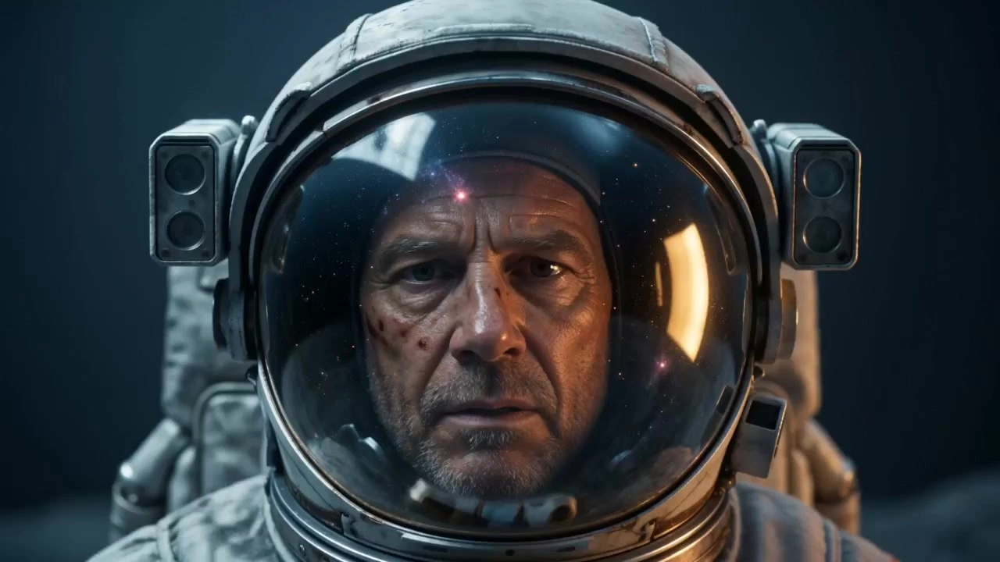

# Hans Zimmer-Inspired Epic Music Video

> **作者：** 阿娴AIGC

## Content

**Process Planning:**

**Overall Phase Logic and Dependencies:**
1. **Parse Input** → Call **resource_prepare_and_analyze** to analyze the user-provided audio (BPM, mood curve, section segmentation) or text ideas, and output a structured narrative table (segments, mood tags, suggested visual elements, suggested duration).
2. **Confirm Rhythm Type** → If the user has not explicitly selected "Fast-paced Montage" or "Slow-paced Immersive" in the input, you must use reply_to_user to ask the user to choose before proceeding to the shot list; do not skip this step.
3. **Establish Global Specs** → Create Final_Video_Spec.md (Final_Video_Spec.md) using **text_editor**, locking in: Title, Rhythm Type, Output Specs (16:9, 1080p, 24fps, no subtitles, no narration, no lip-sync), Visual Style (Hans Zimmer style), Audio Source.
4. **Generate Shot List** → Call **storyboard_designer** to generate the Shot List (key_elements + shots + audio_layers) based on the narrative table and rhythm type. **Pause and display the Shot List to the user, and continue only after confirmation.**
5. **Generate Video Clips** → Call **media_generator** to generate video clips shot by shot.
6. **Compose Output** → Call **video_assembler** to splice clips, synchronize audio, and apply transitions to output the Final Video (Final Video). **Once finished, display the result to the user and prompt for export.**

**Dependencies:** 2→1; 3→2; 4→3; 5→4; 6→5.

**Exception Handling:**
- User provides no input (no audio, no text): Prompt with "Please upload an audio file or write down your story idea, for example, 'A hero walks onto the battlefield alone'."
- Audio duration exceeds 5 minutes: Prompt with "It is recommended to crop to the first 3 minutes, or let me know if you would like to generate in two separate parts," and wait for the user's decision before proceeding.

**Pause Nodes:** Do not run the entire process in one go. You must pause at Phase 4 (after the Shot List is completed) and Phase 6 (after the Final Video is completed) to present the results to the user and obtain confirmation.

**Asset Analysis:**

**Audio Analysis (Core Task):**

**① BPM and Tempo Analysis:**
- BPM > 120 → Emotional Tag: Intense/Combat/Pursuit → Visual Adaptation: Fast cuts, handheld camera shake, fast pans.
- BPM 80–120 → Emotional Tag: Building tension/Movement/Moderate tension → Visual Adaptation: Medium-speed push/pull, mixed cuts.
- BPM < 80 → Emotional Tag: Solemn/Contemplative/Lonely → Visual Adaptation: Slow motion, aerial shots, slow push/pull.

**② Spectrum Energy and Instrumentation Recognition:**
- Strong low-frequency energy (tuba, bass strings, industrial drums) → Oppressive/Grand → Pair with large scale shots (long shots, wide shots), backlit silhouettes.
- Prominent mid-to-high frequencies (synth lead melodies, pipe organs, high-pitched brass) → Sci-fi/Hope/Looking up → Pair with Tyndall light beams, upward camera movements.
- Electronic timbre dominant (synth pads, industrial-textured sound effects) → Cold/Futuristic → Pair with cold blue tones, industrial ruins, or space scenes.

**③ Repetitive Motif Recognition:**
- If short melodic fragments looping and overlapping are detected, with volume/instrumentation increasing layer by layer, mark as "Repetitive Motif Section".
- Visual adaptation for repetitive motif sections: Each cycle corresponds to a progression in shot scale (Long Shot → Wide Shot → Medium Shot → Close-up) or increased cutting frequency to achieve audio-visual synchronization.

**④ Emotional Curve:**
- Extract emotional change nodes of the entire track (Calm → Rising → Climax → Aftermath), segment by section (recommended 3–6 segments).
- Annotation for each segment: Approximate time range, emotional tag, summary of musical characteristics, suggested visual keywords, suggested duration, rhythm adaptation (slow motion/medium speed/fast cuts).

**Text Idea Expansion (Backup Path):**
- If the user only provides a text idea, expand it into 3–5 narrative segments (Beginning, Rising Action, Climax, Ending). Each segment includes: Emotional characterization, suggested visual keywords, and suggested duration.
- The output format remains consistent with the audio analysis results, allowing for seamless integration with downstream Storyboard Design.

**Output Principle:** Output a structured narrative table for direct use by **storyboard_designer**; avoid subjective aesthetic judgments, only extract actionable visual and emotional signals.

**Storyboard Design:**

**Key Elements Design:**
- Based on the visual keywords in the narrative table, distill 3—6 key_elements (e.g., wasteland, ruined castle, battlefield, silhouette of a lone hero, firmament, coastal cliffs, etc.). For each element, describe its core visual characteristics and lighting tone.
- No lip-syncing for specific characters; if characters appear, present them as silhouettes or close-up shots. Precise facial modeling is not required.

**Mandatory Realism Rules (Highest priority, overriding all other visual descriptions):**
- **Strictly Prohibited:** Anime, cartoon, illustration, ink wash, cyberpunk, abstract geometry, Unreal Engine render style, surreal compositing feel, plastic model feel, any "AI-generated" look with smooth smearing or over-sharpening.
- **Mandatory Realistic Texture:**
  - **Characters:** Realistic skin texture (pores, vellus hair, moles, wrinkles), facial appearance under natural lighting, realistic clothing materials (cotton/linen, leather, metal armor, worn fabrics).
  - **Scenes:** Real topography and architecture, realistic weather effects (rain, snow, fog, scorching sun), natural light sources (sun, moonlight, firelight, explosion light).
  - **Props:** Realistic wear-and-tear, rust, reflections (helmets, sword blades, flags, gear).
- **Reference Benchmarks:** Nolan-esque cinematic realism (Interstellar, Dunkirk), documentary photography texture, cinematic live-action feel.
- **Failure Criteria:** If generated images contain non-realistic elements (glowing lines, abstract halos, cartoonish characters, game render textures), prioritize retrying within the same model once; if the retry still fails, alert the user—do not pass silently.

**Hans Zimmer Visual System (Mandatory for all shots):**
- **Lighting:** High contrast; significant brightness difference between key light and shadows; backlight silhouettes and Tyndall beams (god rays) are signature lighting effects; flat lighting or uniform illumination is prohibited.
- **Color Palette:** Cold blue in shadows (deep blue-gray, refer to #1A2A3A), warm yellow in highlights (amber gold, refer to #F5C76E); overall low saturation and high contrast; avoid vivid solid colors. Very light film grain may be added to enhance texture, but must not be excessive.
- **Shot Scale:** Large scales (long shot, full shot, extreme long shot) account for ≥60%, used to establish a grand sense of space; supplemented by close-ups (hands, footprints, weapons, flags, dust, etc.) to reinforce emotion; medium shots used only for transitions.
- **Camera Movement Rules:**
  - Immersive Slow Motion: Slow push/pull, drone aerial shots (level or diving), jib arc movements, static shots with a sense of breathing (micro-shake), telephoto lens to compress spatial depth.
  - Montage Quick Cuts: Rapid push/pull, handheld shake, quick pans, whip pans, short freezes.
- **Transitions:** Dissolves (to convey passage of time), cuts to black (for emotional breaks or chapter feels), match cuts (matching shapes/movements).
- **Repeating Motifs Synchronization:** If the audio contains "repeating motif segments" (marked in the narrative table), the visuals must progress in sync: each cycle corresponds to a progression in shot scale (long shot → full shot → medium shot → close-up), or gradually increase the cutting frequency; static, unchanging single shots are prohibited in these segments.

**Shot Design:**
- Each shot must include: scene (referencing the corresponding key_element), visual content (subject action/state), shot scale and camera movement, lighting description, suggested duration, and whether to synchronize with repeating motifs.
- Immersive Slow Motion Mode: Suggested single-shot duration 4—8s, total shot count controlled at 5—10.
- Montage Quick Cut Mode: Suggested single-shot duration 1.5—3s, total shot count can reach 10—20.
- No lip-syncing, no character singing, no narration synchronization.

**Shot Continuity and Coherence Rules:**
- **Color Tone and Light Source Consistency:** Within the same narrative segment, the key light direction, color temperature (warm/cool), and dominant color tone of adjacent shots must remain consistent; lighting changes across segments must have a clear motivation (e.g., passage of time, scene change) and must not fluctuate without reason.
- **Shot Logic:** Adjacent shots must not feature extreme jumps in scale without transitions (e.g., cutting directly from a close-up to an extreme long shot without a match cut); transitions must be made via intermediate shot scales or matching movements, unless intentionally using a cut-to-black to create an emotional break.
- **Movement Direction Consistency:** Within the same segment, the subject's movement direction (left→right or right→left in the frame) must be uniform to avoid spatial confusion caused by axis jumps.
- **Subject and Scene Binding:** When the same key_element (e.g., "ruined castle" or "silhouette of a lone hero") appears in different shots, visual descriptions must reference the same key_element reference image to ensure consistent appearance, texture, and lighting style across shots.
- **Rhythmic Coherence:** Isolated slow-motion shots must not be inserted into quick-cut segments, and isolated quick-cut shots must not be inserted into slow-motion segments; changes in rhythm must occur at the boundaries of narrative segments and be explicitly marked via transition types (dissolve / cut-to-black).

**Audio Layers Design:**
- **music (BGM):** Use the raw audio provided by the user as the primary BGM audio_layer, covering the entire film.
- **Ambient Sound (Optional):** If the user wishes to layer ambient sound effects (wind, war drums, distant crowd noise, etc.), inquire separately after the shot list is confirmed, and add as an independent audio_layer.
- No narration audio_layer to be set; no vocal singing tracks to be designed.

**Media Generation:**

**Video Clip Generation:**
- Primary generation path: **MultiModalToVideo**, preferred model **Seedance 2.0**, resolution **1080p**.
- Use the corresponding key_element image as a visual reference (reference_image) for each shot to ensure consistency in lighting, shadows, and color tone across shots.
- Do not use generation paths that include lip-syncing/vocals; generated content must not contain any lip-sync or character singing.
- If the scene continuity between two consecutive shots is extremely high (e.g., a push-in within the same scene), the video of the previous shot may be added as a reference_video; generally, only reference the key_element image, do not overlay reference_video.

**Key Element Image Generation:**
- Use **TextToImage**, recommended model **Nano Banana Pro (Gemini 3 Pro Image)**, resolution **2K**.
- Generate one style benchmark image for each key_element, which must reflect the Hans Zimmer lighting system (backlighting, cool dark areas, warm highlights, wide shot composition).

**Ambient Sound Generation (Optional):**
Once the user chooses to add "Epic Bass Ambient Sound," generate it according to the following rules:
- **Generation path:** Use **text_to_instrumental**, prioritize model **Mureka 8** (more stable control over low-frequency ambient sound effects); alternative **Suno 5**.
- **Prompt specification:** Clearly describe the sound effect type + frequency characteristics + emotional tone, for example:
  - Wind: epic wind ambience, low rumbling gust, distant howling, no melody, no percussion, dark atmospheric
  - Distant thunder: distant thunder roll, deep low-frequency rumble, slowly fading, no music, cinematic tension
  - Low-frequency drone: deep sub-bass drone, industrial hum, sustained low frequency texture, ominous, no rhythm
  - Heartbeat: slow deep heartbeat, tense cinematic pulse, isolated low thud, no melody
- **Duration matching:** Align generation duration with the corresponding narrative segment length to avoid a disjointed feel; if the segment is long (>30s), generate in segments and then stitch them sequentially using **video_assembler**.
- **Volume mixing strategy (to be executed by video_assembler):**
  - Main BGM volume baseline: 100%
  - Ambient sound overall ceiling: 20–30% of BGM (to avoid overpowering the main music)
  - Climax quick-cut segments: Ambient sound can be briefly increased to 30–35% of BGM to enhance impact; drop back immediately after the climax ends.
  - Slow motion/lingering segments: Ambient sound drops to 10–15% of BGM to maintain a sense of breathing in the footage.
  - Keep low-level ambient sounds inherent in video clips (wind, footsteps) at ≤15%; mute any human voices or music tracks entirely.

**Global Parameters:**
- Output specification: 16:9, 1080p, no subtitles.
- If a model fails, prioritize switching to an alternative model within the same tool (e.g., Seedance 2.0 Fast) rather than forcibly substituting with a different tool.

**Prompt Writing:**

**Image Prompts (TextToImage / ImageToImage):**
- Describe the subject + environment + lighting effects using natural language, and use short phrases to add style/tone/composition. Only write what is visible in the frame; do not include emotional motivations or off-screen information.
- Fixed style anchors (must be included in every image prompt): cinematic epic, photorealistic, shot on film, real skin texture, natural lighting, high contrast lighting, rim light silhouette, teal shadows, amber highlights, low saturation, wide establishing shot, anamorphic lens flare, atmospheric haze, Nolan-style realism.
- Lighting must be specified: direction of backlight, presence/absence of Tyndall effect (god rays), color temperature of key light (warm/cool).
- Do not describe flat lighting scenarios, uniform illumination, or saturated/vibrant colors.

**Video Prompts (MultiModalToVideo / Seedance 2.0):**
- Use placeholders like <<<image_1>>> for reference images.
- Structure prompts in the following order: **Camera Movement** (e.g., slow aerial push-in / rapid whip pan) → **Subject State** (position, movement intensity) → **Environment & Lighting** (light sources, dust/smoke, weather) → **Audio Notes** (wind, distant thunder, etc., if needed).
- Slow-paced shots: emphasize slow texture words like "slow motion," "gradual," and "lingering."
- Fast-paced shots: emphasize explosive texture words like "fast cut," "sharp," "dynamic," and "handheld energy."
- Fixed negative prompts: no subtitles, no text overlay, no lip sync, no singing, no narration voice, no flat lighting, no music, no anime, no cartoon, no illustration, no watercolor, no cyberpunk neon, no abstract geometry, no CGI render, no plastic texture, no AI smoothing, no over-sharpening, no glowing outlines (BGM is carried by a separate audio track; video generation should not include music descriptions).
- All prompts must be written in **English** to ensure optimal model comprehension.

**Final Assembly:**

**Stitching Order:** Strictly follow the shot order in the Shot List; do not rearrange without authorization.

**Continuity Check (Execution per shot):**
- **Color Jump Check:** If there is a noticeable color temperature jump at the junction of adjacent clips (e.g., warm yellow to cold white, or sudden brightening of shadows), you must apply color transition compensation in the editing layer, or choose a dissolve transition to mask it.
- **Consistency of Movement Direction:** If the main subject's movement direction is opposite in adjacent clips, you must insert a neutral transition shot (such as a static close-up) or a black frame cut. Do not use direct hard cuts that create spatial confusion.
- **Shot Size Transition:** Avoid extreme jumps in shot size between adjacent clips without a transition (e.g., a direct cut from a close-up to an extreme long shot). If match cutting is indicated in the storyboard, strictly execute the match based on shape/motion.
- **Audio-Visual Sync Review:** Each dissolve or hard cut point must be aligned with noticeable beat points or emotional shifts in the BGM; do not place cuts randomly.

**Rhythm Matching:**
- Slow-paced mode: Use dissolve transitions between clips (suggested duration: 1.0–1.5s) to maintain the "breathing" space of the visuals; do not cut hastily.
- Fast-paced mode: Rely primarily on hard cuts, with transition durations ≤ 0.3s; at climactic moments, insert single-frame black frames (2–3 frames) to enhance impact.

**Audio Synchronization:**
- Use the user-provided raw audio as the main BGM track, covering the entire video. Keep the volume stable (no fades, unless needed for the ending).
- If there is an ambient sound track, set the volume to 20–30% of the BGM to avoid overpowering the main music.
- Ambient sounds inherent in the video clips (wind, footsteps, etc.) may be kept at a low level (≤15%), but absolutely no vocal or music tracks should be retained.

**Export Specifications:** 16:9, 1080p, 24fps, no subtitles, no narration, H.264 encoding.

**Conclusion:** After the final shot ends, it is recommended to add a 0.5–1s fade to black to naturally resolve with the musical tail.
