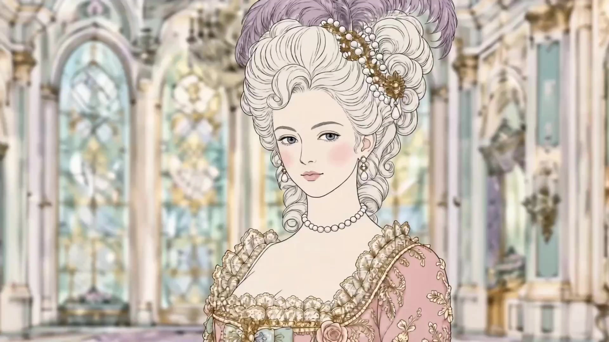

# Hermès Scarf Illustration Style

> **作者：** @李木木

## Content

Process Planning:

Workflow Stages and Sequence:

Confirm the overall video theme and narrative scenario with the user (e.g., Chinese courtyard tea ceremony, European palace banquet, daily life in a Paris apartment) and write to Final_Video_Spec.md (including aspect ratio, estimated duration, visual style, and language) → text_editor.

Design the Shot List: Define all Key Elements (main characters, animals, scenes) and a dual-shot structure for each scene (wide shot plus close-up follow). Default each final_shot to ~3 seconds, extending to 4–5 seconds only if the action cannot be completed naturally → storyboard_designer.

Generate all Key Elements images (characters, animals, scenes) → media_generator.

Generate video by group (two per group: wide shot + close-up), referencing corresponding element images. Reserve sufficient footage for editing; final duration is controlled during assembly → media_generator.

Generate final_audio synchronized precisely with visual actions and environment only when sound effects are explicitly marked in the Shot List. Do not generate BGM, narration, or dialogue → media_generator.

Edit and assemble, arranging shots rhythmically from wide to close-up, trimming standard shots to ~3 seconds, and aligning audio precisely → video_assembler. Dependencies: 2→1; 3→2; 4→3; 5→2; 6→3, 4, 5. Pause Nodes: Pause for user confirmation after completing Final_Video_Spec.md, the Storyboard, and element image generation before proceeding to the next stage.

Asset Analysis:

Reference Image Analysis Focus (for style extraction):

Line style: density, stroke thickness, coloring method (flat/gradient), decorative pattern density.

Color palette: main tones (beige, ivory, gold-brown), accent colors (jewel blue, emerald, rose red, gold), contrast/saturation range.

Narrative structure: subject (person/animal) posture and spatial relationship with the environment (foreground, mid-ground, background).

Character/Animal design: clothing style (era, cultural background), animal breed, and pose.

Output a structured style description for use by storyboard_designer and write_media_prompt.

Storyboard Design:

Visual Style Definition (Global):

Line Style (Ligne Claire): Use thin, consistent black outlines, similar to Belgian comic "Ligne Claire" style, rather than variable-width Chinese ink brush lines. Architecture uses hard, straight lines; people and plants use organic curves. All contours must be clear and closed, without burrs or ink bleeding.

Color Palette (Cold & Warm Gemstone Tones): Use ivory, off-white, or sand as the base. Accent colors should be a balanced mix of warm (ochre gold, vermilion, wine red, orange-red) and cold (royal blue, Prussian blue, emerald green, deep purple) gemstone tones. The overall aesthetic is sophisticated and muted with moderate saturation; avoid overly warm gold dominance.

Filling Method (High-Density Decorative Fill): Use flat color blocks for main subjects. Intricate surfaces like fabrics, carpets, tapestries, and architectural paintings must be filled with high-density patterns (geometric, scrollwork, floral/bird patterns), ensuring readable decorative info in every inch. Use only fine stippling or grain for subtle volume; avoid gradients or strong shading.

Narrative Density: Each frame should resemble a complete silk scarf—rich in cultural symbols, historical artifacts, and natural imagery. The visual information density is high, rewarding close-up inspection. Composition layers: Foreground (plants/objects) → Midground (main characters/animals) → Background (architecture/landscape).

Light & Texture: Soft, even lighting without harsh shadows or specular reflections. The overall aesthetic should be sleek and clean, like luxury silk or matte prints.

Overall Vibe: The sophistication and restraint of a luxury TVC. Each frame should have a flat, decorative art quality suitable for screen-printing on silk. Avoid realistic rendering, casual snapshots, or visual clutter. Key Elements Design Specs:

element character / element animal: Specify clothing (dynasty or cultural style), hairstyle, and color scheme; for animals, specify breed, fur color, and posture traits. Must match the reference style.

element scene: Define spatial hierarchy: foreground iconic decor, midground core activity area, and background architecture or nature. Describe light direction and atmosphere. Dual-Shot Structure (Fixed per scene):Each narrative scene must include the following two shots in fixed order. Each final_shot is default ~3 seconds; only extend to 4–5 seconds if a complete action would otherwise be rushed or cut off.

Shot A — Establishing Wide Shot

Composition: Wide view showing complete spatial hierarchy (foreground, midground, background visible); subject in midground with moderate scale.

Camera: Slow pan or slight push-in to emphasize depth; one clear, restrained movement within 3 seconds.

Duration: Default ~3s; extend to 4–5s only if necessary for space establishment or key actions.

Shot B — Close-up Follow Shot

Composition: Focus on upper body of character or animal, highlighting action details (e.g., pouring tea, raising a glass, turning a page, perching).

Camera: Follow movement, with slight handheld feel or arc orbit; move camera in the direction of the action.

Duration: Default ~3s; extend to 4–5s only if the action's onset, core phase, and conclusion require continuity.

Clearly specify the precise action (exact verbs) and micro-expressions or body details. Actions must fit short durations; do not stack multiple actions. Cross-Shot Audio:

Use only SFX matched to actions and space; no BGM, voiceover, or dialogue.

Design a separate audio_layer for shots with sound. Note the triggering action, sound material, proximity, and duration. Prioritize delicate, close-up, textured sounds (e.g., silk friction, leather creak, objects touching, pouring tea, bird wing flutter, or light breeze).

Media Generation:

Element Image Generation:

Use TextToImage, specify GPT Image 2, and set resolution to 4K.

Character or animal images: Generate side-by-side reference_image—left side for close-up (facial features, hairstyle, neckline); right side for full body (outfit details, color scheme, pose).

Scene images: Generate a full panoramic scene, reflecting foreground, midground, and background depth, including representative decorative details. Video Generation (Shot A and Shot B):

Prioritize MultiModalToVideo, specify model Seedance 2.0, and resolution 720p.

Seedance 2.0 has a minimum generation length of 4 seconds: For shots targeting ~3 seconds, generate 4 seconds for subsequent editing; for longer shots, generate 4-5 seconds as needed, avoiding pauses without narrative value.

Reference inputs for each shot:

element scene image of the corresponding scene (Required).

element character / element animal images (Required).

final_shot of Shot A in the same scene (Use only when generating Shot B as a continuity reference_video; optional for spatial consistency).

Shot B close-up tracking shot: Explicitly specify camera movement direction, action rhythm, and primary action focus in the prompt; do not rely on model improvisation.

Do not generate music, narration, or dialogue within the video; include only natural sounds directly related to camera actions, avoiding overlap with independent audio_layer. Audio Generation:

Generate final_audio only for actions or ambient sounds explicitly marked in the Storyboard using MultiModalToAudio; do not generate music, narration, or dialogue.

Sound effects must align with the sophisticated quality of luxury creative ads, maintaining necessary spatial sense and dynamic range, and be precisely aligned with the action beats of the corresponding shot.

Prompt Writing:

Global Rules:

Write prompt text in Chinese; include only screen-synced sound effects for the entire video, with no dialogue, narration, or BGM.

Style Anchor Phrases (required in every prompt): Hermès silk scarf illustration style, Ligne Claire with uniform fine outlines (hard architectural lines + organic curves), flat color blocks + high-density pattern infills (covering fabrics/carpets/architectural paintings), balanced cold and warm gemstone color palette (royal blue/emerald green/deep purple vs. ochre gold/vermilion/burgundy), ivory white or lime white background, no strong shadows or highlights, soft and uniform lighting, matte silk texture, narrative high-density decorative composition (foreground objects/plants + midground subject + background architecture), exquisite and restrained luxury TVC aesthetic, possessing a graphic decorative art feel "printable on silk via screen printing."

Default to one visual action and camera movement per shot that can be clearly read within about 3 seconds; when extension is needed, ensure the complete setup, action, and resolution of the movement are preserved. Image Prompt (TextToImage — Element Image):

Structure: Subject description (character or animal features) + environment or scene (spatial hierarchy) + style anchor phrases + composition instructions (e.g., "horizontal side-by-side reference, left side close-up, right side full body").

Specify clothing cultural background clearly (e.g., "Tang Dynasty Hanfu, golden wide sleeves, celadon jade belt"); for animals, specify breed and coat color.

Prohibit narrative language outside the frame; describe only what is visible to the camera. Video Prompt (MultiModalToVideo — Shot A Panorama):

reference_image binding: <<<image_1>>> for scene image, <<<image_2>>> for subject person or animal image.

Camera Movement: Camera pans slowly to the right, or camera pushes in slightly; specify direction and speed, and control the action to a concise 3-second visual beat.

Subject Action: Static or slight movement (e.g., fluttering clothes, light flapping of bird feathers); large, erratic movements are discouraged.

Fixed Negative Prompts: no subtitles, no text overlay, no dialogue, no voice-over, no music (sound effects are handled as separate audio_layers). Video Prompt (MultiModalToVideo — Shot B Close-up Tracking):

reference_image binding: <<<image_1>>> for subject close-up, <<<image_2>>> for scene image.

Camera Movement: Tracking shot, camera follows subject's movement direction slowly with a slight arc/wrap-around feel; specify tracking direction (left, right, or forward).

Action Description: Precise verbs + body details + rhythm (e.g., "right hand slowly lifts the teapot, wrist turns slightly, thin stream of tea pours into the celadon cup, movement is relaxed and elegant"); default to one action segment completed within 3 seconds, specify 4–5 seconds only when the full process must be shown.

Sound Effect Prompt (Optional): Use <tea pouring sound, subtle> format for ambient sounds.

Fixed Negative Prompts: no subtitles, no text overlay, no dialogue, no voice-over, no music.

Video Editing:

Editing Rhythm:

Strictly alternate between "Wide Shot (Shot A) → Close-up (Shot B)" to form the basic unit of each scene.

Select the most complete action/camera movement from each 4s source clip. Trim standard Shot A and Shot B to approx. 3s; only keep 4–5s if trimming compromises action integrity.

Transitions: Use hard cuts exclusively between all shots. Do not use cross-fades, fades to black, or other transition effects; maintain rhythm through in-shot action and composition changes. Audio Mixing:

No BGM, narration, or dialogue throughout the film. Keep silent where no specific sound effects are needed; do not fill with music.

Precisely align each final_audio to the action trigger point of the corresponding shot. Maintain nuanced close-up material sounds with moderate spatial sense; avoid overly dense audio that overpowers the visual rhythm.

No narration, dialogue, or subtitles. Export:

Aspect ratio and resolution must follow the Final_Video_Spec.md settings.
