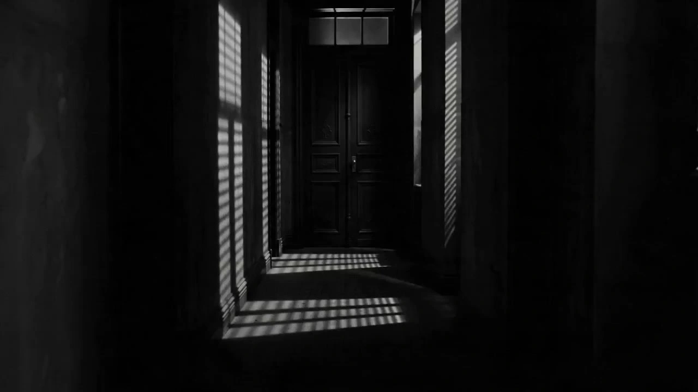

# Hitchcockian Suspense

> **作者：** @阿娴AIGC

## Content

Process Planning:

Full Process Orchestration Logic
Stage Dependencies

1 → 2 → 3 → 4 → 5. Each stage must proceed strictly in sequence. Where confirmation nodes exist, wait for user approval before continuing.

Stage 1: Establish Global Specifications (Final_Video_Spec.md)

Before any shot list or generation begins, create Final_Video_Spec.md (本編仕様ドキュメント) using text_editor, locking in the following parameters:

Aspect Ratio: 16:9

Resolution: 1080p (default), unless the user requests other specifications

Color Mode: Classic Black & White (default) or Vintage Color (written after user selection)

Style Tags: Hitchcockian Suspense, 35mm film grain, Rembrandt high-contrast lighting, enclosed composition

Audio Strategy: No audio track in the output video (user to add music in post-production)

Language: Chinese (for interface/interaction); no dialogue required in the video content

If the user does not specify a color mode, use reply_to_user to ask for "Classic Black & White" or "Vintage Color," then write the selection into the specification file upon receipt.

Stage 2: Asset Analysis (Optional, triggered only when the user uploads images or videos)

Call resource_prepare_and_analyze to analyze reference images or short videos uploaded by the user.

Inject the analysis results (subject description, lighting tendencies, composition keywords, prop clues) into the context for the subsequent Shot List stage.

Stage 3: Storyboard Design

Call storyboard_designer to generate a Shot List based on user input (image analysis results + text creative).

Once the Shot List is complete, pause and present the draft (shot number, shot type, framing, scene description, estimated duration) to the user.

Use a card or reply_to_user to invite the user to confirm or modify (adjusting the number of shots, replacing shot types, or editing any scene description and duration).

User confirmation must be obtained before proceeding to the next stage.

Stage 4: Media Generation

Call media_generator to generate video clips for each shot.

If the script requires characters or scenes to remain consistent across shots, first complete image generation and bind them to the corresponding Key Elements, then generate the video for each shot.

After each shot is generated, pause and present the preview list to the user, allowing them to request regeneration for any unsatisfactory shots.

Stage 5: Editing and Output

Call video_assembler to stitch all shots together in the order specified in the Shot List, without adding any audio tracks.

After assembly, guide the user to export the final MP4 file.

Asset Analysis:

Reference Asset Analysis Rules
Analysis Goal

Convert user-uploaded images or short videos into structured signals that can be injected into the Shot List stage. Do not perform style overwriting; only perform content extraction.

Image Analysis

Subject Recognition: Characters (gender, age impression, period characteristics of clothing), architecture/interior environment (hotel, corridor, stairs, basement, etc.), key props (keys, letters, jewelry, photos, boxes).

Lighting Characteristics: Direction of existing light sources, contrast tendency (high contrast / flat light / soft light), whether there are striped shadows (blinds, grilles).

Composition Tendency: Position of characters in the frame (centered / edge / corner), whether there is a natural occlusion frame (door frame, window frame, railing).

Output: Output in the form of a keyword list to serve as visual anchors for the Shot List stage.

Video Analysis

Extract the overall narrative rhythm (static / movement), main scene types, and key action moments.

If there are obvious Hitchcock-style elements in the video (high-angle shots, close-ups, closed composition), mark them for continuation in the Shot List.

Extract keyframes with reuse value (e.g., the first frame that establishes spatial sense, close-up frames of character reactions) for use as start_frame or reference_image in the Media Generation stage.

MacGuffin Prop Recognition

If suspicious repetitive or isolated props appear in the material (letters, keys, jewelry, photos, boxes), mark them as potential MacGuffins and suggest arranging for the props to appear repeatedly in the Shot List.

Storyboard Design:

Photorealistic Mandatory Lock (Highest Priority for All Shots)

All visual styles must be locked to photorealistic, natural aging texture; anime, ACG style, CG rendering, flat illustration, abstract art, or high-saturation plastic looks are strictly prohibited.

Human skin must retain real details such as pores, moles, wrinkles, and broken capillaries; clothing materials must show visible texture (cotton/linen, leather, worn metal); lighting must be natural or dramatic, never cartoonish.

Any mention of characters in shot descriptions must imply "real skin texture, natural aging feel" to prevent the visuals from drifting toward CG or anime styles.

Narrative Structure Rules

All scripts must follow the four-act structure of "Setup → Anomaly → Thrill → Open-ended/Suspense," prioritizing suspense over jump scares; explicit gore, corpses, and wounds are prohibited. Thrills must be conveyed through indirect implication (water droplets on a blade, handprints on a shower curtain, distorted shadows, sudden silence).

Default shot count: 3–6 shots, each lasting 3–8 seconds.

Each script must contain at least one Hitchcock zoom shot; remaining shots should be chosen from a combination of "static long shot, top-down cage, voyeuristic angle, extreme close-up."

Close-ups (eyes, corners of the mouth, fingers) should account for ≥ 40% of the total.

MacGuffin Item Constraint: Each script must specify one MacGuffin item (key, letter, jewelry, secret document, etc.) that appears in close-up in at least two shots, with the character interacting with it (picking up, examining, hiding); the item itself requires no explanation but must drive character behavior.

Daily Life Alienation Principle: Scenes should take place in daily environments (washing, cooking, opening windows, walking), but must include at least one abnormal detail—a shadow flickering outside the window, eyes under a door crack, abnormal reflections in a mirror, objects moving on their own—to create a sense of psychological dissonance.

Subjective Shot Switching: Each suspense sequence must include at least one three-shot combination: "Character's POV looking at something" → "Cut to close-up of the object/shadow" → "Cut back to close-up of character's terrified reaction"; use framing devices like telescope frames, door cracks, or keyhole shapes to reinforce the voyeuristic feeling.

key_element Design
element character (if involved)

Describe physical features (gender, perceived age, clothing era), facial identifiers (hairstyles, gaze), skin/shadow tendencies, and primary clothing colors.

If the character has key expressions or important screen time in the script, a identity sheet must be preset for them, noting at least four emotional states (calm, terrified, suspicious, gloomy) to serve as a reference for the media_generator stage before being bound as an asset_id.

When the same character appears in multiple shots, all shot descriptions must strictly reference the appearance and expression library from the identity sheet to ensure consistency across shots.

element scene (core scene)

Describe spatial structure (hallway depth, staircase rotation, window/blind positions).

Mark natural occlusion elements (door frames, window frames, railings) and their positional relationship within the frame.

Mark light source positions and sources of striped projections (blinds, grates).

Shot Design Rules

Each shot description must include the following fields:

Field Explanation Shot Type Hitchcock Zoom / Static Long Shot / Top-Down Cage / Voyeuristic Angle / Extreme Close-up Framing Close-up / Medium Shot / Long Shot Camera Movement Parameters Precise description of camera movement (see type specifications below) Visual Content Character action, expression, prop placement, spatial relationships Lighting Refinement Light direction, light/dark distribution, presence of striped shadows Estimated Duration 3–8 seconds Suggested Sound Effects (For user post-production reference only, not generated) E.g., sharp violin sting, bass drone, silence, environmental white noise (dripping water, creaky wooden doors, ticking clocks)

Character Emotion and Facial Expression Refinement Rules (The Core of Realism)

Abstract emotion words are prohibited (e.g., "he says in terror"); must be broken down into specific physiological reactions and visible behaviors:

Terror: Eyes widen abruptly, pupils constrict, lips part slightly but cannot make a sound, breathing halts, fine sweat beads on the forehead.

Suspicion: Brows knit slowly, eyes squint/slant, corners of the mouth turn down, fingers tap the table unconsciously.

Internal Repression: Adam's apple bobs, deep inhale followed by a slow exhale, eyes darting, mouth tensed.

Mandatory use of local close-ups during emotional pivots: In shots where a character faces a key choice or emotional turn, a local close-up (eyes, mouth, trembling hands) must be used to convey internal activity rather than filming the full face.

Dialogue/Monologue Nodes: If the shot involves lines, punctuation must control the tone (?! — …), noting pauses, sighs, stutters, and other colloquial details; internal monologues are treated as whispered voice-overs and should not generate actual audio in the video prompt.

Camera Movement Specifications for Each Type

Hitchcock Zoom (Core, at least one per script)

The camera physically moves forward while the focal length zooms backward (dolly zoom), keeping the subject's size in the frame unchanged.

The background space is extremely stretched/compressed, creating spatial distortion and a strong sense of vertigo.

Speed: Medium (completed in 2–4 seconds), with movement and zoom synchronized.

Character expression: Confusion, terror, unfocused eyes, or dilated pupils.

Static Long Shot

Fixed position, no camera movement.

Primarily used for setup sequences to build the oppressive feeling of a closed space.

Composition requirement: Subject placed at the edge or corner of the frame, framed by door/window frames or railings.

Top-Down Cage

God's eye view (extreme high-angle shot), the character is small and placed in the center of the space.

Surrounding architectural structures (stair railings, hallway walls) form a feeling of a closed cage.

Movement: Fixed position or extremely slow vertical descent (simulating a gaze).

Voyeuristic Angle

Subjective voyeuristic shot, simulating peeking through a door crack, window slit, or shutter gap.

Edges of the frame are blurred by obstructions (door frame edges, shutter blades).

Slight handheld shake to increase unease.

Extreme Close-up

Extreme close-up focusing on eyes, mouth, hands (holding props).

Side lighting, half-lit, background completely out of focus.

No camera movement; tension is conveyed through the actor's micro-expressions.

Visual Hard Rules (Mandatory for all shots)

Dimension Rule Aspect Ratio 16:9, no forced black bars Composition Closed composition preferred; characters often placed at the edge or bottom corner; frequent use of high-angle and low-angle shots Lighting High-contrast Rembrandt lighting (side/backlighting), face half-lit/half-dark; striped shadows from blinds cutting across bodies or walls; large areas of "dead black," no detail in shadows; flat lighting, soft lighting, or gray tones are prohibited Color (B&W Mode) Extreme black and white, dead black in shadow areas, highlights limited to face/key objects Color (Retro Color Mode) Low-saturation retro colors (dark red, dark green, gray-blue), warm yellow highlights, deep black shadows; high-saturation red allowed locally for horror elements (blood, red curtains) Texture 35mm film grain (medium intensity), slight chromatic aberration at edges, natural vignette at corners, slight film jitter Subtitles Prohibit any subtitles or watermarks

Audio Design

The videos produced by this Skill do not contain audio tracks; no audio_layers (background music, sound effects, narration) should be designed. Leave blank for the user to add music during post-production.

Media Generation:

Key Elements Image Generation

If the script requires characters or scenes to remain consistent across shots, first generate a reference image for the key_element using TextToImage.

Recommended model: Nano Banana Pro (Gemini 3 Pro Image), resolution: 2K.

For subsequent reference images of the same character in different shots, use ImageToImage (same model), using the initial generation result as a reference to maintain appearance consistency.

Once generated, register the resource as an asset_id and bind it to the corresponding key_element.

Shot Video Generation
Main Path

Tool: MultiModalToVideo, Model: Seedance 2.0, Resolution: 1080p.

When generating each shot, pass the corresponding key_element reference image (character image + scene image) into image_infos.

reference_video strategy: Only attach the final_shot video of the previous shot as a reference_video when there is extremely strong scene/character continuity between consecutive shots (e.g., a character's continuous action within the same room); usually, do not use video references to avoid over-locking and losing freedom in zooming/composition.

Duration parameter: Set according to the estimated duration of each shot in the Shot List, range 4–15s (supported by Seedance 2.0).

Backup Path

If Seedance 2.0 fails, prioritize switching to Seedance 2.0 Fast (720p) to retry.

If all Seedance series models fail, switch to FirstFrameToVideo + Google Veo3.1 Fast (720p, recommended duration 6s or 8s); in this case, use the key_element image corresponding to the shot as the start_frame input.

Do not switch between tools silently; you must notify the user and obtain confirmation.

Super Resolution Processing

If the generated resolution is 720p, use super_resolution / MediaKit to upscale the video to 1080p in post-processing, maintaining 24 fps.

Audio Processing

This Skill does not generate any audio resources (does not call audio tools such as text_to_narration, text_to_instrumental, lyrics_to_song, etc.).

If the video generation model used outputs an audio track by default (such as the FirstFrameToVideo series), mute/remove all audio channels during the video_assembler stage.

Prompt Writing:

Global Rules

Prompts must be written in English.

All video prompts must include the following negative prompts at the end: no subtitles, no watermarks, no modern objects (mobile phones, cars, LED lights), no music, no dialogue audio.

Do not describe any sound effects or background music in the prompts (the output should have no audio).

Use image placeholders in sequence: <<<image_1>>>, <<<image_2>>> … (the first is for character reference, the second is for scene reference).

Hitchcock Zoom Prompt Template (Core, at least one shot per script)

<<<image_1>>> (Character Reference) <<<image_2>>> (Scene Reference)

Hitchcock zoom (dolly zoom), the camera physically moves forward while the focal length zooms backward. The subject's size remains constant in the frame, while the background [hallway/staircase/room] space is extremely stretched and distorted, creating an intense sense of dizziness and spatial collapse. The character's expression is [confused/terrified], eyes unfocused or pupils dilated, with subtle facial tension. High-contrast Rembrandt side lighting, half the face illuminated and half in shadow, with a single catchlight in the eyes. [Extreme black and white, deep blacks with no detail, highlights limited to the face and key objects / Low-saturation vintage tone (dark red, dark green, gray-blue), warm yellow highlights (approx. #F5D6B3), deep black shadows (approx. #1A1A1A)]. 16:9, medium-intensity 35mm film grain, natural vignette at four corners, slight chromatic aberration at edges, 24fps. No subtitles, no watermarks, no modern objects, no music, no dialogue audio.

Other Shot Type Prompt Templates

Static Long Shot

<<<image_1>>> (Character Reference) <<<image_2>>> (Scene Reference)

Fixed camera position, no camera movement. [Shot size], [description of frame content]. Character placed at the [edge/bottom corner] of the frame, [door frame/window frame/railing] creates a closed composition. High-contrast side/back lighting, character silhouette, Venetian blind strip projections cutting across the wall, large areas of deep black. [Extreme black and white / Low-saturation vintage color]. 16:9, 35mm film grain, vignette at four corners, 24fps. No subtitles, no watermarks, no modern objects, no music, no dialogue audio.

Top-Down Cage

<<<image_1>>> (Character Reference) <<<image_2>>> (Scene Reference)

God's eye view extreme high angle, [fixed position / extremely slow vertical descent]. Character appears small standing in the [center of the stairwell/middle of the corridor], with surrounding [stair railings/corridor walls/door frames] creating a closed, cage-like spiral effect. Top lighting, deep black surroundings, strong geometric contrast between the character and the structure lines. [Extreme black and white / Low-saturation vintage color]. 16:9, 35mm film grain, 24fps. No subtitles, no watermarks, no modern objects, no music, no dialogue audio.

Peeping Perspective

Subjective voyeuristic shot, simulating peeping at the target from [door crack/window crack/gap in blinds], with [door frame edge/blinds slats] blurred in the foreground to obstruct the view. Slight handheld shake to increase tension and unease. [Description of target character/object content]. Low light, low saturation, high contrast. [Extreme black and white / Low-saturation vintage color]. 16:9, film grain, 24fps. No subtitles, no watermarks, no modern objects, no music, no dialogue audio.

Extreme Close-up

<<<image_1>>> (Character Reference)

Extreme close-up, focusing on [eyes/corner of mouth/hand holding a prop], with only partial details visible and the background completely blurred. Side lighting, half bright and half dark, subtle [facial expression changes/muscle tension/finger trembling] clearly visible. No camera movement. [Extreme black and white / Low-saturation vintage color]. 16:9, 35mm film grain, slight vignette, 24fps. No subtitles, no watermarks, no modern objects, no music, no dialogue audio.

Color Mode Description Standards

Color modes must follow fixed descriptions in prompts: "Extreme Black and White" for classic black and white (deep blacks with no detail, highlights limited to face and key objects, no grayscale) or "Low-saturation Vintage Color" (dark red, dark green, gray-blue, warm yellow highlights (approx. #F5D6B3), deep black shadows (approx. #1A1A1A), localized high-saturation red allowed for horror elements).

Texture Description Standards (Must be applied to all shots)

Medium-intensity 35mm film grain, natural vignette at four corners (brightness reduced by approximately 12%, smooth transition), slight red/cyan chromatic aberration at edges (minimal shift), 24fps, no noise reduction, no excessive sharpening, no skin smoothing.

Video Editing:

Editing and Output Rules
Timeline Assembly

Stitch together each final_shot strictly in the order of the shot list; do not adjust the shot sequence (unless explicitly requested by the user).

The duration of each shot is based on the estimated value in the shot list; if the actual generated duration deviates from the estimate, prioritize retaining the complete footage and do not force-cut key actions.

Transitions

Use hard cuts (no transition effects) by default to maintain the Hitchcockian editing rhythm.

In special cases (e.g., transition from setup segments to suspense segments), very short fade-ins/fade-outs (≤ 0.3 seconds) may be used, provided they are clearly marked in the shot list.

The use of flashy transitions such as dissolves, wipes, or zooms is prohibited.

Pacing Control

Setup shots (static long shots) should remain at original speed; do not apply speed ramping.

Suspense climax shots (Hitchcock zooms, abrupt push-ins) should remain at original speed, relying on the camera movement itself to convey tension, without superimposing speed variation effects.

Audio Processing (Critical)

The final output file must not contain any audio tracks.

If the generated video clips carry audio (including sound effects or ambient noise automatically generated by the model), remove/mute all audio channels during the assembly phase.

Output as a pure video stream MP4 file without audio tracks to facilitate the user's post-production soundtrack addition.

Export Parameters

Format: MP4

Frame Rate: 24fps

Aspect Ratio: 16:9

Resolution: 1080p (1920×1080)

No subtitles, no watermarks, no audio tracks
