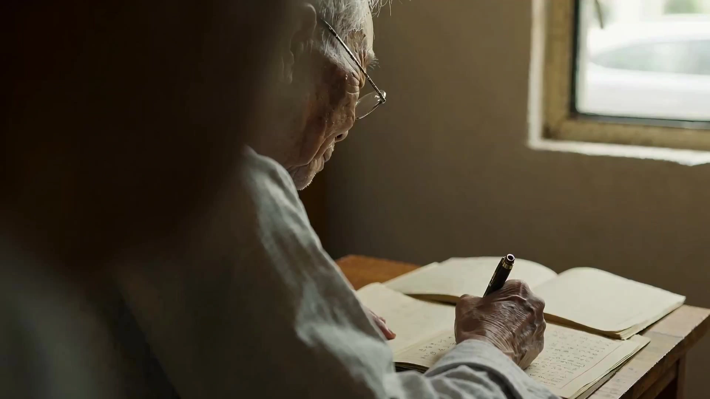

# Humanistic Documentary Film

> **作者：** @Flova

## Content

Process Planning:

Process Planning and Phase Dependencies:

Confirm with the user and establish the Final_Video_Spec.md (Title, Subject/Region, Aspect Ratio, Target Duration, Visual Style, Output Language) → text_editor

Generate the Storyboard (Key Elements, Shot List, Audio Layers) → storyboard_designer. Once the storyboard is ready, scan the current context to find any assets (e.g., element images, background music) provided by the user or previously generated that match the storyboard entries. For each match, bind and assign the asset to the corresponding storyboard slot via media_generator before proceeding with generation steps → media_generator

Set Elements:

If the user has already uploaded element resources (e.g., character images or reference characters), bind them directly as assets for the corresponding Key Elements.

Otherwise, generate images for all elements → media_generator.

Generate the start_frame for each shot → media_generator

Generate video referencing the start_frame from Step 4 → media_generator (FirstFrameToVideo - Happy Horse)

Generate the BGM Audio Layers → media_generator

Complete the assembly of the final video timeline → video_assembler

Dependency Order: 2→1; 3→2; 4→2; 5→4; 6→2; 7→5,6 Pause Nodes: Do not run the entire process at once. Pause after Storyboard completion, after element/start_frame generation, after video completion, and after audio generation, waiting for user confirmation before continuing. Note: Regarding user-provided or pre-existing media (mainly affecting steps 3-5): Before filling in generated content, bind and assign the media to the appropriate storyboard location via media_generator; avoid regenerating content already provided by the user.

Guidelines for Establishing Final_Video_Spec.md

Title: The name should fit the tone of a "humanistic documentary," avoiding overly commercial or flamboyant naming.

Subject/Region

Regional Scope: Guide users to choose from the following areas: Asia, Africa, Middle East, South America, Eastern Europe, Southeast Asia, Island Nations, Developing Countries.

Subject Core Limitations: The subject must focus on "real people" and "ordinary life"; reject the "city promotional video" style.

Aspect Ratio: 16:9 widescreen or the 2.35:1 anamorphic format common in documentaries is recommended.

Visual Style: Locked to "like a real photographer stationed for a long time," "like an Oscar/International Film Festival documentary," "Netflix documentary style," or "National Geographic observational imagery." Clearly state styles to "avoid" (blacklist): "AI-feel, commercial ad-feel, heavy drama, influencer style."

Visual Texture Requirements:

Include atmospheric feel: Dust, vapor, dampness, heat waves, wind.

Lighting Restrictions: Natural light only (morning light, dusk, overcast, window light).

Preserve Imperfections: Intentionally allow and retain slight out-of-focus shots, exposure fluctuations, and a sense of real chaos.

Asset Analysis:

If the user uploads reference images or videos, extract the following signals for downstream use: subject identity and appearance characteristics, scene location and environmental atmosphere, lighting conditions (direction / color temperature / texture), and image color tone and saturation style.

Output structured descriptions without subjective evaluation.

Storyboard Design:

Guidelines for Global Humanistic Documentary Scripts and Narrative PlanningI. Core Narrative Philosophy: Observe life, do not "stage a story"

De-dramatize: Discard heavy dramatic conflicts and commercial ad-style plot designs. The focus of plot planning is not to "tell a story with a beginning, middle, and end," but to present "human life in the real world."

Spontaneity: The scenes and events described in the script should not have traces of being "deliberately arranged by a director"; they must create the natural state of "things accidentally observed by a photographer stationed for a long time."

Pursue a Unified Global Documentary Aesthetic: Such as Netflix documentaries or National Geographic observational imagery, creating humanistic narratives that global audiences can understand and empathize with, avoiding stereotypical regional styles (e.g., pure influencer style or pure Western style). II. Narrative Subject and Entry Point: Shoot the "people" first, not the "city"

Reject Promotional Video Logic: Never make "cityscapes" or "grand landscapes" the primary subject of the script; this is not a city promotional video.

Focus on Real Humans: The plot should always enter through "people," reflecting their culture and environment through the real lives of ordinary individuals. III. Plot Details and Action Design (The most empathetic descriptive points) When writing scripts and scene descriptions, focus on depicting the following detailed actions rather than grand events:

Focus on Manual Labor: Cooking, sewing, laundry, writing, handicraft work.

Character Backs and States: Use "backs" as the main visual in scene descriptions; this is more sophisticated and leaves more room for imagination than showing faces directly.

Small Daily Actions: Lighting a cigarette, drinking tea, staring blankly, looking out the window (use these "small actions" without specific purpose to build a sense of reality in the flow of time). IV. Scene/Subject Planning Library by Region When planning scripts for different developing countries or regions, select the following scenes and events that best embody the local indigenous humanistic atmosphere:

Asian Subjects: Breakfast stalls in the morning, idle chatter in old teahouses, bustling traditional markets, primitive fishing villages, alongside old railways.

African Subjects: Returning home under sunset dust, lively markets, running children, daily life in the rainy season, traditional handicraft work.

South American Subjects: Casual street music performances, old towns full of life, daily seaside life, street/dirt soccer fields, the smoke and fire of night markets.

Middle Eastern Subjects: Traditional markets with sunlight streaming through, focused handicraft processes, moments of devout prayer, the daily norm of life in dusty environments.

Key Elements Design

Prioritize designing character elements (age, appearance, clothing, current activity) and scene elements (geographical environment, time of day, lighting conditions, air texture).

Prop elements are only created separately if they have a substantial impact on consistency across multiple shots.

When the user provides reference materials, element descriptions must be consistent with the reference content and not contradictory.

Shot List Design Principles

Duration: Each shot should be 6–12 seconds; no shots shorter than 5 seconds.

Observational Narrative: The camera does not "design the story" but "accidentally sees life." Prioritize shooting handiwork, backs, and small daily actions (lighting a cigarette, drinking tea, staring blankly, looking out the window); avoid frontal, performance-based compositions.

Minimalist Camera Movement (Ordered by Priority): Describe only one shot per shot list item

Fixed camera (highly recommended)

Slight handheld (breathing feel only / slight drift)

Extremely slow push-in or extremely slow pan

Forbidden: Rotating, fast zoom in/out, drone flying, flashy camera work, jump cuts.

Each shot description must include:

Scene: Reference the scene element ID and specify the time of day and lighting

Subject Action: The small action the character is performing, focusing on body language and demeanor; no dialogue needed

Cinematic Language: Shot size (close-up / medium shot / long shot) + camera movement type + focus strategy

Visual Texture:

Natural light priority: Morning light, dusk, overcast diffused light, side window light; artificial fill light feel is forbidden.

Air feel must be embodied: Choose one of dust, vapor, heat waves, dampness, or light mist to write into the shot description.

Imperfections allowed: Slight out-of-focus, minor exposure fluctuations, and brief pauses by the character are all bonuses for a sense of reality.

Color System:

Low saturation, high layering: Soft highlights without overexposure, details in dark areas without crushing to black, natural skin tones.

Reference color styles: Kodak Vision3 / Fuji Eterna / ARRI Alexa Natural.

Sound Design in Video: Market noise, wind, rain, street sounds, etc.

Audio Layers Design

BGM (Optional): If used, choose minimalist instrumental music or atonal ambient soundscapes; pop music rhythms are forbidden.

Do not use dialogue to drive the narrative.

Media Generation:

Element Image/Start Frame Generation (start_frame for each shot)

Tool: TextToImage/ImageToImage, Model: GPT Image 2, Resolution: 2K

The start_frame must align with the shot size, lighting, and subject posture described in the Storyboard shot, serving as the visual anchor for video generation.

If the user has uploaded reference images (characters / scenes), register them as asset_id and bind them to the corresponding Storyboard element or shot slot, prioritizing them over generation.

Video Shot Generation

Tool: FirstFrameToVideo, Model: HappyHorse 1.0, Resolution: 720p

Use the corresponding shot's start_frame as the input for the first frame.

Audio Layers Generation

Narration (if any): text_to_narration, Model: ElevenLabs v3

BGM: text_to_instrumental, Model: Suno 5 or Mureka 8; describe the style as minimalist instrumental / ambient soundscape; do not generate lyric-based music.

Failure Handling

If Happy Horse generation fails, prioritize retrying within the same model; do not automatically switch to other video generation tools; stop and inform the user.

Prompt Writing:

Start Frame PromptsCore Logic: Focus on capturing the "decisive moment," film color texture, real lighting, and air feel. Discard any camera movement or rhythm-related vocabulary.

Universal Prompt Formula [Subject and Micro-action] + [Environment and Air Feel] + [Lighting Condition] + [Camera Language and Shot Size] + [Color System and Film Texture] + [Core Spiritual Keywords and Master References]

Core Modules and Vocabulary Subject and Micro-actions: Character's back / Smoking hands / Staring out the window / A paused, blank moment. Environment and Air Feel: Dusty air, morning mist, dampness, wind blowing through clothing. Lighting Condition: Natural light, soft window side light, overcast diffused light. Cinematic Language: Medium shot, Close-up, Minimalist composition, Negative space. Color System (Straight output as is): Kodak Vision3, Fuji Eterna, ARRI Alexa Natural, low saturation, soft highlights, detailed shadows, real skin tone. Style and Master References: Magnum Photos, Leica Documentary, National Geographic, Hirokazu Kore-eda, Jia Zhangke.

Example Prompt (Image) (EN) A medium shot of an old man's weathered hands rolling a cigarette, sitting in a dimly lit traditional tea house. Morning mist and dust particles floating in the soft window light. Kodak Vision3 film stock, low saturation, soft highlights, real skin tone. Magnum Photos style, Leica Documentary, observational, honest, real, quiet, timeless. Hirokazu Kore-eda aesthetic.

Video PromptsCore Logic: Focus on the "flow of time," "extremely slow rhythm and camera movement," "subtle changes in the environment," and the "long take observational feel."

Universal Prompt Formula [Extremely restrained camera movement] + [Subject's continuous micro-action] + [Subtle passing/change of environment and light] + [Color System] + [Documentary rhythm and cinematic references] + [Core Spiritual Keywords]

Core Modules and Vocabulary Camera Movement (Must be restrained): Fixed camera, Slight handheld breathing, Extremely slow push-in, Extremely slow pan. Action and Environmental Passing: Continuous subtle movement, light shifting slowly, continuous gentle breeze. Rhythm and Editing Instructions: Long take, Slow pacing, No fast cuts, Breathing space. Color System: Sony Venice Documentary LUT, ARRI Alexa Natural, cinematic color grading, cinematic shadows. Video Style and References: Netflix Documentary (Chef’s Table, Our Planet), Oscar Documentary (Nomadland, Honeyland), Hou Hsiao-hsien pacing.

Example Prompt (Video) (EN) Fixed camera with slight handheld breathing. A slow long take of a South American woman washing clothes by the river. Her back is to the camera. The damp morning air slowly blows her hair. Natural overcast light with subtle environmental shifts. ARRI Alexa Natural, Sony Venice Documentary LUT, low saturation, soft highlights. Cinematic pacing, breathing space, no fast cuts. Nomadland and Honeyland style, Netflix documentary vibe, observational, slow, human, quiet, timeless.

Video Editing:

Rhythm Principles

Long takes are prioritized to preserve the complete sense of the flow of time; do not shorten shots just to be "interesting."

Use 0.5–1s blackouts or sound continuity between shots to create breathing space.

Fast cuts, music-synced beats, special effect transitions, and TikTok rhythms are forbidden.

Audio-Visual Relationship

BGM (if any) volume should be lower than the audio layer of the video; fade in/out, do not overpower the imagery.

Do not force audio-visual synchronization; let imagery and sound flow naturally on their own.
