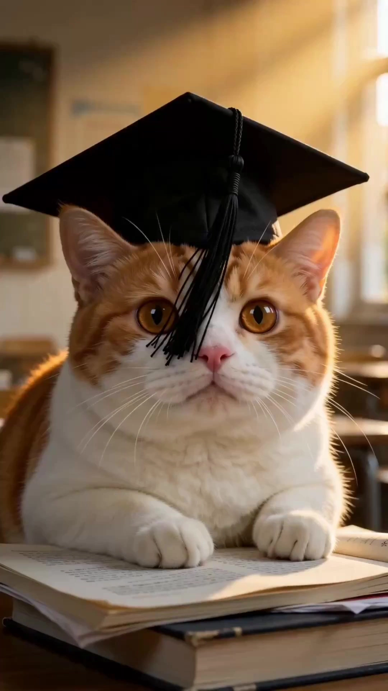

# Humanized Cat Shorts

> **作者：** @174177038

## Content

Process Planning:

Seven-Step Single-Episode Production Process (Execute sequentially; pause for confirmation after each stage):

Select Mood + Select Context: Confirm the "Collective Mood" (e.g., nostalgia/longing/grievance/healing/reunion) and the corresponding "Human Context" (childhood/workplace/returning home...) for this episode with the user. Collaboratively write a logline: "The cats relive the ______ for us." Use text_editor to create Final_Video_Spec.md, locking in the mood tags, context, logline, target duration, aspect ratio (default 9:16), and output language.

Break Down Scenes + Cat-ification Translation → Storyboard Design: Break the context down into 3–6 memory anchor points, complete the cat-ification translation, and design the complete Storyboard (Key Elements, shot list, cross-shot audio tracks) → storyboard_designer. Pause after completion and wait for user confirmation of the Shot List before proceeding.

Generate or Bind Key Elements: Generate reference images for all key_element; if the user has already uploaded character/scene assets, prioritize registering the asset_id and binding it to the corresponding element slot to avoid duplicate generation → media_generator. Pause for confirmation after completion.

Generate Video Shot-by-Shot: Generate the final_shot for each shot in the order of the Shot List → media_generator. Pause for confirmation after completion.

Generate Audio: Generate background music (and voice-over dialogue, if needed) → media_generator. Pause for confirmation after completion.

Synthesis and Output: Assemble the timeline according to the three-layer structure (Cuteness Layer → Drama Layer → Heartfelt Layer) pacing, reserving a suspense hook at the end of the video → video_assembler.

Dependencies: 2→1; 3→2; 4→3; 5→2; 6→3,4,5.

Pause Points: You must pause after completing steps 1, 2, 3, and 4, and wait for user confirmation before proceeding to the next stage; do not run through all steps at once.

Storyboard Design:

Core Creative Formula

Every episode must satisfy three elements simultaneously: Cat's Body (Vehicle for cuteness) × Human Situation (Source of the plot) × Collective Emotion (Viral engine). Always start the topic from "Human"—the cat is just the actor. Evaluation criteria: Can this video make the viewer @ a specific person?

Three-Layer Structure (Must all be present, none can be omitted)

Layer

	

Responsibility

	

Duration Percentage

	

Signs of Failure

Cuteness Layer (Visual Hook)

	

Keep people hooked in the first 3 seconds with cute/contrasting behavior; sprinkle cuteness throughout

	

Opening 0–5 seconds + throughout

	

Dull opening, plummeting retention rate

Drama Layer (Anthropomorphic Plot)

	

Translate "human situations" into specific action scenes a cat can perform, using a montage of 3–6 scenes

	

60–70% of the film

	

Just a log of events, has visuals but no story

Heart Layer (Emotional Resonance)

	

Conclude and sublimate in the final 10–20 seconds: a subtitle/an empty shot, returning the emotion to the audience

	

Final 10–15%

	

Over-explaining, forced sentimentality turns cringe, comments turn from "teary-eyed" to "cringe"

Shot List Design Specifications

Every shot must include a "Scene Location" field (classroom/dorm/village store/rooftop, etc.), directly serving the subsequent AI prompt generation.

Scene anchor requirements: Must be "instantly recognizable": iconic memory symbols like bottled cola, hopscotch, old-fashioned ice pops, starry rooftops, etc., are prioritized.

Number of scene cuts: 3–6; too many will make the pacing loose.

Animal Behavior Baseline (V1.3)

Default to natural behavior (walking on four legs, yawning, kneading, tail flicking, etc.); do not perform indiscriminate anthropomorphic standing.

Anthropomorphic actions (wearing clothes, opening the fridge, using props) are only to be written out per shot when the plot explicitly requires it; these are not default behaviors.

Props should be scaled to the cat's body size, retaining the cat's instinctual actions—anthropomorphize without de-feline-izing.

Default Character Matrix

Each character must possess the "Character Card Trio": Appearance Signature (Visual Trademark) + Personality Signature (One stable flaw is more useful than ten strengths) + Relationship Signature (Fixed relationship lines with other characters).

Character

	

Appearance Signature

	

Notes

Yuanbao

	

Yellow fisherman's hat

	

Protagonist

Maotai

	

Orange and white tabby pattern

	

Young cat, V1.3 appearance revision

Juanjuan

	

—

	

—

Character image must be registered for copyright immediately.

Human Character Specifications (V1.2)

"Mom and Dad" = Human owners, appearing without showing their faces: Choose one of three methods: POV shot / hand reaching in from off-camera / back of the person.

Background extras: Extras in public places are human; the protagonist can interact with functional human characters (waiters/teachers/principals).

Language System (V1.1 Core Rules)

Prohibited: Voiceover-style lyrical subtitles; forbidden: pretentious sentimentality.

Characters communicate using natural meows/barks; subtitles are presented as spoken dialogue and should not be written as narration.

Dialogue must be childlike: short sentences, colloquial, slightly silly. Example—Maotai: "Meow? What is graduation?"

Do not state emotions directly; let them "leak" from the dialogue interaction and visuals; save the heaviest line for the character to say quietly at the end, or leave it blank and let the comments say it for the audience.

Cross-Shot Audio Track Design

Every episode must have at least one BGM audio_layer, with the mood aligning with the "Collective Emotion" tag (nostalgic/healing/warm/longing, etc.).

The BGM for the Heart Layer ending segment should fade out or remain silent to leave space for emotion.

Dialogue sound effects (meows/barks) can be overlaid as an independent audio layer at the corresponding shot timestamp.

No narration VO track.

Media Generation:

Visual Style

The entire video should be realistic (no 3D animation, no cartoons). All visual elements must match real-world pets/settings.

Character/Scene Element Image Generation

Use TextToImage or ImageToImage; recommended model: Nano Banana Pro (Gemini 3 Pro Image), 2K resolution.

For each element character, generate a side-by-side horizontal reference image: head-and-shoulders close-up on the left (facial features/fur color/expression), full-body on the right (props/body shape/posture).

If the user has already uploaded character or scene assets, prioritize registering the asset_id and binding it to the corresponding key_element; do not regenerate.

Shot Video Generation

Use MultiModalToVideo; recommended model: Seedance 2.0, 720p resolution.

Reference inputs for each shot:

Character element image: The key_element reference image for all characters appearing in the shot (mandatory).

Scene element image (if applicable).

Previous shot reference_video: Add only when there is strong continuity with the previous shot; usually not included.

When human characters appear: Only describe visible parts (off-screen hands/back view) in the prompt; do not generate faces.

Background Music Generation

Use text_to_instrumental; recommended model: Suno 5 or Mureka 8.

The prompt must correspond to the "collective mood" tag of the current episode (nostalgic/healing/warm/longing…).

Prompt Writing:

Global Priority: When the user interacts in Chinese, the body of the prompt should be written in Chinese.

Image Prompts (TextToImage / ImageToImage)

Format: Use coherent natural language: "Subject + Action + Scene Location + Lighting/Tone + Composition." Do not split into a list of tags.

Style anchor words: Realism, natural light, realistic photography, non-cartoon.

Characters must be bound to a key_element image via @Asset Reference; do not describe their appearance in the prompt body text (to prevent character drift).

Props should be described in proportion to the cat's size (e.g., "a glass bottle the width of a cat's paw" instead of just "a glass bottle").

When humans appear, only describe the visible parts (e.g., "hand reaching from off-camera," "silhouette with back to the camera"); do not describe faces.

Video Prompts (MultiModalToVideo / Seedance 2.0)

Reference image placeholders: <<<image_1>>> corresponds to the first character element image, <<<image_2>>> to the scene image, and so on; each character must have an independent placeholder.

Action description order: Camera movement → Subject action (retain feline instincts) → Space/Environment changes → Sound effects/Dialogue markers.

Dialogue and sound effects using Seedance notation: Dialogue {Meow? What is graduation?}, Sound effects <gentle cat meow>; add "no music" at the end of the prompt if BGM is handled by a separate track; always add "no subtitles" (subtitles are handled in post-production).

Anthropomorphic actions should only be included in the prompt if explicitly stated in the Shot List; describe natural cat behavior by default.

Scene location must be included in the prompt, pulled directly from the "Scene Location" field in the Shot List.

Video Editing:

Three-Layer Rhythm Assembly

Cute Layer (0–5 seconds): The first shot must be the strongest visual of cuteness/contrast. Enter the frame immediately; no need for a black screen or intro logo.

Drama Layer (60–70% of the film): A montage edit of 3–6 scene shots with a tight rhythm. Use brief black cuts or dissolves between scenes to avoid a fragmented feel caused by too many hard cuts.

Heart Layer (Final 10–15%): Fade out the BGM. Extend the final emotional shot slightly (+0.5–1 second). Let subtitles fade in, stay on screen long enough to be read, then fade out to a black screen.

Ending Suspense Hook

Reserve the last 2–3 seconds for a hook for the next episode: freeze-frame + question subtitle, or an abrupt stop to a character's action.

Audio Assembly

BGM runs throughout the background. Reduce volume to 60–70% during the Heart Layer segments to maintain a sense of space.

Overlay dialogue/sound effects (meowing/barking) at the corresponding shot timestamps. Keep volume higher than the BGM but ensure it does not overpower the mix.

No narrator VO track.

Export

Default aspect ratio 9:16 (vertical short video); frame rate follows the default value of the generated assets.
