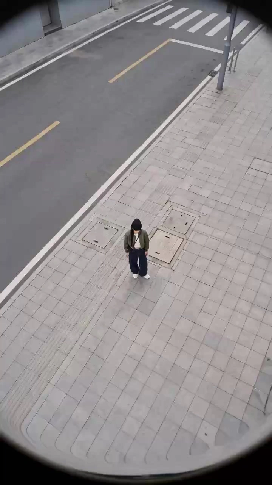

# INS Subject-Anchor Zoom Transitions

> **作者：** @The Lab

## Content

Process Planning:

Upon receiving the user's uploaded character image, complete the task in the following order: Step 1: Confirm Input Assets Identify the main character image uploaded by the user and use it as the sole reference for character identity and attire. Do not ask the user for additional character images unless the original is severely blurred, the character is completely obscured, or it is unrecognizable. Step 2: Analyze and Establish Character Anchors Extract details regarding face shape, facial features, hairstyle, hair color, clothing structure, clothing color, shoes, bags, glasses, accessories, body proportions, and overall temperament. Set the character as the unique visual anchor throughout the entire video. Step 3: Complete Character Reference If the user's image is not a full-body shot, first perform a natural expansion to fill in reasonable body, leg, and shoe details. Based on the original image, create a reference for the same character in the following perspectives: full-body front view, close-up front view, slight high-angle, slight low-angle, and front-side view. All completed content must continue the clothing and character features from the original image; do not redesign the clothing. Step 4: Generate Storyboard Design 6 shots by default, with each shot lasting approximately 1–1.5 seconds. Achieve visual matching between shots using the character's face, body center, glasses, bags, or similar poses. The storyboard should focus on describing shot scale, camera angle, camera movement, character positioning in the frame, and transition points; do not design complex plot lines. Step 5: Generate Keyframes First, generate stable vertical keyframes for each shot. All keyframes must use the same character reference and the same outfit to ensure the character remains recognizable in every shot. Step 6: Generate Dynamic Shots Based on the storyboard, generate shots including quick zoom-ins, quick zoom-outs, high-angle descending shots, low-angle ascending shots, slight pans, and wide-angle tracking shots. Assign only one primary camera movement per shot to avoid overly complex actions within a single shot. Step 7: Check Continuity Check the character's face, clothing, bags, glasses, hands, body proportions, and background space. If character inconsistencies are found in specific shots, regenerate only the failed shots; do not discard other shots that are already acceptable. Step 8: Finalize Editing Complete speed adjustments according to the music rhythm, perform hard cuts matched to character anchors, add sound effects and color grading, and finally output the complete vertical video. By default, complete the entire process directly without waiting for user confirmation at each step. If the user explicitly requests "Show me the shot list first," pause after generating the storyboard and wait for user confirmation before generating the video.

Asset Analysis:

When analyzing user-uploaded images, focus on extracting the following information:

Character Identity Traits Face shape, facial feature proportions, eyebrows/eyes, nose, mouth shape, skin tone, makeup, age appearance, and overall aura.

Hairstyle Traits Hair length, color, bangs, part, curliness, and any hats or hair accessories.

Clothing Traits Fit, material, color, layering, and style of tops, outerwear, bottoms, or dresses.

Accessory Traits Glasses, earrings, necklaces, watches, rings, bags, phones, and shoes. Do not add random accessories not present in the original image.

Character Proportions Head-to-body ratio, shoulder width, waistline, leg proportions, and overall posture. While different camera angles may create reasonable perspective changes, the basic character proportions must remain consistent.

Original Composition Determine if the shot is a close-up, medium shot, or full-body shot. If legs, shoes, or parts of clothing are missing, use outpainting to complete the image rather than cropping the character.

Replaceable Content Original backgrounds do not need to be preserved. They can be replaced with original urban streets, building entrances, modern facades, street corners, parking areas, or cafe exteriors. The background should only provide an Instagram street-style vibe and must not distract from the character.

Character Consistency All shots must be tied to the same character reference. Maintain consistency in face, hairstyle, clothing, bags, and key accessories. Avoid generating second characters, doppelgangers, or background pedestrians obstructing the subject.

Asset Usage Principles User images are for character and outfit reference only. Do not simply scale or reuse static images as video. Regenerate dynamic footage with realistic spatial perspective and camera movement.

Storyboard Design:

Default design for an 8-second, 9:16 vertical, 6-shot Instagram urban street-style short video featuring push/pull transitions. The video has no specific plot; the focus is on showcasing a character's outfit and camera movement changes across multiple original urban environments.

Shot 1: Street-level push-in (Front view) Duration: approx. 1.3 seconds. Character stands full-body in front of an urban shop, café, or building entrance. Character is centered or slightly off-center, holding a phone or naturally adjusting a bag. Camera starts as a full-body wide shot, zooms rapidly with ultra-wide angle towards the character, ending in a medium-close up or close-up on the chest or face. Character looks at the camera with natural, restrained movement. By the end of the shot, the character's face, glasses, or torso should occupy the center to provide a match point for the next shot.

Shot 2: High-angle overhead close-up Duration: approx. 1.2 seconds. Transition to an original street, roadside vehicle, or sidewalk scene. Camera starts from a high angle looking down, rapidly descending and moving closer to the character. Character's orientation and face angle should match the end of the previous shot as much as possible. Use slight fisheye and wide-angle perspective to create a strong sense of space. End with the character adjusting glasses, looking up, or approaching the camera.

Shot 3: Low-angle architectural up-shot Duration: approx. 1.4 seconds. Character is positioned against a modern building facade, pillar, or geometrically structured entrance. Camera starts at a low angle near the character, quickly moves in, then slightly zooms out or moves laterally. Building lines create strong depth; character remains in the visual center. Slightly tilted composition is allowed, but do not distort the character. Character performs subtle movements like turning the head, taking a small step, or adjusting clothing.

Shot 4: Street corner lateral push/pull Duration: approx. 1.3 seconds. Scenario switches to an original street corner, parking area, or building side. Camera quickly moves laterally from the side-front and orbits to the front of the character while slightly pulling out. Character's face height, body center, or bag position must match the previous shot. Needs to feel like a handheld street photographer tracking shot, but avoid excessive shakiness.

Shot 5: Top-down overhead reveal Duration: approx. 1.2 seconds. Camera is above the character, starting with a close-up overhead shot, then rapidly pulling away or circling slightly. Character looks up at the camera, maintaining a stable stance or taking a slow step forward. Use road markings, building edges, or ground patterns to create a graphic effect. Character remains in the center of the frame at the end.

Shot 6: Building entrance front-view finale Duration: approx. 1.5 seconds. Character stands in front of an original building entrance, dark storefront, or urban street. Camera moves rapidly from a wide shot to a medium or close-up. Character naturally turns, adjusts glasses, puts down the phone, or swings the bag slightly. Last 0.3 seconds should decelerate and stabilize, clearly showing the character's outfit and face. No text at the end; allow for a natural pause.

Transition Rules: All shots use the character as an anchor point. Prioritize matching face position, head size, body center, glasses, bag, or similar poses. Transitions occur at the point of peak camera movement speed. Use character-scale matching cuts, rapid zoom cuts, pull-out transitions, or directionally consistent motion cuts. Do not use standard fades, page turns, particle dissipation, magic effects, or templated transitions.

Media Generation:

Media Generation prioritizes character consistency, followed by background complexity and camera movement.

I. Character Reference Setup Bind the user-uploaded image as the reference for the main character throughout the video. If the original image is not a full-body shot, first generate a natural full-body character reference. The facial features, hairstyle, clothing color, and clothing structure of the completed image must match the original.

II. Keyframe Generation Generate portrait-oriented keyframes for 6 separate shots. Use a 9:16 aspect ratio for all keyframes; 1080×1920 or the highest vertical resolution supported by the current model is recommended. The character must maintain the same identity, clothing, and accessories in every keyframe.

III. Scene Generation Use original modern city streets, cafe exteriors, building entrances, geometric facades, street corners, or parking areas. Scenes can vary, but should maintain the feel of the same city, same day, and similar weather. Avoid tourist attractions, famous landmarks, recognizable brand stores, and identifiable commercial logos.

IV. Video Model Selection Prioritize video models that support character reference consistency, start/end frame control, strong camera motion, and vertical output. Set character reference weight to high and camera motion intensity to medium-high. Do not force characters to perform exaggerated walking, jumping, or wide waving just to increase motion.

V. Single Shot Generation Generate approximately 1–1.5 seconds of video footage for each shot. Each shot should contain only one primary camera movement: Fast zoom in; Fast zoom out; High-angle descent; Low-angle ascent; Slight orbit; Horizontal pan.

VI. Continuity Control Reuse the same character reference, clothing description, and character identity keywords for all shots. The ending position of the character in each shot must match the starting position of the next. Prioritize facial stability; avoid excessive motion blur that obscures facial features.

VII. Music and Sound Effects Default to instrumental electronic, light Hip-hop, or urban-style music with no lyrics, clear beats, and a fashionable feel. Music should not be overly dramatic or feel like a skit. Add subtle whoosh or air-movement sound effects at each fast zoom/pan and hard cut. Sound effect volume should be lower than background music and not overpower the overall rhythm.

VIII. Prohibited Content Do not generate subtitles, titles, stickers, borders, watermarks, or random brand text. Do not add irrelevant characters. Do not randomly change clothing. Do not generate exaggerated surreal transformations, teleportation light effects, explosions, smoke, or particle effects.

Prompt Writing:

When generating images and videos, prompts must be organized in the following order: Character Identity Lock + Clothing and Accessories Lock + Original Urban Environment + Shot Size and Camera Position + Camera Movement + Subtle Character Movement + Lighting and Tone + End-of-Shot Match Position + Consistency Constraints and Negative Constraints Use English for video model prompts to ensure stable execution of camera movement instructions; storyboard descriptions can be in Chinese. Each shot prompt must repeatedly emphasize: same person as the reference image; identical face; identical hairstyle; identical outfit; identical accessories; consistent body proportions; subject remains recognizable throughout the shot. Prioritize the following keywords for cinematic language: Instagram fashion reel; urban street style; ultra-wide angle lens; subtle fisheye perspective; fast dolly in; rapid pull back; crash zoom; speed ramp; high-angle tracking shot; low-angle tracking shot; dynamic handheld camera; subject-centered composition; match cut on the subject; snap transition; editorial fashion cinematography. Reference structure for single-shot prompts: Same person as the uploaded reference image, identical face, hairstyle, outfit, bag and accessories. The subject stands in an original modern urban street environment. Vertical 9:16 Instagram fashion reel, ultra-wide angle lens with subtle fisheye perspective. The camera starts from a full-body wide shot and performs a fast smooth dolly-in toward the subject's face. The subject makes a small natural movement and looks toward the camera. Muted cool-gray and beige color palette, soft overcast daylight, editorial street-fashion photography. End with the subject's face centered and filling the frame, prepared for a subject-matched hard cut. Maintain identity and clothing consistency throughout the entire shot. Replace the scene, shot size, and camera movement according to the storyboard for each shot, but do not change the fixed character description. Negative prompts must uniformly include: different person, face change, identity drift, different hairstyle, outfit change, additional accessories, duplicated person, extra limbs, distorted hands, warped face, unstable body proportions, changing bag, changing glasses, random text, logos, watermark, excessive motion blur, melting background, floating objects, sudden body movement, slow cinematic pan, fantasy effects, particle transition, dissolve transition. Avoid vague instructions like "move camera" or "maintain character consistency." You must explicitly state where the camera starts, how it moves, where it ends, and the character's position for matching with the next shot.

Video Editing:

Final Video Editing Specifications: Aspect Ratio: 9:16. Recommended Duration: 7.5–8.5 seconds. Number of Shots: Default to 6. Output Frame Rate: Prioritize 30fps or the native frame rate of the generated footage. No subtitles, voiceovers, or intro/outro text.

Editing Rhythm: Each shot should be approximately 1–1.5 seconds. Use the first 0.1–0.2 seconds to quickly establish the character and scene. Mid-shot, incorporate rapid zooming in/out, downward pans, or orbital movements. Hard cut to the next shot at the peak of the motion speed. Hold the final shot for about 0.3 seconds of stable footage to conclude.

Speed Handling: Use clear yet smooth speed ramps. Use a structure that starts at normal speed, accelerates, and then slightly decelerates at the end. Avoid constant speed throughout and jerky transitions. Speed up when the character's face nears the camera; return to normal speed briefly after transitioning to the next shot.

Transition Handling: Primarily use match-on-action hard cuts based on character anchors. Ensure character head height, face position, body center, or bag placement remain consistent across transitions. Only use 2–4 frames of slight motion blur if necessary to aid the transition. Do not use fades, blackouts, white flashes, page rotations, glitch effects, particle dissolves, or pre-made template transitions.

Shot Direction: Maintain continuity in zoom direction, character line of sight, and body orientation across adjacent shots. Avoid consecutive shots with completely opposite directions to prevent viewer confusion.

Visual Style: The overall aesthetic should be restrained, premium, urban, and Instagram street-style fashion. Use a color palette of gray, beige, black, desaturated green, and natural skin tones. Moderate contrast and vignetting are acceptable, but do not make the character's face too dark. Retain a slight handheld feel and ultra-wide-angle perspective; avoid the over-stabilized look of standard commercial promos.

Music Sync: Align character match cuts with music beats, hits, or significant rhythmic changes whenever possible. Add subtle whoosh sound effects during rapid zoom-ins and zoom-outs. End the final shot naturally with the music rhythm; avoid long fades.

Quality Check: Before output, check every shot for face, hairstyle, clothing, bags, glasses, hands, and character proportions. If only one shot has face swapping, clothing errors, or major hand issues, regenerate only that specific shot. Do not change the entire shot list or character settings just because a single shot failed.
