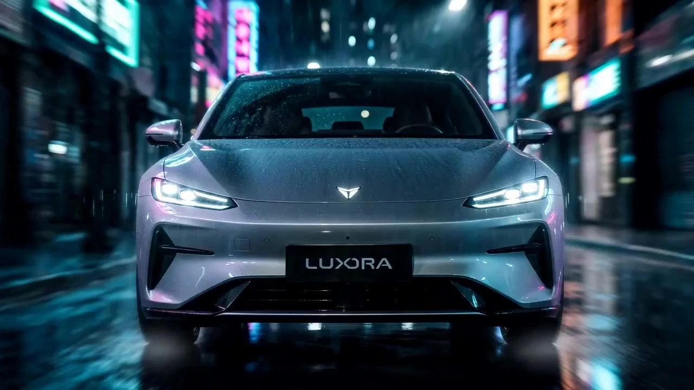

# Image-to-Beat Motion Video

> **作者：** 阿娴AIGC

## Content

**Process Planning:**

**Global Planning and Multi-Agent Collaboration:**
1. **Lock Global Specification Parameters**: Prioritize calling **text_editor** to create Final_Video_Spec.md, with initial entry: duration 18 seconds (can be overridden by user when TVC Mode is enabled, up to 30 seconds); aspect ratio adaptive to original image or default 9:16 vertical; execution mode (TETO Dynamic Mode / Product TVC Mode, confirmed after step 1.5); visual style and audio strategy written according to the selected mode; TETO default style is "dark, morbid film texture, high-contrast cool cyan cinema grading, explosive bass beat-sync, high-end glitch style"; TVC Mode default style is "Morandi low-saturation soft light, high-end gray grading, smooth zoom macro display"; TETO Mode disables steady camera movement, soft dissolves, and excessive skin smoothing; TVC Mode disables hard cuts, strong motion blur, and high-contrast color flickering.

2. **Pre-analysis of Reference Image**: Call **resource_prepare_and_analyze** to perform subject type identification on the reference image (PRODUCT / ARCHITECTURE / LANDSCAPE / ANIMAL / HUMAN / VEHICLE), outputting pixel-level anchor coordinates (single point, not area or axis). Once completed, display the recognition result to the user and request confirmation of the anchor point; if the user is unsatisfied, manual specification of any point is supported.
   2.5. **Mode Selection (Triggered only for PRODUCT type subjects)**: If the recognition result is PRODUCT, before completing the background quality assessment, the Planner pauses and uses cards to ask the user to select the execution mode (Product TVC Mode / Default TETO Dynamic Mode); after selection, the execution mode is written to Final_Video_Spec.md, and all subsequent modules will execute according to the corresponding mode; non-PRODUCT subjects directly continue with TETO Dynamic Mode, skipping this step.
   2.6. **Background Quality Assessment and Scene Replacement (Optional, triggered as needed)**: If **resource_prepare_and_analyze** determines the background is poor, the Planner pauses and uses cards to ask the user whether to replace the background (choice of two: Replace / Keep original background).
   - **Select Replace**: Call **media_generator** (TextToImage) to generate 3 candidate scene backgrounds based on the subject type, then provide them via cards for the user to select (including an "AI Automatic Best" option); after selection, call **media_generator** (ImageToImage) to composite the subject with the new background, and display the composite preview for the user to confirm; after confirmation, the composite image replaces the original image as the visual foundation for Element_Subject_01, and all subsequent generation steps use the composite image.
   - **Select Keep**: Skip this step directly and continue using the original image.
   - **LANDSCAPE Subject Type Forced Skip**: Panoramic aerial images do not undergo background replacement; the original image is retained.

3. **Automatic Audio Source Determination (Seamless processing, no user selection required)**:
   - **User Has Uploaded Audio**: Call **resource_prepare_and_analyze** to perform BPM determination, prelude drop point localization, and kick drum beat timestamp extraction; if identified as 93BPM Dark Trap, the exclusive beat-sync preset is automatically enabled, **the prelude buildup segment is fixed at 5s**, and the montage segment is fixed at 13s (aligned with the 93BPM exclusive timeline of the Shot List design module); other BPM tiers: ambient segment duration = prelude end point (min 2s, max 5s, default 3s), montage segment = 18s minus ambient segment duration. If duration < 18s, the tail is looped to fill (pitch maintained); if > 18s, 18s is cropped from the strongest energy point. If analysis fails, revert to default timeline (Ambient 0–3s / Montage 3–18s, drop points 11s / 13.5s / 16s).
   - **User Has Not Uploaded Audio**: Call **media_generator** (text_to_instrumental) to automatically generate 18s TETO-specific electronic BGM (structure: 0–3s no-beat soothing segment / 3–18s BPM=120 fast-paced segment); ambient segment fixed at 3s, montage segment fixed at 15s; no user intervention required; if the user is dissatisfied later, they can request regeneration (up to 3 times).

4. **Build Structured Storyboard**: Call **storyboard_designer** to match exclusive camera logic based on the identified subject type, planning a two-stage 18-second Shot List (setup segment + high-speed montage segment) and 1 music track.

5. **Asset Binding and Shot List Generation**: Call **media_generator**: Register the main image asset_id and bind the Key Elements; generate video clips sequentially according to the Shot List; prompts fully integrate visual constraints such as pixel-level anchor focus locking, cool cyan film grading, and dark region crushing.

6. **Timeline Assembly and Effect Rendering**: Call **video_assembler** to assemble according to drum beat timestamps, executing variable speed, hard cuts, spherical distortion, RGB dispersion, white flash, and vignette effect chains; force anchor deviation ≤ 2px throughout, outputting a complete 18-second final video.

7. **Super-Resolution Enhancement (Optional)**: After **video_assembler** completes the full video output, **media_generator** (super_resolution · MediaKit) can be called to perform one overall super-resolution enhancement on the final video; select parameters according to the subject type resolution table and BPM tier frame rate table in the media generation module. If the user cares about generation speed or has no membership, this step can be skipped.

**Human-Machine Collaboration and Confirmation Nodes:**
- **Node 2.5 (Mode Selection, PRODUCT subject only)**: After subject identification is complete, use cards to ask the user to select an execution mode—Product TVC Mode (high-end, soothing rhythm, Morandi grading) or default TETO Dynamic Mode (high contrast, explosive fast cuts); after user selection, it is written to Final_Video_Spec.md and cannot be skipped; if the user also declares a custom duration (15–30 seconds), it is written together to override the default 18 seconds.
- **Node Zero**: After background quality assessment is complete, if determined to be poor, pause and use cards to ask if the background should be replaced; if replacement is chosen, display 3 scene candidates for the user to choose from, generate the background, and perform composition, then pause again to display the composite preview; only proceed after the user confirms satisfaction; user confirmation must not be skipped during the entire process. If the background is determined to be high quality or the user chooses to keep it, this node is silently skipped.
- **Node One**: Pause after anchor recommendations are complete, display anchor position preview, and ask the user to confirm or manually override; after confirmation, continue execution without any other audio operations.
- **Node Two**: Pause after the Storyboard is complete, display the planning brief (subject type, anchor coordinates, camera plan, rhythm distribution), and use cards for the user to confirm the special effects intensity (Normal / High-Energy / Berserk).
- **Node Three**: Generate preview after final rendering is complete, and guide the user to click "Save and Activate" in the upper right corner to use this Skill in an actual project.

**Asset Analysis:**

**Subject Type Identification and Camera Angle Label Output:**
Perform subject classification on the reference image uploaded by the user and output corresponding camera angle adaptation labels:
- **PRODUCT (Product still life)** (shoes/clothing, cups, digital, ornaments, etc., desktop individual items) → Label PRODUCT; eye-level slightly overhead 45° e-commerce angle, vertical top-down and long-distance wide-angle prohibited.
- **ARCHITECTURE (Architectural scenes)** (buildings, historical buildings, landmarks, interior structures) → Label ARCHITECTURE; low-angle looking up + eye-level depth composition, small amount of medium-shot eye-level.
- **LANDSCAPE (Scenery/outdoor)** (mountains/water, city panoramas, wilderness, natural scenes) → Label LANDSCAPE; full-process high-altitude aerial view, close-up macro and low-position face-to-face shots prohibited.
- **ANIMAL (Animals/pets)** (cats, dogs, and various cute pets) → Label ANIMAL; ground-level eye-level, level with animal eye height, tracking camera movement.
- **HUMAN (People/portraits)** (people, portraits, human figures) → Label HUMAN; standard portrait composition, eye-level + slightly looking up, focus on facial features and posture, avoid deformed perspective.
- **VEHICLE (Traffic)** (motorcycles, sports cars, cars, etc.) → Label VEHICLE; low-position ground-level looking up + side-level angle, highlighting the tension of the low car body lines.

**Background Quality Assessment:**
After completing subject type identification, perform quality determination on the background area. If any of the following conditions are met, it is determined as "poor background," triggering the background replacement inquiry process in Planner Node Zero:
- **Cluttered Background**: The background contains obvious debris, irrelevant text, watermarks, dense lines, or irrelevant objects, interfering with the subject's visual focus.
- **Dull Lighting**: The background lacks contrast layers, the overall exposure is uniform and flat, and it lacks dramatic light and shadow structures.
- **Color Mismatch**: The background color is dirty, color-cast, or creates an uncoordinated conflict with the subject's tones, making it difficult to support the cool cyan film grading style.
- **Lack of Spatial Layers**: The background is a solid-colored wall, white paper, monochrome cloth screen, etc., with no depth/sense of space, which is unfavorable for surround camera movement display of depth.
- **User Manual Tagging**: The user actively requests to change the background during interaction (reserved interface, highest priority).

Output the determination result as a Boolean (Poor Background: Yes / No) and a brief explanation of the reason for Planner to decide whether to trigger Node Zero. **LANDSCAPE subject types are forced to skip this assessment and directly output "No".**

**Pixel-level Anchor Point Positioning (Single point, not area/axis):**
Anchor points must be a specific pixel coordinate (x_anchor, y_anchor) on the image, automatically selected according to the following priority:
1. **High-Contrast Edge Intersection**: Such as the sharp corner of a car headlight edge, the tip of a car logo, a product logo corner, or the vertex of an architectural ridge.
2. **Highlight Point**: Metal reflection center, water drop highlight, pupil highlight point.
3. **Geometric Feature Point**: Screw center, wheel hub center, pupil center, geometric center of the product brand pattern.
4. **Subject Visual Center of Gravity** (Fallback when the first three have no significant feature points): Character brow center, animal nose tip, center intersection of architectural main facade, visual focus of scenery horizon.

**LANDSCAPE Aerial Anchor Exclusive Logic (Graded fallback strategy when large scenes lack obvious physical anchors):**
Because landscape/outdoor subject types have diffused image information and lack close-range hard edges, anchor selection must follow this priority, falling back level by level until a unique anchor coordinate is determined:
- **First Priority: Iconic Landmarks**—If the image contains single and position-stable landmarks such as an isolated mountain peak top, lighthouse spire, island highest point, or the water entry point of a waterfall's core water column, directly use its visual top or geometric center as the anchor; this type of anchor has high contrast and is stable across perspectives, with the highest priority.
- **Second Priority: Light and Shadow Convergence Point**—If there are no iconic landmarks, find the most intense light focus area in the image: such as the tangent point where the sun touches the horizon at sunset/sunrise, the strongest reflection center (glint center) on the water surface, or the ground drop point of light beams penetrating clouds (god rays); select the brightness peak pixel coordinate.
- **Third Priority: Geometric Convergence Point**—If there is no light/shadow convergence, identify the perspective vanishing point or the intersection coordinate of visual guidance lines in the image: such as the vanishing direction of winding rivers, the vanishing point of extending roads, or the visual convergence point of terraced fields/contour lines; select the estimated coordinate where lines intersect.
- **Fourth Priority: Color Density Center**—If the first three levels cannot locate the point, calculate the geometric center of the 100×100px area in the image with the most concentrated color saturation and brightness contrast as the anchor; this usually corresponds to the vegetation boundary or the high-contrast area at the water-land boundary.
- **Final Fallback: Golden Ratio Intersection Point**—When the overall image is flat and has no visual focus features (such as minimalist sea of clouds, homogeneous desert, calm lake), automatically take the **upper-left golden ratio intersection point** of the image (approx. x × 38.2%, y × 38.2%) as the default anchor; simultaneously explain to the user that the image lacks significant anchor features and recommend manual specification or using a local close-up area as reference image input.

**LANDSCAPE Anchor Auxiliary Rules:**
- All aerial camera movements must keep the anchor point continuously visible (must not fly out of the frame). Even in 360° global surround segments, the anchor must be kept centered through lens rotation rather than translation; if camera movement in a certain direction causes the anchor to exceed the frame, the surround angle in that direction must be limited within the anchor visibility threshold.
- When the golden ratio fallback anchor is in effect, the Shot List design module must limit the limit dive times of the montage segment to no more than 2 (to avoid pull-ins in non-anchor areas exposing image emptiness), and the rest of the duration is filled with high-altitude lateral movement and large-arc slow-speed surrounding.

Output anchor pixel coordinates and selection rationale explanation, and confirm with the user; the user can manually click any point to override. After confirmation, the anchor is solidified and will not change throughout the process.

**Music Rhythm and Attribute Extraction (Executed only when the user has uploaded audio):**
- **Audio Feature Analysis**: Through multi-dimensional feature recognition of the audio, output the following structured audio signals:
  - Audio BPM (Beats Per Minute) and time signature (e.g., 4/4 time).
  - Precise prelude end point timestamp (identified as the first strong beat or audio energy surge point, limited to 2s–5s; if not identified, defaults to 3s; 93BPM Dark Trap fixed at 5s).
  - Start point and strong beat drop point of the climax/chorus segment.
  - Extract transient energy drop points on the timeline for specific timbres or lyrics such as high-contrast kick drums (Kick), hi-hats (Hi-hat), and vocals, outputting a complete set of strong transient drum beats and key beat timestamp axes.
  - For special music styles (such as 93BPM Dark Trap containing vocal lyrics "I know my guy" and "I'm in cheetah"), additionally output the corresponding key vocal start and end timestamps.
- **Data Output and Alignment**: Only output objective timestamp axis data. It does not contain any execution rules such as editing speed changes, lens switching, or special effect triggers, leaving it entirely to the timeline assembly module (**video_assembler**) to read and process.

**When the user has not uploaded audio, this module only performs subject analysis on the reference image and skips the music parsing process.**

**Storyboard Design:**

**Design Key Elements (key_element):**
- Register the reference image uploaded by the user as a Key Element (ID: Element_Subject_01), with the type taken as element character or element scene based on the recognition result.
- The description must fully match the material, color, outline, and geometric center of the original image, and mark the subject type label (PRODUCT / ARCHITECTURE / LANDSCAPE / ANIMAL / HUMAN / VEHICLE) and its 3D anchor position.

**Camera Angle Adaptation Rules (By Subject Type):**
- **PRODUCT**: Eye-level slightly overhead 45°; detail macro close-up (texture/Logo) → Subject centered eye-level → Slightly overhead panoramic outline; small-range surrounding around the object + close-range instantaneous burst zoom.
- **ARCHITECTURE**: Low-angle looking up; low-position looking up to highlight tall tension → Medium-shot eye-level full view → Local line/light and shadow close-up; large-range slow surround + depth instantaneous burst zoom, without distorting architectural perspective proportions.
- **LANDSCAPE**: Full-process high-altitude aerial perspective; high-altitude distant view wide-angle setup → Medium-high altitude progressive dive → Aerial 360° global surround; close-up macro and low-position face-to-face shots prohibited.
- **ANIMAL**: Ground-level eye-level (eye-level with the animal); facial feature macro close-up → Full-body dynamic medium shot → Environment-adapted panoramic view; tracking-style surround + tracking-style instantaneous burst zoom, following the animal's movement trajectory.
- **HUMAN**: Standard portrait composition, eye-level + slightly looking up; eye/face macro close-up → Half-body medium shot → Full-body panoramic view; small-radius posture surround, avoiding deformed perspective, retaining the aesthetic of human proportions.
- **VEHICLE**: Low-position ground-level looking up + side-level angle; car head/headlight detail close-up → Car side profile medium shot → Full vehicle road panoramic view; ground-level surround + forward sprint-style zoom + parallel tracking camera movement.

**Two-stage Shot List Timeline (Universal for all categories):**
- **① Setup Segment (0–3s)**: 1–2 shots, slow horizontal clockwise 180° surround + constant speed push-in (speed approx. 6°/s), panoramic display of the subject and environment; single shot 1.5–2s, no distortion/white flash, only minor RGB color shift (±0.5px); the lens is always centered on the anchor.
- **② High-Speed Montage Segment (3–18s)**: Combine multi-angle high-speed camera movements with the anchor as the center; must cover at least 4 main directions (front, side, back, top-down or looking up), with each direction appearing at least 2 times. **Shot quantity and single-shot duration are precisely allocated according to BPM tiers (see table below):**
  > **The following only supplements exclusive parameters for Shot List planning** (Montage segment available duration, total shot count, allocation formula); BPM tier definitions and single-shot duration benchmarks take **video_assembler** BPM classification rules as the authoritative source and are not repeated here; special effect trigger density and pixel-level special effect parameters are all executed uniformly by **video_assembler**, and Shot List design does not involve such parameters.
  BPM Tier | Montage Available Duration | Default Single Shot Duration | Planned Total Shot Count | Allocation Formula
  --- | --- | --- | --- | ---
  **BPM > 120** (High-Speed Electronic/EDM) | 15s | 0.4s | **Approx. 35–38** | 15s ÷ 0.4s ≈ 37; Reserve 3 climax forced nodes (11s/13.5s/16s) each taking 0.4s, remaining shots filled evenly
  **BPM 80–120** (Standard Rhythm/R&B) | 15s | 0.6s | **Approx. 22–25** | 15s ÷ 0.6s ≈ 25; Up to 3 extended shots (≤0.9s) allowed at weak beats, corresponding reduction in adjacent shot count to fill total duration
  **BPM < 80** (Slow Rhythm Ambience/Lo-Fi) | **13s** (when setup extends to 5s) | 0.8s | **Approx. 16–18** | 13s ÷ 0.8s ≈ 16; Setup segment fixed extension to 5s, montage segment compressed to 13s (consistent with multimodal_analyze_tool BPM<80 additional rules and video_assembler Section 2)
  **93BPM Dark Trap Exclusive** | 13s (climax explosion starts from 5s) | 0.5–2s dynamic | **Approx. 20–26** | Prelude buildup 0–5s: 2–3 slow shots (1.5–2s each); Build-up segment 5–11s: approx. 8–10 (0.6–0.8s each); Climax explosion segment 11–18s: approx. 10–14 (0.4–0.5s each, shortest 0.3s)
  > **Universal Verification Rules**: After planning is complete, verify that the sum of all shot durations = Montage segment available duration (error ≤ 0.2s); if total duration exceeds, prioritize shortening weak-beat shots; if insufficient, randomly add a 0.3–0.5s filler shot at a non-climax node (to maintain rhythm).
  Camera movement types are randomly combined as follows:
  - Rapid Push-in: Speeding from outside to extreme close-up of the anchor
  - Rapid Pull-out: Speeding from extreme close-up to medium shot
  - Rapid Lateral Shift: Horizontal sweep across the anchor (with motion blur)
  - Vertical Surge: Vertical dive/upward surge to the anchor
  - Multi-directional Incomplete Surround: 15°–45° rapid stop/turn with the anchor as the circle center
  - Handheld Micro-shake: Slight jitter while keeping the anchor centered
  - **Climax Forced Nodes** (If audio beat-sync points exist):
    - **11s**: Extreme dive to face (LANDSCAPE uses high-altitude dive) + Spherical expansion distortion.
    - **13.5s**: 360° high-speed surround + four-corner liquefaction stretching.
    - **16s**: Panorama pull-out to conclude, 18s precise closed-loop end.

**Subject Type Exclusive Shot List Tendencies (Overlay execution on top of BPM tier total shot count):**
These rules target visual characteristics of various subjects, adjusting shot scale ratios and camera movement priorities within the total shot count range of the same BPM tier, without changing total duration or beat-sync logic.
- **PRODUCT (Product still life)**
  - Shot Scale Ratio: **Close-up macro 55% / Medium shot 35% / Panoramic outline 10%**; highlight material texture, Logo details, and three-dimensional outline.
  - Camera Movement Priority: Close-range rapid push-in/pull-out ≥ Small-range surround > Rapid lateral shift; diving burst lens restricted to climax nodes (11s/16s), large-scale diving prohibited in daily segments.
  - Each main angle (front, side, 45° slightly overhead) appears at least **3 times**, back view appears at least 1 time; no wide-angle distant view throughout.

- **VEHICLE (Traffic)**
  - Shot Scale Ratio: **Close-up detail 40% / Medium shot vehicle body 40% / Panoramic full vehicle 20%**; capture hardcore details such as headlights, car logo, hub, car body curves.
  - Camera Movement Priority: Low-position ground-level rapid push-in/pull-out ≥ Ground-level 360° surround > Parallel tracking lateral shift; climax segment (11s–18s) prioritizes forward sprint-style push-pull to simulate driving momentum.
  - Each main angle (front of vehicle, front left 45°, side profile, rear of vehicle) appears at least **2 times**, top-down view appears at least 1 time; high-altitude aerial view prohibited.

- **ANIMAL (Pets)**
  - Shot Scale Ratio: **Facial feature macro 50% / Full-body dynamic medium shot 35% / Environment-adapted panoramic 15%**; lock onto cute details like eyes, nose tip, fur texture.
  - Camera Movement Priority: Ground-level tracking rapid push-in/pull-out ≥ Tracking lateral shift > Small-arc surround; montage segment must include at least 2 extremely low-angle upward shots simulating animal perspective (camera height at ground level).
  - Setup segment surround speed slowed to 4°/s (slower than universal rules) to match the lazy/natural temperament of animals; climax dive changed to "ground-level acceleration rushing to nose tip," rather than vertical dive.

- **ARCHITECTURE (Buildings)**
  - Shot Scale Ratio: **Local line/light and shadow close-up 30% / Medium shot full view 45% / Large-range upward panoramic 25%**; present architectural structure layers and depth tension.
  - Camera Movement Priority: Low-position upward rapid push-in depth ≥ Large-range slow surround > Architectural line parallel shift; climax dive changed to "extreme low-position upward surge to architectural top," retaining the erectness of the building, deformed perspective prohibited.
  - Close-up macro prohibited (architecture is not suitable for ultra-close-up face-to-face), closest shot scale does not exceed local line/window grille close-up.

- **LANDSCAPE (Scenery)**
  - Shot Scale Ratio: **High-altitude wide-angle distant view 50% / Medium-high altitude progressive push 35% / Skyline eye-level extension 15%**; maintain aerial perspective throughout, no landing.
  - Camera Movement Priority: High-altitude dive push ≥ Aerial 360° global surround > Skyline shift; climax node (11s) forced execution of high-altitude extreme dive (distinct from other category face-to-face dives).
  - Close-up macro and low-position shots prohibited; setup segment uses high-altitude slow lateral shift (instead of conventional horizontal surround), speed 3°/s.

- **HUMAN (Portraits)**
  - Shot Scale Ratio: **Eye/face close-up 45% / Half-body medium shot 35% / Full-body panoramic 20%**; focus on facial expression, limb lines, and makeup/styling details.
  - Camera Movement Priority: Small-radius posture surround ≥ Eye-level/slightly upward rapid push-in face > Full-body lateral shift shot; avoid ultra-wide-angle close-up (to prevent facial perspective deformation), rapid push-in maximum advancement ratio does not exceed 130% (other categories can reach 140%).
  - Each main angle (front, left/right side 45°, back) appears at least **2 times**; full-body panorama must appear at least 1 time in the setup or ending segment, ensuring complete presentation of human body proportions.

**Product TVC Mode Exclusive Shot List Rules (Only effective when Execution Mode = Product TVC Mode in Final_Video_Spec.md):**
> Under TVC Mode, the following rules completely replace the TETO default Shot List logic (two-stage, high-speed montage, direction coverage forced rules, etc.); color grading, anchor, and audio track design rules are redefined independently of TETO defaults, mixing is prohibited.

**Key Elements Design (TVC Mode):**
- Similarly register the user-uploaded image as a Key Element (Element_Subject_01), and fully record the product's material, color, and outline in the description; additionally mark the **core selling point area** (such as brand Logo position, iconic material texture area, functional components) as anchor candidates for TVC Mode.
- TVC Mode anchors are selected from core selling point areas, rather than prioritized from high-contrast edges or highlight points; if the product has no obvious selling point focus, revert to geometric center.

**Shot Rhythm Design (TVC Mode):**
- **Total Duration**: Use the duration written in Final_Video_Spec.md (default 18s, user can declare 15–30s).
- **Single Shot Duration**: 0.8–2.5 seconds, less than 0.8 seconds prohibited; selling point detail close-ups allowed to stay for up to 3 seconds.
- **Shot Structure (Three-stage)**:
  - **Panoramic Setup Segment (0–30% duration)**: 1–2 shots, full view of product and environment, slow push-in or lateral shift, speed ≤ 6°/s; no special effects, only light soft-focus atmosphere.
  - **Selling Point Display Segment (30%–80% duration)**: 4–8 shots, alternating presentation of product medium shot, material texture close-up, Logo/functional component macro, relaxed rhythm; each core selling point stays for no less than 1.5 seconds.
  - **Conclusion Segment (80%–100% duration)**: 1–2 shots, slow pull-out to panoramic or hold product front close-up, fade out to conclude.

**Camera Movement Rules (TVC Mode):**
- **360° Complete Slow Surround**: Surround clockwise completely and slowly with the anchor (selling point area) as the circle center (speed 6–10°/s); can pause 0.5–1 second at key angles (front, 45° side) to display details.
- **Smooth Push-Pull**: Slowly push in to stay on selling point details (closest distance is texture close-up), then slowly pull back; no acceleration burst curve throughout, constant speed and smooth.
- **Macro Close-up**: Use static macro camera positions for content requiring high definition such as material texture, brand lettering, etc., with no movement; extremely high sharpness, anchor deviation ≤ 2px.
- **Shot Scale Loop**: Panoramic (product + environment) → Medium shot (product subject) → Close-up (selling point detail) appear alternately, continuous three shots at the same scale prohibited.
- **Prohibited Rules (TVC Mode)**: Rapid push-in/pull-out, hard cut jump cuts, handheld jitter, spherical distortion, RGB dispersion, white flash burst, high-speed lateral shift shots; motion blur intensity is extremely low (equivalent shutter angle ≤ 90°), static camera positions completely closed.

**Color Grading and Texture (TVC Mode):**
- Main Color Tone: Low-saturation Morandi tone, automatically matching adjacent colors or complementary background colors based on the product's main color, overall high-end gray tone base.
- Highlights softened, shadows retain slight layers (do not crush to pure black), contrast controlled at low-medium level.
- Optional light film grain (opacity ≤ 3%), used only for texture enhancement, must not be obviously visible.
- High-contrast cool cyan emphasis, color flickering, strong backlight hard light effects prohibited.
- Transitions use **dissolve (0.3–0.5s) or fade in/fade out**, hard cuts prohibited.

**Audio Track Design (TVC Mode):**
- Plan 1 music track, duration consistent with total video duration, **volume controlled below -20dB**, acting as background atmosphere without interfering with visuals.
- Music style tags: Soothing, healing, light business, piano/ambient music, no strong beats, rhythm does not dominate the video.
- If there is a narration (VO) requirement, plan 1 narration type track separately, BGM automatically yields to narration volume.
- Music does not need beat-sync, nor does it need prelude/climax structure design; only serves as emotional background.

**Special Effects Intensity Tier Selection (Node Two User Confirmation):**
After the Storyboard is complete, the user selects the special effects intensity tier (Normal / High-Energy / Berserk) through Node Two cards, written to Final_Video_Spec.md; subsequent **media_generator** and **video_assembler** execute according to the corresponding tier throughout. The three-tier pixel-level parameters (spherical expansion radius, RGB dispersion offset, liquefaction intensity, white flash frames, vignette opacity, handheld jitter amplitude, etc.) take the parameter table in **video_assembler** Section 5 as the only authoritative source; no pixel-level values are listed in this section.

**Camera Movement Core Rules (Global Prohibition):** Constant speed camera movement, soft dissolve transitions, slow-rhythm long shots, fixed static camera positions, excessive skin smoothing. Single movement duration does not exceed 0.8s, movement process must have motion blur; slight real handheld jitter overlaid throughout.

**Camera Movement Exaggeration and Tension Enhancement Rules (Forced execution in montage segment):**
- **Direction Coverage Intensity**: Montage segment must cover all six movement directions below, each appearing at least **3 times** (original minimum 2 times increased): dive/upward surge (vertical), rapid lateral shift/sweep (horizontal), rapid push-in/pull-out (Z-axis forward/backward), incomplete arc surround (15°–90° rapid stop/turn), jump jitter (violent handheld shaking, anchor remains centered); adjacent shots must alternate directions, continuous three shots in the same direction prohibited.
- **Movement Acceleration (Non-constant speed)**: All camera movements must have explosive acceleration curves—rapid push-in first 0.1s slow start, last 0.2s violent acceleration; rapid stop allows slight overshoot before returning (0.05s bounce back); constant speed smooth movement prohibited throughout.
- **Shot Scale Mutation Allowed**: Allowing direct hard cut from extreme distant panoramic to extreme close-up, no transition required, actively creating visual jumping sensation.
- **Motion Blur Layering**: Background/foreground allows strong motion blur during high-speed camera movement; **the core area around the anchor (approx. within 10% radius of the short side of the frame) must remain clear and sharp**, no blurring allowed.
- **Ultra-wide Angle Perspective Distortion**: Default to 24mm equivalent ultra-wide-angle camera position, edge stretching distortion enhances speed sensation; except for portrait (HUMAN) type, limit widest not lower than 35mm equivalent to prevent facial deformity.

**Design Independent Audio Tracks (audio_layers):**
- Plan 1 music type track, duration 18 seconds, precisely mark prelude drop points (general tracks approx. 3s; 93BPM Dark Trap exclusive tracks approx. 5s), vocal entry time points (93BPM exclusive: approx. 5s), and climax triple bursts (11s / 13.5s / 16s) time anchors; non-93BPM tracks do not need to mark vocal recognition trigger rules.

**Media Generation:**

**Asset Binding:**
- Register a unique asset_id for the main image uploaded by the user, bind it as a Key Element (Element_Subject_01) core visual asset; all subsequent video generation uses this original image as the foundation for visual consistency, re-generating subject appearance randomly is prohibited.

**Background Generation and Subject Composition (Optional, executed only when Node Zero background replacement process is triggered):**
**Background Image Generation (TextToImage):**
> The following is the **TETO Dynamic Mode** background scene preset pool, emphasizing dramatic tension and cinematic cool cyan texture; TVC Mode has independent minimalist high-end scene presets, detailed in the "Product TVC Mode Exclusive Generation Strategy" at the end of this section.
- According to the subject type, extract 3 candidate schemes from the following preset scene pool and present them to the user via Planner cards (including "AI Automatic Best" option); generate immediately after selection:
  - **VEHICLE**: Sunset outdoor parking lot warm orange side backlight / City elevated bridge under cool blue night view atmosphere / Cyberpunk style garage neon lighting
  - **PRODUCT**: Minimalist studio gradient gray background soft light / Cyberpunk futuristic metal display stand cool light / Outdoor natural diffused light background
  - **HUMAN**: City rooftop sunset backlight silhouette / Light and shadow art wall side light atmosphere / Minimalist indoor soft light studio
  - **ANIMAL**: Natural grass diffused morning light / Cozy indoor warm yellow background light / Sunny windowsill backlight silhouette
  - **ARCHITECTURE**: Hazy morning blue-gray sky negative space / Blue hour night view city lights / Minimalist high cloud sky high light contrast
  - **LANDSCAPE**: Not applicable, force skip background replacement process
- Recommended model: **Nano Banana Pro (Gemini 3 Pro Image)**, resolution **2K**; background image ratio generated according to the aspect ratio in Final_Video_Spec.md (default 9:16); prompts must integrate cool cyan cinematic color grading tone, realistic style, and light source direction descriptions adapted to the subject type (such as side backlight, top light).

**Subject and Background Composition (ImageToImage):**
- With the original reference image subject + selected background image as input, call **ImageToImage** to seamlessly fuse the subject into the new scene; recommended model: **Nano Banana Pro (Gemini 3 Pro Image)**, resolution **2K**.
- Composition constraints: Subject centered-bottom composition (fitting TETO anchor centering needs); subject edge details fully retained, outline sharp without blurring; light and shadow direction consistent with background light source (if the background contains clear side backlight sources, supplement corresponding highlights and ground projections for the subject); subject color truthfully restored, no color cast due to background color.
- After composition is complete, execute the following **four quality checks**; if any item does not meet the standard, change the random seed and automatically retry (up to 2 times), if still not meeting the standard after 2 times, explain the specific failure item to the user, and provide "Reselect Background" or "Keep Original and Skip Composition" two options:
  Check Item | Determination Standard | Substandard Features
  --- | --- | ---
  **Edge Fusion Degree** | Subject outline and background transition naturally, no hard edges/white edges/jagged edges/halos visible | Obvious cutout traces, edge color overflow, or subject outline looks like a "sticker"
  **Light/Shadow Consistency** | Subject highlight direction is consistent with background light source direction (error ≤ 30%); ground projection exists and perspective is reasonable | Subject illuminated side is opposite to background, missing ground projection, or projection direction is obviously wrong
  **Color Tone Fusion** | Subject color temperature remains coordinated with the overall background color temperature, cool cyan tone is unified; subject does not show obvious color cast or color block mutation | Subject color produces obvious color temperature rupture with background (e.g., background cool cyan, subject warm yellow), or subject color is distorted by background staining
  **Subject Completeness** | Subject key structure (outline, detail parts) is not eroded, covered, or deformed by background; subject proportions maintain original image consistency | Subject partially missing, corners melted by background, or subject produces unintended deformation
- After all quality checks pass, display preview for user confirmation; after confirmation, register the composite image as a new resource_id, rebind to Key Element (Element_Subject_01) and replace the original reference image, and all subsequent video generation steps use this composite image.

**Video Generation Strategy:**
- **Generation Path**: MultiModalToVideo.
- **Recommended Model**: Preferred **Seedance 2.0** (720p); members can upgrade to 1080p; backup **Seedance 2.0 Fast** (720p).
- **reference_image**: Pass the Element_Subject_01 original image as image_1 into image_infos, locking subject multi-angle consistency.
- **Forward/Backward Lens Continuity**: If the current Shot List has extremely strong spatial continuity with the previous Shot (especially surround segments), the final_shot of the previous Shot can be bound as reference_video to assist in deducing multi-perspective physical rationality; in other cases, only the original image is referenced by default.
- **Shot-level Video Quality Check (Four-item standard)**: After each segment is generated, evaluate the following four items in turn; if any does not meet the standard, change the random seed and automatically retry (up to 2 times); if still not meeting the standard after 2 times, stop retrying, explain the specific failure item to the user, and provide "Adjust Prompt to Regenerate" or "Skip this shot and use backup static frame" two options via cards, do not force progression.
  Check Item | Determination Standard | Substandard Features | Intervention Measures when Retrying
  --- | --- | --- | ---
  **Anchor Clarity** | The core area around the anchor (within 10% radius of the short side of the frame) must be clear and sharp, with no overall defocus in the whole frame | Anchor area out of focus, whole frame blurry, or core subject details lost | Reinforce prompt "anchor zone razor sharp, ultra detailed center subject"; prioritize retrying instead of downgrading in Berserk tier
  **Movement Tension** | Each montage shot must have a clear acceleration curve, explosive start/stop, non-constant speed smooth | Whole segment constant speed slow movement, no push-pull acceleration feeling, or movement range is obviously lower than Storyboard design intent | Append to prompt end "explosive acceleration, sudden burst movement, violent camera impact, no smooth easing"
  **Direction/Scale Compliance** | The movement direction and scale of the generated shot must be consistent with the Shot List corresponding Shot description (the execution direction of dive / lateral shift / rapid push / surround must not deviate by more than 45°, scale tier must not cross two tiers) | Planned front rapid push but actually generated as side lateral shift; planned close-up but actually wide-angle panorama | Simplify other descriptions in prompt, highlight direction and scale keywords, remove modifiers that may cause ambiguity
  **Subject Completeness** | The subject must not show limb loss, structural deformation, or be completely covered/masked by motion blur during movement; physical feature points corresponding to the anchor must be identifiable throughout the lens | High-speed camera movement causes subject center area to lose recognizability, subject structure undergoes AI hallucination deformation, or anchor feature points disappear | Append "preserve subject structure integrity, maintain anchor feature point visible throughout motion"
> **Retry Notes:** When retrying, only change the random seed and supplement keywords according to the intervention measures above; do not arbitrarily lower the camera movement intensity tier planned by the Shot List or shorten single-shot duration; if the user chooses "Skip this shot and use backup static frame", **video_assembler** fills it with the subject reference image of the corresponding time point as a static frame, overlaid with normal effects and assembled into the timeline.
- **Visual Style Constraints**: All prompts must integrate visual unity constraints such as cool cyan grading, dark region crushing, 7%–12% film grain, ensuring style consistency across shots.

**Super-Resolution Enhancement (super_resolution / MediaKit):**
After all Shots are generated and assembled, **super_resolution** (video · MediaKit) can be called for the final 18s finished video for overall enhancement. The table below gives recommended parameters according to subject type and BPM tier, prioritizing subject type rules, with BPM tier as frame rate supplementary suggestion.

**Recommended Resolution by Subject Type:**
Subject Type | Recommended Resolution | Explanation
--- | --- | ---
**PRODUCT (Still Life)** | "4k" | Material texture, Logo details are dense, high resolution directly affects texture output
**VEHICLE (Traffic)** | "4k" | Car body curves, headlight outline sharpness requirements are high, 4K enhances metal texture
**ARCHITECTURE (Buildings)** | "4k" | Architectural line layers are rich, high resolution preserves structural depth sense
**LANDSCAPE (Scenery)** | "4k" | Global large scene information volume is large, 4K prevents distant view details from becoming blurry
**ANIMAL (Pets)** | "1080p" | Fur texture has already been processed by the generation model, 1080p is sufficient; 4K optional
**HUMAN (Portraits)** | "1080p" | Prevent excessive sharpening from causing skin texture distortion; 4K limited to fashion/commercial portrait scenes

**Recommended Frame Rate Supplement by BPM Tier (fps):**
BPM Tier | Recommended fps | Explanation
--- | --- | ---
**BPM > 120 (High-Speed Electronic/EDM)** | "60" | Extreme push-pull, jump cuts are dense, 60fps eliminates motion blur accumulation, beat-sync is sharper
**BPM 80–120 (Standard Rhythm)** | "30" | Rhythm is balanced, 30fps retains slight motion blur, maintains film texture
**BPM < 80 (Slow Rhythm Ambience/Lo-Fi)** | "24" | Slow surround dominated, 24fps native frame rate retains the spatial pulling feeling of sudden drop speed change, not suitable for frame interpolation
**93BPM Dark Trap Exclusive** | "60" | Climax segment extreme dive + full set of special effects are dense, 60fps ensures frame-to-frame effects are not blurry

**Trigger Timing and Notes:**
- After **video_assembler** completes full video assembly, effect rendering, and audio-visual alignment, perform super-resolution on the final output file as a whole, rather than processing each Shot one by one.
- When the user explicitly requests "8K output", explain that the current maximum supported is 4K (MediaKit upper limit), do not force write unsupported resolutions.
- Super-resolution is an optional step; if the user cares about generation speed or has no membership, it can be skipped or downgraded to 1080p for direct output.

**Product TVC Mode Exclusive Generation Strategy (Only effective when Execution Mode = Product TVC Mode in Final_Video_Spec.md):**
> Under TVC Mode, the following rules completely replace the TETO default video generation strategy; super-resolution enhancement rules, background generation and composition rules remain unchanged (still execute according to original process).

**Background Image Generation (TextToImage · TVC Mode Exclusive Scene Pool):**
> TVC Mode backgrounds emphasize minimalism, high-end sense, and Morandi low-saturation texture, completely isolated from TETO Mode's cyberpunk/strong backlight scene pool, mixing is prohibited.
- Automatically recommend 3 scene candidates based on the product's main color, present via Planner cards (including "AI Automatic Best" option), generate immediately after selection:
  - **PRODUCT (General E-commerce)**:
    - Minimalist studio matte gradient background (gray-white to light beige, large area soft light at the top, no shadow boundaries)
    - Morandi gray-blue plaster texture platform (product placed on circular arc corner countertop, background and countertop are same color series seamless)
    - Light creamy wool cloth background (close-range velvet texture, warm and soft, high-end product launch feel)
  - **PRODUCT (Digital / Tech)**:
    - Deep space matte black magnetic display stand (extremely thin cool white contour light at the edge, background no gradient, nearly pure black)
    - Smoky gray metal brushed platform (top diffused cool white surface light, edge slight blue tone, tech-sense neutral)
    - Light Morandi blue-gray gradient background (product front view, background from deep to light, no obvious light source direction)
  - **PRODUCT (Beauty / Skincare / Fragrance)**:
    - Soft pink beige marble countertop (background light beige camel diffused soft light, no high-contrast light and shadow)
    - Morandi rose pink velvet curtain background (top front soft light, edge naturally decays, no hard shadows)
    - Transparent glass countertop + light green gray background (refraction light spot slight, overall transparent and refreshing, high-end skincare style)
  - **PRODUCT (Shoes / Accessories / Leather)**:
    - Matte gray-white arc display stand (product front slightly overhead view, background seamless arc transition, no strong light)
    - Light oatmeal color linen cloth background (natural fiber texture close-up, background and countertop same material unified)
    - Deep olive gray velvet background (cool/warm neutral, contour light extremely thin, suitable for dark leather/shoe types)
  - **PRODUCT (Food / Beverage / Health)**:
    - Natural light brown wood grain countertop + milky white background (natural warm, diffused top light, no strong contrast)
    - Light moss green matte background (low-saturation natural feeling, suitable for organic/health product positioning)
    - Ice mist blue-gray glass texture countertop (cool and transparent, background is light gray-white, suitable for beverage/nutrition product tech packaging)
- Recommended model: **Nano Banana Pro (Gemini 3 Pro Image)**, resolution **2K**; background image ratio generated according to the aspect ratio in Final_Video_Spec.md (default 9:16); prompts must integrate the following TVC exclusive constraints:
  - Low-saturation Morandi color tone, overall high-end gray base;
  - Soft diffused light source (no hard shadows, no strong backlight), light direction is mainly top light or front side top light;
  - Realistic texture but not ultra-realistic (avoid excessive HDR), overall transparent and refreshing;
  - Cyberpunk neon, strong backlight silhouettes, high-contrast cool cyan emphasis and other TETO style elements prohibited.

**Subject and Background Composition (ImageToImage · TVC Mode):**
- Call **ImageToImage** to seamlessly fuse the subject into the TVC scene background; recommended model: **Nano Banana Pro (Gemini 3 Pro Image)**, resolution **2K**.
- Composition constraints: Subject centered-bottom or centered composition (meeting TVC selling point anchor needs); product edge details fully retained, outline sharp without blurring; highlight direction consistent with background soft light direction (top light supplements slight highlights on product top surface, side light supplements side contour light); subject color truthfully restored, no color cast due to background Morandi tone.
- Composition quality check follows the four standards of the media generation module (edge fusion degree, light/shadow consistency, color tone fusion, subject completeness), determination standards remain unchanged; if substandard, retry up to 2 times, if still failing, provide "Reselect Background" or "Keep Original" two options.

**Video Generation (TVC Mode):**
- **Generation Path**: MultiModalToVideo (same as TETO default path).
- **Recommended Model**: Preferred **Seedance 2.0** (720p); members can upgrade to 1080p; backup **Seedance 2.0 Fast** (720p).
- **reference_image**: Pass the Element_Subject_01 original image (or composite image) as image_1, locking product appearance consistency throughout.
- **Forward/Backward Lens Continuity**: TVC Mode shot quantity is small (approx. 6–12), adjacent shot spatial continuity is high, final_shot of the previous Shot can be bound as reference_video for every shot, assisting in smooth camera movement coherence.
- **Prompt Style Constraints**: Smooth push-pull, slow surround, Morandi low-saturation color grading, highlight softening, no explosion acceleration feeling, no hard cuts, dissolve transitions. Append negative words to the end of every prompt: "no subtitles, no text, no watermarks, no music, no hard cut, no motion blur".

**BGM Generation (TVC Mode):**
- **User Has Uploaded Audio**: Register asset_id directly and bind to Shot List music track, no BPM analysis (TVC Mode does not rely on beat-sync); if duration is insufficient, tail looped to fill, if exceeded, crop from the most natural segment.
- **User Has Not Uploaded Audio (Automatically generate BGM)**: Call **text_to_instrumental**, recommended model **Suno 5**, backup **Mureka 8**; prompt style tags: ambient, piano, soft cinematic, healing, low tempo, no strong beat, luxury product feel; duration consistent with total video duration (15–30s range); volume marked -20dB after generation, register asset_id and bind to Shot List music track; if the user is dissatisfied later, they can request regeneration, up to 3 times.

**Shot-level Quality Check (TVC Mode adjusted version, four standards):**
Under TVC Mode, movement tension and direction compliance determination standards are different from TETO default values, the other two (anchor clarity, subject completeness) standards remain unchanged.
Check Item | TVC Mode Determination Standard | Substandard Features | Retry Intervention Measures
--- | --- | --- | ---
**Anchor Clarity** | Product core selling point area (within 15% radius of frame short side) is clear and sharp throughout, no defocus | Selling point area out of focus or details lost | Reinforce "ultra sharp product detail, razor clear texture" keywords
**Movement Smoothness** | All camera movements must be constant speed or slow-out curves, no explosion acceleration feeling, no jitter | Obvious acceleration push-in, machine jitter, or frame-to-frame jumping appears | Append "slow smooth dolly, no acceleration, steady camera, no shake"
**Scale/Direction Compliance** | Movement direction and scale must be consistent with Storyboard corresponding Shot description (deviation ≤ 30%, scale tier does not cross one tier) | Planned push-in but actually lateral shift; planned medium shot but actually wide-angle | Simplify prompt, highlight direction/scale keywords
**Subject Completeness** | Product outline and key details (logo, texture) have no deformation or erosion by background during movement | Product edges melted, logo deformed, local missing | Append "preserve product structure integrity, no distortion"

**Audio Source Processing (Automatically determined by Planner, no user selection required):**
- **User Has Uploaded Audio**: Register uploaded MP3 as asset_id via manage_item_assets, fill into Shot List music track; if duration < 18s, tail loop supplement during **video_assembler** assembly stage (pitch unchanged), no stretching processing here; if duration > 18s, crop first 18s from strongest energy point.
- **User Has Not Uploaded Audio (Automatically generate BGM)**: Call text_to_instrumental, generate 18s dark bass electronic BGM; recommended model **Suno 5**, backup **Mureka 8**; prompt must include style tags: dark trap, heavy 808 bass, cinematic, cold atmosphere, 93 BPM. Register asset_id after generation and bind to Shot List music track; user can request regeneration later, up to 3 times.
- **User explicitly specifies no audio output**: Skip audio generation step, leave Shot List music track empty; video assembly stage outputs silent MP4.

**Prompt Writing:**

**Global Principles:** When the user interface is Chinese, prompts are written in Chinese; all video generation prompt endings uniformly include negative words: "no subtitles, no text, no watermarks, no music", audio is guaranteed by an independent audio track.
**Camera Angle and Shot Size Glossary (By subject type):**
- PRODUCT: Eye-level slightly overhead 45°, object-attached macro close-up, subject centered eye-level, slightly overhead panoramic outline, small-range object-attached surround.
- ARCHITECTURE: Low-angle looking up, depth eye-level, architectural line local close-up, large-range slow surround.
- LANDSCAPE: High-altitude aerial wide-angle, diving high-altitude push-in, skyline eye-level extension, 360° global aerial surround.
- ANIMAL: Ground-level eye-level, facial feature macro, full-body dynamic medium shot, tracking surround.
- HUMAN: Eye-level slightly looking up portrait, eye/face macro close-up, half-body medium shot, full-body panoramic, small-radius posture surround.
- VEHICLE: Low-position ground-level looking up, car head/headlight detail close-up, car side profile medium shot, full vehicle road panoramic, ground-level surround push-in.

**Motion Control Glossary (Global universal):**
Instantaneous burst push-pull (0.2s extreme push-in 140%; **HUMAN type limit 130%, exceeding causes facial perspective deformation**), extreme dive face-to-face, 360° high-speed surround, lateral extreme whip pan (whip pan with motion blur), hard cut (hard cut), jump cut (jump cut), handheld micro-shake (handheld micro-shake), center anchor perfect center anchor tracking (perfect center anchor tracking), sudden speed reduction spatial pulling.

**Color Grading and Texture Constraints (Common to all prompts):**
Ultra-high image contrast; dark areas pure black crushed without gray scale; mid-tones high-end cool cyan base; highlights pale and transparent; 7%–12% low-transparency coarse film grain; subject color truthfully restored without color cast; image edges extremely sharp, no excessive skin smoothing, no distortion deformation.

**Seedance 2.0 Multi-lens Prompt Template:**
"With <<<image_1>>> as the 3D locked subject, anchor point fixed at absolute center of frame, never shift, tolerance ≤ 2px. [List internal cut lens actions and sequence according to Story beats, all camera movements circle around the anchor]. Ultra-high contrast, cool cyan cinematic grading, dark areas crushed pure black, highlights pale, 7% film grain, handheld micro-shake, no subtitles, no text, no watermarks, no music."

**Anchor Constraint Required Fields:** Every video generation prompt must contain precise anchor descriptions, format: "Anchor [description] is always located at the absolute center of the frame, all camera movements are performed around this point, no deviation allowed".

**Camera Movement Tension Required Constraints (Append to the end of every prompt in montage segment):** "Anchor core area extremely clear and sharp, foreground/background strong motion blur, movement start/stop has explosive acceleration, non-constant speed, smooth easing prohibited". If the prompt is an English output scenario, equivalently append: "anchor zone razor sharp, foreground/background heavy motion blur, explosive acceleration on every move, no smooth easing, 24mm ultra-wide".

**93BPM Dark Trap Exclusive Camera Movement Marking (When audio is identified as this style):**
- Note at 1/3 beat kick drum drop point: extreme push-in 140% → spherical expansion distortion trigger.
- Note at 2/4 beat hi-hat: RGB red/blue channel 1–2px dispersion offset.
- "I'm in cheetah" vocal segment: dive burst lens + full-screen single-frame white flash + four-corner liquefaction stretching, full set of special effects enabled.

## Product TVC Mode Prompt Rules (Only effective when Execution Mode = Product TVC Mode in Final_Video_Spec.md)
> Under TVC Mode, the following rules completely replace TETO default prompt rules (BPM tier rules, beat-sync anchor constraints, etc.); universal color grading constraints are redefined as follows, not inheriting TETO cool cyan high-contrast settings.
**TVC Mode Color Grading and Texture Constraints (Common to all prompts):**
Low-saturation Morandi color system; soft diffused light, no strong backlight; highlights soft without overexposure; shadows retain slight layers, do not crush to pure black; optional extremely light film grain (opacity ≤ 3%); product subject color truthfully restored, no color cast due to background staining; whole frame clear without motion blur.

**TVC Mode Seedance 2.0 Prompt Template:**
> With <<<image_1>>> as the product subject, anchor [selling point description, such as "top left of brand logo"] is always located at the center of the frame, deviation tolerance ≤ 2px.
>
> [List smooth camera movement actions according to Shot description: slow surround/smooth push-in/macro stay/slow pull-out, must include speed description such as "6°/s clockwise slow surround"].
>
> Low-saturation Morandi tone, soft diffused light, highlights soft, shadows shallow, extremely light film grain, product details extremely clear, smooth constant speed movement without jitter. No subtitles, no text, no watermarks, no music, no hard cut, no motion blur.

**TVC Mode Anchor Description Rules:**
Anchor descriptions in every prompt must point to **core selling point areas** (such as "brand logo center front", "metal button texture area on the right"), rather than high-contrast edge points; append constraint: "Product selling point area is extremely clear throughout, all camera movements are performed around this area, no deviation or blurring".

**TVC Mode Motion Control Glossary (Global universal):**
Slow clockwise surround (6–10°/s), smooth push-in to selling point details (slow dolly in), selling point area static lock (static close-up lock), slow pull-out to panorama (slow pull back), parallel lateral slow sweep (slow lateral slide); all movement words must append "smooth, no acceleration, steady camera" constraints.

**TVC Mode Negative Word Ending (Uniformly appended to the end of every prompt):**
"No subtitles, no text, no watermarks, no music, no hard cut, no sudden movement, no motion blur, no shake, no flash".

## Prompt Examples by BPM Interval (Seedance 2.0 / MultiModalToVideo)
The following examples all follow the universal template structure: <<<image_1>>> lock subject → anchor constraints → internal cut lens action sequence → color grading texture constraints → negative word ending. In actual generation, replace [subject description] and [anchor description] with specific content in the Shot List.

### BPM > 120 (High-Speed Electronic / EDM)
**Rhythm Features**: Single lens ≤ 0.4s, rapid push-in/pull-out + jump cut dominated (≥70%), variable speed 1.5x–2.0x, insert fault jump cut every 4 beats.
**Prompt Example:**
> With <<<image_1>>> as the 3D locked subject, [anchor description] is always located at the absolute center of the frame, all camera movements are performed around this point, deviation tolerance ≤ 2px.
>
> Extreme rapid push-in face-to-face anchor (0.3s, push to 140%, motion blur enabled) → hard cut right jump cut (slight displacement fault) → extreme left whip pan sweep across subject (0.3s, trail) → jump cut reset (frame displacement 8px) → extreme dive from high altitude to anchor top (0.4s) → rapid pull-out to medium shot (0.3s) → fault jump cut (frame switch). Variable speed 1.5x–2.0x acceleration throughout, triggering fault displacement jump cut every 4 beats.
>
> Ultra-high contrast, dark areas crushed pure black, cool cyan cinematic grading, highlights pale, 7% coarse film grain, handheld micro-shake. No subtitles, no text, no watermarks, no music.

### BPM 80–120 (Standard Rhythm Pop / R&B)
**Rhythm Features**: Single lens approx. 0.6s, rapid push-in/pull-out 40% / lateral shift whip pan 30% / short arc surround 30% balanced distribution, variable speed 1.2x–1.5x.
**Prompt Example:**
> With <<<image_1>>> as the 3D locked subject, [anchor description] is always located at the absolute center of the frame, all camera movements are performed around this point, deviation tolerance ≤ 2px.
>
> Front eye-level macro close-up anchor (0.6s, static lock) → rapid push to extreme close detail (0.5s, 1.3x acceleration) → hard cut left lateral whip pan sweep across subject (0.6s, horizontal trail) → clockwise 30° short arc rapid stop surround with anchor as center (0.6s) → rapid pull to medium shot (0.5s) → right reverse whip pan (0.6s) → back view rapid push-in face-to-face (0.6s, 1.2x variable speed). Weak beat nodes allow up to 0.9s slow surround connection transition, variable speed interval 1.2x–1.5x.
>
> Ultra-high contrast, dark areas crushed pure black, cool cyan cinematic grading, highlights pale, 9% coarse film grain, handheld micro-shake. No subtitles, no text, no watermarks, no music.

### BPM < 80 (Slow Rhythm Ambience / Lo-Fi)
**Rhythm Features**: Single lens ≤ 0.8s, large arc slow surround + medium shot lateral shift dominated, rapid push-in ratio ≤30%, prioritizing sudden speed drop (1.0x→0.6x) to create spatial pulling feeling.
**Prompt Example:**
> With <<<image_1>>> as the 3D locked subject, [anchor description] is always located at the absolute center of the frame, all camera movements are performed around this point, deviation tolerance ≤ 2px.
>
> Front medium shot eye-level start, large arc clockwise 60° slow surround with anchor as center (0.8s, speed slow and uniform) → sudden speed drop (1.0x→0.6x, image spatial pulling feeling) → side medium shot lateral slow sweep subject (0.7s) → slow reverse 45° counter-clockwise surround (0.8s) → strong beat node triggers one rapid push to extreme close of anchor (0.6s, only this part accelerates to 1.3x) → slow pull-out to panorama end (0.8s, 1.0x constant speed). Weak beat segments dominated by large arc slow surround, rapid push-in ratio does not exceed 30%.
>
> Ultra-high contrast, dark areas crushed pure black, cool cyan cinematic grading, highlights pale, 12% coarse film grain, handheld micro-shake. No subtitles, no text, no watermarks, no music.

### 93BPM Dark Trap Exclusive
**Rhythm Features**: Single lens 0.5–2s dynamic, 1/3 beat kick drum → push-pull + spherical distortion, 2/4 beat hi-hat → RGB dispersion, "I'm in cheetah" vocal → full set of climax special effects enabled.
**Prompt Example:**
> With <<<image_1>>> as the 3D locked subject, [anchor description] is always located at the absolute center of the frame, all camera movements are performed around this point, deviation tolerance ≤ 2px.
>
> Prelude buildup segment (0–5s): Side macro close-up lock anchor, small-scale 45° slow surround, image only slight RGB color shift (±0.5px), no distortion no white flash, single lens 1.5–2s.
>
> Main verse build-up segment (5–11s, "I know my guy" vocal entry): 1/3 beat kick drum drop point → extreme rapid push-in 140% (0.2s) + 0.1s spherical expansion distortion trigger → slow pull-back (0.5s); 2/4 beat hi-hat drop point → RGB red/blue channel 1–2px dispersion offset; vocal phrase end empty beat → close-up hard cut to medium shot; cut lens density reduced by 30%, single lens max 2s build-up wait.
>
> Climax explosion segment (11–18s, "I'm in cheetah" full phrase): Forced trigger full set of special effects—extreme dive face-to-face (0.3s) + full-screen single-frame white flash + spherical center expansion distortion + four-corner liquefaction stretching + RGB dispersion enabled (2px); 360° high-speed surround (0.4s); rapid push-pull cycle until 16s; 16s panorama pull-out + heaviest vignette edge crushing end.
>
> Ultra-high contrast, dark areas crushed pure black, cool cyan cinematic grading, highlights pale, 10% coarse film grain, G minor low-frequency cool dark atmosphere, handheld micro-shake. No subtitles, no text, no watermarks, no music.

**Final Assembly:**

**Timeline Assembly, Editing, and Beat-Sync Rules:**
1. **Import and Track Alignment**: Load the complete 18s background music file as the main audio track; align all video clips according to the strong beat timestamp axis output by resource_prepare_and_analyze.

2. **Phase 1: Setup Segment Editing**: Crop and import the setup segment video, play at 1.0x constant speed, align with the prelude, fade in/out by 0.2s at the beginning and end; only overlay minor RGB color shift (±0.5px), no distortion no white flash. **Setup segment duration determined by BPM tier**: BPM > 80 or no audio uploaded is 0–3s; BPM < 80 extends to 0–5s (consistent with Shot List design module and subject analysis module BPM < 80 additional rules); 93BPM Dark Trap exclusive is 0–5s. The start time point of the montage fast-cut segment is adjusted accordingly.

3. **Phase 2: High-Energy Montage Quick Cut (3–18s)**:
   - Sequentially extract corresponding video clips according to the complete montage segment lens list planned by Storyboard (lens quantity depends on BPM tier, approx. 16–38), execute according to BPM classification editing template:
   - **BPM > 120 (High-Speed Electronic/EDM)**: Single lens ≤ 0.4s; dominated by rapid push-in/rapid pull-out/jump cut (≥70%), surround types compressed to ≤15° short arc; variable speed 1.5x–2.0x; insert one jump cut fault displacement every 4 beats.
   - **BPM 80–120 (Standard Rhythm Pop/R&B)**: Single lens approx. 0.6s; rapid push-in/pull-out 40%, lateral whip pan 30%, short arc surround 30%; variable speed 1.2x–1.5x; weak beats allow up to 0.9s slow surround connection lens.
   - **BPM < 80 (Slow Rhythm Ambience/Lo-Fi)**: Single lens ≤ 0.8s; dominated by medium shot lateral shift + large arc slow surround, rapid push-in ratio ≤30%; prioritizing sudden speed drop (1.0x → 0.6x) to create spatial pulling feeling.
   - **93BPM Dark Trap Exclusive**: Enable exclusive timestamp axis—1/3 beat kick drum bound to instantaneous burst push-pull to 140% + 0.1s spherical expansion; 2/4 beat hi-hat bound to RGB dispersion 1–2px; "I know my guy" vocal segment reduces cut lens density (single lens max 2s) to build up; "I'm in cheetah" vocal segment forces full set of climax special effects enabled.
   - **Audio-Visual Beat-Sync**: Execute hard cut (Hard Cut), jump cut (Jump Cut), or extremely short dissolve transition within 3 frames at beat points; strong sound explosion moment配合 corresponding BPM tier variable speed parameters.
   - **Pixel-level Anchor Focus Locking**: Ensure screen deviation of anchor points between front and back shots ≤ 2px through X/Y axis fine-tuning during adjacent hard cuts; if it exceeds threshold, automatically retry generation (up to 2 times), if still failing, skip and mark.

4. **Forced Execution of Three Main Climax Nodes**:
   > ⚠️ **The values in parentheses below are default values for high-energy tier, actual execution must take the special effects intensity tier written in Final_Video_Spec.md, substitute corresponding values according to the three-tier parameter table in Section 5, and do not use hard-coded values in this section to override non-high-energy tier execution.**
   - **11s**: Extreme dive face-to-face (LANDSCAPE uses high-altitude dive) + spherical expansion distortion (High-energy default: center expansion radius = frame short side × 30%, edge inward squeeze max displacement = frame short side × 8%, duration 0.1s peak + 0.05s linear bounce back, total 0.15s) + white flash burst (High-energy default: 3 frames).
   - **13.5s**: 360° high-speed surround + four-corner liquefaction stretching (High-energy default: four corners outward stretch = frame diagonal × 6%, liquefaction distortion intensity = 40/100, center subject protection radius = frame short side × 25%, 0.3s fade in peak + duration until lens ends + 0.1s fade out) + RGB full open dispersion (High-energy default: red/blue channels each offset 2px, green channel reverse offset 0.5px).
   - **16s**: Panorama pull-out + low-frequency light/dark strobe (High-energy default: every 2 frames alternate brightness ±15%, duration 0.5s) + heaviest vignette (High-energy default: four-corner range expanded to 20% inward from frame edge, opacity 85%, 0.5s gradient to ending intensity); 18s precise lens closed-loop end.

5. **Special Effects Intensity Three-Tier Parameter Table (Only authoritative source in full text, substitute directly according to tier during execution)**:
   The following three tiers of parameters are written into Final_Video_Spec.md after the user selects in Node Two, assembly stage takes this table as the only numerical basis, do not interpolate or downgrade by yourself.
   Parameter Item | Normal Tier | High-Energy Tier (Default) | Berserk Tier
   --- | --- | --- | ---
   **Variable Speed Range** | 1.0x–1.3x | 1.2x–1.8x | 1.5x–2.5x
   **Rapid Push Max Push Ratio** | 120% | 140% | 160%
   **Spherical Expansion Radius** | Frame short side × 18% | Frame short side × 30% | Frame short side × 45%
   **Edge Inward Max Displacement** | Frame short side × 4% | Frame short side × 8% | Frame short side × 14%
   **Four-Corner Liquefaction Stretch** | Diagonal × 3% | Diagonal × 6% | Diagonal × 10%
   **Liquefaction Distortion Intensity** | 20/100 | 40/100 | 65/100
   **RGB Dispersion Offset (Routine)** | Red/Blue each 0.5px | Red/Blue each 1–2px | Red/Blue each 2–3px
   **RGB Dispersion Offset (Full Climax)** | Red/Blue 1px | Red/Blue 2px + Green reverse 0.5px | Red/Blue 3px + Green reverse 1px
   **White Flash Burst Frames** | Normal beat 1 frame; climax node 2 frames | Normal beat 1 frame; climax node 3 frames | Normal beat 2 frames; climax node 5 frames
   **White Flash Opacity (Climax Node)** | Peak frame 80%, transition 40% | Peak frame 100%, transition 50% | Peak frame 100%, transition 70%
   **Light/Dark Strobe Amplitude (16s Ending)** | Brightness ±8%, every 3 frames alternate | Brightness ±15%, every 2 frames alternate | Brightness ±25%, every frame alternate
   **Vignette Opacity (Routine)** | 45% | 60% | 80%
   **Vignette Opacity (Ending)** | 65% | 85% | 100%
   **Handheld Jitter Amplitude** | Minor (±2px) | Medium (±4px) | Violent (±8px, entire montage)
   **Jump Cut Fault Displacement** | 3–5px | 5–8px | 10–15px
   **Montage Single Lens Min Duration** | 0.5s | 0.3s | 0.2s
   > **Tier Inheritance Principle**: Parameters not listed (e.g., color grading LUT, anchor clarity constraints, audio beat-sync logic) are identical across all three tiers, and do not change due to intensity tier changes. **Berserk tier**, if blur is detected in the subject center area during generation quality check, prioritize retrying rather than downgrading execution.
   > **BPM Priority Principle (Conflict with single lens min duration)**: When the single lens duration required by BPM classification rules is shorter than the lower limit of the current intensity tier's minimum duration (e.g., BPM > 120 default 0.4s is shorter than normal tier lower limit 0.5s), **BPM classification rule prevails**, intensity tier's minimum duration lower limit automatically downward compatible to the shortest beat cut lens duration of this BPM tier (0.3s for BPM > 120). Rhythm beat-sync prevails over intensity restrictions, must not destroy audio-visual synchronization due to tier lower limit blockage.
   Effect Name | Trigger Condition | Intensity Parameter (High-Energy Default) | Duration | Notes
   --- | --- | --- | --- | ---
   **Spherical Expansion Distortion** | Drum strong beat (1/3 beat kick) | Center expansion radius = frame short side × 30%; edge inward squeeze max displacement = frame short side × 8% | 0.1s peak + 0.05s linear bounce back, total 0.15s | Normal: radius × 18%, displacement × 4%; Berserk: radius × 45%, displacement × 14%
   **Four-Corner Liquefaction Stretch** | Climax explosion point (13.5s) + 360° high-speed surround segment | Four corners outward stretch = frame diagonal × 6%; liquefaction distortion intensity = 40 (0–100 normalized); center subject protection radius = frame short side × 25% | 0.3s fade in peak + duration until current lens ends + 0.1s fade out | Subject within center protection area is forced not to deform
   **RGB Dispersion Misalignment** | 2/4 beat hi-hat (weak beat); during high-speed camera movement (rapid push-in/pull-out, sweep) | Weak beat: Red/Blue channel each 0.5–1px; during high-speed movement: 1–2px; full climax (13.5s): Red/Blue 2px + Green reverse 0.5px | Synchronized with lens; weak beat lasts entire single lens; movement dynamically follows; climax fixed until lens ends | Static close-up lens forced to close dispersion
   **Single-frame White Flash Burst** | Every drum strong beat; climax strong node (11s / 13.5s / 16s additional overlay) | Normal beat: 1 frame pure white (opacity 100%); climax node: total 3 frames (peak frame +前后各 1 frame 50% transition frames) | Normal: 1 frame (approx. 0.04s@24fps); climax node: 3 frames (approx. 0.125s@24fps) | Frame count and opacity executed according to three-tier parameter table of this section
   **Vignette Crushing** | Continuous overlay throughout | Routine segment: vignette range = frame edge inward 15%, opacity 60%; climax 16s ending segment: range expanded to 20%, opacity 85% | Continuous throughout; 16s start 0.5s gradient to ending intensity | Opacity executed according to three-tier parameter table of this section (Normal tier 45%/65%; Berserk tier 80%/100%)
   **Motion Blur** | All montage segment movement lenses | Shutter angle equivalent 270° (exposure time = frame duration × 75%); extreme speed lenses (within 0.3s) raised to 360° | Synchronized with movement lenses; static lock lens closed | Setup segment motion blur intensity halved (shutter angle equivalent 180°)

6. **Special Effects Intensity Tier Reference**: During assembly stage, must read the special effects intensity tier written in Final_Video_Spec.md (Normal / High-Energy / Berserk), all distortion radius, liquefaction intensity, RGB dispersion offset, white flash frame count, light/dark strobe amplitude, vignette opacity, handheld jitter amplitude, jump cut fault displacement, variable speed range, all execute by directly substituting **Section 5 three-tier parameter table of this section**, do not interpolate or downgrade by yourself. Unless modified by user confirmation in Node Two, default use High-Energy tier.

7. **Spatial Constraints**: All camera movements, distortion, light effects, strobe 100% synchronized with drum beat linkage, zero rhythm decoupling; subject naturally fits scene surface, no floating/clipping/misalignment; image edges keep extremely sharp, no distortion deformation.
**Product TVC Mode Exclusive Timeline Assembly Rules (Only effective when Execution Mode = Product TVC Mode in Final_Video_Spec.md):**
> Under TVC Mode, the following rules completely replace TETO default assembly logic (Sections 1–7); super-resolution enhancement rules (recommended 4K by subject type) remain unchanged.
1. **Import and Track Alignment**: Load BGM file (volume -20dB) as audio bottom track; TVC Mode does not rely on beat timestamp alignment, Shot switching point determined by natural narrative rhythm planned by Shot List design module.
2. **Three-stage Timeline Assembly**:
   - **Panoramic Setup Segment (0%–30% total duration)**: Import 1–2 panoramic Shots, 1.0x speed, dissolve entry (0.3–0.5s fade in), display product and environment full view.
   - **Selling Point Display Segment (30%–80% total duration)**: Sequentially import medium and close-up Shots, execute **dissolve transition (0.3–0.5s)** at the end of each Shot; absolutely forbid hard cuts; close-up lens stay not less than 1.5s, no special effects applied during period.
   - **Conclusion Segment (80%–100% total duration)**: Import 1–2 conclusion Shots, 0.3–0.5s dissolve or fade out to end; last frame maintains clear static sense, no speed change.

3. **Speed and Rhythm**: 1.0x speed throughout, speed change forbidden; no jump cuts, fault displacement, handheld jitter inserted; adjacent Shot speed transition must be smooth.

4. **Special Effects Application (TVC Mode strictly limited version)**:
   Effect Item | TVC Mode Rules
   --- | ---
   **Transition** | Dissolve (0.3–0.5s) or fade in/fade out; hard cut, jump cut, white flash forbidden
   **Color Grading** | Low-saturation Morandi base, highlights soft, shadows shallow; cool cyan strong contrast LUT forbidden
   **Motion Blur** | Closed (shutter angle equivalent ≤ 90°); static close-up completely closed
   **Spherical Distortion / Four-Corner Liquefaction / RGB Dispersion** | All forbidden
   **White Flash / Light/Dark Strobe / Vignette Crushing** | All forbidden
   **Film Grain** | Optional overlay, opacity ≤ 3%, used only for texture enhancement

5. **Audio-Visual Relationship**: BGM plays continuously throughout as emotional bottom layer, no need to synchronize with picture cut points; if there is narration track, BGM automatically yields to -6dB (side-chain).

6. **Anchor Focus Locking Verification (TVC Mode version)**: Verify selling point area screen coordinate deviation ≤ 2px during adjacent Shot switching; dissolve segment automatically interpolates transition, no extra adjustment needed; fine-tune Shot start frame offset rather than regenerate when exceeding threshold.
