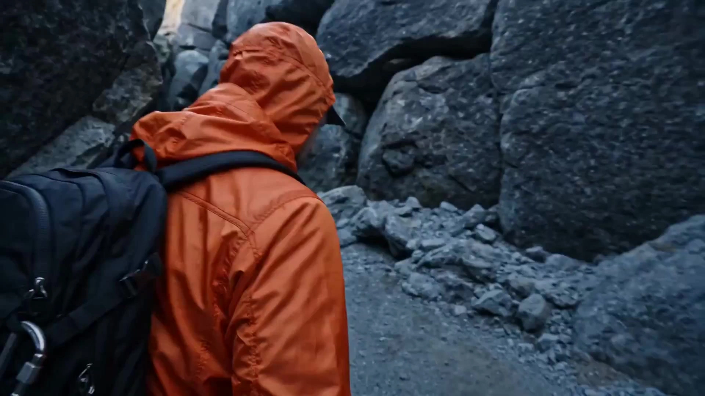

# Immersive Handheld Tracking Shot

> **作者：** @阿娴AIGC

## Content

Process Planning:

Logic and Dependencies for Full Video Planning Phase:

Establish Global Video Briefing: Use text_editor to create Final_Video_Spec.md (including: Title, Aspect Ratio (default 16:9), Target Duration, Output Language, Visual Style Category ("Realistic Cinematic Handheld/FPV Style"), Subtitles (default OFF), BGM (default OFF, optional for users); and two optional mode toggles—fpv_mode: whether to enable FPV over-the-shoulder tracking (default ON); one_shot_mode: whether to simulate a continuous long take (default OFF; if enabled, reduces cut frequency and uses action matching/blinks/whip-pan transitions)). This serves as the global parameter base. Before starting script analysis, confirm user preferences for fpv_mode and one_shot_mode; other parameters (16:9, no subtitles, no BGM) serve as defaults and are only updated if the user actively modifies them.

Role Identity Board Design:

Check user input: If the user has uploaded character reference images or provided detailed text descriptions, invoke resource_prepare_and_ Kanalyze to extract core skeletal and hairstyle features.

Character Element Generation: Invoke media_generator using Nano Banana Pro's TextToImage (or ImageToImage) to generate a 2K pure white background multi-angle, multi-expression Character Sheet, and register it as a key_element asset for that character.

[Pause for Confirmation Node]: Display the generated identity board image; this must be confirmed and locked by the user before proceeding to subsequent steps.

Script Analysis and Storyboard Construction:

Invoke storyboard_designer to receive the user's script/creative ideas. Decompose them into structured shots, key elements (such as element character, element scene, and props), and independent audio tracks.

Analyze the emotional intensity of dialogue in the script and fully decompose it into specific physical action descriptions and camera movement coordination for handheld/FPV shots.

[Pause for Confirmation Node]: Display the structured Storyboard table; the user must confirm shot segmentation, duration ratios, and action/camera movement design.

Media Asset Generation and Binding:

Character and Scene Asset Binding: Invoke media_generator to bind the character identity board image locked in Step 2, as well as scene reference images, into the Storyboard's key_element slots. If audio samples exist, bind them as the character's key_element_audio.

Per-shot Video Generation: Invoke the MultiModalToVideo path of media_generator (preferring Seedance 2.0), using the bound character identity board and scene reference images as visual reference inputs, combined with handheld/FPV camera movements and action descriptions to generate each shot.

Audio Generation: Invoke media_generator for voice (VO/dialogue) and sound effect generation. Dialogue is converted into TTS with physiological pauses and tone markers (using ElevenLabs v3 or MiniMax Speech 2.8 HD), while sound effects are generated or retrieved based on storyboard cards.

[Pause for Confirmation Node]: Display the generated video and audio segments for the user to review consistency and dynamism batch by batch.

Full Video Editing and Quality Control:

Invoke video_assembler to assemble all assets. Perform strict random spot checks for camera stability and character similarity, adjust audio-visual alignment, fades, and sound effect levels, synthesize the final output, and guide the user to click "Save and Activate" at the top right to activate this Skill. Dependencies: 2 -> 1; 3 -> 2; 4 -> 3; 5 -> 4. Pause for Confirmation Mechanism: Strictly implement staged pauses. It is strictly forbidden to run the entire generation flow in one click. Pauses must occur after Character Identity Board, Storyboard design, and Media Asset generation are complete. Use cards or text replies to provide options, ensuring the user remains in control throughout the process.

Asset Analysis:

Multimodal Analysis Specification for Reference Assets

Character Image Analysis: When users upload character reference images, you must precisely analyze and extract the following:

Core identity features (age range, gender, bone structure, eye shape and eyebrow characteristics, hair color and specific hairstyle).

Detailed features (skin pore texture, presence of moles/freckles/wrinkles, direction of light and shadow, clothing material and primary color palette).

Output formatted text for use in key_element descriptions. Avoid abstract words (e.g., "handsome," "beautiful"); they must be converted into concrete, realistic descriptions (e.g., "high nose bridge, clearly defined jawline, fine wrinkles on the forehead").

Audio Sample Analysis: If a user uploads voiceover or vocal references, analyze the gender, perceived age, tone and speed (slow, rapid), voice clarity, and background noise. Tag these as reference features for key_element_audio to select or synthesize the most matching timbre in subsequent TTS generation.

Storyboard Design:

Handheld Shooting and FPV Shot Design Specifications1. Key Elements Design (Elements)

element character: Must include a detailed visual specification in the master ID board. When multiple characters exist, a key_element must be established for each. The description must clearly state the character's attire, body type, and facial details (such as pores, texture, etc.) to ensure high consistency in subsequent generation.

element scene: Annotate key light sources (such as streetlights, window light, neon lights, natural light) and color temperature in the scene. Follow real-world scene lighting (e.g., daytime natural light, overcast diffused light, standard indoor lighting, etc.). Diverse colors and atmospheres are permitted; do not force a high-contrast color grade.

2. Shot Design Rules (Shots) - Mandatory Handheld/FPV Dynamic

No Fixed Camera Prohibition: In the shot description, it is strictly forbidden to use descriptions such as "fixed shot," "static camera," or "Static." Even for stationary scenes, they must be designed as "breathing sway (simulating the operator's breathing)" or "subtle handheld micro-sway."

Dynamic Camera Movements (Every short clip must contain at least 4 types):

Handheld Follow Shot: The lens follows the protagonist's steps, creating slight vertical undulations and micro-sway. The camera slightly lags behind the subject's movement, creating a physical sense of following.

Slow Push-in/Pull-out: Used for emotional progression or visual focus convergence; control the speed of the push/pull to change slowly.

Whip Pan: Used during shifts in gaze or sudden events; requires the camera to rotate rapidly across the environment, featuring brief motion blur.

Orbital/Arc Shot: Used for inner conflict or confrontation between characters; moves in a circular motion around the subject at a slow speed.

Crash Zoom: Used during sudden emotional changes or shock; a short, rapid zoom-in towards the subject.

Inertial Overshoot: When the camera movement stops abruptly or changes direction, it must include a slight rebound and self-correcting movement.

FPV Over-the-Shoulder Follow (Required when fpv_mode is on): The lens is positioned close behind the protagonist, slightly above shoulder height, with the protagonist's shoulder, back, or back of the head as out-of-focus foreground. Follows the protagonist's steps with vertical undulations, simulating human eye height rhythm. When turning, the lens produces a slight centrifugal sensation (shifting slightly outward from the curve before correcting). No Clipping: Foreground shoulder/back must not obstruct the protagonist's face. Applicable scenes: walking, running, passing through doorways, going up stairs, turning around, etc.

Simulated Continuous Long Shot Transition (When one_shot_mode is on): Reduce the number of shot cuts (control the entire video to a few long takes). Transitions between shots must use one of the following methods:

Match-on-Action Transition: The action at the end of the previous shot connects with the action at the start of the next shot (e.g., raising hand → cut to close-up of the hand).

Blink Blackout Transition: A short blackout simulating a blink to connect different scenes.

Follow-Through Transition: Follow the protagonist through a door/window/corridor to transition naturally to the next scene.

Suggested Duration for Simulated Continuous Long Shots (When one_shot_mode is on): Each long shot is recommended to be 10–15s (not exceeding the model's maximum support of 15s). The total video duration ÷ number of shots is the reference benchmark. Prioritize allocating 13–15s to segments with the highest emotional density (climax/turning point), and compress opening and closing segments to 10–12s to form a rhythm arc of "slow start—tense acceleration—calm finish."

Internal Rhythm Design Points for Simulated Continuous Long Shots (When one_shot_mode is on): Each long shot must contain several rhythmic layers; constant speed movement throughout is prohibited:

Setup Segment (Opening): Use breathing micro-sway or FPV entry to stabilize the frame, establishing space and character relationships; rhythm is slower.

Development Segment (Middle): Introduce core actions or dialogue, increase camera movement frequency (e.g., switching from handheld follow to slow push-in or orbiting); emotion progresses; camera movement echoes character action.

Climax / Resolution Segment (Ending): If this is a climax, use a Crash Zoom or Whip Pan to reach the emotional peak; if it is a transition long shot, use Inertial Overshoot to naturally lead into the transition action (the connecting gesture or entry point for the next shot), avoiding abrupt cuts.

Camera Movement Density Control: Do not change camera movement types too frequently within a single long shot (e.g., no more than 3 types) to prevent visual chaos. Type switching must be driven by character action or emotional nodes, not randomly stacked.

Shot Scale Variation Chain: It is strictly forbidden to use the same shot scale for two consecutive shots. Arrange shot groups logically: Long Shot (establishing environment) -> Full Shot (character-environment relationship) -> Medium Shot (body movement) -> Medium Close-Up (expression delivery) -> Close-Up (partial feature detail), to form a visual rhythm.

3. Follow Real Scene Lighting and Shadow Specifications

Each shot must clearly specify the main light source direction and light properties (e.g., side backlighting, natural diffused light, top light, indoor incandescent light, scattered light, etc.).

Real Shadow Presentation: Perform realistic restoration based on the specific environment (e.g., outdoor natural light, overcast diffused light, standard indoor lighting, etc.). If the scene has specific dramatic design, textures of natural light, overcast weather, and ordinary indoor light are allowed; avoid blindly imposing rigid, high-contrast cool blue/warm orange color grading. Lighting and shadow descriptions must serve the scene's real texture and narrative atmosphere.

Cross-Shot Lighting Consistency: Adjacent shots in the same scene must lock the light source direction and color temperature key. Once the main light source direction is determined in the shot description for the first time (e.g., "backlighting from the rear left"), subsequent shots in the same scene must use the same orientation description; do not change the light source orientation without reason. If the plot causes light changes (e.g., walking from outdoors to indoors), the light source switching node and new light source parameters must be explicitly labeled in the shot description; no silent switching.

4. Prop key_element Registration and Cross-Shot State Tracking Specification

Registration Criteria: Props meeting any of the following conditions must be registered as independent key_element props in Storyboard elements:

Appearing in 2 or more shots;

The prop undergoes significant state changes in the plot (e.g., umbrella from closed → opened → broken; mobile phone from screen on → screen off → shattered);

The prop serves as an emotional symbol or narrative anchor (e.g., envelope, photo frame, ring, etc., items carrying plot significance).

key_element prop Description Specification: The description for each prop must include the following fields:

Appearance Benchmark: Material, color, size ratio, surface texture (e.g., "Black automatic folding umbrella, fabric has tiny reflective silver threads, handle is matte rubber material").

Initial State: Complete state upon first appearance (e.g., "closed, dry, held in right hand").

State Change Node Table: List each state switch in order of shot number, formatted as "Shot N → State Description" (e.g., "Shot 2 → Opened, umbrella surface wet with rain; Shot 4 → Dropped to the ground, ribs bent").

Cross-Shot State Tracking Writing: In the description of each shot containing this prop, the prop's current state must be explicitly stated at the beginning (consistent with the State Change Node Table); do not rely on the model to infer it. Example: "Male protagonist holds the already opened, wet umbrella in his right hand (rainwater streaks on the surface), ..."

Lighting Consistency for Foreground Props: When a prop acts as a foreground element (e.g., shoulder bag, umbrella handle appearing in FPV follow), its illuminated surface and shadow direction must be consistent with the main light direction locked in the shot and must be labeled separately in the description.

5. Cross-Shot Continuity Design Specification

Character State Locking: In the shot description, the character's clothing state (collar, cuffs, sweat stains, etc.), prop holding state (e.g., whether holding an umbrella/phone), and hairstyle state must remain precisely consistent between adjacent shots; unreasonable state jumps must not occur in the same scene. If a character makes an action changing their appearance state in a shot (e.g., opening an umbrella), the description in subsequent shots must synchronize this state update.

Scene Space Locking: Label the relative positions of key props and scene landmarks in the frame (e.g., "streetlight is behind the protagonist to the left"), and use this orientation description in adjacent shots to ensure a sense of spatial continuity.

Transition Cue Design: Add a line "Transition Cue" at the end of every shot description, describing the character's position, orientation, and action state at the end of the shot to provide a reference for the entry of the next shot.

6. Background Crowd Dynamic Behavior and Natural Integration Specification

Crowds are not Props: People in the background must have natural, diverse actions and behaviors, just like real street photography or on-location filming. Crowd behavior must not interfere with the protagonist's narrative (do not actively block the protagonist, do not interact with the protagonist, unless the plot explicitly requires it).

Scene-Adapted Behavior Library: Explicitly specify crowd behavior by scene type in the shot description; do not allow stillness or everyone walking in the same direction:

Street/Tourist Area: Walking in different directions, stopping to take photos, chatting, looking at phones, waiting for buses, cycling; medium-high density, occasional people turning heads or dodging;

Classroom: Listening to lectures, heads down writing, spinning pens, talking softly, yawning; teacher can move on the podium, students are not all sitting stiffly;

Restaurant/Cafe: Dining, drinking coffee, chatting, looking at phones, waiters walking with trays; cups can have steam;

Park/Square: Walking, running, playing with children, sitting on benches; mix of static and dynamic;

Office: Typing, answering phones, walking, gesturing in meetings; avoid everyone facing the screen.

Appearance Randomization Requirement: It is forbidden to have two identical crowd members (cannot copy and paste the same appearance). Clothing color, style, season, and cultural context of the scene must match; no uniform clothing; age and gender ratio randomly distributed.

Shot Scale Layered Dynamics: Close-up crowd actions should be clear but must have depth-of-field blur to avoid stealing the show; medium-shot crowd actions just need to be recognizable; long-shot crowd can be represented by blurred groups but must have overall motion. Fast-moving crowds (cycling, running) must be marked with slight motion blur.

7. Scene Design and Character-Background Integration Specification

Scene Source: Prioritize using the scene reference images provided by the user; if none, generate realistic scenes based on the script location, time, weather, and mood (e.g., streets, cafes, indoors, parks, etc.). Strictly forbidden to use solid color backgrounds, virtual studios, synthetic-feeling CG environments, or obviously repeated textures.

Mood Adaptation: Sad/oppressive choose overcast, rainy night, dim interior, cool tones; warm/healing choose sunshine or evening streetlights, warm tones; tense/suspenseful choose heavy shadows, single-sided lighting corridors or stairwells; relaxed/daily choose daytime natural light environments.

Lighting Consistency: The scene's main light direction must be strictly consistent with the lighting direction on the character (e.g., sunlight from the left outside the window → highlight on the character's left, shadow on the right); explicitly label the main light direction in the shot description as the core anchor for visual fusion.

Character Integration Details: Character proportions must coordinate with scene perspective (leaving space above the head, feet grounded); shadow direction and length underfoot must match the scene light source; if there are reflections on the ground (water, glass), character reflections must be described; close-ups should have appropriate depth-of-field blur but background should not be blurred into color blocks; long-shot characters and backgrounds should both be clear.

Color Temperature Consistency: Character skin tone and clothing color temperature must match the ambient light color temperature (warmer under warm light, cooler under cool light); discordant combinations such as cold-toned character and warm-toned background are prohibited.

8. Emotional Intensity and Shot Type MappingEmotional nodes are the only legitimate driving source for shot switching. Whenever an emotional intensity label appears in the shot description, the corresponding camera movement method must be selected from the mapping table below; do not combine arbitrarily or contradict the emotion. Emotional Intensity Level Definitions:

Weak: Emotions undercurrent, externally restrained, small range of character actions

Medium: Emotion begins to manifest, has clear physical or facial reactions

Strong: Emotional outbreak or threshold, full-body physiological reactions obvious, scene tension highest (Table: Emotion Type | Intensity | Preferred Shot | Alternative Shot | Prohibited Shot | Rhythm Explanation)

Linking Usage Rules:

When emotional intensity crosses levels (e.g., from "weak → strong"), the shot type must be upgraded accordingly; do not maintain weak emotional shots during strong emotional segments.

When an emotional level jump occurs within the same shot (e.g., "suppression suddenly explodes"), the trigger time point must be marked in the rhythm layering of the shot description, and the shot type must be switched at that time point.

The emotional type mapping table cannot be used in reverse (e.g., "because I want to use a crash zoom, so I design a shock node"); shots obey emotion, emotion does not obey shots.

9. Dialogue Rhythm and Camera Movement Speed Precise Synchronization SpecificationPauses in dialogue, changes in speaking speed, and camera movement speed must be explicitly aligned in the shot description, rather than designed independently. The alignment rules are as follows:

9.1 Pause Points → Camera Movement Speed Variation AnchorsEvery "..." or "——" pause in the dialogue must have a corresponding camera movement behavior labeled in the shot description:

Short Pause ("..."): Camera movement speed slows down but does not stop, controlling the push-in speed to slightly slow down, simulating the micro-slowness of breathing intervals; if the current shot is handheld follow, the step undulation cycle is synchronously lengthened.

Long Pause ("——" or relatively long silence): Camera movement completely pauses or switches to breathing micro-sway (greatly reduced sway, maintaining a very slight breathing sensation), the camera "holds its breath" waiting for dialogue to restart; if the next sentence's emotion upgrades, start the new shot movement with inertial overshoot when the pause ends.

Breath / Choke (Writing: "inhalation" or blank pause without text): The camera slightly sinks during the pause (center of gravity moves slightly downward), matching the character's physiological sinking sensation, and corrects after the pause ends.

9.2 Speaking Speed → Camera Movement Speed Mapping(Table: Speaking Speed Characteristics | Movement Speed Benchmark | Explanation)

9.3 Keywords → Camera Movement Peak MomentsKeywords in the dialogue that carry the core weight of the narrative (e.g., character names, turning words, negative words) must be marked as "Camera Movement Peak Moments" in the shot description, and the corresponding behavior must be written:

Instant of Keyword Pronunciation: Camera movement speed reaches its peak in the same frame as the word is spoken (e.g., push-in speed instantly increases, whip pan triggered), then briefly falls back to the baseline speed, forming a "shock → aftershock" rhythmic sense.

Negative/Turning Words ("No", "Forget it", "Don't", "Go", etc.): Coordinate with crash zoom or inertial overshoot, triggered almost simultaneously with the speech.

Single Word at Emotional Highest Point (e.g., "Get out!", "Stay!"): Coordinate with whip pan; whip pan start time is synchronized with the pronunciation of the word; when the whip pan is completed and the camera corrects, the character should be in the finishing posture of the movement, forming a dual visual-auditory closure.

9.4 Multi-Character Dialogue Shot Cutting Rhythm RulesIn segments of dialogue between two or more people, the rhythm of cutting the camera between characters must be driven by the rhythm of the dialogue, not waiting until the current character finishes speaking to cut. The following are mandatory shot-cutting specifications: Shot Cutting Timing

Advance Cutting Principle: A very short instant before the speaker of the next line starts speaking, the camera must have already finished switching and be stabilized on that character. Do not cut only after the other party has started speaking (visual lag sensation).

Trailing Tone Overlap Design: When the speaker's trailing tone naturally decays (sentence-final modal particles, pauses), the camera can cut out in advance; the trailing tone does not need to be completely finished before cutting; a slight trailing tone "fading out" in the next shot is reasonable.

Emotional Intensity Affects Cutting Speed:

Calm Dialogue (Low emotion): Cutting rhythm is gentle, cut only when the other person is near the end of speaking.

Dispute/Confrontation (Medium-High emotion): Cutting rhythm accelerates, can cut away when the other party's line is just over halfway, creating the oppressive feeling of "speech being cut off."

Emotional Outbreak (Strong emotion): Permitted to cut in the middle of the other party's lines, coordinate with whip pan or crash zoom, conveying the tearing of the dialogue.

Reaction Shot Design

In each dialogue segment, arrange at least 1–2 Reaction Shots: When character A is speaking, cut to character B's face, capturing their micro-expressions (eye wandering, swallowing, biting lips, slightly frowning, etc.), rather than staying on the speaker the whole time.

Reaction shot duration is suggested to be short (within a few seconds), not too long to cause the speaker's lines to lack visual support; if the dialogue contains important information, prioritize keeping the speaker's screen.

In the reaction shot, the photographed character does not speak, but must have specific physiological micro-action descriptions (abstract descriptions like "silently looking at the other person" are prohibited), for example: "Character B's mouth corners tighten slightly, gaze moves down briefly before lifting up again, Adam's apple slides slightly."

Shot Scale Alternation Principle

When cutting dialogue, there must be a change in shot scale between two adjacent shots; cutting between same scales like Medium A → Medium B is prohibited:

Conventional change: Medium A → Close B → Close A → Close-Up B (gradually pushing in on both scales as emotion upgrades).

Confrontation escalation: Both scales tighten synchronously (Full cut → Medium cut → Close-Up cut), the more intense the dialogue, the closer the scale, until one person's close-up fills the frame.

If environment empty shots (e.g., details of the dialogue location) need to be inserted into the dialogue, the duration should be short and not interrupt the continuity of the dialogue.

Dialogue Cut Marking Format in shot descriptionIn shot descriptions containing multi-character dialogue, use the following format to explicitly mark cutting beats (written in the corresponding position of "Development Segment"):

[Dialogue Cutting Beats] T+0.0s: Character A speaks (line starts, normal speaking speed), camera is already stabilized on A Medium shot, FPV slight breathing micro-sway. T+1.8s: A line trailing tone decaying, cut to B Close shot (cut in the instant before speaking), B face slightly frowns, swallowing action. T+2.5s: B speaks in response, camera stabilized on B Close shot, sway cycle tightens (medium emotion). T+3.8s: B line more than halfway through, cut to A reaction shot, A gaze moves down then lifts, lips tremble slightly. T+5.3s: Cut back to B finishing the last sentence, cut in the instant before speaking, B trailing tone fades out in A Close shot frame. This marking is mandatory for shots containing dialogue segments; descriptions without time information like "reverse shot cutting" cannot be used as substitutes.

9.5 Alignment Marking Format in shot descriptionIn each shot description containing dialogue, use the following format to explicitly bind dialogue rhythm with camera movement behavior (written in the corresponding position of "Development Segment" or "Outbreak Segment"):

[Dialogue Rhythm Alignment] T+0.0s: Line starts, slow speaking speed, slow push-in starts. T+1.2s: "..." pause, push-in speed slows down, sway cycle becomes longer. T+2.0s: "Forget it"——negative keyword, push-in speed instantly increases, inertial overshoot triggered. T+2.5s: Line ends, camera corrects, cuts into next transition action (Transition Cue). This marking is mandatory; vague descriptions like "camera pushes in with dialogue" cannot be used as substitutes.

10. Dialogue Scene Camera Movement Diversification Rules

Core Principle: Dialogue segments are prohibited from using a single camera position throughout (e.g., all full face or all over-the-shoulder). Must use a variety of movements based on dialogue rhythm and emotion; each dialogue segment must use at least 2 types of the following:

Shot/Reverse Shot: When A speaks, cut to A's close-up or medium shot; when B speaks, cut to B's corresponding scale; eye direction must match (A looks right, in B's frame A should be on the left).

Over-the-Shoulder Shot: Foreground is A's shoulder/back (depth-of-field blurred), focus on B's face, enhancing dialogue immersion.

Slow Orbit: When emotion progresses (arguing, confessing), use slow circular motion around the two.

Push-in/Pull-out: Slowly push into the speaker's face on a keyword; pull out to show spatial relationships when emotion eases.

Two-Shot: Medium or full shot showing interaction and body language; switching frequency should not be too high, used for rhythm buffering.

Prohibited: Using fixed camera positions to only shoot one person speaking, or dialogue segment camera is completely static with no changes.

Linked with Emotion: Dialogue movement type must obey Section 8 "Emotional Intensity × Shot Type Mapping Table"—calm dialogue is mainly shot/reverse shot + over-the-shoulder; disputes/confrontations introduce slow orbits; emotional outbursts add crash zoom and whip pans; do not mix and match randomly without emotional drive.

11. Emotional Dialogue Reality Reflection

It is strictly forbidden to write abstract emotional adjectives in the dialogue of the shot description (e.g., "said nervously", "said sadly"). Every line of dialogue must be marked with the emotional breakdown result in front, formatted as "[Facial + Physical + Vocal Characteristics] + dialogue text". The following is the standard breakdown comparison table, to be quoted directly when storyboarding: (Table: Abstract Emotion | Facial | Physical | Vocal Characteristics)

When emotion changes within the same line, it must be broken down by segments, formatted as: "[Physiological description of the first emotional stage]…… (transition pause) [Physiological description of the second emotional stage]……", there must be a visible physiological transition signal (e.g., sighing, eye movement) between the two segments.

Timbre Consistency: The dialogue and voice-over of the same character in the entire video must be forced to bind to the corresponding key_element_audio (if the user uploaded a voice sample) or a consistent narration_speaker_profile.

12. Dialogue Attribution Mandatory Locking

Each shot description containing dialogue must explicitly mark the speaker character ID at the beginning (consistent with Storyboard key_element character), formatted as "Speaker: [Character ID]".

When there are multiple speakers in the same shot, the speaker switch must be marked sentence by sentence in the [Dialogue Cutting Beats] timestamp; it is not allowed for one dialogue block to contain dialogue from two characters without attribution.

The non-speaking character in the Reaction Shot must explicitly write "[Character ID] closed mouth, makes [specific physiological reaction]" in the description; leaving it blank or relying on the model to judge by itself is not allowed.

13. Character Action Physical Reality and Anti-Clipping Specification

Joint Movement Requirement: All action descriptions must comply with human ergonomics, and joint bending directions must be natural. It is forbidden to have descriptions such as arms/fingers passing through the body or clothing, body penetrating scene props, etc.; if an action requires extra space physically (e.g., swinging arms, turning), the action range and its relationship with the surrounding space must be noted in the shot description (e.g., "turn left, no obstacles behind").

Large Motion Rhythm: Actions such as running, jumping, waving, turning, etc., must describe the inertial rhythm of acceleration → constant speed → deceleration in the description, as well as the gravitational sinking sensation when contacting the ground (slightly bent knees on landing, heels lifted off the ground when leaving), and cannot be described as "sliding" or teleportation without inertia.

Clothing and Prop State: When moving significantly, the following state of the clothing must be noted (e.g., "trench coat hem flutters to the right when turning"), to avoid clothing being completely fitted to the body without a sense of physics, and also to avoid clothing clipping into the body outline.

Prohibited Descriptions: Unmotivated twitching, physical-defying hovering, joint bending in reverse, body penetrating scene objects.

Media Generation:

Media Generation Strategy for Handheld/FPV Dynamic Shots1. Identity Board Generation (TextToImage / ImageToImage)

Default Preferred Model: Nano Banana Pro (Gemini 3 Pro Image), with a recommended resolution of 2K (features excellent text rendering, multi-image layout, and detail restoration).

Generation Method: For initial character generation, use TextToImage. If the user provides a single reference image, use ImageToImage to synthesize multiple angles and expressions.

Binding: After generation, the identity board image must be registered as an asset_id and bound to the corresponding element character in the Storyboard.

2. Shot-by-Shot Video Generation (MultiModalToVideo)

Core Model: The default preferred model is Seedance 2.0 / Seedance 2.0 Fast, as it provides the best multimodal support for character and action consistency. Non-members support up to 720p resolution, while members can upgrade to 1080p.

Visual Reference Binding Rules:

Visual Reference 1 (Character): Bind the identity board image of the character involved in the shot (the main image asset of the element character bound in Step 1) to ensure consistency in face, body type, and clothing.

Visual Reference 2 (Scene): Bind the reference image of the scene atmosphere generated by the element scene of the shot.

Audio Reference (key_element_audio): If the character has spoken lines, their key_element_audio (audio sample ID) must be bound and passed to ensure that the lip-sync and timbre of the same character remain consistent across different shots.

Video Reference (Adjacent Frames): Only when adjacent shots have strong requirements for continuous action, pass the final_shot video of the previous shot as a reference. Otherwise, generally avoid video reference binding to prevent visual contamination.

End Frame Extraction for Continuity: For adjacent shots with continuous action requirements (such as simulating a continuous long take or action-match transition), use resource_prepare_and_analyze to extract the last frame of the previous final_shot and use it as the start_frame reference input for the next shot to ensure visual continuity in character posture, lighting, and spatial orientation.

Video Duration: The length of each shot is strictly set between 3s and 15s, determined by the duration designed in the Storyboard.

3. Cross-Shot Consistency Standards

Light Direction Locking: When generating each shot, the prompt must explicitly specify the light source direction, which must be completely consistent with the scene in the Storyboard (directional terms precise to "Left/Right/Direct Back + Angle"). Avoid ambiguous descriptions like "side lighting" or "backlighting" that lack directional information.

Character Appearance Consistency: For all shots involving the same character, the character's identity board image must be bound as a visual reference to force cross-shot consistency in facial bone structure, hairstyle, clothing, and skin texture. Do not generate characters based solely on text descriptions; image reference input is mandatory.

Prop Continuity: Props meeting registration requirements must have a key_element prop created in the Storyboard elements. When generating the corresponding shot, the reference image (asset_id) of that prop must be bound. The binding parameters must include a current status description of the prop (consistent with the status change node table in the Storyboard) to ensure the model sees the correct state of the prop, rather than the initial appearance benchmark.

Prop Reference Image Generation Strategy: For props registered as key_element prop, prioritize using real-life photos provided by the user. If unavailable, generate a pure white background, multi-angle tiled reference image for the prop using TextToImage (Nano Banana Pro, 2K) during the element asset generation stage. Register the asset_id and bind it to the corresponding key_element. If the prop undergoes a significant state change in the story (e.g., an umbrella from dry to soaked), generate reference images for different versions of the state, register them with different asset_ids, and complete the rebind before the state-switch shot.

4. Audio and Speech Synthesis (Text to Speech)

Preferred TTS Model: Use ElevenLabs v3 (recommended for English) or MiniMax Speech 2.8 HD (recommended for multilingual).

Settings: If the character is bound to a key_element_audio, use it as the benchmark for voice cloning. If not, select a TTS preset with high-fidelity breathing and pause details, and generate narration based on the emotional parameters marked in the script.

5. Dialogue Attribution Binding and Lip-Sync Standards

Dialogue Attribution Binding: Every TTS generation task must be bound to a unique speaker character asset_id (consistent with the speaker key_element character noted in the Storyboard shot description). Do not bind the same TTS audio clip to multiple characters to prevent lip-sync activation misalignment.

key_element_audio Passing: When using MultiModalToVideo to generate a shot containing dialogue, you must pass the corresponding key_element_audio binding of the speaker via audio_infos (if available) to ensure that the lip-sync driving and timbre come from the same reference benchmark, reducing lip-sync drift.

Close-up/Tight Shot Lip-Sync Priority: For dialogue shots that are close-up or extreme close-up, the prompt must explicitly emphasize "precise lip-sync, jaw movement matching syllables, natural lip closure"; for medium/long shots, matching the jaw rhythm is sufficient, and precise syllable-by-syllable matching is not required.

Non-Speaker Mouth Closure Constraint: When other characters are present in the same shot, the prompt must specify "only [Speaker Character Description] speaks, all other characters keep their mouths closed or perform physiological reactions (swallowing, blinking, micro-expressions) without opening their mouths."

Prompt Writing:

Prompt Writing and Control Guidelines1. Language Consistency Rules

When the user communicates in Chinese, the subject description, lighting, and detailed instructions in the prompt must be written in Chinese to ensure high alignment with the user's original intent. For tone and specific camera tags, standard industry English abbreviations can be used.

Dialogue sections such as voiceover/narration must remain consistent with the Output Language defined in the Final_Video_Spec.md.

2. Character Identity Board Prompt (TextToImage / ImageToImage)

Must use a 16:9 Landscape structure, pure white background, and cinematic realistic style.

Preferred model is Nano Banana Pro (Gemini 3 Pro Image) with 2K resolution, as it offers the best multi-image layout and text rendering capabilities.

2A. Single-Character Standard Identity Board Template

16:9 landscape, pure white background, photorealistic, cinematic image quality, ultra-high-definition photography. Left half: Four-view layout (Front full-body / Left full-body / Right full-body / Back full-body), arranged proportionally and evenly spaced, character fully in frame, feet touching ground reference line. Right half: Four micro-expression close-ups ([Calm] / [Smile] / [Sad] / [Deep thought or nervous]), 2×2 grid layout, each cell labeled with the corresponding expression tag. Character appearance: [Core description, e.g., 25-year-old East Asian male, short black hair, straight texture, single eyelids, high nose bridge, defined jawline]. Clothing: [Core clothing, e.g., dark gray mandarin collar trench coat, black slim-fit trousers, black leather boots]. Skin details preserved (pore texture, slight stubble, subtle nasolabial folds), no skin smoothing, no plastic-like surface. Light source: [See light source specifications below]. No anime, 3D, CG, cartoon, or manga styles; no background clutter or extra text watermarks.

2B. Multi-Character Side-by-Side Comparison Layout (Used for 2–3 characters)

16:9 landscape, pure white background, photorealistic, cinematic image quality, ultra-high-definition photography. Image divided horizontally into [N] equal columns, each column corresponding to one character (from left to right: [Character A Name] / [Character B Name] / [Character C Name]). Vertical layout within each column: Top — Front full-body standing pose (full body in frame, unified scale); Bottom — 2 close-ups of facial micro-expressions (each character picks their core plot expressions). Each column is proportionally aligned to ensure differences in height/body type between characters are visible within the same reference coordinate system, facilitating scale matching for downstream shots. [Character A appearance and clothing description] / [Character B appearance and clothing description] / [Character C appearance and clothing description]. Skin details preserved (pores, moles, wrinkles, stubble), no skin smoothing, no plastic-like surface. Light source: [See light source specifications below]. No anime, 3D, CG; no overlapping or intersection between characters; no background clutter or extra text watermarks.

2C. Standardized Light Source Direction Writing (Insert into the [Light Source] placeholder above)Select and replace the placeholder directly from the following specifications based on the main light direction of the script's main scene: Standard light source for scene types (insert directly into prompt) Identity Board General Default Soft, uniform diffuse light, no obvious projections, even brightness, suitable for multi-view detail restoration. Daytime outdoor natural light Top-side natural light, main light at 45° angle from above, clear facial contours, shallow shadows in eye sockets, no strong side-backlighting. Dusk/Warm-tone indoor Warm orange side lighting (45° incidence from the right side of the frame), warm tone lighting on the face, shadows with a warm brown cast, slight contrast between cold/warm background. Night street/Neon Cold blue side-backlighting (main light from the back left of the frame), warm orange neon fill light outlining facial edges, strong contrast between light and dark, grainy film texture. Rembrandt light (Dramatic) Rembrandt triangular light, main light at 45° side-above, clear triangular highlight on the face, deep shadow on the dark side, strong emotional tension. Butterfly light (Fashion) Frontal butterfly light, main light directly above and slightly tilted forward, butterfly-shaped shadow cast under the nose, cheekbones highlighted, suitable for showcasing delicate facial features.

Usage Rules: As the character reference image, the Identity Board defaults to the "Identity Board General Default" light source to ensure details are visible from all angles. If the user explicitly specifies the lighting style of the main scene in the film, replace it with the corresponding type to ensure the Identity Board stays consistent with the color tone of the final video.

3. Shot-by-Shot Video Prompt (MultiModalToVideo - Seedance 2.0)

Visual reference binding: Must use <<<image_1>>> to bind the character's identity board.

Motion Stack Structure: Written in the sequence of "Camera Movement Trajectory -> Subject Action and Physiological Reaction -> Spatial and Environmental Characteristics -> Sound and Dialogue Markers," fused into a coherent, detail-rich paragraph.

Camera Movement: Explicitly stated at the beginning. E.g., "Handheld FPV perspective, the camera produces handheld breathing-style micro-vibrations that fluctuate with footsteps. The camera slowly pushes in towards the close-up of <<<image_1>>>'s face with slight inertial lag."

Subject Action and Emotional Expression: Do not use abstract emotional words; write specific actions. E.g., "<<<image_1>>>'s facial muscles are tense, eyes wide and blinking frequently, Adam's apple slides up and down, lips trembling slightly, with a hint of panic."

Lighting and Space: E.g., "Cold blue night street light provides main light from the side-rear, casting long side-backlit shadows. Warm yellow neon light box light slightly outlines facial edges, strong light/dark contrast, grainy film stock quality."

Seedance 2.0 Syntax Control Markers:

Sound Effect Markers: Use angle brackets <...>. E.g., <sound of rain hitting umbrella>, <sound of heavy, rapid breathing>.

Music Markers: Use parentheses (...). E.g., (tense low-pitched string background music).

Dynamic Dialogue Lip-sync Markers: Use curly braces {...} and insert pure dialogue text directly, without emotional modifiers. E.g., {(Chinese) Are you... really leaving?}. 4. Image Quality Benchmark Annotation (General for all video prompts)

Every video prompt must start with the image quality benchmark: Hyper-realistic cinematic texture, 8K-level detail restoration, film grain, skin with pores and texture preserved, no skin smoothing, no CG feel, 24fps cinematic frame rate.

Cross-shot consistency anchoring: Explicitly write the main light direction of this shot (consistent with the Storyboard), as well as key status descriptions of the character's clothing and hairstyle, as visual anchors for model generation to prevent appearance drift across shots.

5. Forced Requirements for Scene and Character Fusion Prompts

Every video prompt must contain scene fusion anchor text, formatted as: Real scene, [scene type and environmental details], light direction [precise orientation], character fused with background, shadow direction consistent, natural depth of field, no cutout feel, no fake compositing.

Color temperature matching: Depending on scene mood, explicitly write color temperature tendencies in the prompt (e.g., "skin tone is warm under warm orange light" or "clothing and environment color temperature are unified under cold blue night view") to prevent character and background tones from becoming disconnected.

6. Mandatory Addition for Background Crowd Prompts

Whenever a shot description contains a public scene (street, square, classroom, restaurant, office, park, etc.), the following crowd fusion text must be added to the video prompt, inserted after the "scene fusion anchor text":

Natural movement of background crowds, people walking, talking, stopping, actions random and non-repetitive; diverse crowd appearance, varied clothing colors and styles, consistent with scene setting; no interaction with the protagonist, not obscuring the protagonist; fast-moving crowds have slight motion blur; no static figures, repetitive pasting, or unified dress code.

Depth layering writing: Foreground crowd (actions clear but depth of field blurred to not distract from the protagonist) → Mid-ground crowd (actions recognizable) → Background crowd (blurred group, overall sense of motion); these three layers must be reflected in the prompt in order, rather than just mentioning "there are crowds."

7. Prompt Writing for Dialogue Shot Emotion DeconstructionFor all shots containing dialogue, character action descriptions in the video prompt must use the format from the emotion deconstruction table in Section 11. Abstract emotional words are prohibited. The format is: [Facial + Body + Sound characteristics] + Dialogue text.

❌ Incorrect: He yelled angrily: Get out of here!

✅ Correct: <<<image_1>>> brows furrowed, eyes sharp, nostrils flaring, voice lowered, each word spoken like it's being smashed out: {(Chinese) Get out of here!} If the emotion shifts within the same line of dialogue (e.g., nervous → relieved), write out the physiological state descriptions for the two stages in segments within the prompt, connected by transitional pause actions (e.g., sighing, eyes looking down then lifting) so the model can execute it.

8. Dialogue Rhythm and Camera Movement Rate Synchronization Prompt WritingWhen "dialogue rhythm alignment" is noted in the shot description, timing information in the video prompt must be converted into executable camera movement rhythm instructions, integrated into the "camera movement trajectory" and "subject action" paragraphs of the Motion Stack; it must not be listed separately as timecode blocks.

Pause correspondence writing: Explicitly state rate changes in the camera movement description. E.g., "Camera pushes in at a constant slow speed; at the end of the first line of dialogue (at the '...' pause), the push-in speed slows down, simulating the brief pause during breathing, and returns to normal speed after the pause ends."

Rapid speech (voice cracking/scared) correspondence writing: Immediately follow the sound effect marker with a camera marker. E.g., "<rapid inhalation> The camera triggers a short, quick push-in at the moment the character speaks, followed by a slight inertial overshoot before centering."

Key turning point word correspondence writing: Explicitly mark the trigger moment. E.g., "At the start of the word 'Forget it', the camera push-in speed instantaneously increases, triggering a slight inertial overshoot, followed by a speed drop, ending on the same frame as the character's sighing action."

Dialogue end → Transition connection: After the last character of the dialogue is spoken, write a camera centering or sinking action in the final segment of the prompt as a transition anchor to the next shot. E.g., "After the dialogue ends, the camera center of gravity sinks slightly and stabilizes, with the character's turning action acting as the crossing trigger point for entering the next shot."

Forbidden vague writing: Prompts must not contain overly generic descriptions like "camera follows the dialogue emotion and pushes in" or "adjust speed following tone"; specific camera movement changes and action coordination descriptions that result in visible "slight, short, slow" effects must be provided.

9. Standing Negatives

The end of the video prompt must forcibly include: no music, no subtitles, no watermark, realistic texture, skin pores, no smoothing, no CG, no anime, no plastic skin, consistent lighting direction, no limb clipping, no body part penetration, no floating, no unnatural joint bending, no abstract motion, physically grounded movement. Ensure visual realism and prevent clipping, abstract motions, sudden light changes across shots, and character appearance drift.

10. Lip-Sync and Physical Action Realism Prompt Standards

Close-up/Tight shots containing dialogue: In the "subject action" paragraph of the Motion Stack, explicit lip-sync instructions must be written. E.g., "Jaw movement is natural when speaking, lip closure and opening match the syllables, no mechanical opening/closing feel, no 'slack mouth' (long periods of closure without movement); non-speaking characters keep mouths completely closed, performing physiological reactions on their faces."

High-intensity movement shots (running, jumping, waving, turning): Write inertial rhythm descriptions in the "subject action" paragraph, formatted as "action start → acceleration → constant speed → deceleration to finish, knees slightly flexed upon landing, with a sense of gravitational sinking"; clothing must be described in terms of follow-through states (e.g., "coat sways to the right following the turn").

Clipping prevention writing: When a shot involves close-range interaction (handshaking, hugging, holding objects), the state of the contact point must be described in the prompt. E.g., "Right hand naturally grips the umbrella handle, fingers wrapping completely, no sense of intersection," to avoid the model generating images where limbs penetrate props.

Video Editing:

Timeline Editing and Composition Standards for Handheld/FPV Short Films

Cross-Shot Consistency Review (Primary Step): Before assembling the timeline, examine each pair of adjacent shots for the following three types of consistency. If issues are found, they must be marked and reported to the user; do not skip silently:

Lighting Direction Consistency: Compare the direction of the main light source in adjacent shots. If there is a non-narrative jump in light source orientation, mark it as a "Lighting Discontinuity" warning.

Character Appearance Consistency: Check for continuity in hairstyle, clothing details (e.g., collar state, rolled-up sleeves), and personal props (phone, umbrella). If a character's appearance in a shot differs significantly from the identity board or the previous shot, mark it as a "Character Consistency" warning.

Spatial Orientation Consistency: Confirm that key scene landmarks (streetlights, walls, doors/windows) do not flip inexplicably between adjacent shots to prevent "crossing the line" (180-degree rule violation) issues.

Dual Quality Check for Non-Fixed Camera Angles: When assembling the timeline, every shot must undergo a motion check. If a video segment appears perfectly static and flat, you must use timeline cropping or slight scaling, and inject smooth-period horizontal/vertical slight shaking curves into the X/Y axes of the timeline to manually reconstruct a slight handheld breathing motion.

FPV Foreground Continuity Check (when fpv_mode is enabled): Check whether the position and brightness of the main character's shoulder/back foreground are continuous in adjacent FPV tracking shots. If there is a jump, fine-tune the in/out points via cropping, or overlay extremely short motion-blurred frames at the transition points in the timeline to smooth the connection.

Simulated Continuous Long Take Transition Verification (when one_shot_mode is enabled): Check transition types one by one (match action/blink-to-black/follow-through). Confirm that the action connection is seamless, black frames are extremely short, and there is no obvious sense of editing.

Multi-Character Dialogue Cut Verification: Check whether every cut in dialogue segments follows the rhythm rule of "cutting to the next speaker an instant before they start talking." If the cut is later than the other party's opening, adjust the in/out points to move the cut earlier. Also, ensure the reaction shot duration is within a reasonable, short range to avoid obscuring important dialogue visuals.

Dialogue Camera Movement Diversity and Emotional Detail QC: For each dialogue segment, additionally check the following two items; if issues are found, they must be marked and reported to the user:

Does the dialogue segment use at least 2 different camera movements (at least 2 from: reverse shot, over-the-shoulder, circling, push-in/pull-out, two-shot)? If only a single camera angle is used throughout, mark it with a "Single Dialogue Camera Movement" warning.

Does the dialogue description contain residual abstract emotion words (e.g., "says angrily," "laughs happily")? If so, mark it with an "Emotion Not Decomposed" warning, prompting the user to revise the shot description against the emotion decomposition reference table.

Shot Size Transition Review:

Check the shot sizes of adjacent shots. If the same shot size appears consecutively, use cropping to adjust the focal length level of one of the shots to ensure the visual rhythm follows the "Long-Medium-Close-Full" shot logic.

Check the color temperature and lighting balance of adjacent shots to ensure that while there is appropriate contrast, no uncomfortable visual sudden shifts occur at the cut points.

Audio Track Fine-Tuning and Fade In/Out:

Voice Track (VO/Dialogue): Highest priority; must be placed on the top audio track. Dialogue between shots should have an extremely short, micro-pause to prevent collisions at the start/end of dialogue across shots.

Ambient Sound Track (SFX): Precisely align with timestamps based on shot descriptions (e.g., footsteps, door opening, rain sounds) and set natural fades in/out so that ambient sound transitions smoothly.

Background Music Track (BGM): Usually placed at the bottom, with volume lowered appropriately relative to the voice track. If a major emotional turning point occurs in the short film (e.g., "quick pan" or "sharp push"), the BGM must undergo instantaneous beat alignment or a sudden fade (Crescendo / Sudden Stop) at that timestamp.

Scene and Character Fusion QC: Before timeline assembly, perform an additional check on the following four items for each shot; if issues are found, they must be marked and reported to the user:

Does the scene match the script description (no abstract/solid color/blurred backgrounds generated automatically)?

Does the character's shadow exist on the ground, and is its direction consistent with the scene's light source?

Are the edges of the character and the background naturally fused (no white edges, no crude cutout traces)?

Does the character's color temperature match the ambient light color temperature (incoherent combinations of character and background tones are prohibited)?

Does the background crowd have natural movement (not static/repeated textures)? Do they have obviously repeated appearances or obscure the protagonist or interfere with the narrative?

Dialogue Attribution and Lip-Sync QC: Verify every line for all shots containing dialogue:

Does the speaker's lip movement match the rhythm of the character's TTS audio (jaw movement, head rhythm matching syllable beats)? Close-up/extreme close-up shots with obviously static lips ("zombie mouth") must be marked with a "Lip-Sync Mismatch" warning.

Do other characters present in the same shot keep their mouths closed or only perform physiological micro-reactions? If a non-speaking character is seen talking, mark it with a "Dialogue Attribution Error" warning and prompt for a regeneration of the shot.

Physical Realism of Actions QC: Perform a frame-by-frame spot check on each shot containing large-scale movements (running, jumping, waving, turning, etc.):

Is there any clipping where limbs penetrate the body, clothing, or scene props? If found, mark it with a "Clipping" warning and prompt the user to change the random seed and regenerate.

Is there non-physical movement like "sliding without inertia" or joints bending backward? If present, mark it with an "Action Distortion" warning.

Image Quality Reconstruction and Super-Resolution Processing:

Before output, evaluate the final timeline. If the user requires a high-definition finished product, apply MediaKit video super-resolution to character close-ups or core dynamic shots to upscale the resolution to 1080p, and fine-tune the frame rate to a stable 24fps cinematic frame rate.
