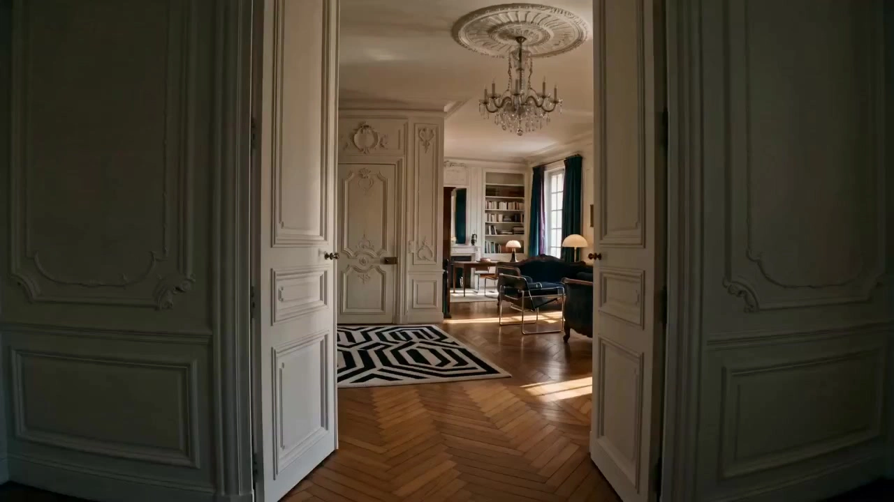

# Immersive Interior Design Tour

> **作者：** 境在丨米叔

## Content

**Process Planning:**

**Overall Workflow and Phase Dependencies:**
1. Confirm core requirements with the user: Target space type (living room/bedroom/whole house, etc.), style keywords (e.g., Wabi-sabi, light luxury, Nordic minimalism), reference images, or text descriptions. Write the conclusions into **Final_Video_Spec.md** (including: space type, style tone, output specification 9:16 vertical, language, **fixed total duration of 15 seconds**) → **text_editor**.
2. If the user has uploaded reference images or documents, perform a multimodal analysis first to extract space layout, materials, lighting, and style information → **resource_prepare_and_analyze**.
3. Plan the multi-frame storyboard structure (4–6 frames, emotional arc, camera movement annotation rules) → **storyboard_designer**.
4. Generate **wide-format panoramic interior image**: Present the complete spatial layout in a wide aspect ratio, serving as the spatial foundation for the entire project, bound as a key element → **media_generator**. **Pause, show, and confirm the panoramic image with the user before proceeding.**
5. Based on the panoramic image, generate a **vertical multi-frame storyboard** (4–6 frames, including director's camera movement annotation text), bound as a storyboard reference asset → **media_generator**. **Pause, show, and confirm the storyboard with the user before proceeding.**
6. Use the multi-frame storyboard as a reference_image to generate a **vertical one-shot exploration video** via Seedance 2.0 → **media_generator**.
7. Generate environmental ambient audio tracks → **media_generator**.
8. Assemble the timeline and complete the final vertical exploration video → **video_assembler**.

**Dependencies:** 2→1; 3→1,2; 4→3; 5→3,4; 6→5; 7→3; 8→6,7.

**Phase Confirmation Points:** Pause once after Step 4 (panorama) and once after Step 5 (storyboard). Only proceed to the next stage after obtaining explicit confirmation from the user; do not run the entire pipeline at once.

**Asset Analysis:**

When the user provides reference images, mood boards, or design documents:
- **Spatial Structure Extraction:** Identify room outlines, major furniture layouts, sightlines, and depth layers.
- **Material and Light Analysis:** Extract wall/floor/furniture materials (e.g., matte micro-cement, washed raw wood, marble), determine the direction of the main light source, color temperature (warm/cool/natural light), and softness/hardness.
- **Style Keyword Summarization:** Summarize reference materials into concise style tags for use in Storyboard and prompt writing (e.g., "Wabi-sabi · Diffused light · Low saturation warm tone").
- **Vertical Composition Adaptation:** When analyzing reference images, prioritize vertical composition elements suitable for a 9:16 aspect ratio: high ceilings/window views, deep corridors, vertical material textures, etc.
- Output structured analysis text for direct citation by **storyboard_designer** and **media_generator**.

**Storyboard Design:**

**Key Element Design**
- Register the entire space as **one element scene** (panoramic space base), with a description containing:
  - Complete spatial layout and main functional zones;
  - Major materials, furnishings, and style keywords;
  - Main light source direction, color temperature, and light/shadow characteristics.
- If there are iconic items (art pieces, plants, textiles), these can be listed separately as **element prop**.
- The image asset for this element is the subsequently generated **wide-format panoramic image**, and its asset_id will be bound here.

**Multi-frame Storyboard Structure Planning (4–6 frames · 15 seconds total duration)**
The storyboard is a **single image** presenting the **complete 15-second narrative path** arranged in a 9:16 vertical grid. Each frame represents a time beat within those 15 seconds. Seedance 2.0 will read the entire storyboard at once and generate a single 15-second one-shot video. When designing, the content rules for each frame must be clear:
- **Duration Allocation per Frame:** 15 seconds total; distribute the share of each frame according to the emotional arc:
  - Frame 1 (Threshold): Approx. 2–3 seconds, entrance establishment;
  - Frames 2–4 (Discovery): Approx. 8–10 seconds (approx. 2–3 seconds per frame), moving toward the main space;
  - Final 1–2 Frames (Belonging): Approx. 3–4 seconds, focus settles, rhythm slows down.
  - Mark the reference time interval within the frame (e.g., "0–2s / 3–7s / 12–15s") for Seedance to align movement beats.
- **Frame Sequence and Emotional Arc Correspondence:**
  - Frame 1 (Threshold): Entrance or foyer perspective, spatial outline appears, cool or low-saturation tones;
  - Frames 2–4 (Discovery): Continuous movement beats pushing into the main space, light gradually fills the room, material details appear;
  - Final 1–2 Frames (Belonging): Visual focus settles (window side, bedside, core corner), lighting and shadows are richest, rhythm slows down.
- **Camera Movement Instruction Text Must Be Marked in Each Frame** (overlaid within the frame as director's annotations):
  - Camera Movement Type: Handheld Pan / Walk-in / Lens Breathing / Gaze Hold;
  - Movement direction and magnitude (e.g., "Slow walk-in towards floor-to-ceiling window, with slight vertical displacement");
  - Vertical composition allocation (top/middle/bottom content, e.g., "Top: ceiling diffused light, Middle: sofa body, Bottom: wood floor texture").
- **Locked Eye-Level Height (Globally Fixed):** Throughout the multi-frame storyboard, the camera height for all frames must be uniformly fixed at **adult walking eye-level**—about 155–170 cm above the ground, level or tilted down slightly by within 5°, simulating normal human eye-level during walking. Drone aerial shots, low-angle shots, bird's-eye views, or exaggerated perspectives are prohibited; camera height must remain consistent between all frames, with no jumps.
- **Sightline Continuity Between Frames:** The visual center of adjacent frames must maintain continuous directional momentum or spatial logic to avoid sightline jump cuts.

**Independent Audio Layer Design**
- Plan one full-length **ambient audio layer** (type: music): quiet interior background noise, faint natural sounds, covering the full duration of the video.
- Optionally plan one **foley gait sound layer**: layer in to match the Walk-in beat, fade out for other frames.

**Media Generation:**

**Step 1: Generate Wide-format Panoramic Interior Image (Space Base)**
- Use **TextToImage** (no reference image) or **ImageToImage** (when the user provides a reference image).
- Recommended model: **Nano Banana Pro (Gemini 3 Pro Image)**, resolution **2K**, wide-format composition (16:9 or wider).
- After generation, bind the asset_id to the element scene in the Storyboard (panoramic space base).
- This image must fully present the spatial overview: major furniture layout, materials, and lighting state, serving as the visual master for subsequent storyboards.

**Step 2: Generate Vertical Multi-frame Storyboard (with Camera Movement Annotations)**
- Use **ImageToImage**, with the panoramic interior image as a reference, to generate a vertical 9:16 multi-frame storyboard (4–6 frames).
- Recommended model: **Nano Banana Pro (Gemini 3 Pro Image)**, resolution **2K**.
- Each frame corresponds to an exploration beat planned in the Storyboard, with director's camera movement annotation text overlaid within the frame (e.g., "Walk-in · Slow push in towards floor-to-ceiling window").
- After generation, register and bind the asset_id as an independent asset for direct reference by subsequent video generation.

**Step 3: Generate Vertical One-shot Exploration Video**
- Use **MultiModalToVideo**, recommended model: **Seedance 2.0**, resolution **720p**, vertical 9:16.
- Reference Input:
  1. **Main reference image (reference_image):** Multi-frame storyboard—Seedance reads the spatial information and camera movement annotations within it and converts them into a continuous one-shot POV movement;
  2. **Supplementary reference image (optional):** If specific materials or lighting need reinforcement, the panoramic interior image can be added as a second reference.
- Duration: **Fixed 15 seconds** (Seedance 2.0 single-pass maximum limit), generate the complete video in one go, no need to split.
- Do not add previous videos as reference_video; rely primarily on the storyboard to drive camera movement logic.

**Audio Generation**
- Use **text_to_instrumental**, recommended models **Suno 5** or **Mureka 8**, to generate an ambient or lo-fi spatial acoustic track, with a duration covering the entire video.

**Prompt Writing:**

**Global Priority:** When the user interacts in Chinese, the prompt text body must be in Chinese; content within audio tags must maintain the project output language.

**Wide-format Panoramic Interior Image Prompt (TextToImage / ImageToImage)**
- Structure: [Spatial overview perspective] + [Main functional zones and furniture layout] + [Material and furnishing details] + [Lighting description] + [Style tags]
- Explicitly state wide-format composition (16:9 or wider), presenting complete spatial depth and horizontal extension; avoid close-up shots.
- Realistic interior photography feel, natural white balance, film grain texture; commercial rendering overexposure or CGI style is prohibited.

**Vertical Multi-frame Storyboard Prompt (ImageToImage)**
- Based on <<<image_1>>> (panoramic interior image), generate a vertical 9:16 multi-frame storyboard with N frames (corresponding to the number of frames planned in the Storyboard).
- The content description for each frame must correspond to the spatial perspective and emotional stage of that frame in the Storyboard (Threshold / Discovery / Belonging).
- **Perspective Height Locked for All Frames:** Each frame must explicitly state "adult walking perspective, camera height approx. 160 cm, level orientation"; drone aerial views, low angles, or exaggerated perspectives are prohibited; all frames must maintain the same perspective height, with no jumps.
- Each frame must render director's camera movement annotation text, which should be concise and clear (e.g., "Walk-in · Slow push towards floor-to-ceiling window"), overlaid in a corner of the frame, with a font style referencing film storyboard manuscripts.
- The overall image must maintain consistent interior style and lighting atmosphere, originating from the same space base.
- No additional people, no subtitles, no commercial rendering look.

**One-shot Video Prompt (MultiModalToVideo / Seedance 2.0)**
- **Reference Binding:** <<<image_1>>> corresponds to the multi-frame storyboard; if a panoramic image is added, it is <<<image_2>>>.
- **Camera Movement Instruction Hierarchy (strictly follow this order):
  [One-shot statement + Duration 15s] → [Overall POV movement path, described in order of storyboard frames, including reference time intervals for each frame] → [Space perspective and light/shadow changes for each segment] → [Vertical triple-composition allocation] → [Audio tags]
- Explicitly state "15-second single continuous POV movement, no cuts," and annotate beats in the path description according to the time intervals of the storyboard frames (e.g., "0–2s Entrance established → 3–10s Pushing towards floor-to-ceiling window → 11–15s Gaze fixed at window, settling"), allowing Seedance to blend the multi-frame perspective and time rhythm from the storyboard into a fluid one-shot movement.
- **Locked Perspective Height (Fixed Throughout):** Explicitly state "adult walking perspective, camera height approx. 160 cm, level orientation, consistent throughout," and prohibit any aerial, low-angle, or drone views; no perspective height drift should occur in any beat of the path description.
- **Vertical-Specific:** State 9:16, describe the vertical triple distribution of the image content (top/middle/bottom).
- **Seedance 2.0 Audio Tags:** Ambient sound with (...), gait sound effects with <...>; if an independent track already exists, add no music.
- **Fixed Negative Constraints:** no subtitles, no cuts, no jump cut, no character morphing, no commercial rendering look, no quotes.

**Example (Living Room One-shot):**
Based on <<<image_1>>> (multi-frame storyboard) and <<<image_2>>> (panoramic interior image). Vertical 9:16, **15 seconds** single continuous first-person POV, no cuts. Movement path: 0–2s Entering slowly from the foyer (Handheld Pan, slight physical vibration) → 3–10s Walking forward towards the floor-to-ceiling window (Walk-in, with vertical displacement) → 11–15s Staying in gaze at the window (Gaze Hold, extremely slow settling). Top: ceiling diffused light and curtain sheer shadows; Middle: micro-cement wall and fabric sofa area; Bottom: matte wood floor approaching. (Quiet interior background noise, faint wind sound outside) <Soft footsteps>. no music, no subtitles, no cuts, no quotes.

**Final Assembly:**

**Vertical Timeline Assembly**
- Assemble in 9:16 vertical format. The core video is the one-shot exploration video; if split into multiple segments due to duration, splice them seamlessly to present as a single continuous video.
- **Audio Mixing:** The ambient atmosphere track runs throughout, with volume lower than the native video sound effects; the foley gait layer is layered in during Walk-in movement segments and fades out in others.
- **Emotional Settling Treatment:** Refer to the emotional stage annotations in the Storyboard (Threshold → Discovery → Belonging), reduce volume and slightly slow down at the end of the Belonging stage to create a sense of emotional sedimentation; avoid hard endings for the video, prioritizing a fade-out finish.
- **Rhythm Control:** Maintain an immersive and soothing rhythm throughout; if splicing multiple segments, choose transition frames where the movement direction is consistent to avoid sightline jump cuts.
