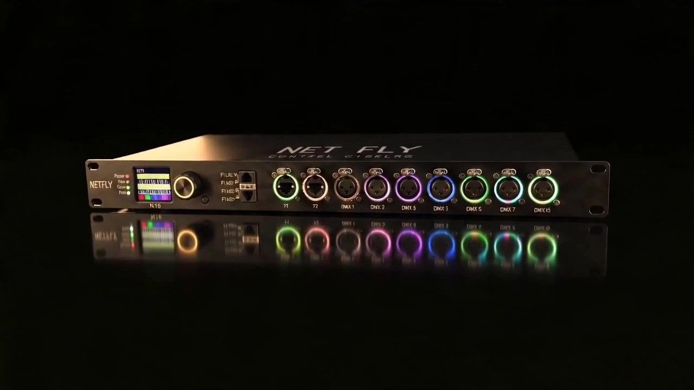

# Industrial Product Commercial Video

> **作者：** @NET FLY

## Content

Process Planning:

Production Stages and Dependencies

Collect User Decision Parameters → Ask user directlyBefore creating the Final_Video_Spec.md, you must confirm the following four key decisions with the user, which can be combined into a single question: ① Video Duration: Provide the following options for the user to select one:

15 seconds—Minimalist version, suitable for short vertical videos/ad spots/quick promotion;

30 seconds—Concise version, suitable for social media/quick showcases;

60 seconds—Standard version, balances information density with viewing experience;

120 seconds—In-depth version, suitable for product launches/detailed function explanations;

180 seconds—Flagship version, suitable for brand websites/comprehensive technical demonstrations.

② Aspect Ratio: Provide the following options for the user to select one, and offer recommendations based on the duration:

Landscape 16:9—Suitable for brand websites, launch event screens, Bilibili/YouTube, etc.; Recommended for 60s or longer.

Portrait 9:16—Suitable for TikTok/Douyin/Reels/Shorts, etc.; Recommended for 15s/30s.

③ Visual Style: Provide the following options for the user to select one (or describe custom requirements):

A. Cold Industrial: Pure black studio background, single hard key light, edge highlighting, high-contrast dark tones, dark gray + metallic silver + tech-blue accents, low-saturation premium color palette.

B. Cyber Tech: Deep space black background with blue-purple luminous grid, emphasizing neon glowing edges, dual-tone electric blue/electric purple, rich particle feel, strong futuristic vibe.

C. Minimalist Pure White: Pure white/light gray gradient background, soft lighting without hard shadows, presenting the product's natural colors, Apple-style clean composition, minimalist text.

D. Dark Gold Luxury Industrial: Matte black + dark gold color scheme, low-key luxury atmosphere, warm gold edge lighting, mirrored reflective floor, benchmark texture quality.

④ Output Resolution: Default is 720p. Upgradeable for higher quality (requires extra processing time and compute power):

720p (Default)—Standard quality, fastest generation, suitable for quick drafts and previews;

1080p—HD quality, slight super-resolution processing, sharper image;

2K—Ultra-clear quality, achieved via MediaKit super-resolution;

4K—Ultra-HD quality, achieved via MediaKit super-resolution, suitable for large brand displays.

Note: 8K is not currently supported for video output (8K super-resolution is only for static images), do not offer this option to the user.

⑤ Narration: Ask if the user needs narration, and select voice gender:

No Narration—Visuals + BGM only, no voiceover;

Narration—Male Voice—Calm male voice, Mandarin Chinese, moderate pace, professional broadcast quality;

Narration—Female Voice—Clear female voice, Mandarin Chinese, moderate pace, professional quality.

⑥ Subtitles: Ask if the user needs subtitles:

No Subtitles—Final video has no text overlays;

Subtitles—Embed narration text as subtitle layer on the timeline (Only available if narration is selected; skip this question if no narration). Proceed to Step 2 only after receiving all confirmations.

Lock Global Parameters → text_editorCreate Final_Video_Spec.md, and record: Full Product Name, Product Positioning, Video Duration (based on user confirmation), Aspect Ratio (16:9 or 9:16), Resolution (720p default; if upgraded, specify target resolution and super-resolution plan), Frame Rate (30fps), Visual Style (based on selection, include corresponding color/lighting/background description), Narration settings (include voice gender if selected), Subtitle settings, Background music tone. Ask for user confirmation before proceeding.

Analyze Product Assets → resource_prepare_and_analyzeStructure the analysis of user-uploaded product images and text information. Output: Product appearance characteristics, module list and hierarchy, visualized functional logic, shot coverage assessment. Analysis results will serve as the decision basis for the following Storyboard Design.

Establish Visual Asset Elements → media_generator

If the user has uploaded product photos, prioritize registering them as asset_id and binding them to the corresponding key_element;

Otherwise, generate reference images one by one based on the key_element list determined in the storyboard design. Pause after generating element images and ask the user to confirm the visual tone before proceeding.

Generate Video Shot by Shot → media_generatorFollowing the shot sequence, use the corresponding element image as a reference for each shot, generated via MultiModalToVideo + Seedance 2.0; only append the previous shot as reference_video when continuity is extremely high.

Generate Audio Layers → media_generator

Narration: Generate segment by segment according to the shot list script;

BGM: Generate pure electronic industrial light music, deep drum beats, strong tech atmosphere.

Super-Resolution Processing (Conditional) → media_generatorExecute only if the user selected 1080p / 2K / 4K in Step 1; skip this for 720p and proceed to Step 8.

1080p: Call super_resolution (MediaKit), resolution set to "1080p", fps set to "30".

2K: Call super_resolution (MediaKit), resolution set to "2k", fps set to "30".

4K: Call super_resolution (MediaKit), resolution set to "4k", fps set to "30".

Timeline Editing and Output → video_assemblerAssemble according to the duration and aspect ratio confirmed in Final_Video_Spec.md, with audio-visual synchronization; process narration and BGM in layers; output the final product.

Dependency Order: 2→1; 3→2; 4→3; 5→4; 6→3; 7→5; 8→6,7

Pause Nodes: Pause once after Step 1 completion, Step 2 completion, and Step 4 completion, waiting for user confirmation before proceeding. During batch generation, if all shots of a certain category are finished, you may proactively display them and ask for user feedback.

Asset Analysis:

User Input Material DescriptionUsers only need to provide: ① Product images (real shots or renders, single or multi-angle); ② Product text information (full name, positioning, core function parameters). No need to upload videos, exploded views, or brand VI files.

Product Image Analysis Rules—Categorized by Upload QuantityCase A: Only single image uploaded

Use this image as the unique visual anchor to extract maximum information:

Product outline and overall proportions (visual estimate of length/width/height);

Body color and surface finish (brushed/sandblasted/mirror/paint);

Visible interface types and layout (e.g., XLR, RJ45, USB-C);

Screen/Display area position and style (OLED/LCD, character style);

RGB indicator color, position, and transparency/texture;

Brand Logo position and font style;

Material and operation area position for knobs/buttons.

Inference/Completion Strategy: For faces not shown (e.g., back/side), combine with product text info and industry standards to make reasonable inferences, explicitly marking as "Inferred Values" for storyboard_designer reference (not as a strong binding visual basis).

Shot Adaptation Tip: In single-image scenarios, 360° orbit shots and exploded views must be supplemented in the prompt with more text descriptions to cover unseen angles, reducing reliance on the reference image.

Case B: Upload 2-3 images (partial/front-back combinations)

Identify perspective (front/back/side/detail) for each image and extract characteristics separately;

Cross-verify consistency in color, finish, and interface placement; if discrepancies exist (e.g., color shift due to lighting), prioritize the majority and add a note;

Detail shot extraction focus: brushed texture of knobs, metallic finish of interfaces, screen character style, backlit RGB diffusion effect; add details to the corresponding key_element description.

Case C: Upload 4 or more multi-angle images

File by front/back/left/right/top/detail;

Provide complete angle reference for 360° orbit shots (at least cover front, side, back); write visual descriptions for every angle in key_element;

Provide spatial layer references for exploded views: infer housing seam positions and module stacking order based on multi-angle images;

If top-view images exist, extract overall heat dissipation structure and panel button layout for motherboard special effect shot composition.

Product Parameter Info Processing Rules

Extract from user text: Full product name, core functions (signal type, transmission logic, main modules), target customer group;

Translate functional descriptions into visual logic for functional visualization shots and narration scripts:

E.g., "1-in 8-out signal distribution" → Light stream branches from 1 input node to 8 output nodes;

E.g., "Optoelectronic isolated transmission" → Signal breaks through an isolation barrier, with separate light points on both sides;

E.g., "Signal amplification" → Light stream brightness/thickness increases after entering a node;

If internal module composition is described (e.g., "independent power module + main control board + interface module"), map directly to the layer explosion order, overriding inferred values.

Element Inference PriorityInformation Source Priority Rules: User Uploaded Images (Directly visible) - Highest - Strong binding, write directly to key_element description; User provided text parameters - High - Supplement functions/modules not covered by images; Multi-angle image cross-inference - Medium - Reasonable inference for hidden angles, mark as "Inferred"; Similar industrial product trends - Low - Use only when both images and text provide no coverage, explicitly mark as "Default Inference".

Output Format: All analysis results archived as structured text, fields including: "Product Appearance Characteristics (by angle)", "Module List and Hierarchy (including inference notes)", "Visualization Functional Logic", "Shot Coverage Assessment (state which shot categories need additional text completion)"; directly referenced by downstream storyboard_designer and media_generator.

Storyboard Design:

Key Elements Design PrinciplesMust define the following element scene / element character:

Overall Product Appearance: Complete product front, back, side, and top views; record body color (dark gray metallic paint), interface layout, screen position, RGB light color and brightness.

Exploded Modules (Each module is an independent element): Housing, motherboard, power module, thermal control module, interface module—describe size proportion, material color, connection method, and spatial layer in the whole machine.

Motherboard Close-up: PCB color (dark substrate), chip layout, solder point density, heat dissipation hole arrangement; provides visual anchor for tech particle effects.

Hand Operation: Skin tone neutral, clean fingernails, no jewelry; props include encoder knobs, buttons, screen interface.

Five Major Shot Categories—Shot List Design SpecificationsEach shot description must include: Scene (Element ID reference), Story beats (Action/effect beat sequence), Cinematography (Shot size/angle/movement), Duration suggestions.

Visual Texture Shots (approx. 12s, recommended 2-3 shots)

Product 360° Orbit: Low-angle upward orbit, with slow turntable or virtual camera track; hard light from 45° left as main light + right fill for edge highlighting on metal ridges; pure black background; depth of field blurring foreground/background scattered elements.

Interface/Knob/Screen Close-up: Macro push-in, focus shifts sequentially to XLR interface metallic texture, knob brushed copper ring, screen OLED glowing characters; backlight RGB diffusion texture must be displayed in a separate beat.

Functional Visualization Shots (approx. 12s, recommended 2 shots)

Using the product top or front view as the base plate, overlay dynamic light streams to simulate signal links: from input port starting point to internal distribution nodes, then branching to output ports, finally dissipating at each port.

Light Stream Animation Beat Design Specs (Each shot must include all the following beats, arranged sequentially):

Start-up Beat: Signal light stream slowly lights up from the input port, fading from dark to bright, duration ~0.5s;

Main Path Travel Beat: Light stream travels along the main link to the distribution node at constant speed, line width 2-4px, with slight pulse (brightness varies every 0.3–0.5s), duration ~2s;

Node Convergence Flash Beat: When light arrives at the distribution/isolation node, a short, intense flash occurs (approx. 0.2s), brightness is 3x the path light, diffusing tiny particle rings outward, embodying signal distribution or isolation logic;

Multi-path Branching Beat: After flash, light splits synchronously into multiple paths (number of branches matches product output channels), each branch extends in parallel to output ports, branches are slightly thinner than the main path, duration ~2s;

Port Dissipation Beat: Light brightness gradually decreases and dissipates upon arriving at output ports, leaving a soft light shadow at the port for ~0.5s before going out.

Light Stream Color Specs: Cold Industrial/Minimalist Pure White select Tech Blue + Cold White (#4FC3F7/#E0F7FA); Cyber Tech selects Electric Blue + Electric Purple dual tones (#00B0FF/#CE93D8), alternating flicker; Dark Gold Luxury selects Warm Gold light (#FFD54F) with deep red node flash.

Camera pushes extremely slowly (from medium shot to close-up within ~12s) to match the light flow rhythm; focus remains on the currently active node or branching point; background product remains static with slight depth-of-field blur.

Duration Flexibility: 120s/180s versions can stretch beat durations evenly and add 1 extra shot specifically showing light animation details of a single functional module (e.g., optoelectronic isolation barrier logic).

Product Exploded View Shots (approx. 12s, recommended 2 shots)

Shot A: Exploded Process—Product starts in fully closed state, modules move slowly along structure axis, suspended outward: housing moves up, interface module moves straight forward, motherboard remains centered as visual anchor, power module retracts backward, thermal control module sinks down; maintain uniform suspension distance between modules (approx. 1/2 of their own height), clear structural levels; entire separation action must be completed in 4–6s, motion curves use ease-in-out, no bouncing or overshoot.

Shot B: Suspended Tour—After modules are suspended in place, camera orbits at an extremely slow low angle (~45° arc), focusing on modules one by one; focus sequence switches: interface module metal contact surface → power module heat vents → motherboard PCB texture → housing inner wall structure; each focus stays ~1.5–2s; background is pure black, main light from 45° single-point hard light illuminates current focus module, other modules use edge lighting to keep outlines visible.

Exploded Sequence Basis: Prioritize the module hierarchy inference results from resource_prepare_and_analyze; if none, default order: "Housing → Interface Module → Motherboard → Power → Thermal".

Duration Flexibility: 120s/180s versions can slow down Shot A (6–8s), expand Shot B tour arc to 180°, and add 1 extra shot focusing on the connection gold finger details between motherboard and power module.

Motherboard Special Effect Shots (approx. 12s, recommended 2 shots)

Motherboard ultra-macro: Circuit board texture clearly visible, flowing blue tech particles travel along PCB trace tracks; design "signal amplification node" high-brightness flash beat to reflect computational logic.

Camera uses extremely slow push/pan to explore motherboard terrain; particle density changes rhythmically with signal strength.

Human Minimalist Operation Shots (approx. 12s, recommended 2-3 shots)

Finger close-up pressing encoder knob (slow motion), screen values change in real-time with rotation;

Button toggle close-up, backlight state changes;

Screen UI interface push-in close-up, parameter switching dynamically;

Keep pure black background, hand movements clean and sharp, no unnecessary shaking.

Duration Distribution Reference: Distribute the total duration reasonably across the five shot categories based on the total duration confirmed by the user in Final_Video_Spec.md; BGM and narration must run throughout, editing beats aligned with musical drum beats. Each duration tier reference distribution (can fine-tune proportions based on visual importance, but all five categories must be included):

Total Duration

	

Visual Texture

	

Functional Visualization

	

Exploded View

	

Motherboard Effects

	

Human Operation

15s

	

~3s

	

~3s

	

~3s

	

~3s

	

~3s

30s

	

~6s

	

~6s

	

~6s

	

~6s

	

~6s

60s

	

~12s

	

~12s

	

~12s

	

~12s

	

~12s

120s

	

~20s

	

~25s

	

~25s

	

~20s

	

~30s

180s

	

~30s

	

~35s

	

~35s

	

~30s

	

~50s

120s and 180s versions can increase the number of shots for each category, enriching camera angles and effect beat layers; do not fill time with repetitive similar shots.

	

	

	

	

	

Cross-Shot Audio Layer Design

BGM (music): Pure electronic industrial light music, deep drum beats, strong tech atmosphere; track length must match the total video duration confirmed in Final_Video_Spec.md, rhythm density can be slightly increased in exploded view shots, drop to low drums in close-up shots.

Narration: Professional and concise, easy to understand, aimed at engineers/entertainment industry customers; pace is calm and steady (~4.5 characters/sec, broadcast-level rhythm); corresponds to shot beats, avoid dense overlapping text during visual climax beats; write full narration script segment by segment after Final_Video_Spec.md is confirmed.

narration_speaker_profile: Set based on voice gender chosen in Final_Video_Spec.md:

User chooses Male Voice: [Calm male voice, Mandarin Chinese, moderate pace, professional broadcast quality]

User chooses Female Voice: [Clear female voice, Mandarin Chinese, moderate pace, professional quality]

If user chooses no narration: Skip all narration audio_layer design, do not write narration scripts in the shot list, keep only BGM audio layer.

Narration Word Count and Rhythm—Tier SpecsThe following standards are based on a pace of 4.5 characters/sec (including pause buffer). Total word counts for narration at each tier must be strictly controlled within the range to avoid conflicting with visual climax nodes.

Duration Tier

	

Total Narration Words (Chinese)

	

Sentence Count

	

Rhythm Requirements

15s

	

30–45 chars

	

2–3 sentences

	

No narration in first 2s, keep visual opening; max 15 chars/sentence; concluding sentence must end before 13s, leave 2s silence; 1 core sentence per shot category, no stuffing info.

30s

	

100–120 chars

	

4–6 sentences

	

No narration in first 3s, keep visual opening; max 18 chars/sentence; concluding sentence must end before 27s, leave 3s silence.

60s

	

210–240 chars

	

8–12 sentences

	

No narration in first 3s; max 20 chars/sentence; narration nodes aligned with shot category switch points; last 5s only BGM, narration ends early.

120s

	

450–510 chars

	

18–25 sentences

	

Written segment by segment per shot category, 3–5 sentences each; add inter-sentence pauses (0.5–1s) in functional visualization and exploded view segments to match effect beats; last 8s for brand closing, max 1 narration sentence.

180s

	

680–760 chars

	

28–38 sentences

	

Segmented by shot category, 5–7 sentences each; narration can leave 5–8s blank in motherboard effect segments (no narration, only BGM+SFX) to create breathing room; no narration in first 0–5s and last 10s.

Cross-Tier General Rules:

Each narration sentence must correspond to specific visual actions or function points, no hollow slogan-style expressions (e.g., "Leading the future", "Beyond limits", etc.).

Narration script must be marked with corresponding shot numbers for narration segment generation and timeline alignment.

When narration overlaps with BGM climax drum beats, prioritize ending narration 0.5s before the beat to avoid sound competition.

Media Generation:

Element Asset Generation

Tools: TextToImage (when no ref image) / ImageToImage (when user image uploaded); Recommended model: Nano Banana Pro (Gemini 3 Pro Image), resolution 2K.

If user uploaded product photos, directly register as asset_id and bind to corresponding key_element; use user image as reference, use ImageToImage to complete missing angles (e.g., back/side/top), maintaining material, color, finish consistency with original image; no need to regenerate already uploaded angles.

Generation specs for various key_elements:

key_element Type

	

Content

	

Layout Mode

Product Overall Appearance

	

Front view + 3/4 side view (two side-by-side)

	

Horizontal layout, two views equal width

Exploded Modules (Housing/Motherboard/Power/Thermal/Interface)

	

Each module generated independently, pure black background with suspension, clear display of thickness, interface, and layer relationship

	

Each individual image, no layout grouping

Motherboard Close-up

	

Full PCB top view, chips, traces, heat vents fully visible; generate another single top view if there is a local highlighted area

	

Single image (local optional)

Hand Operation

	

Holding knob ref image + Button press ref image (can be side-by-side or individual)

	

Horizontal layout or individual images

Functional visualization shots (Category 2) and motherboard effect shots (Category 4) do not require additional element ref images; describe effect behavior in detail in the prompt; if user provided effect ref video, register as asset_id and bind as reference_video.

Element image generation sequence: Generate overall product appearance first (visual tone anchor), confirm pass, then sequentially generate exploded module images → motherboard close-up → hand operation images; pause and display after each batch, wait for user confirmation before proceeding.

Video Shot Generation

Tools: MultiModalToVideo; Model: Seedance 2.0; Resolution: 720p (post-processed to 4K, see below).

Reference inputs for each shot:

Element Image (Required): All key_element images involved in the shot (Product appearance / relevant exploded modules / hand elements);

Previous Shot Video (Conditional): Only append as reference_video when continuity is extremely high (e.g., same camera track continuation), not used in normal cases.

Functional visualization shots (Category 2) and motherboard effect shots (Category 4) involving particle/light effects: describe effect behavior in detail in the prompt, no extra ref image needed; if user provided effect ref video, can be added as reference_video.

Audio Generation

BGM: Tool text_to_instrumental; Model Suno 5 (Alternative Mureka 8); Description: Pure electronic industrial light music, deep drum beats, strong tech atmosphere, BPM approx 90–110, no vocals; length based on user-confirmed video duration in Final_Video_Spec.md (15s/30s/60s/120s/180s).

Narration (Conditional): Execute only if Use Narration selected in Final_Video_Spec.md; Tool text to narration; Model MiniMax Speech 2.8 HD; generate segment by segment according to shot list script, speaker profile defined in storyboard_designer (Male/Female based on Final_Video_Spec.md). If user chooses No Narration, skip this step.

Super-Resolution Processing (Conditional)Execute only if the user selected 1080p / 2K / 4K in the planning stage; 720p option skips this step and hands off directly to video_assembler.

1080p: Call super_resolution (Model MediaKit), resolution set to "1080p", fps set to "30".

2K: Call super_resolution (Model MediaKit), resolution set to "2k", fps set to "30".

4K: Call super_resolution (Model MediaKit), resolution set to "4k", fps set to "30".

SR version serves as final_shot to replace original 720p asset, passed to video_assembler.

Note: Seedance 2.0 video generation uses 720p uniformly; higher quality achieved via MediaKit super-resolution, do not set parameters above 1080p during generation stage. 8K quality currently not supported for video (only static images), do not use this option for video.

Prompt Writing:

Global Priority: All prompt text body is written in English; narration/dialogue script content follows the output language setting of Final_Video_Spec.md. Image Generation (TextToImage / ImageToImage)

Writing Style: Director + Cinematographer joint briefing style; Subject+State+Environment using natural language; Style/Lighting/Composition using stacked phrases.

Industrial Product Image Standard Structure: [Product Name and Appearance Description], [Material Texture Words], [Lighting Scheme], [Composition/Shot Size], [Color Tone], [Background]

Prohibited: Watermarks, messy backgrounds, cheap glows, exaggerated lighting, cartoon styles

Style Color Tone Word Bank (Reference corresponding groups directly in Final_Video_Spec.md when generating images and videos)

Tone Dimension

	

Cold Industrial

	

Cyber Tech

	

Minimalist Pure White

	

Dark Gold Luxury Industrial

Background

	

pure black studio background, seamless dark void

	

deep space black background, faint blue-purple luminous grid overlay

	

pure white / soft light gray gradient background, no hard shadows

	

matte black background, subtle mirror-polished floor reflection

Key Light

	

single hard key light at 45°, sharp edge highlight on metal ridges

	

neon edge glow, dual-tone electric blue and violet rim light

	

soft diffused fill light, even illumination, no shadow

	

warm gold rim light at 30°, low-key luxury ambient

Material Texture

	

brushed gunmetal, anodized aluminum, cold silver sheen, matte industrial coating

	

glowing circuit edge, iridescent metallic surface, particle-dust texture

	

product natural color, satin finish, clean form, minimal reflection

	

matte black lacquer, dark gold accent, mirror chrome insert

Color Keywords

	

deep gray, metallic silver, tech-blue accent, low saturation, high contrast dark tone

	

electric blue, neon violet, cyan particle glow, high saturation neon accent

	

neutral white, light gray, product true color, airy minimal palette

	

matte black, dark gold, warm amber rim, low saturation luxury tone

Lighting Negative Words

	

no soft box glow, no warm tones, no colored fill

	

no white background, no soft diffused light

	

no colored lights, no hard shadows, no neon

	

no cool tones, no neon colors, no bright fill

Video Generation (MultiModalToVideo + Seedance 2.0)

Reference Image Binding: Mark each product element image with placeholders <<<image_1>>>, <<<image_2>>>, etc., and explain the usage of each image in brackets at the beginning of the prompt, e.g., (<<<image_1>>> is reference for overall product appearance, <<<image_2>>> is exploded view — housing module reference). When multiple element images are used, arrange by Overall Product Appearance priority, Exploded Modules next, Hand Reference last.

Movement Stack Order (Organize prompt body in this order):

Camera movement (Shot size, angle, movement type)

Subject state and action beats (Action sequence of product/hand/effects)

Environment and background state (Lighting scheme, background color)

Sound effect notes (Only SFX like industrial white noise; narration generated independently, do not write)

Exclusive Writing Style for Various Shot Types:

Shot Category

	

Core Description Strategy

Visual Texture

	

Define shot size and movement first (e.g., "extremely slow low-angle upward clockwise orbit"), then describe which surface edge the light hits, finally describe material texture words (brushed/mirror/paint) and background state

Functional Visualization

	

Describe static product base plate first (angle/shot size), then write light flow behavior beat by beat according to signal flow logic: Start port → Path color/thickness → Branching node flash → Dissipation at each output port; color must match style tone (Tech Blue/Cold White)

Exploded View

	

Describe closed starting state first, then write movement direction and displacement for each module sequentially, finally describe lighting state after modules are suspended in place; each module movement must include direction words (up/forward/backward/down/centered stay)

Motherboard Effects

	

Describe PCB base (color, texture, chip layout) first, then write particle/current light wave behavior beat by beat: start position, traveling way along traces, density rhythmic change, signal amplification node high-brightness flash timing

Human Operation

	

Define shot size first (hand close-up/screen push-in), then describe finger action details (press/rotate amplitude, speed), combined with screen/backlight state changes; must label slow motion factor (e.g., "250% slow-mo")

Seedance 2.0 Structured Tagging (Use as needed):

Environmental Sound Effects: <Industrial White Noise>, <Metal Clanking Sound>

Dialogue/Narration (Usually not used, generated independently): {Text}

In-video Subtitles (Usually not used): [Text]

Quality Negative Words (Must be appended to the end of every video prompt): no shaky camera, no cheap glow, no neon clutter, no text overlay, no watermark, no subtitles, no music, no lens flare, no motion blur on product edges

Narration Prompt (text to narration)

Generated only if Use Narration selected in Final_Video_Spec.md; skip all rules here if user chooses no narration.

Format: [narration_speaker_profile] + Narration Body (each segment corresponds to a shot or continuous shot interval); narration_speaker_profile based on voice gender recorded in Final_Video_Spec.md:

Male Voice: [Calm male voice, Mandarin Chinese, moderate pace, professional broadcast quality]

Female Voice: [Clear female voice, Mandarin Chinese, moderate pace, professional quality]

Narration Body Requirements: Professional and concise, no industry jargon piling, strong cinematic sense; word count and rhythm must strictly match tier specs in Storyboard Design:

15s Tier: Total words 30–45, max 15 chars/sentence, total 2–3 sentences; 2s blank at start, no narration last 2s; pick 1 core info sentence for each of the 5 shot categories, no stuffing, prioritize functional visualization and product appearance core descriptions.

30s Tier: Total words 100–120, max 18 chars/sentence, total 4–6 sentences; 3s blank at start, no narration last 3s.

60s Tier: Total words 210–240, max 20 chars/sentence, total 8–12 sentences; narration nodes aligned with shot category switch points; last 5s only BGM.

120s Tier: Total words 450–510, max 22 chars/sentence, total 18–25 sentences; add 0.5–1s pause between sentences in functional visualization and exploded view segments to match effect beats; last 8s for closing, max 1 narration sentence.

180s Tier: Total words 680–760, max 22 chars/sentence, total 28–38 sentences; can leave 5–8s silent area in motherboard effect segment; no narration in first 0–5s and last 10s.

Each prompt segment must be marked with corresponding shot number interval for precise narration segment generation and timeline alignment.

When narration overlaps with BGM climax, narration must end 0.5s before the drum beat to avoid sound competition.

Video Editing:

Rhythm and Editing Principles

Total duration must strictly follow the duration confirmed by user in Final_Video_Spec.md (15s/30s/60s/120s/180s); splice the five shot categories according to assigned durations in the shot list script, do not compress or stretch leading to total deviation > ±1s.

Switching between categories: Use hard cut or fast dissolve (dissolve ≤0.3s) within 0.5s, do not use fancy transitions like page turn, rotation, zoom; only use 0.5s black fade transition at category switch node 「Visual Texture → Functional Visualization」.

Slow-motion shots (hand operation, metal orbit) remain at original slow playback speed on timeline, no double acceleration or frame interpolation.

Audio-Visual Sync Rules

BGM Strong Beat Alignment: Mark strong beat positions of BGM before timeline arrangement (beats 1, 3 of each measure), following visual events must land within ±0.1s of the nearest strong beat:

Node flash beat in functional visualization shots;

Moment when each module is suspended in place in exploded view shots;

High-brightness flash in motherboard effect shots;

Switching frames between shot categories.

Narration and Visual Beat Stagger Rules:

Narration sentence start timing should be 0.3–0.5s after the corresponding shot starts, giving vision precedence to establish atmosphere;

Narration sentence end must be 0.5s before BGM strong beat to avoid sound competition;

No narration start or end within 0.5s before/after functional visualization node flash beat and exploded module landing moment (give "breathing room" for visual climax).

Environmental SFX and Visual Action Binding:

Exploded view module separation action start frame: Overlay low-frequency industrial mechanical drone (<Industrial White Noise>, ~ -28dBFS, until modules are in place);

Motherboard effect shot signal node flash frame: Overlay short high-frequency current sound (<Current Pulse Sound>, ~ -22dBFS, duration ≤0.3s);

Human operation knob/button press frame: Overlay metal click sound (<Metal Clanking Sound>, ~ -20dBFS), must be precisely aligned with frames where fingers touch (error ≤1 frame / 33ms).

Fade In/Fade Out Nodes:

Start 0–2s: BGM fades in linearly from mute to normal level;

Last 3s: BGM + Narration (if any) fade out synchronously at -3dB/s rate to mute;

Within category transition dissolve interval: Narration pauses (no narration during dissolve frames), narration resumes after dissolve ends.

Audio Layers

Track 1: BGM (Throughout, noise floor ~ -18dBFS)

Track 2: Narration (Clear on top, ~ -6dBFS; BGM automatically drops to -24dBFS when narration is present, returns to -18dBFS within 0.3s after narration ends)

Track 3: Video Environmental SFX (If any, volume lower than BGM, ~ -26dBFS)

Quality and Export

Video track resolution based on quality option confirmed by user in planning stage: 720p uses raw generated material; 1080p/2K/4K use corresponding material after MediaKit super-resolution; timeline frame rate set uniformly to 30fps.

Color Tone Consistency: Based on style selected in Final_Video_Spec.md, color grading must maintain consistent color temperature, no jumps between shots (allowance ≤200K).

Subtitle Processing (Conditional): Execute based on user selection in Final_Video_Spec.md:

No Subtitles: No text layers on timeline, no subtitles in final video;

Subtitles: Embed narration text by sentence as subtitle layers on timeline, precisely aligned with corresponding narration audio (error ≤1 frame), subtitles display only when narration is playing, no subtitles during narration-free segments. Subtitle font, size, position must match visual style (white text for dark background, dark text for light background); subtitle option auto-skips if no narration chosen.

Prohibited: Watermarks, cheap filters, excessive sharpening; no text layers allowed unless user selects subtitles.
