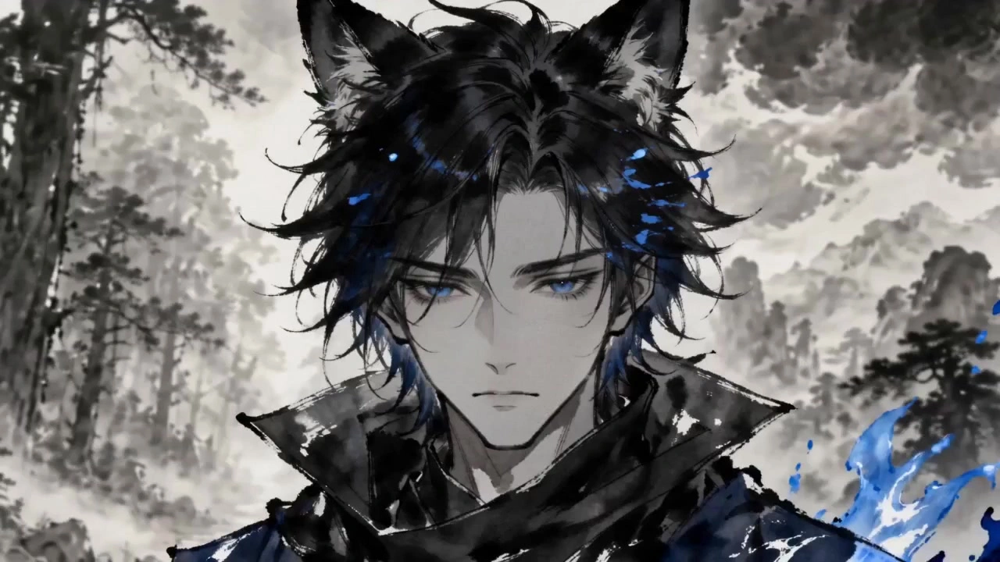

# Ink-Wash Martial Arts Video

> **作者：** @Damon

## Content

Process Planning:

Full-Process Stage Logic and Collaborative Orchestration:

Establish Global Specifications: Before starting the generation task, you must initialize the Final_Video_Spec.md using text_editor. Based on the user-provided plot or concept, explicitly set global parameters (aspect ratio 16:9, video resolution 720p, ink-wash wuxia style, voiceover and subtitle language).

Plan Storyboard: Call storyboard_designer to write a structured storyboard (including Key Elements for core characters and scenes, a shot list (including classic calligraphy freeze-frame cards), and independent audio tracks) based on the user-provided plot/concept.

Bind and Analyze Reference Assets: Prioritize identifying and reading user-provided character or scene reference images and action videos. Call resource_prepare_and_analyze to perform multimodal feature analysis. Focus on evaluating whether character images are standard character sheets (front, side, and back views), whether scene reference images are standard multi-angle, no-character, 4-grid scene reference images, and whether the art style is consistent with the ink-wash wuxia style of "Fog Hill of the Five Elements."

Stylistic Reshaping and System Completion of Image Elements:

When styles do not match or formats are irregular: If the user provides character images that are not character sheets (front, side, back), or the art style does not match the ink-wash wuxia style, or if provided scene images are not multi-angle, no-character, 4-grid scene reference images (or contain characters), it is strictly prohibited to directly bind them as references for final video generation. You must call media_generator's ImageToImage (using GPT Image 2). Using the user-provided asset images as spatial layout and color references, reconstruct and produce 2K no-character, 4-grid scene reference images (element scene) that are consistent with the ink-wash wuxia style and follow a fixed format (Grid 1: Panoramic Establishing Shot / Grid 2: Prop Close-up / Grid 3: Depth Perspective / Grid 4: Atmospheric Lighting), or compliant 2K character sheets (element character), to increase the information density of the scene reference images.

When completely missing: If the user has not provided any reference images, call media_generator's TextToImage (using GPT Image 2) to complete the generation of 2K character sheets and multi-angle, no-character, 4-grid scene reference images.

Binding and Closed-Loop Self-Check (Strictly Prevent Omissions): Bind the asset_id of all ink-wash style reshaped images, completed images, or the user's original images to the corresponding Key Elements. Before proceeding to the next step, you must check one by one that all Key Elements planned in the storyboard (including every character, scene, and key prop) have been successfully generated and bound to their corresponding image assets, ensuring nothing is missed. If any omissions are found, they must be immediately completed or bound; it is strictly prohibited to start shot-by-shot video generation while assets are not fully aligned.

Shot-by-Shot Video Generation and Coherence Control: Call media_generator's MultiModalToVideo, uniformly specifying the use of the Seedance 2.0 model (resolution 720p).

Prompt and Shot List Consistency Pre-check (Iron Rule): Before calling media_generator to generate each shot, the system must perform a deep alignment check between the written prompts and the storyboard shot script, focusing on verifying the following elements:

Character Reference: Confirm whether all main characters (element character) appearing in the storyboard have been bound in the prompts via <<<image_x>>> placeholders or characteristic descriptions, strictly preventing missed characters or the appearance of unrelated figures.

Scene Reference (Strict Binding and Anti-Jumping Rule): Confirm that the specific shot has been explicitly associated with a specific scene (element scene ID). Before generation, the system must check: the 4-grid reference image for this scene element has been successfully generated, bound, and absolutely linked in the prompt via <<<image_y>>>. It is strictly prohibited to start video generation when scene reference images are unbound, scene IDs are missing, or when shots of the same location reference inconsistent asset_ids! If the self-check reveals missing scene bindings, a mandatory pre-check backtrack must be triggered: call media_generator to prioritize completing the generation and binding of the 4-grid scene asset, then proceed to video generation, cutting off the source of scene jumping and abrupt background transitions.

Lines and Dialogue: Check if the lines and dialogue in the shot list have been 100% completely and accurately encapsulated into the Seedance 2.0 syntax block (e.g., {dialogue}), and that the corresponding character voice credential key_element_audio has been correctly input as reference_audio to prevent lip-sync and timbre breakage.

Action, Effects, and Camera Movement: Verify that the action descriptions, five-elements effects (gold, wood, water, fire, earth explosive phenomena), rapid camera movements (Whip Zoom/Pull/Pan), and sound effect (SFX) tags in the prompts perfectly match the storyboard script. If any omissions or deviations are found during the self-check, the prompts and reference bindings must be immediately corrected. It is strictly prohibited to start video generation with errors or missing assets.

Visual Consistency: During each shot's generation, the corresponding element character image and element scene image must be input as reference_image. If consecutive shots have high coherence requirements for action or scenes, the video generated in the previous shot can be introduced as reference_video (dynamic reference).

Sound and Lip-sync Consistency: If the shot contains character dialogue, the corresponding character voice credential key_element_audio must also be bound and passed as reference_audio (or timbre reference) to ensure that the lip-sync and timbre generated in the video remain absolutely consistent across shots.

Sound and Soundtrack Generation:

Character Dialogue and Global Narration: Call media_generator to select MiniMax Speech 2.8 HD to generate character voice characteristics that match the character persona, and register/bind it as the key_element_audio (timbre reference) for that element character; for narrative voiceover (VO), use the same model to generate an elderly voice with the fatalistic feel of a classic storyteller.

Environment and Soundtrack: Call the music and sound effect generation tool of media_generator to generate background music (bgm) with distinct traditional Chinese style characteristics, as well as high-frequency sword clashing and technique explosion sound effects (sfx).

Timeline Editing and Composition: Call video_assembler to assemble the timeline, performing fast editing and audio-visual alignment strictly according to the martial arts beats and the timing of "black and white ink flashes."

Execution Control and Pause Nodes:

Asset Generation Pre-confirmation (Core Iron Rule): Before generating any new assets (including element images, shot-by-shot videos, audio, etc.), you must pause and use reply_to_user to inform the user of the upcoming generation plan (including the planned prompts or reference relationships). Only after receiving the user's confirmation and permission can you call the tools to proceed with the next generation.

Node A (When Script and Storyboard are Locked): Pause after storyboard_designer outputs the storyboard, guide the user to confirm the plot and shots, and only proceed to subsequent stages after approval.

Node B (Asset Output and Verification Confirmation): After each batch or each important asset (such as character designs, scenes, key video shots) is generated or reshaped, it must be presented to the user. After all image element assets are generated, the system must perform a global self-check of the binding status, show the user the complete character and scene binding relationships, and only proceed to the next stage after receiving confirmation of satisfaction.

Asset Analysis:

Input Asset Analysis Specification:

When users upload images, videos, or manuscripts, or proactively provide Character Sheets/Character Design Materials or Scene Reference Images as a benchmark, invoke resource_prepare_and_analyze for in-depth analysis:

Style and Format Consistency Assessment: Determine whether the user-provided character design images match the ink-wash martial arts style of Fog Hill of Five Elements (Wu Shan Wu Xing) in terms of brushstrokes, color distribution, and freehand ink-wash aesthetics. Strictly verify whether the character design image is a standard "character sheet" (front, side, and back views), and verify whether the scene reference image meets the "multi-angle, character-free, four-grid" design standard. If the style does not match, or if it is not a standard character sheet or a four-grid scene image, record its "content features" such as body structure, clothing style, hairstyle, and scene composition, and output a clear conclusion: "Character image is not a character sheet, style is inconsistent, or it is not a four-grid scene image; requires re-shaping to ink-wash style and standardized format (character sheet/four-grid)."

Character Feature Extraction (for character sheets): Precisely extract the character's hairstyle, clothing style, iconic color scheme, carried props, and facial feature lines to provide precise parameters for character consistency.

Scene Feature Extraction and Four-Grid Verification (for scene references): Determine whether the scene image follows the multi-angle, character-free four-grid layout. If it does, extract the micro, macro, and atmospheric details from its four standard grids (establishing shot, close-up of furnishings, depth perspective, and atmospheric lighting effects). If not, extract its scene content, color tendencies, and iconic landscapes, and provide feedback: "Reference image is not a multi-angle, character-free four-grid scene image; requires initiating four-grid standardization re-shaping."

Color Extraction: Focus on identifying the ratio and distribution of traditional mineral pigments (azurite, malachite, cinnabar, etc.).

Line Style: Analyze the thickness and cadence of brushstrokes, and the ratio of "flying white" (feibai) and ink wash.

Action Rhythm: Extract the frame-level time spans for attack wind-ups, strikes, impact points, and recoveries from video references to provide specific parameters for subsequent shot sequencing.

Upon completion of extraction, directly distill the above analysis results into a text description and write it into Final_Video_Spec.md to guide the storyboard_designer and write_media_prompt in adhering to consistent style specifications.

Storyboard Design:

Design Key Elements:

element character:

Design Principles: Strictly encoded based on the "Five Elements" (Wu Xing) color system. For example, Fire Element Envoy (red tones, entwined with flames), Water Element Envoy (blue tones, frost/waves).

Fire Element Envoy Outburst State Special Color/Light-Dark Ratio & Physical Lighting: During outburst or ultimate skill states, implement an extreme contrast between "Flame Vermilion Red" and "Heavy Host Ink (Sujiaomo) Charcoal Framework" (approx. 70% vermilion red/molten gold flames, 30% extremely rough charcoal ink outlines and heavy shadows).

Kinetic Physical Texture: Present high-frequency licking flames from bottom to top, molten gold-like high-viscosity fluid rolling, accompanied by heat distortion on the rice paper space caused by scalding thermal convection. The edges of the flames feature dry, cracked "flying white" (feibai) and explosive ink splatters.

Microscopic Light Rendering: Flames appear as strong self-illuminating cores, casting ultra-high contrast crimson/molten gold reflections (kinetic glow) and intense dynamic backlights onto the body and limbs, outlining the surrounding 30% charcoal ink framework edges with golden-red sharpness, with shadows displaying rapidly flickering hard edges.

Water Element Envoy (Shentu Ziye) Outburst State Special Color/Light-Dark Ratio & Physical Lighting: During extreme cold or ultimate skill outbursts, the visual ratio is approx. 60% deep ultramarine/indigo ink wash, 25% biting flying white frost (negative space), and 15% extremely sharp, crystalline, cold-light-scattering frozen ice blades.

Kinetic Physical Texture: Demonstrate "liquid-solid state transition physical tension"; water flow is high-viscosity heavy ink wash (fluid wash drag), while ice cones show instantaneous freezing and brittle fracture (brittle crystal snapping). Water vapor has an impressionistic damping feel as it gradually permeates and diffuses on the rice paper.

Microscopic Light Rendering: Ice blades exhibit fine translucent medium luster and internal refraction. Against the dark blue ink wash background, external cold light casts sharp specular scatter and crystalline light fragments; the charcoal ink contours of the "Ice Bone Ink Soul" are contrasted by icy rim light, making them appear as crystal-sharp as knife edges.

Wood Element Envoy Outburst State Special Color/Light-Dark Ratio & Physical Lighting: During the "Forest of All Things" ultimate or outburst state, the visual ratio is approx. 65% high-saturation stone green/emerald green energy flow, 20% wild cursive charcoal ink vine framework, and 15% rapidly scattering bright golden flying leaves and wooden shards.

Kinetic Physical Texture: Vines present organic, resilient movement and high-frequency whipping similar to whip-like cursive strikes; plant growth is accompanied by extremely high-speed frictional tension and fiber tearing; flying leaves leave behind crisp, calligraphic "flying white" cleaves as they cut through the air.

Microscopic Light Rendering: Emerald green energy flows show strong chlorophyll subsurface scattering and ambient moss glow. Bright golden flying leaves reflect fragmented golden glints against the dark charcoal ink background; as light passes through the dense vines, it forms dappled rim light projected onto the character's side profile, breaking through the dark tones.

Earth Element Envoy Outburst State Special Color/Light-Dark Ratio & Physical Lighting: During the "Mountain Collapse/Earth Split" ultimate outburst, the visual ratio is approx. 55% dry-brush flying white charcoal ink boulders, 35% mineral ochre/orpiment splashed-color sandstorm, and 10% earth-crack radiance bursting from fissures.

Kinetic Physical Texture: Boulders present colossal tumbling inertia with heavy damping and ground shear where the surface cracks. Flying sand and stones are depicted as rough, hard, dry-brush scratches; dust clouds have a heavy, viscous texture like charcoal friction.

Microscopic Light Rendering: Boulder contours have extremely hard relief shadows/ambient occlusion. The yellow sandstorm physically occludes and attenuates surrounding light, creating a dim and oppressive atmosphere; the earth's pulsing cracks present high-energy glowing earth veins, casting hot, lava-like, bottom-up golden reflected light at the base of the charcoal ink rocks.

Metal Element Envoy Outburst State Special Color/Light-Dark Ratio & Physical Lighting: During ultimate skill or metal-edge outburst, the visual ratio is approx. 50% dazzling bright white blades and lightning light trails, 35% sky-filling scattered gold fragments and gold foil, and 15% heavy, deep charcoal ink iron-bone压阵 (anchoring).

Kinetic Physical Texture: Moves present absolute linear high-speed cutting kinetic energy (linear slicing energy); metal blades feature crisp, irregular calligraphic dry-brush scraping/tearing marks. Scattered gold fragments possess high-frequency vibration friction and the inertial spray of metal collision sparks.

Microscopic Light Rendering: Bright white blades exhibit blinding specular glints from intense lightning. The sky-filling, rapidly ejected flowing gold fragments and gold foil scatter dazzling golden sparkles across the rice paper space, illuminating the 15% anchoring charcoal ink iron-bone edges, creating sharp metallic rim lights; cold and warm tones produce glare under extremely high contrast.

If the user has provided a character design or three-view character sheet, the Storyboard description must strictly refine and follow its visual characteristics, maintaining high consistency; if not provided, the system will originate a design plan, including facial features, hairstyle, representative colors, and Chinese martial arts attire.

Facial Micro-expression and Emotional Outburst Setting Specifications (Rules for Micro Ink Details):

Daily and Standoff Dramatic Scenes (Emotional Micro-expressions): Facial settings must depict extremely delicate, impressionistic micro-expressions, including slightly furrowed brows, shifting eyes, and tense jawlines, capturing the gentle, ancient charm of the face through uniform, exquisite gongbi (fine-line) strokes.

Ultimate Skill Collisions, Outbursts, or Impact Moments (Extreme Emotions): The character's face must display extreme physiological and emotional tension. The shot list description must explicitly plan for: clenched teeth, violent contraction of masseter muscles, bulging facial veins on the forehead and temples, and pupils constricted to pinpoints or bursting with high-self-illuminating five-element colors.

Facial Ink Medium Fusion Details: When experiencing strong energy backlash, pain, or furious roars during ultimate clashes, sweat, tears, or blood flowing on the face must not be rendered realistically. They must be reshaped using impressionistic ink media: such as "viscous dry ink-wash trails" running down the corners of eyes/mouth, "flying white dry-brush scratches" exploding along facial contours and skeletal structure, and "kinetic ink splatters" at high frequency, along with heavy shadow-textured charcoal ink patches on the face, externalizing the character's emotional outburst and physical pain as ink-wash tears ripping across the rice paper.

Drawing Style and Kinetic Tension Coupling Setting (Core Rule): The drawing style must not be static; it must dynamically scale "ink tension" based on camera speed and kinetic energy intensity:

Static or Slow Camera Movement (e.g., drama, atmospheric/empty shots, extremely slow push/pull/pan): The drawing style setting must specify "fine-line gongbi outlining, thin and uniform lines with clear angles, gentle and elegant ink tones, preserving the delicate texture of the rice paper," showcasing Oriental scholarly etherealness.

High-Speed Camera Movement or Strong Strikes (e.g., Whip Zoom, Whip Pan, punches/kicks hitting, ultimate skill outburst moments): The drawing style setting must explicitly mandate "instantaneous transformation of drawing style, adopting extremely rough and wild charcoal ink dry-brush and flying white line work, lines instantly thickened with dry-cracked brush tips at the edges, and massive black ink splatters, presenting a hand-drawn original art骨架 (bone structure) and dynamic destructive power of high visual impact."

Voice Setting and Audio Evidence Planning: If the character includes dialogue, the design plan must explicitly plan its voice tone description (e.g., [Resolute and bold high-pitched young male voice, with a trace of raspy ink-wash martial artist texture]), using this as the foundation for voice characteristics to guide downstream generation and binding of the character's audio evidence key_element_audio. If the user provided a voice audio sample, prioritize extracting the tone from that sample.

Dialogue & Lip-Sync Planning:

Dialogue Phrasing and Breath Pauses: When designing shots with dialogue, dialogue descriptions must use concise, powerful short sentences that fit the martial arts atmosphere (single sentences controlled under 10 characters). Avoid long, complex sentences, leaving sufficient syllable duration for the video generation engine, and explicitly mark pauses and breath breaks in the dialogue (e.g., using "..." or ",") for the generation engine to adjust natural exhalation/inhalation and lip closure.

Strong Binding of Dialogue and Visuals: Shot descriptions must mandatorily link to the speaking element character and specify whether they are in a Close-up or Medium Shot, ensuring the audience can clearly see the opening and closing movements of their lip muscles.

element scene:

Design Principles and Multi-angle Character-free 4-Grid Specification (Core Rule): The background is an atmospheric, splashed-ink impressionistic landscape in the style of Zhang Daqian. Reference images for scenes must adopt the Multi-angle Character-free 4-Grid Scene Reference, with the content of its four grids strictly fixed as:

Panorama/Establishing Shot: Dictates the macro-outline, terrain, and skyline proportions of the scene.

Furnishing Close-up: Details micro-ink textures of key objects, props, and natural landscapes (e.g., ancient pine, stone tablet, table).

Deep Perspective: Displays the layers of foreground, middle ground, and background, along with deep perspective leading lines.

Atmospheric Lighting: Specifies the main color tone wash range and the lighting contrast atmosphere of this environment. If the user has provided a scene reference image, the Storyboard description needs to precisely extract its terrain, spatial layers of each angle, and color tendencies for refinement and precipitation; if provided references do not conform to the 4-grid specification or are not provided, the system will originally design this 4-grid plan based on user intent.

Ink Physics and Aesthetic Settings for Classic Chinese Furnishings (Rugged Pines, Isolated Tablets, Bamboo Forests, etc.) (Rule for Micro-Texture and Light-Dark Contrast):

Rugged Ancient Pines: Branches must be brushed horizontally with rough, staccato dry-brush (rough dry-brush) strokes to show the weathered, cracked scaly bark texture. Pine needles should be gathered into clusters with high-frequency, ultra-fine-line gongbi, presenting a high-contrast thorn-like texture. In terms of lighting, the undersides of pine branches are anchored with dark Sujiaomo/Charcoal ink, while light-receiving surfaces are left blank or coated with extremely faint mineral light gold, revealing a steel-bone pride through the intense collision of dense and light ink.

Isolated Ancient Stone Tablets: The tablet's body must present irregular, cracked hard corners; the surface is underpainted with large areas of wet-on-wet wash, then outlined with dry charcoal-ink for weathered cracks and mottled carvings. Tablet inscriptions or moss are accented with high-saturation stone blue or vermilion splashed color, forming piercing microscopic highlights amidst the surrounding heavy ink. Strong dramatic side light cuts out hard relief shadows on the sides or corners.

Whispering Bamboo Forests: Distant bamboo forests are blurred with large areas of wet ink and very light splashed-ink gradients, while close-up bamboo stalks rise from the ground with crisp, full dry calligraphic strokes, with staccato charcoal ink dots used at the bamboo joints. Bamboo leaves are depicted using the swift and decisive "ge/jie" character leaf-stripping method, with edges featuring cracked brush-tip flying white; in the breeze, they present overlapping, swaying translucent layered shadows, casting dappled rim light through the gaps.

Ink Color and Splashed-Color Ratio Specification (Light-Dark Ratio): According to different scene types, strictly regulate the visual ratio and light-dark contrast between the ink black/white/gray base and high-saturation mineral splashed color, ensuring a balance between Oriental mood and combat tension:

Non-combat/Atmospheric Empty Scenes (Highest Aesthetic Parameters for Drama): Visuals strictly follow the "Three-Dimensional Unity" Chinese Painting Composition Parameters:

Fine-line Gongbi (35% - 40%): Main characters, key props, and close-up edges of trees/stones are outlined with extremely thin, uniform, and coherent fine-line gongbi, retaining gentle details of hair, clothing texture, and micro-expressions.

Negative Space (35% - 40%): The image retains large areas of pure, high-quality rice paper texture as negative space, using clouds, misty rain, and distant water for light-ink gradient blurring, presenting a "breathable" interaction between presence and absence; backgrounds must not be fully filled.

Classical Landscape Splashed Color (20% - 25%): Faint mineral colors (such as stone blue, stone green, light ochre, or mineral light gold) are only used to accent distant mountain ranges, bamboo forest edges, or both sides of waterfalls; ink washes are divided into the five colors of "charcoal, dense, heavy, light, clear," with soft lighting contrast, rejecting any hard-edge strong light sources.

Conventional Combat/Action-Drama Transition Scenes: Use a balanced ratio (approx. 50%-60% black/white/gray base, 40%-50% splashed color). Background landscapes use large areas of splashed ink, but important visual focal points or terrain layers are layered with bright peacock blue or stone green; lighting employs high light-dark contrast, such as a beam of strong light penetrating through dense charcoal ink clouds to cast onto the center of the battlefield, creating a sense of breath within the heavy ink.

Climax Decisive Battle/Five-Element Collision Scenes: Use color-dominant and heavy-ink anchoring ratio (approx. 30% charcoal ink bone structure, 70% explosive splashed color layering). High-saturation vermilion red, bright gold, or stone blue are splashed over large areas and collide fiercely, but must be outlined with rough, high-power charcoal ink and Sujiaomo to define object structures and lines (ink bones with colorful clothes). Use deep ink's heavy tones to control the image's center of gravity, preventing color overload from making the image look cheap. Lighting adopts extreme high contrast, with light like lightning tearing through black rice paper.

Design Shot:

Shot Duration and Rhythm Dynamic Planning Specification (Solving the Pain Point of a Default 5-second Duration for All):

Strictly Prohibit Defaulting All Shots to 5 Seconds: When designing the storyboard, dynamically and explicitly set the duration attribute for each shot based on the intensity of the action, information density, and dialogue word count. Remember that the Seedance 2.0 model has a 4s hard lower limit for video duration; single-shot duration must be strictly controlled between 4s - 12s, and planning any ultra-short shots under 4 seconds is strictly prohibited.

Duration Matching Rules:

High-Speed Fighting/Instant Skill Switching/Close-up Shots (e.g., fast push, single heavy strike, teleportation, flash-white moments): Set the time value to 4s - 6s. These shots focus on explosive power and visual impact; short durations keep the editing high-frequency, compact, and martial arts impactful.

Combos/Skill Intersection Deadlocks/Ultimate Collision Shots: Set the time value to 6s - 9s. Reserve sufficient image growth time for these shots, which require displaying complex momentum changes, multi-stage strikes, particle explosions, and camera push/pull.

Dialogue/Power-up Drama/Atmospheric Empty Shots/Monster Breath/Blast Shots: Set the time value to 9s - 12s. Ensure that dialogue word counts (controlled under 10 characters per sentence, calculated at 2-3 characters per second) have ample duration for lip-sync and mouth shape synchronization, and allow slow pans/cloud-mist fades in dramatic or atmospheric landscape shots to have sufficient breathing room and image expansion space.

Strong Scene Binding and Consistency Specification (Preventing Jump-cuts from the Source):

Explicitly Point to Scene ID: Every shot in the storyboard design must explicitly declare its affiliated scene element ID (scene_id, e.g., pointing to [Element_Scene_01]). Planning shots without scene attribution or using vague generic descriptions is strictly prohibited.

Continuous Scene Full Reuse: If adjacent shots occur in the same location, within the same timeframe, or belong to the same combat/dialogue round, the scene element ID pointed to in the shot list must remain absolutely consistent (the exact same ID). The downstream generator (media_generator) will load and reuse the same 4-grid scene reference asset based on this ID, eradicating the problem of "scene jump-cuts, background inconsistency, and abrupt continuity errors" at the source of storyboard design.

Combat Storyboard Design:

Style Grading: According to the character type, explicitly note their fighting style in the shot description:

Human Characters: Martial arts realism, blades, fists, and kicks, fluid and natural (every hit feels real).

Monster Characters: Fantasy exaggeration, weird and changeable (physical mutation/deconstruction, non-linear trajectories, strong terrain tearing and crushing destruction power).

Five-Element Envoys: Combining reality and abstraction, both spells and real martial arts are equally important. Shot descriptions must clearly specify the specific presentation form of the five-element moves:

Metal (Metal Element): Moves are accompanied by metal-textured blades, sky-filling scattered gold fragments, and bright white light trails; movements are big and open, showcasing unstoppable sharpness.

Wood (Wood Element): Moves appear as wild cursive-brush-like vine entanglements, leaf-blades like knives, and emerald green vitality energy flows, combined with nimble dodging and physical techniques.

Water (Water Element): Moves combine fluid mechanics water flow, ice cone condensation, and ink wash blurring; water force and ice blades alternate, both offensive and defensive, fluid and natural.

Fire (Fire Element): Moves are wrapped in raging flames; flame edges have clear charcoal ink brush staccato textures; flame outbursts are accompanied by explosions and high-speed displacement strikes.

Earth (Earth Element): Moves appear as collapsing boulders, flying sand and dust, and rising rock walls; rock contours feature heavy, dry-brush flying white lines.

Core Skill Style Shot Rules: When the following actions are involved in storyboard shots, the corresponding camera design must be followed:

Punching and Kicking Combos (Boxing/Fist/Combos): Single strikes focus on the moment of explosive power, designing close-ups of tense muscles accompanied by medium-close shots of "chi energy bursting" (ink-wash ripple explosion); Multi-stage combos (Combo Rush) are planned as high-rhythm edit points alternating between fast and slow, with continuous medium/close shots hard-cut配合镜头剧烈震颤 (matching with violent camera shake) to showcase strong bone stress and physical impact feedback.

Qinggong/Leaping: Focus on spatial movement and the feeling of loss of gravity. The camera follows the character leaping from an extremely low仰角 (low-angle shot), with the background landscape falling rapidly downwards to highlight the height; design slow-motion (0.5x) when the character hangs in the air, and plan impressionistic lines of "Motion Trails" along their sliding trajectory.

Hidden Weapons: Focus on multi-angle high-frequency quick cuts. First give a close-up of the character's finger strength (extreme close-up), then track the hidden weapon trajectory with a Whip Pan or POV; when the hidden weapon flies, it draws sharp silver-white hard-brush sharp lines (Speed lines), and design a hard-cut explosion close-up upon hitting the target.

Swords/Cold Weapons/Blade Lock: Focus on defensive parrying and the life-and-death struggle of edge interlocking. The storyboard must design extreme close-ups of "blades meeting, sparks flying violently," or "Impact Frames / Flash White" at the instant of weapon collision; then show the micro-dynamic tension of bulging facial veins, eyes locked in a death stare, and weapons trembling violently in the metal deadlock (Weapon Lock) state.

Tai Chi Qigong / Soft Palm Winds: Focus on the impressionistic tension of "using softness to overcome hardness, accumulating slowly to strike rapidly." The storyboard design adopts continuous slow-motion circular palm movements in the initiation and accumulation phases, with the camera orbiting extremely slowly, while ink-wash auras slowly form around the character; at the moment of striking, design a "camera push hard-cut," compressing the chi into a huge impressionistic air wave/ink-wash ripple explosion, cracking the background landscape into impressionistic ripples. Instruct video_assembler to use an auditory vacuum sensation during the accumulation period and apply ultra-low-frequency air oscillation at the instant of outburst.

Agility/Dash/Teleportation: Focus on the instantaneous spatial position change and visual tension imbalance. The storyboard design must plan for a close-up of power accumulation/crouching or tilting for high-speed starting before initiating teleportation; at the moment of teleportation, the character's original position must be designed with an "ink ghost/residual wash silhouette" while the main body instantly vanishes and condenses at the new position, with medium or panoramic shots presenting non-linear "broken-line displacement"; background landscape produces instantaneous stretching and closing of impressionistic lines along the displacement axis (Motion Lines). Instruct video_assembler to coordinate with rapid airflow friction and explosive sound effects of in-place air implosion.

Monster Eerie Moves & Destructive Strikes: Focus on expressing the monster's uncanny movement changes, physical deformation/deconstruction, and the violent physical mass that destroys the environment.

Metamorphosis/Morphing: Plan for local limb (e.g., scales, claws, wings) instantaneous distortion and expansion in the storyboard, or the monster's form melting into viscous black demonic ink mists when struck, suddenly condensing and reforming at a new position. Utilize strong Dutch angles and wide-angle distortion to highlight the grotesque and physiological oppression.

Claw Slashes & Savage Mauling: Do not follow conventional human martial arts lines; use jagged, non-linear, and abruptly-bending wild slashing vectors (jagged slash vectors). The storyboard design depicts black, deep purple (ochre/purple), or toxic emerald green impressionistic ink-wash marks tearing through the air. Each attack hit must be accompanied by extreme close-ups of the environmental entity (boulders shattering, trees broken in half, ground exploding open) being destroyed, highlighting the substantial physical cutting and destruction of the image.

Demonic Breath & Shockwave Roars: Design the monster's throat and chest demonic fire surging in the storyboard, with surrounding air producing impressionistic converging refraction lines due to strong suction; at the moment of breath outburst, the camera whip-pulls (Whip Pull), showing high-energy bombardment tearing a huge flying-white vacuum belt through the impressionistic landscape like thick splashed ink and dense smoke/flames, delivering a horizontal heavy blow to the受击主体 (target). Instruct video_assembler to coordinate with multi-track ultra-low-frequency explosion and high-frequency tearing explosive polyphony.

Five-Element Countering Confrontation and Transition Mechanism: In the design of duel storyboards involving Five-Element overcoming (e.g., Water overcomes Fire, Fire overcomes Wood, Wood overcomes Earth, Earth overcomes Water, Metal overcomes Wood), a visual contrast must be established through intense color and element conflict, and countering transition rules must be designed:

Strong Color Contrast: The moves of the warring parties must present a strong color contrast (e.g., large-scale confrontation between blue ice waves and crimson flames, vermilion fire seas devouring emerald green flying leaves, etc.), using the covering nature of splashed color to create a sense of overcoming.

Countering Transition Image Design:

Water overcomes Fire: Design a close-up of a giant wave instantly extinguishing flames in the form of an ink-wash bleed, producing large-scale white steam, or frost spreading along the direction of the flames, causing them to harden, freeze, and crack.

Fire overcomes Wood: Design raging flames spreading rapidly like ink on rice paper, carbonizing wild cursive vines and flying leaves into black charcoal ink fragments falling down.

Wood overcomes Earth: Design vibrant green vines forcefully piercing and cracking dry-brush boulders with wild cursive strokes, and rapidly growing green leaves where the rock wall cracks.

Earth overcomes Water: Design heavy dry-brush boulders instantly rising from the ground to cut off rushing water, or the textural conflict of flying sand/dust forcefully sucking dry the ink-wash and leaving it parched.

Metal overcomes Wood: Design sharp golden blades accompanied by bright white light trails, sweeping through like a gale, neatly cutting through flourishing vines, with the broken ends bursting into sky-filling scattered gold fragments.

Duel Transition Rhythm: At the moment of a countering fatal blow or major skill collision, an "Impact Frame" (Black-and-White Ink Flash) must be arranged for visual hard-cut transition, or use the countering element's color to instantly render/erode the opponent's tone as a visual prelude for the transition.

Signature Camera Language:

At the climax of fighting, explicitly design "Impact Frame" (Black-and-White Ink Flash) shots: Instantly switch the image to pure black-and-white, retaining only the rough, hard-edged ink-wash lines to burst with power.

Whip Camera Language Specifications:

Whip Zoom / Push: Used for moments of power accumulation/bursting, extreme close-ups of facial pulling, or core explosion points of weapon impacts. The storyboard shot description must clearly specify a Hard Push from a panoramic/medium shot to an extreme close-up of the character's eyes, tense limbs, or blade interlocking, establishing instantaneous oppressive tension. Instruct video_assembler to arrange rapid-advance and high-energy gathering sound effects on the beat.

Whip Pull / Pull-back: Used for shockwave explosion/diffusion, being hit/flying backward, or retreating after accumulation. Require a Hard Pull from an extreme close-up/partial detail in a second-level instant to a panoramic or long shot, pulling out the grand pressure of scene explosions, rock crumbling, or sandstorms sweeping. Instruct video_assembler to arrange low-frequency spatial sound effects with sound pressure expanding in all directions.

Whip Pan / Sweep: Used for agility dodging, high-speed folding, multi-directional attacks, or melee brawls. The camera conducts extremely high-speed horizontal or vertical sweeping (Whip Pan) along the action's force direction or gaze trajectory; the description must note "background ink/wash blurs at high speed, scenery turns into impressionistic streamlines, focus is firmly locked on the kinetic tangent of the action." Instruct video_assembler to arrange stereo panning sound fields (Stereo Panning).

Combo & Move Switch Transition Guidelines:

Motion Vector Alignment: The hard-cut transition between continuous combo shots must ensure the continuity of action inertia and direction. The force-application kinetic vector direction of the previous shot (e.g., horizontal sweep from right to left) and the force-receiving direction of the following shot's reception/reaction (e.g., flying backward from right to left) must be completely on the same dynamic vector axis. When switching moves (e.g., fist to sword, mid-air change of direction), the camera cut point must be locked on the absolute frame where the move inertia is greatest, achieving a seamless hard cut using the ultimate pull of the action axis.

Ink-Wash Motion Trails & Afterimages: In storyboard designs for high-speed combos and large-scale move switching (e.g., instantaneous dash, flip/dodge), specify that limb or legendary weapon trajectories are accompanied by "multiple translucent ink afterimages" and "sharp jagged calligraphy trails." Use these ink traces that remain in the space for 0.2s - 0.5s to bridge the visual gap between shots, making the hard-cut transition possess both hard mechanical strike feel and the viscous, coherent aesthetics of ink-wash fluid.

Expressive Particles & Charcoal Smoke Guidelines:

Expressive Particles: When characters are hit and fly back, ultimate skills collide, or cold weapons shatter, the shot description must explicitly plan for "mineral pigment flakes," "shimmering gold foil & dust," or "dry-brush calligraphy splinters" as the visual carrier for the release of kinetic energy and the aesthetics of incompleteness; homogeneous, glowing magic digital particles are prohibited.

Charcoal Smoke Effects: For skill outbursts, ground explosions, or the spread of demonic energy, the shot description should explicitly design "rough textured charcoal-ink smoke" and "burnt paper ash," with edges presenting brush-tip burnt edges and flying-white dry-brush scratches, giving the smoke the physical reality and weathered bone-style of ink gradually permeating/blurring on rice paper.

Camera Movement Assistance: Combine with extremely low-angle shots to enhance the three-dimensional encirclement and oppression of the action.

Typography Title Cards: To recreate the iconic visual appearance of skills or character debuts from the original work, the storyboard should plan a separate 4s close-up shot (shot) at key climax points or the character's first debut as a "Calligraphic Title Card."

The description must clearly state the text content to be presented (e.g., [Fire Element · Wen Ren Yu] or [Ten Thousand Fires into One]).

The image setting is: Huge, wild, and rough traditional Chinese calligraphic characters directly cracking and exploding on the rice paper, with a background of intense charcoal ink flying-white scratches, splashed-pigment explosions, and heavy Sujiaomo gradually permeating/blurring, without any other redundant character interference, maximizing the sense of destiny.

Dialogue Design: If a character speaks in every shot, the dialogue must be written independently in the dialogue attribute in the storyboard.

Non-combat Ink Mood Shots and Poetic Transition Design:

Poetic Scenery Shots: In drama, empty shots, character monologues, or emotional transitions, explicitly design slow-paced ink-wash shots rich in poetry. The description must incorporate traditional Chinese painting moods such as "distant mountains like dark eyebrows, layered peaks, hazy misty rain, large areas of negative space."

Poetic Transition Planning: Between these non-combat scenes or when alternating between action and drama, explicitly plan transitional shots of "Ink Bleeding" or "Flying-White Trailing," where the description must indicate how the ink naturally permeates/blurs on the rice paper, or how the dry-brush flying white texture left by a swift brush-sweep evolves into the environment of the next shot.

Long-Scroll Panning & Visual Breathing: Long-shot slow panning (Pan/Tilt) or pulling (Pull-back) must showcase the slow-fast-slow aesthetics of a slowly unfurling Chinese handscroll (Handscroll). When designing the shot, the camera's moving rate must be described as "micro-speed, extremely gentle," and explicitly mandate the image's "breathing"—i.e., the charcoal ink and heavy colors at the edges of the image slowly fade in or out as the pan progresses, while clouds and misty rain undergo a soothing "breathing-style" diffusion (airflow moving at micro-speed) in the center of the image, and negative space expands/contracts progressively with the display of the landscape terrain during the pan, avoiding a dull, static background.

Decorative Close-up Planning: In lyrical, power-accumulating, or empty-shot storyboards, explicitly design slow-pushing close-ups and extreme close-ups (Close-up to Extreme Close-up). The camera focus must be firmly locked on the residual carvings on an isolated tablet, the resilient cracking of a gnarled pine branch, or a drop of ink slipping off a bamboo leaf. It is required that the shot description creates a visual collision of immense intent through extremely subtle camera shaking or cloud movement, contrasting the macro-hardness/uprightness of the furnished objects with the wet-blurring, high-light-dark-contrast fluidity of the ink medium.

Design audio_layer:

BGM: Plan a rhythm-heavy ink-wash martial arts BGM primarily featuring classical instruments like the guzheng, erhu, and flute, integrating electronic rock and heavy percussion elements. When designing, reserve obvious rhythmic downbeats and auditory breathing pauses (drop/rests) for climax collisions.

Ambience: Plan delicate Chinese impressionistic environmental sound effects (e.g., wind through bamboo forests, light rain hitting leaves, rustling of paper, dripping ink bleeding), establishing an ethereal rice paper spatial floor noise, and set dynamic breathing intensity based on the alternation of drama and action.

SFX:

Conventional Martial Arts Moves: Must plan high-frequency, crisp blade-clashing sounds, muffled thuds of body impacts, and the sound of Qinggong wind-passing.

Five-Element Countering Major Collision: According to the type of collision, explicitly plan impressionistic strike sound effects with dual-layer characteristics (e.g., [Metal overcomes Wood]'s metallic splitting of blades cutting through lush vines and the complex polyphony of wood breaking; [Water overcomes Fire]'s angry wave slapping and the high-pressure steam hissing produced by instantaneous flame carbonization). }

Media Generation:

Visual Element Generation Strategy (GPT Image 2):

Core Instructions:

When style and format match perfectly: If the user actively provides assets that meet the requirements, such as a standard character sheet (front, side, and back views) or a multi-angle character-free 4-grid scene reference, and the multimodal analysis determines that the style matches the ink-wash martial arts style of Fog Hill of Five Elements (Wu Shan Wu Xing), then directly use these assets as the standard and skip the generation of the corresponding elements.

When style or format do not match: If the user provides character design images but they are not standard front, side, and back views (character sheet) or do not match the art style, or if the provided scene reference image does not meet the multi-angle character-free 4-grid scene reference specifications (or contains characters), the system must call ImageToImage, designate the GPT Image 2 model, use the user's image as a reference for scene terrain, spatial composition, and color tone, and reconstruct it to create a 2K character-free 4-grid scene reference image that matches the Fog Hill of Five Elements ink-wash martial arts style, has high information density, and meets the fixed 4-grid content allocation (Grid 1: Full Shot Establishing, Grid 2: Prop Close-up, Grid 3: Depth Perspective, Grid 4: Atmospheric Lighting).

When no assets are provided: If the user does not provide any assets, the system must call TextToImage in conjunction with the GPT Image 2 model to perform original completion generation (including character three-views and 4-grid scene images).

Resolution Control: Image output resolution is uniformly set to 2K to ensure the retention of texture and line details.

Character Consistency and Three-View Generation (During system completion and reshaping):

For system-original completions, or characters reshaped based on non-three-view character design images provided by the user, the first image generated must prioritize reshaping/generating a character sheet (three-views) concept image containing front, side, and back views as the ultimate specification for the overall character design.

When generating subsequent poses and expressions for the character, this three-view (whether reshaped by the user, generated by the system, or provided by the user as a high-quality standard character sheet) must be introduced as the core reference_image to ensure that facial features and brushwork textures remain highly consistent.

Scene 4-Grid Generation and Information Density Specification (During system completion or reshaping):

When using the GPT Image 2 model to generate scene images, the prompt must be strictly limited to "4-grid layout, no characters," and the content of the four grids must be fixedly assigned as: Full shot establishing, prop close-up, depth perspective, and atmospheric lighting, producing a design image with white dividing lines to ensure absolute high-density accumulation of multi-angle scene information. The output resolution is uniformly 2K.

Audio Characteristic Generation Strategy (MiniMax Speech 2.8 HD / ElevenLabs v3):

Core Instructions (Generation and extraction of key_element_audio):

When there is no user audio input: Use the audio generation tool, defaulting to MiniMax Speech 2.8 HD (preferred for Chinese and multilingual) or ElevenLabs v3 (preferred for English), to read the "Voiceover Tone Setting" text defined in the element character of the storyboard. Specify voice characteristics, pronunciation tone, and chivalrous spirit parameters to generate a 5s - 10s, clean-noise, full-sounding monaural high-fidelity character voice sample.

When there is user audio input: If the user provides a character voice sample, call resource_prepare_and_analyze to perform high-fidelity voice feature extraction (Voice Cloning/Timbre Extraction) on the audio to obtain its acoustic fingerprint and specific voice frequency characteristics.

Asset Registration and Audio Credential Binding: Register the generated original sample or the cloned/extracted voice audio as a stable Logical Asset, and bind it to the voice attribute of the element character as the character's audio credential key_element_audio. This credential is the unique acoustic handle for maintaining absolute consistency in voice quality across shots.

Global Voiceover (VO Narration) Audio Generation Specification: If narration spanning multiple shots is planned in the storyboard, the system must designate MiniMax Speech 2.8 HD (Chinese) or ElevenLabs v3 (English) when generating narration audio.

Fated Sound Parameters: Forcefully set the narration voice description to [Calm and resonant, with a very strong sense of fate and vicissitudes of an old classic storyteller's male voice, clear articulation, rhythmic tone, ethereal and slightly hoarse], to establish an atmospheric and archaic story background tone.

Multi-track Registration: Register the generated long narration audio as an independent narration logical asset and bind it directly to the corresponding audio_layer (independent audio track) for subsequent multi-channel volume and frequency band ducking during editing.

Video Generation Strategy (Seedance 2.0):

Core Instructions: All shot video generation must use MultiModalToVideo in combination with the Seedance 2.0 model; the use of any other models is strictly prohibited.

Consistency Pre-check: Before executing MultiModalToVideo generation for each shot, the system must self-check and verify the prompt and corresponding storyboard script for that shot to ensure that it includes, without omission: character reference image (element character), scene background image (element scene), the character's dialogue syntax block ({dialogue}), and the audio credential (key_element_audio) corresponding to their voice. Ensure that actions, effects, and camera movements in the prompt are perfectly aligned. Only after confirming that everything is correct can the generation task be issued.

Format Specification: Output video resolution must be strictly controlled to 720p (perfectly adapting to non-members/members user requirements and 16:9 aspect ratio).

Reference Binding and Lip-Sync Binding Mechanism:

When generating a single shot video, the corresponding reference sources must be input and bound:

Character Consistency (Core): The corresponding character element (element character) concept image as the visual benchmark for character appearance and clothing.

Scene Consistency (Core, the ironclad rule for absolutely preventing jumping images and background mutations): The corresponding scene element (element scene) multi-angle character-free 4-grid scene image. The system must strictly parse the scene_id corresponding to the shot and pull the asset_id of the 4-grid reference image uniquely bound to that scene; it is absolutely required to reuse and only allowed to pass this uniquely bound asset. If adjacent shots or the entire film point to the same scene ID, the system must bind the exact same scene asset_id resource in MultiModalToVideo as the reference_image; it is strictly prohibited to dynamically regenerate different batches of scene images! Before generating the video, the prompt must forcefully include a precise description of the specific content allocated to each grid of the 4-grid reference image (Grid 1: Full shot establishing, Grid 2: Prop close-up, Grid 3: Depth perspective, Grid 4: Atmospheric lighting) as reference input for the video generation engine (Seedance 2.0), combined with anti-split screen/anti-collage instructions to force the fusion of 4-grid features into a single continuous 3D shot frame (see write_the_prompt rules for details), completely preventing the generation of split-screen or 4-grid videos from the source.

High-Precision Audio and Lip-Sync Alignment (Lip-Sync Core): If the character has dialogue in the shot, in the audio reference of the MultiModalToVideo task, the character's audio credential key_element_audio must be forcefully bound and passed in as reference_audio. During video generation, the multimodal model will read this voice feature and the {dialogue} text in the prompt, and drive the character's lips, tongue, facial masseter muscles, and mandible to perform millisecond-level speech contour alignment (Phoneme-to-Viseme alignment) through the Acousto-Visual Cross-Attention mechanism. The character's pronunciation mouth shape, breathing rhythm, and the frequency of the key_element_audio in the generated video frame must reach perfect physical-level synchronization to strictly prevent glitches such as mouth shapes "not opening, not matching, or out-of-sync opening/closing frequencies."

Cross-Shot Continuity (Optional): If the current shot has strong continuity with the previous shot in terms of action or space, the previous shot's video can be passed in as reference_video to ensure the smoothness of the visual transition and the consistency of colors/brushwork.

Duration Constraint: The video generation tool must strictly read and inherit the duration attribute set for that shot in the storyboard. Given that the Seedance 2.0 model has a hard physical minimum duration limit of 4 seconds, the generated duration must be strictly controlled between 4s and 12s. It is strictly prohibited to generate or request any video shot shorter than 4 seconds, using this as the absolute duration parameter for generation commands; it is strictly prohibited to ignore the storyboard's duration setting or uniformly apply default durations such as 5 seconds. Actively cut shots when action changes are significant.

Fault Tolerance and Exception Handling Mechanism: Because this short film production is locked to use Seedance 2.0 for all video production, the use of any other video generation model (such as Kling 3.0 Omni or Seedance 2.0 Fast, etc.) is strictly prohibited. If Seedance 2.0 reports an error due to permissions, quotas, or system errors, the system should not perform any downgrades to other models; it should directly pause the task and feed back the error cause to the user, who will decide how to proceed.

Prompt Writing:

Language Priority and Dominant Style Writing Standards:

Advanced Language Consistency Rules: When the user interacts in Chinese or the system loads a Chinese UI, the prompt body must be written in Chinese. However, key artistic terms, style tags, and Five Elements (Wu Xing) effect tags should adopt bilingual references or bracketed annotations (e.g., traditional Chinese ink wash painting (水墨写意)) to ensure accurate model comprehension. For dubbing text such as dialogue or narration, strictly follow the output language specified in Final_Video_Spec.md.

Image Generation Prompt Writing (GPT Image 2):

Dominant Art Style Tags (Written at the start):

"Wu Shan Wu Xing (雾山五行) anime style, traditional Chinese ink wash painting, dynamic ink splash (泼墨写意), gorgeous mineral pigment splash colors (泼彩叠彩: emerald green, malachite blue, cinnabar red, ochre, rich gold)."

Lines and Character Texture (Scaling style to match camera kinetic energy):

Static/Slow-motion Lens Prompts: "refined fine-line ink wash painting, elegant delicate outlines (工笔细描, 纤细匀称线条), smooth wet-on-wet ink gradients, clean paper texture, peaceful posture."

Dynamic/High-energy Impact Lens Prompts: "rough hand-drawn keyframe animation style, extremely thick charcoal ink lines (粗犷焦墨勾线), dry-brush scratch marks (枯笔飞白排线), massive explosive ink splatters (爆裂泼墨喷溅), raw sketch aesthetic, high-velocity action."

Character Three-View Special Prompts (For system completion and reshaping):

When generating/reshaping character three-views, append the following to the prompt: character sheet, three-views study, front view, side view, back view, standing, white background. Integrate the user's reference image features at the beginning of the prompt for fused redesign to ensure the generated concept art has regular, clean structure with clear front/side/back views, facilitating subsequent multimodal understanding and video generation binding.

Scene Multi-Angle Non-Character 4-Grid Design Chart Prompt Standards (For system completion or reshaping):

When generating 4-grid scene charts, the prompt must forcibly include: "scene design sheet, 4-grid layout (四宫格布局), no characters, no humans (无人物), clear white border separators, traditional Chinese ink wash style."

You must explicitly quantify the content fixed for each grid in the prompt: "Grid 1 (top-left) shows a panoramic establishing shot of the entire landscape (全景定场); Grid 2 (top-right) shows a detailed close-up of scenic objects and furnishings like ancient trees, tables, or stone monuments (陈设特写); Grid 3 (bottom-left) shows deep perspective lines and multi-layered depth of the scene (纵深透视); Grid 4 (bottom-right) shows dramatic atmospheric lighting with gorgeous mineral pigment splash and heavy ink contrast (气氛光效)."

Calligraphy Title Card Prompt Writing Standards (Typography Title Cards, GPT Image 2 / Seedance 2.0):

When generating such pure text/title cards, the prompt must use minimalist black/white/gray or high-contrast splash color designs, forcibly including: "gigantic traditional Chinese calligraphy characters in heavy black ink (重墨书法大字), bold aggressive calligraphic brushstrokes showing furious energy, bleeding ink on aged Xuan paper (宣纸宿墨渗透), splashing cinnabar red mineral pigment, dynamic black ink splatters, hyper-detailed traditional Chinese art style, extreme high-contrast, epic martial arts movie title cards, negative space (留白)".

In the prompt, use English double quotes and Chinese brackets to overlap the words to be presented (e.g., the words "【万火归一】" written on the center), ensuring the text edges have wild cursive dry-brush strokes (dry-brush calligraphy edges). Strictly prohibit the generation of any human figures, modern English fonts, or CGI 3D effect text.

Classic Chinese Landscape Furnishing Ink Texture Prompt Standards (Bilingual, applicable to full process):

Rugged Ancient Pines: "gnarled ancient pine tree (万古古松), rugged scaling bark with dry-brush calligraphic lines (开裂焦墨树皮), needle clusters rendered in fine-line gongbi detail (工笔松针), extreme high-contrast lighting, mineral pale gold highlights on top branches, heavy ink shade underneath (重色焦墨压阵), dramatic ink wash martial arts aesthetic."

Isolated Ancient Stone Tablets: "weathered solitary stone monument (孤碑), jagged stone textures with dry calligraphy cracks (枯笔石纹裂隙), moss spots painted as vibrant malachite green and cinnabar red splatters (石绿与朱砂写意泼彩青苔), glowing ancient engraved characters, dramatic sharp side-lighting casting deep relief shadows, atmospheric ink wash background."

Whispering Bamboo Forests: "dense bamboo forest shrouded in ethereal mist (竹林云雾), bamboo stalks drawn with rapid calligraphic strokes showing dry ink nodes (干笔墨竹), bamboo leaves in sharp individual brush-marks (个/介字撇叶), dynamic translucent layered shadows (半透明叶影叠层), dappled sunlight filtering through rustling canopy (斑驳碎光), highly textured Xuan paper canvas."

Lighting and Composition:

"High-contrast dramatic lighting, cinematic framing, detailed paper texture, stylized traditional aesthetics."

Five Elements (Wu Xing) Effect Style Texture Standards (Bilingual Prompts):

Metal Element Effects and Burst State: Use "glowing gold calligraphy ink lines, metallic golden slashes, sharp gold dust, bright white light trails, physical weapon slashes" to present the interwoven bright gold and white light, and sharp metallic cutting sensation;

Metal Element Burst State Additional Prompt: Use "50% blinding white glowing razor-sharp metallic edges with blinding specular glints and lightning-fast linear weapon slashes (亮白镜面高光锋芒与线性极速光轨), 35% explosive shimmering gold foil flakes scattering dynamic golden sparkles (漫天激射流金与金箔碎屑), 15% stark pitch-black heavy charcoal outlines and heavy iron-ink skeletons (深黑重色焦墨骨架), dynamic metal grinding sparks, sharp metallic rim lights, dramatic extreme high-contrast lighting, traditional ink-wash action style" to present the absolute metallic cutting power and micro-reflections with blinding specular highlights, scattering gold flakes, and distinct dark contours.

Wood Element Effects and Burst State: Use "emerald green vines resembling wild cursive calligraphy brushstrokes, flying emerald energy leaves, vibrant green organic energy flows" to present the wild, flexible, and lethal green vegetation vitality like wild cursive calligraphy;

Wood Element Burst State Additional Prompt: Use "65% vibrant emerald and malachite green organic energy flows with green subsurface scattering and ambient moss glow (带次表面散射与微光自发光的翠绿能量流), 20% heavy wild cursive pitch-black ink vines in whip-like motion (狂草焦墨鞭打藤蔓骨架), 15% glowing gold flying leaves with sharp calligraphy brush splits and sparkling gold wood splinters (洒金飞叶与木屑), high-contrast dynamic backlight, dappled rim light filtering through leaves, traditional ink-wash action style" to present the forest-like momentum of wild life bursting forth, flexible whipping, accompanied by mottled backlighting and flying light spots.

Water Element Effects and Burst State: Use "flowing sapphire blue ink washes, translucent liquid water splash, freezing crystal ice shards, dark ink cracks in ice" to present the cold, flexible, yet firm fusion of deep blue, translucent ink wash gradients, and shattered ice;

Shentu Ziye Burst State (Extreme Cold Ice Blade and Deep Blue Ink Splash) Additional Prompt: Use "60% deep indigo ink wash and viscous sapphire blue liquid ink splash (高粘滞深蓝水墨流体), 25% stark white frost and hoarfrost negative space on Xuan paper (白霜写意留白), 15% razor-sharp glowing crystalline ice blades showing internal light refraction and icy rim light (带内部折射与冰冷边缘轮廓反光的极寒冰刃), ultra-sharp brittle icy cracks, characters outlined in stark pitch-black heavy charcoal calligraphy brushstrokes (焦墨骨架), extreme high-contrast cold cinematic lighting, overwhelming chilling presence" to show the tension between high-viscosity fluid dynamics and the refractive cold light, sharp brittle fracture of ice blades.

Fire Element Effects and Burst State: Use "blazing cinnabar red (朱砂红) and molten gold flames with high-frequency flickering convective motion (高频舔舐熔金流体烈焰), 70% explosive fiery energy and thermal wave space distortion (高热对流空间扭曲) contrasted with 30% stark pitch-black heavy charcoal outlines and dynamic flickering shadows (焦墨重色与极速闪烁硬边缘阴影), self-illuminating core casting dynamic crimson backlight on characters (烈焰强自发光反照), flying charcoal soot as black ink dots, extreme high-contrast traditional ink-wash action style" to present physical heat waves and micro-projections, with cinnabar self-illuminating backlighting, molten lava boiling on heavy charcoal black edges, and heat haze distorting the Xuan paper.

Earth Element Effects and Burst State: Use "shattering rocks outlined in thick heavy dry-brush (飞白) black ink, floating dust storm, heavy ochre stone pillars" to present the heavy physical mass of earth shattering and collapsing with dry-brush flying-white strokes and ochre colors;

Earth Element Burst State Additional Prompt: Use "55% heavy shattering rocks outlined in thick dry-brush black ink and dry flying-white strokes with hard relief shadows (具硬朗阳角浮雕阴影的枯笔飞白焦墨巨石), 35% rich mineral ochre pigments and swirling golden dust clouds causing ray attenuation and heavy light scattering (造成光线遮挡衰减的赭石泼彩与漫天黄沙), 10% glowing white and hot gold seismic fracture lines casting under-light projection (亮白与暗金自发光地裂纹底光返照), highly textured rough paper surface, colossal weight and earth-shattering pressure, traditional ink-wash action style" to demonstrate the gravitational force of crumbling giant rocks, light occlusion and scattering from dusty skies, and the earth-shattering pressure and micro-relief shadows from subterranean thermal ground fissures.

Scene Color Ratio Control Prompt (GPT Image 2 / Seedance 2.0):

Poetic/Literary/Quiet Scenes: Explicitly quantify three main parameters in the prompt:

Gongbi Line Art (35%-40%): "35% refined fine-line gongbi ink wash painting, elegant delicate outlines (工笔细描), smooth wet-on-wet ink gradients, highly detailed characters and costumes with clean and neat lines."

Negative Space (35%-40%): "40% extensive negative space (意境留白), ethereal misty clouds and soft smoke, blank paper texture, breathing space, high atmospheric depth."

Classical Splash Color (20%-25%): "25% classical Chinese landscape splashed colors (写意泼彩), subtle accents of pale azurite (淡石青), light malachite (淡石绿), and mineral pale gold (矿物淡金), soft low-contrast lighting, peaceful and quiet atmosphere."

Regular Fight/Transition Scenes: Maintain a balanced contrast in the prompt, breaking through the charcoal ink clouds, e.g., "50% dark charcoal ink wash base, 50% vibrant mineral pigments, dynamic lighting with bright sunbeams breaking through heavy ink clouds, rich textures, stark light-dark contrast".

Showdown/Clash Scenes: Highlight explosive splash colors and charcoal ink suppression in the prompt, e.g., "70% explosive cinnabar red (朱砂) and rich gold splashed colors, 30% stark pitch-black heavy charcoal outlines (焦墨压阵), extreme high-contrast dramatic backlight, electric gold sparks, dynamic ink splatters, blinding white flash".

Advanced Rendering Prompts for Ink-Wash Splattered Particles & Charcoal Smoke (Bilingual, applicable to full process):

Ink-Wash Splattered Particles & Flakes: Strictly prohibit the use of any CGI, magic particles, or anime light effect terms. Must start from the sense of physical medium fracture, refining the Chinese painting texture:

Mineral flakes and debris: "shattered mineral pigment flakes (矿物泼彩碎屑), floating raw azurite particles (悬浮石青色粉微粒), raw cinnabar splinters (朱砂色斑碎屑), vibrant mineral pigment dust (矿物颜料飞落尘埃)", showcasing fragmented details with heavy color powder damping and colorful brilliance.

Weapon destruction and gold dust scattering: "exploding shimmering gold foil flakes (金箔爆裂碎屑), scattering liquid gold dust particles (流金粒子), razor-sharp metallic silver spark flecks (刀剑撞击的银白锐利碎屑)", showcasing the cold glint tension of metallic fragments tearing through space.

Calligraphy strokes and dry-brush debris: "sharp calligraphy brush-splinters (书法枯笔碎落屑), flying dry-brush charcoal flakes (飞散的焦墨纸屑), translucent dynamic ink splashes (半透明水墨飞溅飞落点)", using irregular calligraphy fragments and dust trails to bridge physical energy in the air.

Charcoal-Ink Smoke, Dust & Demonic Mists: Strictly prohibit terms like smooth 3D volumetric smoke or particle volume smoke. Smoke must be endowed with the organic, rough texture of charcoal black and dry-brush friction:

Charcoal smoke and flying ash: "rough textured charcoal-ink smoke clouds (粗粝焦墨烟尘), swirling pitch-black carbon dust (飞舞的焦黑炭尘), fluttering burnt paper ash (飞落的焦灼宣纸纸灰), dense heavy carbon soot dispersion (浓稠焦墨烟灰)", embodying residues with a burning sensation, as if a dry brush had been heavily dragged across rough Xuan paper.

Flying sand and dust storms: "ochre-tinted dynamic dust clouds (矿物赭石写意扬尘), swirling sand and gravel outlined in thick dry-brush black ink (伴随枯笔焦墨勾边的漫天风沙碎石)", expressing gravitational pressure and the material weight of dust storms.

Ink edge diffusion texture: "smoke and dust edges showing dry-brush calligraphy scratch marks and organic wet-on-wet liquid ink diffusion on Xuan paper (烟尘边缘呈现枯笔刮擦和湿润水墨在宣纸上渐变扩散的有机双重质感)", establishing excellent visual texture through edge flying-white cracking and ink wash diffusion traces.

Character Facial Micro-expression and Emotional Burst Ink Detail Prompt Standards (Bilingual, applicable to full process):

Daily Expressions and Literary Micro-expressions: Use "elegant subtle facial expressions (传神微表情), quiet determination in the eyes, high-detail eyes with ink-wash iris, delicate lip contours, soft facial shadows (面部温润晕染)" to outline the elegant and profound Eastern charm.

Ultimate Moves, Bursts, and Impact Pain (Extreme Emotional Outbursts): Must use high-tension physiological detail vocabulary to shape bloodiness and oppression:

Emotion and facial power: "intense emotional outburst, extreme facial tension, teeth clenching (咬牙切齿), clenching jaw with popping veins on temple (额头青筋暴起), bulging facial muscles, wide-eyed fury, pupils dilated into tiny ink points, dynamic facial distortion (痛苦/狂怒引起的面部肌肉拉扯)".

Ink detail micro-rendering: "high-contrast face shadowed with stark black charcoal paint (面部重焦墨阴影), dry calligraphy ink streaks outlining facial structure, thick dry-brush scratch marks on the face representing struggle, dynamic ink splatters across the cheeks mimicking blood and sweat (双颊横飞写意墨点)", perfectly merging the character's spirit and will with physical injury into the fracturing of the ink medium.

Negative Exclusion Prompts:

Must include "3D rendering, CGI, photorealistic, Western watercolor, smooth modern generic anime, soft gradients" to ensure no cheap 3D or generic anime styles are produced.

Video Generation Prompt Writing (Seedance 2.0):

Subject Reference and Continuity: In the prompt, use placeholders like <<<image_1>>>, <<<image_2>>>, etc., to precisely refer to bound character elements (element character) and scene elements (element scene) to prevent subject drift during generation. When introducing the previous shot as a reference, the prompt must explicitly carry over the dynamic features at the end of the previous shot (e.g., momentum direction, stance, and remaining effect particles) to achieve seamless transitions between shots.

Seedance Syntax and Dialogue Wrapping Rules:

Dialogue and vocals must be wrapped in {dialogue}, and inside the brackets, must be written in the specific format [Language Identifier: raw dialogue text], for example: {zh: “休得狂妄，看招！”} or {en: "Stop right there!"}. The dialogue must be 100% identical to the Storyboard Design and the output language of Final_Video_Spec.md.

Emotion and Tone Guidance: Before the dialogue inside the {dialogue} curly braces, you may use square brackets to add micro-emotion guidance, e.g., {zh: [愤怒咆哮]“休得狂妄，看招！”}, to drive the model to render more explosive lip shapes and facial nerve twitches with distinct masseter muscle pulling.

Combat sound effects are wrapped in <sfx>, and localized character music is wrapped in (...).

Motion Stack:

Format: Camera trajectory -> Character main action -> Five Elements effects/spatial changes -> Sound markers.

Example Prompt: "Whip zoom into the character's face. <<<image_1>>> charges forward with a flaming spear, striking the opponent. Ink splashes burst. Stark black and white ink flash (黑白水墨闪) impact frame at the collision beat. <heavy metal clang and flaming explosion sfx>"

Five Elements Clash Prompt Writing: When writing prompts for confrontational clashes, you must use clear color erosion and medium conversion for physical and texture descriptions:

Water vs. Fire Example: "flowing sapphire blue water floods and completely engulfs the blazing cinnabar red flames, turning the fire into thick plumes of dramatic white steam clouds, dynamic ink wash style."

Fire vs. Wood Example: "blazing cinnabar red flames instantly spread along the emerald green vines like thick black ink on Xuan paper, carbonizing the leaves into fluttering black ink ash."

Specific Martial Arts Style Video Prompt Design (Seedance 2.0 / GPT Image 2): When writing prompts for core combat styles, you must use concrete detail vocabulary to enhance the power and dynamism of the scene:

Boxing/Fist/Combos: Use "close combat physical strike, heavy punch impacts, rapid fist combos, barrage of strikes, extreme muscle tension, expanding shockwaves drawn as circular ink ripples (水墨涟漪气劲), explosive ink splatters on hit, dramatic high-contrast impact frame" to strengthen the explosive power of continuous strikes.

Qinggong/Leaping: Use "leaping across forest treetops, defying gravity, vertical ascent, motion blur with elegant trailing ink-wash wind lines (水墨风迹), soaring silhouette against ink sun" to display elegance.

Hidden Weapons: Use "flick of the wrist releasing flying silver needles (暗器), sharp metallic glints, multiple speed lines slicing the air, whip pan tracking the ultra-fast projectile flight" to shape speed and precision.

Swords/Cold Weapons/Blade Lock: Use "intense sword clash, blades locking with flying sparks (刀剑咬合火花四溅), weapon grinding and high-frequency vibration, extreme close-up of blade collision, bulging facial veins, high-contrast sword fight action, dramatic light reflection on cold steel" to show the metallic texture and micro-tension during extreme locked-in wrestling.

Tai Chi Qigong / Soft Palm Winds: Use "Tai Chi Qigong posture, slow flowing circular palm gestures, swirling translucent ink-wash vortex (水墨气劲涡流), dynamic expanding circular wind ripples, paper tearing airwave trails (撕裂纸张般的写意气浪), slow-motion build-up followed by rapid release, highly textured calligraphic wind streaks, extreme spatial distortion, <low-frequency wind suction sfx>, <heavy airwave explosion sfx>" to demonstrate the pressure of wind waves tearing through space.

Agility/Dash/Teleportation: Use "body flicker technique (瞬身术), teleportation in a flash, translucent ink silhouette left at start position (原位留下半透明水墨残影), sharp dark ink dash trails (深色写意冲刺墨痕), high-speed physical displacement, highly compressed background with radial motion streaks, instant relocation, cinematic action anime style, <instant whip-whoosh sfx>, <vacuum relocation pop sfx>" to show high-speed movement surpassing physical limits.

Monster Eerie Slashes & Demonic Blasts: Use "monstrous mutation (妖躯畸变), organic morphing, sharp jagged pitch-black ink claws, toxic purple and green mist (妖异紫绿浓烟), demonic energy shockwaves, chaotic heavy ink splattering, shattering stone pillars and snapping trees, ground cracked" and other words full of material tension and irregular geometric distortion.

Body Mutation Deconstruction: Additionally use "grotesque physical transformation, body parts stretching, morphing into swirling black demonic smoke (熔解为黑烟), sudden instant reappearance, wide Dutch angle, extreme wide-angle distortion (大广角镜头畸变)" to guide Seedance 2.0 to show the weird, grotesque mobility of demonic beasts.

Berserk Biting and Tearing Destruction: Additionally use "jagged speed lines tearing the canvas, deep jagged calligraphic slash marks (锯齿状枯笔抓痕), shattering scenery rocks, debris flying towards screen, catastrophic collateral damage, chaotic dynamic brushwork" to show the tearing and sweeping heavy impact on the physical environment.

Demonic Energy Blast: Additionally use "colossal demonic energy beam blast, massive shockwave tearing through Xuan paper, dense splash of pitch-black ink and toxic green flame, landscape obliterated, shockwave ripple, extreme high-contrast lighting, <catastrophic roar sfx>, <demonic energy blast explosion sfx>" to show large-scale destruction and demonic fire.

Combo & Move Switch Smear Prompting: When writing prompts for fast-paced action switching and multi-stage combo shots, must include physical afterimage and motion blur control words to guide Seedance 2.0 to generate continuous ink-wash frame transitions:

Motion trail afterimages: Add "motion smear frame (高动态残影帧), multi-frame ink-wash ghosting (多重水墨鬼影), multiple translucent hand-drawn afterimages following the fast strike (随疾速打击产生的多重手绘半透明残影), fluid calligraphy brush sweep trails (流体写意笔锋拖尾)".

Transient action switch transition: When two different actions switch abruptly in the same shot, add "instant action transition with dramatic ink explosion (招式瞬态切换伴随猛烈水墨爆浆), sharp jagged speed lines slicing the canvas, dynamic camera displacement, high-velocity motion artifacts", using physical medium explosions and brush-stroke tearing to force the kinetic transition during the switch of the two actions.

Whip Camera Motion Prompting: When writing camera motion prompts for fight scenes, must use the following specific English tags and bilingual annotations to ensure Seedance 2.0 produces perspective distortion and camera push/pull dynamics with high visual impact, and explicitly embed sound markers to fit the multi-track arrangement of the video_assembler:

Whip Zoom / Push: Use "instant camera whip-zoom (极速画面急推), hard zoom-in, dramatic perspective change, immediate extreme close-up on [Character ID], cinematic kinetic energy" to slam the perspective instantly onto the impact point or face, maximizing the sense of oppression. At the same time, embed rapid surge sound effect markers at the end of the prompt (e.g., <whoosh energy surge sfx> or <heavy kinetic punch sfx>).

Whip Pull / Pull-back: Use "explosive whip-pullback (急拉倒镜头), instant wide-angle pull-out, rapid zoom-out, revealing shattering environment, massive scale transition" to rapidly expand the field of view during ultimate move bursts or character retreats, accentuating the destruction. Simultaneously, embed explosion and rock-shattering sound effect markers at the point of action burst (e.g., <explosive blast and environment shattering sfx>).

Whip Pan / Sweep: Use "ultra-fast horizontal whip-pan (极速横向扫掠), motion-blurred background (背景笔墨高速失焦), directional camera swipe, tracking high-speed martial arts trajectory" to simulate high-speed camera hunting, with background ink rapidly tearing and generating blurred flying-white effects. Simultaneously, embed directional airflow sound effect markers (e.g., <ultra-fast whip-whoosh sfx>).

Poetic Non-Combat Transitions and Ink-Wash Aesthetics Prompt Design: When writing non-combat shots or transitional prompts that need to express traditional ink-wash aesthetics, must use specific texture and gradient dissolution vocabulary:

Ink Drop Diffusion Transition: Use "slow motion ink dripping and bleeding on Xuan paper (墨滴自然晕染渗透), soft ink diffusion, watercolor bleeding transition, dissolving into <<<image_x>>>" to guide the model to generate the effect of ink naturally bleeding and objects gradually dissolving and evolving.

Flying-White Trail Transition: Use "dynamic calligraphy brush sweeping across screen, elegant dry-brush flying-white stroke (飞白拖尾) slicing the canvas, revealing <<<image_x>>> behind the stroke, traditional Chinese aesthetic transition" to express an erasure-style transition full of motion and the charm of Chinese calligraphy brushwork.

Atmosphere Building: In empty shots or lyrical shots, add "poetic traditional Chinese landscape, ethereal mountains shrouded in mist (云雾缭绕), minimalist composition with extensive negative space (大面积留白), peaceful and quiet atmosphere" and other words to maximize classical poetic quality.

Scroll-Panning & Slow Zoom Prompting: When writing slow camera movements for literary scenes, must explicitly define ultra-low frequency camera displacement and screen breathing changes:

Panning prompt: Use "ultra-slow horizontal panning (微速横向平移), long scroll handscroll aesthetic (手卷长卷美学), panoramic ink scenery slowly unfurling (山水画卷徐徐展开), characters walking within landscape, peaceful breathing rhythm".

Tilt / Pull-back prompt: Use "micro-speed vertical tilt (极缓纵向扫移), extremely slow cinematic pull-back (微速拉镜头), expanding negative space (留白逐渐开阔), revealing layered distance (展现远山层次)".

Ink Breathing & Diffusion prompt: Must introduce "gently breathing ink wash (水墨呼吸感), slow dynamic ink wash bleeding and fading (水墨渐次晕染与消融), swirling ethereal mist rising and falling in micro-motion (微速吞吐起伏的云雾), wet-on-wet ink diffusion showing paper texture (湿晕墨迹自然渗透渲染)" to guide the model to generate slow dynamic breathing sensations of airflow circulation, mist, and light ink diffusion within the frame, strictly preventing static backgrounds.

Decorative Close-up Micro-dynamics: When writing video prompts for classic landscape furnishing (pine, monument, bamboo) close-ups, must use specific micro-kinetic vocabulary to guide the model to produce slowly growing ink-rhyme changes:

Rugged Pines: "Extreme close-up of <<<image_y>>>'s gnarled pine branches. Micro-camera panning. Ink wash clouds drifting slowly behind the branches, showing deep texture diffusion (背景水墨层徐徐晕染), needles vibrating slightly in the wind, dramatic high-contrast lighting."

Ancient Monument: "Close-up tracking shot across the weathered text of the solitary monument <<<image_y>>>. A single drop of dark ink-liquid sliding down the calligraphic engraving (一滴宿墨顺刻痕滑落). Gentle misty breath rising from the stone base, soft side-lighting casting sharp textured shadows on Xuan paper."

Whispering Bamboo: "Slow zoom-in on bamboo leaves <<<image_y>>>. Rustling canopy with leaves swaying in the breeze, casting dancing translucent shadows across the stalks. Dynamic ink-mist swirling slowly through the bamboo groves, wet-on-wet ink diffusion showing breathing space (湿晕水墨在宣纸上慢速渐变呼吸扩散)."

Rigid Evasion Mechanism for Scene 4-Grid Reference Images Causing Video Split-screen/Collage:

When the video generation uses <<<image_y>>> (4-grid scene reference image) as scene input, you must add spatial fusion and anti-split-screen/instruction descriptions at the beginning and end of the video prompt, guiding Seedance 2.0 to fuse the 4-grid features and output a single continuous video frame.

Forcibly appended anti-split-screen/anti-collage English declaration chain in the prompt (Clearly defining the specific content of each grid in the 4-grid layout, preventing the generation of 4-grid video): "The reference scene image <<<image_y>>> is a 4-grid layout design sheet representing a single unified environment with four distinct perspectives: Grid 1 (top-left) is the panorama establishing shot (全景定场), Grid 2 (top-right) is the furnishing close-ups of scenic objects (陈设特写), Grid 3 (bottom-left) is the deep perspective lines showing spatial depth (纵深透视), and Grid 4 (bottom-right) is the atmospheric lighting and mineral color scheme (气氛光效). Synthesize all these four perspectives into a SINGLE, UNIFIED, CONTINUOUS 3D cinematic space for the camera to move through. DO NOT generate split-screens, DO NOT generate multi-panel layouts, NO grids, NO comic strips, NO dividing lines, NO 4-grid pattern in the final output video. The output must be a single, undivided continuous camera shot."

Negative Restrictions:

Almost all combat shots should default to writing "no music" (BGM is carried by an independent bgm track to avoid confusion with generated sound effects), and must add "no subtitles" (to prevent the generation of messy embedded subtitles in the frame).

Video Editing:

Timeline Sequencing and Post-Production Editing Control:

Combat Editing Rhythms and Impact Frame Syncing:

Combat shot editing pace must be extremely tight. Standard attack actions should use fast, short cuts (approx. 1.0s - 2.0s per shot).

The Golden Rule of Fist/Foot Strikes and Impact Freezes:

Extreme Pre-swing and On-Hit Freeze: Compress the pre-swing and execution timeline of punches and kicks (controlled within 0.2s - 0.4s). Execute a hard freeze (screen freeze) at the exact moment of impact with the target's torso.

Micro-Gravity Freezes and Combo Rhythms: For single hits, forcibly insert a 1-2 frame micro-gravity freeze (approx. 0.04s - 0.08s) or an extreme 0.05s slow-motion effect at the golden frame of impact to provide a rigid physical damping feel. For Combo Rushes, avoid applying hard freezes to every hit; instead, use a "light-to-heavy" editing approach: use high-frequency hard cuts and short-frame jitters for the initial probes or rapid strikes without freezing, and apply 2-3 frame micro-gravity freezes and large-scale screen flashes only on the final Finish Blow to showcase powerful skeletal impact and gravity rebound.

Recoil/Knockback and Camera Shake Decay: Immediately after the freeze frame ends, cut to the reaction shot with high speed (1.5x - 2.0x playback speed) showing the target being thrown back or crashing through the background scenery; duration controlled at 0.8s - 1.2s. At the moment the freeze is released, precisely overlay 0.2s - 0.3s of exponential Camera Shake Decay.

Facial Close-up & Emotional Climax Editing Rhythms:

Extreme Facial Zoom & Freeze: At the critical moment of major move collisions or destructive impacts to a character's head/torso, the edit must use a Whip Zoom to instantly cut to a local, extreme close-up of the character's face (micro-expressions: teeth gritting, glaring eyes, roaring). Apply a 2-3 frame (approx. 0.08s - 0.12s) micro-gravity freeze on the first frame of the cut, locking the facial muscle tension, bulging veins, and ink-wash blood splatters to maximize audio-visual tension.

Emotional Tremor & Micro-vibration: During the freeze, apply a high-frequency, low-amplitude mechanical vibration (Micro-vibration, 0.1s - 0.15s) to simulate the physiological feedback of facial muscles trembling when a character is under heavy impact, enraged, or in pain.

Intimate Audio Focus & Ducking: At the moment of the freeze, BGM must instantly duck by 15-20dB and collapse to mono (Mono-collapse), instantly draining the vast ambient soundscape. In this auditory vacuum, precisely layer ultra-intimate physiological impact sounds (e.g., muffled bone thuds, metallic grinding of teeth, deep, trapped-beast throat growls, or heavy, compressed harsh intake gasps), slamming the emotional pressure of the facial micro-expression toward the audience with absolute clarity. Once the freeze is released and the shot cuts to the recoil, the Drop/Kick and heavy ambient sounds must explosively recover within 0.1s.

Typography Card Editing & Heavy SFX Rhythms:

Hard Cut-in & Visual Freeze: When the video switches to a calligraphy typography freeze card, execute a clean Hard Cut. Apply an absolute 1.5s - 2.0s screen freeze (still image or extremely slow ink diffusion, with zero character movement) on the timeline for this card to force focus onto the visual tension of the text itself.

Ancient Bell & War Drum Crash: On the first frame of the freeze card cut-in, precisely and with zero latency, layer an incredibly impactful Chinese-style percussive polyphonic boom (e.g., massive traditional Chinese war drum boom, deep temple bell strike, bronze gong crash), shattering the silent space.

BGM Instantly Ducked to Silence: Accompanying the freeze cut-in, BGM volume must be instantly attenuated to zero (completely muted, -infinity dB) within 0.05s, making way for the deep, resonant low-frequency reverb tail of the ancient bell or war drum to gracefully release in the absolute auditory vacuum; once the freeze card ends and the shot hard-cuts back to the next high-energy combat scene, the BGM recovers and explodes instantly, accompanied by a Sub-bass Kick/Drop.

Five-Element Clash Sync Rules: At the absolute moment of the move collision between two parties (the "Black & White Ink Flash" frame), execute a Hard Cut. Immediately following the collision frame, insert a 1-3 frame micro-gravity freeze or an extremely short slow-motion (0.1s - 0.2s) to simulate the physical lag and rebound force resulting from the collision of two massive energy sources, followed immediately by a cut to a wide-angle/medium shot of the shockwave bursting and the character being knocked back.

Blade Block & Weapon Clash "Hard Cut Flash" Rules:

Flash Frame: At the absolute moment of weapon blade contact, execute a hard cut on the timeline and insert 1 frame of a pure white screen (Impact Frame) or 1-2 frames of a locally highlighted overexposed visual burst to simulate the sparks of violent cold weapon impact.

Weapon Lock Vibration: Following the flash frame, immediately insert a 2-3 frame (approx. 0.08s - 0.12s) micro-gravity freeze or 0.1s - 0.3s of extremely slow-motion blade struggling. At this point, apply a faint, ultra-high-frequency Micro-vibration to the close-up of the blade clash to simulate the extreme pressure of the weapon struggle and hand-to-hand power contest, then rapidly return to normal speed.

Metal/Stone Shattering & Blunt Impact Rhythms ("Tearing Paper" Screen Shake):

Shatter-Instant Freeze: At the absolute moment when a weapon (cold weapon) shatters, a heavy weapon smashes a boulder, or armor collapses, forcibly insert 4-5 frames of heavy freeze (approx. 0.16s - 0.20s). Match this on-screen with the "tearing rice paper" dry, expressive crack lines and high-contrast speed lines, locking in the most visually destructive moment.

Debris Speed-Ramping: For the first 0.3s after the freeze is released, play the scattering weapon fragments, boulder debris, and dust at 2.0x speed on the timeline to release the explosive kinetic energy; for the following 0.5s, rapidly adjust to 0.5x slow-motion, allowing the scattering mineral pigment particles, heavy ink splashes, and broken line art to gracefully drift and settle in the frame, showcasing the Eastern aesthetic of broken beauty.

Shockwave Camera Shake Decay: At the moment the freeze is released, trigger a large-amplitude, low-frequency exponential camera shake decay, lasting a total of 0.4s - 0.5s to simulate the physical shockwave impact of the metal/stone shattering throughout the rice paper space.

Qigong & Soft Palm Editing Rhythms:

Build-up & Speed Ramp: Stretch the palm-thrust charging phase on the timeline to 1.5s - 2.5s, using 0.5x - 0.75x slow motion; at the moment of strike, perform an extreme speed ramp mutation, accelerating to 2.0x within 0.1s - 0.2s to generate an instant visual break through the air.

Spatial Distortion Freeze & Shake: At the moment the palm force hits the target (the ink shockwave ripple frame), insert a 3-5 frame (approx. 0.12s - 0.20s) "Spatial Distortion Freeze" on the timeline, matching the visuals with a very short, slight local spherical perspective deformation to simulate the physical compression of the rice paper space by high air pressure; then, at the moment the freeze is released, apply 0.4s - 0.6s of large-amplitude, low-frequency exponential camera shake decay to showcase the thick physical texture of the internal force breaking through the body.

Agility & Dash Editing Rhythms:

Dash Launch & Landing Deceleration: Compress the acceleration phase of the launch on the timeline to 0.1s - 0.15s and set the playback speed to 1.8x - 2.2x; at the moment of displacement, use a "Jump Cut" to remove intermediate transition frames, letting the entity "flash" move within 1 frame. At the moment of landing and positioning, forcibly cut back to 1.0x normal speed or a 0.5s 0.5x slow-motion (instant freeze), while applying 0.1s - 0.2s of extremely short, high-frequency vertical shake on the first positioning frame to express the viscous inertial damping of the rice paper space when ultra-high-speed movement suddenly stops.

Multi-Dash Perspective Disjoint: If multiple polyline displacements are contained within the same or adjacent shots, compress each displacement shot length to 0.3s - 0.6s. At adjacent jump-cut points, the direction of the power line at the end of the previous shot (e.g., tilting left) and the power line of the appearance in the subsequent shot (e.g., smashing down) must form a strong angular contrast, completely breaking the original horizontal balance of the screen and intensifying the spatial disjoint tension.

Monster Eerie Moves & Destruction Editing Rhythms:

Metamorphosis Glitch Cuts: At the moment the monster's body distorts or explodes/dissolves into demon cloud/fog, execute 2-3 frames of rapid slices or Jump Cuts/Glitch Cuts. By deliberately dropping frames on the timeline, create an uncanny feeling of irregular limb extension and spatial distortion.

Heavy Destruction Freeze & Ruin Deceleration: When a monster's claw or heavy tail hits a character or smashes a boulder in the scene, insert a longer 4-6 frame micro-gravity freeze (approx. 0.16s - 0.24s) than those used for humans, and even perform a short, hard cut to 1 frame of pure black/heavy ink splash (Impact Splash Frame) to showcase the overwhelming, crushing oppression of the monster. After the freeze is released, the following frames showing the shattered boulder or snapped giant tree should use 1.5x acceleration for the first 0.3s to showcase the explosive flying sand and stone, followed by an 0.5s extreme Camera Shake Decay to simulate the seismic shock of the earthquake.

Demonic Blast Speed Ramp: Compress the energy-charging phase to 1.0s - 1.5s with 0.5x slow-motion to accumulate tension of fear; at the absolute moment the breath energy is fired, the timeline mutates within 1 frame, speed-ramping to 3.0x to create an instant high-speed impact; immediately follow this with a 1.5s - 2.5s wide-shot Whip Pull of the energy sweeping across the screen, allowing sufficient time on the timeline for the physical collision and destruction of the spreading ink-cloud demon fire and cracking mountains to naturally extend and rage.

Combo Transition Cuts & Afterimage Assembly Rhythms:

Velocity-Locked Hard Cuts: At hard cut points during multiple consecutive combos and move transitions (e.g., alternating punches, kicks, weapon strikes), the end frame of the preceding shot (including extreme motion blur/ink stroke smears) must seamlessly connect with the first frame of the subsequent action (impact/block) on the timeline. Before the cut, perform a slight Speed Ramp on the end of the previous shot, maintaining a 1.5x - 2.0x high-frequency inertia 0.1s before the impact occurs, so that the moment of the shot transition explodes with strong kinetic impact, with no velocity gaps.

Stylized Frame Deletion & Jump Cuts: To imitate the rough, sharp power of hand-drawn Wuxia original art, proactively delete 1 to 2 frames of transitional non-key frames (frame dropping) on the timeline at the golden cut points of move transitions (e.g., instant displacement, instant weapon stance changes). Use these jump-style visual breakpoints to create a visual illusion of "lightning speed, instant teleportation," instantly maxing out combat tension.

Residual Smear Frame Overlay & Brush Wiping: When encountering large-scale movement transitions (e.g., Qigong stance changes, breaking through the air), perform afterimage blending on the editing side. Apply a 50% Overlay Mask to the movement trajectory of the last frame of the previous shot and maintain it for 1-2 frames overlaid onto the first frame of the next shot, or insert 1 frame of a hand-painted brush stroke (Brush Wiping) at the hard cut line. By using visual ink residue trails, completely fuse the physical space of the two shots, achieving a silky yet wild ink kinetic transition.

Whip Camera Editing & Audio Sync:

Whip Zoom Acceleration & Audio Sync: It is recommended to compress the Whip Zoom process on the timeline via Speed Ramp, allowing the extreme zoom from panorama to close-up to be completed within 0.3s - 0.5s. The audio track must layer a rising, oppressive "whoosh/surge" sound, whose amplitude and frequency envelope must peak at the last frame of the Whip Zoom (the limit close-up frame), hard-syncing with the heavy impact or stone shattering sound, achieving an instant focus of audio-visual energy.

Whip Pull Spatial Extension & Low-Frequency Sound Pressure: The start of the Whip Pull (first frame) must absolutely coincide with the visual blast point of the explosion or major move collision. It is recommended to maintain a constant speed or slight deceleration during the Whip Pull, so that the wide-scale scene effects like recoil, crumbling debris, and dust storms have sufficient time to physically extend, keeping the total shot length at 1.5s - 2.0s. The audio track during the Whip Pull segment needs to be accompanied by a wide-range low-frequency bass decay envelope and air vibration (sub-bass air wave), simulating the auditory vastness of the shockwave radiating outwards.

Whip Pan Hard Cuts & Panning: Since the screen is in a state of high motion blur during a Whip Pan, the sweep duration must be controlled between 0.2s - 0.4s. If used for a Whip Pan transition between two different shots, the sweep direction and speed at the end of the previous shot and the sweep kinetic energy at the beginning of the subsequent shot must absolutely lock (Whip Pan Transition), hard-cutting at the intersection point. The audio track in the Whip Pan segment needs to precisely coincide with a "whip-whoosh/swoosh" sound, and the channel balance (Pan) of this sound effect must move in milliseconds between the left and right channels according to the camera sweep trajectory (e.g., L -> R or R -> L panning), reinforcing the absolute tangential momentum of the character shuttling through the rice paper space.

Aesthetic Pacing & Transitions (Non-Combat):

Handscroll Slow Panning & Visual Breathing Pacing: Extend the duration of non-combat aesthetic shots (e.g., landscapes, standing, contemplation, long shots of literary scenes) to 4.0s - 12.0s. Camera movement must be smooth and slow-speed (micro Pan/Tilt/Zoom), creating an aesthetic similar to a traditional long scroll being slowly unfurled. During panning, the screen content should maintain a slow sense of dynamic growth, letting the blank space breathe from full to empty and empty to full through the natural permeation of clouds and ink, and natural fades/dissolves (using the natural flow between video frames); avoid splicing static, rigid backgrounds directly.

Ink Wash Transition Pacing & Curves: When executing a "Wash" poetic transition, discard software-default linear fades; set the duration to 1.5s - 2.5s. Use a natural permeation curve (slow-fast), matching the visual trajectory of ink and mineral pigments slowly concentrating and diluting, gradually eroding and fusing into the next shot on rice paper.

Brush Stroke Sweep & Wipe Transition: When executing a "Flying White" (Feibai) transition, arrange a 0.8s - 1.2s rapid brush animation on the timeline. The moment the brush tip sweeps across the screen, accompany it with a Stencil Mask of paper texture and flying-white edge details, neatly erasing the previous shot and revealing the next shot along the trajectory of the brush sweep.

Ambient Audio & Ethereal Music Alignment: During poetic transitions, the intense combat BGM fades out completely; the audio track is precisely aligned with "paper rustling, faint bubble sounds of ink dropping and diffusing, wind blowing through bamboo forests, single-note prolonged tones (Drone) of the Guqin/Xiao," achieving an auditory vastness that is one with the visuals.

Ambient Panning & Audio Breathing: Accompanying long-shot slow-speed panning, the stereo ambient soundscape (e.g., wind through bamboo, misty rain on bamboo) must slowly move (Panning) between left and right channels at an extremely faint arc (e.g., a faint reverse displacement opposite to the camera movement direction), giving the acoustic space a sense of movement damping. Environment volume uses "Slow Envelope LFO," creating a slow, -15dB to -20dB rise and fall breathing sensation with the rise and fall of the screen's white space, matching the ethereal, secluded Chinese instrumental long tones to achieve the true state of 'a breathing landscape scroll'.

Decorative Close-up Pacing & Sync:

Pacing & Camera Trajectory Control: Decorative close-up shots (pine, stele, bamboo) must have a duration stably set between 4.0s - 8.0s. Screen editing must conform to the gravity and wind resistance of the objects, using extremely gentle slow-speed micro-movements (Micro-movement); never use any camera movement with speed ramping, rapid zooming, or hard-cut jitters.

Macro-scenic Micro-SFX:

Pine Needle Wind: When focusing on hardy pines, the audio track must precisely overlay the fine whistling sound generated by wind passing through dense pine needles, and the very low-frequency woody cracking and friction sounds of dead branches under high stress (creaking pine branch, high-pitch wind needle whistle) to convey character.

Stele Antiquity: When focusing on an aged, isolated stele, overlay the extremely faint crunching of sand and grit peeling off, the bubbling and diffusing of ink, and the ethereal, distant sound of falling water drops (falling sand grit, ink-wash drop ping), to highlight the ancient loneliness of the passage of time.

Rustling Bamboo Forest: When focusing on an expressive bamboo forest, overlay the crisp bamboo board sounds of bamboo nodes rubbing against each other at high frequencies, and the layered rustling sounds generated by bamboo leaves (clacking bamboo nodes, soft rustling bamboo leaves), matching the sound image with millisecond-level, gentle, reciprocating micro-swings between left and right channels, showcasing the vast depth of the bamboo forest.

Precision Audio-Visual Alignment & Multi-Track Collision Audio Design:

Environment vs. Combat SFX Dynamic Hierarchy:

Ambiance Volume Breathing: In literary scenes of confrontation or "large-area blank space" shots where characters are gathering strength, keep ambient sound (e.g., wind through bamboo, light rain, insect chirps) at normal volume (-18dB) with a wide stereo soundstage to establish a realistic sense of space; at the moment of combat or the initiation of rapid camera movement, the ambient sound must instantly duck by 15-20dB and collapse toward the center channel (Mono-collapse), so that the auditory focus is instantly focused on combat impact SFX and heavy-rhythm BGM within milliseconds, refusing interference from background noise.

Attack Transient Control: All fist/foot impacts and weapon clashes must maintain an extremely short attack time of 5ms - 15ms, ensuring the hardness and penetrative power of the physical impact; whereas the tail sounds of magic effects like ink fluids and flame explosions need a designed, smooth exponential release time (Release Time) to create an organic, flowing texture of ink and wash diffusion.

Five-Element Counter & BGM Coordination:

Rhythmic Sync: The absolute moment of the Five-Element opposing clash (the "Black & White Ink Flash" frame) must precisely coincide with the downbeats of the combat BGM, achieving a double overlay of audio-visual energy.

Rhythm Slicing & Rest: At the moment the clash occurs and the screen executes a Micro-Gravity Freeze (Freeze Frame), the BGM must undergo a transient rhythm "slice" or short-term mute (0.15s - 0.3s), creating an intensely oppressive auditory vacuum, allowing the unique sound effects of the Five-Element clash (e.g., ice cracking, fire exploding) to tear through the soundstage; at the moment the freeze ends and the target is knocked back (1.5x - 2.0x speed), the heavy drum beat (Drop/Kick) of the BGM must explosively cut back, instantly releasing the auditory pressure and pushing the emotion to a climax.

Dynamic Frequency Band Carving & Ducking: To prevent BGM melodic instruments from swallowing the signature SFX of the Five-Element clash, perform dynamic frequency band suppression (EQ Carving) on the BGM at the absolute moment of collision:

Gold cuts Wood - High-frequency peak carving: Gold clashes generate extremely sharp metallic ringing and shattered gold (2kHz - 6kHz band). At the moment of collision, BGM high-frequency instruments (e.g., bamboo flute, high-frequency electronic synthesizers) in this band must be dynamically suppressed by 8-10 dB, ensuring the metallic splitting sound of blades cutting vines is crisp and striking.

Water drowns Fire - Mid-low frequency peak carving: Raging waves extinguishing flames are accompanied by massive high-pressure steam hissing and dull water impact sounds (150Hz - 500Hz band). BGM mid-low frequency instruments (e.g., cello, heavy bass, distorted synthesizers) in this band must be dynamically suppressed by 8 dB to prevent muddiness, allowing the explosive dry/wet texture of scalding steam to perfectly break through.

Fire burns Wood - Mid-high frequency peak carving: Intense fire consuming vines generates a large amount of densely explosive carbonization cracking sounds (1kHz - 3kHz band). BGM mid-frequency lead instruments (e.g., Erhu, Guzheng melody) in this band are dynamically suppressed by 6 dB, clearing the band to showcase the physical details of vegetation carbonizing and scattering.

Wood penetrates Earth - Mid-frequency peak carving: The rough, muffled thuds of wild vine lashes and the crushing of dry-ink boulders (400Hz - 1.5kHz band). BGM mid-frequency percussion in this band is suppressed by 6 dB, ensuring the damping and heaviness of wood and stone tearing and breaking are preserved.

Earth blocks Water - Ultra-low frequency peak carving: The ultra-low frequency oscillation (40Hz - 120Hz band) generated by flying sand/stone and boulder-blocked currents. BGM Sub-bass tracks perform 10 dB dynamic ducking (Side-chain Ducking) at the moment of collision, allowing the Sub-bass boom and the physical feedback of the earth's authority to shatter the rice paper screen.

SFX Layering: SFX at the point of move collisions must avoid singular explosion sounds and adopt a "Dual-Layer Overlay Structure":

High-frequency characteristic layer: Synthesize realistic/expressive SFX based on the attributes of both combatants. For example, Water drowns Fire uses high-pressure steam jet and boiling tear sounds; Fire burns Wood uses dry firewood instantaneous explosion and flame-engulfing crackle sounds; Gold cuts Wood uses sharp metallic ringing and the metallic splitting sound of vines being shredded.

Low-frequency energy layer: Overlay Sub-bass boom and air shockwave vibration SFX to provide substantial physical volume and spatial intimidation.

High-Energy Clash SFX Layering:

Blade Clash Attack Transient Alignment: At the absolute millisecond moment of the two weapons colliding, precisely coincide a heavy impact sound with an attack transient time of <2ms and high penetrative power (e.g., heavy blade clash, ringing blade strike, piercing metal ping), and align absolutely, with zero latency, to the first frame of the timeline's "Hard Cut Flash Frame," piercing the auditory soundstage.

Scraping/Friction: During the subsequent blade lock and wrestling micro-tremor slow-motion, the audio track must overlay a high-frequency, piercing "screech/hiss" (screeching metallic scrape, high-pitch metal friction) long-tail friction sound, and the friction sound volume and frequency must exponentially rise and fall in envelope with the screen's jitter amplitude (Micro-vibration), showcasing the physical pull and metallic deformation of the locked struggle; at the moment of rebounding or sheathing the blade, naturally cut off with a short metallic ringing tail and a swoosh transient.

Shattering & Structural Collapse SFX Layering:

High-frequency Crystalline Shatter Layer (5kHz - 15kHz): At the moment a divine weapon snaps or gold/stone explodes, lay down extremely sharp, crisp crystalline shattering sounds and crisp metallic cracking sounds (crisp glass shatter, metallic fragment snapping, crystalline sword breaks), endowing the breakage with extreme hardness.

Mid-frequency Ripping Layer (500Hz - 2kHz): Overlay rough, muffled thuds of intense sand/stone friction, heavy wood fiber bursting, and metallic shear breaking (heavy stone cracking, grinding rock shards, tearing steel sheets), showcasing the process of objects being forcibly torn and destroyed by physical force.

Low-frequency Sub-bass Impact Layer (30Hz - 100Hz): Overlay heavy drum beats and air shockwave mutation oscillations (massive sub-bass impact drop, earthquake rumbles), using ultra-low-frequency bomb-collapse to vent physical volume in all directions.

BGM Dynamic EQ Carving for Shatter: At the absolute moment of the gold/stone shattering explosion, perform precise EQ peak carving on the BGM track: deep cut 12 dB at 3kHz - 8kHz (high-frequency shatter zone), and deep cut 10 dB at 40Hz - 100Hz (ultra-low-frequency heavy pressure zone). Clear the absolute band for the sharp crystalline burst and ultra-low-frequency air wave to penetrate the soundstage without obstruction, then smoothly cut back within 0.4s.

Qigong Audio Layering & Dynamic Ducking:

Airwave SFX Layering:

Vacuum Suction Layer: During the palm-thrust charging phase, synthesize and lay down a low, mid-low frequency whistling sound (vacuum wind-up, 100Hz - 800Hz) with the texture of a bellows suction and vacuum pressure gathering, with volume and frequency rising and converging as the palm circle closes.

Explosive Release Layer: At the impact freeze frame of the strike, instantly overlay a dual-layer of ultra-low-frequency oscillation shockwave blast (sub-bass airwave impact, 30Hz - 100Hz) and high-frequency, sharp paper-tearing/wind-blade cutting crackling sound (paper wind-shear tear, 4kHz - 10kHz), creating a shocking sense of "silent explosion, softness containing strength."

BGM Ducking & EQ Carving for Qigong:

Tension HPF: During energy accumulation, the BGM track volume smoothly ducks by 6 dB, and a high-pass filter is applied to weaken low-frequency bass below 120Hz, yielding the low-frequency band to highlight the vacuum suction sensation.

Auditory Drop: At the palm-impact freeze frame, BGM volume instantly ducks by a sharp 15 dB, creating an extremely short 0.2s auditory vacuum, leaving the soundstage entirely to the ultra-low-frequency boom of the shockwave and the high-frequency paper-tearing sound; the moment the freeze is released and the target is knocked back, the BGM, accompanied by the heavy drum beat (Drop/Kick), smoothly cuts back to normal volume within 0.1s, completing the energy release.

Agility & Dash Audio Layering & Ducking:

Dash SFX Layering:

Vacuum Relocation Pop: At the absolute transient of the entity flashing/teleporting and leaving behind ink afterimages, precisely align a short and extremely deep, muffled "air implosion, air pressure mutation" sound (vacuum pop, air implode, 150Hz - 350Hz), simulating the physical sensation of air pressure where space is forcibly crumpled and torn.

High-Speed Wind Shear: Along the displacement trajectory, overlay high-frequency, sharp expressive wind shears and paper friction air-breaking sounds (high-pitched paper tear/wind shear, 3kHz - 8kHz), and apply heavy stereo sweeping (Panning), causing the channel to complete a high-speed spatial displacement between left and right channels (L->R or R->L) within milliseconds, maxing out the movement entity trajectory of shuttling through the rice paper screen from an auditory perspective.

BGM Ducking & EQ Carving for Dash:

Displacement Drop: From the start of the teleportation to the end of the landing, for the entire 0.1s - 0.3s extremely short flash interval, the BGM track volume must instantly duck by 10-12 dB, yielding high and low-frequency bands so that the air pop sound and wind shear air-breaking sound can tear through the soundstage with high contrast and extreme clarity; at the golden frame of landing freeze and screen jitter, the BGM's heavy drum beat (Drop/Kick) must smoothly and explosively cut back to normal volume within milliseconds.

Monster Combat & Demonic Blast Audio Layering & Ducking:

Metamorphosis SFX Layering:

Organic Bone-Snapping Layer: When the demon body mutates and deconstructs, synthesize expressive low-frequency cracking sounds of moist, heavy bone dislocation/snapping, scale armor cracking, and viscous muscle stretching (squelch, wet meat tearing, deep crunching, 100Hz - 400Hz), showcasing an extremely eerie biological texture.

Demonic Hissing Layer: Accompanying the monster transforming into black mist or teleporting, overlay high-frequency, sharp hissing like a venomous snake's tongue and eerie cold wind sounds (high-pitched snake-like hiss, ghostly whisper, 5kHz - 12kHz), maxing out the demon/horror atmosphere.

Savage Mauling & Demonic Blast Layering:

Grave Sub-bass Blast Layer: At the moment of firing breath or mountain-cracking destruction, overlay extremely heavy, volcanic eruption-like ultra-low-frequency booms (seismic sub-bass boom, 20Hz - 60Hz), simulating the physical crushing of massive energy levels.

High-frequency Tear & Ruin Layer: At the moment claws slice open the rice paper screen, boulders explode, and ancient trees burst, overlay ultra-high-frequency, piercing compound sounds of shattering glass, heavy metal ripping, and wood fiber bursting (sharp debris shattering, heavy screeching rip, 4kHz - 10kHz), endowing the destruction with a terrifyingly realistic and chilling auditory hardness.

BGM Ducking & EQ Carving for Monsters:

Demonic Roar & Blast Auditory Drop: At the absolute transient of the monster unleashing wide-range breath or the freeze of a savage roar, BGM track volume instantly ducks by 12-15 dB, and a Notch Filter is applied to deep-cut 12 dB each in the 200Hz - 800Hz voice/bone deformation zone and the 40Hz - 100Hz ultra-low-frequency zone. Create an auditory vacuum space that completely bows to the monster's wild tyranny, allowing the heavy bone-cracking sounds, demon shrieks, and the physical roar of collapsing earth to tear the eardrums with extreme dynamic contrast; when the energy sweeps across the ground, the BGM smoothly recovers within 0.1s as the recoil frame arrives, with the heavy drum beat (Drop/Kick) cutting back like a tidal wave.

Millisecond-Precision A/V Alignment: Align the synthesized double-layer heavy impact SFX, blade clash SFX, and "Black & White Ink Flash" visual blast frames, blade "Flash Frames," and micro-gravity freeze start points with millisecond-level absolute precision, ensuring the ultimate combat impact of blades clashing and airwaves penetrating the screen.

Dialogue Frequency Carving & Ducking: When character dialogue or important narration appears in the shot:

Ambient & Combat SFX Ducking: SFX layer volume must proactively drop by 8-12 dB while dialogue is ongoing, and a high-pass filter must be used to weaken low-frequency booms below 250Hz, clearing the clear voice frequency band and strictly preventing dialogue from being swallowed by blade clashes or large magical explosions.

BGM Dynamic Ducking: The BGM track transiently ducks by 6-8 dB 0.1s before voice entry and smoothly recovers 0.2s after voice ends, ensuring the extremely textured voice of the Chinese ink-wash martial arts hero is clear and magnetic.

Lip-Audio Millisecond Sync: When merging video audio tracks in post-production, the waveform attack transient of the dialogue audio must be aligned with the first frame of the speaker "opening mouth and showing teeth to speak" in the video shot with millisecond precision (allowing for an imperceptible human-ear deviation of within ±20ms). At the moment the dialogue audio ends (waveform completely fades), the speaker's lip closure in the video must complete simultaneously, to maintain an extremely realistic, cinematic audio-visual texture.
