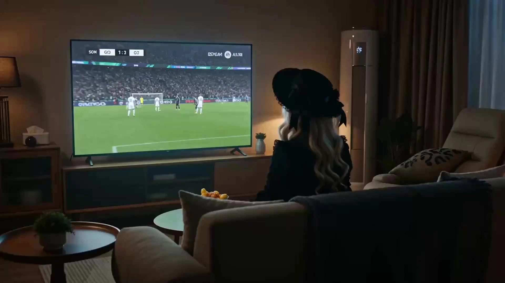

# Into the World Cup

> **作者：** Flova

## Content

**Process Planning:**

## Core Principles

This Skill divides the World Cup football theme into two separate video shots for generation:
1. **Shot 1 (approx. 3 seconds)**: Shows the user watching TV from an Over-the-Shoulder (OTS) perspective, being pulled into the scene by a football star on the TV, achieving a "space-time wall-breaking" effect.
2. **Shot 2 (11 seconds)**: Shows the user transported to the sky above a night football field, executing a mid-air rotation, charging for a side kick, a 7-second extreme bullet-time bicycle kick, and a perfect landing and goal in a continuous sequence.

## Character Acquisition Rules (Choose one)
When starting this Skill, you must confirm:
- **User Uploads Portrait**: The user provides a photo of a person (the protagonist, who watches TV and performs the bicycle kick).
- **AI Generated Character**: If no photo is uploaded, an AI will automatically generate a character.

## Startup and Interaction Flow
1. **Information Gathering and Spec Establishment**:
   - Confirm the character source ("Upload Photo" or "AI Generated Character").
   - Use **text_editor** to create or update Final_Video_Spec.md, setting a fixed total duration of 14 seconds (Shot 1: 3s, Shot 2: 11s), 16:9 aspect ratio, and 720p by default (1080p optional for members).
2. **Character Establishment (Phase 2)**:
   - If the user has uploaded a photo, proceed directly to the next process.
   - If no photo is uploaded, call **media_generator** (TextToImage path, using Nano Banana Pro) to generate a high-precision football character reference image and register it as an asset_id. Do not call storyboard_designer.
   - **Pause** to show the character image to the user for confirmation, then proceed to the next phase after confirmation.
3. **Shot Generation (Phase 3)**:
   - **Generate Shot 1**: Write a TV portal/crossing prompt, call **media_generator** (MultiModalToVideo path, using Seedance 2.0, duration set to 4s for easier trimming), using the character reference image as reference_image.
   - **Generate Shot 2**: Write a bicycle kick prompt, call **media_generator** (MultiModalToVideo path, using Seedance 2.0, duration set to 11s), using the same character reference image as reference_image to ensure character consistency.
   - **Pause** to let the user preview the results of the two clips.
4. **Iterative Adjustment and Assembly (Phase 4)**:

- After confirming everything is correct, call **video_assembler** to seamlessly splice Shot 1 (trimmed to 3s) and Shot 2 (11s), synthesize the final 14-second video, and guide the user to export it.

## Interaction Pause Points
- You must pause after character establishment for the user to confirm the character's appearance.
- You must pause after video generation for the user to preview the generated clips.

**Asset Analysis:**

## Extraction of Character Features and Costume Styling
When a user uploads a photo of the main character (<<<image_1>>>), analyze the image and perform a structured extraction:
- **Facial Features and Hairstyle**: Extract precise facial contours, facial details, hair length, hairstyle, and hair color.
- **Costume and Styling Details**: Specifically extract the style, material, neckline, color, and accessories (e.g., glasses, jewelry, hats, etc.) of the clothing worn by the character in the photo, and generate a detailed text-based feature description. These features must be mandatorily injected into the video generation prompts for Shot 1 and Shot 2 to ensure 100% character consistency across the two different shots. It is strictly prohibited for the model to automatically convert these into generic jerseys or any other non-matching clothing.

**Storyboard Design:**

## Narrative Structure: Dual-Shot Spacetime Transition
This skill abandons the single long take in favor of a **Two-shot** structure to achieve ultimate alignment between spatial leaps and high-energy motion.

### Shot Breakdown and Spacetime Axis
| Shot ID | Shot Name | Duration | Visuals and Camera Logic | Emotion and Rhythm |
| :--- | :--- | :--- | :--- | :--- |
| **Shot_01** | Spacetime Portal: Breaking the Wall | | A dark room, Over-the-Shoulder (OTS) shot of the protagonist (<<<image_1>>>) watching TV on a sofa. The soccer match on screen zooms into a close-up of the athlete. The athlete suddenly freezes, turns to look directly at the camera, reaches a hand through the liquid, mercury-like rippling screen, and grabs the protagonist. The camera slowly pushes into a close-up of the TV set, followed by the entire frame being swallowed by an intensely bright white light (ending in whiteout). The protagonist is transported into another world. | Curious, mysterious, sense of physical traversal. Normal speed. |
| **Shot_02** | The Pitch: Overhead Kick | | The protagonist (<<<image_1>>>) is placed in a massive night stadium. Multiple cuts/camera movements showcase the highlight moment:  1. **Facial Close-up**: Normal speed. A tight close-up of the protagonist's determined face, eyes full of fighting spirit, slight sweat on the forehead (similar to a penalty shootout scene).  2. **Behind-the-Back Shot**: Normal speed. Cut to an OTS perspective looking at the protagonist and the goal ahead. The protagonist rotates in mid-air to build kinetic energy, preparing to kick the ball; speed transitions to extremely slow motion.  3. **Front-Facing Bullet Time**: Extremely slow motion (Bullet Time). The camera instantly cuts to a **front-facing perspective** (fixed low angle). The protagonist performs a 7-second mid-air suspension, body parallel to the ground, tilted left to store power, showing the perfect overhead kick posture from the front. The camera captures the character's expression and power-charging motion as the ball drifts above the foot in slow motion.  4. **Landing & Goal**: Instantly cuts back to the **protagonist's back view**. Kinetic energy is restored, the ball is struck with explosive power at normal speed, gravity returns, and the ball descends rapidly; then, the goal is scored, and the protagonist lands safely, using the left hand to cushion the impact, with the ball hitting the net in the background. | Thrilling, explosive power, breathless bullet time. Facial close-up (normal) -> Mid-air back view (slow) -> Frontal bullet time (extra slow) -> Recovery and landing (normal). |

### Audio Design
- No independent BGM track throughout.
- In-shot sound effects are declared via the video prompt's audio declarations <...>, synthesized directly into each shot by the video generation model Seedance 2.0.
  - **Shot_01 Audio**: TV static, sci-fi portal traversing wind sounds.
  - **Shot_02 Audio**: Thundering crowd cheers, referee whistle, the heavy, explosive impact of kicking the ball, friction sounds of sliding across turf.

**Media Generation:**

## Generation Strategy
### Main Character Generation (if not uploaded by user)
- **Path**: TextToImage
- **Model**: Nano Banana Pro (Gemini 3 Pro Image), 2K resolution.
- **Prompt Design**: Generate a vibrant soccer fan wearing a specific color jersey (as per user's requested tone), standing against a World Cup stadium background, front close-up, clear details.
- **Asset Registration**: Register as the asset_id for the main character key_element after generation.

### Shot Video Generation
1. **Shot_01 Video Generation**
   - **Path**: MultiModalToVideo
   - **Model**: Seedance 2.0
   - **Parameters**: 720p resolution (1080p available for members), 16:9 aspect ratio.
   - **Reference Binding**: Bind the aforementioned main character asset as the core visual reference <<<image_1>>>.

2. **Shot_02 Video Generation**
   - **Path**: MultiModalToVideo
   - **Model**: Seedance 2.0
   - **Parameters**: 720p resolution (1080p available for members), 16:9 aspect ratio.
   - **Reference Binding**: Bind the same visual reference as Shot_01 <<<image_1>>> to ensure character consistency between the two shots.

**Prompt Writing:**

## Prompt Writing Standards and Character Locking
- **Clothing and Character Locking (Highest Priority)**: When the user uploads a photo as the protagonist, it is **strictly forbidden** to describe the protagonist as "wearing soccer jersey/uniform" in the Prompt, unless the uploaded image itself depicts them in such a jersey. In the English Prompts for both shots, you must accurately extract and write the specific clothing (e.g., casual wear, leisure jacket, etc.), hairstyle, and accessory details from the user's photo <<<image_1>>> into the description to enforce 100% consistency in clothing across the two shots.

Write separate English Prompts for the two shots (Shot_01 and Shot_02), strictly following the prompt structure provided below.

### Shot_01 Prompt Standards (TV Screen Breakout)

- **Technical Statement (Opening)**:
  Cinematic photorealistic interior scene, 16:9 widescreen, 4 seconds, normal playback speed.
- **Content Description**:
  A dimly lit cozy living room, over-the-shoulder shot from directly behind a viewer \[Insert viewer details from <<<image_1>>> (e.g., young woman with long wavy blonde hair)\] seated on a sofa, watching a large television ahead. The room is dark except for the warm flickering light cast by the TV.
  On the television screen, a soccer match is playing. The shot begins as a wide full-field view: players running across the green pitch, one athlete dribbling the ball toward the goal. The TV broadcast camera gradually pushes in, slowly narrowing from the full stadium scene to the athlete’s upper body, then to a close-up of his face. Suddenly, the athlete stops mid-motion, turns his head, and looks directly into the camera with clear intent.
  He slowly extends one hand forward toward the viewer. His hand breaks through the television screen, the glass surface liquefying like rippling mercury, shimmering silver-blue distortion rings expanding outward from his arm. The viewer on the sofa freezes, then leans forward instinctively. The athlete grabs the viewer and pulls her into the television. As her body is dragged through the liquid screen in a swirling dimensional teleportation vortex, the camera slowly and continuously pushes forward to a close-up shot of the television, and the scene ends with a sudden transition to a blinding pure white light (fade to bright white light ending).
- **Sound Effects Statement**:
  No dialogue, no subtitles, no music. SFX: soccer stadium ambience from the TV, television static hum, electric crackle, loud dimensional portal whoosh <stadium hum, television static hum, electric crackle, loud dimensional portal whoosh>.
- **Rendering Parameters (Ending)**:
  Photorealistic, cinematic lighting, volumetric TV glow, detailed liquid mercury screen distortion, camera slowly pushing in to close-up, sci-fi warp effect, transition to blinding white light, character consistency based on <<<image_1>>>.

### Shot_02 Prompt Standards (Bicycle Kick Highlight on the Pitch)

- **Technical Statement (Opening)**:
  Ultra realistic World Cup soccer match footage, dynamic camera cuts, highly detailed cinematic lighting.
- **Space-Time Locking Description**:
  - **Penalty Close-up** : Normal speed. Extreme close-up shot of the player's face <<<image_1>>> (e.g., young woman with long wavy blonde hair) standing in front of the soccer goal. Her face is intensely focused, with tiny beads of sweat on her forehead, and her eyes shine with deep determination, reminiscent of a high-stakes penalty shootout scene. Volumetric stadium floodlights create a dramatic glow in the background.
  - **The Leap and Rotation** : Normal speed. Sudden camera cut to a back over-the-shoulder shot (OTS) from directly behind the player <<<image_1>>>, looking past her toward the front of the soccer goal in the distance. The player stands between the camera and the goal, centered in frame, with her back to the camera. She spins horizontally in the air mid-leap, gathering momentum, and prepares to kick the ball. Speed ramps down from normal to extreme slow motion.
  - **Bullet Time Bicycle Kick** : Bullet time. Sudden camera cut to a dramatic **front-view low-angle shot**, completely fixed in position with no camera movement. The player <<<image_1>>> is suspended in mid-air with zero-gravity hangtime, viewed from her front — her face, torso, and front side are fully visible as her body tilts horizontally to the left, leg cocked back in a perfect bicycle kick posture. She is executing this flawless bicycle kick, facing forward. The airborne football slowly descends in extreme slow motion, drifting down until it hovers just above her striking foot. Camera remains completely fixed in position.
  - **Kinetic Fall** : Pacing instantly snaps back to normal speed. Sudden camera cut back to a rear-view / back-angle shot from behind the player <<<image_1>>> looking toward the goal. The ball rockets away and successfully blasts into the soccer goal net, gravity instantly restores, and the player's body falls rapidly toward the green turf.
  - **The Land and Goal** : Normal speed, continuing the rear-view / back-angle shot. The player <<<image_1>>> lands safely on the green turf, cushioning her fall with her left arm. In the background, the soccer ball tears into the back of the net.
- **Sound Effects Statement**:
  No dialogue, no subtitles, no music. SFX: thunderous stadium crowd roar, referee whistle blow, heavy explosive ball strike impact, grass sliding rustle <thunderous stadium crowd roar, referee whistle blow, heavy explosive ball strike impact, grass sliding rustle>.
- **Rendering Parameters (Ending)**:
  4K resolution, volumetric stadium floodlights, stadium mist, photorealistic turf grass, dramatic lens flare, motion blur on speed transitions, highly detailed character consistency based on <<<image_1>>>.

**Final Assembly:**

Editing and Splicing Rules
- **Shot_01 Handling**:
  - Keep the full video and audio, fade out the audio for 2s.
- **Shot_02 Handling**:
  - Keep the video in full.
