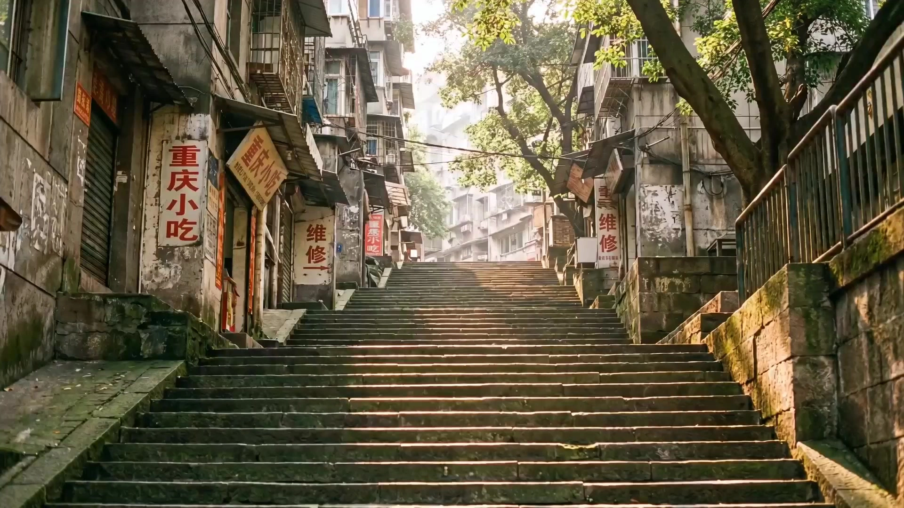

# J-Pop Idol MV

> **作者：** 黄炜炜

## Content

**Process Planning:**

**Full Process Stages and Dependencies:**
1. Use **text_editor** to create Final_Video_Spec.md, locking global parameters: aspect ratio (default 16:9), target duration, output language (Japanese/Chinese lyrics), visual style tone (Heisei film idol MV), and color system (summery youth film).
2. Invoke **storyboard_designer** to design the complete Shot List:
   - First, establish key_element (member roles, core scenes, key props);
   - Then, plan the shot list according to the structure: "Daily Life → After School → Friendship → Practice → Laughter → Stage → Youth Climax → Sunset Ending";
   - Simultaneously design the audio_layer (BGM + optional narration VO).
3. After completing the Shot List, scan existing user-uploaded assets, and use **media_generator** to bind matching resources to the corresponding Storyboard slots to avoid duplicate generation.
4. Generate all key_element image references (character reference images, scene reference images) → **media_generator**.
5. Generate video clips shot-by-shot, prioritizing element images as visual references → **media_generator**.
6. Generate BGM and audio/VO Audio Layers → **media_generator**.
7. After all media is ready, invoke **video_assembler** to complete timeline editing and export the final video.

**Dependencies:** 2→1; 3→2; 4→2; 5→4; 6→2; 7→4,5,6.

**Paused Nodes:** Do not execute all stages continuously at once. After each milestone is completed, you must pause to show the user a review checklist and obtain explicit confirmation before continuing. The content displayed and questioning method for each node are as follows:
**⏸ Paused Node A — After Final_Video_Spec is Locked**
Display the following checklist for user verification:
- 🎬 Aspect Ratio: \[Locked Value\]
- ⏱ Target Duration: \[Locked Value\]
- 🌐 Output Language: \[Japanese / Chinese / Other\]
- 🎨 Visual Style Tone: \[Description\]
- 🎞 Color System: \[Locked Value\]
Questioning Method: "The above global parameters are confirmed. Do you wish to continue to Shot List design? If any parameters need adjustment, please let me know now."

**⏸ Paused Node B — After Storyboard Shot List is Completed**
Display the following checklist for user verification:
- 🧑‍🤝‍🧑 key_element Character List: \[Member A (Personality Label) / Member B / ……\]
- 🏫 key_element Scene List: \[Scene Name + Film Tone\]
- 🎬 Shot List Summary: \[Total N shots, labeled by segment: Daily Life → After School → …… → Sunset Ending\]
- 🎵 audio_layer List: \[BGM Style Description / Ambient Sound / VO Narration (if any)\]
Questioning Method: "The Shot List design is complete. Please confirm the above structure. If any character personalities, scene selections, or segment pacing need adjustment, please inform me before continuing; once confirmed, character and scene image generation will begin."

**⏸ Paused Node C — After key_element Image Generation is Completed**
Display the following checklist for user verification:
- 🖼 Generated Character Reference Images: \[Member A — Dual-grid composition (half-body+full-body) / Member B / ……\]
- 🏞 Generated Scene Reference Images: \[Scene Name + Film Tone Annotation\]
- 📎 User Uploaded Asset Binding Status: \[Bound / Unbound, list asset_id\]
- ⚠️ Consistency Issues Requiring User Attention (if any): \[Description\]
Questioning Method: "Character and scene images are ready. Please confirm one by one whether the appearance, personality, clothing, and scene lighting meet expectations. If you need to regenerate or adjust any member/scene, please point it out; after full confirmation, video generation will begin shot by shot."

**⏸ Paused Node D — After Shot Video Generation is Completed**
Display the following checklist for user verification:
- 🎥 Completed Shot List: \[Shot 01 — Daily Life Fragment / Shot 02 — After School / ……, total N\]
- ✅ Generation Path: \[MultiModalToVideo / FirstFrameToVideo, annotate model used\]
- ⚠️ Generation Exceptions or Shots Requiring Attention (if any): \[Shot ID + Problem Description\]
- 🔁 Suggested Shot Regeneration (if any): \[Shot ID + Reason\]
Questioning Method: "All shot videos have been generated. Please preview them one by one. If there are any shots that need to be regenerated or replaced, please provide the ID and adjustment direction; once fully confirmed, we will enter the audio generation stage."

**⏸ Paused Node E — After Audio Generation is Completed**
Display the following checklist for user verification:
- 🎵 BGM: \[Generation Model / Style Description / Duration\] (or: User Uploaded, asset_id bound)
- 🔊 Ambient Sound/SFX Layer (if any): \[Type List\]
- 🎙 VO Narration (if any): \[speaker profile / corresponding shot interval\]
- 🔗 Summary of audio_layer to shot correspondence
Questioning Method: "Audio layers are all ready. Please listen to the BGM and each audio layer. If you need to adjust the style, rhythm, or replace any audio resource, please let me know now; once confirmed, we will enter final timeline editing and synthesis."

**Handling User Uploaded Assets:** If users provide character reference images, scene images, audio, etc., prioritize binding them as assets for the corresponding key_element, avoiding duplicate generation of existing content.
## Vertical Project (9:16) Exclusive Scheduling Rules
> Trigger Condition: User specifies vertical output, or aspect ratio in Final_Video_Spec.md is set to 9:16. The following rules are **executed as an overlay** on top of the standard full process and do not replace original stage logic.

### ⏸ Vertical Exclusive Paused Node V-A — After Final_Video_Spec is Locked (Vertical Format Confirmation)
In addition to standard Paused Node A, display the following vertical parameter checklist for user verification:
- 📐 Aspect Ratio: 9:16 (Vertical Confirmed)
- 📱 Target Platform: \[Reels / TikTok / Shorts, affects safe zone reservation plan\]
- ⏱ Target Duration Version: \[15s Reels / 30s Reels / 60s / Full Version\]
- 🎬 Asset Generation Path Confirmation: Vertical video generation model (**Wan2.6** or **Kling 3.0 Audio**, aspect_ratio: "9:16"); Seedance series does not support native vertical, if use is required it must be cropped in post, please confirm acceptance.
- 🖼 Horizontal Reference Asset Processing Plan: If user already has 16:9 assets, confirm cropping anchor (center crop / manually specify person position).
Questioning Method: "Vertical output settings detected. The above vertical parameters are confirmed. Do you wish to continue to Shot List design? If you need to adjust the target platform or duration version, please let me know now."

### ⏸ Vertical Exclusive Paused Node V-B — After Storyboard Shot List is Completed (Safe Zone Preview)
In addition to standard Paused Node B, display the following vertical composition checklist:
- 📏 Multi-person Shot Check: Annotate all shots containing 3 or more people, confirm they have been changed to vertical staggered standing or split into multiple close-ups, lateral 3-person side-by-side is prohibited.
- 🔲 Safe Zone Preview Annotation: For each key shot (laughter climax freeze frame, sunset ending smile frame, stage performance center girl close-up), annotate whether the subject falls within the core safe zone (center 70%×65% of the frame); shots outside the safe zone are marked as "composition adjustment required".
- 📐 Panorama/Wide Shot Review: List all shots planned as wide shots, confirm if their horizontal information can be preserved within the vertical frame; if horizontal information is critical (e.g., multiple people side-by-side), annotate as "recommended to replace with vertical composition or split shot".
- ⏱ Shot Duration Check: Confirm all shot durations have been tightened by 20–30% according to vertical rules.
Questioning Method: "Vertical Shot List is complete. Please confirm the above safe zone check results. If there are shots with lateral multi-person alignments or subjects drifting out of safe zones that need adjustment, please inform me before continuing; once confirmed, character and scene image generation will begin."

**Vertical Short Duration Version General Scheduling Rules:**
- After locking the duration version in Final_Video_Spec, immediately use **text_editor** to write "Target Duration Version" and "Reserved Segment List" into Final_Video_Spec.md, ensuring subsequent Storyboard design only unfolds for reserved segments and does not design segments that will be deleted.
- During the Storyboard design phase for 15s / 30s versions, **must not** design shots outside the scope of reserved segments (to avoid wasting resources after generation); if the user later wishes to expand to a longer version, append the corresponding Shot List design then.

**Asset Analysis:**

**Analysis Perspective: Interpret all input as "AKB48 Golden Era Youth Idol MV Assets".**
**Character Analysis:**
- Identify member personality layers: center girl (core energy), shy member (shy type), genki member (energetic type), cool beauty (cool beauty), emotional supporter (emotional role).
- Assessment: degree of natural makeup, authenticity of youthful smiles, clothing style (school uniform/summer wear/stage wear), group chemistry.
- If there are multiple character reference images, analyze the coordination of the group's overall temperament and the sense of youth ensemble.

**Scene Analysis:**
- Identify which youth time-space the scene belongs to: after-school classroom, school rooftop, summer playground, train station platform, riverbank, summer festival, convenience store entrance, sunset basketball court, etc.
- Analyze light texture: whether it has summer natural light, golden hour warm light, classroom fluorescent light feel, humid summer air feel.

**Photography/Image Style Analysis:**
- Identify film-like characteristics: Kodak Gold 200 warm tones, Fuji Pro 400H cool soft tones, soft grain, highlight blowout, overexposed areas, faded tone feel.
- Assess shooting method: handheld documentary feel, candid youth perspective, natural composition vs. commercial composition.

**Audio Analysis (if any):**
- Identify BGM style affiliation: Upbeat J-Pop, youthful guitar, idol chorus segments, nostalgic bright melody.
- Identify ambient sounds: cicadas, train station sounds, playground laughter, club practice sounds, sneaker footsteps.

**Output Focus: Convert analysis results into language that can be directly injected into the Storyboard—character element descriptions, scene element descriptions, shot mood annotations, audio_layer style guidelines.**

**User Uploaded Real Photo Processing Workflow**
When the user provides real portraits as character references, perform the following analysis steps:
**Step 1: Facial Feature Extraction (identity anchor)**
- Precisely describe facial structure: face shape contour, eye shape (single/double eyelid, eye spacing), nose bridge height, lip thickness, jawline.
- Record skin texture and tone (e.g., natural warm white, healthy tanned skin).
- Extract key hairstyle parameters: hair color (natural black/dyed), bangs shape (soft bangs/air bangs/no bangs), hair length and volume feel.
- **These parameters will become locked fields in the key_element description for this character, and all subsequent generation must align with them.**

**Step 2: Temperament and Character Type Positioning**
- Based on temperament layers (center girl / shy member / genki member / cool beauty / emotional supporter), determine which AKB member archetype the photo is closest to.
- Assess the "youth authenticity" coefficient: degree of natural smile, eye vitality, naturalness of movement—these directly influence the selection of temperament words in the prompt.

**Step 3: Clothing and Styling Information Extraction**
- If there is clothing in the photo, record: color scheme, style (school uniform/casual/summer wear), key accessories (hair accessories/school bag/bow tie).
- If clothing is not applicable (e.g., user provided an ID photo or casual clothes), note in the key_element description "Clothing referenced from Storyboard scene specification", retain facial feature locking, and define clothing separately in the Shot List design layer.

**Step 4: Comprehensive Processing of Multiple Photos (e.g., if user provides multiple images)**
- Multi-angle photos (front + side + smile close-up): comprehensive extraction, focusing on the clearest front photo as the main identification anchor, with other angles supplementing details.
- Multi-member photos (group reference): establish a feature profile for each member, analyze temperament complementarity and group chemical reactions, and output a description of the group's overall atmosphere (for Storyboard design use).
- Handling conflicting information: If hairstyles/makeup are inconsistent between photos, prioritize the version that best fits the "Heisei youth idol temperament," and note the selection basis in the element description.

**User Uploaded Audio (BGM / Vocals) Processing Workflow**
When the user provides BGM or vocal audio as an audio reference, perform the following analysis steps:
**Step 1: Audio Type Determination**
- Determine which of the following types the uploaded audio belongs to:
  - **BGM Background Music**: Instrumental-based, used as background music for the entire film or specific segments.
  - **Vocal Reference Audio (key_element_audio)**: Contains specific character speaking or singing clips, used to maintain consistent voice across shots.
  - **Ambient Sound/SFX**: Cicadas, train sounds, playground laughter, etc., used to overlay under BGM to enhance documentary feel.
- If the type is unclear, confirm the purpose of the audio with the user before proceeding.

**Step 2: BGM Style Feature Extraction (BGM Type Only)**
- Identify music rhythm: BPM range (lively/fast / mid-tempo/lyrical / slow/sentimental).
- Identify major instrument configuration: guitar / piano / synthesizer / strings / percussion combination.
- Identify emotional arc: overall emotional direction (upbeat joyful → sentimental ending / energetic throughout / slow-build climax).
- Assess fit with Heisei idol MV temperament: whether it meets the "Upbeat J-Pop / youthful guitar / nostalgic bright melody" benchmark; if the style deviates (e.g., EDM / trap), note it in the analysis output and suggest the user confirm whether to continue using it.
- Identify structural segments within the BGM (if there are clear intro / verse / chorus / bridge / outro distinctions) to provide beat reference basis for subsequent Storyboard shot allocation.

**Step 3: Vocal Reference Audio Feature Extraction (key_element_audio Type Only)**
- Extract voice characteristics: timbre (bright girlish / low mature / sweet childlike), vocal range (high / medium / low), language of pronunciation (Japanese / Chinese / Other).
- Identify emotional expression: lively/energetic / gentle/sentimental / cool/restrained.
- **These parameters will become locked fields in the key_element_audio description for this character, and subsequent cross-shot dialogue/singing generation must align with them.**

**Step 4: Ambient Sound Feature Extraction (Ambient Sound/SFX Type Only)**
- Identify ambient sound category (cicadas / train / playground laughter / practice room / festival voices, etc.).
- Assess the type of MV segment suitable for overlay (daily life slices / friendship interaction / closing sunset, etc.).
- Record volume dynamic characteristics (continuous steady / intermittent / fade in/out), for reference during the mixing stage.

**User Uploaded Real Scene/Background Photo Processing Workflow**
When the user provides real scene photos as scene references, perform the following analysis steps:
**Step 1: Scene Type Classification**
- Classify the photo into the corresponding type in the priority scene pool (e.g., after-school classroom / school rooftop / summer playground / train station platform / riverbank / summer festival / convenience store entrance / sunset basketball court, etc.).
- If the scene is not in the predefined scene pool, assess whether it meets "Heisei youth temperament"—judgment criteria: natural environmental feel, Japanese suburb/campus cultural feel, non-luxury modern feel. Unsuitable scenes must be explained to the user and replacement suggested.

**Step 2: Light Feature Extraction (lighting anchor)**
- Identify main light source type: natural daylight / golden hour slanted sun / fluorescent indoor light / festival lantern warm light / convenience store cool white light / overcast diffuse light.
- Extract light color temperature tendency: warm tone (sunset orange) / cool soft tone (overcast blue-white) / neutral (indoor fluorescent).
- Assess highlight status: whether there is overexposed blowout, softened highlights, film-like lens flare—these are bonus points for Heisei temperament, preserve them and annotate in the element scene description.
- Record shadow quality: hard shadow / soft shadow / almost no shadow (diffuse light environment).

**Step 3: Space and Detail Feature Extraction (spatial anchor)**
- Extract spatial structure: indoor / outdoor / semi-open space; depth of field (shallow depth corridor vs open playground); viewing angle (low angle / eye level / overlooking).
- Identify iconic scene props and details: chalk writing on blackboard, wire fence railing, bicycle parking area, old-fashioned wooden desks and chairs, train platform signage, summer festival string lights, playground track lines, etc.
- Assess the "sense of era" of the space: whether it has Heisei era characteristics (slightly worn facilities, non-smart environment, hand-drawn bulletin boards, etc.); if the scene is too modern, note "aging treatment required in prompt" in the element description.

**Step 4: Film Tone Matching Assessment**
- Determine which film tone the scene is best suited for:
  - Warm sunny outdoor scenes → Kodak Gold 200 tone (warm, slight overexposure, highlight flare)
  - Indoor / overcast scenes → Fuji Pro 400H tone (cool soft, delicate grain, natural skin tone)
  - Sunset / dusk scenes → Mixed tone (orange-red warm tone + soft grain + light leak allowed)
- Write this matching result into the element scene description as the color benchmark for all shots in this scene.

**Step 5: Comprehensive Processing of Multiple Scene Photos**
- Multi-angle photos of the same scene: comprehensively extract spatial information, using the angle that best embodies the scene's "youth temperament" as the main reference anchor, and other angles to supplement spatial details.
- Different scene photos (multi-scene reference): establish feature profiles for each scene separately, analyze emotional rhythm differences between scenes (e.g., quietness of the classroom vs openness of the rooftop), for reference when assigning shots in the Storyboard.
- Handling conflicting information: If light conditions differ significantly between multiple photos (e.g., sunny day and overcast day at the same location), prioritize the version that best fits the mood of the target segment, and note the selection basis in the element description.

**Storyboard Design:**

**Core style:** all designs must align with a "Heisei-era AKB48 Golden Age youth idol MV." The target is not perfect idols, but ordinary girls shining in a real youth moment. Preserve natural reactions, amateur charm, slightly messy hair, imperfect movement, and candid warmth. Prohibit high-fashion styling, Western supermodel faces, AI-influencer makeup, strong sexualization, dark concepts, heavy plot twists, cyber-futuristic moods, luxury architecture, Western nightclubs, fashion-runway aesthetics, and overly polished commercial idol perfection.
If the user provides reference images, character and scene descriptions must stay consistent with visible reference details. The templates below are structural and stylistic references; they must not override real facial features, user-specified appearance, or supplied media.
## Key Elements
### Character Key Elements
**Member includes:**
- Style label
- Makeup
- Hairstyle
- Clothing
- Iconic actions or expressions
- Prohibitions
**Char prohibitions:**
- High-fashion feeling
- Western supermodel face
- AI influencer makeup
- Strong sexualized feeling
**Char allowances:**
- Slightly messy hair
- Uneven movements
- Natural reactions
- Amateur charm
## Style Types
### 1. Center Girl/Core Energy Type
**Appearance:**
- Face: clear and recognizable features, bright piercing eyes, naturally upturned mouth corners; not perfectly exquisite, but memorable at first glance.
- Skin tone: healthy natural warm white or tan, slightly sun-kissed.
- Hairstyle: mainly medium-long hair with fluffy volume; soft bangs or air bangs, slightly spread hair ends; ponytail or half-up styles are allowed, but excessive styling is prohibited.
**Clothing:**
- Daily/main MV scene: white shirt + plaid skirt + white sports socks + canvas shoes; or sailor suit with ribbon tie. Tie color should be warm, such as red, wine red, or orange family, as a signature color.
- Stage/performance scene: unified group costume with a center-position color scheme, usually more saturated or subtly differentiated from other members. Individual sexualization is prohibited.
- Iconic accessories: simple headbands or hair clips, not exaggerated; braided wristbands are allowed.
**Actions:**
- Natural smile looking directly into the camera; real mouth arc, not a performance smile.
- Runs out first and turns back to call the other members.
- During backing-vocal gestures, slightly ahead of others by half a beat, as if she felt the beat first; not perfect synchronization.
- Eyes slightly red at emotional highs but not crying; direct eye contact.
**Words:** center girl energy, natural charisma, idol smile with eye contact, youthful leading presence, spontaneous laughter, effortless group anchor.
### 2. Genki Member/Vitality Type
**Appearance:**
- Face: round face, relatively large eyes, slightly upturned outer corners; eyes become crescent-shaped when smiling; expressive, with emotions written on the face.
- Skin tone: healthy tan or natural white, not pale; cheeks often have a natural rosy glow.
- Hairstyle: short hair or shoulder-length hair works best; twin tails allowed if tied casually rather than in an exquisite high position; thick soft bangs; natural black or dark brown hair, with subtle highlights allowed but not exaggerated.
**Clothing:**
- Daily: sports-club feeling, such as track jacket + skirt + knee-high sports socks + sneakers; or plaid skirt + knit cardigan, half-zipped or sleeves rolled up.
- Stage: the most vibrant group costume colors, such as yellow, orange, or bright green; shoes lean sporty.
- Iconic accessories: headphones around the neck, a small bear or star hair clip, badges on the school bag.
**Actions:**
- Laughs with head tilted back, covers mouth, shoulders shaking.
- Runs down the hallway while swinging the school bag without caring.
- Mutters the beat during practice, frowns while correcting mistakes, then suddenly jumps happily.
- First member to make a funny pose in group photos.
**Words:** genki energy, bright spontaneous smile, moon-eye laugh, bouncy movement, athletic casualness, enthusiastic group participant, accidental adorable.
### 3. Shy Member/Introverted Type
**Appearance:**
- Face: soft delicate features, eyes often looking downward or to the side, rarely directly at the camera; small shy smile with real warmth; may occasionally bite lower lip.
- Skin tone: naturally fair, no sun-kissed look; delicate skin texture.
- Hairstyle: mainly long smooth hair with soft volume; thick soft bangs covering part of forehead; loose strands around face; natural black or dark brown hair; no dyeing.
**Clothing:**
- Daily: most standard school-uniform styling, shirt buttoned up, tie properly tied, standard skirt length; white cotton socks + loafers; knit vest is a plus.
- Stage: softer group costume colors, such as pink, light blue, or creamy white; simple accessories only.
- Iconic accessories: small handbag or crossbody school bag; often holding a book or notebook; small side hair clip.
**Actions:**
- When suddenly captured, slightly hides from the camera or blocks face with hand, then peeks through fingers and cannot help smiling.
- Eyes drift when talking, but briefly make eye contact when speaking about happy things.
- Half a step behind in group activity, but always follows the group.
- Most serious during practice, silently repeating the same move until correct.
**Words:** shy member softness, half-hidden smile, downward glance, quiet presence in group, accidental eye contact, timid but genuine warmth, introverted idol charm.
### 4. Cool Beauty/Clean-Cool Type
**Appearance:**
- Face: strong contour, high cheekbones or clear jawline; narrow or almond eyes; calm restrained gaze; relatively thin lips; mouth corners neither clearly upturned nor downturned; expressionless but not indifferent.
- Skin tone: cold white or neutral white, no obvious rosy glow.
- Hairstyle: mainly straight smooth hair; no bangs or center-parted curtain bangs; natural black with a very slight cold-brown tone; perms and fluffy hairstyles are prohibited.
**Clothing:**
- Daily: simplest school uniform styling, only necessary items, clean lines; or dark knit cardigan + white shirt + dark skirt, low saturation overall.
- Stage: cold-color group costume family, such as dark blue, gray white, or deep wine red; minimalist accessories or none.
- Iconic accessories: optional thin-rimmed glasses to strengthen bookishness; shoulder bag; no cute accessories.
**Actions:**
- Only member keeping an upright posture during group play, but with a very subtle mouth-corner arc, secretly holding back a laugh.
- Profile while seriously looking at sheet music or scripts, jaw slightly tilted forward.
- Cooperates with a "helpless but not refusing" feeling when dragged into activities.
- Sunset silhouette looking into the distance; especially suitable for the ending segment.
**Words:** cool beauty composure, quiet elegance, suppressed smile, clean profile in sunlight, restrained idol presence, graceful stillness, subtle warmth beneath cool exterior.
### 5. Emotional Supporter/Emotional Type
**Appearance:**
- Face: large expressive eyes, slightly drooping outer corners, natural teary-eyed feeling but not sad; dimples when smiling; wide facial expression range.
- Skin tone: natural warm tone; cheeks easily flush when emotionally excited.
- Hairstyle: medium-long or long hair, large volume, natural slight curls rather than permed curls; soft bangs or airy scattered bangs; hair may be slightly lighter natural brown.
**Clothing:**
- Daily: one more layered item than others, such as sweater jacket loosely draped or scarf loosely wrapped once; warm daily-life feeling.
- Stage: warm costume colors such as beige, warm pink, or light orange; often cloth bows or headbands.
- Iconic accessories: plush toy pendant on school bag; multiple thin hand-woven wrist ropes from friends.
**Actions:**
- First to get red eyes during touching group moments, but still smiling.
- Hands clenched in front of chest while cheering for others.
- Laughs the hardest and most realistically in laughter scenes, almost laughing to tears.
- First to say "One more time!" and pat others on the shoulder after failed practice.
**Words:** emotional supporter warmth, teary-eyed smile, expressive face, wholehearted laughter, encouraging presence, heartfelt group affection, crying-while-smiling idol moment.
## Scene Elements
**Scene pool:**
- After-school classroom
- School rooftop
- Summer playground
- Riverbank
- Train station
- Club room/dance room
- School corridor
- School auditorium stage
- Cherry blossom street
- Summer festival
- Seaside
- Tokyo streets
- Convenience store entrance
- Sunset basketball court
**Scene needs:**
- Light source, such as summer sunset, fluorescent light, festival lanterns
- Spatial details, such as chalk writing on blackboard, bicycle, wire fence
- Ambient sound hints
**Scene no:**
- Luxury modern architecture
- Western-style nightclubs
- Cyberpunk cities
- High-end fashion runways
## Scene Templates
### Element_Classroom/After-School Classroom
**Lighting:**
- Main light: afternoon sunset cutting through blinds into light strips; warm yellow, around 5000K.
- Auxiliary light: classroom fluorescent white light, visible lamps or fluorescent reflections, creating slight color-temperature contrast with natural light.
- Highlight status: softened overexposure near windows; dust particles visible in light beams.
**Space:**
- Old wooden desks and chairs; ballpoint-pen carvings on desktops.
- Chalk writing left on blackboard, such as unfinished exercises or numbers.
- Potted plants or origami on windowsill.
- Messy bookshelves, textbooks placed upside down.
- Tree shadows from corridor-side window projected on floor.
- Slightly old ceiling and yellowed lamps.
- Aisles between desks create perspective lines.
**Film tone:**
- Fuji Pro 400H cold soft tone for indoor fluorescent areas.
- Kodak Gold 200 warm tone for direct sunlight near the window.
**Ambience:**
- Distant playground sounds
- Low ceiling-fan hum
- Page turning
- Occasional corridor footsteps
### Element_Rooftop/School Rooftop
**Lighting:**
- Main light: open direct sunlight, unobstructed.
- Golden hour is recommended default: low sun angle, side light forms warm orange outlines, strong backlight silhouette.
- Highlight status: sky may blow out; hair halos encouraged; slight light leak allowed.
**Space:**
- Slightly rusty wire fence around rooftop edge.
- Cement floor with fine cracks.
- Rooftop equipment boxes or outdoor AC units.
- Chalk-drawn grid games on ground.
- Low-rise residential roofs or distant mountain silhouettes in background; no modern skyscrapers.
- Open spatial feeling; sky occupies upper half of frame; low horizon; contrasts with classroom.
**Film tone:**
- Golden hour: Kodak Gold 200 warm tone, orange-yellow highlight blowout, soft grain.
- Overcast or noon: mixed cold white sky + neutral ground.
**Ambience:**
- Continuous low wind
- Distant cicadas
- Urban low-frequency background noise
- Occasional airplane sound
### Element_Playground/Summer Playground
**Lighting:**
- Main light: intense summer direct sunlight; hard shadows; strong ground reflection; visible asphalt heat shimmer.
- Recommended time: golden hour after school, side sunset creating long runway shadows.
- Highlight status: partial sky overexposure; backlit glowing hair while running; sweat or water stains catch highlights.
**Space:**
- Red running track surrounding grass or dirt soccer field.
- Standard track lines and numbers.
- Slightly rusty iron goal.
- Flagpole, possibly moving flag.
- Cement ping-pong table in a corner.
- Streets or residences visible outside iron fence.
- Wide open view; low-angle shots can make sky large and characters small but free.
**Film tone:**
- Kodak Gold 200 warm tone; can shift slightly orange-red during golden hour.
**Ambience:**
- Cicadas as dominant sound
- Sneaker footsteps on track
- Whistle
- Distant student play
- Wind through trees
### Element_Riverside/Riverbank
**Lighting:**
- Main light: open and unobstructed, similar to rooftop, with water-surface reflection as fill.
- Sunset is best: orange-red side or front light near horizon; water reflection gives warm fill from below.
- Highlight status: point-like blowouts on water; clear backlight silhouette; wind-blown hair and clothing with halo.
**Space:**
- Old concrete or stone riverbank railing.
- River or low grass outside railing.
- Blurry graffiti or handwritten text on railing.
- Cement path with weeds in cracks.
- Distant low-rise residential area, fields, railroad bridge, or power poles.
- Linear depth along riverbank; suburban feeling, not central city.
**Film tone:**
- Sunset: Kodak Gold 200 orange-red warm tone + soft grain + optional light leak.
- Evening ending: gradually reduce saturation into blue-gray twilight.
**Ambience:**
- Low continuous water flow
- Distant train passing over bridge
- Wind
- Occasional birds, not cicadas
### Element_SummerFestival/Summer Festival
**Lighting:**
- Main light: warm festival lantern light, orange-yellow and red family dominant; strong contrast in night environment.
- Auxiliary light: old-style stall incandescent or warm-white LED; distant fireworks or reflected light on faces.
- Highlight status: lanterns create local highlights; uneven face lighting is realistic and should be preserved; dense background lights may blow out.
**Space:**
- Red-white or blue-white striped stall canvas.
- Goldfish scooping, shooting, cotton candy stalls.
- Ukiyo-e colored paper lanterns on bamboo poles.
- Sand or temporary wooden-board ground.
- Dense crowd.
- Members may wear yukata or summer casual clothes; hair accessories allowed.
- Narrow lively space; lens may be partially blocked by crowd edges to create candid feeling.
**Film tone:**
- Mixed warm festival orange-red light + night blue-black background.
- Slightly higher saturation than daytime.
- Tone blowout allowed, but neon glare must not become modern nightclub-like.
**Ambience:**
- Distant taiko music
- Crowd laughter
- Vendor shouting
- Fireworks or firecrackers
- Yukata fabric friction
### Element_TrainStation/Train Station Platform
**Lighting:**
- Main light: platform roof blocks direct sunlight, creating diffuse soft light.
- Recommended station type: ground-level small or suburban station, not underground.
- Station fluorescent white light and natural light coexist.
- Highlight status: dynamic light and shadow from train-window reflections when train arrives; backlight may appear at platform end.
**Space:**
- Worn yellow warning line.
- Old station signs and timetables, hand-drawn style or old fonts.
- Railway vanishing point.
- Open views at platform ends, with distant residences or fields.
- Metal waiting benches, slightly old.
- Old ticket machines.
- Station-master booth near ticket gate.
- Linear-depth space with a waiting/transition mood.
**Film tone:**
- Fuji Pro 400H cold soft tone under fluorescent roof.
- Natural light at platform end can cut to Kodak Gold 200.
**Ambience:**
- Metal train-arrival sound and wind pressure
- Japanese announcements
- Ticket gate sound
- Shoes on platform
- Distant rail sounds
### Element_DanceRoom/Club Room/Practice Room
**Lighting:**
- Main light: fluorescent top light, slightly cold white, evenly lit without strong shadows.
- Auxiliary: mirror reflection doubles light sources; window-side natural light creates cold-warm contrast.
- Highlight status: wood or PVC floor reflection; clear floor shadows; mirror highlights appropriate.
**Space:**
- Full-length wall mirror, slightly aged, fingerprints or scratches near edges.
- Reflections of members' backs in mirror.
- Elastic-feeling wood or soft PVC floor.
- Water bottles, towels, school bags in corner.
- Handwritten practice schedule or lyric sticky notes on wall.
- Old CD player or small speaker.
- Rectangular enclosed space; depth extended through mirror.
**Film tone:**
- Fuji Pro 400H cold soft tone dominant.
- Slight warm natural light near window allowed.
- Avoid being entirely cold.
**Ambience:**
- Small speaker playing low-volume, slightly distorted BGM
- Rubber sneaker sounds on floor
- Members muttering beats or slogans
- Breathing and panting
### Element_Stage/School Auditorium Stage
**Lighting:** warm school fluorescent stage light; no luxury concert lighting.
**Space:** wooden floor, side curtain, tape marks, simple mic stands.
**Ambience:** room echo, shoes on wood, faint chorus practice.
### Element_SchoolCorridor/School Corridor
**Lighting:**
- Main light: window on one side, natural light slanting in; fluorescent fill on the other side, creating zones of light and shadow.
- Recommended after school: low-angle sunset through corridor window, long floor shadows, overexposure at corridor end.
- Highlight status: floor reflections obvious; overexposed end works as a natural transition signal.
**Space:**
- Old-style sliding wooden doors or metal classroom doors.
- Class signs on doors.
- Bulletin boards with handwritten posters and activity notices.
- Red fire-hydrant boxes.
- Shoe-cabinet area near entrance.
- Stairs or corners visible at corridor end.
- Strong linear perspective, suitable for follow-shots.
**Film tone:**
- Mixed Fuji Pro 400H cold soft tone on fluorescent side and Kodak Gold 200 warm tone on sunlight side.
- Overall neutral; avoid pushing one tone too strongly.
**Ambience:**
- Rubber-soled sneaker sounds, crisp
- Leather-shoe sounds, heavier
- Corridor echo
- Distant classroom sounds
- Rising noise after school bell
## Prop Elements
Common iconic props must be created as individual Prop Elements in Key Elements, so Shot List descriptions can reference them directly. Each Prop Element must include:
- Appearance description
- Usage method
- Paragraph suggestions
- Prohibited pairing or style
- Prompt style words when useful
### Element_Prop_HairRibbon/Hairband, Hair Clip, Bow Hair Accessory
Appearance:
- Cloth bow hairband, around 4-6cm wide, white, creamy yellow, or pink family; cotton or linen feel, not shiny satin.
- Or small star/flower hair clip, metal or plastic, low-key white, pink, or light blue.
- Prohibit oversized coming-of-age-ceremony bows, luxurious rhinestone decorations, exaggerated Japanese/Korean trendy styling.
Usage:
- Worn on top or side of hair.
- Asymmetrical placement feels more youthful and casual.
- Can combine with ponytails or half-up hairstyles.
**Paragraphs:**
- Daily Life
- Friendship Interactions
- Summer Festival with yukata
- Stage Performance with unified group styling
**Words:** simple fabric ribbon, handmade feel, school-girl hair accessory, slightly crooked placement, pastel cotton bow.
### Element_Prop_SchoolBag/School Bag, Commuter Bag
Appearance:
- Dark navy or black canvas backpack, weak or fictional school logo, slightly worn fabric and aged corners.
- Or creamy white/khaki crossbody canvas bag with rope buckle or snap closure, 1-3 badges, not overly piled.
- Prohibit luxury leather bags, exaggerated camouflage, large luxury logos.
Usage:
- Held by straps with both hands.
- Worn lazily over one shoulder.
- Bounces up and down while running; this is an important youth visual rhythm.
**Paragraphs:**
- After School running
- Daily Life close-up of packing bag
- Corridor follow-shot
**Words:** worn canvas school bag, badge-studded flap, bouncing with footsteps, navy or khaki, everyday student feel.
### Element_Prop_CheerStick/Cheer Stick, Glow Stick
Appearance:
- Transparent plastic cylinder filled with fluorescent liquid, color matching member support color such as pink, white, yellow, or light blue.
- Around 40-50cm long, with textured grip.
- In stage backgrounds, many glow sticks can form a support sea.
- Prohibit modern LED glow sticks that feel too sci-fi; prohibit Western concert lighter or phone-light substitutes.
Usage:
- Held high in one hand or swung with both hands crossed, synchronized to BGM beat.
- Can also be a daily handheld prop.
**Paragraphs:**
- Stage Performance
- Laughter Climax running with cheer sticks
**Words:** glowstick cheering, idol fan culture prop, synchronized wave motion, pastel fluorescent color, concert energy.
### Element_Prop_Senko/Senko Hanabi, Handheld Sparkler
Appearance:
- Senko Hanabi: fine paper stick; after ignition, ball-shaped orange-red sparks bloom slowly and scatter; quiet, short, very Japanese summer feeling.
- Or general handheld sparkler, around 30cm thin stick, emitting white/gold sparks for around 30 seconds.
- Prohibit large firecrackers, large fireworks, Western celebration popper feeling.
Usage:
- Gently held with both hands while looking down at sparks.
- Or held sideways so sparks illuminate hair.
- Dedicated to night Summer Festival or Riverbank scenes.
**Paragraphs:**
- Laughter Climax group sparklers
- Sunset Ending close-up of Senko Hanabi
- Summer Festival scenes
**Words:** hanabi sparkler, soft golden sparks, summer night ritual, fleeting fire, quiet wonder expression, illuminated by warm light.
### Element_Prop_Bicycle/Bicycle
Appearance:
- City commuter lightweight bicycle, white, light blue, or beige.
- Front metal wire basket may hold school bag or flower bouquet.
- Frame has slight use marks; not brand new.
- Prohibit racing road bike, mountain bike, electric-assist bicycle.
Usage:
- Pushed while walking beside it.
- Ridden side-by-side.
- Parked near corridor pillar or tree as background prop.
**Paragraphs:**
- Daily Life after-school ride
- Friendship side-by-side long shot
**Words:** vintage city bicycle, wire front basket, leisurely after-school ride, pastel frame, sun-dappled street.
### Element_Prop_Notebook/Notebook, Lyric Book, Exercise Book
Appearance:
- B5 or A5 lined notebook, plain cover or small stickers/labels.
- Inner pages include handwritten lyrics, song practice records, or diary-style Japanese handwriting.
- Or small lyric card, folded white cardstock.
- Prohibit hardcover leather notebook and iPad/tablet substitutes.
Usage:
- Held with both hands while reading.
- Placed on desk for page flipping.
- Used during practice while singing softly and checking lyrics.
**Paragraphs:**
- Practice close-up of checking lyrics
- Daily Life notebook on desk
**Words:** hand-written lyrics notebook, sticker-covered cover, practice reference card, casual study prop, personal idol journal feel.
### Element_Prop_IceCream/Popsicle, Summer Snack
Appearance:
- Gari-Gari Kun style rectangular popsicle, blue or orange, with wooden stick.
- Or milk ice cream scoop in white paper cup.
- Melting ice water dripping from the side is a summer-style bonus.
- Prohibit luxury desserts and high-end ice cream brand feeling.
Usage:
- Held and licked with one hand.
- Shared among members.
- Placed on desk corner or rooftop railing to melt.
**Paragraphs:**
- Friendship interaction
- Daily Life summer snack close-up
- Rooftop scenes
**Words:** melting summer popsicle, shared snack moment, casual sweet, dripping ice in sunlight, summer afternoon treat.
## Seasonal Variants
When a project is clearly set in one of the following seasonal contexts, replace the relevant color tone benchmark, spatial details, and ambient sound design of the priority scene pool. Character rules and MV structure rules remain unchanged.
### Seasonal Variant A: Cherry Blossom Season/Spring, Late March-April
Trigger:
- User specifies spring cherry blossom background.
- Shot List includes cherry blossom street, cherry blossom campus, or similar signals.
Color tone replacement:
- Main benchmark: Fuji Pro 400H cold soft tone biased toward pink-white spring diffuse light.
- Prohibit Kodak Gold 200 orange-yellow warm tone as main tone; spring light is cold soft, not summer warm orange.
- Allow elegant contrast between sakura pink and sky blue.
- Slight pink blowout allowed in highlight areas where petals catch backlight.
- Prohibit high-saturation commercial cherry blossom pink.
- Prohibit summer sun-kissed skin tone.
**Scene detail:**
- Replace cicadas with very light sound of falling cherry blossom petals, breeze, and distant bicycle bell.
- Add petals falling under trees, pink petal layer on ground, flower branches moving in wind, rows of cherry blossom trees at school gate.
- Prohibit summer lush green leaves, snow scenes, and red leaves.
Emotional adjustment:
- Add new-semester feeling and shyness of first meeting.
- Suitable for Daily Life and Friendship Moments.
- Sunset Ending can use petals falling in wind instead of sunset silhouette as youth-departure signal.
**Add-ons:**
- cherry blossom petals falling
- sakura-lined school path
- spring pastel haze
- cold-soft spring daylight
- pale pink overcast sky
- petals on uniform shoulder
- new semester freshness
Ambient sound replacement:
- Very light petal-falling sound
- Breeze
- Distant bicycle bell
- Softer new-semester student laughter
### Seasonal Variant B: Seaside/Late Summer, Late August-Early September
Trigger:
- User specifies late-summer seaside.
- Shot List contains seaside, beach, summer is almost over, or equivalent signals.
Color tone replacement:
- Main benchmark: enhanced Kodak Gold 200 warm tone.
- Late summer sunlight is more slanted and orange-red than midsummer.
- Slight saturation reduction allowed to express fading summer.
- Add strong point-like blowout on sea surface.
- Sandy beach reflection may create high exposure.
- Light leaks are allowed.
- Prohibit cold blue Mediterranean/Western resort processing.
- Prohibit bright saturated tropical beach feeling.
**Scene detail:**
- Priority spaces: coastal promenade, breakwater, beach edge with uniforms or casual wear rather than swimsuit party, old shopping street near port.
- Add wave sound as continuous low-frequency dominant layer, sandy ground, breakwater concrete piers, fishing boats, old docks, distant island or lighthouse silhouette.
- Prohibit luxury seaside resort, modern yacht dock, swimsuit beach-party feeling.
Emotional adjustment:
- Core emotion is summer is almost over.
- Add a stronger sense of time passing compared with midsummer.
- Suitable for Youth Climax and Sunset Ending.
- Laughter Climax can become the last group run against the seaside background.
- Allow members silently staring at the sea, hair frozen in sea breeze, waves behind backlight silhouette.
**Add-ons:**
- late summer seaside
- fading summer warmth
- coastal concrete seawall
- ocean light reflection
- sea breeze catching hair
- end-of-summer melancholy
- Kodak overexposed beach haze
- distant waves as backdrop
Ambient sound replacement:
- Waves as continuous dominant sound
- Stronger sea breeze
- Distant ship whistles
- Sand stepping sounds
- Occasional seagulls
### Seasonal Variant C: Cultural Festival/Autumn, October-November
Trigger:
- User specifies cultural festival, school festival, class display, stage performance, cultural festival preparation, or similar signals.
Color tone replacement:
- Main benchmark: Fuji Pro 400H cold soft base with warmer indoor incandescent or warm-white temporary lighting.
- Create the cultural-festival atmosphere of cold base + warm light.
- Add reflections from warm-colored paper, ribbons, hand-drawn posters, and corridor display boards.
- Allow autumn sunset color temperature, orange-red but lower intensity than summer.
- Allow indoor/outdoor color-temperature switching: outdoor cold blue sky, indoor warm light.
- Prohibit summer high-intensity direct sunlight and Kodak warm-tone blowout.
**Scene detail:**
- Exclusive spaces: classroom arranged as display stall, corridor hand-drawn posters, temporary stage in school auditorium, school plaza with temporary stalls and chairs.
- Add handmade class posters with slightly crooked text, colored balloons or streamers, classmates in casual clothes or themed costumes, handmade props on display stands.
- Optional autumn details: yellowed leaf trees outside corridor window, small amount of fallen leaves on school ground.
- Core focus remains human atmosphere of cultural festival, not red-leaf scenery.
- Prohibit professional concert lighting, modern commercial exhibition feeling, cyber-style installations.
Emotional adjustment:
- Arc: hard preparation -&gt; displaying together -&gt; brief peak -&gt; reluctance to part.
- Adds achievement of completing something together and reluctance that it is almost over.
- Suitable for Practice, Stage Performance, Youth Climax, and group hugs after performance.
- Sunset Ending can use festival clean-up, classroom returning to normal, and sunset outside window.
**Add-ons:**
- school culture festival atmosphere
- handmade classroom decorations
- warm indoor festival light
- autumn school corridor
- makeshift stage performance
- student-made poster backdrop
- after-festival bittersweet quiet
- cool autumn outdoor light
Ambient sound replacement:
- Mixed school-plaza crowd laughter
- Distant unclear stage music
- Laughter during classroom layout
- Japanese cultural-festival announcements
- Autumn wind blowing posters
## Version Structure
When target duration is 30 seconds, 60 seconds, or 3 minutes, adjust segment retention, shot count, and rhythm density according to duration. Do not compress all eight segments proportionally. Short versions preserve narrative integrity through priority pruning. The full eight-segment structure is only for versions over 3 minutes.
### 30-Second Version/Target 28-33s
Required retained segments:
1. Laughter Climax/Segment 5: energy peak, must not be deleted; compress to 2-3 shots, around 8-10s.
2. Stage Performance/Segment 6: core idol visual; retain 1-2 shots, around 6-8s.
3. Sunset Ending/Segment 8: emotional landing point; retain 1 shot, around 8-10s.
Deleted segments:
- Daily Life
- After School
- Friendship Moments
- Practice Scenes
- Youth Climax
**Rhythm rules:**
- Laughter Climax shots: 1.5-2.5s each, opening with fast-cut impact.
- Stage Performance shots: 2-4s, directly inherit climax energy with no emotional transition.
- Sunset Ending shot: keep full 8s whitespace.
- BGM uses chorus climax segment only; do not use intro or verse.
**Shot count:** 4-6 shots.
### 60-Second Version/Target 55-65s
Required retained segments:
1. Daily Life/Segment 1: quickly establish scene feeling; 2-3 shots, around 8-10s; prioritize one empty shot + one character close-up.
2. Friendship Moments/Segment 3: key emotional connection; 2-3 shots, around 8-10s; reverse-shot/counter-shot priority.
3. Laughter Climax/Segment 5: required; 3-4 shots, around 8-10s.
4. Stage Performance/Segment 6: required; 2-3 shots, around 10-12s.
5. Sunset Ending/Segment 8: required; 1-2 shots, around 10-12s.
Deletion priority:
- Practice Scenes/Segment 4
- After School/Segment 2
- Youth Climax/Segment 7
If duration still exceeds target, compress Daily Life to only one empty shot around 3s.
**Rhythm rules:**
- Daily Life -&gt; Friendship -&gt; Laughter progresses from slow to medium to fast.
- Daily Life: 3-4s per shot.
- Friendship: 2-3s per shot.
- Laughter: 1.5-2.5s per shot.
- BGM enters from end of intro/verse, reaches chorus explosion before Laughter Climax.
- Stage Performance aligns with BGM chorus beats.
- Sunset Ending completes during outro fade.
**Shot count:** 10-14 shots.
### 3-Minute Version/Target 2m50s-3m15s
Use full eight-segment structure.
Duration and shot allocation reference:
SegmentSuggested DurationShot CountDaily Life20-25s5-7After School15-20s4-5Friendship Moments20-25s5-6Practice Scenes20-25s4-5Laughter Climax15-20s4-6Stage Performance25-35s5-7Youth Climax20-25s3-4Sunset Ending25-35s3-4
Compression priority if total duration exceeds target:
1. Compress Practice Scenes first: reduce from 5 shots to 3; remove footstep close-ups; retain mirror panorama and expression medium shots.
2. Then compress After School: remove close-up of packing school bag; directly start from door-push overexposure or corridor running.
3. Finally compress Daily Life: reduce to 2-3 pure empty shots to establish scene.
4. Do not compress Laughter Climax, Youth Climax, or Sunset Ending, because they are emotional core segments.
**Shot count:** 30-40 shots.
### Cross-Version General Rules
- **Opening principle:** every duration version must establish a visual memory point within the first 3 seconds, such as backlight silhouette, smile close-up, or iconic scene empty shot. Opening with dialogue or explanatory scenes is prohibited.
- **Ending principle:** every version must end with a Sunset Ending type shot, such as freeze smile or sunset silhouette. Duration must not be less than 5s, ending with soft fade to warm white.
- **BGM alignment principle:** during Shot List design, label which BGM structural part, such as intro, verse, chorus, or outro, corresponds to each segment. Ensure Laughter Climax hits the chorus explosion point and Sunset Ending lands in the outro fading interval.
- **Indivisible shot pair:** After-school running and rooftop door-push overexposure are a strong continuous pair. When cropping, either keep both or delete both.
### Reels Short-Duration BGM Labeling
Applicable to 15s and 30s Reels versions. During Shot List design, note the corresponding BGM timestamp interval and beat markers beside each shot, so editing can align visuals precisely with music.
15s Reels requirements:
- Write BGM clip description in Final_Video_Spec.md: "Clip from chorus explosion point, approx. 8-11s, starting from the first strong beat of the explosion point."
- Label each shot, for example:
  - Laughter Climax: \[BGM: chorus explosion +0s start\]
  - Sunset Ending: \[BGM: chorus explosion +5s start, fading segment\]
- First frame must synchronize with the first strong beat of the chorus explosion.
- No intro transition.
30s Reels requirements:
- Laughter Climax: \[BGM: chorus explosion point\]
- Stage Performance: \[BGM: second loop of chorus or start of post-chorus musical phrase\]
- Sunset Ending: \[BGM: first beat of outro fading segment\]
- Mark shot switching points in beat units, such as cut every 4 beats, around 2s at 120BPM, or stay for 8 beats, around 4s at 120BPM.
- If BGM has no clear outro, use the first beat of the chorus energy-decline segment as Sunset Ending entry.
## Vertical 9:16/Reels/TikTok
Trigger:
- User specifies vertical output.
- Final_Video_Spec.md aspect ratio is 9:16.
These rules apply on top of standard Shot List rules and do not replace them.
### Composition Adaptation
- Subject must stay in the vertical center area, with about 15% safety margin at top and bottom.
- Prevent heads from being blocked by interface elements and feet from being cropped by lower information bars.
- Vertical frame width is only about 56% of horizontal width; panoramas and long shots lose horizontal information.
- Prioritize medium shots and close-ups.
- When panorama is necessary, character must be centered and no important information should extend to both horizontal edges.
- Vertical medium shots should not exceed 2 people.
- For 3 or more people, use staggered front-back vertical arrangement or split into multiple individual close-ups for fast cutting.
- Prohibit horizontal side-by-side 3-person composition in vertical frame.
- Eye position should fall in the top third of the frame; avoid excessive headroom.
- Empty shots and establishing shots should prioritize strong depth: corridor perspective, riverbank extension, train-track vanishing point.
- Prohibit horizontally dependent panoramas such as wide playground views or multi-person side-by-side platform compositions.
### Subtitle and Platform Safety Zones
Reserve these zones during Shot List design:
- Upper safety zone: top 8-10%, reserved for platform username/title bar. Do not place important faces or prop close-ups here.
- Lower safety zone: bottom 20-25%, reserved for platform description, music info, and interaction UI. Do not place major expressions or key actions here.
- Right safety zone: right 10-12%, reserved for like/comment/share buttons. Keep subjects and key props away from right edge.
- Core expression area: central 70% horizontal x 65% vertical. Emotional highs, key gestures, and smile freeze frames must fall inside this area.
### Camera Movement Adaptation
- Prioritize vertical camera movement such as slow tilt up or tilt down.
- Use horizontal panning cautiously because subjects can quickly leave frame.
- Vertical soft push feels stronger than horizontal; reduce push speed by about 30% to avoid cutting into the face too quickly.
- Follow-run shots should keep running direction along the vertical axis, toward or away from camera, not horizontally out of frame.
- Reduce side-to-side handheld drift by half compared with horizontal; retain slight vertical drift to preserve youth documentary texture without displacing subject outside safety zone.
### Vertical Duration Adjustment
- Vertical user attention dwell time is shorter; reduce shot duration by 20-30% compared with similar horizontal shots.
- Laughter Climax: horizontal 2-4s per shot becomes vertical 1.5-3s per shot.
- Sunset Ending: horizontal 8-15s becomes vertical 6-10s; soft fade also shortened.
- Stage Performance: keep BGM beat-cutting principle, but control each shot around 3-5s.
### Vertical Short Versions
15s vertical/target 13-17s:
- Retain only 2 segments:
  - Laughter Climax/Segment 5: 1-2 shots, 6-8s total, each 1.5-2.5s.
  - Sunset Ending/Segment 8: 1 shot, 6-8s; soft fade to warm white within 1.5s.
- Delete all other segments.
- BGM: clip the highest-energy 8s after chorus explosion, directly layer into sunset ending fade; do not use intro or verse.
- Shot total suggestion: 2-3 shots.
- First frame must create strong visual impact within 0.5s, such as backlight running silhouette or smile close-up. There is no time for Daily Life foreshadowing.
30s vertical/target 28-33s:
- Retain the same three segments as standard 30s: Laughter Climax -&gt; Stage Performance -&gt; Sunset Ending.
- Shot total suggestion: 3-5 shots, slightly fewer than horizontal 30s to preserve dwell time.
- Re-check each planned shot for vertical safety zones.
- If original panorama loses too much horizontal information, replace it with low-angle upward medium shot or individual close-up.
## Eight-Segment MV Template
**Each shot must contain:**
- **Scene:** associated element scene ID.
- **Beat:** character action and emotion, referencing element character IDs; include lines or inner narration if any.
- Cinematography Language: shot size, camera angle, and camera movement, such as panorama, medium, close, extreme close; low, level, high; handheld drift, soft zoom, follow, fixed candid.
- Duration Reference: youth montage single shot usually 4-10s; emotional ending shot may extend to 12-15s.
Global prohibitions:
- Dark concept
- Strong plot twists
- Cyber-future feeling
### Segment 1: Daily Life/Campus Daily Slices, Handheld Candid Feel
**Rhythm:**
- Fast-cut montage.
- 2-4s per shot.
- Creates a casually recorded daily feeling.
**Views:**
- Long shot/panorama, 1-2 shots: empty shot to establish scene, no characters or blurred distant characters; examples include corridor-end light, cicada tree shadows outside classroom window, playground iron fence.
- Medium shot, 2-3 shots: campus daily action slices, such as flipping textbooks, packing school bag, napping on desk, daydreaming by window.
- Close-up/extreme close-up, 1-2 shots: detail capture, such as ballpoint pen in hand, desk carving, backlight hair strands.
**Camera:**
- Mainly fixed candid shots.
- No push or pull.
- Occasionally insert one medium shot with slight handheld shake for documentary texture.
- Follow-shots and pushing are prohibited.
**Sample:**
- **Scene:** [Element_Classroom], classroom window side, afternoon sunset cutting through blinds.
- **Beat:** [Element_CharA] lies on desk, profile facing window, eyes empty, mouth corners slightly upturned as if thinking of something funny.
- **Camera:** fixed level camera, slight handheld tremor, no push; hold on shoulder and hair strands moving in fan breeze.
- **Time:** 4s.
### Segment 2: After School/Packing Bag, Corridor Running, Rooftop Gathering
**Rhythm:**
- From static to dynamic.
- Energy gradually rises.
- First half slow, 4-6s per shot.
- After running starts, fast cuts, 2-3s per shot.
**Views:**
- Close-up, 1 shot: packing school bag, books and water bottle stuffed into bag, establishing school-is-over signal.
- Medium follow-shot, 1-2 shots: corridor running side follow-shot, low angle, bouncing school bag, sneaker footsteps.
- Panorama/long shot, 1 shot: rooftop iron door pushing open, sunlight rushing in, overexposure establishes new space.
- Medium/close-up reverse shots, 2 shots: members gathering on rooftop, laughing, panting, pushing.
**Camera:**
- School bag close-up: fixed.
- Corridor follow-shot: low-angle handheld follow.
- Rooftop door push: fixed, using light change as natural transition.
- Gathering interaction: slight level handheld drift.
**Sample:**
- **Scene:** [Element_SchoolCorridor], after-school corridor.
- **Beat:** [Element_CharA] and [Element_CharB] run fast side-by-side; school bags bounce with step frequency; sneaker footsteps clear.
- **Camera:** handheld low-angle side follow-shot, camera half a step behind, showing profiles and smiles. They run to corridor end and push open rooftop iron door; frame instantly overexposes.
- **Time:** 6s.
### Segment 3: Friendship Moments/Member Interaction, Playing, Laughter
**Rhythm:**
- Most relaxed segment.
- Frequent switching between close-up and medium.
- 3-5s per shot.
- Cut according to laughter rhythm.
**Views:**
- Close-up reverse-shot, 2-3 shots: Member A speaks, Member B reacts and laughs; eye contact priority.
- Medium shot, 1-2 shots: group play, chasing, blocking faces, pushing each other; retain body-limb panorama.
- Extreme close-up, 1 shot: laughing until eyes squint; possible freeze-frame candidate; soft focus feeling.
**Camera:**
- Reverse-shot/counter-shot uses fixed or very slight handheld.
- Group-play medium shot uses follow or drift for chaotic vitality.
- Extreme close-up uses soft zoom slow push and stops at smile high point.
**Sample:**
- **Scene:** [Element_Rooftop], rooftop.
- **Beat:** [Element_CharA], [Element_CharB], and [Element_CharC] sit near railing eating snacks. [Element_CharB] says something that makes the other two burst into laughter; [Element_CharA] covers mouth, [Element_CharC] tilts back.
- **Camera:** level medium shot, handheld drift slightly forward, ending on three-person smile freeze frame.
- **Time:** 5s.
### Segment 4: Practice Scenes/Club Room Rehearsal, Uneven Choreography
**Rhythm:**
- Energetic but with effort.
- Unevenness is the key.
- Medium rhythm, 4-7s per shot.
- Switch according to choreography beat.
**Views:**
- Panorama, 1-2 shots: full view of everyone practicing in front of dance-room mirror, uneven movements visible.
- Medium shot, 2 shots: practice-focused expression close-up, frowning while counting beats, muttering movements.
- Close-up, 1 shot: gesture or footwork detail, emphasizing practice texture.
- Low-angle panorama, 1 shot: everyone jumping or landing at the same time, sneaker footsteps.
**Camera:**
- Panorama mainly fixed or extremely slow soft push.
- Medium shot inserts slight handheld for live feeling.
- Footwork close-up fixed low angle.
- Do not use smooth jib or stabilizer movement.
**Sample:**
- **Scene:** [Element_DanceRoom], club room in front of mirror.
- **Beat:** [Element_CharA], [Element_CharB], and [Element_CharC] practice backing-vocal gestures. Movements are uneven; [Element_CharC] cannot keep up, stops and redoes, while the other two continue.
- **Camera:** fixed panorama, fluorescent white light, floor reflection, mirror reflection of backs.
- **Time:** 6s.
### Segment 5: Laughter Climax/Group Running, Summer Fireworks, Spinning
**Rhythm:**
- Energy vertex of whole film.
- Fast switching.
- 2-4s per shot.
- Strongest visual impact segment.
**Views:**
- Long shot running, 1 shot: everyone rushes toward camera, backlight overexposure, classic AKB youth-running image.
- Low-angle upward shot, 1 shot: members jump, sky background, hair blown by wind.
- Medium spinning shot, 1 shot: one member spins in place, skirt and hair spread, soft zoom follow.
- Extreme close-up, 2 shots: laughing until eyes close; hand holding cheer stick or sparkler.
**Camera:**
- Running uses low-angle fixed greeting shot; characters rush toward camera.
- Spinning medium shot uses soft zoom follow.
- Close-up can use slight rack focus.
- Stabilizers prohibited; shaking allowed.
**Sample:**
- **Scene:** [Element_Playground], golden-hour playground.
- **Beat:** [Element_CharA], [Element_CharB], and [Element_CharC] all run toward camera; faces only become clear as they approach.
- **Camera:** low-angle fixed camera, backlight silhouette, highlight blowout, hair blown by wind.
- **Time:** 3s.
### Segment 6: Stage Performance/Idol Formation, Youth Hand Dance, Idol Smile
**Rhythm:**
- Formal but still warm and youthful.
- Cut according to BGM beat.
- High action points correspond to cut points.
- 4-8s per shot.
**Views:**
- Front panorama, 1 shot: establish formation, confirm member positions and clothing.
- Medium level pan, 1-2 shots: sweep across choreography queue, show group image.
- Close-up reverse-shot, 2 shots: center girl looking directly at camera and smiling, alternating with group panorama.
- Low-angle upward shot, 1 shot: hand-raising or spinning action, upward surging feeling.
**Camera:**
- Panorama fixed front.
- Medium pan speed follows BGM beat.
- Close-up/extreme close-up fixed or extremely slow soft push.
- Low-angle fixed.
- Prohibit skilled arc movement or drone-like feeling.
**Sample:**
- **Scene:** [Element_Stage] school auditorium stage with warm fluorescent light.
- **Beat:** [Element_CharA], [Element_CharB], and [Element_CharC] complete final chorus hand gestures, turn front simultaneously, raise right hands; movements slightly uneven but full of vitality.
- **Camera:** front medium shot, fixed camera, slow soft push to medium close-up.
- **Time:** 6s.
### Segment 7: Youth Climax/Full-Member Camera, Emotional Progression
**Rhythm:**
- Emotionally fullest segment.
- Not fast cutting; it should stay.
- 5-10s per shot.
- Give emotion time to settle.
**Views:**
- Panorama, 1 shot: everyone standing or gathered, lens slowly pushes, establishing emotional high point.
- Medium shot, 1-2 shots: eye contact between members, no lines, emotion through expression and gaze.
- Close-up/extreme close-up, 1-2 shots: facial close-up with slightly red eyes or firm gaze; teary light allowed but not deliberately melodramatic.
**Camera:**
- Panorama slowly pushes, either physical slow approach or soft zoom.
- Medium fixed.
- Close-up fixed, longer duration than usual.
**Sample:**
- **Scene:** [Element_Rooftop], sunset approaching, light shifts from warm yellow to orange-red.
- **Beat:** everyone faces camera in a row, shoulders touching, no one speaks; [Element_CharA] ends in front medium close-up, eyes directly looking, mouth corners slightly upturned.
- **Camera:** handheld extremely slow forward medium shot, faces gradually becoming clear.
- **Time:** 10s.
### Segment 8: Sunset Ending/Sunset Silhouette, Silent Eye Contact, Smile Freeze Frame
**Rhythm:**
- Slowest segment in whole film.
- Most whitespace.
- 8-15s per shot.
- Silence allowed.
**Views:**
- Long shot silhouette, 1 shot: everyone in sunset backlight, soft fade edges.
- Medium shot, 1 shot: one member profile looking into distance, no lines, wind blowing hair strands.
- Close-up freeze frame, 1 shot: member turns back and smiles, final smile of whole film.
- Optional empty shot, 1 shot: sunset, empty classroom, scattered cherry blossoms, or cicada playground as youth-departure signal.
**Camera:**
- Silhouette long shot fixed.
- Profile medium shot fixed or extremely slight handheld drift.
- Freeze-frame smile uses soft zoom slow push until stop; final frame can freeze.
- Empty shot fixed, soft fade to warm white or nostalgic film burn-out.
**Sample:**
- **Scene:** [Element_Riverside], final moment of sunset, deeper orange-red horizon.
- **Beat:** everyone stands side-by-side by riverbank railing as backlight silhouettes; wind blows several members' hair in the same direction.
- **Camera:** fixed long shot, camera does not move, waits for light change; Kodak Gold 200 warm tone, soft grain, highlight blowout.
- **Time:** 12s, ending with soft fade to warm white.
## Audio Design
**BGM/music:**
- Upbeat J-Pop
- Youth Guitar
- Idol Chorus
- Nostalgic Bright Melody
**References:**
- Heavy Rotation
- Ponytail to Shushu
- Koisuru Fortune Cookie
**BGM no:**
- EDM
- Trap
- Dark film soundtracks
**Optional ambience/SFX:**
- Cicadas
- Train passing sounds
- Playground laughter
- Club practice sounds
- Sneaker footsteps
Ambient sounds should sit under BGM to enhance documentary feeling.
**Optional VO:**
- If the MV has youth narration, design a narration_speaker_profile, such as "youth narration, gentle and slightly sentimental."
- State exact narration text and corresponding shot interval.

**Media Generation:**

**User Uploaded Real Reference Photo Binding Workflow**
When the user provides real portraits as character references, perform the following steps (complete before any generation task begins):
1. **Register asset_id:** Register a stable asset_id for each user-uploaded reference photo, bind it to the corresponding resource_id (physical file), ensuring all subsequent references use asset_id instead of temporary paths.
2. **Bind to key_element:** Bind the registered asset_id to the key_element slot (element character) for the corresponding character in the Storyboard. If this key_element has not been established, create the character element in the Storyboard first, then complete binding.
3. **Mark as Reference Anchor:** Note in the key_element description "Facial features based on user-uploaded photo, subsequent generation must align with it", avoiding downstream generation re-interpreting character appearance on its own.
4. **Skip Duplicate Generation:** Characters with bound real reference images are not generated as separate TextToImage character reference images. If different clothing/scene versions need to be generated, use **ImageToImage**, using the bound real reference image as a baseline for transfer, retaining facial features.
5. **Multi-member Scene Processing:** If the user uploads photos of multiple members, complete registration and binding for each member sequentially, confirm each member has an independent key_element and asset_id, then start subsequent generation flow.

**User Uploaded Real Scene/Background Photo Binding Workflow**
When the user provides real scene photos as background references, perform the following steps (complete before any generation task begins):
1. **Register asset_id:** Register a stable asset_id for each uploaded scene photo, bind it to corresponding resource_id, all subsequent references use asset_id.
2. **Bind to element scene:** Bind asset_id to the key_element slot (element scene) for the corresponding scene in the Storyboard. If this element scene has not been established, create the scene element in the Storyboard first, then complete binding.
3. **Write Light and Space Anchors into element scene description:** According to analysis results, note:
   - Light source and color temperature (e.g., "Golden hour slanted sun warm light / Kodak Gold 200 tone")
   - Iconic spatial details (e.g., "chalk writing on blackboard, old-fashioned wooden desks and chairs")
   - Film color matching benchmark (Kodak / Fuji / Mixed tone)
   - If the scene feels too modern, note "aging treatment instruction required in prompt"
4. **Skip Duplicate Generation:** element scenes with existing real scene reference images are not generated as separate TextToImage scene background images. If characters need to be overlaid in this scene, use **ImageToImage** or **MultiModalToVideo** to synthesize using the bound scene photo as background reference, retaining light and spatial features.
5. **Multi-scene Photo Processing:** If the user uploads photos of different scenes, complete registration and binding for each scene sequentially, confirm each scene has an independent element scene and asset_id, then associate the corresponding shot's generation task with the correct scene element.

**User Uploaded Audio (BGM / Vocals) Binding Workflow**
When the user provides BGM or vocal audio as reference, perform the following steps (complete before any generation task begins):
1. **Register asset_id:** Register a stable asset_id for each uploaded audio file, bind it to corresponding resource_id, ensuring subsequent references use asset_id instead of temporary paths.
2. **Bind by audio type classification:**
   - **BGM Type** → Bind to audio_layer (type: music) slot corresponding to Storyboard. If this audio_layer has not been established, create it in Storyboard first, then complete binding. Note in audio_layer description "BGM based on user-uploaded audio, skip text_to_instrumental generation", and record the analyzed style features (BPM range, main instruments, emotional arc, internal segment structure) for reference beat alignment during **video_assembler** editing.
   - **Vocal Reference (key_element_audio) Type** → Bind to key_element_audio slot of corresponding character key_element. Note in key_element description "Voice timbre based on user-uploaded audio, subsequent dialogue/singing generation must align with it", record extracted voice characteristics (timbre, range, emotional type).
   - **Ambient Sound/SFX Type** → Bind to audio_layer (type: sfx/ambient) slot corresponding to Storyboard, note suitable MV segment types for overlay.
3. **Skip Duplicate Generation:** audio_layer with bound real BGM is not called for **text_to_instrumental** regeneration; characters with bound key_element_audio, use the audio directly as voice reference for dialogue/singing generation, do not generate TTS voice independently.
4. **Multi-audio Processing:** If the user uploads multiple audio files, complete registration and binding for each sequentially (BGM corresponds to different audio_layer according to segment order; multi-character vocals bound to respective key_element), confirm all binding is complete before starting subsequent video generation flow.
5. **Style Conflict Prompt:** If the uploaded BGM style deviates significantly from the Heisei idol J-Pop benchmark (e.g., EDM / trap / dark film score), explain the style deviation to the user via reply_to_user after binding, ask if they wish to continue or replace, do not automatically refuse.

**Character/Scene Image Generation (key_element Images)**
- Use **ImageToImage** or **TextToImage**, recommended model: **Nano Banana Pro(Gemini 3 Pro Image)** (2K, priority—strongest cross-image facial consistency, suitable for character reference dual-grid composition and multi-character joint generation); for style exploration stage, **Midjourney V7** can be used additionally to generate temperament references, but Midjourney cannot be used for character main images requiring consistency anchors.
- For different style/scene versions of the same character, use **ImageToImage** based on the first reference image to maintain consistent face and temperament; do not use **Midjourney V7** for continuity transfer (its consistency is insufficient to lock facial features).
- Character reference images default to generating horizontal dual-grid composition: Left—half-body head-and-shoulder close-up (facial recognition anchor); Right—full-body styling (clothing/hairstyle/accessories completely presented).

**shot Video Generation**
- Default path: **MultiModalToVideo**, recommended model **Seedance 2.0** (720p); requires membership qualification.
- Reference input for each shot:
  1. **element image** (required): element image of all characters appearing in the shot + element image of scene/props.
  2. **Previous shot video** (optional): include only when there is strong continuity with the previous shot (continuous action in same scene, direct emotional inheritance); usually skip video reference to maintain youthful montage cut feel.
- For shots requiring synchronized sound effects/dialogue (e.g., stage performance fragments), switch to **FirstFrameToVideo**, recommended model **Google Veo3.1 Fast** (720p); beware of conflicting overlays with independent narration VO tracks.

**Ensuring Cross-Shot Character Facial Consistency**
*Consistency Check Node:*
After completing a batch of shots (recommended every 3—5 shots or at the end of each segment), perform the following checks before continuing generation, if check fails, regenerate first then continue:
Check Item Pass Standard Failure Judgment Facial Recognition Anchor Face shape, eye shape, hair color correspond to key_element reference image, visually identifiable as same person Obvious drift in facial structure, sudden change in hairstyle/skin tone Makeup and Hairstyle Bangs shape, hair volume consistent with element description Bangs type change (e.g., soft bangs to middle-part), hair color step change Clothing Consistency Clothing consistent with element description for same character in same segment Clothing style or color scheme changes within segment without plot reason Temperament Tone Facial expression aligned with temperament label (energetic/shy/cool, etc.) Character temperament significantly deviates from setting (e.g., energetic type becomes indifferent type)

*Regeneration Judgment Criteria:*
- **Must regenerate**: Facial recognition anchor fails (obvious distortion in face shape or eye shape); clothing changes without plot reason within the same segment.
- **Suggested regenerate**: Temperament tone deviates by more than 1 grade (e.g., from shy to indifferent); hairstyle sudden change affects character identifiability.
- **Acceptable to retain**: Instantaneous blur caused by slight handheld movement; natural skin tone slight difference caused by light change; natural fluctuation of expressions within reasonable emotional range.
- When regenerating, prioritize adjusting prompt (strengthen facial feature words, change seed, or reduce shot duration), rather than directly switching models; if the same prompt fails twice, then consider switching to **FirstFrameToVideo** to use keyframe to force control appearance of the first frame.

*Multi-member co-frame shot reference image binding strategy:*
When multiple members appear in the same shot, reference image binding is handled in the following priority order:
1. **Bind independent reference image for each appearing member**: Use the character reference image (half-body close-up in left grid is priority facial anchor) of each respective key_element, use placeholders like <<<image_1>>>, <<<image_2>>>, etc., to bind sequentially, and explicitly annotate which member the placeholder refers to (face/full-body/clothing) in the prompt.
2. **Member number cap suggestion**: In a vertical medium shot, it is recommended that no more than **2 members** appear in the same frame; for 3 or more, switch to vertical arrangement (e.g., staggered front-to-back) or split into multiple close-up/medium shot cuts, lateral 3-person side-by-side is prohibited (frame will be heavily cropped).
3. **Protagonist priority principle**: If a shot has a clear center girl or emotional focus member, place the member's reference image in the first placeholder position (model has higher weight for the first reference image), other members arranged sequentially.
4. **Avoid reference image conflict**: When hairstyles/clothing colors of multiple reference images are similar, use orientation words in the prompt to distinguish ("member on the left side of frame references <<<image_1>>>"); if facial confusion still occurs, generate single-person shots first, then synthesize multi-person footage through **MultiModalToVideo**'s Video Modifies mode.
5. **Group ensemble full shot**: If the number of members is large and facial recognition is not the main requirement (e.g., wide running shot, stage full shot), use multi-character joint reference images (horizontal multi-grid composition) to replace multiple independent reference images, reducing model parsing burden—but this path is only suitable for wide/full shots, medium shots and closer still require independent binding.

**Non-member Backup Plan: Kling 3.0 Omni**
When the user does not have Seedance 2.0 membership, shot video generation switches to **MultiModalToVideo + Kling 3.0 Omni**, rules as follows:
- **Resolution**: 720p (1080p unavailable for non-members).
- **Duration**: Each shot duration set to integer seconds, range 3—15s; youth montage segments suggested 4—8s, emotional ending shots can extend to 10—12s.
- **refer_type must be explicitly declared** (Kling 3.0 Omni mandatory parameter, Seedance series does not need it):
  - refer_type: "feature" — uses element image or previous shot video as reference (Reference-to-video / Video reference scene, most commonly used in this skill).
  - refer_type: "base" — direct content modification of existing video (e.g., changing background, weather, clothing style, etc. Video-to-Video scene).
  - The vast majority of shot generation for this skill belongs to element image reference scenes, default using refer_type: "feature"; only改用 refer_type: "base" when explicitly needing style/content editing of existing shots.
- **Reference input strategy consistent with Seedance**:
  1. element image (required): character element image + scene/prop element image.
  2. Previous shot video (optional): include only for strong continuity scenes, refer_type remains "feature".
- **Shots with synchronized sound effects/dialogue**: Kling 3.0 Omni lacks built-in sound effect wrapper syntax; such shots still switch to **FirstFrameToVideo + Google Veo3.1 Fast** (720p), rules same as member path.
- **Failure handling**: If Kling 3.0 Omni shot generation fails, prioritize retrying within the same tool (adjust prompt or duration parameters); if continuous failure, stop the shot generation and inform the user via reply_to_user, let the user decide whether to switch other tools (e.g., ImagesToVideo + Vidu(Q3)).

**BGM Generation**
- Use **text_to_instrumental**, recommended model Suno 5 (backup Mureka 8).
- Note: Suno 5 failure rate is high if famous musicians/band names are in the prompt—use style descriptions instead (e.g., "upbeat J-Pop idol chorus, bright acoustic guitar, nostalgic synth, cheerful melody").
- BGM prompt writing specifications see **write_media_prompt** module "BGM Generation Prompt" special chapter.

## Vertical (9:16) Shot Video Generation Special Specification
> Trigger Condition: Aspect ratio in Final_Video_Spec.md is 9:16, or user explicitly specifies vertical output. The following rules are **executed as an overlay** on top of standard shot generation rules, do not replace original path logic.

### Native Vertical Generation Path (Priority)
Vertical shots prioritize using the following two paths that natively support aspect_ratio: "9:16", avoiding loss of frame information due to post-crop:

#### ① FirstFrameToVideo + Wan2.6 (When no built-in sound effect requirement)
Parameter Specification Value Model Wan2.6 aspect_ratio "9:16" resolution "720p" or "1080p" (1080p requires member) duration 5s, 10s or 15s
- **Applicable Scenes**: Daily slices, friendship interaction, after-school running, youth climax, etc., shots without synchronous dialogue sound effects.
- **Reference Image Binding**: Same as horizontal path, use character key_element reference images (<<<image_1>>>, <<<image_2>>> …) + scene element image; first frame prioritized to use keyframe image visually closest to shot opening.
- **prompt Composition Anchor**: Insert vertical declaration segment before the prompt subject description (see write_media_prompt Vertical Special Specification), movement direction of running/rotating shots must be adjusted to the longitudinal axis direction rather than horizontal traversal.
- **Failure Handling**: If Wan2.6 shot generation fails, prioritize retrying within the same model (adjust prompt or duration); continuous failure then switch to Kling 3.0 Audio retry, do not rollback to horizontal path.

#### ② FirstFrameToVideo + Kling 3.0 Audio (When synchronized dialogue/sound effects required)
Parameter Specification Value Model Kling 3.0 Audio aspect_ratio "9:16" resolution "720p" or "1080p" (1080p requires member) duration 3s—15s integer value
- **Applicable Scenes**: Stage performance fragments (requires synchronized applause/footsteps), shots containing character dialogue, shots needing built-in BGM atmosphere.
- **Conflict Handling with narration VO**: If that shot corresponds to an interval where independent narration VO track has been designed, Kling 3.0 Audio built-in sound effect description only writes ambient sound (<cicadas, wind>), do not write narration text, avoiding double voice overlay.
- **Reference Image Binding**: Same as Wan2.6 path, use key_element reference image + first frame image.
- **Failure Handling**: Kling 3.0 Audio generation failure, prioritize retrying within same model; if continuous failure, switch to Wan2.6 (accept that this shot has no built-in sound effects, mixed in post); do not switch to other tools.

### Seedance Series Vertical Post-Crop Plan (Backup Path)
When user already has Seedance 2.0 member qualification, and insists on using Seedance to generate vertical shots, Seedance does not support native aspect_ratio: "9:16", must follow the process below to perform cropping in post, **user must explicitly know and confirm acceptance of this plan in the Final_Video_Spec locking stage before enabling this path**.

#### Generation Stage Processing
1. **Generate in Horizontal (16:9)**: Use standard MultiModalToVideo + Seedance 2.0 (720p or 1080p), all parameters same as standard horizontal path.
2. **Composition Preset**: prompt must include the following composition constraint words, ensuring subjects fall into safe areas that are still safe after subsequent cropping:
   > subject centered horizontally, all key action within central 56% of frame width, avoid placing important elements near left or right edges, vertical-friendly framing
3. **Multi-person Frame Shot**: prompt must describe vertical staggered standing (staggered vertically, front-to-back depth), horizontal 3-person side-by-side prohibited—horizontal generating can accommodate, but after cropping the members on the sides will be cut out.
4. **Running/Rotation, etc. Movement Shot**: movement direction in prompt must be specified as longitudinal axis direction (rushing from distance to camera, or running deep to distance), avoid horizontal movement going out of frame after cropping.

#### Post-Cropping Stage (video_assembler execution)
At the timeline assembly stage, perform 9:16 cropping on all Seedance-generated horizontal material:
Operation Specification Crop Ratio Crop from 16:9 to 9:16, retain approx 56% width of frame center Default Anchor **Horizontal Center Crop** — suitable for shots with subjects centered Manual Anchor If the subject in the generated shot is significantly skewed (e.g., character stands at left 1/3 of frame), annotate cropping anchor offset in video_assembler instruction (e.g., "crop offset 10% to the left"), ensuring subject stays in vertical frame safe zone Safety Check After cropping must confirm subject face/key action falls within core safe zone (horizontal 70%×vertical 65%), otherwise readjust cropping anchor or mark as needing regeneration Letterbox Prohibited Strictly prohibited to use black bars/blur fill to fit 16:9 material into 9:16 frame—must execute actual cropping

#### Cropping Loss Assessment and Regeneration Judgment
Perform assessment shot-by-shot after cropping, failed shots must return for regeneration (adjust composition prompt then generate via Seedance horizontal path again):
Assessment Item Pass Standard Fail→Process Method Subject Completeness Character face, key gestures are within the cropped frame Adjust cropping anchor; if unable to cover then regenerate Multi-person Completeness All expected members appear in the cropped frame Regenerate, strengthen vertical standing constraints in prompt Key Visual Elements Props, scene iconic details not cropped out of frame Regenerate, limit element position to frame center in prompt Movement Direction Horizontal movement did not cause subject out of frame Regenerate, modify movement description to longitudinal axis direction

### Non-member Vertical Backup Plan
When the user does not have membership rights, vertical generation path adjusts as follows:
- **No sound effect shot** → **FirstFrameToVideo + Wan2.6** (aspect_ratio: "9:16", resolution: "720p")
- **With sound effect/dialogue shot** → **FirstFrameToVideo + Kling 3.0 Audio** (aspect_ratio: "9:16", resolution: "720p")
- Do not use Seedance path (non-members cannot use Seedance 2.0, also no need to start cropping process)
- Kling 3.0 Omni horizontal backup plan remains unchanged, but this backup plan is not applicable under vertical project (Kling 3.0 Omni does not support 9:16 in MultiModalToVideo tool)

**Super Resolution (Optional Post-processing)**
- Key shots or cover images can improve quality via **super_resolution**: images use Jimeng SR (4K); videos use MediaKit (1080p).
- Vertical project: super resolution processing must be executed after cropping (crop to 9:16 first, then send to MediaKit), avoiding loss of edge detail caused by cropping after super resolution on horizontal material.

**Prompt Writing:**

**Highest Priority (Global):** When users interact in Chinese, prompt body is written in Chinese; if there are Japanese dialogue/lyrics lines, retain in original language in corresponding positions.

## Image prompt (TextToImage / ImageToImage)

Written in "Director + Photographer Joint Description" style—natural language description of subject + action + environment, phrase description of style/color/light/composition. Prohibit writing invisible psychological activity, only write content camera can see.

**Film Visual Benchmark (Integrate into subject description paragraph, do not list separate headings):**
- Film reference: Kodak Gold 200 warm tone / Fuji Pro 400H cool soft tone
- Graininess: soft grain, light overexposure, highlight soft flare
- Color Tone: pastel blue / warm sunlight yellow / sakura pink / school navy / sunset orange / soft white
- Allowed: Slight light leaks, lens flare, soft focus feel, film timecode texture
- Prohibited: HDR sharpening feel, super-clear CG feel, commercial-level sharpening

**Character Description Anchor:**
- Lock: Facial features, makeup (natural), hairstyle (soft bangs/ponytail), clothing (reference element description)
- Temperament words: youthful awkwardness, idol smile, natural reaction, genuine laughter, amateur charm
- Prohibited to write: sexualized descriptions, cold fashion feel, Western supermodel temperament

**Scene/Light Description Anchor:**
- summer sunlight, golden hour glow, after school atmosphere, humid summer air, classroom dust particles, fluorescent school light, festival lantern warmth

## Nano Banana Pro Special Writing Style

Nano Banana Pro (Gemini 3 Pro Image) is the preferred model for this skill's character reference images and multi-character joint images, its prompt must additionally follow these specifications:

### Character Reference Image: Dual-grid Composition Instruction
Dual-grid composition is the standard format for character main images, must explicitly declare layout with structured instruction at the beginning of the prompt, then describe content:
【Dual-grid horizontal comparison image, white dividing line centered】\
Left grid: \[Character Name\] half-body head-and-shoulder close-up, front eye-level, face clearly identifiable—\[Facial feature description\].\[Hairstyle description\].\[Makeup description\].\[Expression description\].\
Right grid: Same individual full-body styling, standing posture natural, top to bottom fully in frame—\[Clothing complete description, including accessories\].\[Footwear description\].\[Posture/Hand position\].\
Overall style: \[Film tone\]\[Color tone words\]\[Light description\], soft grain, analog warmth.

**Facial Feature Locking Format (identity anchor block):**
Extracted from multimodal_analyze_tool analysis results, written as a coherent descriptive block embedded in the left grid description paragraph—format as follows:
> 「Face shape contour (e.g.: small round face/oval face) + Eye shape (e.g.: gentle single eyelid, moderate eye spacing) + Nose bridge (e.g.: low bridge, round tip) + Lips (e.g.: thin lips, corners slightly raised) + Skin tone (e.g.: natural warm white skin) + Hairstyle keywords (e.g.: black soft bangs, medium-long hair, voluminous feel)」

Locking fields must correspond word-for-word with analysis results of user-uploaded reference photos; if no user reference photo, fill in referring to character settings in key_element description.

**Multi-character Joint Reference Image (Group ensemble image):**
When multiple members need to be presented in one image, expand to multiple columns based on the dual-grid instruction:
【Four-grid/Six-grid horizontal arrangement, each grid equal width, white dividing line, 2K resolution】\
Grid 1: \[Member A\] full-body styling—\[Description\].\
Grid 2: \[Member B\] full-body styling—\[Description\].\
……\
Overall style: Unified Heisei youth film color tone, clothing color schemes between members coordinated, avoid excessive color temperature differences between grids.

### Scene/Background Reference Image Writing Style
- Describe with spatial anchor first: Indoor/outdoor structure → Depth → Iconic prop details → Light source and color temperature.
- Explicitly write target film tone (Kodak Gold 200 / Fuji Pro 400H / Mixed tone), and append aging feel words at the end (if needed): slightly aged facilities, non-digital signage, hand-drawn bulletin board, worn wooden desks.
- Scene images do not need people, write "empty scene, no characters" to avoid model adding characters on its own.

## Video prompt (MultiModalToVideo / FirstFrameToVideo)
- **Reference Image Binding:** Each character is explicitly bound using placeholders <<<image_1>>>, <<<image_2>>> …, and note which aspect (face/full-body/clothing) is referenced from the image.
- **Movement Layering Order:** Camera movement (handheld drift/soft zoom/follow-shot) → Subject movement (movement amplitude+emotional beat) → Spatial scheduling (character position/scene change) → Sound effect prompt (if sync dialogue/sound effects, use Seedance wrapper).
- **Youth Documentary Camerawork Vocabulary:** handheld drift, soft zoom in, candid observational framing, slow follow pan, rack focus to subject, accidental tilt
- **AKB-style Action Vocabulary:** spontaneous laughter burst, group running in unison, hair catching sunlight, awkward synchronized idol gesture, freeze on smile, rooftop silhouette at sunset

### Seedance 2.0 Wrapper Complete Grammar and Examples
Seedance 2.0 supports embedding structured markers within the prompt to control sound effects, dialogue, music, and subtitles, must strictly adhere to format when using:
Marker Usage Format(...) Background Music Description (upbeat J-Pop, bright acoustic guitar)<...> Sound Effect/Ambient Sound <cicadas chirping, sneaker footsteps on corridor>{...} Character Dialogue (verbatim lines, Japanese prefix if non-Japanese) {Japanese: 「行くよ！」} or {Chinese: 「我们跑吧！」}【...】 Screen Overlay Subtitle/Title 【青春、ここにある】

**Complete Example—After-school Rooftop Running Segment (incl. dialogue+ambient sound):**

<<<image_1>>> (Member A full-body styling reference) <<<image_2>>> (Member B full-body styling reference)\
\
Handheld camera low-angle follow-shot, two members rush out of classroom corridor and push open rooftop iron door, sun rushes into frame—soft overexposure highlights, camera slight flare. Member A (referencing <<<image_1>>> face and uniform) rushes out first, turns back and shouts loudly; Member B (referencing <<<image_2>>> face and hairstyle) follows closely behind, school bag bouncing with running, hair blown by wind. The two stop at the rooftop edge, panting, looking at each other, laughing out loud simultaneously. Camera slowly soft zooms into medium-close of the two, freeze frame on smile.\
\
<iron door push open sound, corridor echo, wind sound, two people laughter>\
{Japanese: 「もう授業終わったよ！」}\
{Japanese: 「やっと自由だ！」}\
\
Kodak Gold 200 warm tone, soft grain, golden hour glow, pastel tone, analog warmth.\
\
no music, no subtitles, no K-pop precision choreography, no commercial stabilizer movement, no HDR sharpness

**Complete Example—Stage Performance Segment (incl. BGM description+group dialogue):**

<<<image_1>>><<<image_2>>><<<image_3>>> (Three members full-body stage uniform reference)\
\
Fixed camera front medium shot, three girls complete the last chorus formation on the school hall stage, movements slightly uneven but full of vitality—raising hands, rotating, looking at each other. Camera slowly zoom in to full shot→medium shot, finally stopping on center girl close-up, eyes looking directly at lens, corners of mouth slightly raised. Stage fluorescent warm light hits faces of the three, background is slightly humble school backdrop.\
\
(upbeat J-Pop idol chorus, bright acoustic guitar, nostalgic synth pad)\
<audience applause, hall echo, stage floor stepping sound>\
【夏の約束】\
\
Fuji Pro 400H cool soft tone, soft grain, fluorescent school light, pastel contrast, amateur charm.\
\
no subtitles, no K-pop刀群舞, no luxury stage lighting, no HDR sharpness

**Wrapper Usage Notes:**

- {...} only puts verbatim dialogue, no action description or emotional explanation.
- If project has set independent narration VO track, video prompt **must not** repeat VO text, avoiding track overlay conflict.
- (...) music description is used to guide Seedance built-in sound effect style, but BGM main track走 independent audio_layer, the two do not conflict—end still must append no music to prevent model from generating independent music track.

## Seasonal Limited Variant prompt Supplementary Specification

When the project triggers **Cherry Blossom / Seaside / School Festival** variants, append corresponding seasonal keyword groups after the standard film benchmark words, while replacing or deleting words inconsistent with the current season.

Variant Append Vocabulary Replace/Delete 🌸 Cherry Blossom cherry blossom petals, sakura pink haze, cold-soft spring daylight, Fuji Pro 400H dominant, new semester freshness Delete summer sunlight / cicadas / humid summer air 🌊 Seaside late summer seaside, coastal seawall, ocean light reflection, fading summer warmth, Kodak overexposed beach haze Replace cicadas with ocean waves; delete classroom dust particles 🎡 School Festival school culture festival, handmade classroom decoration, warm indoor festival light, autumn outdoor cool light, after-festival bittersweet Delete summer sunlight; replace cicadas with autumn wind / festival crowd ambience

**Video prompt Additional Rules for Seasonal Variants:**

- Cherry Blossom shot: Append <petals drifting in wind, soft rustling sound> after movement description.
- Seaside shot: Append <continuous ocean wave sound, sea breeze> after movement description; note prohibited swimsuit/beach party feel within frame.
- School Festival shot: Append <distant stage music, crowd chatter, autumn wind> after movement description; when handmade posters or streamers appear in the scene, annotate clearly with handmade paper banner, colored streamers in the prompt, avoid model generating commercial exhibition feel.

## Vertical (9:16) prompt Special Supplement

> Trigger Condition: Aspect ratio in Final_Video_Spec.md is 9:16, or user explicitly specifies vertical output. The following rules are overlaid on standard video/image prompt specifications.

**Model and Parameter Selection:**

- Video generation prioritizes models supporting 9:16: **FirstFrameToVideo** path recommended **Wan2.6** (aspect_ratio: "9:16") or **Kling 3.0 Audio** (aspect_ratio: "9:16"); use Kling 3.0 Audio when synchronous sound effects required. **MultiModalToVideo** (Seedance series) does not support aspect_ratio parameter, if vertical shot must use Seedance, must explicitly indicate vertical composition in prompt, and accept that final frame may need post-cropping.
- Image generation (character reference / scene image) still follows standard **TextToImage / ImageToImage**, resolution maintains 2K; vertical composition differences are guided by descriptions in the prompt, not changing model or resolution parameters.

**Image prompt Composition Guide Words (Vertical Special):**
Add the following guidance in the composition description position of standard character/scene prompt:
> vertical 9:16 composition, subject centered vertically, face positioned at upper third, full headroom visible, no horizontal crop
- Character dual-grid reference image maintains horizontal dual-grid (still used for reference input of subsequent video generation), **does not need** to specially generate vertical reference images.
- Scene reference images, if vertical version needed, add vertical framing, portrait orientation at prompt beginning, and emphasize vertical perspective lines (corridor vanishing point, riverbank extension direction) rather than horizontal width.

**Video prompt Composition Guide Words (Vertical Special):**
Before movement layering description, add the following composition anchor paragraph:
> Vertical 9:16 framing. Subject centered on vertical axis, eyes at upper-third position. Keep all key action within the central 70% horizontal safe zone—no important elements near left or right edges. Avoid horizontal panning; prefer slow tilt or static framing with vertical depth.
- Running shot: change "rushing laterally toward camera" to "rushing toward camera along longitudinal axis (from distance to near)", character always centered in vertical frame.
- Rotation shot: skirt/hair spread amplitude description can be retained, but note rotation radius does not exceed horizontal safe zone—constrain with moderate spin, stays within frame.
- Group shot: when multiple members co-frame, describe as staggered vertical standing (staggered vertically, front-to-back depth), not lateral side-by-side.

**Negative Prompt Append (Vertical Special, append after standard fixed negative prompt):**
> no horizontal pan beyond safe zone, no wide landscape framing, no side-by-side group lineup cutting out of frame

**Fixed Negative Prompt (Append to end of every video prompt):**
- no music (BGM runs on independent audio track)
- no subtitles (subtitles in post-processing)
- Style Negative: no K-pop precision choreography, no high-fashion styling, no commercial stabilizer movement, no cyberpunk or dark concept, no EDM energy, no luxury architecture

## BGM Generation prompt (text_to_instrumental)
> This specification applies to **Suno 5** and **Mureka 8**, writing style basically identical, differences see end notes.
### Writing Structure (Four-segment style)

\[Emotional Positioning\] + \[BPM / Beat Feel\] + \[Main Instrument Layer\] + \[Emotional Arc / Segment Structure\]

- **Emotional Positioning**: Start with 1 sentence point out the temperament core of the whole piece, as the model's highest priority signal.
- **BPM / Beat Feel**: No need for precise numbers, use descriptive phrases to convey rhythm feel (see below quick check table).
- **Main Instrument Layer**: List in order of "Melodic instruments → Rhythmic instruments → Atmospheric layer", avoid listing more than 6 instruments (signal dilution).
- **Emotional Arc**: Describe the emotional trend of the whole song or internal segment changes (intro buildup→verse narrative→chorus burst→outro finish), providing dynamic ups and downs for the model to arrange.

### BPM Description Quick Check
Target Feel Description Phrase Lively fast-cut montage upbeat, energetic, around 130–140 BPM, driving beat Youth mid-tempo chorus moderately upbeat, around 110–120 BPM, bouncy rhythm Sentimental lyrical segment mid-tempo, around 80–90 BPM, gentle flow Dusk ending slow, around 65–75 BPM, unhurried, nostalgic pulse

### Instrument Combination Recommendation (Heisei Idol J-Pop)
Segment Type Recommended Instrument Combination Daily/Friendship Montage bright acoustic guitar, glockenspiel, light drum kit, cheerful piano, subtle synth pad Chorus Burst electric guitar power chords, full drum kit with snare accent, layered idol chorus vocals (wordless), synth brass stab Sentimental/Rooftop fingerpicked acoustic guitar, solo piano, soft strings, light shaker, ambient reverb tail Dusk Ending solo piano, warm cello, distant acoustic guitar, fading synth wash, no percussion or very soft brush drums
> **Prohibited instruments/style words**: EDM drop, trap hi-hat, 808 bass, dubstep wobble, dark orchestral, heavy metal guitar

### Complete prompt Example
**Example A — Full Film Main BGM (Upbeat Chorus Type, suitable for daily life+practice+laughter segments)**
Upbeat, cheerful Japanese idol pop anthem full of youthful energy and nostalgic warmth.\
Around 120–130 BPM, bouncy rhythmic drive.\
Bright acoustic guitar as the lead melody, light electric piano fills, glockenspiel accents on beat,\
full drum kit with punchy snare, layered wordless idol chorus in the background, subtle analog synth pad for warmth.\
Structure: gentle intro with acoustic guitar → verse builds with drums entering → chorus bursts with full instrumentation and choir swell\
→ brief emotional bridge with piano solo → final chorus with added energy → soft outro fading on acoustic guitar.\
Nostalgic pastel tone, summer sunlight feeling, analog warmth, no EDM, no trap, no dark mood.

**Example B — Emotional Segment BGM (Sentimental Lyrical Type, suitable for dusk ending+youth climax retrospect)**
Bittersweet, nostalgic Japanese idol ballad with a gentle sense of fleeting youth and warm melancholy.\
Mid-tempo, around 80–85 BPM, unhurried and flowing.\
Fingerpicked acoustic guitar carrying the main melody, soft solo piano responding in phrases,\
warm string ensemble (cello + violin) as sustained background layer, very light brush drums entering only in the chorus,\
faint analog synth wash as ambient texture.\
Structure: solo acoustic guitar intro → verse with piano joining → emotional chorus with strings swelling softly\
→ quiet bridge, only guitar and cello → final chorus with full strings → fade out on solo piano.\
Summer evening atmosphere, Kodak film warmth, soft sorrow, no percussion in intro/outro, no electric guitar distortion.

**Example C — Short Fragment Ambient Music (Low-key Atmosphere Type, suitable for classroom/corridor/train fragment segments as background layer)**
Soft, ambient Japanese school-life background music with a nostalgic, understated feel.\
Slow tempo, around 70 BPM, minimal and airy.\
Solo piano playing simple, sparse melody, light acoustic guitar strumming in the background,\
faint glockenspiel notes scattered occasionally, very soft synth pad, no drums.\
Loop-friendly structure with gentle variations, no dramatic climax, maintains a quiet everyday atmosphere throughout.\
Suitable as ambient underscore beneath dialogue or environmental sound.\
Pastel tone, soft focus, analog warmth, no percussion, no chorus vocals.

### Suno 5 and Mureka 8 Difference Notes
Project Suno 5 Mureka 8 Famous artist/band name **Prohibited to write**, high probability of triggering failure—use style descriptions instead Relatively loose, but still recommend using style words instead of professional instrumental description Precision Accept natural language description, the more detailed the better Same as left, can appropriately add genre tags (e.g., "J-Pop idol, Shibuya-kei influenced") Emotional Arc Segment explicitly write intro/verse/chorus/outro structure, good response Same as left, can also use "dynamic progression from quiet to full" etc. overall description Duration Control Do not specify duration directly, influences indirectly through segment count Same as left

**Final Assembly:**

**Editing Temperament Benchmark:** "Youth fragment feel"—like a montage of Heisei-era idol MVs, not a commercial precision cut.

**Rhythm and Duration:**
- Daily/Friendship segments: Fast-cut montage, single shot on-screen time 1.5—3s, creating a lively flowing feel.
- Emotional/Dusk ending segments: Slow down, single shot stays 4—8s, leaving white space for emotions to settle.
- Stage Performance segments: Cut according to BGM beat, movement peaks correspond to switch points.

**Transition Preferences:**
- Priority: soft dissolve (youth nostalgia), handheld smash cut (natural transition), freeze frame on smile (freeze smile).
- Allowed: Film timecode jump cut, VHS light glitch transition, DV recording feel overlap.
- Prohibited: Precision commercial effect transitions, K-pop style RGB outline switching, cyber visual glitch effects.

**Audio Layer Mixing:**
- BGM main track runs through the whole film, BGM fades out in dusk ending segment.
- Ambient sounds (cicadas/train/laughter) in daily/friendship segments overlaid under BGM, volume approx. 20—30% of BGM.
- If there is narration VO, BGM slightly lowered during VO (duck to approx. -6dB), restore after VO ends.
- Video shots with built-in sound effects (FirstFrameToVideo generation) pay attention not to overlap with VO track.

**Picture Processing Preferences:**
- Overall color tone unified to "summery youth film" color system (pastel warm tone, soft contrast), avoid color jumps.
- Allowed to retain slight handheld shake, occasional defocus—this is part of youth documentary texture, do not do stabilization processing.
- Film ending suggestion: Dusk freeze frame, soft fade to warm white or nostalgic film burn out.

### Reels Vertical BGM Clip Points and Beat Alignment Specification
> Applicable to 15s / 30s Reels versions. The following rules are overlaid on standard editing rhythm.

#### 15s Reels BGM Clip and Alignment Rules
- **Clip Segment**: Clip **8—11s** starting from chorus burst point (first strong beat of all instrument groups joining or vocal burst); no intro / verse; clip start deviation ≤ 0.2s (must align with strong beat downbeat).
- **First Frame Entry**: First frame of video synchronized with first beat of BGM chorus burst, error ≤ 1 frame (approx. 0.04s @ 24fps); establish visual impact within 0.5s, no leading black screen or fade-in.
- **Laughter Climax Fast-Cut Beats**: Shot switch point aligned with strong beat (downbeat), using **2–4 beats as one switch unit**; at 120 BPM, 2 beats ≈ 1s, 4 beats ≈ 2s; switching on weak beats or middle of melody prohibited.
- **Shift Breathing Frame**: Between the last shot of laughter climax and dusk ending shot, reserve **1 beat of soft dissolve transition** (approx. 0.5s @ 120 BPM), completing rhythm shift from fast-cut→white space, avoiding hard cut.
- **BGM Fade-out**: Start linear fade-out at 13—14s (last approx. 1.5s), synchronized with soft fade to warm white; BGM volume drops to -18dB when screen completes full white; sudden cut prohibited.

#### 30s Reels BGM Clip and Alignment Rules
- **Three BGM Position Anchors**:
  - **Laughter Climax Entry** = chorus burst point first beat; shot switch uses **4 beats (approx. 2s @ 120 BPM)** as standard unit, switch point aligned with strong beat.
  - **Stage Performance Entry** = chorus second loop start (or post-chorus phrase start); shot switch follows **8-beat phrase boundary** (approx. 4s), melody peak/strongest instrument impact corresponds to center girl close-up or formation freeze frame.
  - **Dusk Ending Entry** = BGM outro fade-out first beat; soft fade to warm white ends synchronized with BGM fade-out curve.
- **If BGM has no clear outro**: Use the first beat of the quiet phrase after chorus energy decline as dusk ending entry anchor.
- **Three-segment Seamless Connection**: Shot switch points for Laughter Climax→Stage Performance must fall on phrase boundary (cannot cut in middle of phrase); allow max **0.5s soft dissolve** transition between two segments, no hard cut.

#### Vertical Fast-Cut BPM Beat Quick Check Table
BGM BPM 1 Beat Duration 2 Beats (Shortest Switch Unit) 4 Beats (Standard Switch Unit) 8 Beats (Emotional Dwell Unit) 110 0.55s 1.1s 2.2s 4.4s 120 0.50s 1.0s 2.0s 4.0s 128 0.47s 0.9s 1.9s 3.7s 138 0.43s 0.9s 1.7s 3.5s
- Vertical fast-cut target on-screen time 1.5–2.5s ≈ **3–5 beat range**; recommended using **4 beats** as base unit, default to 120 BPM estimate if BPM unknown.
- Emotional dwell segment (Dusk ending) uses **8 beats as minimum dwell unit**, no fast-cut; vertical corresponds to approx. 4–5s, tightened compared to horizontal but still must leave space for emotional settling.
- When user uploads BGM, **resource_prepare_and_analyze** should output BPM estimate during analysis stage, write to Final_Video_Spec.md, for quick check table retrieval during editing.

### Vertical (9:16) Editing Special Rules
> Trigger Condition: Aspect ratio in Final_Video_Spec.md is 9:16, or user explicitly specifies vertical output.

**Timeline Construction:**
- Vertical timeline resolution set to **1080×1920** (720p corresponds to 720×1280); ensure all material generated or cropped to this ratio before import, no stretch fill.
- Horizontal material (e.g., 16:9 reference clips uploaded by user) if must be used, prioritize **center crop** to 9:16, retaining characters in screen center; if character is skewed, manually mark crop anchor before cutting. Letterbox black bar fill prohibited.

**Safety Zone Overlay and Subtitle Processing:**
- Post-subtitles (if any) placed uniformly in safe band **above 18%, within 25%** from the bottom of the screen, font size adapted for vertical readability (font size recommended not lower than 1.3 times horizontal).
- Soft fade to warm white duration for end freeze frame recommended **1.5—2s** (vertical user attention span decays quickly, shouldn't be too long).

**Rhythm and Transition (Vertical Adaptation):**
- Overall rhythm **tightened 20—25%** compared to horizontal: fast-cut montage segment on-screen time target 1—2.5s, emotional segment 4—7s, dusk ending 5—8s.
- Transitions prioritize **hard cut** and **soft dissolve**; freeze frame on smile dwell time in vertical shortened to **2—3s** compared to horizontal (too long looks sluggish in vertical).
- Prohibit use of horizontal slide transitions (slide left/right) in vertical—conflicts with platform native swipe gestures, easily causing misoperation feel.

**Audio Layer Mixing (Vertical No Difference):**
- Audio mixing rules same as horizontal, no vertical special adjustments; BGM fade-out, VO ducking strategies remain consistent.
