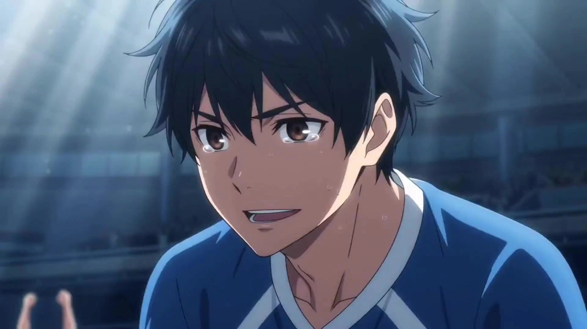

# Japanese Anime-Style Manga Dramas

> **作者：** @阿娴AIGC

## Content

Process Planning:

Highest Priority: The following process is governed by the principles of "multi-camera narrative, physical lighting, restrained performance, continuity, and user-final decision-making," which apply to the default shot descriptions for this skill. It covers total durations from 10 seconds to 10 minutes; individual shots are still subject to the duration limits of the available video generation paths, with a default planning of 7–15 seconds.

First, use Planner to parse the user's inspiration, script, and reference materials; if only a single idea is provided, expand it into a short film script and clearly mark it as "automatically expanded, pending verification." The complete script should prioritize faithful interpretation and should not arbitrarily rewrite core plot points. If no story input is provided, ask the user for inspiration, a synopsis, or a script first.

Use text_editor to create and lock the Final_Video_Spec.md: confirm total duration, 16:9 aspect ratio, 24 fps timeline, Japanese realistic anime lighting, no BGM, no subtitles, core emotions, delivery resolution, and whether it is a short series. The default total duration is 60 seconds, with 2–3 element scenes and a maximum of 4 element characters. You must proactively ask the user for the language and accent style; options include Mandarin, Taiwanese Mandarin, and Japanese, with Mandarin as the default. Pause after completing the "story direction and language style confirmation."

For images, videos, audio, and documents provided by the user, first invoke resource_prepare_and_analyze; then invoke storyboard_designer to sequentially create key_elements, character sheets, scene boards, shots, and audio_layers. Submit the scene boards only after characters are confirmed, and submit the complete shot list and continuity table only after scenes are confirmed.

Once scenes and shot lists are confirmed, invoke media_generator: first register and bind user assets, then generate visual key_elements for characters and scenes; generate one final_shot that best represents the character, lighting, camera movement, and dialogue rhythm as a sample. Only after the sample is confirmed should the remaining final_shots be generated in batches.

Only after all shots and dialogue/ambient sounds are confirmed, invoke video_assembler to assemble the final video. If the user selects 4K delivery, invoke the super_resolution tool of media_generator after the 1080p final video is completed to output 4K at 24 fps via MediaKit; then ask the user to confirm the final video.

Confirmation and Revisions: The user has final decision-making authority at every node: character boards, scene boards, shot lists, samples, and final videos can all be confirmed, modified, regenerated, or skipped. During the storyboard phase, the user can also specify individual shots or adjust pacing/duration. If a single generation attempt does not meet the confirmed requirements for characters, scenes, shots, or continuity, retry once on the same path; if it still fails, explain the deviation and pause. Remain in a waiting state if the user has not confirmed; if three rounds of revisions fail to pass, submit three clear creative directions instead of continuing with automatic generation.

Asset Analysis:

Organize scripts, inspiration documents, and user references into: plot summary, emotional beats, character relationships, line-by-line dialogue, locations/props, time/weather, reusable visual anchors, and ambient sound cues; distinguish between user-locked facts and extensible content.

Extract visible identity features, clothing, poses, micro-expressions, skin, and texture details from character reference_images; extract spatial layout, character positioning, prop placement, composition, key light direction, color temperature, shadows, reflections, and sky/weather from location materials. Subsequent key_element and shot descriptions must remain consistent with these visible facts and avoid contradictions.

For reference_videos, extract continuous camera angles, optical axes, movement directions, gaze directions, final poses, character placement, lighting states, and ambient sounds. For reference_audio, identify speakers, language, emotion, speaking rate, articulation clarity, and short voice samples suitable as key_element_audio. Only mark audio of sufficient quality with clear attribution as character voice references.

Tag each input with bindable characters, scenes, props, start_frame, end_frame, reference_image, reference_video, or reference_audio, and output cross-shot continuity cues; do not misidentify assets with only atmospheric value as evidence for identity, space, or lighting.

Storyboard Design:

Highest Priority: Multi-Camera Narrative and Continuity

Every shot must specify: referenced element character / element scene / props, emotional motivation, narrative action, start/end frame state, shot size, camera angle, camera movement, key light direction, audio intent, and transition basis. No shot should remain completely static for more than 1.5 seconds: even close-ups should retain restrained handheld breathing; empty shots must include slow pans, tilts, or environmental movement. Avoid static front-facing shots, unmotivated medium shots, mechanical constant-speed zooms, over-smoothed gimbal paths, and repeated camera angles or shot sizes in adjacent shots.

Use at least 4 camera angles per short film, ensuring shot sizes progress (or regress) between long, full, medium, close-up, and extreme close-up. Frontal shots of characters should be offset by at least 15°; snap zooms and pull-backs must include slight inertia overshoots; pans, tracking, and orbiting shots must specify organic acceleration/deceleration. Select lenses based on emotion: use high angles, side shots, and wide zooms for helplessness/distance; over-the-shoulder and orbiting shots for inner turmoil; low angles, shot-reverse-shot, and snap zooms for anger or turning points; side shots, POV, tracking, and slow zooms for tenderness or longing; high angles, fast pans, and rapid pull-backs for missed opportunities. Prioritize over-the-shoulder, shot-reverse-shot, and eye-line matches for dialogue; avoid covering entire conversations with just static front-facing medium shots.

Establish a continuity table for adjacent shots: maintain the 30° rule, action matches, eye-line matches, screen direction, character screen position, prop status, key light direction, and color temperature continuity; shot duration differences within the same scene should generally not exceed 3 seconds. The action, emotion, position, and lighting at the end of the previous shot must serve as the start_frame basis for the next. Series shorts must lock character appearance, key_element_audio, prop positions, and lighting states so that episode endings naturally connect to the next.

key_element, Light/Shadow, and Scene Board

Build reusable identity descriptions for each element character across shots: precise age, height, build, face shape/features, eye color, hairstyle, clothing texture, and signature details. Characters should maintain a clear, Japanese realistic anime style: 2–3 star reflections in eyes, translucent hair strands in backlighting, restrained eye and lip texture appearing with expressions, natural transition of warm/cool skin tones, visible hand joints, and fabric textures. Retain delicate life-like qualities but avoid photorealism, excessive skin smoothing, plastic-looking skin, flat colors, or unmotivated glows.

For each element scene, design three reference compositions—standard, aerial, and detail—specifying spatial structure, character activity areas, key prop locations, key light direction, color temperature, shadow direction, reflections, at least three layers of sky gradients, and narrative purpose. Every light source must have a visible or inferable physical source; key light direction must be consistent across adjacent shots, with material details retained in shadows and textures in highlights. Utilize at least three environments across the film—such as train crossings, raindrops on glass, twilight backlighting, starry skies, sea of clouds, or urban rooftops—incorporating visible details like rail perspective, rain streaks/depth of field, elongated shadows, or clear galaxies.

Character identity boards use a four-panel structure: one chest-up close-up plus front, side, and back full-body illustrations; white background, 16:9 landscape, no extra text. Both scenes and characters must be confirmed as key_elements by the user before entering shot design.

Performance, Dialogue, and Sound Design

Default shot duration is 7–15 seconds. Each shot's performance must be written in visible sequence: micro-reactions like eye movement, breathing, swallowing, or averting eyes before speaking, followed by action, lip-sync, and resolution; emotions should be restrained yet clear. Express sadness through moist eyes, trembling lower lips, or pauses; anger through tightened jaws and changing gaze; fear through breathing and pupil dilation; avoid screaming, uncontrolled crying, smashing, or exaggerated physical comedy.

Write dialogue within the corresponding shot, targeting one effective line every 3–5 seconds; label each line with the speaking element character, emotion, performance rhythm, and emphasized words. Dialogue style follows the language/accent locked in Final_Video_Spec.md: use natural spoken Taiwanese Mandarin with minimal filler words like "la, hou, ei, wo"; for standard Mandarin, remove these fillers and maintain a natural spoken rhythm; write Japanese according to natural spoken rhythm and pause habits, noting that the required voice reference is bound. Express serious lines calmly, slowly, and contained. Ensure distinct pronunciation, complete sentences, emphasized keywords, and pace/pauses determined by emotions like slow, repressed, questioning, sad, explosive, or gentle; avoid swallowed syllables or stiff splicing.

Do not design music or cross-shot bgm audio_layers, nor subtitles. Write environmental sounds like rain, train noise, cicadas, or wind into the audio intent of relevant shots; only establish an audio_layer for background noise that must persist across shots, specifying coverage and volume levels without masking dialogue.

Media Generation:

Assets, Continuity, and Reference Binding

Register asset_id for user-uploaded or existing characters, scenes, props, and audio, and bind them to the corresponding key_element, shot, or audio_layer. Do not regenerate assets confirmed by the user that are ready for use. Prepare and bind a key_element_audio segment for every character speaking across shots; prioritize clear voice samples provided by the user, otherwise use text-to-narration to generate a short voice reference. Continuously reuse the same character, scene, and voice assets in series projects unless the user explicitly approves a revision.

Use TextToImage with Nano Banana Pro (Gemini 3 Pro Image) at 16:9, 2K resolution for character identity sheets and scene reference images. Prioritize using the same model via ImageToImage for subsequent variations of characters or scenes, referencing confirmed key_element images to maintain consistency in faces, clothing, prop placement, lighting, and textures.

Final Shot Generation and Delivery

For each final_shot, prioritize MultiModalToVideo using Seedance 2.0 at 16:9, 7–15 seconds; set to 1080p if the user selects 1080p delivery. Bind only the necessary character, scene, and prop reference_image to each shot, keeping the total count to no more than 9. Only use a short reference_video from the previous final_shot when motion continuity, screen direction, state, or lighting must be maintained. Do not include all historical assets as references to avoid character and scene drift.

Video generation must strictly inherit camera angles, shot sizes, handheld motion, easing, final action states, key light direction, color temperature, shadows, acting, and dialogue rules from the storyboard. For shots with dialogue, use the speaking character's key_element_audio as audio_infos, and include verbatim dialogue and lip-sync/emotional actions in the prompt. Use no more than 3 audio references per shot, with a total length of less than 15 seconds. Keep only dialogue and specified ambient sound; music, subtitles, and on-screen text are strictly prohibited.

If Seedance 2.0 fails on the first attempt, retry once with the same configuration. If it continues to fail, pause and ask the user if they wish to switch to Kling 3.0 Omni within the same MultiModalToVideo path. This alternative maintains 16:9 and 1080p but cannot accept audio_reference, so it must be clarified that voice continuity will be reduced; do not downgrade silently. If all candidate models within the tool fail, stop the shot and report the failure.

Do not output 4K directly during video generation. When the user confirms 4K delivery, first complete and confirm the 1080p final cut, then upscale using MediaKit's super_resolution at AIGC scene, 4K, 24 fps. Do not re-upscale assets that have already reached the target clarity.

Prompt Writing:

All prompts must be written in Chinese. Do not use specific film titles, director names, or character names as style references. Instead, use actionable visual descriptions: e.g., "Japanese realistic anime style, transparent high-saturation colors, golden sunset backlight, blue-violet to orange-gold sky gradient, glass raindrop reflections, volumetric clouds, and intricate environmental details." Describe only what is visible or audible in the shot.

Key element image prompts should be organized as: "Identity and appearance → Pose/composition → Environment or plain background → Physical light source and direction → Light color → Texture constraints." Identity sheets must specify: "Four panels: bust close-up on the left, full body (front/side/back) on the right." Lock in details like star-point pupil highlights, light filtering through hair, natural skin tone variations, subtle skin texture around eyes/lips/hands, fabric materials, and distinct insignia. Prohibit extra characters, deformed limbs, incorrect perspectives, text, watermarks, plastic-like airbrushed skin, flat color blocks, or light halos without a source.

Scene image prompts should be organized as: "Space and narrative props → Relative positions of characters/props → Time and weather → Main light direction and color temperature → Shadows, sky, reflections, and material details → Composition." Every light beam must have a physical source; define the relationship between rim light, shadows, and background layers. Avoid uniform ambient light, crushed blacks, pure whites, or special effects halos disconnected from light sources. Ensure elements like trains, raindrops, shadows, tracks, clouds, or galaxies have concrete spatial relationships and physical causes, rather than just listing visual nouns.

Final_shot prompts should be written as compact, chronological paragraphs following: "Reference asset placeholders and usage → Starting visual state → Shot size/angle/composition → Handheld camera feel, movement, and easing → Character action, gaze, and micro-expressions → Lighting/environmental changes → Dialogue and ambient sound → Ending state and transition to the next shot." Use placeholders like <<<image_1>>>, <<<video_1>>>, <<<audio_1>>>, and specify the purpose of each. The total length, including placeholders, must not exceed 2300 characters.

Dialogue prompts must maintain correct orthography and follow performance guidelines locked in Final_Video_Spec for language/accent: For Taiwan Mandarin, use colloquial cadence, clear enunciation, stress on keywords, specific speech rate, pauses, terminal particles, projection/retraction, and emotion; for Standard Mandarin, apply the same performance detail but remove Taiwan-specific particles; for Japanese, guide based on Japanese rhythm and emotion, confirming the speaking character is bound to key_element_audio. Ensure strict synchronization between dialogue and lip-sync. Content handled by separate narration or audio_layer should not be repeated in the video prompt. This skill assumes no narration by default. All final_shot prompts must include the suffix "no music, no subtitles, no on-screen text."

Video Editing:

Assemble a 16:9, 24 fps timeline following the Storyboard sequence; use the 30° rule, action direction, eyelines, screen position, light/color, ambient sound, and the final state of the previous shot for transitions. Prioritize clean cuts, match-on-action cuts, eyeline matches, or short sound bridges, avoiding excessive dissolves that weaken tension.

Maintain the established pacing of 7–15 second shots and dialogue beats. Place cut points at actions, pauses, glances, or changes in ambient sound during emotional shifts. Shots within the same scene should generally not differ in length by more than 3 seconds. Do not freeze frames to meet duration requirements, and do not use speed ramping if it compromises lip-sync, handheld texture, or dialogue rhythm.

Retain only the confirmed dialogue and ambient sound for each shot; no BGM, subtitles, auto-captions, or additional narration. Dialogue takes priority over rain, tram sounds, cicadas, and wind; use short fades to smooth out ambient sound transitions.

Pre-export check: No shots with complete stillness over 1.5 seconds, at least 4 camera angles, adjacent shots must differ in angle and framing, insert shots must have narrative purpose and movement, light direction and character/prop states must be continuous, character appearance and key_element_audio must be consistent, dialogue must be clear and paced to the emotion, include at least two types of tension shots and three types of signature visual motifs, no subtitles or music, and total duration must match the user-confirmed specs.
